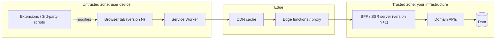
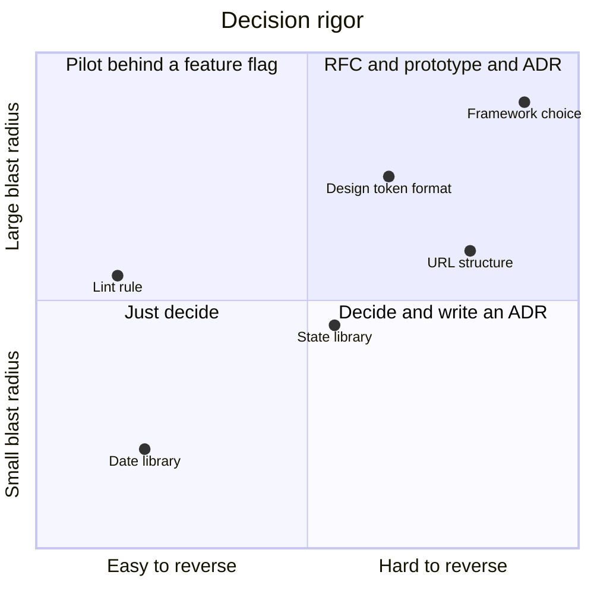
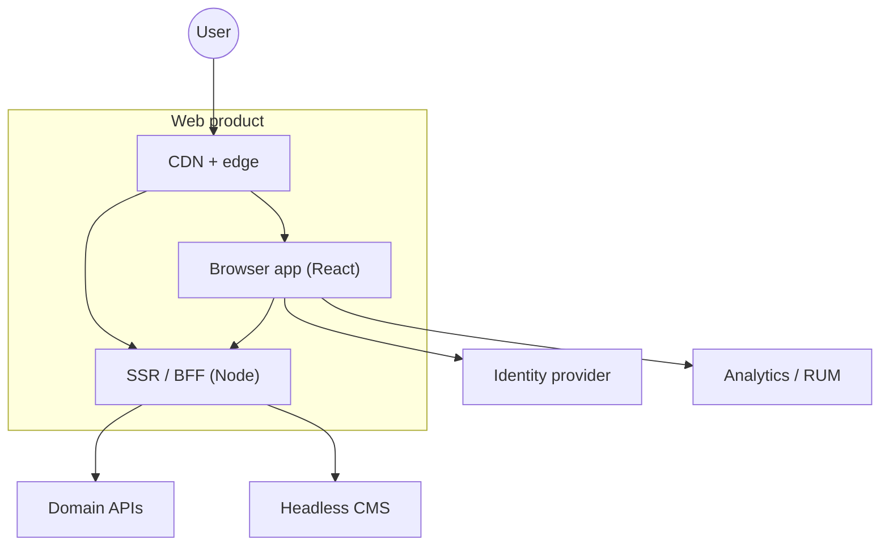

# 01 — Thinking Like a Frontend Architect

> Architecture is the set of decisions that are expensive to change. A frontend architect's job is to make fewer of those, make them later, and make them well.

**Prerequisites:** none · **Related:** [32 Rendering Strategies](32-rendering-strategy-architecture.md) · [63 Governance & ADRs](63-architecture-governance-and-adrs.md) · [72 The Principal Engineer](72-the-principal-frontend-engineer.md)

---

## TL;DR

- The frontend is **a node in a distributed system** running on hardware you don't control, over a network you don't control, in a runtime an attacker *does* control, often for days at a time, while you deploy new server code underneath it.
- Architecture work is choosing **which quality attributes matter most** for *this* product (performance, accessibility, resilience, security, evolvability, cost, velocity) and making trade-offs explicit.
- Every abstraction is paid for in one of three currencies: **bytes** (shipped to users), **milliseconds** (on their devices), or **people** (cognitive load on your teams). Name the currency.
- Classify decisions by **reversibility** (one-way vs two-way doors) and **blast radius**. Spend your rigor on one-way doors; move fast on two-way doors.
- **Boundaries are the architecture**: module boundaries, network boundaries, deploy boundaries, team boundaries, trust boundaries. Draw them deliberately.
- Turn important characteristics into **fitness functions** (automated checks in CI): bundle budgets, Web Vitals thresholds, dependency rules, a11y checks.
- Conway's law: your system will mirror your communication structure. Design teams and code **together**.

---

## 1. What a frontend architect actually does

| Activity | Output | Time horizon |
|---|---|---|
| Choose rendering strategy, framework, hosting | ADR, reference architecture | 3–5 years |
| Define module, package and team boundaries | Dependency rules, ownership map (CODEOWNERS) | 1–3 years |
| Set quality bars | Performance budgets, a11y standard, security baseline | Continuous |
| Build paved roads | Templates, design system, CI pipeline, platform libraries | 6–24 months |
| Review high-risk changes | Design review feedback, RFC decisions | Weekly |
| Lead migrations | Migration plan, codemods, progress dashboards | 6–36 months |
| Grow people | Mentoring, sponsorship, writing | Continuous |

A senior engineer optimizes a **feature**. A staff engineer optimizes a **system**. A principal engineer optimizes **the way many systems and teams evolve over time**.

> [!IMPORTANT]
> The most valuable architectural output is usually not code. It is a *constraint* that makes a whole class of bad decisions impossible (a lint rule, a type, a CI gate, a default in a template).

---

## 2. The frontend is a distributed system

The classic **eight fallacies of distributed computing** apply to the browser with extra force:

| Fallacy | Frontend reality |
|---|---|
| The network is reliable | Mobile networks drop, captive portals lie, requests silently stall. Design for retries, timeouts, offline states. |
| Latency is zero | A 4G RTT is 50–150 ms; satellite and congested networks are far worse. Waterfalls multiply RTTs. |
| Bandwidth is infinite | JS is the most expensive byte: it must be downloaded, parsed, compiled and executed. |
| The network is secure | Everything in the client is visible and modifiable. The client is **untrusted**. |
| Topology doesn't change | Users move between Wi-Fi and cellular; CDNs re-route; service workers intercept. |
| There is one administrator | Browser extensions, corporate proxies, ad blockers and third-party scripts all modify your runtime. |
| Transport cost is zero | Egress costs money; so does SSR compute per request. |
| The network is homogeneous | Chrome, Safari, Firefox, in-app webviews, old Android WebViews, screen readers, smart TVs. |

Two properties are unique to frontends and routinely underestimated:

### 2.1 Version skew

A user loads version **N** of your SPA at 09:00 and keeps the tab open. You deploy **N+1** at 11:00. Now:

- The client calls APIs with N's assumptions while the server runs N+1.
- Lazy chunks referenced by N may have been deleted from the CDN → `ChunkLoadError`.
- Server Actions/RPC identifiers compiled into N may no longer exist on N+1's server.

Mitigations (covered in [62 CI/CD](62-cicd-release-engineering-and-feature-flags.md)): keep old assets for days, version API contracts additively, detect stale clients and soft-reload on navigation, use platform "skew protection" when available.

### 2.2 Long-lived, stateful sessions

Server processes restart constantly; browser tabs live for days. Memory leaks, unbounded caches, stale auth tokens and stale feature-flag values accumulate. Your architecture must define **how a session ages**.



---

## 3. Quality attributes for the frontend

A **quality attribute** (or "architecture characteristic", or "-ility") is a property the system must have that isn't a feature. You can't maximise them all; they pull against each other.

| Attribute | Frontend meaning | Typical measure |
|---|---|---|
| **Load performance** | Time to useful content | LCP, TTFB, FCP (p75 field) |
| **Runtime responsiveness** | Interactions feel instant | INP (p75), long tasks, LoAF |
| **Visual stability** | Nothing jumps | CLS |
| **Accessibility** | Usable with keyboard, screen reader, zoom, low vision | WCAG 2.2 AA conformance, audit defects |
| **Resilience** | Degrades gracefully under partial failure | Crash-free sessions, error-boundary hit rate |
| **Security & privacy** | No XSS, no token theft, minimal data exposure | CSP violations, pen-test findings, dependency CVEs |
| **Evolvability** | Cheap to change safely | Lead time for changes, change failure rate |
| **Testability** | Confidence without fragility | Flake rate, test runtime, escaped defects |
| **Observability** | You know what users experience | RUM coverage, MTTD |
| **Internationalization** | Works in every locale and direction | Locales supported, pseudo-loc coverage |
| **Discoverability (SEO)** | Crawlable, shareable | Indexed pages, rich results |
| **Cost** | Compute, egress, licences, headcount | $/1k requests, CDN hit ratio |
| **Developer velocity** | Teams ship independently | Deploy frequency, PR cycle time |

### 3.1 Pick the top three

Every product has 2–3 attributes that dominate. The architecture should be *visibly shaped* by them.

| Product | Dominant attributes | Architectural consequences |
|---|---|---|
| E-commerce storefront | Load performance, SEO, experimentation velocity | Server rendering + edge caching, strict JS budgets, flag-driven experiments, image pipeline |
| Internal analytics dashboard | Data correctness, density, developer velocity | SPA is fine, strong server-state cache, virtualization, typed API contracts |
| Online banking | Security, accessibility, resilience | BFF with HttpOnly cookies, strict CSP, conservative dependencies, audited components |
| Collaborative editor | Real-time correctness, offline, responsiveness | CRDTs, local-first storage, workers, careful rendering performance |
| Media/news site | LCP, SEO, ad revenue vs CLS | Static/ISR, third-party governance, reserved ad slots |

> [!TIP]
> In a design review, ask: "What are the top three quality attributes for this system, and where in the design do I see them?" If nobody can answer, the design isn't finished.

---

## 4. The three currencies: bytes, milliseconds, people

Every abstraction has a cost. Name it.

- **Bytes.** 100 KB of compressed JavaScript costs far more than 100 KB of image. It decompresses to roughly 300–500 KB, then must be parsed, compiled and executed on the main thread, and it delays interactivity. On a mid-tier Android this can mean hundreds of milliseconds of main-thread work.
- **Milliseconds.** Runtime work: rendering, reconciliation, layout, effects, hydration, network round trips.
- **People.** Cognitive load: how many concepts a new engineer must learn, how many ways there are to do the same thing, how many teams must coordinate to ship.

Examples:

| Choice | Bytes | Milliseconds | People |
|---|---|---|---|
| Add a runtime CSS-in-JS library | +12–30 KB | style injection at render | low (familiar) |
| Adopt micro-frontends | duplicated deps unless shared carefully | extra network + bootstrap | **high**: contracts, versioning, platform team |
| Adopt React Server Components | **less** client JS | server round trips for navigation | **high**: new mental model, new trust boundary |
| Add a global state library | +1–15 KB | depends on selector discipline | medium |
| Write a custom framework layer | varies | varies | **very high**: you own it forever |

---

## 5. Decision-making under uncertainty

### 5.1 One-way vs two-way doors

| | Two-way door (reversible) | One-way door (irreversible-ish) |
|---|---|---|
| Examples | Choosing a date library, a lint rule, a folder layout inside one package | Rendering model, framework, URL structure (SEO), auth architecture, public API contracts, data model of local-first sync |
| Process | Decide quickly, document lightly, revisit later | RFC, prototypes, explicit alternatives, sign-off, ADR |
| Failure mode | Over-analysis paralysis | Under-analysis that locks you in for years |

### 5.2 Blast radius and reversibility matrix



### 5.3 Make decisions *later*, but not *too late*

The "last responsible moment" is the point where delaying further eliminates good options. Techniques to buy time:

- **Hide decisions behind seams:** an internal `http` client wrapper, a `useFeatureFlag` hook, a `track()` analytics facade. You can swap the implementation later.
- **Prototype the riskiest assumption first** (e.g., "can we hydrate this page under 200 ms INP on a Moto G Power?").
- **Use feature flags** to run competing implementations in production.

### 5.4 Weighted decision matrix

For one-way doors, make the scoring explicit, so disagreements are about weights (values) rather than vibes:

| Criterion (weight) | Next.js | React Router v8 (framework) | Vite SPA |
|---|---|---|---|
| SEO / LCP (5) | 5 | 4 | 2 |
| Team familiarity (3) | 4 | 3 | 5 |
| Hosting flexibility (3) | 3 | 5 | 5 |
| Complexity / cognitive load (4) | 2 | 3 | 5 |
| Ecosystem / hiring (2) | 5 | 4 | 4 |
| **Weighted total** | **3.8** | **3.8** | **4.0** |

The numbers matter less than what the exercise produces. It shows you what you actually value, and it puts that in writing.

---

## 6. Levels of frontend architecture

Use a C4-style zoom to keep conversations at the right altitude:

| Level | Questions | Artifacts |
|---|---|---|
| **System context** | Who uses it? What other systems does it touch (IdP, payments, analytics, CMS)? | Context diagram |
| **Containers** | Browser app, SSR/BFF, CDN, edge functions, service worker, mobile webviews | Container diagram, deployment diagram |
| **Components** | Routing, data layer, state, design system, feature modules | Module dependency graph |
| **Code** | Component APIs, hooks, types | Code, Storybook, typed contracts |



---

## 7. Boundaries are the architecture

| Boundary | Questions | Enforced by |
|---|---|---|
| **Module** | Which code may import which? What is the public API of a feature? | `exports` maps, ESLint boundaries rules, dependency-cruiser, Nx module boundaries |
| **Network** | What runs on server vs client? Where are the round trips? | RSC boundaries, BFF, API schemas |
| **Deploy** | What can ship independently? | Separate pipelines, micro-frontends, versioned packages |
| **Team** | Who owns what? Who must coordinate? | CODEOWNERS, team topologies |
| **Trust** | Where does untrusted input enter? Where are secrets? | Validation at boundaries, CSP, server-only modules, taint APIs |
| **Failure** | What fails together? | Error boundaries, Suspense boundaries, circuit breakers, bulkheads |

> [!WARNING]
> The most common architectural failure in large frontends is a **missing module boundary**. Without one, every feature imports every other feature's internals, and the codebase becomes a single connected component that cannot be split, owned or migrated.

---

## 8. Fitness functions: architecture you can test

From *Building Evolutionary Architectures*: a **fitness function** is an objective, automated check of an architecture characteristic.

| Characteristic | Fitness function | Where it runs |
|---|---|---|
| Bundle size | `size-limit` / bundle analyzer budget per route | PR CI |
| Load performance | Lighthouse CI budgets on key templates; RUM p75 LCP alert | CI + production |
| Responsiveness | RUM p75 INP alert per route | Production |
| Module boundaries | `eslint-plugin-boundaries`, Nx `enforce-module-boundaries`, dependency-cruiser | PR CI |
| Accessibility | axe in component tests + Playwright; lint (`jsx-a11y`) | PR CI |
| Security | `npm audit`/OSV scan, lockfile lint, CSP report monitoring | CI + production |
| Type safety | `tsc --noEmit` with strict flags; ban `any` growth (ratchet) | PR CI |
| Dependency hygiene | Renovate with policy; ban duplicate React copies | Scheduled |

**Ratchets** are especially powerful in legacy codebases: "the number of `any`s / ESLint disables / legacy imports may only go down."

```ts
// scripts/ratchet.ts: fail CI if a metric regresses vs the committed baseline
import { readFileSync } from 'node:fs';

type Metrics = Record<string, number>;
const baseline: Metrics = JSON.parse(readFileSync('ratchet.json', 'utf8'));
const current: Metrics = JSON.parse(process.argv[2]);

const regressions = Object.entries(current).filter(
  ([key, value]) => value > (baseline[key] ?? Infinity),
);

if (regressions.length) {
  console.error('Ratchet regressions:', regressions);
  process.exit(1);
}
```

---

## 9. Conway's law and team topologies

> "Organizations which design systems are constrained to produce designs which are copies of the communication structures of these organizations." (Melvin Conway, 1968)

Applied to frontends:

- One web app, twelve teams, one deploy pipeline → **coordination becomes the bottleneck** (merge queues, release trains, shared ownership of everything).
- Splitting the app into twelve independently deployed micro-frontends → **integration becomes the bottleneck** (contracts, duplicated deps, inconsistent UX).
- The usual sweet spot is a **modular monolith** with strong module boundaries, plus independent deploys only where team autonomy really pays for the integration cost.

*Team Topologies* vocabulary helps:

| Team type | Frontend example |
|---|---|
| Stream-aligned | Checkout team, Search team: own features end to end |
| Platform | Web platform team: build tooling, CI, design system infrastructure, observability |
| Enabling | Accessibility or performance guild that coaches teams |
| Complicated subsystem | Rich-text editor team, video player team, map rendering team |

> [!TIP]
> Use the **inverse Conway manoeuvre** on purpose. If you want a shared design system to succeed, fund a team that owns it. If you want teams to own their features end to end, give them ownership of routes, pipelines and on-call for those routes.

---

## 10. Architectural smells in frontends

| Smell | Symptom | Usual root cause | Remedy |
|---|---|---|---|
| God component | 1,500-line `Dashboard.tsx` | No composition boundaries | Extract by responsibility; compound components |
| Prop drilling through 6+ layers | Unrelated components pass `user` along | State lives in the wrong place | Colocate state, use composition (`children`), or context |
| Global store as a junk drawer | Everything in Redux, including server data and form state | No state taxonomy | Split by state type ([28](28-state-and-data-ownership-architecture.md)) |
| Effect chains | `useEffect` sets state that triggers another effect | Imperative thinking | Derive during render; event handlers ([13](13-effects-and-synchronization.md)) |
| Duplicated server state | Same entity fetched and cached in 3 places | No server-state cache | TanStack Query / RSC ([30](30-server-state-and-data-fetching.md)) |
| Barrel-file bloat | Importing one icon pulls in 2 MB in dev, breaks tree-shaking | `index.ts` re-exporting everything | Direct imports; `sideEffects: false`; package `exports` |
| `utils/` black hole | 400 unrelated helpers, everyone depends on it | No ownership | Move helpers next to their callers, or into owned packages |
| Coupled deploys | Feature A can't ship because feature B's tests fail | Shared pipeline without isolation | Affected-only CI, ownership, merge queues |
| Framework-in-a-framework | A homegrown "platform" wrapping React with its own lifecycle | Over-abstraction | Thin wrappers at seams only |

---

## 11. Running a design review

Questions that catch most problems:

1. **Context.** What problem are we solving, for whom, and how will we know it worked?
2. **Quality attributes.** What are the top three, and how does this design serve them?
3. **Alternatives.** What did you consider and reject, and why?
4. **Boundaries.** What's server and what's client? What's the trust boundary? Who owns each module?
5. **Data.** Where does each piece of state live? What's the source of truth? How is it invalidated?
6. **Failure.** What happens when the API is slow? When it errors? When the user is offline? When the deploy changes underneath them?
7. **Performance.** What's the JS cost per route? Where are the waterfalls? What's the INP risk?
8. **Accessibility and i18n.** Keyboard, screen reader, zoom, RTL, long translations?
9. **Security.** Untrusted input? Tokens? Third parties? New dependencies?
10. **Operability.** How will we observe it? What's the rollout and rollback plan?
11. **Reversibility.** If we're wrong, what does it cost to undo?

---

## Architect's checklist

- [ ] Top three quality attributes are named and visible in the design
- [ ] One-way-door decisions have an ADR with rejected alternatives
- [ ] Module boundaries are enforced by tooling, not convention
- [ ] Every piece of state has a named home and a source of truth
- [ ] Failure modes (slow, error, offline, version skew) are designed, not discovered
- [ ] Budgets exist for JS per route, LCP, INP, CLS, and they run in CI or RUM alerts
- [ ] Ownership is explicit (CODEOWNERS) and matches team structure
- [ ] There is a rollout and rollback plan (flags, canaries)
- [ ] New dependencies were evaluated (maintenance, size, security, licence)

---

## Interview angles

**Q1. How do you decide what to optimise for in a new frontend?**
Start from the product and its users, not the stack. Identify the 2–3 dominant quality attributes (for a storefront: LCP/SEO, conversion reliability, experimentation velocity). Turn them into measurable targets (p75 LCP < 2.5 s on mid-tier mobile), then pick the architecture that makes those targets the default rather than a heroic effort. Then automate the targets as fitness functions.

**Q2. What is version skew and how do you handle it?**
Clients run old code against new servers because tabs stay open across deploys. The symptoms are chunk-load errors, failed RPC calls and contract mismatches. Handle it by keeping old immutable assets available for a long window, making API changes additive and versioned, catching chunk-load errors and reloading on the next navigation, using framework skew protection where available, and monitoring client version distribution in RUM.

**Q3. Tell me about an architectural decision you would make differently.**
Structure the answer as: the context, the options you weighed, the decision, the signal that it was wrong, how you reversed or contained it, and what you'd now do upfront (e.g., "we adopted runtime CSS-in-JS before RSC existed; it blocked our server-components migration; today I'd choose a zero-runtime approach and hide styling behind design-system components so the implementation is swappable").

**Q4. Monolith or micro-frontends for 10 teams?**
Default to a modular monolith with enforced boundaries, affected-only CI and per-team ownership. Go to micro-frontends only when independent *deployment* is the bottleneck, teams have genuinely separate release cadences or tech stacks, and you can afford a platform team to own integration. The cost is paid in consistency, performance (duplicated runtime) and operational complexity.

**Q5. How do you make architecture stick across 100 engineers?**
Through constraints and paved roads, not documents alone: templates that start projects correctly, lint rules and types that encode decisions, CI gates (fitness functions), a design system that makes the accessible thing the easy thing, and ADRs that explain *why*, so people can make consistent decisions you never see.

---

## Further reading

- Mark Richards & Neal Ford, *Fundamentals of Software Architecture* (O'Reilly)
- Neal Ford, Rebecca Parsons, Patrick Kua, *Building Evolutionary Architectures*, 2nd ed.
- Matthew Skelton & Manuel Pais, *Team Topologies*
- Simon Brown, *The C4 model*: <https://c4model.com>
- Dan McKinley, *Choose Boring Technology*: <https://boringtechnology.club>
- Michael Nygard, *Documenting Architecture Decisions*: <https://cognitect.com/blog/2011/11/15/documenting-architecture-decisions>
- web.dev, *Web Vitals*: <https://web.dev/articles/vitals>

---

[Index](README.md) · [Next: 02 — How Browsers Render →](02-browser-rendering-pipeline.md)
