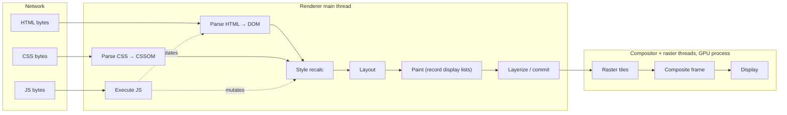
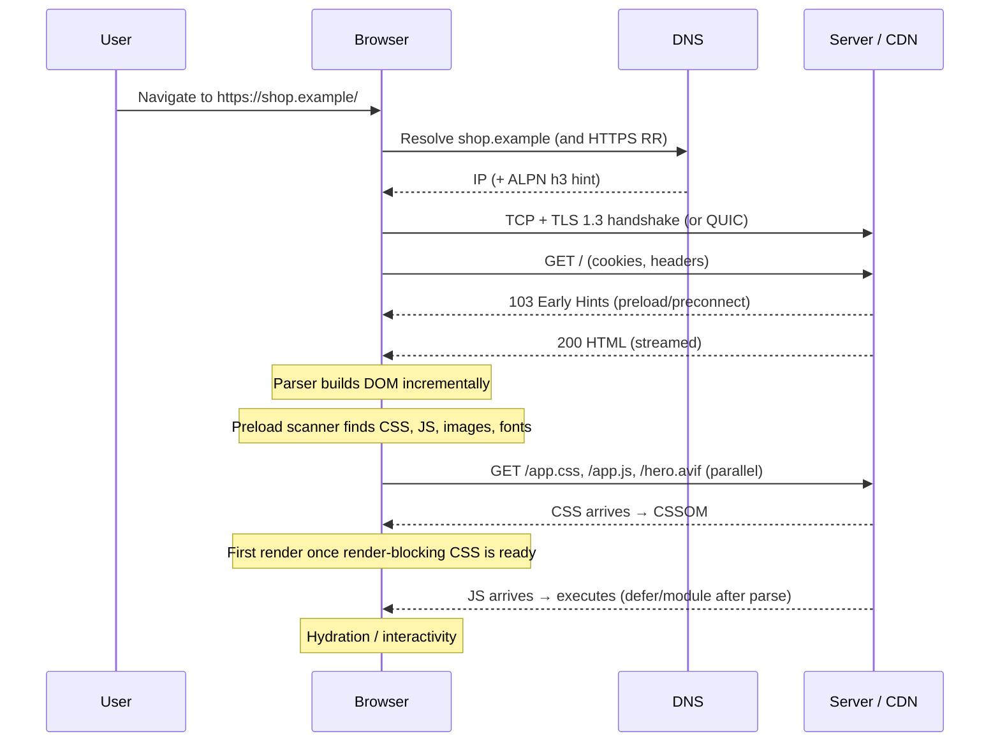
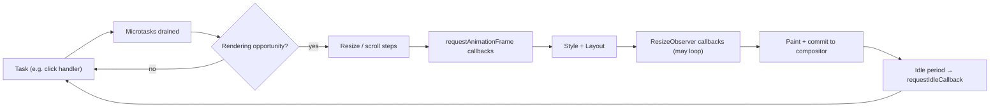

# 02 — How Browsers Render

> Every frontend performance problem eventually becomes one of four questions: *What blocked the parser? What blocked the main thread? What forced layout? What couldn't be composited?*

**Prerequisites:** [01](01-thinking-like-a-frontend-architect.md) · **Related:** [03 JS Runtime](03-javascript-runtime-and-engine.md) · [38 React Performance](38-react-performance-engineering.md) · [39 Core Web Vitals](39-web-performance-and-core-web-vitals.md)

---

## TL;DR

- The pipeline is **Parse → Style → Layout → Paint → Composite**. HTML builds the DOM, CSS builds the CSSOM, style calculation combines them, layout computes geometry, paint records drawing commands, and the compositor rasterises layers and produces frames, largely off the main thread.
- **CSS is render-blocking**. **Classic `<script>` is parser-blocking**, and it also waits for pending CSS. `defer` and `type="module"` scripts execute in order after parsing; `async` scripts execute as soon as they arrive.
- The **preload scanner** discovers resources in the HTML before the parser reaches them. Resources hidden in JS, CSS or client-rendered markup can't be discovered early, which is the classic LCP killer.
- A frame at 60 Hz is **~16.7 ms**, at 120 Hz **~8.3 ms**. A task over **50 ms** is a *long task*; it delays input handling and painting, which is what INP measures.
- **Layout thrashing** happens when you interleave DOM writes with reads of layout properties, forcing synchronous layout. Batch reads, then writes.
- `transform` and `opacity` animations can run on the **compositor thread** without layout or paint; animating `top`, `width` or `height` cannot.
- `content-visibility: auto` and CSS containment let the browser skip work for off-screen subtrees. They are a cheap, powerful tool for long pages.

---

## 1. The mental model: a pipeline with threads



Key insight: **only the main thread runs your JavaScript, style, layout and paint recording.** Scrolling, `transform`/`opacity` animations and rasterisation can happen on other threads, *if you let them*. Much of rendering performance comes down to keeping the main thread free and keeping animations on the compositor.

In Chromium's architecture (RenderingNG), the renderer process has a main thread and a compositor thread, raster work is done by worker threads, and the GPU process (Viz) aggregates compositor frames from multiple renderers and draws them.

---

## 2. From URL to first pixel



Steps worth knowing in detail:

1. **Navigation start**: the browser may already have a prefetched or prerendered page (Speculation Rules), or a page in the **back/forward cache** (bfcache), in which case it is instant.
2. **Connection**: DNS, then TCP+TLS (2–3 RTT on TLS 1.2, 1 RTT on TLS 1.3, potentially 0-RTT on QUIC resumption).
3. **TTFB**: server think time + network. Streaming HTML lets the browser start before the full response.
4. **Parsing** is incremental: the parser can build DOM from the first chunk.
5. **First paint** requires the DOM so far plus all render-blocking CSS.

---

## 3. Parsing, blocking, and the preload scanner

### 3.1 What blocks what

| Resource | Blocks parsing? | Blocks rendering? | Executes when? |
|---|---|---|---|
| `<link rel="stylesheet">` | No (but blocks later sync scripts) | **Yes** | n/a |
| `<link rel="stylesheet" media="print">` | No | No (unless media matches) | n/a |
| `<script>` (classic, sync) | **Yes** | Yes (indirectly) | Immediately, after pending CSS is loaded |
| `<script defer>` | No | No | After parsing, **in document order**, before `DOMContentLoaded` |
| `<script async>` | No (pauses parser only while executing) | No | As soon as downloaded, **any order** |
| `<script type="module">` | No (deferred by default) | No | After parsing, in order (with `async`: ASAP) |
| `<link rel="modulepreload">` | No | No | Fetches and compiles module graph early |
| Inline `<script>` | **Yes** | — | Immediately (after pending CSS) |
| `` | No | No | Decode async-ish; affects LCP |
| Web fonts | No | Text may be invisible (FOIT) depending on `font-display` | n/a |

> [!NOTE]
> Why does a sync script wait for CSS? Because the script might read computed style (`getComputedStyle`), and it has to see the correct value. So a slow stylesheet ahead of a sync script blocks the parser too.

`blocking="render"` on `<script>`, `<link>` or `<style>` explicitly marks a resource render-blocking. It's useful for critical client-side theming (to avoid a flash of the wrong theme) but dangerous if overused.

### 3.2 The preload scanner

While the main parser is blocked (say, executing a sync script), a lightweight **preload scanner** reads ahead in the raw HTML and starts fetching `src`/`href` resources it finds. This is one of the most important performance features in browsers, and SPAs routinely defeat it:

| Pattern | Discoverable by preload scanner? |
|---|---|
| `` in server HTML | ✅ |
| `` / `<picture>` in server HTML | ✅ |
| CSS `background-image: url(hero.jpg)` | ❌ (needs CSSOM + style) |
| Image rendered by client-side React | ❌ (needs JS to download and execute) |
| `` above the fold | ✅ discovered but **deprioritised and deferred** |
| Font referenced in CSS `@font-face` | ❌ until CSS is parsed and text uses it → use `preload` |
| Dynamic `import()` | ❌ → use `modulepreload` for critical chunks |

> [!WARNING]
> The single most common LCP mistake: the hero image is rendered by client-side JS, is a CSS background, or has `loading="lazy"`. Put the LCP image in server-rendered HTML, eager, with `fetchpriority="high"`.

```html
<!-- LCP hero done right -->
<link rel="preconnect" href="https://img.cdn.example" />

```

---

## 4. Style calculation

The browser matches every element against CSS rules to compute final styles.

- Selectors are matched **right to left**: `.nav a span` first finds all `span`s, then checks ancestors.
- Cost is roughly *(elements affected) × (rules to check)*. Modern engines use bloom filters, rule hashing by rightmost compound and style sharing, so selector micro-optimisation rarely matters. **The number of elements invalidated matters far more.**
- **Style invalidation**: changing a class on `<body>` can invalidate styles for the whole tree. Changing a class on a leaf is cheap.
- `:has()` is powerful but can create broad invalidation (a change in a child can restyle ancestors). Engines optimise common cases; still, avoid `:has()` on huge, frequently mutated subtrees.

**Tools:** DevTools Performance panel → "Recalculate Style" events show elements affected. In Chromium, *Selector stats* in the Performance panel helps find expensive selectors.

---

## 5. Layout (reflow)

Layout computes the geometry (position, size) of every box. It is often the most expensive main-thread phase in complex UIs.

### 5.1 Forced synchronous layout and layout thrashing

Normally, the browser batches layout until the next frame. But **reading** a layout-dependent property after a **write** forces it to compute layout *right now*:

```ts
// ❌ Layout thrashing: N forced layouts
for (const el of items) {
  el.style.width = `${el.parentElement!.offsetWidth / 2}px`; // read → write → read → write…
}

// ✅ Batch reads, then writes: 1 layout
const widths = items.map((el) => el.parentElement!.offsetWidth); // all reads
items.forEach((el, i) => (el.style.width = `${widths[i] / 2}px`)); // all writes
```

Common properties and methods that force layout: `offsetTop/Left/Width/Height`, `clientTop/Width/…`, `scrollTop/Width/…` (reading and setting), `getBoundingClientRect()`, `getClientRects()`, `getComputedStyle()` (for layout-dependent values), `innerText`, `focus()` (may scroll), `scrollIntoView()`, `elementFromPoint()`, `window.innerHeight/innerWidth` in some cases.

> [!TIP]
> In React, `useLayoutEffect` runs synchronously after DOM mutation and before paint. Measuring there is correct (to avoid flicker), but **every read forces layout**. Measure once, store it, and don't measure in a loop over hundreds of components. Prefer `ResizeObserver`, which delivers sizes asynchronously, batched per frame.

### 5.2 Layout scope

- Changing geometry of one element can invalidate its ancestors, siblings and descendants (e.g., text wrapping in a flex row).
- **CSS containment** limits the scope:

```css
.card {
  contain: layout paint style; /* changes inside don't affect outside */
}

.feed-item {
  content-visibility: auto;          /* skip layout/paint when off-screen */
  contain-intrinsic-size: auto 320px; /* placeholder size to avoid scrollbar jumps */
}
```

`content-visibility: auto` can cut initial rendering work dramatically on long pages (feeds, docs, comment threads). The browser skips style, layout and paint for off-screen content until it nears the viewport. It is Baseline as of 2024 (Safari 18). It also keeps find-in-page and accessibility working, unlike JS virtualisation.

---

## 6. Paint and compositing

**Paint** records drawing operations (display lists) for each layer; **raster** turns them into pixels (tiles), often on the GPU; **composite** assembles layers into a frame.

### 6.1 Which property changes trigger which phases

| Change | Style | Layout | Paint | Composite |
|---|---|---|---|---|
| `width`, `height`, `top`, `left`, `margin`, `padding`, `font-size`, adding/removing DOM | ✅ | ✅ | ✅ | ✅ |
| `color`, `background-color`, `box-shadow`, `border-radius`, `visibility` | ✅ | — | ✅ | ✅ |
| `transform`, `opacity` (on a composited layer) | ✅ | — | — | ✅ |
| `filter`, `clip-path` | ✅ | — | depends | often ✅ |

This is why the canonical advice is: **animate `transform` and `opacity`**. On a layer that's already composited, the compositor thread can run these animations even while the main thread is busy.

```css
/* ✅ compositor-friendly slide-in */
.panel {
  transform: translateX(-100%);
  transition: transform 200ms ease-out;
}
.panel[data-open='true'] {
  transform: translateX(0);
}
```

### 6.2 Layers: useful, but not free

Elements get their own compositing layer for reasons like 3D transforms, `will-change: transform`, video, canvas, fixed positioning (sometimes), or overlap with another layer ("layer squashing" limits explosions).

- **Benefit:** isolated repaint, cheap transform/opacity animation.
- **Cost:** GPU memory per layer (width × height × 4 bytes, plus tiles), and layerisation overhead. Hundreds of layers on a low-end device cause jank and even crashes.

> [!WARNING]
> `* { will-change: transform; }`, or putting `will-change` on every list item, is a well-known way to exhaust GPU memory. Apply `will-change` just before an animation and remove it afterwards, or only on a handful of elements.

### 6.3 Scrolling and passive listeners

Scrolling is handled on the compositor thread **unless** a non-passive `touchstart`/`touchmove`/`wheel` listener might call `preventDefault()`. Then the compositor must wait for the main thread.

```ts
// ✅ tell the browser you won't call preventDefault
window.addEventListener('touchmove', onTouchMove, { passive: true });
```

Chromium treats document-level touch and wheel listeners as passive by default; explicit `{ passive: true }` remains best practice for element-level listeners.

---

## 7. The frame and the event loop's rendering steps



- At 60 Hz the budget is ~16.7 ms per frame, and the browser needs part of it, so your JS realistically gets **~10 ms**. At 120 Hz the budget halves.
- `requestAnimationFrame` callbacks run **before** style/layout in the next frame. Do visual writes there.
- `ResizeObserver` callbacks run after layout. If they cause more layout changes, the browser re-runs layout (with a depth limit, producing the infamous "ResizeObserver loop completed with undelivered notifications" error).
- `requestIdleCallback` runs when the frame has spare time; it is not guaranteed to run soon (use the `timeout` option).

### 7.1 Long tasks, LoAF and INP

- A **long task** is any task > 50 ms. It blocks input handling and rendering.
- The **Long Animation Frames API (LoAF)** reports frames delayed by more than 50 ms with script attribution (which scripts, which functions, forced layout time). It is far more useful than the Long Tasks API for diagnosing INP. Chromium shipped it in Chrome 123.
- **INP** (Interaction to Next Paint) measures from user input to the next paint, including input delay (main thread busy), processing time (your handlers) and presentation delay (style, layout, paint). See [39](39-web-performance-and-core-web-vitals.md).

```ts
// Field diagnostics for slow frames (Chromium)
new PerformanceObserver((list) => {
  for (const entry of list.getEntries() as any[]) {
    if (entry.duration > 100) {
      console.log('LoAF', entry.duration, entry.blockingDuration, entry.scripts?.map((s: any) => s.sourceURL));
    }
  }
}).observe({ type: 'long-animation-frame', buffered: true });
```

### 7.2 Breaking up work: yielding

```ts
// Yield to the main thread so input and paint can happen
async function processInChunks<T>(items: T[], work: (item: T) => void) {
  let lastYield = performance.now();
  for (const item of items) {
    work(item);
    if (performance.now() - lastYield > 8) {
      // scheduler.yield() keeps continuation priority (Chromium); fall back to a macrotask
      await ('scheduler' in globalThis && 'yield' in (globalThis as any).scheduler
        ? (globalThis as any).scheduler.yield()
        : new Promise((r) => setTimeout(r, 0)));
      lastYield = performance.now();
    }
  }
}
```

React's concurrent renderer does a version of this for rendering work ([15](15-concurrent-react-suspense-and-transitions.md)).

---

## 8. Fonts, images and layout shifts

### 8.1 Fonts

| `font-display` | Behaviour | Use for |
|---|---|---|
| `block` | Invisible text up to ~3 s (FOIT) | Icon fonts (prefer SVG instead) |
| `swap` | Fallback immediately, swap when loaded (FOUT) | Body text where branding matters |
| `optional` | Use the font only if it's available almost instantly; no late swap | Best for CLS and performance |
| `fallback` | Short block, short swap window | Compromise |

Reduce CLS from font swaps by matching fallback metrics with `size-adjust`, `ascent-override`, `descent-override` and `line-gap-override` (frameworks like `next/font` generate these automatically). Preload only the 1–2 most critical font files, self-host, and subset with `unicode-range`.

### 8.2 Images

- Always set `width`/`height` (or `aspect-ratio`) so the browser reserves space → no CLS.
- Use `loading="lazy"` for **below-the-fold** images only.
- `decoding="async"` lets decode happen off the critical path.
- Serve AVIF/WebP with `<picture>` or content negotiation; size with `srcset`/`sizes`.
- `fetchpriority="high"` on the LCP image; `fetchpriority="low"` on carousel images that aren't visible.

### 8.3 Layout shift causes

1. Images, iframes or ads without reserved space
2. Content injected above existing content (banners, cookie notices) without reserved space
3. Web fonts swapping with different metrics
4. Animating layout properties instead of `transform`
5. Client-only rendering that replaces a server-rendered skeleton with content of a different size

Shifts within 500 ms of a user input are excluded from CLS (`hadRecentInput`). That's why a click-to-expand accordion doesn't count, but an auto-expanding one does.

---

## 9. How this maps to React (and Angular)

| React behaviour | Rendering consequence | Guidance |
|---|---|---|
| Render phase (pure computation) | JS only, no DOM | Keep it cheap; memoise expensive derivations |
| Commit phase (DOM mutations) | Triggers style/layout/paint on next frame | Fewer, batched mutations; stable keys |
| `useLayoutEffect` with measurement | Forced sync layout before paint | Measure sparingly; prefer `ResizeObserver` |
| Hydration | Big main-thread task(s) | Streaming SSR + selective hydration; less client JS; RSC |
| Large lists | Many DOM nodes → expensive style/layout | `content-visibility`, virtualisation |
| Animations via state changes | Re-render + layout per frame | CSS transitions on `transform`/`opacity`, View Transitions, WAAPI |
| Concurrent rendering (transitions) | Yields to the browser between units of work | Use `startTransition` for non-urgent updates |

Angular's change detection has the same shape. Template bindings update the DOM, and OnPush/zoneless reduce how often that happens ([56](56-angular-architecture-and-dependency-injection.md)).

---

## 10. A DevTools workflow for rendering problems

1. **Reproduce on a throttled profile**: Performance panel, CPU 4× or 6× slowdown, "Fast 4G" or slower. Better yet, use a real mid-tier Android over remote debugging.
2. **Record the interaction** and look at the main thread flame chart:
   - Yellow (**Scripting**): your JS. Find the longest tasks; click into "Bottom-up" for the self time of each function.
   - Purple (**Rendering**): style and layout. Look for *Forced reflow* warnings (red triangles) with stack traces.
   - Green (**Painting**): large paint areas; check with *Rendering → Paint flashing*.
3. **Rendering tab**: Paint flashing, Layout Shift Regions, Layer borders, FPS meter, *Emulate prefers-reduced-motion*.
4. **Layers panel**: count layers and their memory; look for layer explosions.
5. **Coverage tab**: unused JS/CSS bytes on load.
6. **Performance Insights / Lighthouse**: LCP element, render-blocking resources, LCP sub-part breakdown.
7. **React Performance Tracks** (React 19.2+): the Scheduler and Components tracks in the Performance panel show React's work aligned with browser work ([38](38-react-performance-engineering.md)).

---

## Pitfalls and anti-patterns

- Lazy-loading or client-rendering the LCP image.
- Large render-blocking CSS bundles (all routes' CSS in one file).
- Third-party sync scripts in `<head>` (tag managers, A/B testing scripts that hide the page with anti-flicker snippets).
- Layout thrashing in scroll handlers; non-passive scroll and touch listeners.
- Animating `height` for accordions (use `grid-template-rows: 0fr → 1fr`, `interpolate-size: allow-keywords` where supported, or `transform: scaleY` with care).
- `will-change` everywhere → GPU memory exhaustion.
- Measuring DOM in render (in React this is also a purity violation).
- Giant DOM trees (> ~1,500 nodes is a common audit warning, but it's a smell, not a rule). The real costs are style/layout scope and memory.

---

## Architect's checklist

- [ ] LCP element is in server HTML, eager, prioritised, correctly sized
- [ ] Render-blocking CSS is minimal per route; critical CSS strategy is defined
- [ ] No sync third-party scripts in `<head>`; tag manager is governed
- [ ] Animations use `transform`/`opacity` or View Transitions; reduced motion is respected
- [ ] Long lists use `content-visibility` or virtualisation
- [ ] Fonts: self-hosted, subset, ≤2 preloads, metric-matched fallbacks
- [ ] Images: dimensions always set; responsive sources; modern formats via an image pipeline
- [ ] RUM collects LoAF/INP attribution to find main-thread offenders
- [ ] Performance testing happens on throttled or real mid-tier devices

---

## Interview angles

**Q1. Walk me through what happens between typing a URL and seeing pixels. Go deep where it matters for performance.**
DNS (possibly with an HTTPS record advertising HTTP/3), connection setup (TCP+TLS 1.3 or QUIC), request with cookies, TTFB (server and CDN), streamed HTML parsing into the DOM, the preload scanner discovering subresources, CSSOM construction (render-blocking), script execution (sync scripts block the parser and wait for CSS; defer/module run after parse), style → layout → paint → composite, then hydration making it interactive. The performance levers are TTFB (caching, edge), discoverability (preload scanner, `fetchpriority`, Early Hints), render-blocking resources, main-thread work during hydration, and image and font loading.

**Q2. Why is animating `transform` cheaper than animating `left`?**
`left` changes geometry, so every frame needs style → layout → paint → composite on the main thread. `transform` on a composited layer only changes how an already-rasterised layer is drawn, so the compositor thread can do it without main-thread involvement. It stays smooth even when JS is busy.

**Q3. What is layout thrashing and how do you fix it?**
Interleaving DOM writes with reads of layout-dependent properties forces the browser to recompute layout synchronously, possibly many times per frame. Fix it by batching all reads before all writes (FastDOM pattern), caching measurements, using `ResizeObserver`/`IntersectionObserver` instead of polling geometry, and doing visual writes in `requestAnimationFrame`.

**Q4. `async` vs `defer` vs `type="module"`?**
All three avoid blocking the parser during download. `defer` executes after parsing in document order, before `DOMContentLoaded`. `async` executes as soon as it downloads, in any order, pausing the parser while it runs, so it's good for independent scripts like analytics. Module scripts are deferred by default, support `import`, and with `async` behave like async. Critical module chunks can be fetched early with `modulepreload`.

**Q5. Our hero image LCP is 4 s but the image is only 80 KB. What do you check?**
The LCP sub-parts: TTFB, resource load *delay* (discovery), resource load duration, and element render delay. An 80 KB image with high LCP usually has a discovery or render-delay problem. Is it rendered by client JS? Lazy-loaded? A CSS background? Blocked behind render-blocking CSS or fonts? Is there a slow TTFB or a missing preconnect to the image CDN? Fixes: server-render it, `fetchpriority="high"`, preload if it's discovered late, reduce render-blocking CSS, improve TTFB.

**Q6. How does `content-visibility: auto` differ from virtualisation?**
`content-visibility` keeps all DOM nodes but lets the browser skip rendering work (style, layout, paint) for off-screen subtrees. Find-in-page, anchors and accessibility keep working, and it's one line of CSS. Virtualisation removes off-screen DOM nodes entirely, which saves memory and DOM size for huge lists (10k+ rows), at the cost of complexity and a11y and find-in-page trade-offs. Use content-visibility for long documents and feeds of moderate size, and virtualisation for massive datasets.

---

## Further reading

- Chrome for Developers, *RenderingNG* architecture series: <https://developer.chrome.com/docs/chromium/renderingng>
- Mariko Kosaka, *Inside look at modern web browser* (4 parts): <https://developer.chrome.com/blog/inside-browser-part1>
- HTML Standard, *Event loop processing model*: <https://html.spec.whatwg.org/multipage/webappapis.html#event-loop-processing-model>
- web.dev, *Optimize LCP*, *Optimize INP*, *Optimize CLS*: <https://web.dev/explore/learn-core-web-vitals>
- web.dev, *content-visibility*: <https://web.dev/articles/content-visibility>
- Paul Irish, *What forces layout/reflow*: <https://gist.github.com/paulirish/5d52fb081b3570c81e3a>
- Chrome for Developers, *Long Animation Frames API*: <https://developer.chrome.com/docs/web-platform/long-animation-frames>

---

[← Previous: 01 — Thinking Like a Frontend Architect](01-thinking-like-a-frontend-architect.md) · [Index](README.md) · [Next: 03 — The JavaScript Runtime and Engine →](03-javascript-runtime-and-engine.md)
