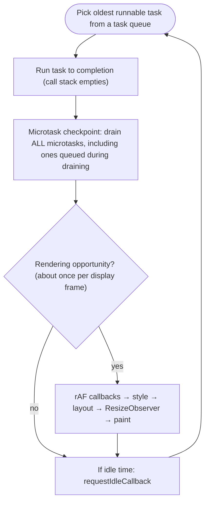
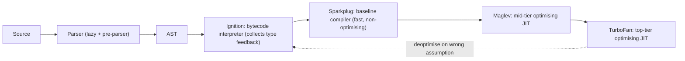

# 03 — The JavaScript Runtime and Engine

> JavaScript is single-threaded the way a restaurant with one chef is single-threaded. The kitchen still runs at speed, as long as nobody orders a dish that takes forty minutes to cook.

**Prerequisites:** [02](02-browser-rendering-pipeline.md) · **Related:** [15 Concurrent React](15-concurrent-react-suspense-and-transitions.md) · [38 React Performance](38-react-performance-engineering.md) · [74 Machine Coding](74-machine-coding-drills.md)

---

## TL;DR

- The **event loop** takes one **task** at a time (script, event, timer, message), runs it to completion, then drains **all microtasks** (promise reactions, `queueMicrotask`, `MutationObserver`), then may **render** (rAF → style → layout → paint).
- Microtasks can starve rendering: an infinite chain of promise reactions blocks paint just like a `while(true)`.
- **Closures** capture *bindings*, not values. That is the source of both their power and the "stale closure" bugs you'll meet in React hooks.
- V8 runs code through **Ignition** (interpreter), **Sparkplug** (baseline), **Maglev** (mid-tier optimiser) and **TurboFan** (top-tier optimiser). Code stays fast when object **shapes** (hidden classes) stay consistent and call sites stay **monomorphic**.
- Garbage collection is generational. Most SPA leaks are **retained references**: detached DOM, forgotten listeners and intervals, unbounded caches, closures holding big objects.
- **ESM** is static, asynchronous, with live bindings. **CJS** is dynamic, synchronous, with copied values. The interop between them is where tooling pain comes from.
- `AbortController` is the universal cancellation primitive. Design APIs that accept an `AbortSignal`.

---

## 1. The event loop, precisely



| Queue | Examples | Notes |
|---|---|---|
| **Task (macrotask) queues** | `<script>` execution, DOM events, `setTimeout`/`setInterval`, `MessageChannel`, `postMessage`, network callbacks | Browsers have *several* task queues (by source) and may prioritise user input |
| **Microtask queue** | Promise reactions (`then`/`await` continuations), `queueMicrotask`, `MutationObserver` | Drained completely after each task *and* after each callback when the stack empties |
| **Animation frame callbacks** | `requestAnimationFrame` | Run once per rendering opportunity, before style/layout |
| **Idle callbacks** | `requestIdleCallback` | Only when there's spare time; use `timeout` |

### 1.1 The canonical ordering puzzle

```ts
console.log('1 sync');
setTimeout(() => console.log('2 timeout'), 0);
Promise.resolve().then(() => console.log('3 microtask'));
queueMicrotask(() => console.log('4 microtask'));
requestAnimationFrame(() => console.log('5 rAF'));
(async () => {
  console.log('6 async body (sync part)');
  await null;
  console.log('7 after await (microtask)');
})();
console.log('8 sync');
```

Output: `1, 6, 8, 3, 4, 7, 2` and `5` (rAF comes before or after `2`, depending on when the next frame lands; it usually runs *after* the timeout in practice, but neither ordering is guaranteed).

Reasoning: synchronous code first (1, 6, 8). Then the microtask checkpoint drains in FIFO order (3, 4, 7). Then the next task (the timeout, 2), and rendering steps (rAF, 5) when the browser decides to render.

### 1.2 Microtask starvation

```ts
// ❌ This never lets the browser paint or handle input
function spin() {
  Promise.resolve().then(spin);
}
spin();
```

Chained promises don't yield to rendering. Yielding requires a **task** boundary (`setTimeout`, `MessageChannel`, `scheduler.postTask`) or `scheduler.yield()`.

### 1.3 Timers are not precise

- `setTimeout(fn, 0)` is clamped to ≥ 4 ms after 5 levels of nesting (HTML spec).
- Background tabs throttle timers (to ≥ 1 s, and Chromium applies intensive throttling to long-hidden pages).
- Timers are delayed by long tasks; they're "not before", never "exactly at".

### 1.4 Node's event loop (it matters for SSR)

Node (libuv) runs phases: **timers → pending callbacks → poll (I/O) → check (`setImmediate`) → close**. Between each callback, it drains `process.nextTick` queue first, then promise microtasks.

```ts
setTimeout(() => console.log('timeout'), 0);
setImmediate(() => console.log('immediate'));
process.nextTick(() => console.log('nextTick'));
Promise.resolve().then(() => console.log('promise'));
// nextTick, promise, then timeout/immediate (order of these two depends on context;
// inside an I/O callback, immediate always fires before timeout)
```

> [!WARNING]
> In SSR, a synchronous CPU-heavy render (e.g., `renderToString` of a huge tree) blocks the **whole Node process**, so every concurrent request waits. Prefer streaming renderers, cap page complexity, cache aggressively, and measure event-loop lag (`perf_hooks.monitorEventLoopDelay`).

---

## 2. Scheduling APIs for the main thread

| API | Runs | Use for |
|---|---|---|
| `requestAnimationFrame` | Before next paint | Visual updates, reading layout once per frame |
| `setTimeout(fn, 0)` | Next task (≥ clamping) | Crude yielding |
| `MessageChannel` | Next task, no clamping | Scheduler implementations (React's scheduler uses it in browsers) |
| `queueMicrotask` | End of current task | Batching state updates within a task |
| `requestIdleCallback` | Idle periods | Low-priority work (analytics batching, prefetch decisions) |
| `scheduler.postTask(fn, { priority })` | Task with `user-blocking`, `user-visible` or `background` priority | Prioritised work (Chromium and Firefox; check Baseline) |
| `scheduler.yield()` | Yields, then resumes with *continuation priority* | Breaking up long tasks without losing your place in line (Chromium-first; feature-detect) |

---

## 3. Scope, closures, `this` and prototypes

### 3.1 Closures capture bindings

```ts
function makeCounter() {
  let count = 0;            // binding lives in the closure's environment record
  return {
    inc: () => ++count,
    get: () => count,
  };
}
```

The classic loop bug, and why `let` fixed it:

```ts
for (var i = 0; i < 3; i++) setTimeout(() => console.log(i)); // 3 3 3: one shared binding
for (let j = 0; j < 3; j++) setTimeout(() => console.log(j)); // 0 1 2: a fresh binding per iteration
```

**React connection:** every render creates new closures over that render's props and state. An effect or callback that captured render #1's `count` keeps seeing render #1's value. That's the "stale closure" ([12](12-hooks-in-depth.md)).

### 3.2 Hoisting and the TDZ

- `var` declarations are hoisted and initialised to `undefined`.
- `let`/`const`/`class` are hoisted but **uninitialised** until their declaration runs (Temporal Dead Zone). Accessing them earlier throws `ReferenceError`.
- Function declarations are hoisted with their body.

### 3.3 `this` binding rules (in priority order)

1. `new Fn()` → `this` is the new object
2. Explicit: `fn.call(obj)`, `fn.apply(obj)`, `fn.bind(obj)`
3. Implicit: `obj.fn()` → `this === obj`
4. Default: `undefined` in strict mode (modules and classes are strict), `globalThis` in sloppy mode
5. Arrow functions don't have their own `this`; they capture the enclosing `this` lexically

```ts
class Store {
  items: string[] = [];
  add(item: string) { this.items.push(item); }
}
const s = new Store();
const add = s.add;
// add('x'); // ❌ TypeError: this is undefined (class bodies are strict)
const boundAdd = s.add.bind(s); // ✅
```

### 3.4 Prototypes

Objects delegate property lookups along `[[Prototype]]` chains. `class` is syntax over constructor functions and prototypes, plus real additions: `#private` fields, `static` blocks, and `super` semantics.

```ts
const base = { greet() { return `hi ${this.name}`; } };
const user = Object.create(base, { name: { value: 'Ada' } });
user.greet(); // 'hi Ada' found via prototype
```

---

## 4. Inside V8: why some JavaScript is fast

### 4.1 The pipeline



- **Lazy parsing**: functions are pre-parsed (syntax-checked) and only fully parsed when first called. Wrapping a function in parentheses used to be a hint to parse eagerly; modern heuristics and code caching mostly make this moot.
- **Code caching**: V8 caches compiled bytecode for scripts seen repeatedly. Stable, long-cached bundle URLs help repeat visits.
- **Type feedback**: the interpreter records the shapes and types seen at each operation. Optimising tiers speculate on that feedback and **deoptimise** if the assumptions break.

### 4.2 Hidden classes (maps) and inline caches

V8 assigns objects a hidden class describing their layout. Objects created the same way share a shape, and property access compiles to a fixed-offset load.

```ts
// ✅ Same shape: monomorphic, fast
function point(x: number, y: number) { return { x, y }; }

// ❌ Shapes diverge: polymorphic → megamorphic
const a: any = {}; a.x = 1; a.y = 2;
const b: any = {}; b.y = 2; b.x = 1;      // different insertion order → different shape
const c: any = { x: 1, y: 2 }; delete c.x; // delete → dictionary mode (slow)
```

| Call site sees… | Name | Cost |
|---|---|---|
| 1 shape | Monomorphic | Fastest |
| 2–4 shapes | Polymorphic | Slower |
| > 4 shapes | Megamorphic | Generic lookup, much slower |

Practical guidance (it matters in hot paths like render loops, parsers, virtual list math, data transforms):

- Initialise all fields in constructors or object literals, in a consistent order.
- Don't `delete` properties on hot objects; set to `undefined` or use `Map`.
- Keep arrays **packed** and of consistent element kinds (avoid holes, avoid mixing ints, doubles and objects).
- Avoid changing a function's argument types across calls in hot code.

> [!NOTE]
> Don't micro-optimise application code by folklore. Profile first. These rules matter for libraries and hot loops, rarely for event handlers.

### 4.3 Memory and garbage collection

V8's heap is **generational**:

- **Young generation** (nursery): small, collected frequently by a parallel *Scavenger* (copying collector). Most objects die young.
- **Old generation**: collected by *Mark-Compact*, with **concurrent** and **incremental** marking (Orinoco) to minimise pauses.

GC pauses show up as "Minor GC"/"Major GC" in the Performance panel. Allocation-heavy code (creating many short-lived objects per frame) causes frequent minor GCs, which can add jank to animations.

### 4.4 Memory leaks in SPAs

A leak is memory that is **reachable but no longer needed**.

| Leak source | Example | Fix |
|---|---|---|
| Detached DOM | A removed node still referenced from a JS array or closure | Drop references; use `WeakMap` keyed by node |
| Forgotten listeners | `window.addEventListener('resize', h)` in a component, never removed | Effect cleanup; `AbortController` signal |
| Intervals and timeouts | `setInterval` without `clearInterval` | Cleanup |
| Observers | `IntersectionObserver` never disconnected | `observer.disconnect()` in cleanup |
| Unbounded caches | `const cache = new Map()` at module scope, growing per request or per item | LRU with max size; `WeakMap`; TTL |
| Closures capturing large data | Event handler closure retains a 50 MB response | Capture only what's needed |
| Global stores | Every visited entity kept forever | Eviction / GC time in query caches |
| Third-party scripts | Chat widgets, analytics | Audit; lazy-load; sandbox in iframes |

```ts
// AbortController makes cleanup composable
useEffect(() => {
  const ac = new AbortController();
  window.addEventListener('resize', onResize, { signal: ac.signal });
  document.addEventListener('keydown', onKey, { signal: ac.signal });
  fetch('/api/data', { signal: ac.signal }).then(/* … */).catch(() => {});
  return () => ac.abort(); // removes both listeners and cancels the fetch
}, []);
```

**The 3-snapshot technique** in DevTools Memory panel:
1. Load the page, do the action once (warm up), take snapshot **A**.
2. Repeat the action N times, take snapshot **B**.
3. Repeat N more times, take snapshot **C**.
4. In C, view "Objects allocated between A and B" that are still alive. Things that grow linearly with N are your leak. Filter by "Detached" to find detached DOM trees.

`WeakRef` and `FinalizationRegistry` exist, but finalisers are non-deterministic. Use them only for caches and diagnostics, never for correctness.

---

## 5. Modules: ESM, CJS and the interop tax

| | ES Modules | CommonJS |
|---|---|---|
| Syntax | `import`/`export` | `require`/`module.exports` |
| Resolution | Static: analysed before execution | Dynamic: evaluated at runtime |
| Loading | Asynchronous (graph fetched, linked, evaluated) | Synchronous |
| Bindings | **Live** (importers see updates) | Copied value at require time |
| Top-level `await` | ✅ | ❌ |
| Tree-shaking | Natural (static) | Hard (dynamic) |
| `this` at top level | `undefined` | `module.exports` |
| In browsers | Native | Requires bundling |

```ts
// counter.mjs
export let count = 0;
export function inc() { count++; }

// main.mjs
import { count, inc } from './counter.mjs';
inc();
console.log(count); // 1: live binding
```

### 5.1 Circular dependencies

ESM handles cycles by linking bindings before evaluation. Accessing an import whose module hasn't finished evaluating throws a TDZ `ReferenceError` for `let`/`const`/`class`. CJS returns a *partially populated* `exports` object, which is a silent bug. In large frontends, circular imports between feature modules are an architecture smell; detect them with `madge`, dependency-cruiser or Nx graph rules.

### 5.2 Package `exports` and conditions

```json
{
  "name": "@acme/ui",
  "type": "module",
  "exports": {
    ".": {
      "types": "./dist/index.d.ts",
      "import": "./dist/index.js"
    },
    "./button": {
      "types": "./dist/button.d.ts",
      "import": "./dist/button.js"
    },
    "./package.json": "./package.json"
  },
  "sideEffects": ["**/*.css"]
}
```

- `exports` **encapsulates** the package: deep imports not listed are blocked.
- Conditions (`import`, `require`, `browser`, `node`, `react-server`, `development`, custom) let bundlers pick builds. RSC bundlers use the `react-server` condition to pick server-only builds ([18](18-react-server-components-and-server-functions.md)).
- **The ecosystem trend is ESM-only.** Node supports `require()` of synchronous ESM graphs in current LTS lines, which removed most of the reason for dual CJS/ESM packages. React Router v8, Storybook and many libraries now ship ESM-only.

> [!WARNING]
> **Dual-package hazard:** if a package ships both CJS and ESM and both get loaded, you get two copies of module state (two React contexts, two singletons). That breaks `instanceof` checks, context identity and stores in subtle ways. ESM-only packages avoid it.

### 5.3 Dynamic import and import maps

```ts
const { Chart } = await import('./chart.js'); // code-split point
```

```html
<script type="importmap">
  { "imports": { "react": "https://esm.sh/react@19.3.0" } }
</script>
```

Import maps allow bare specifiers natively in browsers (Baseline). They're used in some micro-frontend setups and build-less development ([61](61-micro-frontends-and-module-federation.md)).

---

## 6. Async patterns that scale

### 6.1 Promise combinators

| Combinator | Resolves when | Rejects when | Use |
|---|---|---|---|
| `Promise.all` | All fulfil | First rejection | Parallel required data |
| `Promise.allSettled` | All settle | Never | Best-effort batch (dashboard widgets) |
| `Promise.race` | First settles | First settles with rejection | Timeouts (prefer `AbortSignal.timeout`) |
| `Promise.any` | First fulfils | All reject (`AggregateError`) | Fastest mirror / fallback endpoints |
| `Promise.withResolvers()` | — | — | Exposes `{ promise, resolve, reject }` (ES2024) |
| `Promise.try(fn)` | — | — | Wraps sync-or-async functions uniformly (ES2025) |

### 6.2 Cancellation with `AbortSignal`

```ts
async function getJSON<T>(url: string, { signal }: { signal?: AbortSignal } = {}): Promise<T> {
  // Combine caller cancellation with a timeout
  const s = AbortSignal.any([signal ?? new AbortController().signal, AbortSignal.timeout(8000)]);
  const res = await fetch(url, { signal: s });
  if (!res.ok) throw new Error(`HTTP ${res.status}`);
  return res.json() as Promise<T>;
}
```

Design rule: **every async API in your codebase should accept an `AbortSignal`.** It composes across fetch, event listeners, streams and your own functions.

### 6.3 Concurrency control

```ts
// Run at most `limit` tasks concurrently, preserving result order
export async function mapLimit<T, R>(items: T[], limit: number, fn: (t: T) => Promise<R>): Promise<R[]> {
  if (!Number.isInteger(limit) || limit < 1) throw new RangeError(`limit must be a positive integer, got ${limit}`); // 0 would run nothing
  const results = new Array<R>(items.length);
  let next = 0;
  async function worker() {
    while (next < items.length) {
      const i = next++;
      results[i] = await fn(items[i]);
    }
  }
  await Promise.all(Array.from({ length: Math.min(limit, items.length) }, worker));
  return results;
}
```

### 6.4 Unhandled rejections

In browsers, the `unhandledrejection` event fires. In Node (since v15), unhandled rejections **crash the process** by default. Always attach handlers, and report `unhandledrejection` to your error tracker ([41](41-observability-and-diagnostics.md)).

### 6.5 Async iteration and streams

```ts
// Read a streamed response (e.g., LLM tokens or NDJSON)
const res = await fetch('/api/stream');
const reader = res.body!.pipeThrough(new TextDecoderStream()).getReader();
for (;;) {
  const { value, done } = await reader.read();
  if (done) break;
  render(value);
}
```

---

## 7. Real parallelism: workers and shared memory

- **Web Workers** run JS on separate threads with message passing (structured clone). **Transferables** (`ArrayBuffer`, `MessagePort`, `OffscreenCanvas`, `ReadableStream`) move ownership with zero copying.
- **SharedArrayBuffer + Atomics** give true shared memory, but only in **cross-origin isolated** pages (`Cross-Origin-Opener-Policy: same-origin` + `Cross-Origin-Embedder-Policy: require-corp` or `credentialless`). This is required for things like multithreaded WASM and some video and audio pipelines.
- Good worker workloads: parsing and transforming large JSON, search indexing, diffing, syntax highlighting, image processing, CRDT merges, crypto.
- Bad worker workloads: anything needing synchronous DOM access, or tiny tasks where serialisation outweighs compute.

```ts
// worker-client.ts: a minimal typed RPC over postMessage (or use Comlink)
const worker = new Worker(new URL('./search.worker.ts', import.meta.url), { type: 'module' });
let id = 0;
const pending = new Map<number, (v: unknown) => void>();
worker.onmessage = (e) => { pending.get(e.data.id)?.(e.data.result); pending.delete(e.data.id); };
export function search(query: string) {
  return new Promise<string[]>((resolve) => {
    const msgId = ++id;
    pending.set(msgId, resolve as (v: unknown) => void);
    worker.postMessage({ id: msgId, query });
  });
}
```

---

## 8. Modern language features worth using

| Feature | Since | Why it matters |
|---|---|---|
| `structuredClone()` | Baseline 2022 | Deep clone without JSON hacks (handles Dates, Maps, cycles) |
| `Array.prototype.at`, `findLast`, `toSorted`, `toReversed`, `toSpliced`, `with` | ES2022–ES2023 | Immutable array ops, great for React state |
| `Object.groupBy`, `Map.groupBy` | ES2024 | Group without lodash |
| `Promise.withResolvers` | ES2024 | Deferred pattern |
| RegExp `v` flag | ES2024 | Set notation in character classes |
| Iterator helpers (`.map`, `.filter`, `.take` on iterators) | ES2025 | Lazy pipelines without arrays |
| `Set` methods (`union`, `intersection`, `difference`, …) | ES2025 | Real set algebra |
| Import attributes / JSON modules | ES2025 | `import data from './x.json' with { type: 'json' }` |
| `Promise.try`, `RegExp.escape`, `Float16Array` | ES2025 | Small but handy |
| `Temporal` | Firefox 139, Chrome 144; **not yet Safari** (late 2026) | Correct date/time and time-zone handling ([37](37-internationalization-and-localization.md)); polyfill for now |
| Explicit Resource Management (`using`) | Shipping in Chromium and Firefox | Deterministic cleanup (`[Symbol.dispose]`) |

---

## Pitfalls and anti-patterns

- Assuming `setTimeout(fn, 0)` runs "immediately" or "next".
- Long synchronous loops on the main thread (or in SSR on the Node event loop).
- Promise chains with no `catch`, or `async` event handlers whose errors vanish.
- Module-scope mutable singletons in SSR: state leaks **between requests and users** ([18](18-react-server-components-and-server-functions.md), [43](43-frontend-security-architecture.md)).
- `JSON.parse(JSON.stringify(x))` for cloning: it drops `undefined`, Dates and Maps, and throws on cycles.
- Unbounded module-level caches (`Map`) in long-lived tabs.
- Mixing CJS and ESM copies of the same library (duplicate React, broken contexts).

---

## Architect's checklist

- [ ] Long tasks are tracked in RUM (LoAF), and budgets exist for main-thread work per interaction
- [ ] Every async API accepts `AbortSignal`; components cancel on unmount
- [ ] Global caches have bounds (LRU/TTL) and an eviction strategy
- [ ] SSR code has no request-scoped data in module scope
- [ ] Packages publish ESM with `exports` maps; no dual-package hazard for stateful libs
- [ ] Circular dependencies are detected in CI
- [ ] Heavy compute is moved to workers when it exceeds a frame budget
- [ ] Unhandled rejections are reported in browser and server

---

## Interview angles

**Q1. Explain the difference between microtasks and macrotasks, and why it matters for UI.**
After each task, the engine drains the entire microtask queue before it can render. Promise continuations are microtasks, so a long chain of them delays paint and input as surely as a sync loop. To let the browser render or handle input, you need a task boundary or `scheduler.yield()`. React's scheduler uses `MessageChannel` tasks for exactly this reason.

**Q2. What is a stale closure? Give a non-React and a React example.**
A function that captured a binding from an older scope and keeps using its old value. Non-React: a `setInterval` callback created once that logs `count` from the scope where it was defined. React: `useEffect(() => { const id = setInterval(() => setCount(count + 1), 1000); return () => clearInterval(id); }, [])` always uses the initial `count`. Fixes: functional updates (`setCount(c => c + 1)`), correct dependencies, refs for latest values, or `useEffectEvent`.

**Q3. How would you find and fix a memory leak in a long-running SPA?**
Reproduce with a repeatable action, use the 3-snapshot technique, compare retained objects, look for detached DOM trees and growing arrays and maps, follow retainer paths to the owner (a listener, closure, cache or store), fix with cleanup, `AbortController`, `WeakMap` or bounded caches, and add a regression test (an E2E test that performs the action 50× and checks `performance.memory` in Chromium, or heap snapshot diffs in CI for critical flows).

**Q4. Why might a function become slow after running fast for a while?**
Deoptimisation. TurboFan or Maglev compiled it under assumptions from type feedback (monomorphic shapes, integer math), and a later call violated them: a new object shape, a `delete`d property, a double instead of a small integer. V8 deoptimises back to bytecode and may re-optimise as polymorphic or megamorphic. Fix by keeping shapes consistent and inputs predictable, and confirm with `--trace-deopt` or profiler markers.

**Q5. ESM vs CJS: why is the ecosystem going ESM-only?**
ESM is the standard, is static (so tree-shaking and analysis work), supports top-level await and live bindings, and runs natively in browsers. The main blocker for ESM-only packages was CJS consumers, and Node's support for `require()` of ESM in current LTS releases largely removed it. ESM-only also removes the dual-package hazard and halves build and test matrices.

---

> [!TIP]
> **Runnable code:** [E03](E03-javascript-runtime-and-engine.md) has this chapter's `mapLimit`, with tests for result order, the concurrency cap and the limit guard. `node extract-examples.mjs 03` writes it out as a project; then run `npm ci` and `npm test` in it.

## Further reading

- Jake Archibald, *Tasks, microtasks, queues and schedules*: <https://jakearchibald.com/2015/tasks-microtasks-queues-and-schedules/>
- HTML Standard, *Event loops*: <https://html.spec.whatwg.org/multipage/webappapis.html#event-loops>
- V8 blog: *Maglev*, *Sparkplug*, *Fast properties*, *Trash talk (Orinoco GC)*: <https://v8.dev/blog>
- Node.js, *The Node.js Event Loop*: <https://nodejs.org/en/learn/asynchronous-work/event-loop-timers-and-nexttick>
- Chrome DevTools, *Fix memory problems*: <https://developer.chrome.com/docs/devtools/memory-problems>
- MDN, *JavaScript modules*: <https://developer.mozilla.org/en-US/docs/Web/JavaScript/Guide/Modules>
- web.dev, *Optimize long tasks* (yielding): <https://web.dev/articles/optimize-long-tasks>

---

[← Previous: 02 — How Browsers Render](02-browser-rendering-pipeline.md) · [Index](README.md) · [Next: 04 — TypeScript at Scale →](04-typescript-at-scale.md)
