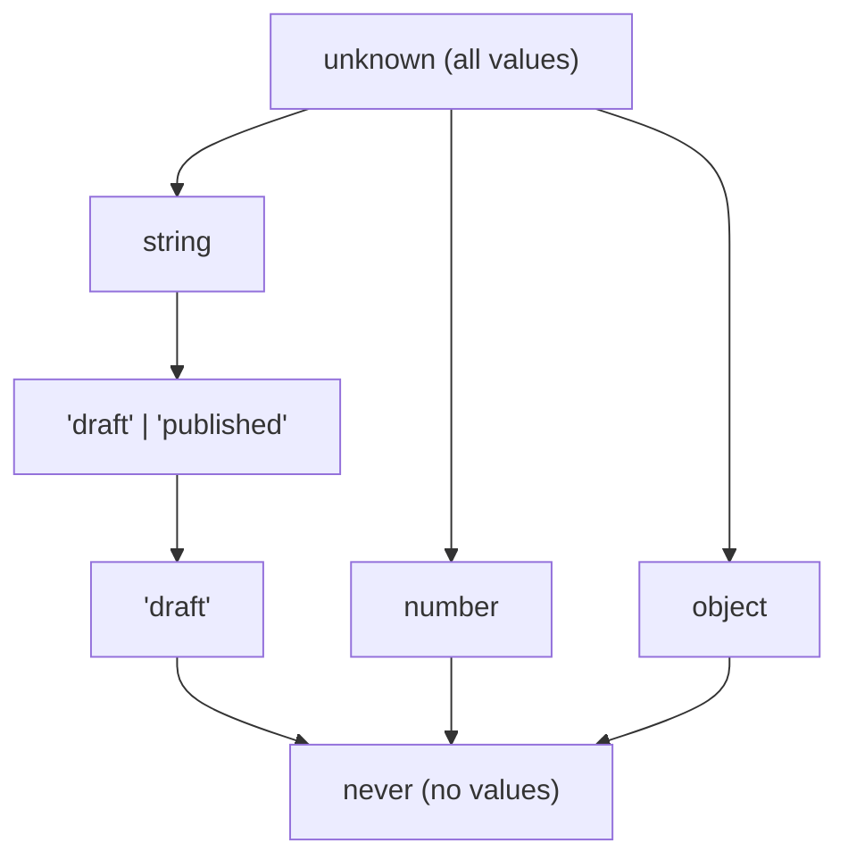

# 04 — TypeScript at Scale

> Types are the cheapest documentation you will ever write, the only documentation the compiler checks, and the most effective architecture enforcement tool in a frontend codebase.

**Prerequisites:** [03](03-javascript-runtime-and-engine.md) · **Related:** [22 Component Patterns](22-component-architecture-and-patterns.md) · [60 Monorepos & Tooling](60-monorepos-build-tooling-and-bundlers.md) · [33 API Contracts](33-api-integration-bff-and-contracts.md)

---

## TL;DR

- Think of types as **sets of values**. Assignability is the subset relation, `unknown` is the universe, `never` is the empty set, and `any` turns checking off in both directions.
- TypeScript is **structural**: shape matters, not name. Use **branded types** when you need nominal distinctions (`UserId` vs `OrderId`).
- Model domain state as **discriminated unions** so illegal states are unrepresentable. Enforce exhaustiveness with `never`.
- Types vanish at runtime. **Validate at trust boundaries** (network, storage, URL, `postMessage`) with a schema library, and infer static types from the schema.
- For scale: `strict` plus `noUncheckedIndexedAccess`, `verbatimModuleSyntax`, `moduleResolution: "bundler"`, `isolatedDeclarations` for fast parallel `.d.ts` emit, project references for big monorepos.
- **TypeScript 7.0** (July 2026) is the native Go port, roughly 10× faster. It ships **without a programmatic API until 7.1**, so tools built on the compiler API (Angular's compiler, type-aware lint, codemods) still run against **TypeScript 6.x** side by side.
- In React 19, `ref` is a regular prop, the global `JSX` namespace is gone (use `React.JSX`), and `useRef` requires an argument.

---

## 1. The mental model: types as sets



- `A extends B` asks: is set A a subset of set B?
- Union `A | B` is set union; intersection `A & B` is set intersection (for object types this *merges* properties, because more constraints mean fewer values).
- `never` is the identity element for unions: `A | never = A`.
- `any` is not a set. It is an instruction to stop checking, and it **spreads**. Prefer `unknown` plus narrowing.

### Structural typing

```ts
interface Point { x: number; y: number }
const p = { x: 1, y: 2, z: 3 };
const q: Point = p; // ✅ structurally compatible (extra props allowed when not a fresh literal)
// const r: Point = { x: 1, y: 2, z: 3 }; // ❌ excess property check on fresh object literals
```

---

## 2. Narrowing and control-flow analysis

```ts
type Shape =
  | { kind: 'circle'; radius: number }
  | { kind: 'rect'; width: number; height: number }
  | { kind: 'triangle'; base: number; height: number };

function area(s: Shape): number {
  switch (s.kind) {
    case 'circle': return Math.PI * s.radius ** 2;
    case 'rect': return s.width * s.height;
    case 'triangle': return (s.base * s.height) / 2;
    default: return assertNever(s); // compile error if a new kind is added and not handled
  }
}

function assertNever(x: never): never {
  throw new Error(`Unhandled variant: ${JSON.stringify(x)}`);
}
```

Narrowing tools, ranked by how often you should reach for them:

1. **Discriminant checks** (`s.kind === 'circle'`)
2. `typeof` / `instanceof` / `in`
3. Truthiness and equality (careful with `0` and `''`)
4. **User-defined type guards**: `function isUser(x: unknown): x is User`
5. **Assertion functions**: `function assertIsDefined<T>(x: T): asserts x is NonNullable<T>`
6. **Inferred type predicates** (TS 5.5+): `arr.filter((x) => x !== undefined)` now narrows to `T[]` automatically

### `satisfies`: check without widening

```ts
type Route = { path: string; auth: boolean };

const routes = {
  home: { path: '/', auth: false },
  account: { path: '/account', auth: true },
} satisfies Record<string, Route>;

routes.home.path;      // ✅ still knows the exact keys
// routes.missing      // ❌ error: keys are preserved, not widened to string
```

---

## 3. Make illegal states unrepresentable

```ts
// ❌ Boolean soup: 16 combinations, most of them invalid
type BadState = { isLoading: boolean; isError: boolean; data?: User; error?: Error };

// ✅ Exactly the valid states
type RemoteData<T, E = Error> =
  | { status: 'idle' }
  | { status: 'loading' }
  | { status: 'success'; data: T }
  | { status: 'error'; error: E };

function render(state: RemoteData<User>) {
  if (state.status === 'success') return state.data.name; // data guaranteed
  if (state.status === 'error') return state.error.message;
  return '…';
}
```

Apply the same idea to component props:

```tsx
type ButtonProps =
  | ({ as: 'a'; href: string } & Omit<React.ComponentProps<'a'>, 'href'>)
  | ({ as?: 'button' } & React.ComponentProps<'button'>);

function Button(props: ButtonProps) {
  if (props.as === 'a') {
    const { as: _as, ...rest } = props;
    return <a {...rest} />;
  }
  const { as: _as, ...rest } = props;
  return <button type="button" {...rest} />;
}
```

---

## 4. Generics, conditional types and mapped types

### 4.1 Generics with constraints and inference

```ts
function pluck<T, K extends keyof T>(items: readonly T[], key: K): T[K][] {
  return items.map((i) => i[key]);
}

const names = pluck([{ id: 1, name: 'Ada' }], 'name'); // string[]
```

**`const` type parameters** (TS 5.0) infer literal types without callers writing `as const`:

```ts
function defineRoutes<const T extends readonly string[]>(paths: T) { return paths; }
const r = defineRoutes(['/home', '/about']); // readonly ['/home', '/about']
```

**`NoInfer<T>`** (TS 5.4) stops inference from a parameter:

```ts
function createFSM<S extends string>(initial: NoInfer<S>, states: S[]) { /* … */ }
createFSM('idle', ['idle', 'loading']);    // ✅
// createFSM('oops', ['idle', 'loading']); // ❌ 'oops' not in S
```

### 4.2 Conditional types and `infer`

```ts
type Awaited2<T> = T extends PromiseLike<infer U> ? Awaited2<U> : T;
type ElementOf<T> = T extends readonly (infer E)[] ? E : never;

// Distributive over unions, unless wrapped in a tuple
type ToArray<T> = T extends unknown ? T[] : never;
type A = ToArray<string | number>;           // string[] | number[]
type ToArrayND<T> = [T] extends [unknown] ? T[] : never;
type B = ToArrayND<string | number>;         // (string | number)[]
```

### 4.3 Mapped types, key remapping, template literal types

```ts
type Getters<T> = { [K in keyof T as `get${Capitalize<string & K>}`]: () => T[K] };
type UserGetters = Getters<{ name: string; age: number }>;
// { getName: () => string; getAge: () => number }

// Extract route params from a path string
type Params<P extends string> =
  P extends `${string}:${infer Param}/${infer Rest}`
    ? { [K in Param | keyof Params<`/${Rest}`>]: string }
    : P extends `${string}:${infer Param}`
      ? { [K in Param]: string }
      : {};

type T1 = Params<'/orgs/:orgId/projects/:projectId'>; // { orgId: string; projectId: string }
```

> [!WARNING]
> Type-level programming is seductive. Every clever type is a maintenance cost and a compile-time cost. Put advanced types in **library and infrastructure code** (routers, form libraries, API clients) where they buy safety for many call sites, and keep application code boring.

### 4.4 Utility types you should know cold

`Partial`, `Required`, `Readonly`, `Pick`, `Omit`, `Record`, `Exclude`, `Extract`, `NonNullable`, `ReturnType`, `Parameters`, `ConstructorParameters`, `InstanceType`, `Awaited`, `NoInfer`, `Uppercase`/`Lowercase`/`Capitalize`/`Uncapitalize`.

---

## 5. Variance

- **Covariant** (output position): `Box<Cat>` is assignable to `Box<Animal>` if `Box` only *produces* values.
- **Contravariant** (input position): a handler for `Animal` can be used where a handler for `Cat` is expected.
- **Invariant**: both read and write, so neither direction is safe.

```ts
type Handler<T> = (value: T) => void;
const handleAnimal: Handler<Animal> = (a) => {};
const handleCat: Handler<Cat> = handleAnimal; // ✅ contravariance (strictFunctionTypes)
```

> [!NOTE]
> **Method syntax is bivariant** even under `strictFunctionTypes` (for historical DOM compatibility). `interface X { onChange(v: string): void }` is checked more loosely than `interface X { onChange: (v: string) => void }`. Prefer property syntax for callbacks in your own APIs.

TS 4.7 added explicit variance annotations (`interface Producer<out T>`, `interface Consumer<in T>`). They are mostly useful in library code to speed up checking and to document intent.

---

## 6. Nominal typing with brands

```ts
declare const brand: unique symbol;
type Brand<T, B extends string> = T & { readonly [brand]: B };

type UserId = Brand<string, 'UserId'>;
type OrderId = Brand<string, 'OrderId'>;
type Cents = Brand<number, 'Cents'>;

const toUserId = (s: string) => s as UserId; // only at validated boundaries

function getOrder(id: OrderId) { /* … */ }
// getOrder(toUserId('u_1')); // ❌ cannot pass a UserId where an OrderId is expected
```

Good brand candidates: IDs, money (`Cents`), validated strings (`Email`, `Slug`), sanitised HTML (`SafeHtml`), and units (`Pixels` vs `Rem`).

---

## 7. Types end at runtime: parse, don't validate

Everything arriving from outside the process (HTTP, `localStorage`, URL params, `postMessage`, `FormData`, third-party SDKs) is `unknown` until proven otherwise.

```ts
import { z } from 'zod';

export const User = z.object({
  id: z.string().brand<'UserId'>(),
  email: z.email(),
  role: z.enum(['admin', 'member', 'viewer']),
  createdAt: z.coerce.date(),
});
export type User = z.infer<typeof User>;

export async function fetchUser(id: string, signal?: AbortSignal): Promise<User> {
  const res = await fetch(`/api/users/${id}`, { signal });
  if (!res.ok) throw new Error(`HTTP ${res.status}`);
  return User.parse(await res.json()); // throws with a precise error if the contract drifted
}
```

- **Standard Schema** is a small shared interface implemented by Zod, Valibot, ArkType and others. Form and router libraries accept "any Standard Schema", so your validation library is swappable.
- Validate at the **edge of your system** once, then trust the types inside it. Don't re-validate in every component.
- For API contracts, generate types from **OpenAPI or GraphQL schemas** and validate in development and staging (or sample in production) to detect drift ([33](33-api-integration-bff-and-contracts.md)).

---

## 8. Typing React (19.x)

### 8.1 Props and DOM passthrough

```tsx
type InputProps = React.ComponentProps<'input'> & {
  label: string;
  error?: string;
};

// React 19: `ref` is just a prop. No forwardRef needed.
export function TextField({ label, error, id, ...inputProps }: InputProps) {
  const autoId = React.useId();
  const inputId = id ?? autoId;
  const errorId = `${inputId}-error`;
  return (
    <div>
      <label htmlFor={inputId}>{label}</label>
      <input
        id={inputId}
        aria-invalid={!!error}
        aria-describedby={error ? errorId : undefined}
        {...inputProps}
      />
      {error && <p id={errorId} role="alert">{error}</p>}
    </div>
  );
}
```

| Type | Use |
|---|---|
| `React.ComponentProps<'button'>` | All props of an intrinsic element (includes `ref` in React 19 types) |
| `React.ComponentPropsWithoutRef<'button'>` | Same, minus `ref` |
| `React.ComponentProps<typeof MyComponent>` | Props of a component |
| `React.ReactNode` | Anything renderable (children) |
| `React.ReactElement` | A JSX element (props default to `unknown` in React 19 types) |
| `React.JSX.Element` | The JSX expression type (the global `JSX` namespace was removed in React 19 types) |
| `React.Ref<T>` / `React.RefObject<T \| null>` | Ref types (`useRef<T>(null)` returns `RefObject<T \| null>`) |

### 8.2 Generic components

```tsx
type Column<T> = { key: keyof T & string; header: string; render?: (row: T) => React.ReactNode };

type TableProps<T> = {
  rows: readonly T[];
  columns: readonly Column<T>[];
  getRowKey: (row: T) => string;
};

export function Table<T>({ rows, columns, getRowKey }: TableProps<T>) {
  return (
    <table>
      <thead>
        <tr>{columns.map((c) => <th key={c.key} scope="col">{c.header}</th>)}</tr>
      </thead>
      <tbody>
        {rows.map((row) => (
          <tr key={getRowKey(row)}>
            {columns.map((c) => <td key={c.key}>{c.render ? c.render(row) : String(row[c.key])}</td>)}
          </tr>
        ))}
      </tbody>
    </table>
  );
}

// <Table rows={users} columns={[{ key: 'email', header: 'Email' }]} getRowKey={(u) => u.id} />
// key is checked against keyof User
```

### 8.3 Context without `null!` lies

```tsx
function createStrictContext<T>(name: string) {
  const Ctx = React.createContext<T | null>(null);
  function useStrict() {
    const value = React.useContext(Ctx);
    if (value === null) throw new Error(`use${name} must be used inside <${name}Provider>`);
    return value;
  }
  return [Ctx, useStrict] as const;
}

const [AuthContext, useAuth] = createStrictContext<{ user: User; logout(): void }>('Auth');
```

### 8.4 Polymorphic components: prefer `asChild`

Typing a generic `as` prop (`<Box as="a" href>`) correctly is notoriously expensive for the compiler and for readers. The **`asChild`/Slot pattern** (Radix, React Aria and Base UI have equivalents) composes behaviour onto a child element instead, and needs simple types ([22](22-component-architecture-and-patterns.md)).

### 8.5 Events

```tsx
const onChange: React.ChangeEventHandler<HTMLInputElement> = (e) => setValue(e.currentTarget.value);
const onSubmit = (e: React.FormEvent<HTMLFormElement>) => { e.preventDefault(); /* … */ };
```

---

## 9. `tsconfig` for large codebases

```jsonc
// tsconfig.base.json: shared by every package
{
  "compilerOptions": {
    "target": "ES2023",
    "lib": ["ES2023", "DOM", "DOM.Iterable"],
    "module": "preserve",               // TS 5.4+: let the bundler handle module format
    "moduleResolution": "bundler",
    "jsx": "react-jsx",
    "strict": true,
    "noUncheckedIndexedAccess": true,   // arr[i] is T | undefined
    "exactOptionalPropertyTypes": true, // optional ≠ "may be undefined"
    "noImplicitOverride": true,
    "noFallthroughCasesInSwitch": true,
    "verbatimModuleSyntax": true,       // explicit `import type`; predictable emit
    "isolatedModules": true,            // required by esbuild/SWC/Oxc single-file transpilers
    "erasableSyntaxOnly": true,         // TS 5.8+: no enums/namespaces/param properties
    "skipLibCheck": true,
    "resolveJsonModule": true,
    "noEmit": true
  }
}
```

| Option | Why it matters at scale |
|---|---|
| `noUncheckedIndexedAccess` | Eliminates a large class of `undefined` crashes from arrays and records |
| `exactOptionalPropertyTypes` | Distinguishes "absent" from "present but `undefined`" (matters for PATCH payloads and form state) |
| `verbatimModuleSyntax` | Type-only imports are explicit, so transpilers drop them predictably and side-effect imports stay intact |
| `isolatedModules` | Each file can be transpiled alone (Vite/Oxc/SWC/esbuild/Babel) |
| `erasableSyntaxOnly` | Code is pure "JS + types", runnable by Node's built-in type stripping and any transpiler |
| `isolatedDeclarations` | Requires explicit types on exports so `.d.ts` files can be emitted **per file, in parallel**, without type checking (big win for monorepo builds) |
| `composite` + project references | Incremental builds with enforced package boundaries (`tsc -b`) |

### 9.1 Enums: prefer `as const`

```ts
// ✅ erasable, tree-shakeable, plays well with unions
export const Role = { Admin: 'admin', Member: 'member', Viewer: 'viewer' } as const;
export type Role = (typeof Role)[keyof typeof Role]; // 'admin' | 'member' | 'viewer'
```

---

## 10. Monorepo typing strategies

| Strategy | How | Pros | Cons |
|---|---|---|---|
| **Project references** | Each package `composite: true`; root `tsc -b` | True incremental builds; boundaries enforced | Config overhead; build ordering |
| **Internal source packages** ("just-in-time") | `exports` points to `.ts`; consumers' bundler transpiles | Zero build step; instant feedback | Every consumer type-checks dependencies; slower as you grow |
| **Compiled packages** | Each package emits JS + `.d.ts` | Fast consumers; publishable | Build orchestration (Nx/Turborepo caching essential) |

```json
{
  "name": "@acme/money",
  "exports": {
    ".": {
      "types": "./src/index.ts",
      "default": "./src/index.ts"
    }
  }
}
```

Use `customConditions` (e.g., `"source"`) if you want the same package to resolve to source in the monorepo and to built output when published.

---

## 11. TypeScript 6 and 7: the native transition

- **TypeScript 6.0** (2026) is the bridge release: the last JavaScript-based compiler. It deprecates legacy options that the native port drops. Clear its deprecation warnings first.
- **TypeScript 7.0** (July 2026) is the **Go-native** compiler and language service. It is roughly 10× faster on full builds thanks to native code and shared-memory parallelism, including parallel project-reference builds.
- **No stable programmatic API until 7.1.** Anything that imports `typescript` as a library (the Angular compiler, type-aware `typescript-eslint` rules, `ts-morph` codemods, some bundler plugins, doc generators) keeps using 6.x. Microsoft publishes 6.x under an alias (`@typescript/typescript6`, binary `tsc6`) so both can be installed side by side.

```jsonc
// package.json: TS 7 for type-checking, TS 6 for API-dependent tools
{
  "devDependencies": {
    "typescript": "^7.0.0",
    "@typescript/typescript6": "^6.0.0"
  },
  "scripts": {
    "typecheck": "tsc --noEmit -p tsconfig.json"
  }
}
```

> [!TIP]
> Treat TS 7 adoption as a **CI and editor speed project**, not a language change. The type system's behaviour is meant to match 6.0. Roll out by running `tsc` (7) in CI next to the existing check for a few weeks, compare diagnostics, then switch. Frameworks are adopting it for type checking (Next.js 16.3+ can use TypeScript 7 during `next build`). Angular's compiler stays on TypeScript 6 until the API lands.

---

## 12. Keeping the type checker fast

Even with TS 7, editor latency matters on huge codebases.

- Diagnose: `tsc --extendedDiagnostics`, `tsc --generateTrace ./trace` (inspect with `@typescript/analyze-trace` or Perfetto).
- Prefer `interface X extends A, B` over `type X = A & B` for object types: interfaces are cached by name, intersections are recomputed.
- Avoid enormous unions (thousands of members) and deep recursive conditional types in hot paths.
- Annotate return types of exported functions (also required by `isolatedDeclarations`).
- Split giant files that every module imports (e.g., one `types.ts` with 5,000 lines).
- `skipLibCheck: true` (and check your own published `.d.ts` separately).

---

## 13. Testing types

```ts
import { expectTypeOf, test } from 'vitest';

test('Params extracts route params', () => {
  expectTypeOf<Params<'/a/:id/b/:slug'>>().toEqualTypeOf<{ id: string; slug: string }>();
});

// Or inline negative tests
// @ts-expect-error: OrderId is not a UserId
getOrder(toUserId('u_1'));
```

---

## 14. Migrating a large JS or loose-TS codebase

1. Turn on `allowJs` + `checkJs: false`; rename files incrementally.
2. Enable `strict` in the base config, and opt out per legacy package or per file with a ratchet (e.g., *betterer* snapshots the count of errors; it may only go down).
3. Ban new `any` with `@typescript-eslint/no-explicit-any` (warn → error), and track `any` count as a metric.
4. Type the **boundaries first** (API client, routing, stores). Inner code benefits automatically.
5. Generate types from schemas instead of hand-writing them.

---

## Pitfalls and anti-patterns

- `as` casts at random call sites (each one is a lie the compiler can't check); confine them to validated boundaries.
- Non-null assertions (`user!.name`) sprinkled to silence errors.
- `Object.keys(obj)` returns `string[]` by design (objects can have extra keys), so don't cast it to `(keyof T)[]` without thinking.
- Optional props used to model mutually exclusive variants (use unions).
- Over-generic components (`<Select<T, K extends keyof T, V extends T[K]>>`) that nobody can read.
- Hand-maintained API types that drift from the backend.
- Enums with numeric values crossing network boundaries.
- `@ts-ignore` instead of `@ts-expect-error` (the latter fails when the error disappears, so dead suppressions are caught).

---

## Architect's checklist

- [ ] Base `tsconfig` with `strict`, `noUncheckedIndexedAccess`, `verbatimModuleSyntax`, `isolatedModules`
- [ ] Runtime validation at every trust boundary, with types inferred from schemas
- [ ] API types generated from OpenAPI/GraphQL; drift detected in CI
- [ ] Domain IDs and money are branded
- [ ] Async and remote state modelled as discriminated unions
- [ ] Monorepo typing strategy chosen deliberately (references vs source vs compiled)
- [ ] TS 7 rollout plan, with API-dependent tools pinned to TS 6
- [ ] `any` and `@ts-expect-error` counts tracked as ratchets
- [ ] Type-level tests for shared library types

---

## Interview angles

**Q1. Explain `unknown` vs `any` vs `never`.**
`unknown` is the top type: every value is assignable to it, but you can't use it without narrowing, so it's safe. `never` is the bottom type with no values: it marks impossible branches and exhaustiveness checks, and it's assignable to everything. `any` disables checking in both directions and spreads through inference, so treat it as an escape hatch, not a type.

**Q2. When would you use a branded type?**
When two values share a runtime representation but must not be mixed: user IDs vs order IDs, cents vs dollars, raw vs sanitised HTML. The brand exists only at compile time, and you create branded values only at validated boundaries (parsers, constructors).

**Q3. How do you keep frontend types in sync with backend contracts?**
Make the backend schema the source of truth (OpenAPI, GraphQL SDL, protobuf), generate client types and ideally typed clients in CI, validate responses at runtime in non-production (or sample in production) to catch drift, and add contract tests ([33](33-api-integration-bff-and-contracts.md)). Hand-written duplicates always drift.

**Q4. What changes with TypeScript 7 for a large frontend org?**
Type checking and the editor become roughly an order of magnitude faster, which shortens CI and improves editor responsiveness on huge repos. But TS 7.0 has no programmatic API yet, so tools that use the compiler API (Angular's compiler, type-aware ESLint, codemods) must stay on TS 6 for now. You run both side by side, migrate CI type checks to 7, and keep tooling on 6 until 7.1.

**Q5. Why prefer discriminated unions over optional properties for component props?**
Optional properties allow invalid combinations (`href` with `onClick` on a link variant, `loading` together with `error`). Unions encode exactly the valid shapes. The compiler then narrows inside the component and errors at call sites that pass invalid combinations, so the component's contract becomes self-documenting.

---

## Further reading

- *TypeScript Handbook*: <https://www.typescriptlang.org/docs/handbook/>
- TypeScript blog, *Announcing TypeScript 7.0* (July 2026) and *TypeScript native port*: <https://devblogs.microsoft.com/typescript/>
- Alexis King, *Parse, don't validate*: <https://lexi-lambda.github.io/blog/2019/11/05/parse-don-t-validate/>
- Standard Schema: <https://standardschema.dev>
- React TypeScript Cheatsheets: <https://react-typescript-cheatsheet.netlify.app>
- TypeScript Wiki, *Performance*: <https://github.com/microsoft/TypeScript/wiki/Performance>
- Matt Pocock, *Total TypeScript* (articles): <https://www.totaltypescript.com>

---

[← Previous: 03 — The JavaScript Runtime and Engine](03-javascript-runtime-and-engine.md) · [Index](README.md) · [Next: 05 — Networking, Caching and Delivery →](05-networking-caching-and-delivery.md)
