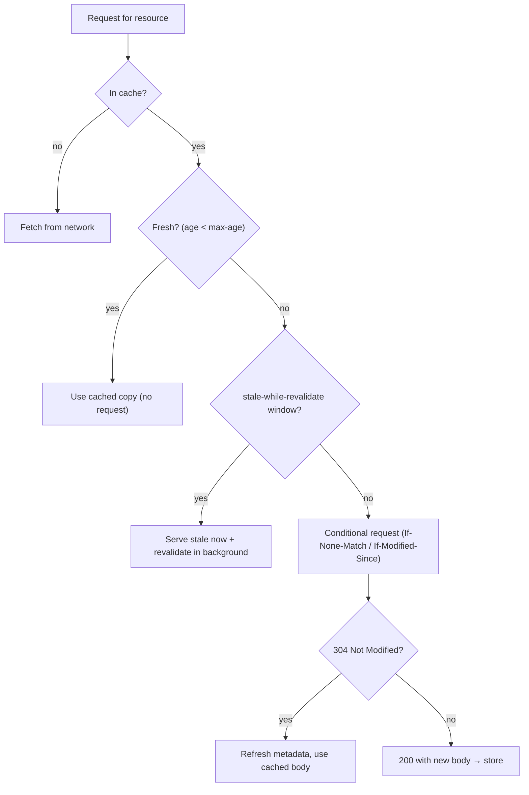
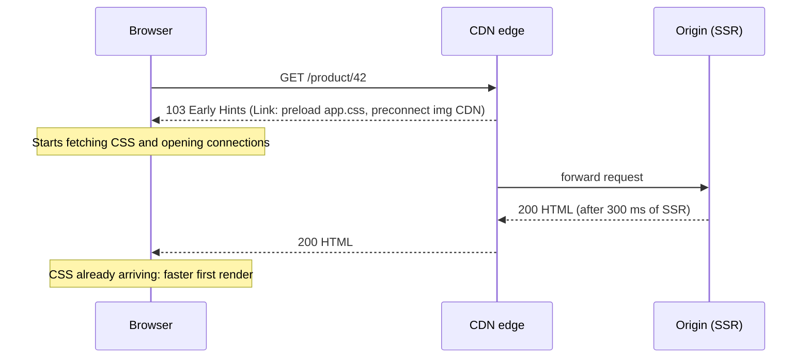
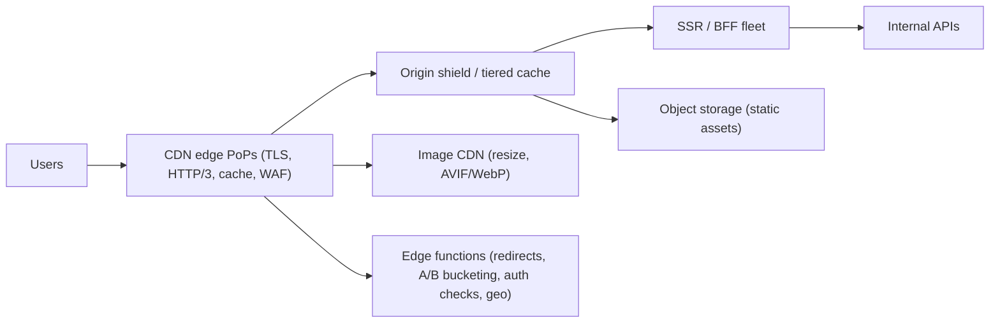

# 05 — Networking, Caching and Delivery

> The fastest request is the one you never make. The second fastest is the one served from a cache one hop away. Everything else is physics.

**Prerequisites:** [02](02-browser-rendering-pipeline.md) · **Related:** [39 Core Web Vitals](39-web-performance-and-core-web-vitals.md) · [48 Next.js Caching](48-nextjs-rendering-and-caching.md) · [32 Rendering Strategies](32-rendering-strategy-architecture.md)

---

## TL;DR

- Latency, not bandwidth, dominates the web. Count **round trips**: DNS, connection, TLS, request, redirects, waterfalls.
- **HTTP/2** multiplexes requests over one connection; **HTTP/3** (QUIC over UDP) removes TCP head-of-line blocking and survives network changes. Server Push is dead. Use **103 Early Hints** and `preload` instead.
- The golden caching pattern: **fingerprinted static assets → `Cache-Control: public, max-age=31536000, immutable`**; **HTML → short or no cache at the browser, smart caching at the CDN** (`s-maxage` + `stale-while-revalidate`, purge by tag).
- `no-cache` means *revalidate before use*; `no-store` means *never store*. Mixing them up is a classic bug.
- `Vary` multiplies cache entries; `Vary: Cookie` effectively disables CDN caching.
- Browser caches are **partitioned by top-level site**. "Shared CDN libraries are cached across sites" stopped being true years ago.
- CORS is a browser-enforced **read** protection, not an authorisation system. Cookies are governed by `SameSite`, `Secure`, `HttpOnly`, `Partitioned` and prefixes like `__Host-`.

---

## 1. Latency math

A cold HTTPS navigation on a mobile network (RTT ≈ 100 ms):

| Step | RTTs | Time |
|---|---|---|
| DNS lookup | 1 | ~100 ms (often cached) |
| TCP handshake | 1 | 100 ms |
| TLS 1.3 handshake | 1 | 100 ms |
| HTTP request → first byte | 1 + server time | 100 ms + think time |
| **Total before first byte** | **~4 RTT** | **~400 ms + server** |
| Each additional waterfall step (CSS → font, JS → API → image) | +1 RTT each | +100 ms each |

QUIC (HTTP/3) folds transport and TLS into a single round trip, and supports 0-RTT resumption. That makes HTTP/3 valuable on high-latency mobile links even before bandwidth matters.

> [!IMPORTANT]
> The architectural goal is to minimise **sequential** round trips on the critical path. Two parallel requests cost one RTT; a chain of three costs three. Most "slow app" problems are waterfalls, not large payloads.

---

## 2. HTTP versions

| | HTTP/1.1 | HTTP/2 | HTTP/3 |
|---|---|---|---|
| Transport | TCP | TCP | QUIC (UDP) |
| Multiplexing | ❌ (≈6 connections/origin) | ✅ streams on one connection | ✅ independent streams |
| Head-of-line blocking | Request-level | **TCP-level** (one lost packet stalls all streams) | Per-stream only |
| Header compression | ❌ | HPACK | QPACK |
| Connection migration | ❌ | ❌ | ✅ (Wi-Fi → cellular survives) |
| Server push | n/a | Deprecated; removed from Chrome | Not implemented by browsers |
| Prioritisation | n/a | Original tree scheme largely abandoned → **RFC 9218 Extensible Priorities** (`priority` header) | RFC 9218 |

Consequences for frontend architecture:

- **Domain sharding** and **sprite sheets** (HTTP/1.1 hacks) are counterproductive on HTTP/2+. They create extra connections and defeat prioritisation.
- **Bundling still matters**, but for different reasons: compression ratio, fewer module evaluation boundaries, cache granularity. Hundreds of tiny unbundled modules in production still lose to well-chunked bundles because of per-request overhead and deep import waterfalls ([60](60-monorepos-build-tooling-and-bundlers.md)).
- **Connection coalescing**: HTTP/2 can reuse one connection for different hostnames that share an IP and a certificate. Fewer origins means fewer handshakes.

---

## 3. HTTP caching in depth

### 3.1 Freshness and validation



### 3.2 `Cache-Control` directives

| Directive | Meaning | Typical use |
|---|---|---|
| `max-age=N` | Fresh for N seconds (all caches) | Static assets |
| `s-maxage=N` | Overrides `max-age` for **shared** caches (CDN) | HTML/API at the CDN |
| `public` | Any cache may store (even with `Authorization`) | Static, anonymous content |
| `private` | Only the browser may store | Personalised HTML, user APIs |
| `no-cache` | May store, **must revalidate** before each use | HTML that changes often but supports ETags |
| `no-store` | Must not store anywhere | Sensitive data (banking pages, tokens) |
| `immutable` | Never revalidate while fresh (even on reload) | Fingerprinted assets |
| `must-revalidate` | Once stale, must not serve stale without revalidating | Correctness-critical |
| `stale-while-revalidate=N` | May serve stale for N s while revalidating in background | HTML, API GETs, CDN |
| `stale-if-error=N` | May serve stale for N s if origin errors | Resilience |

### 3.3 The golden pattern

```http
# app.3f9a1c.js, styles.8b21e0.css, fonts, images with content hashes
Cache-Control: public, max-age=31536000, immutable

# HTML document (SSR/SSG), cached at the CDN, revalidated in the background
Cache-Control: public, max-age=0, s-maxage=300, stale-while-revalidate=86400

# Personalised HTML
Cache-Control: private, no-cache

# Sensitive pages
Cache-Control: no-store
```

Why: assets are versioned by content hash, so they never change at a given URL and can be cached forever. HTML is the **entry point** that references the current hashes, so it must stay fresh enough that new deploys are picked up quickly.

### 3.4 Validators

- `ETag` (strong or weak `W/"…"`) with `If-None-Match`, which takes precedence over `Last-Modified`/`If-Modified-Since`.
- A `304` still costs a round trip, but saves the body. For HTML that's usually fine; for hundreds of assets it isn't. That's why `immutable` matters.
- Without explicit freshness, caches apply **heuristic freshness** (often 10% of the time since `Last-Modified`). Always set `Cache-Control` explicitly.

### 3.5 `Vary` and cache keys

`Vary: Accept-Encoding` is normal. Each `Vary` header multiplies the stored variants:

- `Vary: Accept-Language` fragments by every language string the browser sends. Prefer a locale in the URL ([37](37-internationalization-and-localization.md)).
- `Vary: Cookie` → effectively **one cache entry per user** → CDN hit ratio collapses.
- `Vary: User-Agent` is the same disaster. Use Client Hints (`Sec-CH-UA-Mobile`) with a normalised cache key at the edge if you must.

CDNs also have their own **cache keys** (host + path + selected query params + selected headers). Normalise query strings (strip `utm_*` tracking params) at the edge to raise hit ratios.

### 3.6 CDN-specific controls and invalidation

- `CDN-Cache-Control` / `Surrogate-Control`: directives for the CDN only, invisible to browsers.
- **Purge by tag / surrogate key**: tag responses (`Surrogate-Key: product-123 category-shoes`) and purge all pages that show product 123 when it changes. This is the infrastructure behind on-demand revalidation in frameworks ([48](48-nextjs-rendering-and-caching.md)).
- **Origin shield / tiered caching**: a mid-tier cache in front of the origin prevents a thundering herd when edge caches expire at once.
- **Request collapsing**: concurrent misses for the same key wait on one origin fetch.

> [!TIP]
> **Cache hit ratio is a product KPI**, not just an infra metric. A storefront at a 95% CDN hit ratio typically has better TTFB, lower origin cost and better resilience than one at 60%. Track it per route type.

---

## 4. The browser's many caches

| Cache | Scope | Notes |
|---|---|---|
| Memory cache | Per renderer, short-lived | Images, preloads in the same page |
| HTTP disk cache | **Partitioned** by (top-level site, frame site) | Obeys `Cache-Control` |
| Service Worker Cache Storage | Per origin (partitioned in third-party contexts) | You control it ([34](34-realtime-offline-and-collaboration.md)) |
| Back/forward cache (bfcache) | Per tab history | Whole page snapshot in memory. Blocked by `unload` handlers, `Cache-Control: no-store` (in some browsers), open connections. Instant back/forward. |
| Prefetch / prerender cache | Per document | Speculation Rules |
| Code cache (V8) | Per script URL | Compiled bytecode for repeat visits |

> [!NOTE]
> Since ~2020–2021 all major browsers **partition the HTTP cache** by top-level site, to stop cross-site tracking via cache probing. Loading React from a public CDN therefore gives **no** cross-site cache benefit, and it adds a DNS + TLS connection. Self-host your dependencies.

---

## 5. Compression

| Encoding | Notes |
|---|---|
| gzip | Universal baseline |
| Brotli (`br`) | ~15–25% smaller than gzip for text. Precompress static assets at level 11; use 4–6 for dynamic responses |
| Zstandard (`zstd`) | Fast compression at good ratios; good for dynamic responses. Supported in Chromium and Firefox; check Safari before relying on it |
| Compression dictionaries | Shared-dictionary transport (`Use-As-Dictionary`, `Available-Dictionary`) lets a new bundle version be delta-compressed against the previous one. Very large wins for frequently deployed SPAs. Chromium-first; feature-detect via negotiation |

Don't compress already-compressed formats (JPEG, PNG, AVIF, WOFF2, MP4).

---

## 6. Resource hints and priorities

| Hint | Effect | Use sparingly because… |
|---|---|---|
| `<link rel="dns-prefetch">` | DNS only | Cheap; fine for many third-party origins |
| `<link rel="preconnect" crossorigin>` | DNS + TCP + TLS | Each open connection costs; limit to 2–4 critical origins |
| `<link rel="preload" as="…">` | Fetch now at high priority | Over-preloading steals bandwidth from the LCP resource |
| `<link rel="modulepreload">` | Fetch and parse a module (and optionally its deps) | Critical-path modules only |
| `<link rel="prefetch">` | Low-priority fetch for a likely *next* navigation | May waste data on metered connections |
| `fetchpriority="high" / "low"` | Adjust browser priority of `img`, `link`, `script`, `fetch()` | Best tool for LCP images and de-prioritising carousels |
| **Speculation Rules** | Prefetch or **prerender** whole next pages | Chromium; prerender executes JS, so guard analytics and side effects |
| **103 Early Hints** | Server sends `Link: preload/preconnect` before the final response | Uses server "think time" to start fetching critical assets |

```html
<script type="speculationrules">
{
  "prerender": [{ "where": { "href_matches": "/product/*" }, "eagerness": "moderate" }],
  "prefetch": [{ "where": { "selector_matches": "a.nav" }, "eagerness": "conservative" }]
}
</script>
```

> [!WARNING]
> Prerendered pages run JavaScript before the user sees them. Gate analytics page views, ad impressions and one-time effects on `document.prerendering` and the `prerenderingchange` event.

### 6.1 Early Hints sequence



---

## 7. CORS, precisely

CORS lets a server **relax** the Same-Origin Policy for cross-origin **reads** made by browsers.

- **Simple requests** (GET/HEAD/POST with CORS-safelisted headers and content types like `text/plain`, `multipart/form-data`, `application/x-www-form-urlencoded`) are sent directly. The browser blocks *reading* the response unless `Access-Control-Allow-Origin` matches.
- **Preflighted requests** (e.g., `Content-Type: application/json`, custom headers, PUT/DELETE) send an `OPTIONS` request first. Cache preflights with `Access-Control-Max-Age`.
- **Credentials** (`credentials: 'include'`) require `Access-Control-Allow-Credentials: true` and a **specific** origin (no `*`).

```http
Access-Control-Allow-Origin: https://app.example.com
Access-Control-Allow-Credentials: true
Access-Control-Allow-Methods: GET, POST, PATCH
Access-Control-Allow-Headers: Content-Type, X-Request-Id
Access-Control-Max-Age: 600
Vary: Origin
```

> [!CAUTION]
> CORS is **not** server-side security. Requests from curl, servers or malicious native apps ignore it, and "simple" cross-origin POSTs are *sent* even when the response can't be read. That's what CSRF exploits ([43](43-frontend-security-architecture.md)). Authorise every request on the server. Never reflect arbitrary `Origin` values into `Access-Control-Allow-Origin` together with credentials.

**Architecture tip:** the cheapest CORS is no CORS. Serve your API from the same site as your app (a `/api` path through the CDN or BFF). This avoids preflights (one RTT each) and lets you use `SameSite` cookies cleanly.

---

## 8. Cookies

```http
Set-Cookie: __Host-session=abc123; Path=/; Secure; HttpOnly; SameSite=Lax; Max-Age=1209600
```

| Attribute | Effect |
|---|---|
| `Secure` | HTTPS only |
| `HttpOnly` | Invisible to JS (`document.cookie`), which mitigates token theft via XSS |
| `SameSite=Lax` | Sent on top-level navigations from other sites, not on cross-site subresource or POST requests. Default in Chromium when omitted |
| `SameSite=Strict` | Never sent cross-site (breaks "arrive logged-in from an email link") |
| `SameSite=None; Secure` | Sent cross-site (third-party contexts), subject to browser third-party cookie policies |
| `Partitioned` (CHIPS) | Third-party cookie partitioned per top-level site (embedded widgets) |
| `__Host-` prefix | Must be `Secure`, `Path=/`, no `Domain`. Cannot be overwritten by subdomains |
| `__Secure-` prefix | Must be `Secure` |

**Third-party cookie landscape (late 2026):** Safari and Firefox block third-party cookies by default. Chrome reversed its plan to deprecate them and has wound down most Privacy Sandbox APIs. Architect for "third-party cookies unavailable" anyway: first-party sessions, a BFF on your own domain, CHIPS for embeds, and FedCM or redirects for federated login ([45](45-authentication-and-authorization.md)).

**Size matters:** cookies are sent on **every request** to the matching domain, including static assets, if they share a domain. Serve static assets from a cookieless domain or path scope, and keep cookies small (a 4 KB cookie on 100 requests is 400 KB of upload).

---

## 9. Fetch details architects should know

```ts
await fetch('/api/orders', {
  method: 'POST',
  headers: { 'Content-Type': 'application/json', 'Idempotency-Key': crypto.randomUUID() },
  body: JSON.stringify(order),
  credentials: 'same-origin',  // default for same-origin; 'include' for cross-site cookies
  priority: 'high',            // fetch priority hint
  keepalive: true,             // survive page unload (≤64 KB in-flight budget)
  signal: AbortSignal.timeout(10_000),
});
```

- **Analytics on unload:** `navigator.sendBeacon()` or `fetch(…, { keepalive: true })`, sent on `visibilitychange` → `hidden` (not on `unload`, which is unreliable and blocks bfcache).
- **Streaming responses:** `res.body` is a `ReadableStream`, for incremental rendering of NDJSON, Server-Sent Events or LLM tokens.
- **Request streaming** (`duplex: 'half'`) works over HTTP/2+ in Chromium; don't depend on it cross-browser.
- **Measuring:** `PerformanceResourceTiming` (DNS, connect, TLS, TTFB, transfer per resource) and the **`Server-Timing`** response header, which surfaces backend timing in DevTools and RUM:

```http
Server-Timing: db;dur=53, ssr;dur=120, cache;desc="HIT"
```

---

## 10. Delivery architecture



Design principles:

1. **Static assets never touch the SSR fleet.** Upload them to object storage at build time with immutable caching.
2. **HTML is cacheable whenever it isn't personalised.** Move personalisation into small client-side or streamed "holes" (Partial Prerendering in Next.js, islands elsewhere), so the shell can be cached at the edge ([32](32-rendering-strategy-architecture.md)).
3. **Keep old asset versions** around after deploys (days to weeks) to survive version skew.
4. **Do cheap, cacheable decisions at the edge** (redirects, locale detection, experiment bucketing via a cookie set once), and keep expensive logic at the origin.
5. **Use an image CDN** rather than hand-made image variants.

---

## Pitfalls and anti-patterns

- `Cache-Control: no-cache` on fingerprinted assets (thousands of pointless 304s).
- Long `max-age` on **unfingerprinted** URLs (`/app.js`), so users are stuck on old code for days.
- `Vary: Cookie` or `Vary: User-Agent` at the CDN.
- Personalised HTML cached publicly (**data leak**: user A sees user B's page). Always mark it `private` and make cache keys explicit.
- Over-preloading (fonts, scripts, images) so nothing is actually prioritised.
- Third-party scripts on many distinct origins (each costs DNS + TLS).
- Cross-origin API on a separate domain, costing preflights for every non-simple request.
- Relying on `unload` for analytics (unreliable, and breaks bfcache).

---

## Architect's checklist

- [ ] Asset URLs are content-hashed and served `immutable` for a year
- [ ] HTML caching strategy per route type is documented (static, ISR, private, no-store)
- [ ] CDN cache keys are normalised (tracking params stripped); hit ratio is monitored
- [ ] Purge-by-tag is available and wired to content changes
- [ ] HTTP/3 is enabled at the edge; HTTP/2 at minimum
- [ ] API is served same-site (no CORS on the hot path) or preflights are cached
- [ ] Session cookies use `__Host-`, `Secure`, `HttpOnly`, `SameSite=Lax`
- [ ] `Server-Timing` and Resource Timing feed RUM
- [ ] bfcache eligibility is tested (no `unload` handlers)
- [ ] Old assets are retained across deploys

---

## Interview angles

**Q1. Design the caching strategy for an e-commerce site with SSR product pages.**
Fingerprinted assets: one-year immutable. Product HTML: cached at the CDN with `s-maxage` plus a long `stale-while-revalidate`, tagged by product and category, and purged on price or stock change through webhooks. The browser gets `max-age=0` so it revalidates through the CDN. Personalised fragments (cart count, recommendations) load client-side or stream as dynamic holes so the HTML stays shareable. Images go through an image CDN with immutable variants. Inventory comes from a short-TTL API. Monitor hit ratio and TTFB per template.

**Q2. `no-cache` vs `no-store` vs `max-age=0`?**
`no-store` forbids storing at all. `no-cache` allows storing but requires revalidation (a conditional request) before every use. `max-age=0` makes the response immediately stale, so it is revalidated unless a `stale-while-revalidate` window allows serving stale. For HTML you usually want `max-age=0` at the browser with CDN caching via `s-maxage`; for sensitive pages, `no-store`.

**Q3. Why did our CDN hit ratio collapse after a release?**
Usual suspects: a new `Vary` header (Cookie, User-Agent, Accept-Language), a cookie now set on every response (some CDNs bypass caching when they see `Set-Cookie`), query parameters added to URLs (cache key fragmentation), `Cache-Control: private` or `no-store` leaking from a shared middleware, or a deploy that changed asset hashes too often.

**Q4. Is CORS a security feature?**
It's a relaxation mechanism for the browser's Same-Origin Policy that controls whether a page may *read* cross-origin responses. It doesn't stop requests from being sent (so CSRF is still possible), and non-browser clients ignore it. Server-side authentication and authorisation are always required.

**Q5. Why is self-hosting third-party libraries usually faster than a public CDN today?**
HTTP caches are partitioned by top-level site, so there's no cross-site cache hit. A separate origin costs DNS, TCP and TLS on the critical path, and you lose control of versioning, integrity and availability. Self-hosted, fingerprinted and HTTP/2-multiplexed on your existing connection is faster and safer.

---

## Further reading

- MDN, *HTTP caching*: <https://developer.mozilla.org/en-US/docs/Web/HTTP/Guides/Caching>
- RFC 9111 (HTTP Caching), RFC 9114 (HTTP/3), RFC 9218 (Extensible Priorities), RFC 8297 (Early Hints)
- web.dev, *Fetch Priority*, *Preload critical assets*, *bfcache*: <https://web.dev/articles/fetch-priority> · <https://web.dev/articles/bfcache>
- Chrome for Developers, *Speculation Rules*: <https://developer.chrome.com/docs/web-platform/prerender-pages>
- Ilya Grigorik, *High Performance Browser Networking*: <https://hpbn.co>
- MDN, *CORS*: <https://developer.mozilla.org/en-US/docs/Web/HTTP/Guides/CORS>
- Chrome for Developers, *Compression dictionary transport*: <https://developer.chrome.com/blog/shared-dictionary-compression>

---

[← Previous: 04 — TypeScript at Scale](04-typescript-at-scale.md) · [Index](README.md) · [Next: 06 — Modern Web Platform APIs →](06-modern-web-platform-apis.md)
