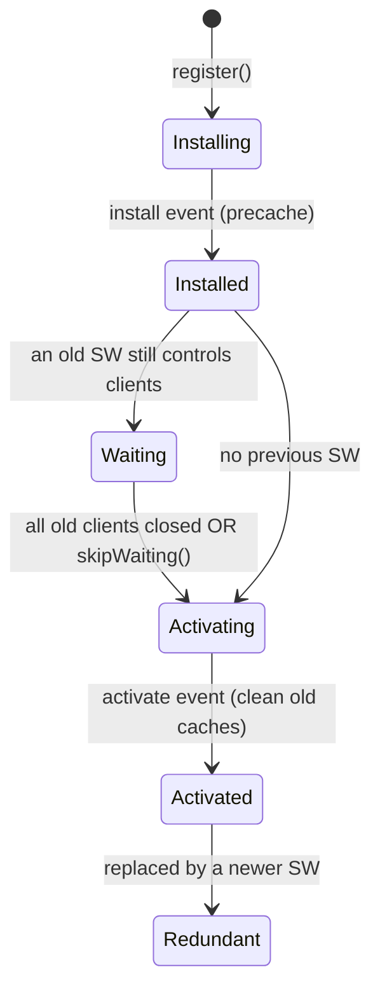

# 06 — Modern Web Platform APIs

> Every year the platform absorbs something we used to ship as a library: modals, popovers, positioning, transitions, routing primitives, date handling. The architect's job is to notice, and to delete code.

**Prerequisites:** [02](02-browser-rendering-pipeline.md), [03](03-javascript-runtime-and-engine.md) · **Related:** [36 Accessibility](36-accessibility-engineering.md) · [35 Design Systems](35-enterprise-design-system-architecture.md) · [34 Offline & Real-time](34-realtime-offline-and-collaboration.md)

---

## TL;DR

- Use **Baseline** (Newly available = in all major browsers; Widely available = 30 months later) to set a **support policy** instead of debating individual features.
- **Workers** move CPU-heavy work off the main thread. **Service Workers** are a programmable network proxy, powerful and dangerous; always ship a kill switch.
- **Web Components** are the right tool for *framework-agnostic* design-system primitives and embeddable widgets. React 19 finally supports them fully.
- **Observers** (Intersection, Resize, Mutation, Performance) replace polling and scroll handlers.
- New UI primitives (`<dialog>`, **Popover API**, **Invoker Commands**, **CSS Anchor Positioning**, `<details name>`, customisable `<select>`) replace large chunks of modal, tooltip and dropdown JavaScript, with accessibility and top-layer behaviour built in.
- The **View Transitions API** and the **Navigation API** give SPAs native animated transitions and a proper routing primitive. React 19.3 ships a stable `<ViewTransition>` component.
- **Storage** has a hierarchy: `localStorage` (small, synchronous, blocks the main thread) → IndexedDB (structured, async) → OPFS (files, fast sync access in workers, enables SQLite-in-the-browser).

---

## 1. Support policy: Baseline over browser lists

| Term | Meaning |
|---|---|
| **Baseline Newly available** | Supported in the current versions of Chrome, Edge, Firefox and Safari (desktop and mobile) |
| **Baseline Widely available** | 30 months after becoming newly available: safe for almost all audiences |
| **Limited availability** | Not in all engines: progressive enhancement or polyfill only |

Policy template for an ADR:

> "We target **Baseline Widely available** for required functionality. We may use **Baseline Newly available** features with a fallback. We use limited-availability features only as progressive enhancement behind feature detection."

Vite's default build target is aligned with Baseline Widely available, and `browserslist` supports Baseline queries. Align your transpile target, your polyfill policy and your test matrix to the same statement.

```ts
// Feature-detect, never UA-sniff
if ('startViewTransition' in document) { /* … */ }
if (HTMLElement.prototype.hasOwnProperty('popover')) { /* … */ }
if (CSS.supports('anchor-name: --a')) { /* … */ }
```

---

## 2. Workers: real parallelism

| Kind | Scope | Use |
|---|---|---|
| Dedicated Worker | One page | CPU-heavy work: parsing, search indexes, diffing, image processing |
| Module Worker (`{ type: 'module' }`) | One page | Same, with ESM imports (all modern browsers) |
| Shared Worker | All same-origin tabs | Shared connection or cache across tabs (historically unavailable on Chrome for Android; check) |
| Service Worker | Origin scope, event-driven | Network proxy, offline, push, background sync |
| Worklets (Audio, Paint) | Rendering or audio pipeline | Specialised low-latency hooks |

**Cost model:** worker startup (tens of ms), memory per worker, and **serialisation** across the boundary (structured clone). Use **transferables** (`ArrayBuffer`, `MessagePort`, `ImageBitmap`, `OffscreenCanvas`, streams) for zero-copy moves.

```ts
// main.ts: offload JSON parsing and transformation of a 20 MB payload
const worker = new Worker(new URL('./transform.worker.ts', import.meta.url), { type: 'module' });
const buf = await (await fetch('/api/export')).arrayBuffer();
worker.postMessage(buf, [buf]); // transferred: main thread no longer owns `buf`
worker.onmessage = (e: MessageEvent<Row[]>) => render(e.data);

// transform.worker.ts
self.onmessage = (e: MessageEvent<ArrayBuffer>) => {
  const rows = JSON.parse(new TextDecoder().decode(e.data)) as RawRow[];
  postMessage(rows.map(normalise));
};
```

> [!TIP]
> A library like **Comlink** turns workers into async function calls. Pair it with a small worker pool when parallelism helps (e.g., `navigator.hardwareConcurrency - 1` workers, capped).

---

## 3. Service Workers: a programmable proxy



Essentials:

- **Scope**: a SW controls pages under its path (`/` for the whole origin).
- **Update flow**: the browser checks for a new SW script on navigation (and at most every 24 h). The new SW **waits** until all tabs using the old one close, unless you call `skipWaiting()` (then coordinate with `clients.claim()` and tell the page to reload).
- **Navigation preload** lets the network request for a navigation start in parallel with SW boot.
- **Strategies:** cache-first (fingerprinted assets), network-first (HTML, APIs needing freshness), stale-while-revalidate (avatars, non-critical APIs), network-only (mutations), cache-only (offline fallback page) ([34](34-realtime-offline-and-collaboration.md)).

> [!CAUTION]
> A buggy service worker can **brick your site for returning users**: they keep getting a cached, broken app shell. Always have a kill switch: deploy a SW at the same URL that unregisters itself and clears caches, and make sure the SW script itself is served with `Cache-Control: no-cache`.

```ts
// sw-kill-switch.js: deploy at the same path as the broken SW
self.addEventListener('install', () => self.skipWaiting());
self.addEventListener('activate', async () => {
  const keys = await caches.keys();
  await Promise.all(keys.map((k) => caches.delete(k)));
  await self.registration.unregister();
  const clients = await self.clients.matchAll({ type: 'window' });
  clients.forEach((c) => c.navigate(c.url));
});
```

---

## 4. Web Components

Four building blocks: **Custom Elements**, **Shadow DOM**, **`<template>`/`<slot>`**, and **ES modules**.

```ts
class AcmeBadge extends HTMLElement {
  static observedAttributes = ['tone'];
  #root = this.attachShadow({ mode: 'open' });

  connectedCallback() { this.render(); }
  attributeChangedCallback() { this.render(); }

  render() {
    const tone = this.getAttribute('tone') ?? 'neutral';
    this.#root.innerHTML = `
      <style>
        :host { display: inline-flex; }
        span { padding: 0 .5rem; border-radius: 999px; background: var(--acme-badge-bg, #eee); }
        :host([tone="danger"]) span { background: var(--acme-danger, #fdd); }
      </style>
      <span part="label"><slot></slot></span>`;
  }
}
customElements.define('acme-badge', AcmeBadge);
```

| Concern | Reality |
|---|---|
| Style encapsulation | Shadow DOM isolates styles. Theming goes through **CSS custom properties** (they pierce the shadow root) and `::part()` |
| SSR | **Declarative Shadow DOM** (`<template shadowrootmode="open">`) is Baseline, so shadow content can be server-rendered |
| Forms | **Form-associated custom elements** (`static formAssociated = true` + `ElementInternals`) participate in forms, validation and labels |
| Accessibility | ARIA references (`aria-labelledby`, `aria-describedby`) **can't cross shadow boundaries** today. Reference Target and element-reference APIs are in progress. Use `ElementInternals` for roles and states, or keep labelled pairs in the same root |
| React | **React 19 fully supports custom elements**: it passes the Custom Elements Everywhere tests, sets properties when the element defines them (so rich data works), and supports declarative custom-event props |
| Events | Custom events must be `bubbles: true, composed: true` to escape shadow roots |

**When Web Components are the right architecture:**

- A design system consumed by **multiple frameworks** (React, Angular, Vue, server-rendered pages): build primitives with Lit or Stencil, then wrap them thinly per framework ([35](35-enterprise-design-system-architecture.md)).
- **Embeddable widgets** for third-party sites (Shadow DOM protects you from their CSS, and them from yours).
- Micro-frontend integration contracts ([61](61-micro-frontends-and-module-federation.md)).

**When they're not:** application-level components inside a single-framework app. You lose framework ergonomics (composition, context, server components) for no gain.

---

## 5. Observers: stop polling the DOM

| Observer | Replaces | Typical uses |
|---|---|---|
| `IntersectionObserver` | Scroll handlers with `getBoundingClientRect` | Lazy loading, infinite scroll sentinels, impression tracking, pausing off-screen video |
| `ResizeObserver` | `window.resize` + measurement | Component-level responsive logic, charts, virtualised lists |
| `MutationObserver` | Polling DOM changes | Integrating third-party DOM, editors, tests |
| `PerformanceObserver` | Polling `performance` entries | LCP, CLS (`layout-shift`), INP (`event`), LoAF, resource timing |

```ts
// Infinite scroll sentinel
export function observeSentinel(el: Element, onVisible: () => void) {
  const io = new IntersectionObserver(
    (entries) => entries.some((e) => e.isIntersecting) && onVisible(),
    { rootMargin: '800px 0px' }, // start loading before the user hits the bottom
  );
  io.observe(el);
  return () => io.disconnect();
}
```

> [!NOTE]
> Prefer **CSS container queries** (Baseline Widely available since 2025) over `ResizeObserver` when the goal is purely visual responsiveness. Use `ResizeObserver` when *logic* depends on size (e.g., how many chart ticks to compute).

---

## 6. Storage

| Store | Capacity | API | Good for | Avoid for |
|---|---|---|---|---|
| Cookies | ~4 KB each | Header + `document.cookie` | Session identifiers (HttpOnly) | Data (sent on every request) |
| `localStorage` / `sessionStorage` | ~5 MB/origin | **Synchronous** strings | Tiny preferences (theme) | Anything large or frequent (blocks main thread), tokens (XSS-readable) |
| IndexedDB | Large (quota-based) | Async, transactional, indexes | Offline data, caches, drafts, local-first stores | Simple key-value (use a wrapper: `idb`, Dexie) |
| Cache Storage | Quota-based | Request → Response | Offline assets and API responses (with SW) | Structured querying |
| **OPFS** (Origin Private File System) | Quota-based | Files; fast **sync access handles in workers** | SQLite WASM, large binary data, editors | Main-thread sync access (not allowed) |

Quota and eviction:

```ts
const { usage, quota } = await navigator.storage.estimate();
const persisted = await navigator.storage.persist(); // request protection from eviction
```

- Browsers evict "best-effort" storage under pressure (LRU by origin). `persist()` asks for durable storage, and browsers grant it based on engagement heuristics.
- **Safari ITP** can delete script-writable storage for sites the user hasn't interacted with in 7 days of browser use. **Never treat client storage as the only copy of user data.**
- Storage is **partitioned** in third-party iframes (by top-level site).

---

## 7. Cross-tab and cross-context communication

| Mechanism | Use |
|---|---|
| `BroadcastChannel` | Same-origin pub/sub across tabs (logout everywhere, cache invalidation) |
| `storage` event | Legacy cross-tab signal via `localStorage` writes |
| `SharedWorker` | Shared connection (one WebSocket for all tabs) |
| **Web Locks API** (`navigator.locks`) | Cross-tab mutex and **leader election** |
| `window.postMessage` | Cross-origin iframes and popups. **Always check `event.origin`** |
| `MessageChannel` | Private ports between contexts |

```ts
// Leader election: only one tab holds the WebSocket
navigator.locks.request('realtime-leader', async () => {
  const ws = connect();
  const bc = new BroadcastChannel('realtime');
  ws.onmessage = (m) => bc.postMessage(m.data); // fan out to other tabs
  await new Promise(() => {}); // hold the lock until this tab closes
});
```

```ts
// postMessage safely
window.addEventListener('message', (event) => {
  if (event.origin !== 'https://payments.example.com') return; // ✅ origin allowlist
  const msg = PaymentMessage.safeParse(event.data);            // ✅ validate shape
  if (!msg.success) return;
  handle(msg.data);
});
```

---

## 8. Native UI primitives that replace libraries

### 8.1 `<dialog>`, Popover and Invoker Commands

```html
<!-- Modal dialog: focus trapping, Esc to close, top layer, inert background -->
<button commandfor="confirm" command="show-modal">Delete…</button>
<dialog id="confirm" aria-labelledby="confirm-title">
  <h2 id="confirm-title">Delete project?</h2>
  <form method="dialog">
    <button value="cancel">Cancel</button>
    <button value="delete">Delete</button>
  </form>
</dialog>

<!-- Non-modal popover: light dismiss, top layer, no JS -->
<button popovertarget="menu">Options</button>
<div id="menu" popover>…</div>
```

- **`<dialog>.showModal()`** gives you focus management, `Esc`, the top layer (no z-index wars), `::backdrop` and an inert background.
- **Popover API** (`popover`, `popovertarget`) gives you light dismiss, top layer, and an implicit `aria-expanded` relationship on the invoker. `popover="manual"` turns off light dismiss; `popover="hint"` is for tooltips in supporting browsers.
- **Invoker Commands** (`commandfor` + `command`) wire buttons to dialogs and popovers declaratively, with custom commands (`--my-command`) dispatched as `command` events. They have been in all major engines since late 2025.

### 8.2 CSS Anchor Positioning

```css
.trigger { anchor-name: --menu-anchor; }
.menu {
  position: absolute;
  position-anchor: --menu-anchor;
  position-area: bottom span-right;           /* place relative to the anchor */
  position-try-fallbacks: flip-block, flip-inline; /* auto-flip when out of viewport */
}
```

Anchor positioning (Baseline Newly available in January 2026) replaces most of what Popper/Floating UI did for tooltips and menus. Keep a JS positioning library only for complex cases or older-browser support.

### 8.3 Other replacements

| Need | Native answer |
|---|---|
| Exclusive accordion | `<details name="faq">` (only one open per group) |
| Styled select | Customisable `<select>` via `appearance: base-select` (Chromium-first; progressive enhancement) |
| Inert background | `inert` attribute |
| Lazy images and iframes | `loading="lazy"` |
| Smooth height animation | `interpolate-size: allow-keywords` / `calc-size()` (Chromium-first) or grid `0fr → 1fr` |
| Scroll-linked animation | Scroll-driven animations (`animation-timeline: scroll()/view()`), Chromium and Safari |
| Masonry, subgrid | Subgrid is Baseline; masonry layout is still being standardised |

---

## 9. View Transitions and the Navigation API

### 9.1 View Transitions

```ts
// Same-document (SPA) transition
function navigateTo(render: () => void) {
  if (!document.startViewTransition || matchMedia('(prefers-reduced-motion: reduce)').matches) {
    render();
    return;
  }
  document.startViewTransition(() => render());
}
```

```css
/* Cross-document (MPA) transitions: opt in on both pages */
@view-transition { navigation: auto; }
.product-image { view-transition-name: product-hero; }
::view-transition-old(root), ::view-transition-new(root) { animation-duration: 200ms; }
```

- Same-document transitions are Baseline (newly available since late 2025). Cross-document transitions work in Chromium and Safari.
- **React 19.3** ships a stable `<ViewTransition>` component integrated with transitions and Suspense, including `addTransitionType` for direction-aware animations ([15](15-concurrent-react-suspense-and-transitions.md)).
- `view-transition-name` must be unique per page at the time of the snapshot. Generate names from IDs (`product-${id}`).

### 9.2 Navigation API

```ts
navigation.addEventListener('navigate', (event) => {
  if (!event.canIntercept || event.hashChange || event.downloadRequest) return;
  const url = new URL(event.destination.url);
  if (!url.pathname.startsWith('/app')) return;
  event.intercept({
    async handler() {
      const data = await loadRoute(url, { signal: event.signal }); // aborted if superseded
      renderRoute(data);
    },
  });
});
```

The Navigation API (Baseline Newly available, January 2026) centralises **all** navigations (links, forms, back/forward, `navigation.navigate()`) into one interceptable event with an `AbortSignal`, built-in scroll and focus handling, and a real history entries list. Routers are adopting it; it removes many History-API hacks.

---

## 10. Scheduling and responsiveness APIs

| API | Status (late 2026) | Use |
|---|---|---|
| `requestAnimationFrame` | Universal | Visual updates |
| `requestIdleCallback` | All major engines | Low-priority work (Safari support arrived late; feature-detect) |
| `scheduler.postTask` | Chromium; spreading | Prioritised tasks (`user-blocking`, `user-visible`, `background`) |
| `scheduler.yield()` | Chromium-first | Yield inside long tasks without losing priority |
| `isInputPending()` | Deprecated direction | Superseded by yielding with `scheduler.yield()` |

---

## 11. Streams, compression and binary data

```ts
// Gzip-compress a large client-side export without a library
const compressed = new Blob([json]).stream().pipeThrough(new CompressionStream('gzip'));
const blob = await new Response(compressed).blob();
```

- `ReadableStream` / `WritableStream` / `TransformStream` are universal. Use them for streamed rendering, LLM token streams and large file processing.
- `CompressionStream` / `DecompressionStream` (gzip, deflate) are Baseline.
- **WebAssembly** is valuable for CPU-bound codecs, parsers, physics and crypto. It doesn't make DOM work faster (it has no direct DOM access).
- **WebGPU** now ships across engines on major platforms. It's relevant for visualisation, ML inference in the browser ([65](65-ai-powered-react-interfaces.md)) and advanced graphics.

---

## 12. Lifecycle, visibility and bfcache

- Use `visibilitychange` (→ `hidden`) as the **last reliable moment** to persist state and send analytics.
- `pagehide` / `pageshow` with `event.persisted` detect bfcache restores. **Refresh stale data on `pageshow` with `persisted === true`.**
- Avoid `unload` handlers. Chromium is deprecating them, and they make pages ineligible for bfcache.
- Chromium's Page Lifecycle API adds `freeze` and `resume` for discarded or frozen background tabs.

```ts
addEventListener('pageshow', (e) => {
  if ((e as PageTransitionEvent).persisted) queryClient.invalidateQueries(); // came back from bfcache
});
```

---

## Pitfalls and anti-patterns

- Shipping a service worker without a kill switch or without `no-cache` on the SW script.
- Putting auth tokens in `localStorage` (XSS-readable) ([43](43-frontend-security-architecture.md)).
- Heavy synchronous `localStorage` reads during startup.
- `postMessage` handlers without origin checks and schema validation.
- Re-implementing modals and tooltips in JS without focus management, instead of using `<dialog>`, Popover and anchor positioning.
- Web Components for app-internal components in a single-framework codebase.
- View transitions without honouring `prefers-reduced-motion`.
- Treating IndexedDB as durable storage for unsynced user data on Safari.

---

## Architect's checklist

- [ ] Browser support policy written in Baseline terms; build targets match it
- [ ] Feature detection (not UA sniffing) for limited-availability APIs
- [ ] Worker strategy for CPU-heavy features (and a budget for when to use it)
- [ ] Service worker: update flow, cache versioning, kill switch, monitoring
- [ ] Storage strategy per data type, with eviction and sync assumptions documented
- [ ] Cross-tab behaviour defined (logout, cache invalidation, single realtime connection)
- [ ] Design system uses native `<dialog>`, Popover and anchor positioning where Baseline allows
- [ ] bfcache eligibility monitored (Chrome DevTools → Application → Back/forward cache)

---

## Interview angles

**Q1. When would you use a Web Worker, and what does it cost?**
When CPU work would exceed a frame budget or create long tasks that hurt INP: big JSON transforms, search indexing, syntax highlighting, image processing, CRDT merges. The costs are startup time, memory, serialisation (mitigated by transferables), and no DOM access. Measure that the work outweighs the overhead, and use a pool or a single long-lived worker rather than spawning per task.

**Q2. A bad service worker deploy is serving a broken app to returning users. What do you do?**
Deploy a kill-switch SW at the same script URL. It calls `skipWaiting`, deletes caches, unregisters itself and navigates clients to reload. Make sure the SW script is served `no-cache` so browsers pick up the change. Then do a post-mortem: add SW update tests, staged rollout, version checks, and monitoring of SW errors.

**Q3. Should our design system be built with Web Components?**
If it must serve multiple frameworks, server-rendered pages or third-party embeds: yes, for the primitives, with thin React and Angular wrappers. Plan for declarative shadow DOM, form association and the cross-shadow ARIA limitations. If everything is React, framework components are more ergonomic (context, composition, RSC compatibility) and simpler to test.

**Q4. How do the View Transitions and Navigation APIs change SPA architecture?**
The Navigation API gives routers one interceptable event for every navigation, with abort signals and built-in scroll and focus restoration, replacing History API workarounds. View Transitions give native, compositor-friendly animations between DOM states or even between MPA pages. Together they narrow the UX gap between MPAs and SPAs, which makes server-rendered, multi-page architectures more attractive for content sites.

**Q5. How do you elect one tab to own a WebSocket connection?**
Use the Web Locks API: every tab requests the same named lock, one holds it and opens the socket, and the others wait. The leader fans out messages with `BroadcastChannel`. When the leader tab closes, the lock is released and the next tab takes over automatically.

---

## Further reading

- web.dev, *Baseline*: <https://web.dev/baseline>
- MDN, *Service Worker API*, *Web Components*, *Popover API*, *View Transition API*, *Navigation API*: <https://developer.mozilla.org/en-US/docs/Web/API>
- Chrome for Developers, *CSS anchor positioning*: <https://developer.chrome.com/docs/css-ui/anchor-positioning-api>
- web.dev, *Origin private file system*: <https://web.dev/articles/origin-private-file-system>
- Custom Elements Everywhere: <https://custom-elements-everywhere.com>
- Jake Archibald, *The service worker lifecycle*: <https://web.dev/articles/service-worker-lifecycle>
- web.dev, *New to the web platform* (monthly): <https://web.dev/blog>

---

[← Previous: 05 — Networking, Caching and Delivery](05-networking-caching-and-delivery.md) · [Index](README.md) · [Next: 07 — Modern CSS and Layout Architecture →](07-modern-css-and-layout-architecture.md)
