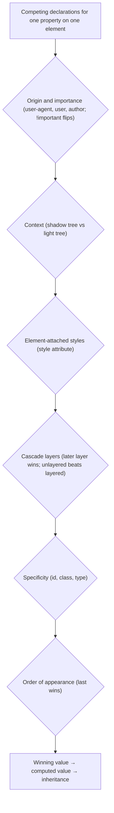

# 07 — Modern CSS and Layout Architecture

> Most "CSS problems" in large apps are cascade-ownership problems. Cascade layers, custom properties and container queries give you the tools to treat CSS as an architecture, rather than a negotiation between whoever wrote the last selector.

**Prerequisites:** [02](02-browser-rendering-pipeline.md) · **Related:** [23 Styling Architecture](23-styling-architecture-and-theming.md) · [35 Design Systems](35-enterprise-design-system-architecture.md) · [37 i18n](37-internationalization-and-localization.md)

---

## TL;DR

- The cascade decides which declaration wins, in this order: **origin and importance → context (shadow DOM) → element-attached (`style=""`) → cascade layers → specificity → order of appearance.** Layers sit *above* specificity, which is what makes them an architectural tool.
- Use **`@layer`** to give each kind of CSS (reset, tokens, base, vendor, components, utilities, overrides) an explicit priority. Unlayered styles beat all layered styles, and `!important` reverses layer order.
- **Custom properties are your runtime theming API.** They inherit, can be scoped per component, and (with `@property`) can be typed and animated.
- **Container queries** make components responsive to the space they're given, not to the viewport. Media queries remain right for page-level layout and **user preferences** (`prefers-reduced-motion`, `prefers-color-scheme`, `forced-colors`, `pointer`).
- **`:has()`** is a parent and relational selector. It replaces a lot of JS state-to-class plumbing, but use it deliberately on large, frequently mutated trees.
- **Grid** for two-dimensional, layout-driven structure; **Flexbox** for one-dimensional, content-driven alignment; **subgrid** to align nested content to a parent grid.
- Write **logical properties** (`margin-inline-start`, `padding-block`) from day one. RTL support then becomes nearly free.
- **CSS is render-blocking.** Your CSS architecture is also a performance architecture: split per route, keep critical CSS small, delete dead CSS.

---

## 1. The cascade, precisely



The key architectural insight is that **layer order is decided before specificity is even compared.** A low-specificity selector in a higher layer beats a high-specificity selector in a lower layer. That ends specificity wars.

---

## 2. Cascade layers as an architecture

```css
/* Declare the order once, at the top of the entry stylesheet */
@layer reset, tokens, base, vendor, components, patterns, utilities, overrides;

@import url('modern-normalize.css') layer(reset);
@import url('third-party-datepicker.css') layer(vendor); /* tame vendor CSS */

@layer tokens {
  :root {
    --color-bg: oklch(99% 0.005 250);
    --color-fg: oklch(20% 0.02 250);
    --space-2: 0.5rem;
    --radius-md: 0.5rem;
  }
}

@layer base {
  body { background: var(--color-bg); color: var(--color-fg); font: 1rem/1.5 system-ui, sans-serif; }
  :focus-visible { outline: 2px solid var(--color-focus, Highlight); outline-offset: 2px; }
}

@layer components {
  .button { padding: var(--space-2) calc(var(--space-2) * 2); border-radius: var(--radius-md); }
}

@layer utilities {
  .visually-hidden { position: absolute !important; inline-size: 1px; block-size: 1px; overflow: hidden; clip-path: inset(50%); white-space: nowrap; }
}
```

| Rule | Consequence |
|---|---|
| Later layers win over earlier ones (normal declarations) | Utilities override components without `!important` |
| **Unlayered** author styles beat all layered styles | Legacy CSS can be left unlayered (wins) while you migrate, or put in an early `legacy` layer (loses) |
| `!important` **reverses** layer order | An `!important` in `reset` beats an `!important` in `utilities`, so resets can protect accessibility-critical rules |
| Nested layers (`@layer components.card`) | Package-level sub-ordering inside design systems |
| `@import … layer(x)` | Wrap vendor CSS you don't control |

> [!IMPORTANT]
> In a large app, **decide the layer stack in an ADR** and enforce it with Stylelint (e.g., require every rule to be inside a declared layer). Tailwind v4 already emits its CSS into layers (`theme`, `base`, `components`, `utilities`), so align your own layers around them ([23](23-styling-architecture-and-theming.md)).

### Specificity tools that still matter

- `:where(...)` has **zero specificity**. Use it for library defaults that consumers must be able to override trivially.
- `:is(...)` takes the specificity of its most specific argument.
- Avoid ID selectors and `!important` in component CSS. Use `@scope` or CSS Modules for isolation.

```css
/* Library default: trivially overridable by any consumer class */
:where(.prism-button) { background: var(--button-bg, ButtonFace); }
```

### `@scope`

```css
@scope (.card) to (.card__content) {
  img { border-radius: var(--radius-md); }  /* only images inside .card, not inside nested content */
}
```

`@scope` provides proximity-based scoping with a lower boundary (a "donut scope"). Engine support arrived later in Firefox than in Chromium and Safari, so check Baseline before relying on it. CSS Modules and Shadow DOM remain the mainstream isolation tools.

---

## 3. Custom properties: the theming API

```css
@layer tokens {
  :root {
    color-scheme: light dark;
    --surface: light-dark(oklch(99% 0.01 250), oklch(18% 0.02 250));
    --text: light-dark(oklch(22% 0.02 250), oklch(94% 0.01 250));
    --brand: oklch(62% 0.19 255);
    --brand-hover: oklch(from var(--brand) calc(l - 0.06) c h);    /* relative color syntax */
    --brand-subtle: color-mix(in oklch, var(--brand) 12%, var(--surface));
  }
  [data-theme='dark'] { color-scheme: dark; }
  [data-brand='acme-red'] { --brand: oklch(58% 0.21 25); }        /* multi-brand override */
}

.badge {
  --badge-bg: var(--brand-subtle);  /* component-level variable: an explicit override point */
  background: var(--badge-bg);
}
```

| Technique | Why |
|---|---|
| **Semantic tokens** (`--surface`, `--text-muted`) over raw values (`--blue-500`) | Themes swap semantic mappings without touching components |
| **`light-dark()`** + `color-scheme` | One declaration serves both schemes; UA widgets (scrollbars, form controls) follow |
| **`oklch()`** | Perceptually uniform lightness, so generated scales and hover states look consistent; wide gamut |
| **`color-mix()`** and relative color syntax | Derive hover, subtle and border colors from one brand token |
| **Component-scoped variables** (`--badge-bg`) | Stable override points that are part of the component's public API |
| **`@property`** | Typed, inheritable-or-not, animatable custom properties (e.g., animating gradient angles) |

```css
@property --progress {
  syntax: '<percentage>';
  inherits: false;
  initial-value: 0%;
}
.meter { background: conic-gradient(var(--brand) var(--progress), transparent 0); transition: --progress 300ms; }
```

> [!WARNING]
> Changing a custom property on `:root` invalidates style for **every element that inherits it**: potentially the whole document. That's fine for theme switches. It's not fine 60 times per second, as in pointer-following effects. Scope high-frequency variables to the smallest subtree, or use `@property { inherits: false }`.

---

## 4. Responsive architecture: media queries vs container queries

```css
.product-card-wrapper { container: card / inline-size; }

.product-card { display: grid; gap: var(--space-2); }

@container card (min-width: 28rem) {
  .product-card { grid-template-columns: 8rem 1fr; }
}

/* Container query units scale with the container, not the viewport */
.product-card__title { font-size: clamp(1rem, 4cqi, 1.5rem); }
```

| Use media queries for… | Use container queries for… |
|---|---|
| Page-level layout (sidebar vs drawer) | Components placed in different-sized slots (card in a sidebar vs in a grid) |
| **User preferences:** `prefers-reduced-motion`, `prefers-color-scheme`, `prefers-contrast`, `forced-colors` | Design-system components that must work anywhere |
| **Input capabilities:** `(pointer: coarse)`, `(hover: hover)` | Typography scaled to available space (`cqi`) |
| Print styles | Embeddable widgets |

Container **size** queries are Baseline Widely available (2025). Container **style** queries (`@container style(--variant: compact)`) work in Chromium and Safari. Treat them as an enhancement.

### Interaction-aware design

```css
@media (pointer: coarse) {
  .toolbar button { min-inline-size: 44px; min-block-size: 44px; } /* touch targets (WCAG 2.2 target size: 24×24 minimum) */
}

@media (hover: hover) {
  .row:hover .row-actions { opacity: 1; } /* don't hide actions behind hover on touch devices */
}

@media (prefers-reduced-motion: reduce) {
  *, *::before, *::after { animation-duration: 0.01ms !important; transition-duration: 0.01ms !important; scroll-behavior: auto !important; }
}
```

---

## 5. `:has()`: relational styling

```css
/* Style a field group based on its input's state: no JS state-to-class plumbing */
.field:has(input:user-invalid) { --field-border: var(--color-danger); }

/* Card layout changes when it contains an image */
.card:has(> img) { grid-template-rows: 12rem auto; }

/* Quantity query: a grid with more than 6 items switches density */
.grid:has(> :nth-child(7)) { --cols: 4; }

/* Prevent background scroll when a modal dialog is open */
html:has(dialog[open]:modal) { overflow: hidden; }
```

`:has()` is Baseline (since late 2023). Engines optimise it heavily, but a broad `:has()` (e.g., `body:has(.x)`) re-evaluates on many DOM mutations. Keep the subject element as specific as possible, and avoid `:has()` on huge, frequently changing subtrees such as virtualised grids.

---

## 6. Layout systems

### 6.1 Flexbox vs Grid

| | Flexbox | Grid |
|---|---|---|
| Dimension | One axis at a time | Rows **and** columns |
| Sizing philosophy | Content-out: items decide | Layout-in: the grid decides |
| Typical uses | Toolbars, button groups, nav bars, centring, media objects | Page layouts, card galleries, forms, dashboards, aligned data |
| Wrapping | `flex-wrap` (rows don't align across lines) | Items align to tracks |
| Overlap and layering | Hard | Easy (`grid-area` overlap) |

```css
/* Responsive card grid without media queries */
.gallery {
  display: grid;
  grid-template-columns: repeat(auto-fill, minmax(min(16rem, 100%), 1fr));
  gap: var(--space-4);
}

/* Named areas: readable page layout */
.app-shell {
  display: grid;
  grid-template: 'header header' auto 'nav main' 1fr / 16rem 1fr;
  min-block-size: 100dvh;
}
.app-shell > header { grid-area: header; }

/* Subgrid: nested cards align their title, body and footer rows across the gallery */
.card { display: grid; grid-row: span 3; grid-template-rows: subgrid; }
```

### 6.2 Intrinsic and fluid sizing

- `min-content`, `max-content` and `fit-content()` size to content. `minmax()` sets bounds.
- `clamp(min, preferred, max)` gives fluid typography and spacing without breakpoints:

```css
:root {
  --step-0: clamp(1rem, 0.95rem + 0.25vw, 1.125rem);
  --step-3: clamp(1.6rem, 1.3rem + 1.5vw, 2.4rem);
  --space-fluid: clamp(1rem, 0.5rem + 2vw, 2.5rem);
}
```

> [!NOTE]
> Fluid type scales (the "Utopia" approach) mix `rem` with `vw` so that **browser zoom still works**. A pure-`vw` font size fails WCAG resize-text requirements.

- Viewport units: `svh`/`lvh`/`dvh` (small, large, dynamic) handle mobile browser toolbars. Use `dvh` for full-height app shells, and `svh` where layout jumps are unacceptable.
- `aspect-ratio` reserves space for media → no CLS.
- `text-wrap: balance` for headings (Baseline), and `text-wrap: pretty` for paragraphs (Chromium and Safari; progressive).

---

## 7. Logical properties and writing modes

```css
/* ❌ physical: breaks in RTL */
.callout { margin-left: 1rem; border-left: 4px solid; text-align: left; }

/* ✅ logical: correct in LTR and RTL, horizontal and vertical writing modes */
.callout { margin-inline-start: 1rem; border-inline-start: 4px solid; text-align: start; }
```

| Physical | Logical |
|---|---|
| `width` / `height` | `inline-size` / `block-size` |
| `margin-left` / `margin-right` | `margin-inline-start` / `margin-inline-end` |
| `padding-top` / `padding-bottom` | `padding-block-start` / `padding-block-end` |
| `top` / `left` | `inset-block-start` / `inset-inline-start` |
| `text-align: left` | `text-align: start` |

Set `dir="rtl"` on `<html>` (from the locale), mirror directional icons with `:dir(rtl)` (e.g., `transform: scaleX(-1)` on arrows), and **don't** mirror media, logos or numbers ([37](37-internationalization-and-localization.md)).

---

## 8. Native features that replace JavaScript

| Need | Modern CSS |
|---|---|
| Entry animations for elements appearing (incl. popovers and dialogs) | `@starting-style` + `transition-behavior: allow-discrete` (Baseline) |
| Animate to and from `height: auto` | `interpolate-size: allow-keywords` / `calc-size()` (Chromium-first; progressive) |
| Scroll-linked effects and progress bars | Scroll-driven animations (`animation-timeline: scroll() / view()`), Chromium and Safari |
| Tooltip and menu positioning | Anchor positioning ([06](06-modern-web-platform-apis.md)) |
| Auto-growing textarea | `field-sizing: content` (Chromium-first) |
| Theme-aware form controls | `accent-color`, `color-scheme` |
| Truncation | `text-overflow`, `line-clamp` (`-webkit-line-clamp` widely supported) |
| Smooth anchor scrolling | `scroll-behavior: smooth` (disable under reduced motion) |
| Scroll snapping carousels | `scroll-snap-type`, `scroll-snap-align` |

```css
/* Popover entry/exit animation with no JavaScript */
[popover] {
  opacity: 1; transform: translateY(0);
  transition: opacity 150ms, transform 150ms, overlay 150ms allow-discrete, display 150ms allow-discrete;
}
[popover]:not(:popover-open) { opacity: 0; transform: translateY(-4px); }
@starting-style { [popover]:popover-open { opacity: 0; transform: translateY(-4px); } }
```

---

## 9. CSS architecture methodologies, mapped to 2026

| Methodology | Core idea | Status today |
|---|---|---|
| **BEM** | Naming conventions to fake scoping (`.card__title--large`) | Superseded by CSS Modules, `@scope` and layers, but still readable |
| **ITCSS** | Order CSS from generic to specific (settings → tools → generic → elements → objects → components → utilities) | Its idea **is** cascade layers, now native |
| **CUBE CSS** | Composition, Utility, Block, Exception | Pairs naturally with layers and custom properties |
| **Utility-first** (Tailwind) | Compose small single-purpose classes in markup | Mainstream; v4 is CSS-first with `@theme` and layers |
| **Component-scoped** (CSS Modules, Shadow DOM, zero-runtime CSS-in-JS) | Styles live with components | Mainstream in React and design systems |

**A pragmatic 2026 stack for a large React app:** declared layers (reset → tokens → base → vendor → components → utilities) + semantic tokens as custom properties + component styles via CSS Modules or Tailwind + container queries in components + logical properties everywhere + Stylelint enforcing layers and banning physical properties.

---

## 10. CSS and performance

- **Render-blocking:** all CSS needed for first paint blocks rendering. Split CSS by route (bundlers do this with CSS Modules and per-route imports), inline small critical CSS for landing pages, and lazy-load CSS for below-the-fold widgets.
- **Dead CSS** accumulates silently. Use the Coverage tab, build-time usage analysis (utility frameworks generate only the classes you use), and ownership per stylesheet.
- **Selector cost** is rarely the bottleneck. **Invalidation scope** is ([02](02-browser-rendering-pipeline.md)): toggling a class on `<body>` restyles everything.
- **`content-visibility: auto`** + `contain-intrinsic-size` for long pages.
- **Fonts:** CSS is where font loading is configured (`font-display`, `size-adjust`), so it's a CLS lever too.
- **Budget:** e.g., ≤ 50 KB compressed render-blocking CSS per route, tracked in CI.

---

## 11. Accessibility in CSS

```css
/* Never remove focus indication; restyle it */
:focus-visible { outline: 3px solid var(--focus-ring); outline-offset: 2px; }

/* Respect Windows High Contrast / forced colors */
@media (forced-colors: active) {
  .button { border: 1px solid ButtonText; }
  .icon { forced-color-adjust: auto; }
}

/* Honor stronger contrast preferences */
@media (prefers-contrast: more) {
  :root { --text-muted: var(--text); }
}
```

- Use `:focus-visible` (keyboard focus) rather than `:focus` when you restyle focus rings. Never `outline: none` without a replacement.
- Don't encode meaning in color alone. Check contrast for every theme (WCAG 2.2 AA: 4.5:1 for text, 3:1 for UI components and large text).
- Visually hidden text must remain available to screen readers (the `.visually-hidden` pattern, not `display: none`).
- Respect `prefers-reduced-motion` globally, not per component ([24](24-animation-and-motion-systems.md)).

---

## Decision framework: choosing a CSS architecture

| Constraint | Leaning |
|---|---|
| React Server Components / streaming SSR | Zero-runtime: CSS Modules, Tailwind, vanilla-extract, StyleX. Avoid runtime CSS-in-JS ([23](23-styling-architecture-and-theming.md)) |
| Design system consumed by many apps or frameworks | Tokens as CSS variables + component CSS in layers; consider Web Components with `::part` |
| Multi-brand or white-label | Semantic tokens + `[data-brand]` overrides; no hard-coded colors in components |
| Many teams contributing CSS | Declared layers + CSS Modules + Stylelint rules + ownership |
| Content-heavy marketing pages | Utility-first or minimal global CSS + critical CSS; container queries for reusable blocks |
| Legacy global CSS you can't rewrite | Put it in an early `legacy` layer, and migrate component by component |

**Failure modes to anticipate:** layer order not declared (the import order silently decides it), vendor CSS unlayered (it wins over everything), tokens bypassed with literals, physical properties creeping in, and `:root` variable updates on high-frequency events.

**Migration path:** declare layers → wrap legacy and vendor CSS in layers → introduce semantic tokens → convert components to scoped styles → enforce with lint → delete dead CSS using coverage data.

---

## Pitfalls and anti-patterns

- `!important` to win specificity battles (use layers).
- Pixel font sizes everywhere (users who enlarge their default font size get nothing). Use `rem`.
- `100vh` full-height layouts on mobile (they jump under the browser toolbars). Use `dvh`/`svh`.
- Hover-only affordances on touch devices.
- Hiding focus outlines; color-only status indication.
- Physical properties in a product that will ship RTL locales.
- Animating layout properties (`height`, `top`) instead of `transform` ([02](02-browser-rendering-pipeline.md)).
- One giant global stylesheet loaded on every route.

---

## Architect's checklist

- [ ] Layer order declared in one place; vendor and legacy CSS wrapped in layers
- [ ] Semantic design tokens as custom properties; no raw color literals in components (lint)
- [ ] Light and dark (and brand) themes via token remapping, with `color-scheme` set
- [ ] Container queries for reusable components; media queries for page layout and preferences
- [ ] Logical properties enforced; RTL smoke tests in CI
- [ ] Focus-visible, forced-colors, reduced-motion and contrast handled globally
- [ ] Per-route CSS budget and dead-CSS tracking
- [ ] Fluid type uses `rem` + viewport units (zoom-safe)

---

## Interview angles

**Q1. Explain the cascade and where cascade layers fit.**
For each property, the browser resolves competing declarations by origin and importance, then context (shadow vs light DOM), then element-attached styles, then **cascade layer** order, then specificity, then source order. Because layers come before specificity, a simple selector in a later layer beats a complex selector in an earlier one, so you can organise CSS by intent (reset, tokens, components, utilities) instead of fighting specificity. Unlayered styles beat layered ones, and `!important` inverts layer precedence.

**Q2. Container queries vs media queries?**
Media queries respond to the viewport and the user's environment: screen size, preferences, input type. Container queries respond to the size (or style) of an ancestor container, which makes components portable. A card can adapt whether it's in a narrow sidebar or a wide grid. Use media queries for page layout and preferences, and container queries for reusable components.

**Q3. Design a theming system that supports light/dark mode and three customer brands.**
Define primitive tokens (raw palettes) and **semantic** tokens (`--surface`, `--text`, `--brand`, `--border`) as custom properties in a `tokens` layer. Components consume only semantic tokens. Dark mode remaps semantic tokens (via `light-dark()` + `color-scheme`, or `[data-theme]`), and brands override a small set of brand tokens via `[data-brand]`. Derive hover and subtle variants with `color-mix()` or relative color syntax in OKLCH. Validate contrast for each theme × brand combination in CI, and ship tokens from a single source (DTCG JSON → CSS, TS and native) ([35](35-enterprise-design-system-architecture.md)).

**Q4. How do you prevent CSS from becoming unmaintainable across 15 teams?**
Make ownership and precedence structural. Use a declared layer stack, scoped component styles (CSS Modules or utility-first), semantic tokens only (lint bans literals), Stylelint rules for layers and logical properties, per-route CSS splitting with budgets, and coverage-based dead-CSS deletion. Global CSS is owned by the platform team and kept tiny.

**Q5. Grid or Flexbox for a dashboard?**
Grid for the dashboard's two-dimensional structure (named areas or `auto-fill`/`minmax` tracks, subgrid for aligned card internals). Flexbox inside widgets for one-dimensional alignment (toolbars, legends). Container queries make each widget adapt to its tile size.

---

## Further reading

- MDN, *Cascade layers*, *Container queries*, *:has()*, *Logical properties*: <https://developer.mozilla.org/en-US/docs/Web/CSS>
- web.dev, *Learn CSS*: <https://web.dev/learn/css>
- Miriam Suzanne, *A Complete Guide to CSS Cascade Layers*: <https://css-tricks.com/css-cascade-layers/>
- Utopia, *Fluid responsive design*: <https://utopia.fyi>
- Andy Bell, *CUBE CSS*: <https://cube.fyi>
- web.dev, *Interop and Baseline*: <https://web.dev/baseline>
- WCAG 2.2, *Understanding Target Size (Minimum)*: <https://www.w3.org/WAI/WCAG22/Understanding/target-size-minimum>

---

[← Previous: 06 — Modern Web Platform APIs](06-modern-web-platform-apis.md) · [Index](README.md) · [Next: 08 — React's Mental Model and the Rules of React →](08-react-mental-model-and-rules.md)
