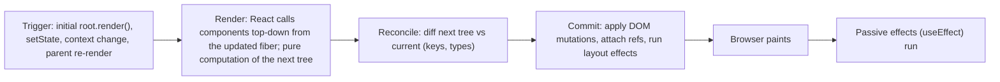
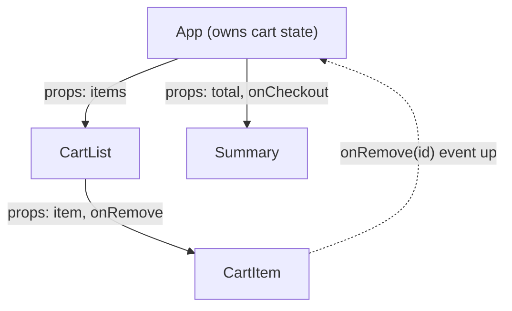

# 08 — React's Mental Model and the Rules of React

> React's one big bet: describe what the UI should look like for a given state, and let the library work out how to get there. Every rule of React exists to keep that bet safe.

**Prerequisites:** [03](03-javascript-runtime-and-engine.md) · **Related:** [10 Internals](10-react-internals-fiber-and-reconciliation.md) · [12 Hooks](12-hooks-in-depth.md) · [13 Effects](13-effects-and-synchronization.md)

---

## TL;DR

- **UI = f(state).** Components are functions that turn props, state and context into a *description* of UI (React elements). React decides when to call them and how to apply the result.
- **Rendering ≠ updating the DOM.** *Render* means calling your components to compute the next tree. *Commit* means applying the minimal set of changes to the host (DOM). A render can happen without any DOM change, and React may render more than once before committing, or discard a render entirely.
- Because React may render at any time, any number of times, **components and hooks must be pure**: same inputs, same output, no side effects during render. Side effects belong in **event handlers** first and **effects** second.
- **State is a snapshot.** Within a render, `state` is a constant. `setState` schedules a new render with a new snapshot. Updates are **batched** automatically (React 18+).
- **State belongs to a position in the tree**, identified by component type, position and `key`. Same type at the same position keeps its state; change the type or the `key` and the state resets.
- Keep state **minimal**. Anything you can compute from props or other state should be computed during render, not stored and synchronised.
- These rules aren't style advice. **Concurrent rendering, StrictMode, Server Components and the React Compiler all depend on them.**

---

## 1. From imperative to declarative

```ts
// Imperative: you describe the transitions
button.addEventListener('click', () => {
  count++;
  label.textContent = `Clicked ${count} times`;
  if (count > 5) { warning.hidden = false; button.disabled = true; }
});
```

```tsx
// Declarative: you describe the states
function Counter() {
  const [count, setCount] = useState(0);
  return (
    <>
      <button disabled={count > 5} onClick={() => setCount((c) => c + 1)}>
        Clicked {count} times
      </button>
      {count > 5 && <p role="alert">That's enough clicking.</p>}
    </>
  );
}
```

With *N* boolean pieces of UI state there are 2ᴺ possible states and O(N²) transitions between them. Imperative code has to handle every transition correctly. Declarative code has to describe each state correctly, and React derives the transitions. This is why React scales to large UIs, and why everything that breaks the "describe the state" model (mutation, side effects in render, manual DOM edits) causes bugs.

---

## 2. Elements, components and instances

| Concept | What it is | Lifetime |
|---|---|---|
| **Component** | A function (or class) you write: `function Avatar(props) { … }` | Static code |
| **Element** | An immutable plain object describing what to render: `{ type: Avatar, props: {…}, key }` | Created on every render; cheap |
| **Fiber (instance)** | React's internal record for a component *at a position in the tree*: holds state, hooks, effects | As long as that position keeps the same type and key |
| **Host node** | The DOM node (or native view) | Managed by React during commit |

```tsx
// JSX is syntax for element creation (automatic runtime)
const el = <Avatar user={user} size={48} />;
// compiles to roughly:
import { jsx as _jsx } from 'react/jsx-runtime';
const el2 = _jsx(Avatar, { user, size: 48 });
```

> [!WARNING]
> **Never call a component as a function** (`{Avatar({ user })}`). That runs its hooks inside the *parent's* fiber. You lose its own state identity and break the Rules of Hooks. Always render it as an element (`<Avatar user={user} />`) so React can own its lifecycle.

---

## 3. Trigger → Render → Commit



### What triggers a render

1. **Initial render:** `createRoot(el).render(<App />)`.
2. **A state update** in the component, or in any ancestor (via `useState`/`useReducer`, or an external store with `useSyncExternalStore`).
3. **A context value change** for a context the component reads.
4. **Its parent re-rendered**, unless React can bail out (same element reference, `memo` with equal props, or compiler-memoised output; see [10](10-react-internals-fiber-and-reconciliation.md)).

> [!NOTE]
> "A parent re-render re-renders all children" is the default, and it is usually fine. Rendering is cheap compared to DOM work, and React only touches the DOM where output changed. Optimise when profiling shows a render cost that matters ([38](38-react-performance-engineering.md)).

---

## 4. State as a snapshot

```tsx
function Counter() {
  const [count, setCount] = useState(0);

  function handleClick() {
    setCount(count + 1); // schedules: 0 + 1
    setCount(count + 1); // schedules: 0 + 1 (same snapshot)
    setCount(count + 1); // schedules: 0 + 1
    console.log(count);  // 0: this render's snapshot never changes
  }
  // After the click: count === 1

  function handleClickCorrect() {
    setCount((c) => c + 1); // queue updater functions
    setCount((c) => c + 1);
    setCount((c) => c + 1);
  }
  // After the click: count === 3
  return <button onClick={handleClick}>{count}</button>;
}
```

Rules that follow from snapshots:

- Event handlers, effects and callbacks created in a render **see that render's values forever**, which is the root of stale closures ([12](12-hooks-in-depth.md)).
- Use **updater functions** when the next state depends on the previous one.
- **Automatic batching**: all updates in the same tick (event handlers, promises, timeouts, native handlers) are batched into one render. Use `flushSync` only for rare cases that need synchronous DOM (e.g., scrolling to a newly added item immediately).

```tsx
import { flushSync } from 'react-dom';

function addMessage(msg: Message) {
  flushSync(() => setMessages((m) => [...m, msg])); // DOM updated synchronously
  listRef.current!.lastElementChild!.scrollIntoView();
}
```

---

## 5. Identity: state lives at a position in the tree

React associates state with **where a component sits in the render tree**, not with the component's JSX or variable.

```tsx
function Profile({ isEditing }: { isEditing: boolean }) {
  return isEditing ? <Form key="edit" /> : <Form key="view" readOnly />; // different keys → separate state
}

// Same type, same position → state is preserved
{isFancy ? <Counter fancy /> : <Counter />}

// Different types at the same position → state is destroyed
{isPaused ? <p>Paused</p> : <Counter />}
```

### Use `key` to reset state on purpose

```tsx
// ✅ When the user changes, reset all of the form's internal state
<EditProfileForm key={userId} userId={userId} />
```

This is the idiomatic replacement for "an effect that resets state when a prop changes" ([13](13-effects-and-synchronization.md)).

### Never define components inside components

```tsx
function Parent() {
  // ❌ A NEW component type is created on every render, so React sees a different type
  //    and unmounts/remounts the subtree each time (losing state, focus, DOM)
  function Row({ item }: { item: Item }) { return <li>{item.name}</li>; }
  return <ul>{items.map((i) => <Row key={i.id} item={i} />)}</ul>;
}
```

Define components at module level. The React Compiler's lint rules flag this (`static-components`).

---

## 6. Purity and the Rules of React

The official **Rules of React** fall into three groups.

### 6.1 Components and hooks must be pure

1. **Idempotent:** the same props, state and context always produce the same output.
2. **Side effects run outside of render:** in event handlers (preferred) or effects.
3. **Props and state are immutable:** never mutate them; create new values.
4. **Return values and arguments to hooks are immutable** once passed.
5. **Values are immutable after being passed to JSX:** don't mutate an object after using it in an element.

```tsx
// ❌ Impure: reads a mutable global and mutates props
let renderCount = 0;
function Bad({ items }: { items: Item[] }) {
  renderCount++;                         // side effect in render
  items.sort((a, b) => a.rank - b.rank); // mutates props!
  return <List items={items} />;
}

// ✅ Pure: local mutation of values created during this render is fine
function Good({ items }: { items: Item[] }) {
  const sorted = items.toSorted((a, b) => a.rank - b.rank); // new array
  return <List items={sorted} />;
}
```

> [!TIP]
> **Local mutation is allowed.** Creating an array in render and pushing into it is pure, because nothing outside the render can observe it. Mutating anything that existed *before* the render (props, state, module variables, refs read during render) is not.

### 6.2 React calls components and hooks

- Never call component functions directly; render them as JSX.
- Never pass hooks around as values or call them conditionally. They are part of the component's identity.

### 6.3 Rules of Hooks

- Call hooks **only at the top level** (not in loops, conditions, nested functions, or after early returns).
- Call hooks **only from React functions** (components and custom hooks).
- Exception: `use()` can be called conditionally ([16](16-react-19-features-and-the-compiler.md)).

### Why React insists

| React capability | Why it needs purity |
|---|---|
| **StrictMode** (development) | Renders twice and runs effects as mount → unmount → mount, to surface impure renders and missing cleanups |
| **Concurrent rendering** | May start, pause, abandon and restart renders. Side effects in render would run for UI that never appears |
| **Suspense** | Components can render partially, suspend, and render again later |
| **`<Activity>`** | Hidden subtrees are rendered at low priority and effects are unmounted and remounted as visibility toggles |
| **Server Components / SSR** | Render in a different environment, possibly at build time |
| **React Compiler** | Memoises based on the assumption that same inputs mean same outputs, and that values aren't mutated after use |

---

## 7. One-way data flow



- **Props flow down. Events flow up** (through callbacks).
- **Lifting state up**: when two components need the same state, move it to their closest common parent and pass it down.
- **Single source of truth**: every piece of state is owned by exactly one component (or one store), and everything else derives from it.

---

## 8. Minimal state and derived data

The most effective React refactor is usually **deleting state**.

```tsx
// ❌ Redundant state that must be kept in sync
const [items, setItems] = useState<Item[]>([]);
const [filter, setFilter] = useState('');
const [visibleItems, setVisibleItems] = useState<Item[]>([]);
useEffect(() => setVisibleItems(items.filter((i) => i.name.includes(filter))), [items, filter]);

// ✅ Derive during render (memoise only if it's genuinely expensive)
const visibleItems = items.filter((i) => i.name.includes(filter));
```

Principles for structuring state (from the React docs, worth memorising):

1. **Group related state** that always changes together (`{ x, y }` rather than separate `x`, `y`).
2. **Avoid contradictions**: `isSending` + `isSent` → a single `status: 'typing' | 'sending' | 'sent'`.
3. **Avoid redundant state** that can be computed (full name from first and last).
4. **Avoid duplication**: store `selectedId`, not a copy of the selected object.
5. **Avoid deep nesting**: normalise (`byId` maps + id lists) for trees and graphs.

### "Thinking in React", the architect's version

1. Break the UI into a component hierarchy by responsibility.
2. Build a static version with props only.
3. Find the **minimal complete** representation of state.
4. Decide where each piece of state lives (component, URL, server cache, form, store; see [28](28-state-and-data-ownership-architecture.md)).
5. Add inverse data flow (callbacks or actions).

---

## 9. Composition over configuration

```tsx
// ❌ Configuration explosion
<Card title="Plan" subtitle="Pro" showBadge badgeText="Popular" footerButtons={[/* … */]} />

// ✅ Composition with children and slots
<Card>
  <Card.Header>
    <Card.Title>Pro</Card.Title>
    <Badge>Popular</Badge>
  </Card.Header>
  <Card.Body>…</Card.Body>
  <Card.Footer><Button>Choose</Button></Card.Footer>
</Card>
```

- `children` is the most powerful prop in React. It inverts control: the parent decides *what*, and the child decides *where*.
- Passing JSX as props (slots) avoids prop drilling and is also a **performance tool**: elements created by a parent that didn't re-render are referentially stable, so React skips them ([10](10-react-internals-fiber-and-reconciliation.md)).
- Inheritance between components is never needed. Use composition and hooks.

---

## 10. Escape hatches

**Refs** (`useRef`) and **effects** (`useEffect`) step outside the declarative model to talk to the imperative world: the DOM, timers, network, third-party widgets. They're necessary and legitimate. Overusing them is the clearest sign that a codebase is fighting React.

| Escape hatch | Legitimate use | Smell |
|---|---|---|
| `ref` to DOM | Focus, scroll, measure, integrate a non-React widget | Reading DOM to decide what to render |
| `ref` as an instance variable | Timer IDs, latest-value storage for callbacks | Using refs to avoid re-renders for visible data |
| `useEffect` | Synchronising with external systems | Deriving state, handling user events, chaining state updates |

---

## 11. React's design principles

The React team's long-standing principles explain many API decisions:

- **Composition:** components from different authors compose without coordination.
- **Escape hatches:** pragmatic access to the imperative world.
- **Stability:** gradual deprecation with warnings (and codemods) over breaking changes.
- **Interoperability:** React can be adopted incrementally into existing apps.
- **Scheduling is React's job:** components describe *what*, and React decides *when*, which is what makes it a *pull*-based system able to defer, split and prioritise work ([15](15-concurrent-react-suspense-and-transitions.md)).
- **Developer experience and debuggability:** warnings, DevTools, owner stacks.

> [!NOTE]
> **Contrast with fine-grained reactivity** (Angular signals, Solid, Svelte runes, Vue): those systems track which DOM bindings depend on which signals and update just those bindings, with no component re-render. React re-runs component functions and diffs the output. React's model is simpler to reason about (it's just functions) and enables scheduling, Suspense and server components naturally. Signal systems do less work per update by construction. The React Compiler narrows the gap by memoising automatically ([59](59-react-vs-angular-architecture-comparison.md)).

---

## Pitfalls and anti-patterns

| Anti-pattern | Why it's wrong | Do instead |
|---|---|---|
| Mutating state (`state.items.push(x); setState(state)`) | Same reference → React may skip the update; breaks memoisation and time-travel debugging | `setItems((xs) => [...xs, x])` or Immer |
| Storing derived data in state | Two sources of truth that drift | Compute during render |
| `key={index}` on reorderable or insertable lists | State and DOM attach to the wrong item | Stable IDs |
| `key={Math.random()}` | Remounts every render | Stable IDs |
| Components defined inside components | New type every render → remount | Module-level components |
| Side effects in render (fetch, subscriptions, analytics) | Run for discarded renders, twice in StrictMode | Event handlers or effects |
| Reading `ref.current` during render to decide output | Not reactive, so the UI goes stale | State, or `useSyncExternalStore` |
| Copying props into state "for editing" without a reset strategy | Stale when the prop changes | Use a `key` to reset, or keep it controlled |

---

## Architect's checklist

- [ ] StrictMode is on in development for all apps
- [ ] `eslint-plugin-react-hooks` (with the compiler-powered rules) is enabled and errors block CI
- [ ] Code review looks for derived state, effect chains and mutation
- [ ] List rendering always uses stable domain IDs for keys
- [ ] State ownership is documented for each major feature (where it lives and why)
- [ ] Components are composed with `children`/slots rather than configuration props
- [ ] Imperative integrations (maps, charts, editors) are isolated behind small wrapper components

---

## Interview angles

**Q1. What happens, step by step, when you call `setState` in a click handler?**
React enqueues an update on that component's fiber with a lane (priority) derived from the event: a discrete click gets the synchronous lane. All updates in the same event are batched. After the handler returns, React schedules a render from the root and processes the update queue for that fiber to compute the new state. It re-renders the component and, by default, its descendants, skipping subtrees with no pending work and equal props. It reconciles the new elements against the current fibers, then commits the DOM mutations, attaches refs and runs layout effects synchronously. Passive effects run afterwards. If `Object.is(newState, oldState)`, React may bail out early without re-rendering children.

**Q2. Why does React require components to be pure?**
Because React reserves the right to call them whenever and as often as it needs to: rendering twice in StrictMode, interrupting and restarting concurrent renders, pre-rendering hidden content in `<Activity>`, rendering on a server at build time, and memoising output with the Compiler. Impure renders would cause duplicated side effects, inconsistent UI and incorrect memoisation.

**Q3. How does React decide whether to keep or reset a component's state?**
By position and identity in the tree: the same component type at the same position under the same parent, with the same `key`, keeps its fiber and state. A different type, or a different `key`, unmounts the old fiber (destroying state) and mounts a new one. That's why you can reset state deliberately with `key`, and why components defined inside other components lose state on every render.

**Q4. What's the difference between rendering and committing? Can a render happen without a DOM change?**
Rendering is computing the next element tree by calling components, pure and possibly interruptible. Committing applies the differences to the DOM synchronously and runs layout effects. Yes: if a render produces the same output, reconciliation finds nothing to change and the commit is a no-op for the DOM. A concurrent render can also be thrown away entirely without ever committing.

**Q5. Explain "state as a snapshot" and how it causes the classic `setCount(count + 1)` ×3 bug.**
Each render has constant state values. All three calls read the same snapshot value (0) and schedule "set to 1". Updater functions (`c => c + 1`) are queued and applied in order to the latest pending state, giving 3.

---

## Further reading

- React docs, *Thinking in React*: <https://react.dev/learn/thinking-in-react>
- React docs, *Rules of React*: <https://react.dev/reference/rules>
- React docs, *Render and Commit*, *State as a Snapshot*, *Preserving and Resetting State*: <https://react.dev/learn>
- React docs, *Choosing the State Structure*: <https://react.dev/learn/choosing-the-state-structure>
- React docs (legacy), *Design Principles*: <https://legacy.reactjs.org/docs/design-principles.html>
- Dan Abramov, *React as a UI Runtime*: <https://overreacted.io/react-as-a-ui-runtime/>

---

[← Previous: 07 — Modern CSS and Layout Architecture](07-modern-css-and-layout-architecture.md) · [Index](README.md) · [Next: 09 — React Fundamentals: The Complete Reference →](09-react-fundamentals-complete-reference.md)
