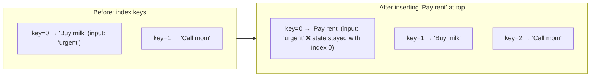
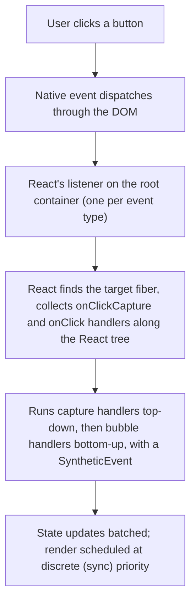

# 09 — React Fundamentals: The Complete Reference

> Fundamentals are where senior engineers lose interviews and production incidents start: the `0 &&` that renders a stray zero, the input that silently flips from uncontrolled to controlled, the key that reattaches state to the wrong row. This chapter covers every fundamental together with its edge cases.

**Prerequisites:** [08](08-react-mental-model-and-rules.md) · **Related:** [10 Internals](10-react-internals-fiber-and-reconciliation.md) · [12 Hooks](12-hooks-in-depth.md) · [26 Forms](26-forms-and-validation.md) · [A1 API Reference](A1-react-api-reference.md)

---

## TL;DR

- **JSX** compiles to `jsx()` calls from `react/jsx-runtime` (the automatic runtime, required in React 19). Attributes are camelCase DOM properties (`className`, `htmlFor`, `tabIndex`). `aria-*` and `data-*` stay kebab-case. `style` takes an object.
- **Component names must start with a capital letter**, otherwise JSX treats them as host elements. Props are read-only. Defaults come from destructuring (`defaultProps` was removed for function components in React 19).
- `false`, `null`, `undefined` and `true` render nothing, but **`0` and `NaN` render as text**. That's the `count && <List/>` bug.
- **Keys** must be stable and unique **among siblings**. They tell React which item is which across renders. They're not props, and they're not for performance tricks.
- **Synthetic events** are delegated at the **root container** (React 17+). `onChange` fires on **every keystroke**, unlike the DOM `change` event. Events bubble through the **React tree**, including across portals.
- **Controlled** inputs take `value` + `onChange`; **uncontrolled** inputs take `defaultValue` and are read through refs or `FormData`. Switching between the two is a bug that React warns about.
- **StrictMode** (development only) double-invokes renders, effects and ref callbacks to surface impurity and missing cleanup. Since 19.3 it also double-invokes effects during hydration.

---

## 1. JSX in depth

### 1.1 What JSX compiles to

```tsx
// Source
<Button variant="primary" onClick={save}>Save</Button>

// Automatic runtime output (production)
import { jsx as _jsx } from 'react/jsx-runtime';
_jsx(Button, { variant: 'primary', onClick: save, children: 'Save' });

// Multiple static children use jsxs (lets React skip key warnings for static arrays)
// Development builds use jsxDEV with source locations for better errors and owner stacks
```

- You **don't** need `import React from 'react'` for JSX (automatic runtime). React 19 requires the new JSX transform.
- `key` is extracted separately and is **not** available as `props.key`. In React 19, `ref` is a regular prop for function components, and reading `element.ref` is deprecated.
- Elements are **immutable** plain objects. You can't "update" an element; you render a new one.

### 1.2 The rules

| Rule | Example | Why |
|---|---|---|
| One root per expression | `return <><Header /><Main /></>` | A function returns one value; Fragments add no DOM |
| Close every tag | ``, `<br />`, `<Input />` | JSX is XML-like |
| camelCase DOM properties | `className`, `htmlFor`, `tabIndex`, `onClick`, `autoComplete`, `readOnly` | JSX maps to DOM properties, not HTML attributes |
| `aria-*` and `data-*` keep dashes | `aria-expanded={open}`, `data-testid="row"` | Spec'd attribute names |
| `style` is an object | `style={{ marginInlineStart: 8, '--gap': '4px' }}` | Numbers become `px` except for unitless properties |
| JS expressions in `{}` | `{user.name}`, `{items.length > 0 ? … : …}` | Statements (`if`, `for`) aren't expressions |
| Comments | `{/* note */}` | Inside JSX |
| Custom elements | `<acme-badge tone="danger">` | Lowercase with a dash means host custom element |

```tsx
// CSS custom properties in inline styles need a cast in TS
<div style={{ '--columns': 3 } as React.CSSProperties} />
```

### 1.3 Whitespace and text

- Lines with only whitespace between tags are removed. `{' '}` inserts an explicit space.
- Text is **escaped** automatically. `<p>{userInput}</p>` can't inject HTML. This is React's baseline XSS protection ([43](43-frontend-security-architecture.md)).
- The only way to inject raw HTML is `dangerouslySetInnerHTML={{ __html: sanitized }}`. Sanitise with DOMPurify, or pass a `TrustedHTML` value under Trusted Types. React 19.3 passes Trusted Types objects through without coercing them to strings.

### 1.4 What can be rendered

| Value | Renders | Notes |
|---|---|---|
| `string`, `number` | Text | `0` and `NaN` render! |
| `null`, `undefined`, `true`, `false` | Nothing | Basis of conditional rendering |
| React element | The element | |
| Array / iterable of renderables | Each item | Items need `key`s |
| Fragment | Its children | |
| Portal (`createPortal`) | Children in another DOM node | [14](14-refs-dom-portals-and-imperative-apis.md) |
| **Plain object** | ❌ Throws "Objects are not valid as a React child" | Usually a forgotten `.name` |
| **Function** | ❌ Warning, renders nothing | You meant to call a render prop, or render `<Comp />` |
| `Date` | ❌ Throws (it's an object) | Format it first |

---

## 2. Components and props

```tsx
type AvatarProps = {
  user: { name: string; imageUrl: string };
  size?: number;              // optional with default
} & Omit<React.ComponentProps<'img'>, 'src' | 'alt'>;

export function Avatar({ user, size = 48, ...imgProps }: AvatarProps) {
  return (
    
  );
}
```

| Fundamental | Detail |
|---|---|
| **Capitalisation** | `<avatar />` is a host element named "avatar"; `<Avatar />` is your component |
| **Props are read-only** | Never mutate `props` (Rules of React) |
| **Defaults** | Destructuring defaults. `defaultProps` for **function** components was removed in 19 (classes still support it) |
| **Spreading** | `{...rest}` forwards unknown props. Spread **before** explicit props you want to protect, or **after** props you want to allow overriding. Order matters |
| **`children`** | Anything between tags. Type it `React.ReactNode` |
| **Booleans** | `<Toggle disabled />` means `disabled={true}` |
| **Functions as props** | Callbacks (events up), render props (UI injection) |

> [!TIP]
> Prop naming conventions that scale: `onX` for callbacks, `isX`/`hasX` (or plain adjectives like `disabled`, `open`) for booleans, `renderX` for render props, `defaultX` for uncontrolled initial values, and `X` + `onXChange` for controlled pairs ([22](22-component-architecture-and-patterns.md)).

---

## 3. Conditional rendering

```tsx
// Ternary for either/or
{isLoggedIn ? <Dashboard /> : <Login />}

// && for "maybe": make the left side a real boolean
{items.length > 0 && <List items={items} />}   // ✅
{items.length && <List items={items} />}       // ❌ renders "0" when empty

// Early return
if (!user) return null;

// Lookup map for many variants
const views = { grid: GridView, list: ListView, board: BoardView } as const;
const View = views[mode];
return <View items={items} />;
```

### Hide vs unmount vs deactivate

| Technique | DOM | State | Effects | Use when |
|---|---|---|---|---|
| Conditional render (`cond && <X/>`) | Removed | **Destroyed** | Cleaned up | Default |
| CSS (`hidden`, `display: none`) | Kept | Kept | Keep running | Cheap toggles with no background work |
| `<Activity mode="hidden">` (19.2+) | Kept, hidden | **Kept** | **Cleaned up**, re-run when visible | Tabs, back navigation, pre-rendering likely next screens ([15](15-concurrent-react-suspense-and-transitions.md)) |

> [!WARNING]
> Conditionals change **position-based identity**. `{a ? <Counter /> : <Counter />}` keeps state (same type at the same position), while `{a && <Counter />}{!a && <Counter />}` gives two different positions, so state resets. Use `key` when you want an explicit reset ([08](08-react-mental-model-and-rules.md)).

---

## 4. Lists and keys

```tsx
<ul>
  {todos.map((todo) => (
    <TodoItem key={todo.id} todo={todo} />   // key on the outermost element returned by map
  ))}
</ul>

// Multiple elements per item: keyed Fragment
{entries.map((e) => (
  <Fragment key={e.term}>
    <dt>{e.term}</dt>
    <dd>{e.definition}</dd>
  </Fragment>
))}
```

| Key rule | Why |
|---|---|
| Unique among **siblings** (not globally) | Keys identify children within one parent |
| **Stable** across renders | Changing keys remounts components (state, focus and DOM lost) |
| From data (`id`), not from position | Insertions and reorders shift indexes, so state attaches to the wrong item |
| Not `Math.random()` / `crypto.randomUUID()` in render | A new key every render remounts every time |
| Index is acceptable only for **static, never-reordered, stateless** lists | E.g., breadcrumbs built from a fixed path |
| Not readable as a prop | Pass `id` separately if the child needs it |



**Keys as a reset tool:** `<ChatThread key={threadId} />` gives each thread fresh state. This is the idiomatic replacement for effects that "reset state when a prop changes" ([13](13-effects-and-synchronization.md)).

---

## 5. Events

### 5.1 The synthetic event system



| Fact | Detail |
|---|---|
| Delegation | React 17+ attaches listeners to the **root container**, not `document`. This allows multiple React versions and roots on one page |
| Synthetic events | Cross-browser wrappers. `e.nativeEvent` gives the original. Event pooling was **removed** in React 17, so you can use `e` asynchronously |
| Propagation | Follows the **React component tree**, so events from inside a portal bubble to the portal's React parent ([14](14-refs-dom-portals-and-imperative-apis.md)) |
| Capture phase | `onClickCapture`, `onKeyDownCapture`, … |
| `stopPropagation()` | Stops React propagation (and the native event at the root) |
| `onChange` on inputs | Fires on **every input change** (like DOM `input`), not on blur |
| `onFocus` / `onBlur` | **Bubble** (implemented with `focusin`/`focusout`). Use `e.currentTarget.contains(e.relatedTarget)` to detect focus leaving a container |
| `onMouseEnter` / `onMouseLeave` | Don't bubble (DOM semantics) |
| `onScroll` | Does **not** bubble in React 17+ |
| Touch and wheel | React attaches `touchstart`/`touchmove`/`wheel` as **passive** at the root, so `preventDefault()` in `onWheel` doesn't work. Add a native listener with `{ passive: false }` via a ref when you truly need it |
| Priority | Discrete events (click, keydown) → sync lane; continuous events (mousemove, scroll) → continuous lane ([10](10-react-internals-fiber-and-reconciliation.md)) |
| `submit` | 19.3: the `submit` event includes `submitter` (the button that submitted) |

### 5.2 Handler patterns

```tsx
// ✅ pass the function
const save = <button onClick={handleClick}>Save</button>;

// ❌ calls it during render (and every render)
const wrong = <button onClick={handleClick()}>Save</button>;

// ✅ arguments via closure
const removeButton = <button onClick={() => remove(item.id)}>Remove</button>;

// ✅ currentTarget is the element the handler is attached to; target is what was clicked
function onRowClick(e: React.MouseEvent<HTMLTableRowElement>) {
  const id = e.currentTarget.dataset.id;
}

// ✅ IME-safe Enter handling (CJK input methods compose text with Enter)
function onKeyDown(e: React.KeyboardEvent<HTMLInputElement>) {
  if (e.key === 'Enter' && !e.nativeEvent.isComposing) submit();
}
```

> [!IMPORTANT]
> **Event handlers are the primary place for side effects** in React: they run in response to a specific user action, exactly once. Reach for effects only for synchronisation that isn't caused by a particular interaction ([13](13-effects-and-synchronization.md)).

---

## 6. State fundamentals

```tsx
const [user, setUser] = useState<User>(initialUser);

// Objects: copy, don't mutate
setUser((u) => ({ ...u, address: { ...u.address, city: 'Lisbon' } }));

// Arrays: use non-mutating operations
setTodos((ts) => [...ts, newTodo]);                                  // add
setTodos((ts) => ts.filter((t) => t.id !== id));                     // remove
setTodos((ts) => ts.map((t) => (t.id === id ? { ...t, done: !t.done } : t))); // update
setTodos((ts) => ts.toSorted((a, b) => a.rank - b.rank));            // sort (ES2023)

// Deep updates: Immer keeps code readable
import { produce } from 'immer';
setDoc(produce((d) => { d.sections[2].blocks[5].text = 'new'; }));
```

| Operation | ❌ Mutating | ✅ Non-mutating |
|---|---|---|
| Add | `push`, `unshift` | `[...a, x]`, `[x, ...a]` |
| Remove | `splice`, `pop`, `shift` | `filter`, `toSpliced` |
| Replace | `a[i] = x` | `map`, `with(i, x)` |
| Sort or reverse | `sort`, `reverse` | `toSorted`, `toReversed` |

---

## 7. Forms and inputs: fundamentals

### 7.1 Controlled vs uncontrolled

```tsx
// Controlled: React state is the source of truth
const [email, setEmail] = useState('');
<input type="email" value={email} onChange={(e) => setEmail(e.target.value)} />

// Uncontrolled: the DOM is the source of truth; read on submit
function Signup() {
  async function action(formData: FormData) {
    await register({ email: String(formData.get('email')) });
  }
  return (
    <form action={action}>                       {/* React 19 form Action */}
      <input name="email" type="email" defaultValue="" required />
      <button>Sign up</button>
    </form>
  );
}
```

| Element | Controlled props | Uncontrolled props | Gotchas |
|---|---|---|---|
| `<input type="text">` | `value` + `onChange` | `defaultValue` | `value` without `onChange` → read-only warning (or add `readOnly`) |
| `<input type="checkbox/radio">` | `checked` + `onChange` | `defaultChecked` | Use `checked`, not `value`, for state |
| `<textarea>` | `value` | `defaultValue` | Not children text |
| `<select>` | `value` (array with `multiple`) | `defaultValue` | React-specific: no `selected` on `<option>` |
| `<input type="file">` | — | Always uncontrolled | Read `files` via ref or `FormData` |
| `<input type="number">` | `value` is a **string** | `defaultValue` | Parse yourself. 19.3 changed `defaultValue` updates for number inputs |

> [!WARNING]
> **Controlled ↔ uncontrolled switching:** `value={user?.name}` is `undefined` (uncontrolled) on the first render, then a string (controlled). React warns, and the behaviour is undefined. Use `value={user?.name ?? ''}`. Likewise, never set `value={null}`.

### 7.2 Form Actions (React 19) in one paragraph

`<form action={fn}>` calls `fn(formData)` inside a transition. You get pending state via `useFormStatus` (in a child) or `useActionState`. Uncontrolled fields are **automatically reset** after a successful Action (19.3 fires `onReset` on that reset), and the same function can be a Server Function for progressive enhancement. Full architecture in [26](26-forms-and-validation.md).

---

## 8. Styling fundamentals

```tsx
import clsx from 'clsx';
import styles from './Button.module.css';

<button
  className={clsx(styles.button, variant === 'primary' && styles.primary, isActive && 'is-active')}
  style={{ inlineSize: fullWidth ? '100%' : undefined }}
/>
```

- `style` numbers become `px` except for **unitless** properties (`lineHeight`, `zIndex`, `opacity`, `flex`, `fontWeight`, `order`, …). `lineHeight: 1.5` is unitless; `lineHeight: '24px'` sets pixels.
- Prefer classes and CSS variables over inline styles for theming and performance (inline styles can't use media queries, pseudo-classes or container queries).
- Styling architecture (Modules, Tailwind, zero-runtime) is covered in [23](23-styling-architecture-and-theming.md).

---

## 9. Fragments

```tsx
<>                                   {/* short syntax: no key, no props */}
  <Header />
  <Main />
</>

<Fragment key={id}>…</Fragment>      {/* needed for keyed lists */}

<Fragment ref={fragmentRef}>…</Fragment>  {/* 19.3: Fragment refs → FragmentInstance */}
```

Fragment refs (stable in 19.3) give you a `FragmentInstance` that can add event listeners to, focus, observe (with `IntersectionObserver`/`ResizeObserver`) and scroll its first-level host children, without adding a wrapper `<div>` ([14](14-refs-dom-portals-and-imperative-apis.md)).

---

## 10. Composition fundamentals

```tsx
// children as a slot
function Panel({ title, children }: { title: string; children: React.ReactNode }) {
  return (
    <section aria-labelledby="panel-title">
      <h2 id="panel-title">{title}</h2>
      {children}
    </section>
  );
}

// named slots via props
const page = (
  <Layout sidebar={<Nav />} header={<TopBar />}>
    <Content />
  </Layout>
);

// render prop (pass a function when the child must supply data)
const list = <DataList items={users} renderItem={(u) => <UserRow user={u} />} />;
```

Composition is the primary reuse mechanism in React: there is no component inheritance. Advanced patterns (compound components, headless hooks, `asChild`) are in [22](22-component-architecture-and-patterns.md).

---

## 11. Roots and entry points

```tsx
import { createRoot, hydrateRoot } from 'react-dom/client';
import { captureError } from '@/shared/observability';

// Client-rendered app
const root = createRoot(document.getElementById('root')!, {
  identifierPrefix: 'app-',                // useId prefix (multiple roots on one page)
  onUncaughtError: (error, info) => captureError(error, { componentStack: info.componentStack }),
  onCaughtError: (error, info) => captureError(error, { componentStack: info.componentStack }), // caught by error boundaries
  onRecoverableError: (error, info) => reportWarning(error),                     // e.g. hydration mismatch recovered
});
root.render(<App />);
// root.unmount();

// Server-rendered app
hydrateRoot(document, <App />, { onRecoverableError: reportWarning });
```

| API | Status |
|---|---|
| `createRoot`, `hydrateRoot` | Stable (React 18+). Enables concurrent features |
| `ReactDOM.render`, `ReactDOM.hydrate`, `unmountComponentAtNode`, `findDOMNode` | **Removed** in React 19 |

---

## 12. StrictMode

```tsx
createRoot(el).render(
  <StrictMode>
    <App />
  </StrictMode>,
);
```

In **development only**, StrictMode:

1. **Renders components twice** (and calls `useState`/`useMemo`/`useReducer` initialisers twice) to expose impure renders. Since React 19, memoised results from the first render are **reused** on the second.
2. **Runs effects twice on mount** (setup → cleanup → setup) to expose missing cleanups. Since **19.3** this also happens during **hydration**, matching client-rendered roots.
3. **Calls ref callbacks twice** (attach → detach → attach), React 19.
4. Warns about deprecated APIs.

> [!NOTE]
> "My effect runs twice in development" is StrictMode working as designed. The fix is a correct cleanup, never removing StrictMode ([13](13-effects-and-synchronization.md)).

---

## 13. Accessibility fundamentals in JSX

```tsx
<label htmlFor="email">Email</label>
<input id="email" type="email" autoComplete="email" aria-describedby="email-hint" />
<p id="email-hint">We'll never share your email.</p>

<button type="button" aria-expanded={menuOpen} aria-controls="menu" onClick={toggleMenu}>Options</button>

  {/* decorative: empty alt, not missing alt */}
```

- Use **semantic elements first** (`button`, `a`, `nav`, `main`, `label`, `table`). A `div` with `onClick` isn't keyboard-accessible.
- `useId()` generates stable IDs for label and description relationships that survive SSR ([12](12-hooks-in-depth.md)).
- Enable `eslint-plugin-jsx-a11y`. Treat a11y as a system contract ([36](36-accessibility-engineering.md)).

---

## 14. The fundamentals gotcha list

| # | Gotcha | Fix |
|---|---|---|
| 1 | `class=`, `for=` | `className`, `htmlFor` |
| 2 | `{count && …}` renders `0` | `{count > 0 && …}` |
| 3 | `onClick={fn()}` | `onClick={fn}` or `() => fn(x)` |
| 4 | Index keys on dynamic lists | Stable IDs |
| 5 | Mutating state arrays and objects | Copy (`map`, `filter`, spread, Immer) |
| 6 | Reading state right after `setState` | State is a snapshot; use the next value you computed |
| 7 | `value` without `onChange` | Add `onChange`, `readOnly`, or use `defaultValue` |
| 8 | `value={undefined}` then a string | `value={x ?? ''}` |
| 9 | Components defined inside components | Module scope |
| 10 | `preventDefault()` in `onWheel` doesn't work | Native non-passive listener via ref |
| 11 | Expecting `onScroll` to bubble | Attach to the scrolling element |
| 12 | `onChange` assumed to fire on blur | It fires per keystroke; use `onBlur` for commit-on-blur |
| 13 | Rendering an object | Render its fields |
| 14 | Enter-key submit firing during IME composition | Check `isComposing` |
| 15 | `<div onClick>` for actions | `<button type="button">` |
| 16 | Forgetting `type="button"` inside forms | Buttons default to `type="submit"` |
| 17 | `style={{ zIndex: '10px' }}` | Unitless numbers for unitless properties |
| 18 | `defaultValue` expected to update when props change | Use a `key` to reset, or make it controlled |

---

## Decision framework: controlled or uncontrolled?

| Question | If yes → |
|---|---|
| Do other parts of the UI react to each keystroke (live validation, character counts, dependent fields)? | Controlled (or a form library with subscriptions) |
| Is the form large (50+ fields) with performance issues on typing? | Uncontrolled + form library (React Hook Form) or form Actions |
| Must it work without JavaScript (progressive enhancement)? | Uncontrolled + `<form action>` (Server Function) |
| Is the value derived from or shared with server state? | Controlled from a form state layer, synced on submit |
| Do you only need values on submit? | Uncontrolled + `FormData` |

---

## Architect's checklist

- [ ] `eslint-plugin-react-hooks` and `eslint-plugin-jsx-a11y` are on, and errors block CI
- [ ] StrictMode wraps every root in development
- [ ] Keys come from domain IDs; no index keys on mutable lists (code-review item)
- [ ] Root error callbacks report to observability ([41](41-observability-and-diagnostics.md))
- [ ] A single convention for controlled vs uncontrolled inputs per form type
- [ ] `dangerouslySetInnerHTML` only through a sanitising wrapper component (lint ban elsewhere)
- [ ] Prop naming conventions documented in the design-system contribution guide

---

## Interview angles

**Q1. Why does `{items.length && <List />}` sometimes render `0`?**
`&&` returns its left operand when it's falsy. `0` is falsy, but React renders numbers as text, so the expression evaluates to `0` and React prints it. `false`, `null` and `undefined` render nothing. Use a real boolean: `items.length > 0 && …`, or a ternary.

**Q2. What does `key` actually do?**
It's the identity of a child among its siblings during reconciliation. React matches old and new children by key (and type), so state, DOM nodes and effects stay attached to the right item across inserts and reorders. Changing a key forces a remount, which is useful for intentionally resetting state. Keys only need to be unique among siblings, and they aren't passed as props.

**Q3. How do React events differ from DOM events?**
React delegates listeners at the root container and dispatches synthetic events along the **React** tree (so events bubble through portals to React parents). `onChange` fires on every edit, like `input`. `onFocus`/`onBlur` bubble, `onScroll` doesn't, and touch and wheel listeners are passive, so `preventDefault` there doesn't work. Pooling is gone since React 17. Each event type also has a scheduling priority that determines how urgently the resulting update renders.

**Q4. Controlled vs uncontrolled inputs: which do you prefer?**
Neither universally. Controlled inputs make React state the single source of truth: live validation and dependent fields are easy, but every keystroke re-renders. Uncontrolled inputs keep the DOM as the source of truth, read on submit via `FormData` or refs. They're simpler, faster for big forms, and natural with React 19 form Actions and progressive enhancement. Large apps often use uncontrolled inputs underneath a form library that offers subscriptions, plus controlled components for complex widgets.

**Q5. Why does my effect run twice?**
StrictMode in development mounts, unmounts and remounts components to verify that effects clean up properly, because features like `<Activity>`, Fast Refresh and future preserved-state features rely on that resilience. Since 19.3 this also happens during hydration. In production it runs once. The fix is a proper cleanup function.

---

## Further reading

- React docs, *Describing the UI*, *Adding Interactivity*, *Managing State*: <https://react.dev/learn>
- React docs, *Common components (e.g. `<div>`)* and *`<input>`*, *`<select>`*, *`<textarea>`*: <https://react.dev/reference/react-dom/components>
- React docs, *`<StrictMode>`*, *`<Fragment>`*: <https://react.dev/reference/react>
- React 17 release notes, *Changes to event delegation*: <https://legacy.reactjs.org/blog/2020/10/20/react-v17.html>
- React 19.3 release post: <https://react.dev/blog/2026/09/09/react-19-3>

---

[← Previous: 08 — React's Mental Model and the Rules of React](08-react-mental-model-and-rules.md) · [Index](README.md) · [Next: 10 — React Internals: Fiber, Reconciliation and Lanes →](10-react-internals-fiber-and-reconciliation.md)
