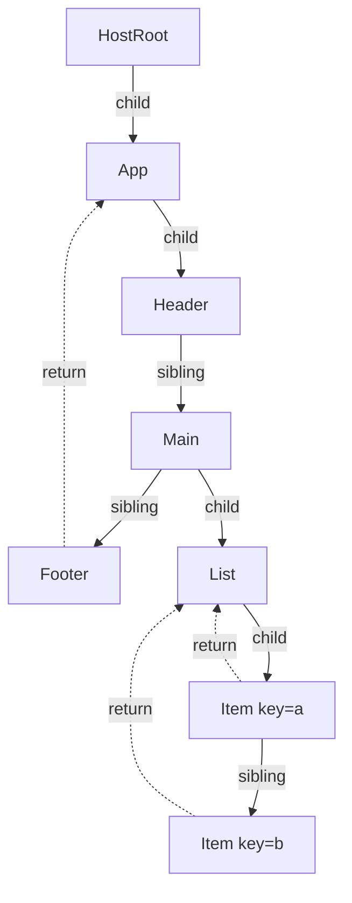
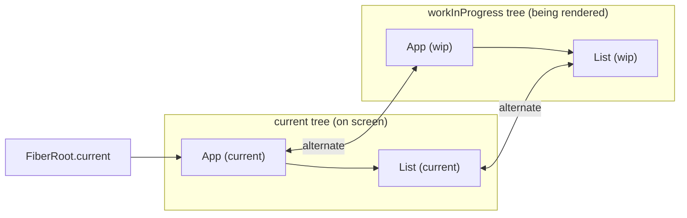
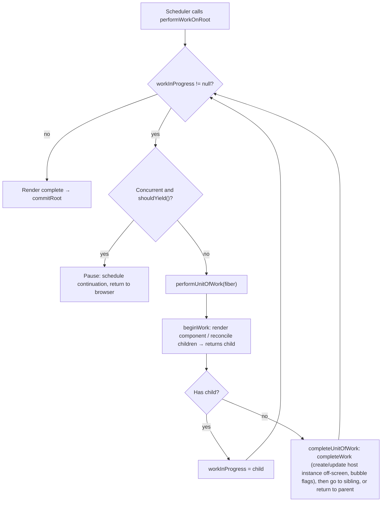
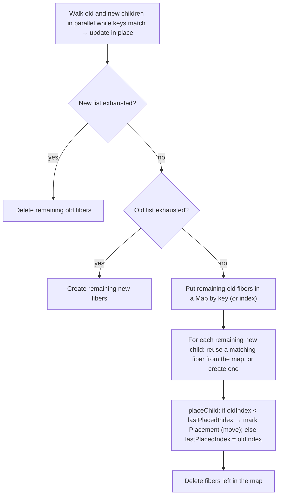
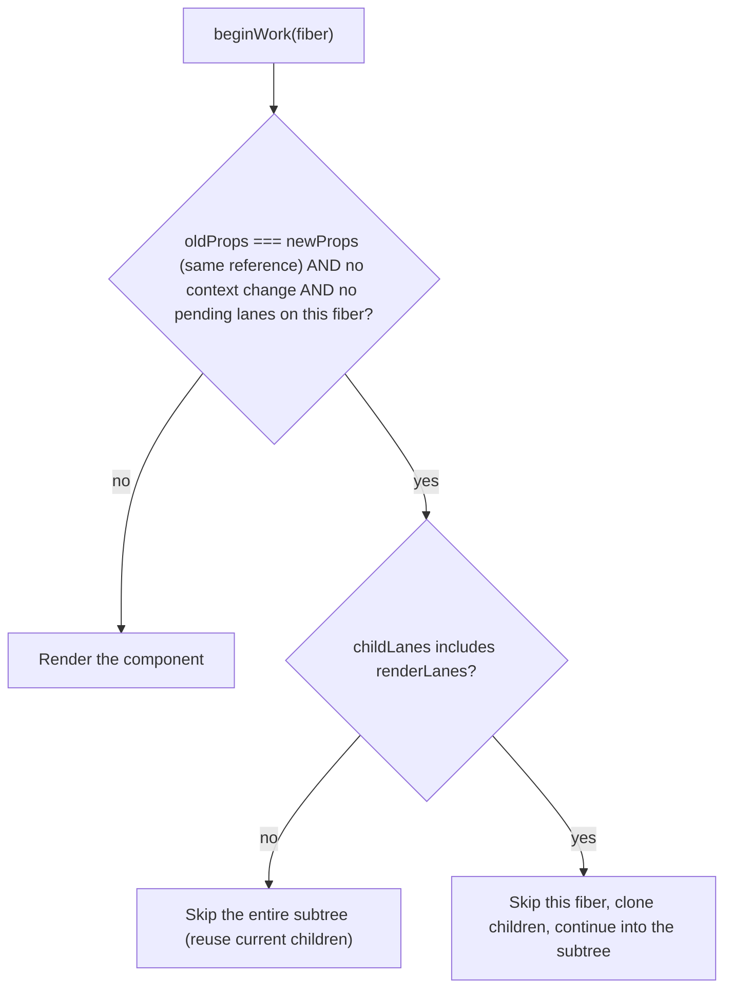
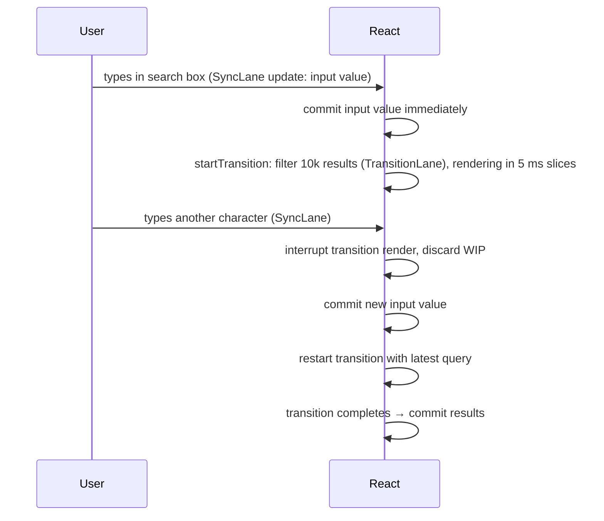
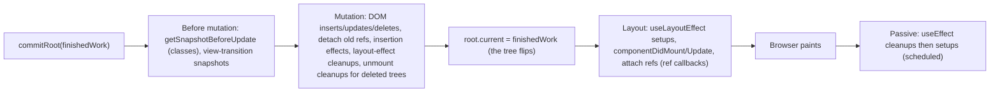

# 10 — React Internals: Fiber, Reconciliation and Lanes

> Fiber is React's own call stack, rebuilt as a linked list so it can be paused, prioritised, resumed and thrown away. Everything "concurrent" in React grows out of that one decision.

**Prerequisites:** [03](03-javascript-runtime-and-engine.md), [08](08-react-mental-model-and-rules.md), [09](09-react-fundamentals-complete-reference.md) · **Related:** [11 Build Your Own React](11-build-your-own-react.md) · [12 Hooks](12-hooks-in-depth.md) · [15 Concurrent React](15-concurrent-react-suspense-and-transitions.md)

---

## TL;DR

- A **fiber** is a mutable object representing one component instance or host node at a position in the tree. It has `child`/`sibling`/`return` pointers, props, state (`memoizedState`, which for function components is the **hooks linked list**), pending work (`lanes`, `childLanes`) and effects (`flags`, `subtreeFlags`).
- React keeps **two trees**: `current` (on screen) and `workInProgress` (being built). They are linked via `alternate`. At commit, the root pointer flips (double buffering).
- The **render phase** (`beginWork` down, `completeWork` up, one fiber per unit of work) is pure and **interruptible** in concurrent mode. The **commit phase** (before-mutation → mutation → layout, then passive effects) is **synchronous**.
- **Reconciliation** is O(n), based on two heuristics: different **types** produce different trees, and **keys** identify children among siblings. Moving an item from the end of a list to the front is the expensive case.
- **Bailouts** let React skip a fiber (when there are no pending lanes, and props and context are unchanged by reference) or a whole subtree (when `childLanes` is empty). Passing the *same element object* is the cheapest optimisation in React.
- **Lanes** are a bitmask priority system. Sync lane for discrete input, continuous lane for drag and scroll, default lane for network and timers, transition lanes for `startTransition`, plus retry, idle and offscreen lanes. Higher-priority updates **interrupt** lower-priority renders. Starved lanes **expire** and render synchronously.
- React yields to the browser **between fibers**, roughly every 5 ms. A single slow component still blocks the main thread.

---

## 1. Why Fiber exists

Before React 16, the **stack reconciler** walked the component tree recursively. Once a render started, it ran to completion: the call stack was the data structure, so it couldn't be paused. A 200 ms render blocked input for 200 ms.

Fiber (React 16, 2017) re-implemented reconciliation as an explicit **work loop over a linked tree of fibers**. That made it possible to:

1. **Split** rendering into units of work (one fiber each).
2. **Pause** and yield to the browser between units.
3. **Prioritise** updates (lanes).
4. **Abort** and restart work when something more urgent arrives.
5. **Reuse** completed work (bailouts, double buffering).
6. Render **off-screen** (Suspense fallbacks, `<Activity>`) and **resume** later.

Concurrent features (transitions, Suspense, streaming SSR, selective hydration) were all built on this foundation over the following years.

> [!NOTE]
> The React docs avoid the term "virtual DOM". The more precise model is: components return **element trees** (descriptions), React maintains a **fiber tree** (instances with state), and a **host config** (react-dom, react-native, custom renderers) applies changes to the real host.

---

## 2. Anatomy of a fiber

```ts
// Simplified: the real type has more fields and they change between versions
interface Fiber {
  tag: WorkTag;                  // FunctionComponent, ClassComponent, HostRoot, HostComponent ('div'),
                                 // HostText, Fragment, ContextProvider, ForwardRef, Memo, Lazy,
                                 // SuspenseComponent, OffscreenComponent (powers <Activity>), …
  type: any;                     // the component function/class, or 'div'
  key: string | null;
  stateNode: any;                // DOM node for host fibers, class instance for classes, FiberRoot for HostRoot

  // Tree structure (a singly linked list of children)
  return: Fiber | null;          // parent
  child: Fiber | null;           // first child
  sibling: Fiber | null;         // next sibling
  index: number;                 // position among siblings

  // Inputs and outputs
  pendingProps: any;             // new props for this render
  memoizedProps: any;            // props from the last committed render
  memoizedState: any;            // class state, OR the head of the hooks linked list
  updateQueue: any;              // pending updates (class/root), effect list for function components
  dependencies: any;             // contexts this fiber reads

  // Scheduling
  lanes: Lanes;                  // pending work on this fiber
  childLanes: Lanes;             // pending work somewhere in the subtree

  // Effects
  flags: Flags;                  // Placement, Update, ChildDeletion, Ref, Passive, Snapshot, Visibility…
  subtreeFlags: Flags;           // union of descendants' flags (lets commit skip clean subtrees)
  deletions: Fiber[] | null;

  alternate: Fiber | null;       // the other version of this fiber (current ↔ workInProgress)
}
```

### Tree shape



Each fiber points to its **first child**, its **next sibling** and its **parent** (`return`, named because that's where work "returns" to, like a stack frame's return address).

---

## 3. Double buffering: `current` and `workInProgress`



- When an update starts, React creates (or reuses) the `alternate` of each fiber it visits, building the **workInProgress** tree.
- Untouched subtrees are **shared** by cloning pointers (cheap).
- If a render is interrupted or discarded, the `current` tree is untouched, so the screen stays consistent.
- At commit, `FiberRoot.current = finishedWork`. The workInProgress tree **becomes** current, and the old current becomes the pool of alternates for the next render.

---

## 4. The render phase: the work loop



```js
// Conceptual (React source names vary between versions)
function workLoopConcurrent() {
  while (workInProgress !== null && !shouldYield()) {
    performUnitOfWork(workInProgress);
  }
}

function performUnitOfWork(unit) {
  const next = beginWork(unit.alternate, unit, renderLanes); // go down
  unit.memoizedProps = unit.pendingProps;
  if (next === null) completeUnitOfWork(unit);               // go up / sideways
  else workInProgress = next;
}
```

### What `beginWork` does per fiber type

| Fiber type | `beginWork` |
|---|---|
| Function component | Calls the component with props, running hooks against the fiber's hook list → children → reconcile |
| Class component | Processes the update queue, calls lifecycle methods and `render()` → reconcile |
| Host component (`div`) | Reconciles `props.children` |
| Context provider | Pushes the new value; if it changed, marks consumers for update |
| Suspense | Decides whether to render the primary children or the fallback |
| Memo / SimpleMemo | Shallow-compares props → may bail out |
| Offscreen (`<Activity>`) | Hidden: defers the subtree to `OffscreenLane` |

### What `completeWork` does

- For host fibers: creates DOM nodes (`createInstance`), appends already-completed children (the DOM subtree is built **detached**, off-screen), and computes the prop diff (an update payload) for existing nodes.
- **Bubbles** `flags` into the parent's `subtreeFlags`, so the commit phase can skip subtrees with nothing to do.

---

## 5. Reconciliation: the diffing algorithm

A general tree diff is O(n³). React's heuristic algorithm is **O(n)**:

1. **Different element types → different trees.** `<div>` → `<span>`, or `<Counter>` → `<Timer>`: unmount the old subtree (state destroyed) and mount the new one.
2. **Same type → update in place.** Host elements diff props; components re-render with new props, keeping state.
3. **Keys identify children** among siblings.

### 5.1 The array algorithm (`reconcileChildrenArray`)



`lastPlacedIndex` explains the classic performance asymmetry:

| Change | Moves React performs |
|---|---|
| `[A, B, C, D] → [B, C, D, A]` (first to last) | 1: only `A` moves |
| `[A, B, C, D] → [D, A, B, C]` (last to first) | **3**: `A`, `B`, `C` all move |

After `D` (old index 3) is placed, `lastPlacedIndex = 3`, and every following item has a smaller old index, so each is marked as moved. For drag-to-reorder lists and "prepend" feeds this is usually fine, but it's why **stable keys matter more than clever keys**.

### 5.2 Keys and type: worked examples

```tsx
// Same type, same position → props update, state kept
const before1 = <Profile userId={a} />, after1 = <Profile userId={b} />;

// Same type, different key → unmount + mount (state reset)
const before2 = <Profile key={a} userId={a} />, after2 = <Profile key={b} userId={b} />;

// Different type at the same position → subtree destroyed
const view = isEditing ? <EditForm /> : <ReadOnlyView />;

// Wrapping changes the type at that position → remount!
const plan = isPremium ? <Card><Plan /></Card> : <Plan />; // <Plan> loses state when toggling
```

---

## 6. Bailouts: how React skips work



Three ways to get `oldProps === newProps`:

1. **The parent didn't re-render**, so the element objects are literally the same.
2. **The element was created higher up and passed down** (`children`, slots): when the middle component re-renders, `children` is still the same object.
3. **`memo`** replaces the reference check with a shallow comparison (`Object.is` per prop). The React Compiler achieves the same effect automatically by caching JSX elements.

```tsx
// The "lift content up" optimisation: no memo needed
function ScrollTracker({ children }: { children: React.ReactNode }) {
  const [y, setY] = useState(0);                       // re-renders on every scroll
  useEffect(() => {
    const on = () => setY(window.scrollY);
    window.addEventListener('scroll', on, { passive: true });
    return () => window.removeEventListener('scroll', on);
  }, []);
  return <div data-y={y}>{children}</div>;             // children is the same element object → bailout
}

<ScrollTracker>
  <ExpensiveDashboard />  {/* created by the parent: NOT re-rendered when y changes */}
</ScrollTracker>
```

### 6.1 The `setState` eager bailout

When you call `setState(x)`:

- If the fiber has **no pending updates**, React computes the next state **eagerly**. If `Object.is(next, current)`, it returns without scheduling a render.
- Otherwise it schedules the update. During render, if the computed state is unchanged, React **bails out of the children** (it may still call your component once). That's why the docs say "React may still need to call your component before bailing out".

### 6.2 Context propagation

When a provider's `value` changes (`Object.is`), React schedules work on every fiber that reads that context. Those consumers re-render **even if their parent bailed out**, and `memo` can't stop a context-driven re-render. This is why context value identity matters ([29](29-client-state-management.md)).

---

## 7. Lanes: React's priority model

Lanes are bits in a 31-bit integer. Each bit (or group of bits) is a priority class. Bitmasks make "is there pending work of this priority in this subtree?" a single `&` operation, and let React batch updates of the same priority.

| Lane (simplified) | Typical source | Behaviour |
|---|---|---|
| **SyncLane** | Discrete events: click, keydown, input. `flushSync` | Rendered synchronously, without yielding |
| **InputContinuousLane** | Continuous events: mousemove, pointermove, scroll, drag | High priority |
| **DefaultLane** | Updates outside events: network callbacks, `setTimeout` | Normal |
| **TransitionLanes** (several) | `startTransition`, `useTransition`, Actions | Interruptible; keep showing old UI instead of fallbacks |
| **RetryLanes** | Re-rendering after a suspended promise resolves | |
| **IdleLane** | Idle work | Lowest |
| **OffscreenLane** | Hidden `<Activity>` and offscreen pre-rendering | Rendered when nothing else is pending |
| Hydration lanes | Selective hydration of server-rendered boundaries | Can be bumped when the user interacts |



How lanes are assigned (`requestUpdateLane`):

1. Inside a transition → a transition lane.
2. Otherwise → derived from the **current event priority** (the type of `window.event` during dispatch): discrete → Sync, continuous → InputContinuous, none → Default.

Key behaviours:

- **Interruption:** if a higher-priority lane arrives during a lower-priority render, React throws away the workInProgress tree and starts over from `current` with the urgent update. Later, it re-applies the low-priority updates on top (update queues keep base state for this reason).
- **Starvation protection:** each pending lane gets an expiration time. Expired lanes are treated as synchronous, so a transition can't be postponed forever.
- **Transitions in 19.3:** transitions now **render independently** instead of being merged into one render, so a slow transition no longer blocks unrelated ones.
- **Batching:** all updates of the same lane in one tick are processed in a single render (automatic batching, React 18+).

---

## 8. The scheduler

The `scheduler` package is React's cooperative task scheduler:

- A **min-heap** of tasks ordered by expiration time, with priorities `Immediate`, `UserBlocking`, `Normal`, `Low` and `Idle` (React maps lanes to these).
- **Time slicing:** it runs work until a deadline of roughly **5 ms**, then yields with a **`MessageChannel`** message (a macrotask without `setTimeout`'s clamping) so the browser can handle input and paint.
- `shouldYield()` is checked by the concurrent work loop between fibers.

> [!IMPORTANT]
> React can only yield **between** fibers. If one component's render takes 120 ms (say, synchronously filtering 100k rows inside render), that whole 120 ms is one uninterruptible chunk. Concurrency doesn't fix expensive components. Splitting work, memoisation, virtualisation and workers do ([38](38-react-performance-engineering.md)).

---

## 9. The commit phase



- The commit is **synchronous**: users never see half-applied DOM.
- `subtreeFlags` lets commit skip subtrees that have no effects.
- **Layout effects** run before paint, so measuring and adjusting there avoids flicker but blocks paint.
- **Passive effects** run after paint, scheduled at normal priority. When the render came from a **discrete input** (a click, a keypress), React flushes passive effects **synchronously at the end of the commit**, so their results are consistent before the next discrete event.
- Before a new render starts, React always flushes pending passive effects from the previous commit.

---

## 10. Updates and the hook queue (preview)

For function components, `fiber.memoizedState` is a linked list of hook objects in call order. Each `useState`/`useReducer` hook owns a circular queue of pending updates, each tagged with a lane. During render, React processes only the updates whose lanes are included in the current render lanes. Skipped updates (lower priority) are kept, together with a `baseState`, so they can be rebased later. Full detail in [12](12-hooks-in-depth.md), and a working implementation in [11](11-build-your-own-react.md).

---

## 11. The event system internals

1. At `createRoot`, React calls `listenToAllSupportedEvents(container)`, registering one capture and one bubble listener per supported native event on the **root container**.
2. When a native event fires, React finds the nearest fiber from the event target (each DOM node carries an internal key pointing to its fiber).
3. It **accumulates** listeners (`onClick`/`onClickCapture` props) by walking `return` pointers up the **fiber** tree. That's why portals bubble to React parents.
4. It creates one `SyntheticEvent` and dispatches it through the listener list (capture top-down, then bubble bottom-up), respecting `stopPropagation`.
5. The **event priority** of this native event type determines the lane of any `setState` called inside.

---

## 12. Hydration internals

- `hydrateRoot` walks the existing server HTML and the fiber tree **together**. Instead of creating DOM nodes, React **claims** existing ones (`tryToClaimNextHydratableInstance`), attaching fibers and event handling to them.
- **Mismatches** (different text, missing or extra elements) throw a recoverable error. React discards the server HTML up to the **nearest Suspense boundary** (or the root) and client-renders that region, then reports through `onRecoverableError`. React 19 logs a single error with a diff of the mismatch.
- **Selective hydration:** Suspense boundaries hydrate independently. If the user clicks inside a not-yet-hydrated boundary, React raises that boundary's priority, hydrates it first, then **replays** the discrete event.
- `suppressHydrationWarning` silences text mismatches **one level deep** (e.g., timestamps). It is not a fix for structural mismatches.
- Since **19.3**, `use(browser())` lets a component **opt out of server rendering selectively**: it suspends on the server, so the fallback is sent in the HTML, and the component renders after hydration. Reserve it for rare, browser-dependent UI ([17](17-ssr-streaming-and-hydration.md)).

---

## 13. Suspense internals in brief

- A component **suspends** by calling `use(promise)` on a pending promise (internally a special exception that unwinds to the nearest Suspense boundary).
- The boundary switches to its fallback. In React 19, the fallback commits **immediately**, and React then **pre-warms** (pre-renders) the suspended siblings in the background, so their own data requests start early without delaying the fallback.
- When the promise resolves, a retry lane re-renders the boundary.
- During a **transition**, React prefers to keep the already-visible UI rather than show a fallback for content that was already revealed ([15](15-concurrent-react-suspense-and-transitions.md)).
- `<Activity mode="hidden">` uses an Offscreen fiber: the subtree stays mounted, its effects are disconnected, and its updates render at `OffscreenLane`.

---

## Decision framework: applying internals knowledge

| Symptom | Internal cause | Lever |
|---|---|---|
| Typing lags while a list filters | Filtering render shares the SyncLane with the input update | `startTransition` / `useDeferredValue` for the list |
| A big subtree re-renders on unrelated state | Parent state too high; new element objects each render | Colocate state; pass `children`; `memo`/Compiler |
| Memoised child still re-renders | Context it reads changed, or a prop identity changes every render | Split context; stabilise values (Compiler) |
| Input loses focus or state on each keystroke | Component type changes each render (defined inline) or key changes | Module-level components; stable keys |
| Reordering a long list is slow | Many Placement moves (last-to-first pattern) | Accept, or virtualise; ensure stable keys |
| Hydration error replaces SSR content | Mismatch → client render to nearest boundary | Fix non-determinism (dates, random, locale); `use(browser())` for truly browser-only UI |
| UI still janky with transitions | A single slow component can't be interrupted | Split, memoise, virtualise, move work to a worker |

---

## Pitfalls and anti-patterns

- Relying on render counts or on a component rendering exactly once.
- Side effects during render (they run for interrupted and discarded renders, too).
- Random or unstable keys; wrapping conditionally (changing the type at a position).
- Heavy synchronous work in `useLayoutEffect` (blocks paint for the whole commit).
- Overusing `flushSync` (forces the sync lane, defeating batching and transitions).
- Assuming `memo` blocks context updates.

---

## Architect's checklist

- [ ] Team can explain render vs commit, lanes and bailouts (onboarding material)
- [ ] Performance reviews use the Profiler and Performance Tracks to identify *which* fibers render and why
- [ ] Hydration mismatches are reported via `onRecoverableError` and tracked as defects
- [ ] Code review flags inline component definitions, unstable keys and conditional wrappers
- [ ] Non-urgent, expensive updates are marked as transitions by convention

---

## Interview angles

**Q1. What is Fiber and why did React need it?**
Fiber is React's reimplementation of reconciliation as an explicit, linked-list-based work loop. Each fiber is a unit of work holding a component's props, state, hooks, pending lanes and effects. The old recursive reconciler couldn't pause. Fiber can yield between units, prioritise updates with lanes, abort stale work and reuse finished work. That enables time slicing, transitions, Suspense, streaming SSR and selective hydration.

**Q2. Walk through what happens between `setState` and the DOM update.**
`setState` creates an update with a lane and enqueues it on the fiber's hook queue, marking `lanes` on the fiber and `childLanes` up to the root. Then it schedules the root with the scheduler, unless the eager bailout finds the state unchanged. The render phase runs from the root. Fibers without pending work bail out; dirty fibers re-run their component, process the update queue and reconcile children. `completeWork` prepares DOM changes off-screen and bubbles flags. The commit phase then applies mutations, flips `current`, runs layout effects and attaches refs, and later runs passive effects.

**Q3. Explain React's reconciliation heuristics and what keys do.**
React assumes elements of different types produce different trees (so it remounts) and uses keys to match children among siblings. For arrays, it first walks both lists while keys match, then maps the remaining old fibers by key, reuses matches, and marks moves using `lastPlacedIndex`. Keys must be stable and unique among siblings. Index keys break when items are inserted or reordered, attaching state to the wrong item.

**Q4. What are lanes, and how do they enable concurrency?**
Lanes are bitmask priorities. Updates get lanes based on where they come from (discrete event, continuous event, default, transition). React renders the highest-priority pending lanes, can interrupt a transition render when an urgent update arrives, rebases skipped updates later, batches same-lane updates together, and expires starved lanes so they eventually render synchronously.

**Q5. Why might a `memo`ised component still re-render?**
Because a prop's identity changed (a new object or function each render), because a context it consumes changed, or because its own state changed. `memo` only compares props shallowly. Fix it by stabilising values (or letting the Compiler do it), splitting contexts, or restructuring so the expensive subtree is passed in as `children`.

**Q6. What happens on a hydration mismatch in React 19?**
React throws a recoverable error during hydration, abandons hydration for the region up to the nearest Suspense boundary (or the whole root), and client-renders it, discarding that server HTML. It reports the error via `onRecoverableError` with a diff. The fix is deterministic rendering between server and client. For genuinely browser-only UI, `use(browser())` (19.3) skips server rendering for that component in a controlled way.

---

## Further reading

- Andrew Clark, *React Fiber Architecture*: <https://github.com/acdlite/react-fiber-architecture>
- React source: `packages/react-reconciler` (ReactFiberWorkLoop, ReactChildFiber, ReactFiberLane): <https://github.com/react/react>
- React docs, *Preserving and Resetting State*: <https://react.dev/learn/preserving-and-resetting-state>
- React 18 working group, *New Suspense SSR architecture* and *Automatic batching*: <https://github.com/reactwg/react-18/discussions>
- React 19.3 release post (transitions render independently): <https://react.dev/blog/2026/09/09/react-19-3>
- Dan Abramov, *Before You memo()*: <https://overreacted.io/before-you-memo/>

---

[← Previous: 09 — React Fundamentals: The Complete Reference](09-react-fundamentals-complete-reference.md) · [Index](README.md) · [Next: 11 — Build Your Own React →](11-build-your-own-react.md)
