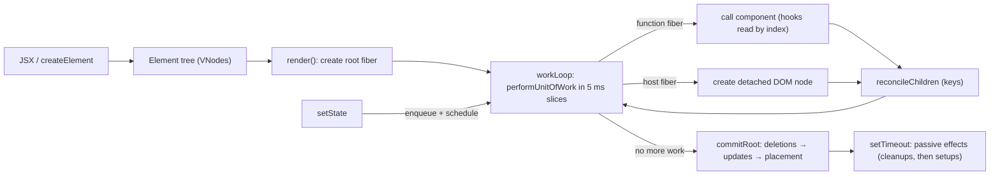

# 11 — Build Your Own React

> You don't really understand hooks until you've implemented `useState` with an array and an index. You don't really understand keys until you've written the loop that matches them. This chapter builds a working mini React, about 270 lines of TypeScript, tested against a real DOM.

**Prerequisites:** [10](10-react-internals-fiber-and-reconciliation.md) · **Related:** [12 Hooks](12-hooks-in-depth.md) · [13 Effects](13-effects-and-synchronization.md) · [74 Machine-Coding Drills](74-machine-coding-drills.md)

---

## TL;DR

- React's core fits in a few hundred lines once you strip away priorities, error handling and platform details: **elements** (descriptions) → **fibers** (instances with state) → a **time-sliced render loop** → a **synchronous commit** → **passive effects after paint**.
- **Hooks are an array per fiber, read by call order.** That's the entire reason for the Rules of Hooks.
- **`setState` enqueues an update and schedules work.** It doesn't render synchronously, which is why multiple calls in one event **batch** into one render.
- **Keys** let reconciliation match new elements to old fibers, so DOM nodes and state move with their items instead of staying at their index.
- **Pending passive effects must be flushed before the next render begins.** We hit this bug ourselves while building this chapter, and real React does exactly the same.
- The implementation below **passes tests** for batching, keyed reorders, inserts and deletes, effect cleanup ordering and unmount cleanups (jsdom, Node 22).

---

## 1. Scope: what we build and what we skip

| Concept | Mini React | Real React |
|---|---|---|
| Elements & JSX | ✅ `createElement` | ✅ `jsx()` automatic runtime |
| Fiber tree with `child`/`sibling`/`parent` | ✅ | ✅ (`return` instead of `parent`) |
| Time-sliced render loop (yields every ~5 ms) | ✅ `MessageChannel` | ✅ Scheduler package |
| Keyed reconciliation | ✅ Map by key | ✅ two-pass algorithm with `lastPlacedIndex` |
| Synchronous commit | ✅ | ✅ (before mutation → mutation → layout) |
| `useState` with updater functions and batching | ✅ | ✅ with lanes and rebasing |
| `useEffect` with deps, cleanup, flush-before-render | ✅ | ✅ (+ layout and insertion effects) |
| `useRef`, `useMemo` | ✅ | ✅ |
| Priorities, interruption, restart | ❌ renders always complete | ✅ lanes |
| Bailouts (skip unchanged subtrees) | ❌ re-renders everything from the root | ✅ `childLanes`, `memo`, Compiler |
| Event delegation, synthetic events | ❌ direct listeners | ✅ root delegation |
| Context, Suspense, error boundaries, portals, refs to DOM, hydration, `style` objects | ❌ (exercises) | ✅ |



---

## 2. Elements: describing UI

```ts
const el = createElement('ul', { id: 'list' },
  items.map((id) => createElement(Row, { key: id, label: id })));
// → { type: 'ul', key: null, props: { id: 'list', children: [ {type: Row, key: 'a', …}, … ] } }
```

- `key` is pulled out of props: it belongs to the element, not to the component (the same rule as React).
- `normalize` flattens nested arrays (from `.map`), drops `null`/`undefined`/booleans (which is why `cond && <X/>` works) and wraps strings and numbers as text elements. Note: `0` is a number, so it **renders**. The `0 &&` bug falls out of these rules naturally.

---

## 3. Fibers and the work loop

The render phase walks the tree **depth-first** without recursion. That's what makes it pausable:

```text
performUnitOfWork(fiber):
  1. "begin" the fiber: call the component, or create its DOM node
  2. reconcile its children → child fibers
  3. next unit = child, else sibling, else the nearest ancestor's sibling
```

Because the "stack" is now the fiber tree itself plus one pointer (`nextUnitOfWork`), the loop can stop after any fiber and resume later from exactly that pointer.

### Time slicing

```ts
function workLoop() {
  const deadline = performance.now() + 5;
  while (nextUnitOfWork && performance.now() < deadline) nextUnitOfWork = performUnitOfWork(nextUnitOfWork);
  if (nextUnitOfWork) { scheduleWork(); return; } // yield: let the browser handle input and paint
  if (wipRoot) commitRoot();
}
```

> [!NOTE]
> Why `MessageChannel` rather than `requestIdleCallback`? Idle callbacks may not fire for a long time on busy pages, weren't available in Safari for years, and don't give React control over slice length. `setTimeout(0)` is clamped to ≥ 4 ms after nesting. A `MessageChannel` message is an unclamped macrotask, which is exactly what React's scheduler uses in browsers.

---

## 4. Reconciliation with keys

```ts
// index old children by key, falling back to position
previous.set(old.key ?? `#${i}`, old);
// for each new element: reuse the old fiber if key AND type match
const reusable = match !== undefined && match.type === element.type;
```

- **Same key + same type → reuse** the fiber's DOM node and hooks (state survives).
- **Same key + different type → delete + create** (React's rule: different types produce different trees).
- **Leftover old fibers → deletions.**

**Placement:** our commit makes each parent's DOM children match the fiber order with a single cursor pass (`placeChildren`), inserting new nodes and moving existing ones. Real React doesn't read the DOM during commit. Instead it marks `Placement` flags during reconciliation using `lastPlacedIndex` ([10](10-react-internals-fiber-and-reconciliation.md)). That's why moving the *last* item to the *front* costs React several moves, while our cursor approach does it in one. Both produce the same DOM.

---

## 5. The commit phase

```text
commitRoot:
  1. deletions: run effect cleanups for the deleted subtree, remove its DOM nodes
  2. commitFiber (post-order): update changed props on reused nodes, then place children
  3. currentRoot = wipRoot   (the tree "flips")
  4. schedule passive effects after paint
```

The commit is synchronous and runs in one task, so the user never sees a half-updated DOM. New subtrees are assembled **detached** (children are placed into a new parent before that parent is attached), just like React's `completeWork` builds DOM off-screen.

---

## 6. Hooks: an array and an index

```ts
function nextHook() {
  return wipFiber.alternate?.hooks[hookIndex]; // "the hook at this position last render"
}
```

Each render, a function component's hooks are re-created **in call order**, and each looks up its predecessor by index in the previous fiber's hook array. If a hook is called conditionally, every later hook reads the wrong slot. That's the entire basis of the **Rules of Hooks** ([12](12-hooks-in-depth.md)).

### `useState`: a queue and batching

```ts
const queue = old ? old.queue : { pending: [] };        // the queue object survives across renders
for (const action of queue.pending.splice(0)) state = typeof action === 'function' ? action(state) : action;
const setState = old ? old.setState : (a) => { queue.pending.push(a); scheduleUpdate(); }; // stable identity
```

- `setState` **only enqueues and schedules**. Two calls in the same click produce one render, which applies both updater functions in order (the test checks `count 2`, rendered once).
- The setter is created once and reused, so its identity is stable, as in React. That's why setters never need to be effect dependencies.
- Updates that arrive **during** a render are never lost: they stay in the queue, and the loop renders again after committing.

### `useEffect`: deps, cleanup, and the flush rule

```ts
const changed = !old || !deps || deps.some((d, i) => !Object.is(d, old.deps[i]));
const hook = { deps, create, cleanup: old?.cleanup }; // carry the previous cleanup forward
if (changed) pendingEffects.push(hook);
```

After commit, effects run in a later task (after paint): **all cleanups first, then all setups**.

> [!IMPORTANT]
> **The bug we hit while writing this chapter:** the first version scheduled effects with `setTimeout`, but a second render could start *before* that timeout fired. The new render copied the **stale** cleanup (`cleanup: old.cleanup`) before the previous effect had produced its new one, so the wrong cleanup ran at unmount and the real one leaked. The fix is to flush pending passive effects **before beginning any new render**, which is exactly what React does (`flushPassiveEffects()` at the start of each render). The test suite catches this regression.

### `useRef` and `useMemo`

`useRef` reuses the same `{ current }` object forever. That's all a ref is: a stable box attached to the fiber. `useMemo` recomputes only when a dependency fails `Object.is`. Note that neither notifies React of anything: mutating `ref.current` never re-renders.

---

## 7. The complete source

```ts
// mini-react.ts: a teaching implementation of React's core ideas (~270 lines).
// Elements → fibers → time-sliced render phase → synchronous commit → passive effects.

type Key = string | null;
type Child = VNode | string | number | boolean | null | undefined | Child[];
type Component = (props: any) => Child;
type Props = { [key: string]: unknown; children: VNode[] };

export interface VNode {
  type: string | Component;
  key: Key;
  props: Props;
}

interface StateHook { kind: 'state'; state: unknown; queue: { pending: unknown[] }; setState: (a: unknown) => void }
interface EffectHook { kind: 'effect'; deps?: unknown[]; create: () => void | (() => void); cleanup?: void | (() => void) }
interface RefHook { kind: 'ref'; ref: { current: unknown } }
interface MemoHook { kind: 'memo'; deps: unknown[]; value: unknown }
type Hook = StateHook | EffectHook | RefHook | MemoHook;

interface Fiber {
  type: string | Component | null; // null marks the root
  key: Key;
  props: Props;
  dom: Node | null;                 // host node (null for function components)
  parent: Fiber | null;             // React calls this `return`
  child: Fiber | null;
  sibling: Fiber | null;
  alternate: Fiber | null;          // the fiber from the previous commit
  flags: number;
  hooks: Hook[];
}

const TEXT = 'TEXT_ELEMENT';
const UPDATE = 1;

// ---------------------------------------------------------------- elements
export function createElement(type: string | Component, config: Record<string, unknown> | null, ...children: Child[]): VNode {
  const { key, ...props } = config ?? {};
  return { type, key: key == null ? null : String(key), props: { ...props, children: normalize(children) } };
}

function normalize(children: Child[]): VNode[] {
  const out: VNode[] = [];
  const visit = (c: Child): void => {
    if (Array.isArray(c)) return c.forEach(visit);         // flatten nested arrays (e.g. from .map)
    if (c == null || typeof c === 'boolean') return;       // null/undefined/true/false render nothing
    out.push(typeof c === 'object' ? c : { type: TEXT, key: null, props: { nodeValue: String(c), children: [] } });
  };
  children.forEach(visit);
  return out;
}

// ---------------------------------------------------------------- global work state
let nextUnitOfWork: Fiber | null = null;
let wipRoot: Fiber | null = null;
let currentRoot: Fiber | null = null;
let deletions: Fiber[] = [];
let wipFiber: Fiber | null = null;
let hookIndex = 0;
let pendingEffects: EffectHook[] = [];   // collected during render
let scheduledEffects: EffectHook[] = []; // committed, waiting to run after paint
let updatePending = false;

export function render(element: VNode, container: Element) {
  beginRender(container, { children: [element] }, null);
  scheduleWork();
}

function beginRender(dom: Node, props: Props, alternate: Fiber | null) {
  flushPassiveEffects(); // like React: finish the previous commit's effects before rendering again
  wipRoot = { type: null, key: null, props, dom, parent: null, child: null, sibling: null, alternate, flags: 0, hooks: [] };
  deletions = [];
  nextUnitOfWork = wipRoot;
}

function scheduleUpdate() {
  updatePending = true; // batched: many setState calls in one task → one render
  scheduleWork();
}

// ---------------------------------------------------------------- scheduler (time slicing)
const channel = new MessageChannel();
let workScheduled = false;
channel.port1.onmessage = () => { workScheduled = false; workLoop(); };
function scheduleWork() {
  if (!workScheduled) { workScheduled = true; channel.port2.postMessage(null); }
}

function workLoop() {
  if (!wipRoot && updatePending && currentRoot) {    // start a re-render from the committed tree
    updatePending = false;
    beginRender(currentRoot.dom!, currentRoot.props, currentRoot);
  }
  const deadline = performance.now() + 5;            // ~5 ms slices, like React's scheduler
  while (nextUnitOfWork && performance.now() < deadline) {
    nextUnitOfWork = performUnitOfWork(nextUnitOfWork);
  }
  if (nextUnitOfWork) { scheduleWork(); return; }     // yield to the browser; continue next task
  if (wipRoot) commitRoot();
  if (updatePending) scheduleWork();                  // updates arrived mid-render: render again
}

// ---------------------------------------------------------------- render phase
function performUnitOfWork(fiber: Fiber): Fiber | null {
  if (typeof fiber.type === 'function') updateFunctionComponent(fiber);
  else updateHostComponent(fiber);
  if (fiber.child) return fiber.child;                // go down
  let next: Fiber | null = fiber;
  while (next) {                                      // then sideways, then up
    if (next.sibling) return next.sibling;
    next = next.parent;
  }
  return null;
}

function updateFunctionComponent(fiber: Fiber) {
  wipFiber = fiber;
  hookIndex = 0;
  fiber.hooks = [];
  const output = (fiber.type as Component)(fiber.props);
  reconcileChildren(fiber, normalize([output]));
  wipFiber = null;
}

function updateHostComponent(fiber: Fiber) {
  if (!fiber.dom) fiber.dom = createDom(fiber);       // created detached; attached during commit
  reconcileChildren(fiber, fiber.props.children);
}

function createDom(fiber: Fiber): Node {
  const dom = fiber.type === TEXT ? document.createTextNode('') : document.createElement(fiber.type as string);
  updateDom(dom, { children: [] }, fiber.props);
  return dom;
}

const isEvent = (k: string) => k.startsWith('on');
const isProperty = (k: string) => k !== 'children' && !isEvent(k);

function updateDom(dom: Node, prev: Props, next: Props) {
  const el = dom as any;
  for (const k of Object.keys(prev)) {
    if (isEvent(k) && prev[k] !== next[k]) el.removeEventListener(k.slice(2).toLowerCase(), prev[k]);
    if (isProperty(k) && !(k in next)) el[k] = '';
  }
  for (const k of Object.keys(next)) {
    if (isProperty(k) && prev[k] !== next[k]) el[k] = next[k];
    if (isEvent(k) && prev[k] !== next[k]) el.addEventListener(k.slice(2).toLowerCase(), next[k]);
  }
}

// Keyed reconciliation: match new elements to old fibers by key (or position).
function reconcileChildren(parent: Fiber, elements: VNode[]) {
  const previous = new Map<string, Fiber>();
  let old = parent.alternate?.child ?? null;
  for (let i = 0; old; i++, old = old.sibling) previous.set(old.key ?? `#${i}`, old);

  let prevSibling: Fiber | null = null;
  elements.forEach((element, i) => {
    const id = element.key ?? `#${i}`;
    const match = previous.get(id);
    const reusable = match !== undefined && match.type === element.type; // same key + same type
    if (reusable) previous.delete(id);
    const fiber: Fiber = {
      type: element.type, key: element.key, props: element.props,
      dom: reusable ? match.dom : null,
      parent, child: null, sibling: null,
      alternate: reusable ? match : null,
      flags: reusable ? UPDATE : 0,
      hooks: [],
    };
    if (prevSibling) prevSibling.sibling = fiber; else parent.child = fiber;
    prevSibling = fiber;
  });
  previous.forEach((f) => deletions.push(f));         // unmatched old fibers are deleted
}

// ---------------------------------------------------------------- commit phase (synchronous)
function commitRoot() {
  const root = wipRoot!;
  deletions.forEach(commitDeletion);
  commitFiber(root);
  currentRoot = root;
  wipRoot = null;
  scheduledEffects = pendingEffects;
  pendingEffects = [];
  setTimeout(flushPassiveEffects);                    // passive effects run after the browser paints
}

function commitFiber(fiber: Fiber) {
  if (fiber.dom && fiber.alternate && fiber.flags & UPDATE) updateDom(fiber.dom, fiber.alternate.props, fiber.props);
  fiber.alternate = null;                             // drop the previous generation
  for (let c = fiber.child; c; c = c.sibling) commitFiber(c);
  if (fiber.dom && fiber.type !== TEXT) placeChildren(fiber.dom, hostChildren(fiber));
}

function hostChildren(fiber: Fiber): Node[] {
  const out: Node[] = [];
  for (let c = fiber.child; c; c = c.sibling) {
    if (c.dom) out.push(c.dom); else out.push(...hostChildren(c)); // look through components
  }
  return out;
}

// Make the parent's DOM children match the fiber order: inserts new nodes, moves existing ones.
function placeChildren(parentDom: Node, nodes: Node[]) {
  let cursor = parentDom.firstChild;
  for (const node of nodes) {
    if (node === cursor) { cursor = cursor.nextSibling; continue; }
    parentDom.insertBefore(node, cursor);
  }
}

function commitDeletion(fiber: Fiber) {
  runEffectCleanups(fiber);
  for (const node of fiber.dom ? [fiber.dom] : hostChildren(fiber)) node.parentNode?.removeChild(node);
}

function runEffectCleanups(fiber: Fiber) {
  for (const hook of fiber.hooks) if (hook.kind === 'effect' && typeof hook.cleanup === 'function') hook.cleanup();
  for (let c = fiber.child; c; c = c.sibling) runEffectCleanups(c);
}

function flushPassiveEffects() {
  const effects = scheduledEffects;
  scheduledEffects = [];
  for (const e of effects) if (typeof e.cleanup === 'function') e.cleanup(); // all cleanups first
  for (const e of effects) e.cleanup = e.create();                            // then all setups
}

// ---------------------------------------------------------------- hooks
function nextHook<T extends Hook>(): T | undefined {
  return wipFiber!.alternate?.hooks[hookIndex] as T | undefined; // same call order every render
}

function pushHook(hook: Hook) {
  wipFiber!.hooks.push(hook);
  hookIndex++;
}

export function useState<S>(initial: S | (() => S)): [S, (action: S | ((prev: S) => S)) => void] {
  const old = nextHook<StateHook>();
  const queue = old ? old.queue : { pending: [] as unknown[] };
  let state = old ? old.state : typeof initial === 'function' ? (initial as () => S)() : initial;
  for (const action of queue.pending.splice(0)) {
    state = typeof action === 'function' ? (action as (prev: unknown) => unknown)(state) : action;
  }
  const setState = old ? old.setState : (action: unknown) => { queue.pending.push(action); scheduleUpdate(); };
  pushHook({ kind: 'state', state, queue, setState });
  return [state as S, setState as (action: S | ((prev: S) => S)) => void];
}

export function useEffect(create: () => void | (() => void), deps?: unknown[]) {
  const old = nextHook<EffectHook>();
  const changed = !old || !deps || !old.deps || deps.length !== old.deps.length
    || deps.some((d, i) => !Object.is(d, old.deps![i]));
  const hook: EffectHook = { kind: 'effect', deps, create, cleanup: old?.cleanup };
  if (changed) pendingEffects.push(hook);
  pushHook(hook);
}

export function useRef<T>(initial: T): { current: T } {
  const old = nextHook<RefHook>();
  const hook: RefHook = old ?? { kind: 'ref', ref: { current: initial } };
  pushHook(hook);
  return hook.ref as { current: T };
}

export function useMemo<T>(compute: () => T, deps: unknown[]): T {
  const old = nextHook<MemoHook>();
  const same = old !== undefined && deps.length === old.deps.length && deps.every((d, i) => Object.is(d, old.deps[i]));
  const hook: MemoHook = same ? old : { kind: 'memo', deps, value: compute() };
  pushHook(hook);
  return hook.value as T;
}
```

---

## 8. Using it

```tsx
/** @jsxRuntime classic */
/** @jsx createElement */
import { createElement, render, useState, useEffect } from './mini-react';

function Todos() {
  const [items, setItems] = useState([{ id: 1, text: 'Write mini React' }]);
  const [draft, setDraft] = useState('');

  useEffect(() => {
    document.title = `${items.length} todos`;
  }, [items.length]);

  return (
    <div>
      <input value={draft} onInput={(e: Event) => setDraft((e.target as HTMLInputElement).value)} />
      <button onClick={() => { setItems((xs) => [{ id: Date.now(), text: draft }, ...xs]); setDraft(''); }}>
        Add
      </button>
      <ul>{items.map((t) => <li key={t.id}>{t.text}</li>)}</ul>
    </div>
  );
}

render(<Todos />, document.getElementById('root')!);
```

With TypeScript, set `"jsx": "react"` and `"jsxFactory": "createElement"` in `tsconfig.json` (or use the pragmas above with Babel). Because our props map directly to DOM properties and our event names are lowercased DOM events, use `onInput` rather than React's synthetic `onChange`.

### The test suite (abridged)

```ts
// Batching: two updater calls in one click → one render, count 2
btn.dispatchEvent(new Event('click'));
await settle();
assert.equal(btn.textContent, 'count 2 doubled 4');
assert.equal(renders, rendersBefore + 1);
assert.deepEqual(log, ['effect 0', 'cleanup 0', 'effect 2']);

// Keyed reorder: DOM nodes move with their keys
setItems(['d', 'a', 'b', 'c']);
await settle();
assert.equal(lis()[0], liD);   // same DOM node object, moved
assert.equal(lis()[1], liA);   // reused, not recreated

// Unmount runs the latest cleanup
setShow(false);
await settle();
assert.deepEqual(log, ['effect 0', 'cleanup 0', 'effect 2', 'cleanup 2']);
```

---

## 9. Exercises: grow it towards React

| # | Exercise | What you'll learn |
|---|---|---|
| 1 | **Bailouts**: track `pending` per fiber and `childPending` up the tree. Skip fibers whose props are `===` and that have no pending updates | Why passing `children` avoids re-renders; what `childLanes` is for |
| 2 | **`memo`**: shallow-compare props before calling a component | The cost model of memoisation |
| 3 | **Context**: `createContext` + a provider fiber whose value consumers read by walking `parent` | Why context changes bypass `memo` |
| 4 | **Priorities**: two queues (urgent, transition); urgent updates restart the in-progress render from `currentRoot` | Interruption, and why queues need a base state |
| 5 | **Event delegation**: one listener per event type on the container, mapping DOM nodes back to fibers | Why events bubble through portals in React |
| 6 | **Error boundaries**: wrap `performUnitOfWork` in `try/catch`, unwind to the nearest boundary fiber, render its fallback | Why boundaries don't catch errors in event handlers |
| 7 | **Suspense**: let components throw a promise, render the nearest fallback, retry on resolve | How `use()` integrates with rendering |
| 8 | **`useLayoutEffect`**: run during commit, before yielding to paint | The layout-vs-passive trade-off |

---

## Pitfalls this exercise exposes

- **Conditional hooks** corrupt the index mapping (try it: an `if` around `useState` swaps state between hooks).
- **Mutating state** (`items.push`) doesn't enqueue anything, so nothing re-renders.
- **Index keys** make reused fibers keep the wrong state after an insert at the top.
- **Effects scheduled without a flush-before-render rule** leak cleanups.
- **Rendering everything from the root** on every update (our simplification) shows why bailouts and the Compiler matter on big trees.

---

## Interview angles

**Q1. Implement `useState` from scratch. What data structure do you need?**
A per-component (per-fiber) array of hook slots, plus a cursor that resets to 0 at the start of each render. `useState` reads slot *i* from the previous render (or initialises it), applies the slot's queued updates in order, stores the result in the new slot, and returns `[state, setState]`. `setState` pushes the update to that slot's queue (shared across renders) and schedules a render. It must not render synchronously, so that multiple calls batch together.

**Q2. Why must hooks be called unconditionally and in the same order?**
Because hooks are identified by call position, not by name. Each call reads "the next slot". If a hook is skipped on one render, every subsequent hook reads its neighbour's state. The linter enforces the order statically.

**Q3. Why does React flush passive effects before starting a new render?**
Because the next render reads hook state from the last commit, including effect cleanups. If a previous commit's effects haven't run yet, the new render would carry forward stale cleanups and inconsistent state. Flushing first ensures effects for commit N complete before render N+1 begins.

**Q4. How do keys change what your reconciler does?**
Without keys, children match by index, so inserting at the top makes every item reuse the wrong fiber (wrong state, wrong DOM). With keys, children match by identity through a key → fiber map. Matched fibers keep their DOM and hooks, unmatched old fibers are deleted, and new elements are created. The commit then moves nodes to match the new order.

**Q5. What would you add first to make it production-worthy?**
Bailouts (subtree skipping via pending flags), event delegation, error boundaries and dev warnings. Then priorities (urgent vs transition lanes) with interruption and update rebasing, which is where most of real React's complexity lives.

---

> [!TIP]
> **Runnable code:** [E11](E11-build-your-own-react.md) has mini React, its full test suite, and the Todos example running in a browser (`npm run dev`). `node extract-examples.mjs 11` writes it out as a project; then run `npm ci` and `npm test` in it.

## Further reading

- Rodrigo Pombo, *Build your own React* (Didact): <https://pomb.us/build-your-own-react/>
- Andrew Clark, *React Fiber Architecture*: <https://github.com/acdlite/react-fiber-architecture>
- React source, `ReactFiberHooks.js` and `ReactFiberWorkLoop.js`: <https://github.com/react/react/tree/main/packages/react-reconciler/src>
- Dan Abramov, *Why Do React Hooks Rely on Call Order?*: <https://overreacted.io/why-do-hooks-rely-on-call-order/>

---

[← Previous: 10 — React Internals: Fiber, Reconciliation and Lanes](10-react-internals-fiber-and-reconciliation.md) · [Index](README.md) · [Next: 12 — Hooks in Depth →](12-hooks-in-depth.md)
