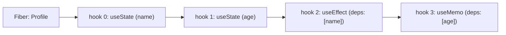
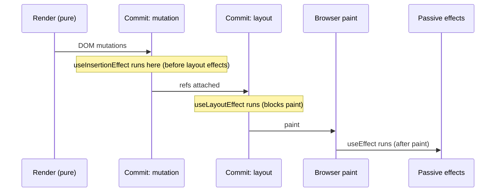
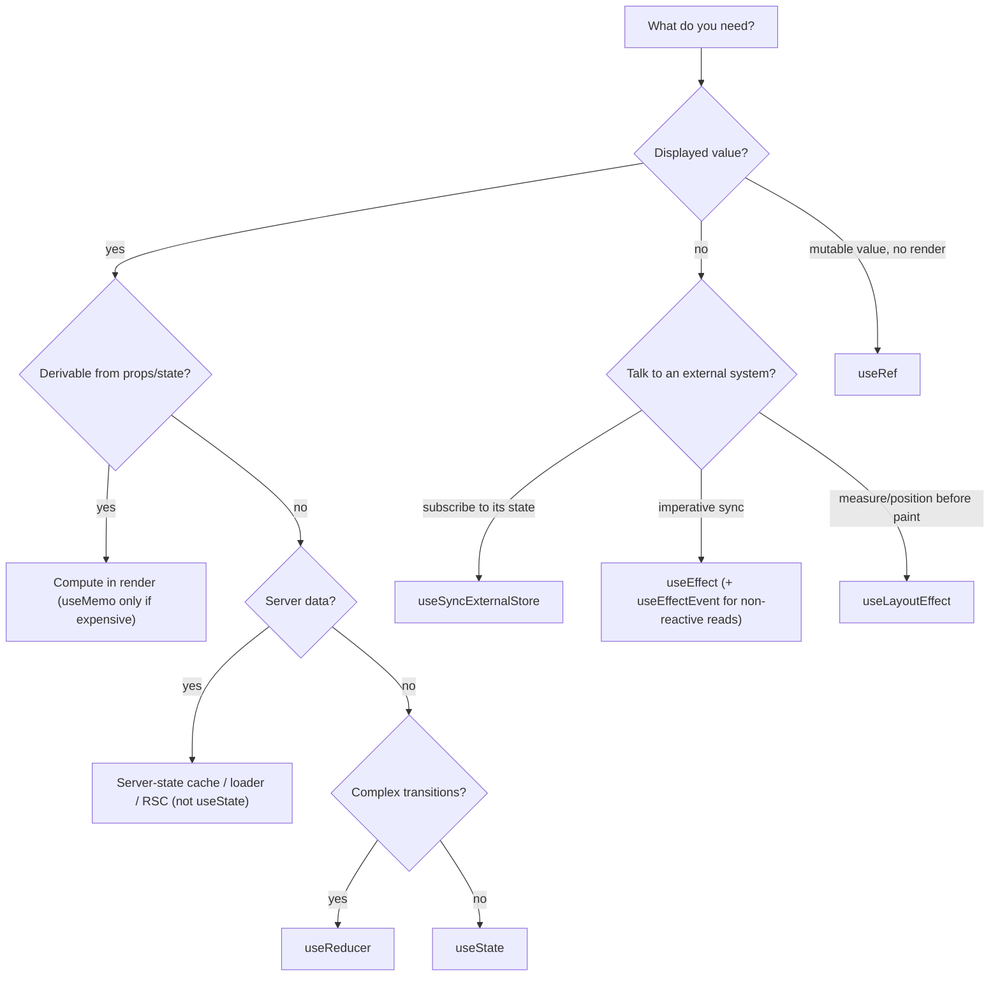

# 12 — Hooks in Depth

> A hook is a slot in a per-component array, read by call order, that lets a function remember something between renders. Every hook API is a variation on "what do you remember, and when do you recompute it?"

**Prerequisites:** [10](10-react-internals-fiber-and-reconciliation.md), [11](11-build-your-own-react.md) · **Related:** [13 Effects](13-effects-and-synchronization.md) · [15 Concurrent React](15-concurrent-react-suspense-and-transitions.md) · [16 React 19 & Compiler](16-react-19-features-and-the-compiler.md) · [A1 API Reference](A1-react-api-reference.md)

---

## TL;DR

- Hooks live on the fiber as a **linked list in call order**. That is why they must be called unconditionally at the top level (`use()` is the exception: it reads a promise or context rather than a slot).
- **State hooks:** `useState` for independent values, `useReducer` when transitions are complex or event-like. **Context:** `useContext`, or `use(Context)`, which can be called conditionally.
- **Ref hooks:** `useRef` is a mutable box that never triggers renders. `useImperativeHandle` exposes a curated imperative API. `ref` is a plain prop in React 19.
- **Effect hooks:** `useEffect` (after paint), `useLayoutEffect` (before paint, blocking), `useInsertionEffect` (style injection) and `useEffectEvent` (non-reactive logic called from effects; stable since 19.2).
- **Performance hooks:** `useMemo` and `useCallback` cache between renders. The **React Compiler** applies them automatically and more granularly. Manual use is still occasionally justified: an effect dependency that must stay stable, or a library that compares references.
- **Concurrency and Actions:** `useTransition`, `useDeferredValue`, `useActionState`, `useOptimistic`, `use()`, plus `useFormStatus` from react-dom.
- **Integration:** `useSyncExternalStore` (tear-free external stores), `useId` (SSR-stable IDs), `useDebugValue`.
- Most hook bugs are **stale closures**: a callback created in render N reads render N's values forever. The four fixes are updater functions, correct dependencies, refs and `useEffectEvent`.

---

## 1. How hooks work (the 60-second version)



- On **mount**, each hook call appends a new hook object. On **update**, each call reads the next object from the previous render's list ([11](11-build-your-own-react.md) builds this from scratch).
- React swaps a **dispatcher** before calling your component (mount dispatcher, update dispatcher). Outside render, hooks hit an "invalid" dispatcher. That's the source of *"Invalid hook call"*, which you also get with **two copies of React** in a bundle (a dual-package or monorepo hoisting bug).
- State updates carry a **lane** and are processed only when their lane is rendered. Lower-priority updates are rebased later ([10](10-react-internals-fiber-and-reconciliation.md)).

---

## 2. The hook map

| Hook | Remembers | Recomputes when | Triggers render? | Typical use |
|---|---|---|---|---|
| `useState` | A value | Never (you set it) | Yes, on set | Local UI state |
| `useReducer` | A value + reducer | On dispatch | Yes | Complex local state transitions |
| `useContext` / `use(Ctx)` | — | Provider value changes | Yes | Read dependency-injected values |
| `useRef` | A mutable box | Never | **No** | DOM nodes, instance variables |
| `useImperativeHandle` | An exposed handle | Deps change | No | Imperative component APIs |
| `useMemo` | A computed value | Deps change | No | Expensive derivations, stable identities |
| `useCallback` | A function | Deps change | No | Stable callback identity |
| `useEffect` | An effect + cleanup | Deps change (after commit, after paint) | Only if it sets state | Sync with external systems |
| `useLayoutEffect` | An effect + cleanup | Deps change (after commit, **before paint**) | Only if it sets state | Measure and position without flicker |
| `useInsertionEffect` | An effect | Deps change (before layout effects) | No | CSS-in-JS style injection |
| `useEffectEvent` | Latest-closure function | Every render (non-reactive) | No | Effect logic that reads latest props without re-syncing |
| `useTransition` | Pending state | — | Yes | Mark updates non-urgent |
| `useDeferredValue` | A lagging copy | When React gets time | Yes (background) | Keep input responsive with slow children |
| `useActionState` | Action result state | Per action | Yes | Form and Action results |
| `useOptimistic` | Temporary state | During an Action | Yes | Optimistic UI |
| `use` | — | — | Suspends | Read promises or context (conditionally allowed) |
| `useSyncExternalStore` | Store snapshot | Store emits | Yes | External stores, browser APIs |
| `useId` | A unique ID | Never | No | Accessibility ID wiring |
| `useDebugValue` | DevTools label | — | No | Custom hook debugging |
| `useFormStatus` (react-dom) | Parent form status | Form submits | Yes | Pending UI inside forms |

---

## 3. State hooks

### 3.1 `useState`

```ts
const [value, setValue] = useState<T>(initialValueOrInitializer);
```

| Detail | Behaviour |
|---|---|
| Lazy initialiser | `useState(() => expensive())` runs only on mount (twice in StrictMode development) |
| Setter identity | **Stable** across renders. Never needs to be a dependency |
| Updater functions | `setX(prev => next)`: queued and applied in order; use them whenever the next state depends on the previous |
| Bailout | `Object.is(next, current)` → React skips re-rendering children (it may still call the component once) |
| Batching | All updates in one task render once (React 18+) |
| Storing functions | `setFn(() => myFn)`, because a function argument is treated as an updater |

**Use when:** independent pieces of local UI state (open/closed, input values, selected tab).
**Don't use when:** the value can be **derived** from props or other state (compute it), it's **server data** (use a server-state cache, [30](30-server-state-and-data-fetching.md)), or it's in the **URL** (use the router, [31](31-routing-architecture.md)).
**Performance:** each set re-renders this component and, by default, its subtree. Colocate state as low as possible.

### 3.2 `useReducer`

```ts
type State = { status: 'idle' | 'loading' | 'error' | 'ready'; items: Item[]; error?: string };
type Action =
  | { type: 'fetch' }
  | { type: 'success'; items: Item[] }
  | { type: 'failure'; error: string };

function reducer(state: State, action: Action): State {
  switch (action.type) {
    case 'fetch': return { ...state, status: 'loading', error: undefined };
    case 'success': return { status: 'ready', items: action.items };
    case 'failure': return { ...state, status: 'error', error: action.error };
  }
}

const [state, dispatch] = useReducer(reducer, { status: 'idle', items: [] });
```

**Use when:** several values change together, the next state depends on the previous one in non-trivial ways, you want **event-like actions** (testable, loggable), or you're modelling a small state machine.
**Don't use when:** one or two independent values, where it's ceremony.
**Notes:** `dispatch` is stable. Reducers must be **pure** (StrictMode calls them twice). Reducer + context is a lightweight store pattern for a subtree ([29](29-client-state-management.md)).

---

## 4. Context hooks

```tsx
const theme = useContext(ThemeContext);

// React 19: `use` reads context and may be called conditionally
function Badge({ show }: { show: boolean }) {
  if (!show) return null;
  const theme = use(ThemeContext); // ✅ allowed after an early return
  return <span className={theme.badge}>New</span>;
}
```

| Detail | Behaviour |
|---|---|
| Value lookup | Nearest provider above in the **React** tree (portals included) |
| Re-render trigger | Provider `value` changes by `Object.is`, and **`memo` can't block it** |
| Provider syntax | React 19: `<ThemeContext value={…}>` (`.Provider` still works, slated for deprecation) |
| RSC | Server Components can't *read* or *create* context, but since 19.3 they can **render** a provider imported from a `'use client'` module |

**Use when:** dependency injection of rarely changing values (theme, locale, current user, feature flags, services).
**Don't use when:** high-frequency state shared by many consumers (every consumer re-renders). Use a store with selectors instead ([29](29-client-state-management.md)).
**Performance:** memoise the provided value (or let the Compiler do it), and split contexts by update frequency (`UserContext` vs `PresenceContext`).

---

## 5. Ref hooks

### 5.1 `useRef`

```ts
const inputRef = useRef<HTMLInputElement>(null);  // DOM ref: RefObject<HTMLInputElement | null>
const timerRef = useRef<number | undefined>(undefined); // instance variable
```

| Rule | Why |
|---|---|
| Don't read or write `ref.current` during render (except lazy init) | Not reactive: the UI won't update, and it breaks purity and Compiler assumptions (lint: `refs`) |
| Mutate refs in event handlers and effects | That's what they're for |
| Lazy init pattern | `if (ref.current === null) ref.current = createExpensive();` is the accepted exception |

**Use when:** DOM access (focus, measure, scroll), timer and subscription IDs, latest-value storage for callbacks, integration with imperative libraries.
**Don't use when:** the value is displayed. Use state.

### 5.2 Callback refs and ref cleanup (React 19)

```tsx
<div
  ref={(node) => {
    if (!node) return;
    const ro = new ResizeObserver(([entry]) => setWidth(entry.contentRect.width));
    ro.observe(node);
    return () => ro.disconnect(); // React 19: ref callbacks can return a cleanup
  }}
/>
```

When a ref callback returns a cleanup, React calls the cleanup on detach instead of calling the callback with `null`. In StrictMode, ref callbacks are double-invoked in development. More in [14](14-refs-dom-portals-and-imperative-apis.md).

### 5.3 `useImperativeHandle`

```tsx
type VideoHandle = { play(): void; pause(): void };

function Video({ src, ref }: { src: string; ref?: React.Ref<VideoHandle> }) {
  const videoRef = useRef<HTMLVideoElement>(null);
  useImperativeHandle(ref, () => ({
    play: () => videoRef.current?.play(),
    pause: () => videoRef.current?.pause(),
  }), []);
  return <video ref={videoRef} src={src} />;
}
```

**Use when:** a component must expose a *small* imperative API (focus, scroll, play) without leaking its DOM.
**Don't use when:** you could express it with props (`isPlaying`). Imperative handles bypass React's data flow.

---

## 6. Effect hooks

### 6.1 Timing at a glance



| Hook | Runs | Blocks paint | Server | Use for |
|---|---|---|---|---|
| `useEffect` | After paint (synchronously at the end of commit if the update came from a discrete input) | No | Doesn't run | Subscriptions, network sync, analytics, non-visual sync |
| `useLayoutEffect` | After DOM mutation, before paint | **Yes** | Doesn't run | Measuring layout, positioning tooltips, preventing visual flicker |
| `useInsertionEffect` | Before layout effects, before refs attach | Yes | Doesn't run | Injecting `<style>` rules (CSS-in-JS libraries only) |

All three take a setup function that may return a cleanup, plus a dependency array. Detailed patterns, races and the "you might not need an effect" catalogue are in [13](13-effects-and-synchronization.md).

### 6.2 `useEffectEvent` (stable since 19.2)

```tsx
function ChatRoom({ roomId, theme }: { roomId: string; theme: Theme }) {
  // Reads the latest `theme` but is NOT a dependency: changing theme won't reconnect
  const onConnected = useEffectEvent(() => {
    showToast(`Connected to ${roomId}`, theme);
  });

  useEffect(() => {
    const conn = createConnection(roomId);
    conn.on('connected', () => onConnected());
    conn.connect();
    return () => conn.disconnect();
  }, [roomId]); // ✅ only roomId is reactive here
}
```

| Rule | Why |
|---|---|
| Call Effect Events only from inside effects (or other Effect Events) | They're for effect logic, not event handlers or render |
| Don't pass them to other components or hooks | Their identity isn't meant to be stable or shared |
| Don't list them in dependencies | The linter knows they're non-reactive |

**Use when:** an effect must react to *some* values (reconnect when `roomId` changes) but read others' latest values without re-running (`theme`, analytics context, the cart count in a logging call).
**Don't use when:** you're just trying to silence `exhaustive-deps`. If the effect should re-run when a value changes, it's a dependency.

---

## 7. Memoisation hooks

```ts
const visible = useMemo(() => filterAndSort(items, query), [items, query]); // cache a value
const onSelect = useCallback((id: string) => select(id), [select]);       // cache a function
```

| Detail | Behaviour |
|---|---|
| Comparison | Each dependency with `Object.is` |
| Guarantee | A performance hint, **not a semantic guarantee**. React may discard caches (e.g., in future offscreen features) |
| StrictMode | Calls the factory twice in development; since React 19 it **reuses** the first result on the second render |
| `useCallback(fn, deps)` | Equivalent to `useMemo(() => fn, deps)` |

### When manual memoisation still matters (with or without the Compiler)

| Situation | Why |
|---|---|
| **Expensive computation** measured in the Profiler (> ~1 ms per render on target devices) | Avoid recomputing on unrelated renders |
| **Effect dependencies** that must stay stable (an options object passed into a subscription effect) | Otherwise the effect resubscribes every render. The Compiler usually handles this, but be explicit if correctness depends on it |
| **Libraries that compare references** (memoised children, context values, external stores) | Identity stability is the contract |
| Code the **Compiler skipped** (bail-outs from Rules-of-React violations, `"use no memo"`, unsupported syntax) | Manual memoisation is your only tool there |

> [!IMPORTANT]
> With the **React Compiler** enabled, most `useMemo`/`useCallback`/`memo` calls become unnecessary. The Compiler memoises at a finer grain (even inside conditionals) and preserves the guarantees of the manual memoisation you already wrote (lint: `preserve-manual-memoization`). Don't rip out existing memoisation wholesale. Keep it where it encodes a correctness requirement, and stop adding it by reflex ([16](16-react-19-features-and-the-compiler.md), [38](38-react-performance-engineering.md)).

---

## 8. Concurrency and Action hooks

### 8.1 `useTransition`

```tsx
const [isPending, startTransition] = useTransition();

function onTabChange(tab: Tab) {
  startTransition(() => setTab(tab)); // non-urgent: interruptible, keeps old UI visible
}

// React 19 Actions: async functions are allowed
function onSave() {
  startTransition(async () => {
    const result = await saveDraft(draft);
    startTransition(() => setSavedAt(result.savedAt)); // updates AFTER an await must be wrapped again
  });
}
```

**Use when:** an update is expensive and not urgent (switching tabs, filtering a big list, navigating), or you want pending state for async work (Actions).
**Don't use when:** the update is a controlled input's value. Input updates must be urgent, or typing lags or desyncs.
**Notes:** transitions don't show Suspense fallbacks for already-revealed content. Since 19.3, independent transitions render independently ([15](15-concurrent-react-suspense-and-transitions.md)).

### 8.2 `useDeferredValue`

```tsx
const [query, setQuery] = useState('');
const deferredQuery = useDeferredValue(query, /* initialValue */ '');
const isStale = query !== deferredQuery;

return (
  <>
    <input value={query} onChange={(e) => setQuery(e.target.value)} />
    <div style={{ opacity: isStale ? 0.6 : 1 }}>
      <SlowResults query={deferredQuery} /> {/* memoised (or compiled) so it skips urgent renders */}
    </div>
  </>
);
```

**Use when:** you don't control the state update (the value comes from props), or you want the urgent render to proceed with the old value while React renders the new one in the background.
**Don't use when:** you need to reduce **network** requests. That's debouncing. Deferred values adapt to device speed but don't skip work for slow servers.
**Requirement:** the slow child must skip re-rendering when given the same deferred value (`memo` or the Compiler), otherwise there's no benefit.

### 8.3 `useActionState`

```tsx
async function subscribe(prev: { error?: string; ok?: boolean }, formData: FormData) {
  const email = String(formData.get('email'));
  const res = await api.subscribe(email);
  return res.ok ? { ok: true } : { error: res.message };
}

function Newsletter() {
  const [state, formAction, isPending] = useActionState(subscribe, {});
  return (
    <form action={formAction}>
      <input name="email" type="email" required />
      <button disabled={isPending}>Subscribe</button>
      {state.error && <p role="alert">{state.error}</p>}
      {state.ok && <p role="status">Thanks!</p>}
    </form>
  );
}
```

| Detail | Behaviour |
|---|---|
| Signature | `useActionState(action, initialState, permalink?)` → `[state, dispatch, isPending]` |
| Action receives | `(previousState, payload)` |
| Ordering | Dispatches are **queued and run sequentially** |
| With Server Functions | Works with progressive enhancement; `permalink` supports pre-hydration submissions in frameworks |
| History | Replaced `ReactDOM.useFormState` (React 19) |

### 8.4 `useOptimistic`

```tsx
function Likes({ likes, onLike }: { likes: number; onLike: () => Promise<void> }) {
  const [optimisticLikes, addOptimistic] = useOptimistic(likes, (current, delta: number) => current + delta);

  return (
    <form action={async () => { addOptimistic(1); await onLike(); }}>
      <button>♥ {optimisticLikes}</button>
    </form>
  );
}
```

The optimistic value shows while the Action is pending, then **automatically reverts** to the real `likes` (which, on success, now includes the server-confirmed value). Call `addOptimistic` inside an Action or transition. Conflict handling and rollback architecture are in [28](28-state-and-data-ownership-architecture.md).

### 8.5 `use`

```tsx
// Promise: suspends until resolved; errors go to the nearest error boundary
function Comments({ commentsPromise }: { commentsPromise: Promise<Comment[]> }) {
  const comments = use(commentsPromise);
  return comments.map((c) => <p key={c.id}>{c.text}</p>);
}
```

| Rule | Detail |
|---|---|
| Conditionally callable | Yes (unlike other hooks), but not inside `try/catch`. Use an error boundary |
| Promise source | Must be **stable**: created by a Server Component, a cache, a router loader or a data library. Creating a promise during render makes React suspend on an "uncached promise" every render |
| Context | `use(Context)` behaves like `useContext` but may follow early returns |
| 19.3 | Development warning when `use` is called incorrectly inside a conditional |

### 8.6 `useFormStatus` (react-dom)

```tsx
function SubmitButton() {
  const { pending } = useFormStatus(); // status of the PARENT <form>
  return <button disabled={pending}>{pending ? 'Saving…' : 'Save'}</button>;
}
```

It must be rendered **inside** the `<form>` whose status it reads. 19.3 fixed status resetting on unrelated state updates.

---

## 9. Integration hooks

### 9.1 `useSyncExternalStore`

```ts
// Tear-free subscription to a browser API
function subscribe(callback: () => void) {
  window.addEventListener('online', callback);
  window.addEventListener('offline', callback);
  return () => {
    window.removeEventListener('online', callback);
    window.removeEventListener('offline', callback);
  };
}

export function useOnlineStatus() {
  return useSyncExternalStore(
    subscribe,                 // stable (module scope): otherwise it resubscribes every render
    () => navigator.onLine,    // client snapshot: must return the same value if nothing changed
    () => true,                // server snapshot (SSR and hydration)
  );
}
```

| Rule | Consequence of breaking it |
|---|---|
| `getSnapshot` returns a **cached/immutable** value | Returning a new object each call → infinite re-render loop |
| `subscribe` is stable | Resubscribes on every render |
| Provide `getServerSnapshot` for SSR | Hydration errors or a thrown error during server rendering |
| Store updates are **synchronous** | Store changes during a transition de-opt that update to blocking |

**Use when:** subscribing to anything outside React: stores (Redux, Zustand and Jotai use it internally), browser APIs (media queries, online status, storage), third-party SDK state.
**Don't use when:** the data is server state (use a query cache) or local state.

### 9.2 `useId`

```tsx
function Field({ label }: { label: string }) {
  const id = useId();
  return (<><label htmlFor={id}>{label}</label><input id={id} aria-describedby={`${id}-hint`} /></>);
}
```

- Generates IDs that **match between server and client** (based on tree position).
- Format is an implementation detail and has changed (`:r:` → `«r»` in 19.1 → `_r_` in 19.2, chosen to be valid in CSS selectors and `view-transition-name`). Never parse it.
- Use `identifierPrefix` on roots when several React roots share a page.
- **Not for keys** in lists.

### 9.3 `useDebugValue`

```ts
function useOnlineStatus() {
  const online = useSyncExternalStore(subscribe, getSnapshot, () => true);
  useDebugValue(online ? 'Online' : 'Offline');
  return online;
}
```

---

## 10. Stale closures: anatomy and fixes

```tsx
function Timer() {
  const [count, setCount] = useState(0);

  useEffect(() => {
    const id = setInterval(() => setCount(count + 1), 1000); // ❌ captures count = 0 forever
    return () => clearInterval(id);
  }, []);                                                   // (and lies to the linter)
}
```

| Fix | Code | When |
|---|---|---|
| **Updater function** | `setCount(c => c + 1)` | The closure only needs previous state |
| **Correct dependencies** | `[count]` (effect re-subscribes each change) | Re-syncing is acceptable |
| **Effect Event** | `const tick = useEffectEvent(() => setCount(count + step))` | Needs the latest props/state without re-subscribing |
| **Ref holding the latest value** | `latest.current = value` in an effect; read in callbacks | Library code, imperative integrations |

```tsx
// Dan Abramov's useInterval, rewritten with useEffectEvent
function useInterval(callback: () => void, delay: number | null) {
  const onTick = useEffectEvent(callback);
  useEffect(() => {
    if (delay === null) return;
    const id = setInterval(() => onTick(), delay);
    return () => clearInterval(id);
  }, [delay]);
}
```

---

## 11. Designing custom hooks

### 11.1 Principles

1. **Share logic, not state.** Each call site gets its own state. To share *state*, lift it or use a store.
2. **Name by purpose:** `useOnlineStatus`, `useProductSearch`, `useFeatureFlag('new-checkout')`. Avoid lifecycle-named hooks (`useMount`, `useUpdateEffect`). They hide what is being synchronised and invite bugs.
3. **Return shapes:** a tuple for two values that callers rename (`[value, setValue]`), an **object** for three or more (`{ data, error, isPending, refetch }`).
4. **Accept an options object** for anything beyond one or two parameters. It's extensible without breaking changes.
5. **Return stable functions** (the Compiler does this, or `useCallback` in libraries that must support non-compiled consumers).
6. **Make cancellation explicit**: accept or create an `AbortSignal`, and clean up on unmount.
7. **Prefer `useSyncExternalStore`** over `useState` + `useEffect` for subscriptions.
8. **Document reactivity:** which inputs re-trigger work, and which are read as latest values.
9. **Don't wrap data fetching in bespoke effect hooks** across a codebase. Standardise on a server-state library or framework loaders ([30](30-server-state-and-data-fetching.md)).

### 11.2 Worked examples

```ts
// useMediaQuery: external store pattern
export function useMediaQuery(query: string, serverDefault = false) {
  const subscribe = useCallback((cb: () => void) => {
    const mql = window.matchMedia(query);
    mql.addEventListener('change', cb);
    return () => mql.removeEventListener('change', cb);
  }, [query]);
  return useSyncExternalStore(subscribe, () => window.matchMedia(query).matches, () => serverDefault);
}
```

```ts
// useLocalStorageState: cross-tab synced, SSR-safe, tolerant of corrupt values
const listeners = new Set<() => void>();
function emit() { listeners.forEach((l) => l()); }
function subscribe(cb: () => void) { listeners.add(cb); return () => { listeners.delete(cb); }; } // stable: no resubscribe per render
if (typeof window !== 'undefined') window.addEventListener('storage', emit);

export function useLocalStorageState<T>(key: string, fallback: T) {
  const raw = useSyncExternalStore(subscribe, () => localStorage.getItem(key), () => null); // strings compare by value
  const value = useMemo(() => {
    if (raw === null) return fallback;
    try { return JSON.parse(raw) as T; } catch { return fallback; } // corrupt or hand-edited storage
  }, [raw, fallback]);
  const setValue = useCallback((next: T) => { localStorage.setItem(key, JSON.stringify(next)); emit(); }, [key]);
  return [value, setValue] as const;
}
```

```ts
// usePrevious, done right: no reading refs during render
export function usePrevious<T>(value: T): T | undefined {
  const [current, setCurrent] = useState(value);
  const [previous, setPrevious] = useState<T | undefined>(undefined);
  if (!Object.is(value, current)) {   // adjusting state during render is allowed (guarded)
    setPrevious(current);
    setCurrent(value);
  }
  return previous;
}
```

```ts
// useDebouncedValue: for network calls (useDeferredValue doesn't reduce requests)
export function useDebouncedValue<T>(value: T, delayMs: number): T {
  const [debounced, setDebounced] = useState(value);
  useEffect(() => {
    const id = setTimeout(() => setDebounced(value), delayMs);
    return () => clearTimeout(id);
  }, [value, delayMs]);
  return debounced;
}
```

### 11.3 Testing hooks

```ts
import { renderHook, act } from '@testing-library/react';

test('useCounter increments', () => {
  const { result } = renderHook(() => useCounter(0));
  act(() => result.current.increment());
  expect(result.current.count).toBe(1);
});
```

Prefer testing hooks **through a component** that uses them the way users would. Reserve `renderHook` for library-grade hooks ([42](42-testing-architecture.md)).

---

## 12. Hooks and the Compiler's lint rules

`eslint-plugin-react-hooks` v7.x ships compiler-derived rules alongside `rules-of-hooks` and `exhaustive-deps`. The ones that matter most for hook code:

| Rule | Catches |
|---|---|
| `rules-of-hooks` | Conditional or nested hook calls |
| `exhaustive-deps` | Missing or extra dependencies (understands `useEffectEvent`) |
| `refs` | Reading or writing `ref.current` during render |
| `set-state-in-render` | Unconditional `setState` during render (infinite loops) |
| `set-state-in-effect` | Synchronous `setState` in effects (usually derived state in disguise) |
| `purity` | Impure calls in render (`Date.now()`, `Math.random()`) |
| `immutability` | Mutating props, state or hook arguments |
| `static-components` | Components defined during render |
| `use-memo` | Invalid `useMemo` usage |
| `incompatible-library` | APIs the Compiler can't safely memoise (e.g., some form and table libraries' mutable APIs) |

---

## Decision framework: picking a hook



---

## Pitfalls and anti-patterns

- Calling hooks conditionally, in loops, or after early returns (except `use`).
- Effects that compute derived state (`set-state-in-effect`), or chains of effects ([13](13-effects-and-synchronization.md)).
- `useCallback` everywhere "for performance" without memoised consumers, which adds cost and noise.
- Context for high-frequency shared state.
- `getSnapshot` returning fresh objects → render loops.
- Promises created during render passed to `use()`.
- `useLayoutEffect` for non-visual work (blocks paint).
- Suppressing `exhaustive-deps` instead of restructuring (use updater functions, move functions inside effects, use Effect Events).
- Duplicate React copies causing "Invalid hook call" (check with `npm ls react`).

---

## Architect's checklist

- [ ] Hooks lint rules (including compiler rules) are errors in CI
- [ ] Server data is never stored in `useState` copies; a single server-state layer is mandated
- [ ] Shared custom hooks have documented reactivity, return shapes and tests
- [ ] External subscriptions use `useSyncExternalStore`
- [ ] `useLayoutEffect` usage is reviewed (justify the blocking work)
- [ ] Policy on manual memoisation after Compiler adoption is written down
- [ ] Context providers memoise values and are split by update frequency

---

## Interview angles

**Q1. `useMemo` vs `useCallback` vs `memo`?**
`useMemo` caches a computed value between renders, `useCallback` caches a function (sugar for `useMemo(() => fn)`), and `memo` wraps a component so it skips re-rendering when its props are shallow-equal. They work together: `memo` is useless if a parent passes a new callback every render, which is where `useCallback` helps. With the React Compiler, all three are applied automatically. Manual use remains for correctness-sensitive identities and code the Compiler skips.

**Q2. When `useReducer` over `useState`?**
When several values change together under rules, when the next state depends on the previous one through domain logic, when you want named, testable, loggable actions, or when modelling a small state machine. Also when passing `dispatch` down is cleaner than many setters (it's stable and has one identity).

**Q3. What problem does `useSyncExternalStore` solve?**
Subscribing to external mutable sources safely under concurrent rendering. Without it, React could render part of the tree with one store value and part with another (tearing) when a render yields mid-way. The hook reads a snapshot consistently and forces a synchronous re-render if the store changes during a concurrent render. It also handles SSR via `getServerSnapshot`.

**Q4. What is `useEffectEvent` and why does it exist?**
It defines effect logic that should always see the latest props and state but must not trigger the effect to re-run, such as a "connected" callback that reads the current theme. Before it existed, people suppressed `exhaustive-deps` or used ref hacks. It's stable since React 19.2. You call it only from effects and never list it as a dependency.

**Q5. Why does `use(promise)` warn about uncached promises?**
Because a promise created during render is a new object every render. React suspends, and on retry the component creates yet another promise, so it never resolves to a stable value. Promises must come from something that caches them across renders: a Server Component prop, a router loader, a data library's cache or React's `cache()` on the server.

**Q6. Implement `useDebouncedValue`, and explain how it differs from `useDeferredValue`.**
(See §11.2.) Debouncing delays updates by a fixed time and reduces work such as network requests. `useDeferredValue` has no fixed delay: it lets the urgent render use the old value and renders the new value in the background as soon as the device can. It improves responsiveness but doesn't reduce requests.

---

> [!TIP]
> **Runnable code:** [E12](E12-hooks-in-depth.md) has `useLocalStorageState`, with tests for cross-tab sync, corrupt values and server rendering. `node extract-examples.mjs 12` writes it out as a project; then run `npm ci` and `npm test` in it.

## Further reading

- React docs, *Built-in React Hooks*: <https://react.dev/reference/react/hooks>
- React docs, *Reusing Logic with Custom Hooks*: <https://react.dev/learn/reusing-logic-with-custom-hooks>
- React docs, *Separating Events from Effects* (`useEffectEvent`): <https://react.dev/learn/separating-events-from-effects>
- React docs, *`useSyncExternalStore`*: <https://react.dev/reference/react/useSyncExternalStore>
- React 19 release post (Actions, `use`, `useOptimistic`, `useActionState`): <https://react.dev/blog/2024/12/05/react-19>
- `eslint-plugin-react-hooks` changelog: <https://github.com/react/react/blob/main/packages/eslint-plugin-react-hooks/CHANGELOG.md>

---

[← Previous: 11 — Build Your Own React](11-build-your-own-react.md) · [Index](README.md) · [Next: 13 — Effects and Synchronization →](13-effects-and-synchronization.md)
