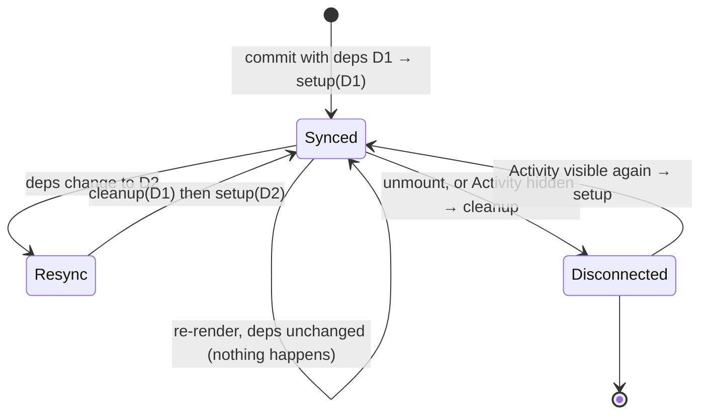
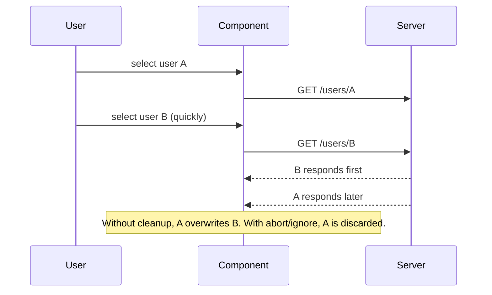
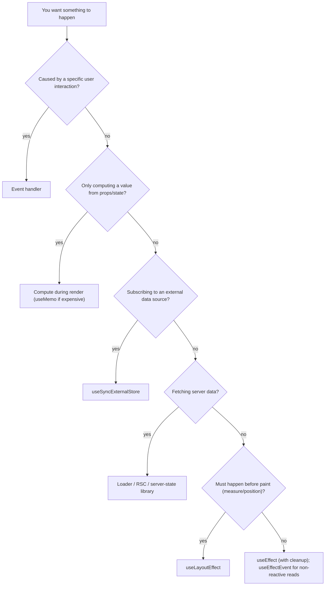

# 13 — Effects and Synchronization

> An effect is not a lifecycle method. It is a declaration: "while this component is on screen with these values, keep this external system in sync, and here is how to undo it." Most effect bugs come from asking effects to do anything else.

**Prerequisites:** [12](12-hooks-in-depth.md) · **Related:** [15 Concurrent React](15-concurrent-react-suspense-and-transitions.md) · [28 State Ownership](28-state-and-data-ownership-architecture.md) · [30 Server State](30-server-state-and-data-fetching.md)

---

## TL;DR

- **Effects synchronise a component with something outside React** (network connections, subscriptions, browser APIs, timers, non-React widgets). If no external system is involved, you almost certainly **don't need an effect**.
- Think in **setup → cleanup pairs**, not "mount / update / unmount". React may run setup and cleanup many times: StrictMode double-invokes them in development, `<Activity>` disconnects and reconnects them, dependencies change. Your cleanup must exactly undo your setup.
- The **dependency array is not a choice**. It's a declaration of every reactive value the effect reads. To change dependencies, change the code: move values out of or into the effect, use updater functions, or use **`useEffectEvent`** for non-reactive reads.
- **Data fetching in raw effects** must handle races (abort or ignore stale responses), and it still has no caching, no deduplication, no SSR and creates waterfalls. Use a framework loader, RSC or a server-state library.
- `useLayoutEffect` is for measuring and positioning **before paint**. It blocks the paint, so keep it small.
- The most common effect anti-patterns are **derived state in effects**, **event logic in effects** and **effect chains**. Each has a direct replacement.

---

## 1. The mental model: synchronisation, not lifecycle



Each render has its own props, state and effect closures. An effect "belongs" to the render that created it. When dependencies change, React cleans up the old render's effect and sets up the new one.

```tsx
function ChatRoom({ roomId }: { roomId: string }) {
  useEffect(() => {
    const connection = createConnection(roomId); // setup: start syncing with room `roomId`
    connection.connect();
    return () => connection.disconnect();        // cleanup: stop syncing with that room
  }, [roomId]);                                  // re-sync whenever roomId changes
  return <h1>Welcome to {roomId}</h1>;
}
```

> [!IMPORTANT]
> Ask "**what am I synchronising with, and when should it re-synchronise?**" If the answer is "nothing external, I just want to update state when X changes", you need render-time computation or an event handler, not an effect.

---

## 2. You might not need an effect: the catalogue

| # | Situation | ❌ Effect version | ✅ Replacement |
|---|---|---|---|
| 1 | Derive data for display | `useEffect(() => setFullName(first + ' ' + last), [first, last])` | `const fullName = first + ' ' + last` |
| 2 | Expensive derivation | Effect + state | `useMemo` (or the Compiler) |
| 3 | Reset all state when a prop changes | Effect that calls several setters | `<Profile key={userId} />` |
| 4 | Adjust *some* state when a prop changes | Effect comparing props | Compute during render, or store the previous prop and adjust during render (guarded) |
| 5 | Respond to a user action (submit, buy, toggle) | Effect watching a flag (`if (submitted) post()`) | Do it in the event handler |
| 6 | Share logic between handlers | Effect triggered by state set in handlers | A plain function called from both handlers |
| 7 | Chains of state updates | Effect A sets B, effect B sets C… | Compute the next state in one handler |
| 8 | Notify a parent of a state change | `useEffect(() => onChange(value), [value])` | Call `onChange` in the same handler that sets the state, or lift state up |
| 9 | Pass data up to a parent | Child fetches, then sets parent state in an effect | Fetch in the parent (or a shared loader) and pass it down |
| 10 | Subscribe to an external store | `useEffect` + `useState` | `useSyncExternalStore` |
| 11 | Initialise the app once | `useEffect(() => init(), [])` (runs twice in dev) | Module-level init, or a once-guard outside React |
| 12 | Fetch data | `useEffect` + `fetch` + `setState` | Framework loader, RSC, or TanStack Query / SWR |

### 2.1 Examples

```tsx
// #4: adjusting state on prop change, without an effect
function List({ items }: { items: Item[] }) {
  const [selectedId, setSelectedId] = useState<string | null>(null);
  // Derive: if the selected item disappeared, treat selection as null
  const selected = items.find((i) => i.id === selectedId) ?? null;
  // …render using `selected`; no effect, no extra state
}
```

```tsx
// #5 and #8: event-specific logic belongs in the event
function Toggle({ onChange }: { onChange: (on: boolean) => void }) {
  const [on, setOn] = useState(false);
  function toggle() {
    const next = !on;
    setOn(next);
    onChange(next);       // ✅ same event, same batch: parent and child update together
  }
  return <button aria-pressed={on} onClick={toggle}>Toggle</button>;
}
```

```tsx
// #7: effect chain (❌) vs a single handler (✅)
// ❌
useEffect(() => { if (card?.gold) setGoldCount((c) => c + 1); }, [card]);
useEffect(() => { if (goldCount > 3) { setRound((r) => r + 1); setGoldCount(0); } }, [goldCount]);
// ✅
function placeCard(next: Card) {
  setCard(next);
  if (next.gold) {
    if (goldCount < 3) setGoldCount(goldCount + 1);
    else { setGoldCount(0); setRound(round + 1); }
  }
}
```

---

## 3. Dependencies: declared, not chosen

Every **reactive value** the effect reads must be a dependency: props, state, context, and anything computed from them in the component body. The linter (`exhaustive-deps`) enforces this.

### How to remove a dependency (change the code, not the array)

| Technique | Before | After |
|---|---|---|
| Prove it isn't reactive: move it **outside** the component | `const options = { serverUrl }` in the body | Module-level constant |
| Move it **inside** the effect | Function defined in the body and called in the effect | Define the function inside the effect |
| **Updater function** | `setMessages([...messages, msg])` → depends on `messages` | `setMessages((ms) => [...ms, msg])` |
| **Effect Event** for non-reactive reads | Effect reads `theme` only for a toast | `const onConnected = useEffectEvent(() => toast(theme))` |
| **Primitive dependencies** instead of objects | `[options]` (new object every render) | `[options.roomId, options.serverUrl]`, or construct the object inside the effect |
| **Split** unrelated concerns | One effect does connection + analytics | Two effects, each with its own dependencies |

```tsx
// ❌ object dependency recreated every render → reconnects on every keystroke elsewhere
const options = { serverUrl, roomId };
useEffect(() => {
  const c = createConnection(options);
  c.connect();
  return () => c.disconnect();
}, [options]);

// ✅ depend on primitives; build the object inside
useEffect(() => {
  const c = createConnection({ serverUrl, roomId });
  c.connect();
  return () => c.disconnect();
}, [serverUrl, roomId]);
```

> [!WARNING]
> `// eslint-disable-next-line react-hooks/exhaustive-deps` is almost always a bug waiting to happen. It hides stale closures and makes the Compiler skip the component. Treat each suppression as a design smell to fix.

---

## 4. Cleanup: the symmetry rule

> Cleanup must undo exactly what setup did, so that **setup → cleanup → setup** is indistinguishable from a single setup.

| Setup | Cleanup |
|---|---|
| `addEventListener` | `removeEventListener` (or `AbortController.abort()`) |
| `setInterval` / `setTimeout` | `clearInterval` / `clearTimeout` |
| `subscribe()` | `unsubscribe()` |
| `new IntersectionObserver().observe()` | `observer.disconnect()` |
| Open a WebSocket or connection | Close it |
| `fetch` | `abort()` or ignore the result |
| Create a third-party widget (`new Map(el)`) | `widget.destroy()` |
| Start an animation | Cancel or reset it |
| Set `document.title` or a global class | Restore the previous value (if others rely on it) |

```tsx
useEffect(() => {
  const ac = new AbortController();
  const { signal } = ac;
  window.addEventListener('resize', onResize, { signal });
  document.addEventListener('visibilitychange', onVisibility, { signal });
  return () => ac.abort(); // one call undoes everything
}, []);
```

### Why StrictMode runs effects twice

In development, StrictMode mounts → unmounts → remounts every component (since 19.3 also during hydration), immediately exercising the cleanup path. Bugs it reveals: double subscriptions, connections never closed, analytics sent twice, "effect assumed to run once". **Fix the cleanup. Don't add "ran once" refs.**

Other things that legitimately re-run effects in production: dependency changes, `<Activity>` hide/show, Fast Refresh in development, and future offscreen and preserved-state features.

---

## 5. Data fetching with effects (when you must)

```tsx
function Profile({ userId }: { userId: string }) {
  const [state, setState] = useState<RemoteData<User>>({ status: 'loading' });

  useEffect(() => {
    const ac = new AbortController();
    setState({ status: 'loading' });
    fetch(`/api/users/${userId}`, { signal: ac.signal })
      .then((r) => (r.ok ? r.json() : Promise.reject(new Error(`HTTP ${r.status}`))))
      .then((user: User) => setState({ status: 'success', data: user }))
      .catch((error: unknown) => {
        if (ac.signal.aborted) return;                       // stale request: ignore
        setState({ status: 'error', error: error as Error });
      });
    return () => ac.abort();                                  // race-safe: old requests cancelled
  }, [userId]);
}
```



Even race-safe, effect fetching has structural problems:

| Problem | Why it matters | Who solves it |
|---|---|---|
| **No caching or deduplication** | Every mount refetches; two components fetch the same thing | TanStack Query, SWR, RTK Query, RSC + framework caches |
| **Waterfalls** | Child fetches only after the parent renders after *its* fetch | Loaders, RSC, prefetching, render-as-you-fetch |
| **No SSR** | Effects don't run on the server | Framework data APIs, RSC |
| **No retry, refetch or staleness policy** | Hand-rolled per component | Server-state libraries |
| **Double fetch in StrictMode (development)** | Harmless with abort, but noisy | Libraries handle it |

> [!TIP]
> Architectural rule: **ban raw `fetch` in `useEffect` in application code** (lint or code review). Fetching belongs in one data layer: framework loaders and RSC, or a server-state cache ([30](30-server-state-and-data-fetching.md)).

---

## 6. Effect timing: `useEffect` vs `useLayoutEffect`

```tsx
// Tooltip that must be positioned before the user sees it
function Tooltip({ anchorRect, children }: { anchorRect: DOMRect; children: React.ReactNode }) {
  const ref = useRef<HTMLDivElement>(null);
  const [height, setHeight] = useState(0);

  useLayoutEffect(() => {
    setHeight(ref.current!.getBoundingClientRect().height); // measure → re-render before paint
  }, []);

  const placeAbove = anchorRect.top - height > 0;
  return (
    <div ref={ref} style={{ position: 'fixed', top: placeAbove ? anchorRect.top - height : anchorRect.bottom }}>
      {children}
    </div>
  );
}
```

| Question | `useEffect` | `useLayoutEffect` |
|---|---|---|
| Can the user see an intermediate state? | Yes (one frame) | No |
| Blocks paint? | No | **Yes** (and it forces synchronous layout if it measures) |
| Runs on the server? | No | No (React 19 removed the old SSR warning, but it still doesn't run) |
| Default choice | ✅ | Only for measure/position/flicker problems |

> [!NOTE]
> Before reaching for `useLayoutEffect`, check whether CSS solves it: anchor positioning, container queries, `aspect-ratio`. The best layout effect is the one you didn't need ([07](07-modern-css-and-layout-architecture.md)).

---

## 7. Effects with Effect Events

```tsx
function Page({ url, shoppingCart }: { url: string; shoppingCart: Cart }) {
  const onVisit = useEffectEvent((visitedUrl: string) => {
    logVisit(visitedUrl, shoppingCart.items.length); // reads the latest cart without re-running
  });

  useEffect(() => {
    onVisit(url);   // pass reactive values explicitly as arguments
  }, [url]);        // re-run only when the URL changes
}
```

Guidelines: pass the **reactive** values that caused the effect as arguments, read the **non-reactive** ones inside the Effect Event, and never use Effect Events to silence dependencies that should re-sync.

---

## 8. Integrating non-React widgets

```tsx
function MapView({ center, zoom, markers }: Props) {
  const containerRef = useRef<HTMLDivElement>(null);
  const mapRef = useRef<MapLib.Map | null>(null);

  // 1. Create once / destroy once (initial view read through an Effect Event: lint-clean)
  const getInitialView = useEffectEvent(() => ({ center, zoom }));
  useEffect(() => {
    const map = new MapLib.Map(containerRef.current!, getInitialView());
    mapRef.current = map;
    return () => { map.destroy(); mapRef.current = null; };
  }, []);

  // 2. Sync each prop separately
  useEffect(() => { mapRef.current?.setCenter(center); }, [center]);
  useEffect(() => { mapRef.current?.setZoom(zoom); }, [zoom]);
  useEffect(() => {
    const layer = mapRef.current?.addMarkers(markers);
    return () => layer?.remove();
  }, [markers]);

  return <div ref={containerRef} style={{ blockSize: 400 }} />;
}
```

> [!NOTE]
> The pattern is **one effect for the widget's lifetime, plus one effect per synchronised prop**. The lifetime effect reads initial values through an Effect Event, so it doesn't re-create the widget when they change, and the per-prop effects keep it in sync afterwards. Wrapper components like this are the **only** place imperative widget code should live ([14](14-refs-dom-portals-and-imperative-apis.md), [25](25-complex-ui-engineering.md)).

---

## 9. Effects and `<Activity>`

`<Activity mode="hidden">` (React 19.2+) keeps a subtree's **state and DOM** while **cleaning up its effects**. When it becomes visible, the effects set up again.

Consequences:

- Effects must be **re-entrant**: setup after cleanup must work (StrictMode already tests this).
- Subscriptions, timers and video playback stop automatically while hidden. That's the point.
- Data stays as last rendered. Refresh on reveal if freshness matters (a server-state library's `refetchOnMount` or a stale-time policy does this).

---

## 10. Common effect smells in code review

| Smell | Ask |
|---|---|
| `useEffect(() => setX(f(y)), [y])` | Can `x` be computed during render? |
| `useEffect` with `[]` that reads props | Is this initial-only on purpose? Should it be an Effect Event or a dependency? |
| Effect watching a boolean set by a handler | Should this logic live in the handler? |
| Several effects that set each other's state | Can the next state be computed in one place? |
| `fetch` in an effect in feature code | Why isn't this using the data layer? |
| `isMounted` refs | Use cleanup / abort instead |
| Disabled `exhaustive-deps` | What's the real dependency structure? |
| `useLayoutEffect` without measurement | Why block paint? |
| Effect calling `onChange` prop with state | Call it in the event that changed the state |

---

## Decision framework: is this an effect?



---

## Pitfalls and anti-patterns

- Treating `[]` as "componentDidMount" and fighting StrictMode instead of writing cleanups.
- Lying about dependencies.
- Object or function dependencies recreated each render (infinite resubscriptions or refetch loops).
- Synchronous `setState` at the top of an effect (`set-state-in-effect`), which is derived state in disguise.
- Fetch without abort, or "ignore" logic (race conditions).
- Analytics page views in effects, which double-fire in StrictMode and fire on prerender. Attach to router events, and gate on `document.prerendering`.
- Heavy work in layout effects.

---

## Architect's checklist

- [ ] Lint: `exhaustive-deps`, `set-state-in-effect`, `refs` as errors; suppressions need a justification comment and review
- [ ] Raw data fetching in effects is banned in feature code
- [ ] Imperative integrations live in dedicated wrapper components
- [ ] Every effect has a cleanup or a written reason why none is needed
- [ ] StrictMode enabled; no "run once" ref hacks
- [ ] Analytics and side-effect events are tied to user events or router events, not to render or effects

---

## Interview angles

**Q1. Why does my effect run twice in development, and what should I do?**
StrictMode intentionally runs setup → cleanup → setup to verify that the effect is resilient to remounting, which React relies on for features like `<Activity>`, Fast Refresh and preserved state. (Since 19.3 it does this during hydration too.) The fix is a correct cleanup that fully undoes the setup, so that two setups with a cleanup in between behave like one. Don't suppress it with refs.

**Q2. How do you avoid race conditions when fetching in an effect?**
Cancel or ignore stale work in the cleanup: create an `AbortController` per effect run, pass its signal to `fetch`, and abort in the cleanup. Or keep an `ignore` flag that the cleanup sets. Then only the latest request can set state. In an architecture, I'd move fetching to a server-state library or loaders, which handle races, caching and deduplication.

**Q3. Your effect depends on a callback prop and reconnects every render. Fix it.**
The parent passes a new function each render. Options: move the logic that needs the callback into an Effect Event (`useEffectEvent`) so the effect doesn't depend on it, have the parent stabilise it (`useCallback`, or the Compiler), or restructure so the effect only depends on primitives (IDs) and the callback is invoked from an event rather than from the effect.

**Q4. `useEffect` vs `useLayoutEffect` with an example.**
A tooltip that must flip above its anchor if there's no room below needs its own height before it's painted. Measuring in `useLayoutEffect` and re-rendering happens before paint, so there's no flicker. A subscription or analytics call should be `useEffect`, which doesn't block paint. Layout effects block the frame and often force synchronous layout, so use them sparingly.

**Q5. Give three cases where people use effects but shouldn't.**
Deriving state from props (compute in render). Responding to a user action by watching a state flag (do it in the handler). Resetting state when a prop changes (use a `key`). Also: notifying parents of changes, chaining state updates, and subscribing to stores (use `useSyncExternalStore`).

---

## Further reading

- React docs, *Synchronizing with Effects*: <https://react.dev/learn/synchronizing-with-effects>
- React docs, *You Might Not Need an Effect*: <https://react.dev/learn/you-might-not-need-an-effect>
- React docs, *Lifecycle of Reactive Effects*, *Removing Effect Dependencies*: <https://react.dev/learn/lifecycle-of-reactive-effects>
- React docs, *Separating Events from Effects*: <https://react.dev/learn/separating-events-from-effects>
- Dan Abramov, *A Complete Guide to useEffect*: <https://overreacted.io/a-complete-guide-to-useeffect/>

---

[← Previous: 12 — Hooks in Depth](12-hooks-in-depth.md) · [Index](README.md) · [Next: 14 — Refs, the DOM, Portals and Imperative APIs →](14-refs-dom-portals-and-imperative-apis.md)
