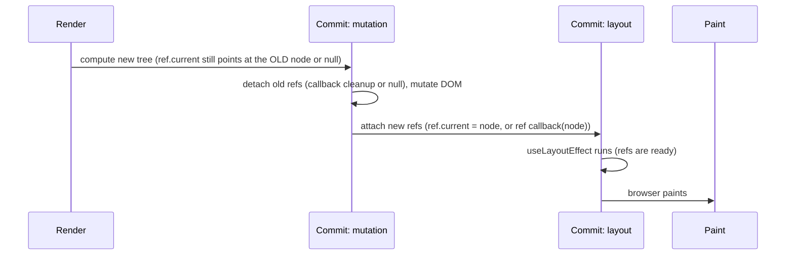
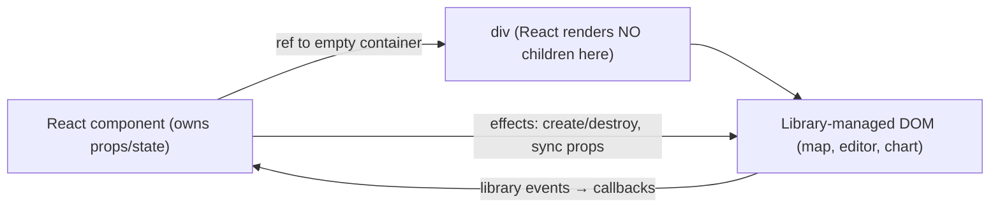

# 14 — Refs, the DOM, Portals and Imperative APIs

> React owns the DOM it renders. Refs are the narrow, deliberate doors through which you reach in, for focus, scroll, measurement and third-party widgets, without breaking that ownership.

**Prerequisites:** [12](12-hooks-in-depth.md), [13](13-effects-and-synchronization.md) · **Related:** [25 Complex UI](25-complex-ui-engineering.md) · [36 Accessibility](36-accessibility-engineering.md) · [24 Animation](24-animation-and-motion-systems.md)

---

## TL;DR

- A **ref** is a mutable box (`{ current }`) attached to a fiber. Mutating it never re-renders. React sets DOM refs during the **commit's layout phase**: before `useLayoutEffect` runs, after the DOM is updated.
- **React 19:** `ref` is a regular prop for function components (`forwardRef` is no longer needed and is expected to be deprecated), and **ref callbacks can return a cleanup function**. StrictMode double-invokes ref callbacks in development.
- **Fragment refs (stable in 19.3)** give you a `FragmentInstance` for a group of sibling nodes: add listeners, focus, observe with Intersection/Resize observers, scroll and measure, all without a wrapper `<div>`.
- **Portals** render children into a different DOM node while keeping their **React** parent: context flows and **events bubble through the React tree**, not the DOM tree. For modals and popovers, the native **top layer** (`<dialog>`, `popover`) now removes most z-index reasons for portals.
- `flushSync` forces an update to commit synchronously. It's an escape hatch for imperative follow-ups (scroll to the item you just added, print). It defeats batching and transitions.
- **Never let React and another library mutate the same DOM subtree.** Give imperative widgets an empty container that React doesn't render children into.

---

## 1. Refs: semantics and timing



| Rule | Reason |
|---|---|
| Don't read `ref.current` during render | It reflects the *previous* commit, isn't reactive, and breaks purity (lint: `refs`) |
| Read DOM refs in effects and event handlers | They're attached by then |
| Conditionally rendered elements set refs to `null` on unmount | Always null-check |
| Refs aren't available in Server Components | Refs are client-only |

### 1.1 Ref as a prop (React 19)

```tsx
// No forwardRef: `ref` arrives like any other prop
export function TextInput({ ref, ...props }: React.ComponentProps<'input'>) {
  return <input ref={ref} className="input" {...props} />;
}

// Consumer
const inputRef = useRef<HTMLInputElement>(null);
<TextInput ref={inputRef} />;
```

> [!NOTE]
> Class components still receive `ref` as a special attribute that points to the class instance, not as a prop. In React 19, reading `element.ref` is deprecated, because the ref now lives in `element.props.ref`.

### 1.2 Callback refs and cleanup

```tsx
// React 19: return a cleanup instead of handling the `null` call
<li
  ref={(node) => {
    if (!node) return;
    itemNodes.set(item.id, node);
    return () => itemNodes.delete(item.id);
  }}
/>
```

> [!WARNING]
> An **inline** ref callback is a new function on every render, so React runs the previous callback's cleanup and the new callback's setup **on every render**. That's fine for cheap work like map bookkeeping. For expensive setup (observers, third-party init), stabilise the callback with `useCallback`, or let the Compiler memoise it.

### 1.3 Refs to many items

```tsx
function Gallery({ photos }: { photos: Photo[] }) {
  const nodes = useRef(new Map<string, HTMLImageElement>());

  function scrollToPhoto(id: string) {
    nodes.current.get(id)?.scrollIntoView({ behavior: 'smooth', block: 'nearest', inline: 'center' });
  }

  return (
    <ul>
      {photos.map((p) => (
        <li key={p.id}>
           {
              if (node) nodes.current.set(p.id, node);
              return () => { nodes.current.delete(p.id); };
            }}
          />
        </li>
      ))}
    </ul>
  );
}
```

### 1.4 Merging refs

```ts
// Combine a consumer's ref with an internal one, supporting React 19 ref cleanups
export function mergeRefs<T>(...refs: Array<React.Ref<T> | undefined>): React.RefCallback<T> {
  return (node) => {
    const cleanups = refs.map((ref) => {
      if (typeof ref === 'function') return ref(node);
      if (ref) (ref as React.RefObject<T | null>).current = node;
      return undefined;
    });
    return () => {
      cleanups.forEach((c, i) => {
        if (typeof c === 'function') c();
        else {
          const ref = refs[i];
          if (typeof ref === 'function') ref(null);
          else if (ref) (ref as React.RefObject<T | null>).current = null;
        }
      });
    };
  };
}
```

---

## 2. Fragment refs (19.3)

Fragment refs solve two old problems: you couldn't reach a component's DOM without a wrapper element, and you couldn't reach it at all when the component didn't forward a ref.

```tsx
function InView({ children, onChange }: { children: React.ReactNode; onChange: (visible: boolean) => void }) {
  const fragmentRef = useRef<FragmentInstance>(null); // the FragmentInstance type ships with the React 19.3 typings

  useEffect(() => {
    const fragment = fragmentRef.current!;
    const io = new IntersectionObserver((entries) => onChange(entries.some((e) => e.isIntersecting)));
    fragment.observeUsing(io);              // observes each first-level host child
    return () => { fragment.unobserveUsing(io); io.disconnect(); };
  }, [onChange]);

  return <Fragment ref={fragmentRef}>{children}</Fragment>;
}

// Works on <Card>, even though Card doesn't expose a ref
<InView onChange={(v) => track('card-visible', v)}>
  <Card />
</InView>
```

| `FragmentInstance` method | Use |
|---|---|
| `addEventListener` / `removeEventListener` / `dispatchEvent` | Events on the first-level host children |
| `focus()` / `focusLast()` / `blur()` | Move focus to the first or last focusable descendant (depth-first) |
| `observeUsing(observer)` / `unobserveUsing(observer)` | Attach an `IntersectionObserver` or `ResizeObserver` to the children |
| `getClientRects()`, `getRootNode()`, `compareDocumentPosition()`, `scrollIntoView()` | Measure, locate and scroll to the children |

**Replaces:** wrapper `<div ref>` elements (which break CSS layouts such as grid, flex and tables), `findDOMNode` (removed in React 19), and ad-hoc "focus the first tabbable child" utilities.

---

## 3. Focus management

| Need | Technique |
|---|---|
| Focus on mount | `autoFocus` (React calls `.focus()` on mount), or `ref.current.focus()` in an effect |
| Focus after a state change shows an element | Effect keyed on the state, or `flushSync(() => setOpen(true)); ref.current.focus()` |
| Restore focus when a dialog closes | Save `document.activeElement` on open, restore on close (native `<dialog>` does this for you) |
| Trap focus in a modal | `<dialog>.showModal()` (native trapping and inert background), or `inert` on siblings |
| Composite widgets (toolbar, grid, listbox) | Roving `tabIndex` (one item has `0`, the rest `-1`) + arrow-key handlers ([25](25-complex-ui-engineering.md)) |
| Focus without scrolling | `el.focus({ preventScroll: true })` |
| Move focus to a group of siblings | Fragment ref `.focus()` (19.3) |
| Announce route changes | Focus the main heading (or a skip target) after navigation ([36](36-accessibility-engineering.md)) |

```tsx
function InlineEdit({ value, onSave }: { value: string; onSave: (v: string) => void }) {
  const [editing, setEditing] = useState(false);
  const inputRef = useRef<HTMLInputElement>(null);
  const buttonRef = useRef<HTMLButtonElement>(null);

  function startEditing() {
    flushSync(() => setEditing(true)); // commit now, so the input exists
    inputRef.current?.select();
  }

  function finish(save: boolean, next?: string) {
    if (save && next !== undefined) onSave(next);
    flushSync(() => setEditing(false));
    buttonRef.current?.focus();        // return focus to the trigger (a11y)
  }

  return editing ? (
    <input
      ref={inputRef}
      defaultValue={value}
      onKeyDown={(e) => {
        if (e.key === 'Enter' && !e.nativeEvent.isComposing) finish(true, e.currentTarget.value);
        if (e.key === 'Escape') finish(false);
      }}
      onBlur={(e) => finish(true, e.currentTarget.value)}
    />
  ) : (
    <button ref={buttonRef} onClick={startEditing}>{value}</button>
  );
}
```

---

## 4. Scroll management

```tsx
// Keep the viewport stable when older messages are prepended (chat history)
function MessageList({ messages }: { messages: Message[] }) {
  const listRef = useRef<HTMLDivElement>(null);
  const prevHeight = useRef(0);

  useLayoutEffect(() => {
    const el = listRef.current!;
    const delta = el.scrollHeight - prevHeight.current;
    if (prevHeight.current && delta > 0 && el.scrollTop < 50) el.scrollTop += delta; // compensate before paint
    prevHeight.current = el.scrollHeight;
  }, [messages]);

  return <div ref={listRef} style={{ overflowY: 'auto', overflowAnchor: 'none' }}>{/* … */}</div>;
}
```

- `overflow-anchor` (CSS scroll anchoring) solves many "content inserted above" jumps natively. Disable it when you manage scroll manually, as above.
- **Scroll restoration** across SPA navigations belongs to the router (or the Navigation API), not to individual components ([31](31-routing-architecture.md)).
- `scrollIntoView({ block: 'nearest' })` avoids jarring jumps. Respect `prefers-reduced-motion` before using `behavior: 'smooth'`.

---

## 5. Measuring

| Approach | When | Cost |
|---|---|---|
| `getBoundingClientRect()` in `useLayoutEffect` | You need the size *before paint* (positioning) | Forces synchronous layout. Do it once, not per item |
| `ResizeObserver` | Size changes over time (charts, virtualisation, container-driven logic) | Batched per frame, async |
| CSS (container queries, anchor positioning) | Purely visual adaptation | None in JS |
| Fragment ref `getClientRects()` | Measure a component that has no wrapper or ref | As above |

```ts
export function useElementSize<T extends Element>() {
  const [size, setSize] = useState({ width: 0, height: 0 });
  const ref = useCallback((node: T | null) => {
    if (!node) return;
    const ro = new ResizeObserver(([entry]) => {
      const { inlineSize: width, blockSize: height } = entry.contentBoxSize[0];
      setSize((s) => (s.width === width && s.height === height ? s : { width, height }));
    });
    ro.observe(node);
    return () => ro.disconnect();
  }, []);
  return [ref, size] as const;
}
```

---

## 6. Portals

```tsx
import { createPortal } from 'react-dom';

function Toast({ message }: { message: string }) {
  return createPortal(
    <div role="status" className="toast">{message}</div>,
    document.getElementById('toast-root')!,
  );
}
```

### 6.1 Portal semantics

| Aspect | Follows the React tree | Follows the DOM tree |
|---|---|---|
| Context (theme, router, i18n) | ✅ | |
| **Synthetic event bubbling** | ✅ (a click inside a portal reaches `onClick` on its React ancestors) | |
| Native event bubbling (`addEventListener`) | | ✅ |
| CSS inheritance, `overflow` clipping, stacking context | | ✅ (which is why portals escape clipping) |
| Keyboard focus order | | ✅ (DOM order, a frequent a11y pitfall) |
| Hidden by `<Activity mode="hidden">` | ✅ (since 19.3) | |

```tsx
// Gotcha: "click outside to close" sees clicks inside the portal as clicks INSIDE the React parent
<div onClick={() => console.log('parent clicked')}>   {/* fires for clicks inside the portal, too */}
  <Menu />                                             {/* renders its list into a portal */}
</div>
```

### 6.2 Portals vs the top layer in 2026

| Need | Prefer |
|---|---|
| Modal dialog | `<dialog>` + `showModal()`: top layer, focus trap, `Esc`, inert background. No portal needed |
| Popover, menu, tooltip | `popover` attribute + **CSS anchor positioning**, also in the top layer |
| Toast region, global overlays, rendering into another window or iframe | Portal |
| Content into a non-React container (a map overlay, a third-party widget slot) | Portal into the widget's DOM node |

### 6.3 SSR and portals

`react-dom/server` doesn't render portals. Render portal content only on the client, for example behind `use(browser())` (19.3) or after hydration, and make sure the server HTML doesn't depend on it ([17](17-ssr-streaming-and-hydration.md)).

---

## 7. `flushSync`

```tsx
import { flushSync } from 'react-dom';

function addTodo(text: string) {
  flushSync(() => setTodos((t) => [...t, { id: crypto.randomUUID(), text }]));
  listRef.current!.lastElementChild!.scrollIntoView(); // DOM is updated now
}
```

| Use | Avoid |
|---|---|
| Imperative follow-ups that need the committed DOM right now (scroll, focus, measure, `window.print()`) | Routine updates: it defeats batching |
| Integrations that must read DOM synchronously after an update | Inside render or effects (React warns, and it may not flush) |
| Rare | Anything that should be a transition |

---

## 8. Integrating imperative and third-party libraries



Rules for wrappers:

1. **One wrapper component per library.** No other code touches the library directly (an adapter or anti-corruption layer, [21](21-frontend-architecture-styles-and-boundaries.md)).
2. **React renders an empty container.** The library owns everything inside it.
3. **Lifetime effect** creates and destroys the instance. **Per-prop effects** sync changes ([13](13-effects-and-synchronization.md)).
4. **Events out** through props (`onSelect`), and **commands in** through `useImperativeHandle` if necessary.
5. **SSR:** guard creation to the client (effects don't run on the server). Render a sized placeholder to avoid CLS.
6. **Portals in** when the library offers slots (e.g., render React tooltips into map overlay elements).

> [!CAUTION]
> Manually mutating DOM that React rendered (removing nodes, changing `innerHTML`) desynchronises React's fiber tree from the DOM. Expect crashes like *"Failed to execute 'removeChild' on 'Node'"*. Non-destructive operations (focus, scroll, measuring, reading) are fine. Browser extensions and auto-translate tools that rewrite text nodes cause the same class of crash. Wrapping text in elements and avoiding bare text siblings next to conditionals reduces exposure.

---

## 9. Imperative handles as public APIs

```tsx
export type DataGridHandle = {
  scrollToRow(index: number): void;
  focusCell(row: number, col: number): void;
  getSelection(): ReadonlyArray<string>;
};

export function DataGrid<T>({ ref, rows }: { ref?: React.Ref<DataGridHandle>; rows: T[] }) {
  const viewport = useRef<HTMLDivElement>(null);
  useImperativeHandle(ref, () => ({
    scrollToRow: (i) => viewport.current?.scrollTo({ top: i * ROW_HEIGHT }),
    focusCell: (r, c) => viewport.current?.querySelector<HTMLElement>(`[data-cell="${r}:${c}"]`)?.focus(),
    getSelection: () => selectionRef.current,
  }), []);
  // …
}
```

Treat a handle like an API contract: keep it **small**, **document** it, **version** it, and prefer declarative props (`scrollToIndex` as a prop with a change key) when consumers mostly just need to set state.

---

## Decision framework: ref, state, portal or top layer?

| Question | Answer |
|---|---|
| Does the value affect what's rendered? | **State** |
| Is it a DOM node, a timer ID, an instance, or a latest-value cache? | **Ref** |
| Must you act on several siblings without a wrapper element? | **Fragment ref** |
| Does UI need to escape `overflow`, `z-index` or stacking contexts? | **Top layer** (`dialog`, `popover`) first, **portal** second |
| Must a parent command a child imperatively (focus, scroll, play)? | **`useImperativeHandle`**, kept minimal |
| Does an imperative follow-up need committed DOM immediately? | **`flushSync`**, sparingly |

---

## Pitfalls and anti-patterns

- Reading or writing `ref.current` during render.
- Storing DOM nodes in state (causes re-renders, and the nodes can go stale).
- `forwardRef` in new code (unnecessary in React 19), and wrapper `<div>`s just to get a ref (use Fragment refs).
- Inline ref callbacks doing expensive work every render.
- Portals for modals without focus management, `aria-modal` and an inert background (prefer `<dialog>`).
- "Click outside" logic that forgets portal bubbling.
- Mixing React-rendered children with library-managed DOM in one node.
- `flushSync` in loops or as a default.

---

## Architect's checklist

- [ ] Design-system components accept `ref` as a prop and forward it to the main host element
- [ ] A shared `mergeRefs` utility that supports ref cleanups
- [ ] Modals, menus and tooltips use `<dialog>`/`popover`/anchor positioning where Baseline allows; portals are documented exceptions
- [ ] Each third-party DOM library has exactly one wrapper component
- [ ] Focus-management patterns (restore on close, roving tabindex, route-change focus) are standard utilities
- [ ] Lint `refs` rule enabled; `flushSync` usages reviewed

---

## Interview angles

**Q1. What changed about refs in React 19?**
`ref` became a regular prop for function components, so `forwardRef` is no longer needed. Ref callbacks can return a cleanup function, which React calls on detach instead of calling the callback with `null`. StrictMode double-invokes ref callbacks to surface missing cleanup. Reading `element.ref` is deprecated. In 19.3, `<Fragment ref>` became stable, giving a `FragmentInstance` for groups of children.

**Q2. How do events behave inside a portal?**
Synthetic events bubble along the React component tree, so a click inside a portal triggers `onClick` on the portal's React ancestors even though the DOM node lives elsewhere (e.g., under `body`). Context also flows through portals. Native DOM listeners follow the DOM tree. This matters for "click outside" detection and for event handlers higher up that shouldn't react to overlay content.

**Q3. When would you use `flushSync`?**
When imperative code needs the DOM to reflect a state update immediately: scrolling to a just-added list item, focusing an input that just appeared, printing. It forces a synchronous render and commit, defeating batching and concurrent features, so it should be rare and never used inside render or effects.

**Q4. How do you integrate a non-React map or editor library safely?**
Use a dedicated wrapper component that renders an empty container `div` and holds the library instance in a ref. One lifetime effect creates and destroys it (reading initial props through an Effect Event), separate effects sync each prop, library events are exposed as callback props, and commands are exposed through a small imperative handle if needed. React never renders children into that container. On the server, render a sized placeholder.

**Q5. Why might a portal-based modal fail accessibility review, and what's the modern alternative?**
Portals move DOM position but don't provide focus trapping, focus restoration, `Esc` handling, background inertness or the correct modal semantics. Teams often forget some of these. The native `<dialog>` with `showModal()` provides all of them plus top-layer rendering, which avoids z-index issues without a portal.

---

## Further reading

- React docs, *Manipulating the DOM with Refs*: <https://react.dev/learn/manipulating-the-dom-with-refs>
- React docs, *`useImperativeHandle`*, *`createPortal`*, *`flushSync`*: <https://react.dev/reference>
- React 19.3 release post (Fragment refs): <https://react.dev/blog/2026/09/09/react-19-3>
- React 19 release post (ref as a prop, ref cleanup): <https://react.dev/blog/2024/12/05/react-19>
- MDN, *The `<dialog>` element*, *Popover API*: <https://developer.mozilla.org/en-US/docs/Web/HTML/Element/dialog>
- WAI-ARIA APG, *Developing a Keyboard Interface*: <https://www.w3.org/WAI/ARIA/apg/practices/keyboard-interface/>

---

[← Previous: 13 — Effects and Synchronization](13-effects-and-synchronization.md) · [Index](README.md) · [Next: 15 — Concurrent React →](15-concurrent-react-suspense-and-transitions.md)
