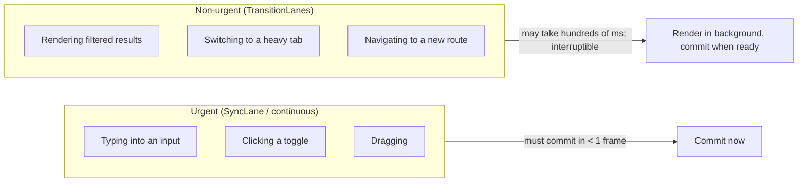
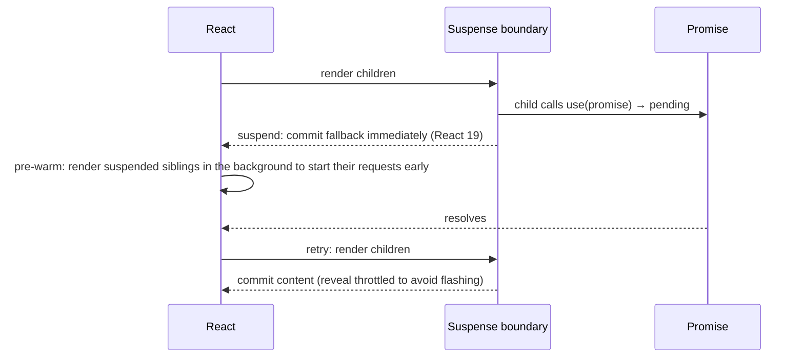
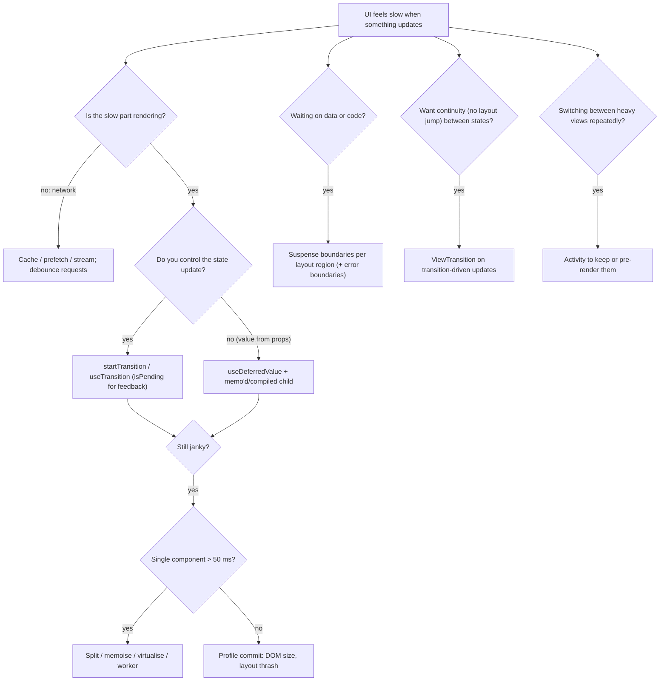

# 15 — Concurrent React: Suspense, Transitions, Activity and View Transitions

> Concurrency in React isn't parallelism. It's prioritisation: the input you're typing into renders now, and the expensive list it filters renders when it can, without ever showing you a broken half-state.

**Prerequisites:** [10](10-react-internals-fiber-and-reconciliation.md), [12](12-hooks-in-depth.md) · **Related:** [17 SSR & Hydration](17-ssr-streaming-and-hydration.md) · [24 Animation](24-animation-and-motion-systems.md) · [38 React Performance](38-react-performance-engineering.md)

---

## TL;DR

- React distinguishes **urgent** updates (typing, clicking, pressing), which must feel instant, from **non-urgent** ones (showing results, switching tabs, navigating), which may lag. **Transitions** mark the second kind. They render interruptibly, in the background, and keep the current UI on screen instead of flashing fallbacks.
- `useDeferredValue` gives you a lagging copy of a value. React renders the urgent update with the old value first, then the new value in the background.
- **Suspense** declares loading boundaries. A component suspends by reading an unresolved, *cached* promise (`use()`, framework data, `lazy`), and the nearest boundary shows its fallback. Boundary placement is a **UX architecture decision**.
- Inside a transition, React won't replace already-visible content with a fallback. It waits and shows `isPending` instead.
- **`<Activity mode="hidden">`** (19.2) keeps a subtree's state and DOM while unmounting its effects and deprioritising its updates. It's ideal for tabs, back navigation and pre-rendering likely next screens.
- **`<ViewTransition>`** (stable in 19.3) animates enter, exit, update and shared-element changes using the browser's View Transition API, **only** for transitions, Suspense reveals and deferred-value updates. `addTransitionType` lets the same change animate differently by cause.
- Concurrency can't split a single slow component, can't make the network faster, and can't shorten the commit phase. Those need memoisation, virtualisation, workers and better data access.

---

## 1. The urgency spectrum



Before React 18, every update was urgent, so a heavy result list rendered in the same blocking task as the keystroke that caused it. With concurrent rendering, the keystroke commits immediately and the list renders in 5 ms slices. If another keystroke arrives, the in-progress list render is **thrown away** and restarted with fresh data ([10](10-react-internals-fiber-and-reconciliation.md)).

---

## 2. Transitions

```tsx
function SearchPage() {
  const [query, setQuery] = useState('');           // urgent: drives the input
  const [results, setResults] = useState(allItems);
  const [isPending, startTransition] = useTransition();

  function onChange(e: React.ChangeEvent<HTMLInputElement>) {
    const q = e.target.value;
    setQuery(q);                                     // commits immediately
    startTransition(() => setResults(filter(allItems, q))); // background, interruptible
  }

  return (
    <>
      <input value={query} onChange={onChange} aria-describedby="status" />
      <span id="status" aria-live="polite">{isPending ? 'Updating…' : ''}</span>
      <ResultList items={results} />
    </>
  );
}
```

### 2.1 Semantics to know cold

| Property | Detail |
|---|---|
| Priority | Transition lanes, lower than input. Urgent updates interrupt them |
| Interruptible | Yes: React discards stale transition work and restarts with the latest state |
| Suspense behaviour | **Doesn't** show fallbacks for already-revealed boundaries. Keeps old UI, reports `isPending` |
| Async functions (Actions) | Allowed since React 19. `isPending` stays true until the function settles |
| Updates after `await` | Not automatically part of the transition. **Wrap them in `startTransition` again** |
| Independent transitions | Since **19.3**, unrelated transitions render independently, instead of being entangled into one render |
| Standalone `startTransition` | Same semantics without `isPending` (usable outside components, e.g., routers) |
| Not for | Controlled input values (they must stay urgent) |

```tsx
// Async transition (Action) with a follow-up update after await
startTransition(async () => {
  const saved = await save(draft);                 // isPending = true throughout
  startTransition(() => setLastSaved(saved.at));   // ✅ re-wrap post-await updates
});
```

### 2.2 Transitions vs debouncing vs throttling

| Technique | What it does | Reduces work? | Adapts to device? |
|---|---|---|---|
| Transition | Render the latest value in the background; discard stale renders | Rendering work only for discarded renders | ✅ Fast devices show results sooner |
| `useDeferredValue` | Same idea, applied to a value | Same | ✅ |
| Debounce | Wait for a quiet period, then do it once | ✅ Network and compute | ❌ Fixed delay |
| Throttle | At most once per interval | ✅ | ❌ |

Typical production pattern: **debounce the network request** (≈200–300 ms), and **transition the rendering** of results.

---

## 3. `useDeferredValue`

```tsx
const deferredQuery = useDeferredValue(query);
// Render 1 (urgent): query = "ab", deferredQuery = "a"  → input updates; <Results> skips (same prop)
// Render 2 (background): deferredQuery = "ab"           → <Results> re-renders; interruptible
<Results query={deferredQuery} />  // must be memo'd or compiled so it skips the urgent render
```

- **`initialValue`** (React 19): `useDeferredValue(value, initialValue)` lets the first render use a cheap placeholder, then render the real value in the background. It's useful for instant first paint of expensive sections.
- Combined with Suspense: if the deferred render suspends, React keeps showing the old results (no fallback) until the new data is ready. That's "stale-while-revalidate" for UI.
- 19.3 fixed a bug where `useDeferredValue` could get stuck on an old value.

---

## 4. Suspense

### 4.1 What can suspend

| Source | How |
|---|---|
| Code | `lazy(() => import('./Chart'))` |
| Data | `use(promise)` with a **cached/stable** promise; Suspense-enabled libraries (TanStack Query `useSuspenseQuery`, Relay); framework loaders; RSC streaming |
| Stylesheets | `<link rel="stylesheet" precedence>` (React waits for them before revealing content) |
| Images and fonts | Inside a `<ViewTransition>` (19.3), so content, images and fonts reveal together |
| Server rendering | `use(browser())` suspends on the server, so the fallback ships in the HTML (19.3) |

### 4.2 How a boundary behaves



- **React 19 commits the fallback immediately** when a component suspends, then "pre-warms" the rest of the suspended subtree in the background, so lazy requests further down still start early.
- Reveals of nested boundaries are **throttled** (React waits briefly to batch reveals that land close together). That's why streamed UI doesn't flicker boundary by boundary. Since 19.2, Suspense reveals are also **batched during SSR streaming**.
- **Errors** from a suspended promise go to the nearest **error boundary**. Always pair Suspense boundaries with error boundaries at the same granularity ([40](40-resilience-and-reliability.md)).

### 4.3 Boundary placement: a UX architecture decision

```tsx
function ProductPage({ id }: { id: string }) {
  return (
    <Layout>
      <ProductHeader id={id} />                       {/* critical: no boundary; part of the shell */}
      <Suspense fallback={<GallerySkeleton />}>
        <Gallery id={id} />
      </Suspense>
      <ErrorBoundary fallback={<ReviewsUnavailable />}>
        <Suspense fallback={<ReviewsSkeleton />}>
          <Reviews id={id} />                         {/* slow, non-critical: isolated */}
        </Suspense>
      </ErrorBoundary>
      <Suspense fallback={null}>
        <Recommendations id={id} />                   {/* optional: no visible placeholder */}
      </Suspense>
    </Layout>
  );
}
```

| Guideline | Why |
|---|---|
| Boundaries follow **layout regions** users perceive as units | Avoids "popcorn" UI where dozens of spinners resolve randomly |
| Critical content is in the shell, not behind a boundary | Its LCP shouldn't wait on slow siblings, and it shouldn't flash |
| Isolate slow or unreliable data | One slow API shouldn't block the page; one failing API shouldn't break it |
| Skeletons match final dimensions | Prevents CLS |
| Fewer, intentional boundaries | Each is a loading state that design must approve |

---

## 5. `<Activity>`: keeping UI alive while hidden (19.2+)

```tsx
function Tabs({ active }: { active: 'feed' | 'inbox' | 'settings' }) {
  return (
    <>
      <Activity mode={active === 'feed' ? 'visible' : 'hidden'}><Feed /></Activity>
      <Activity mode={active === 'inbox' ? 'visible' : 'hidden'}><Inbox /></Activity>
      <Activity mode={active === 'settings' ? 'visible' : 'hidden'}><Settings /></Activity>
    </>
  );
}
```

| While `hidden`… | Behaviour |
|---|---|
| State | **Preserved** (scroll position in DOM, form inputs, component state) |
| DOM | Kept, but hidden |
| Effects | **Cleaned up**; set up again when visible |
| Updates | Still processed, at the lowest priority (offscreen), so hidden content can be **pre-rendered** |
| Portals inside | Hidden too (19.3) |
| Errors inside | Don't escape the hidden tree (19.3) |
| `useSyncExternalStore` | Doesn't miss mutations made while hidden (19.3 fix) |

**Use cases:** tab panels without losing state, back/forward navigation that restores instantly, **pre-rendering** a likely next screen (render it hidden, reveal it on navigation), keeping expensive editors alive.

> [!WARNING]
> - **Memory:** every hidden tree keeps its DOM and state. Cap how many you keep (e.g., the last three routes).
> - **DOM side effects** not tied to effects continue. A hidden `<video autoplay>` can keep playing audio. Pause media in an effect cleanup.
> - **Render must be pure.** Hidden pre-rendering runs your components before the user sees them.
> - **Stale data:** hidden UI may be out of date when it's revealed. Pair it with a server-state cache's staleness policy.

---

## 6. `<ViewTransition>` (stable in 19.3)

```tsx
import { ViewTransition, startTransition, addTransitionType } from 'react';

function Slides({ index }: { index: number }) {
  return (
    <ViewTransition
      key={index}                                          // new key → exit old, enter new
      enter={{ next: 'slide-in-right', previous: 'slide-in-left', default: 'none' }} // a per-type map needs a default
      exit={{ next: 'slide-out-left', previous: 'slide-out-right', default: 'none' }}
    >
      <Slide index={index} />
    </ViewTransition>
  );
}

function goNext() {
  startTransition(() => {
    addTransitionType('next');      // label the cause; also applied as a browser view-transition type
    setIndex((i) => i + 1);
  });
}
```

```css
::view-transition-old(.slide-out-left) { animation: 200ms ease-in both slide-to-left; }
::view-transition-new(.slide-in-right) { animation: 200ms ease-out both slide-from-right; }
@keyframes slide-to-left { to { transform: translateX(-30%); opacity: 0; } }
@keyframes slide-from-right { from { transform: translateX(30%); opacity: 0; } }
@media (prefers-reduced-motion: reduce) {
  ::view-transition-group(*), ::view-transition-old(*), ::view-transition-new(*) { animation: none !important; }
}
```

### 6.1 The model

| Concept | Detail |
|---|---|
| **Triggers** | Only updates in **transitions** (`startTransition`, Actions), **Suspense reveals**, and **`useDeferredValue`** updates. Urgent updates never animate |
| **Animation kinds** | `enter` (boundary added), `exit` (removed), `update` (children's content or layout changed), `share` (a **named** boundary removed in one place and added in another: shared-element transitions) |
| **Props** | `name`, `default`, `enter`, `exit`, `update`, `share`. Each takes a class string, `"auto"`, `"none"`, or a map from transition type to class |
| **Events** | `onEnter`, `onExit`, `onUpdate`, `onShare` for imperative control via the Web Animations API |
| **Default** | Cross-fade |
| **Types** | `addTransitionType('next')` selects class maps and also works with CSS `:active-view-transition-type(next)` |
| **Platform** | DOM only (React Native support in progress). Where the browser lacks the View Transition API, updates apply without animation |

### 6.2 Suspense + View Transitions

```tsx
import { Suspense, ViewTransition } from 'react'; // not the DOM's ViewTransition type

// Animate fallback → content as an update, but don't animate cached content appearing instantly
<ViewTransition update="auto" default="none">
  <Suspense fallback={<CardSkeleton />}>
    <Card id={id} />
  </Suspense>
</ViewTransition>
```

Recommended principles from the React team: **fallbacks appear immediately without animation**, **fallback → content animates**, and **content that doesn't suspend appears immediately**. Inside a `<ViewTransition>`, images and fonts can suspend too (19.3), so a card reveals with its image and font loaded together.

### 6.3 Shared-element transitions

```tsx
import { ViewTransition } from 'react';

// List page
<ViewTransition name={`photo-${photo.id}`}></ViewTransition>
// Detail page (after a navigation wrapped in a transition)
<ViewTransition name={`photo-${photo.id}`}></ViewTransition>
```

Names must be **unique on the page** at snapshot time. Generate them from IDs. Routers and frameworks that wrap navigations in transitions (Next.js, React Router) make page-level shared transitions work out of the box. Animation-system design is covered in [24](24-animation-and-motion-systems.md).

> [!NOTE]
> Gesture-driven transitions (`unstable_startGestureTransition`, swipe-to-go-back style animations bound to a scroll or pointer timeline) are **not stable** as of November 2026 ([A4](A4-experimental-and-canary-apis.md)).

---

## 7. Tearing and external stores

In a concurrent render that yields mid-way, an external mutable store could change between rendering component A and component B. The UI would show two different "truths" (tearing). `useSyncExternalStore` prevents this: if the store changes during a concurrent render, React re-renders synchronously with a consistent snapshot. All serious store libraries use it under the hood. If you write your own store, use it too ([29](29-client-state-management.md)).

---

## 8. What concurrency can't fix

| Problem | Why concurrency doesn't help | What does |
|---|---|---|
| One component takes 150 ms to render | React yields only **between** fibers | Memoise, split, virtualise, move compute to a worker ([38](38-react-performance-engineering.md)) |
| A huge commit (thousands of DOM mutations) | Commit is synchronous | Fewer DOM nodes, virtualisation, `content-visibility` |
| Slow API responses | Rendering isn't the bottleneck | Caching, prefetching, streaming, better endpoints |
| Long tasks from third-party scripts | Not React's work | Script governance, workers, lazy loading |
| Expensive effects after commit | Effects run outside the render scheduler | Optimise or defer effect work; `scheduler.yield()` |

**Observe it:** React Performance Tracks in the Chrome Performance panel (19.2+) show the **Scheduler** track (blocking, transition, Suspense and idle work) and a **Components** track, aligned with the browser's main-thread timeline ([20](20-react-tooling-devtools-and-debugging.md)).

---

## Decision framework: which concurrency tool?



---

## Pitfalls and anti-patterns

- Wrapping input value updates in transitions (typing lags or desyncs).
- Expecting transitions to speed up the network, or to split a single heavy component.
- Forgetting to re-wrap state updates after `await` in async transitions.
- Creating promises during render and passing them to `use()` (infinite suspense).
- A Suspense boundary around every component (popcorn UI), or one boundary around the whole page (nothing shows until everything loads).
- Suspense without error boundaries.
- Hidden `<Activity>` trees accumulating without limit; media still playing while hidden.
- Animating urgent updates with View Transitions (they won't animate, by design), or ignoring reduced motion.

---

## Architect's checklist

- [ ] Loading-state map per page: which regions are the shell, which have boundaries, and their skeletons (design-approved)
- [ ] Every Suspense boundary has a sibling error boundary strategy
- [ ] Router navigations run in transitions, with a global pending indicator
- [ ] Search and filter UIs: debounced requests + transitioned rendering
- [ ] `<Activity>` usage has a retention policy (count and memory)
- [ ] View Transitions honour `prefers-reduced-motion`; names are generated from stable IDs
- [ ] Performance Tracks are used in performance reviews to confirm work runs in transition lanes

---

## Interview angles

**Q1. What problem do transitions solve, and how do they work?**
They separate urgent updates (input) from expensive non-urgent ones (rendering results), so typing stays responsive. Updates inside `startTransition` get transition lanes. React renders them in time slices, interrupts and restarts them when urgent updates arrive, and commits only the latest completed result. During a transition React keeps existing UI visible rather than showing Suspense fallbacks, and `isPending` lets you show feedback.

**Q2. `useTransition` vs `useDeferredValue`?**
Same mechanism, different handles. `useTransition` wraps the *state update* you control. `useDeferredValue` derives a lagging copy of a *value* you may not control (props, a context value). With `useDeferredValue`, the expensive child must skip rendering when the deferred value hasn't changed (`memo` or the Compiler), otherwise there's no benefit.

**Q3. How do you decide where to put Suspense boundaries?**
Around regions the user perceives as independent units and that have independent data dependencies, keeping critical content in the shell. Slow or optional content is isolated so it can't block or break the page, skeletons match final dimensions, and every boundary is paired with an error boundary. The goal is a deliberate reveal sequence, not maximum granularity.

**Q4. What does `<Activity>` do, and what are the risks?**
It keeps a subtree mounted (state and DOM) while hidden, disconnecting its effects and processing its updates at the lowest priority. That allows instant tab switches, back navigation and pre-rendering. The risks are memory growth, DOM side effects that aren't tied to effects (media playback), stale data on reveal, and impure renders being exposed by pre-rendering.

**Q5. How does `<ViewTransition>` decide what to animate?**
Only updates that are transitions, Suspense reveals or `useDeferredValue` updates animate. React classifies each `<ViewTransition>` boundary as enter, exit, update or share (a named boundary moving between places), applies the configured class (optionally keyed by transition types set with `addTransitionType`), and drives the browser's View Transition API. Urgent updates never animate.

---

## Further reading

- React docs, *`useTransition`*, *`useDeferredValue`*, *`<Suspense>`*, *`<Activity>`*, *`<ViewTransition>`*: <https://react.dev/reference/react>
- React 19.3 release post (View Transitions, transition types): <https://react.dev/blog/2026/09/09/react-19-3>
- React 19.2 release post (`<Activity>`, Performance Tracks, SSR batching): <https://react.dev/blog/2025/10/01/react-19-2>
- React 18 working group, *New feature: startTransition* and *New Suspense SSR architecture*: <https://github.com/reactwg/react-18/discussions>
- MDN, *View Transition API*: <https://developer.mozilla.org/en-US/docs/Web/API/View_Transition_API>

---

[← Previous: 14 — Refs, the DOM, Portals and Imperative APIs](14-refs-dom-portals-and-imperative-apis.md) · [Index](README.md) · [Next: 16 — React 19.x Features and the React Compiler →](16-react-19-features-and-the-compiler.md)
