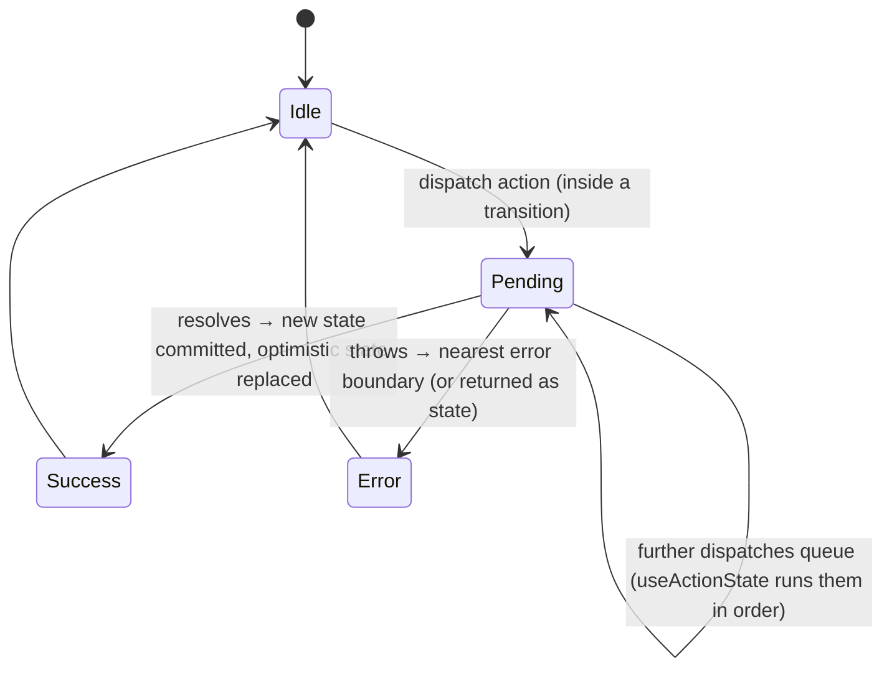
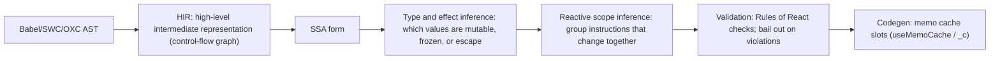

# 16 — React 19.x Features and the React Compiler

> React 19 changed how React apps *mutate* (Actions), how they *load* (`use`, resource APIs, Server Components) and how they *optimise* (the Compiler). The 19.x minors since then have been about making UI feel native: Activity, Effect Events and View Transitions.

**Prerequisites:** [12](12-hooks-in-depth.md), [15](15-concurrent-react-suspense-and-transitions.md) · **Related:** [18 RSC](18-react-server-components-and-server-functions.md) · [26 Forms](26-forms-and-validation.md) · [38 React Performance](38-react-performance-engineering.md) · [A1 API Reference](A1-react-api-reference.md) · [A2 Version History](A2-react-version-history-and-governance.md)

---

## TL;DR

- **Actions** are async functions run inside transitions. React manages pending state, errors, optimistic updates and sequencing. `<form action={fn}>`, `useActionState`, `useFormStatus` and `useOptimistic` are the building blocks.
- **`use()`** reads promises (suspending) and context, and can be called conditionally.
- **Quality-of-life:** `ref` as a prop, ref cleanup functions, `<Context value>` as provider, document metadata (`<title>`, `<meta>`, `<link>`) hoisted to `<head>`, stylesheet `precedence`, deduplicated async scripts, resource-hint APIs (`preload`, `preinit`, `preconnect`…), root error callbacks, full custom-element support.
- **19.1** added Owner Stacks. **19.2** added `<Activity>`, `useEffectEvent`, `cacheSignal`, Performance Tracks and Partial Pre-rendering. **19.3** added `<ViewTransition>`, Fragment refs, `browser()`, Trusted Types and Server Components rendering `<Context>`. **19.3.1** is a security release, and the minimum safe 19.3 version for RSC apps.
- The **React Compiler (v1.x)** auto-memoises components and hooks at a fine grain by analysing your code (HIR → SSA → effect and reactivity inference → memo-cache codegen). It assumes the **Rules of React** and quietly skips code that breaks them.
- The Compiler **reduces but doesn't eliminate** manual memoisation. Keep explicit memoisation where correctness depends on identity, or where the Compiler bails out.

---

## 1. The 19.x timeline at a glance

| Release | Date | Headline features |
|---|---|---|
| **19.0** | Dec 5, 2024 | Actions, `useActionState`, `useFormStatus`, `useOptimistic`, `use`, form Actions, `ref` as prop, ref cleanup, `<Context>` as provider, metadata, stylesheets, async scripts, resource APIs, root error callbacks, custom elements, stable RSC; removals of legacy APIs |
| **19.1** | Mar 28, 2025 | Owner Stacks + `captureOwnerStack()`, Suspense fixes, `useId` format `«r»`, Parcel RSC support |
| **19.2** | Oct 1, 2025 | `<Activity>`, `useEffectEvent`, `cacheSignal`, Performance Tracks, Partial Pre-rendering (`resume`, `resumeAndPrerender`), SSR Suspense batching, Web Streams on Node, `eslint-plugin-react-hooks` v6, `useId` prefix `_r_` |
| 19.0.x–19.2.x patches | Dec 2025 → Oct 2026 | A series of **Server Components security fixes** ([44](44-rsc-security-threat-model.md)) plus regression and performance fixes |
| **19.3** | Sep 9, 2026 | `<ViewTransition>` + `addTransitionType` stable, Fragment refs stable, `browser()`, Trusted Types, RSC renders `<Context>`; transitions render independently; StrictMode double-invokes effects during hydration |
| **19.3.1** | Oct 14, 2026 | Security release (fixes an unauthenticated RCE in RSC: GHSA-xqc2-xf4c-x3h3 / CVE-2026-126187) |

> [!CAUTION]
> If you use Server Components (via Next.js, React Router RSC APIs, Waku, Parcel, or the Vite RSC plugin), the safe floors are **19.0.9 / 19.1.10 / 19.2.9 / 19.3.1**. Client-only React apps aren't affected ([A3](A3-security-advisories-timeline.md)).

---

## 2. Actions

### 2.1 The problem they solve

Before React 19, every mutation required hand-written pending flags, error state, race handling, optimistic state and rollback. Actions put that lifecycle into React:



### 2.2 Form Actions

```tsx
async function updateName(prev: { error?: string }, formData: FormData) {
  const name = String(formData.get('name') ?? '').trim();
  if (name.length < 2) return { error: 'Name must be at least 2 characters' }; // expected failure → state
  await api.updateName(name);                                                  // unexpected failure → throw
  return {};
}

function NameForm({ current }: { current: string }) {
  const [state, formAction, isPending] = useActionState(updateName, {});
  return (
    <form action={formAction}>
      <input name="name" defaultValue={current} aria-invalid={!!state.error} aria-describedby="name-err" />
      <SaveButton />
      {state.error && <p id="name-err" role="alert">{state.error}</p>}
    </form>
  );
}

function SaveButton() {
  const { pending } = useFormStatus();          // reads the parent form
  return <button disabled={pending}>{pending ? 'Saving…' : 'Save'}</button>;
}
```

| Feature | Detail |
|---|---|
| `<form action={fn}>` | Calls `fn(formData)` in a transition. The `action` attribute can also be a URL (native behaviour) |
| `<button formAction={fn}>` | A per-button action inside one form |
| Automatic reset | After a successful Action, **uncontrolled** fields reset. 19.3 fires `onReset` on that reset. Use `requestFormReset(form)` to trigger it manually |
| Progressive enhancement | With a **Server Function** as the action, the form posts before hydration and works without JS ([18](18-react-server-components-and-server-functions.md)) |
| `submitter` | 19.3: `submit` events include the submitting button |

> [!TIP]
> **Error convention:** return *expected* failures (validation, conflicts, "email taken") as **state** from the Action, and **throw** only *unexpected* failures, which then reach error boundaries. This keeps forms usable and boundaries meaningful ([40](40-resilience-and-reliability.md)).

### 2.3 Optimistic updates

```tsx
function TodoList({ todos, addTodo }: { todos: Todo[]; addTodo: (text: string) => Promise<void> }) {
  const [optimisticTodos, addOptimistic] = useOptimistic(
    todos,
    (current, text: string) => [...current, { id: `temp-${text}`, text, pending: true }],
  );

  return (
    <form action={async (fd) => { const text = String(fd.get('text')); addOptimistic(text); await addTodo(text); }}>
      <input name="text" required />
      <ul>{optimisticTodos.map((t) => <li key={t.id} aria-busy={t.pending}>{t.text}</li>)}</ul>
    </form>
  );
}
```

The optimistic layer disappears when the Action settles. On success, `todos` (from the server or parent) already contains the real item; on failure, the UI reverts automatically. Conflict resolution and idempotency are in [28](28-state-and-data-ownership-architecture.md).

---

## 3. Loading primitives

### 3.1 `use()`

```tsx
// Server Component starts the request; the client component reads it (streaming)
export default async function Page() {
  const reviewsPromise = getReviews(); // not awaited: streamed to the client
  return <Suspense fallback={<ReviewsSkeleton />}><Reviews reviewsPromise={reviewsPromise} /></Suspense>;
}

'use client';
function Reviews({ reviewsPromise }: { reviewsPromise: Promise<Review[]> }) {
  const reviews = use(reviewsPromise);
  return <ReviewList reviews={reviews} />;
}
```

### 3.2 Resource-hint APIs (`react-dom`)

```tsx
import { preconnect, prefetchDNS, preload, preloadModule, preinit, preinitModule } from 'react-dom';

function ProductPage({ product }: { product: Product }) {
  preconnect('https://img.cdn.example');                                // open the connection early
  preload(product.heroImage, { as: 'image', fetchPriority: 'high' });   // LCP image
  preinit('/styles/product.css', { as: 'style', precedence: 'default' }); // fetch + insert stylesheet
  preloadModule('/chunks/reviews.js');                                  // warm a code-split chunk
  return <Product product={product} />;
}
```

During SSR, these emit `<link>` tags as early as possible in the stream. On the client, they insert hints when called (in render or in event handlers, such as warming a chunk on hover).

### 3.3 Metadata, stylesheets and scripts

```tsx
function BlogPost({ post }: { post: Post }) {
  return (
    <article>
      <title>{`${post.title} · Acme Blog`}</title>                      {/* hoisted into <head> */}
      <meta name="description" content={post.summary} />
      <link rel="canonical" href={post.url} />
      <link rel="stylesheet" href="/css/prose.css" precedence="default" /> {/* deduped, ordered; reveal waits for it */}
      <script async src="https://widgets.example/embed.js" />              {/* deduped */}
      <PostBody post={post} />
    </article>
  );
}
```

| Feature | Behaviour | Caveat |
|---|---|---|
| `<title>`, `<meta>`, `<link>` anywhere | Hoisted to `<head>` | Frameworks' metadata APIs handle deduplication and streaming better. Use them when available ([47](47-nextjs-app-router-architecture.md)) |
| `<link rel="stylesheet" precedence>` | React inserts it in precedence order, deduplicates it, and Suspense waits for it before revealing content | All stylesheets with the same precedence are grouped |
| `<style href precedence>` | Inline style blocks, hoisted and deduplicated | Inside `<ViewTransition>`, fonts declared this way can suspend (19.3) |
| `<script async src>` | Deduplicated, hoisted | Only `async` scripts |

---

## 4. Ergonomic changes (19.0)

| Change | Before | After |
|---|---|---|
| Refs | `forwardRef((props, ref) => …)` | `function C({ ref, ...props })` ([14](14-refs-dom-portals-and-imperative-apis.md)) |
| Ref cleanup | Callback called with `null` | Callback may **return** a cleanup |
| Context provider | `<ThemeContext.Provider value>` | `<ThemeContext value>` |
| `useDeferredValue` | No initial value | `useDeferredValue(value, initialValue)` |
| Errors | Rethrown and logged twice | Root options `onCaughtError`, `onUncaughtError`, `onRecoverableError`, with a single deduplicated log |
| Hydration errors | Many cryptic messages | One error with a **diff**, and tolerance for extension-inserted nodes in `<head>`/`<body>` |
| Custom elements | Attributes only | Properties when the element defines them, plus custom-event props |

---

## 5. 19.1 → 19.3 in detail

### 19.1: Owner Stacks

`captureOwnerStack()` (development only) returns the **owner** stack: *which components rendered this component*, as opposed to the parent stack. Error overlays and DevTools use it to show where a problematic element was created ([20](20-react-tooling-devtools-and-debugging.md)).

### 19.2: Activity, Effect Events, PPR and tooling

| Feature | Summary |
|---|---|
| `<Activity mode>` | Hide UI while preserving state; effects disconnect ([15](15-concurrent-react-suspense-and-transitions.md)) |
| `useEffectEvent` | Non-reactive effect logic ([12](12-hooks-in-depth.md)) |
| `cacheSignal()` | In RSC, an `AbortSignal` that fires when the current `cache()` lifetime (the request) ends, so you can cancel downstream work |
| Performance Tracks | Scheduler and Components tracks in Chrome's Performance panel |
| Partial Pre-rendering | `prerender` a static shell at build time, then `resume` it at request time to fill in dynamic parts ([17](17-ssr-streaming-and-hydration.md)) |
| SSR Suspense batching | Reveals of streamed boundaries are batched, which reduces flicker and suits view transitions |
| Web Streams on Node | `renderToReadableStream` available on Node (Node streams remain faster) |
| `useId` | Prefix changed to `_r_` (valid in CSS selectors and `view-transition-name`) |

### 19.3: native-feeling UI

| Feature | Summary |
|---|---|
| `<ViewTransition>` + `addTransitionType` | Stable animated transitions ([15](15-concurrent-react-suspense-and-transitions.md), [24](24-animation-and-motion-systems.md)) |
| Fragment refs | `FragmentInstance` for groups of children ([14](14-refs-dom-portals-and-imperative-apis.md)) |
| `browser()` (react-dom) | `use(browser())` suspends during SSR only, so the fallback ships in the HTML and the component renders after hydration. The companion server option `onBrowserBailout` reports where SSR deferred to the browser. **A selective SSR bailout for rare browser-dependent UI**, not a replacement for every effect or `typeof window` check ([17](17-ssr-streaming-and-hydration.md)) |
| Trusted Types | `TrustedHTML`/`TrustedScript`/`TrustedScriptURL` pass through sinks without string coercion, which makes `require-trusted-types-for 'script'` CSPs workable ([43](43-frontend-security-architecture.md)) |
| RSC `<Context>` | Server Components can render a provider imported from a `'use client'` module directly |
| Behaviour changes | Transitions render independently; StrictMode double-invokes effects during hydration; development warning for incorrect conditional `use`; `onReset` on automatic form reset; `submitter` on submit events; `resize` updates batched to the next frame |
| DOM additions | `onFullscreenChange`/`onFullscreenError`, SVG `maskType`, `fetchPriority` for module resources, `credentialless` iframes |
| RSC transport | `Error.cause` and `AggregateError.errors` cross the wire; `<Activity>` supported in Flight |

---

## 6. Removed and deprecated in React 19

| Removed | Replacement |
|---|---|
| `ReactDOM.render` / `hydrate` | `createRoot` / `hydrateRoot` |
| `unmountComponentAtNode` | `root.unmount()` |
| `findDOMNode` | Refs, Fragment refs |
| String refs (`ref="input"`) | Callback or object refs |
| Legacy context (`contextTypes`, `getChildContext`) | `createContext` |
| `propTypes` checks | TypeScript, plus runtime validation at boundaries |
| `defaultProps` on **function** components | ES default parameters (classes keep `defaultProps`) |
| Module pattern factories, `React.createFactory` | Plain components and JSX |
| `react-dom/test-utils` | `act` from `react`; Testing Library for the rest |
| `react-test-renderer/shallow` | Testing Library |
| UMD builds | ESM CDNs or bundlers |
| `renderToStaticNodeStream` | `renderToPipeableStream` / `prerenderToNodeStream` |
| The old JSX transform | The automatic runtime is required |

| Deprecated | Note |
|---|---|
| `element.ref` | Read `element.props.ref` |
| `react-test-renderer` | Migrate to Testing Library |
| `forwardRef` | Not yet deprecated, but unnecessary. Expect deprecation |
| `<Context.Provider>` | Use `<Context>` |
| `ReactDOM.useFormState` | Renamed `useActionState` |

**Upgrade path:** upgrade to **18.3** first, which warns about every API removed in 19. Then run the official codemods (`npx codemod@latest react/19/migration-recipe`) and the types codemod (`types-react-codemod`), then fix the remaining TypeScript errors: `useRef` needs an argument, and the global `JSX` namespace is now `React.JSX` ([64](64-migration-playbooks.md)).

---

## 7. The React Compiler

### 7.1 What it does

The Compiler is a **build-time** transform that automatically memoises components and hooks. It caches values, callbacks and JSX at a granularity manual memoisation can't reach: per expression, even under conditionals.

```tsx
// You write
function TodoList({ todos, filter, onToggle }: Props) {
  const visible = todos.filter((t) => t.status === filter);
  return <List items={visible} onToggle={onToggle} />;
}
```

```js
// Compiler output (illustrative and simplified)
import { c as _c } from 'react/compiler-runtime';
function TodoList(t0) {
  const $ = _c(5);                       // a per-component memo cache with 5 slots
  const { todos, filter, onToggle } = t0;
  let visible;
  if ($[0] !== todos || $[1] !== filter) {
    visible = todos.filter((t) => t.status === filter);
    $[0] = todos; $[1] = filter; $[2] = visible;
  } else {
    visible = $[2];
  }
  let jsx;
  if ($[3] !== visible || $[4] !== onToggle) { /* … */ jsx = <List items={visible} onToggle={onToggle} />; }
  // the reused JSX element is referentially equal → React bails out of <List>
  return jsx;
}
```

### 7.2 How it works



The key analysis is **mutability and aliasing**. The Compiler must know when a value can no longer change (it's been passed to JSX, returned, or captured by a hook) so that caching it is safe. That's why the Rules of React (no mutating props, state or values after they're rendered) are prerequisites.

### 7.3 Configuration (v1.x)

| Option | Values | Use |
|---|---|---|
| `compilationMode` | `'infer'` (default), `'annotation'`, `'syntax'`, `'all'` | `infer` compiles functions that look like components and hooks. `annotation` compiles only functions marked `'use memo'`, for incremental rollout |
| `target` | `'19'` (default), `'18'`, `'17'` | Older React versions need the `react-compiler-runtime` package |
| `panicThreshold` | `'none'`, `'critical_errors'`, `'all_errors'` | Whether violations fail the build or just skip that function |
| `sources` | A filter function or paths | Roll out by directory |
| `gating` | Feature-flag config | Ship both compiled and uncompiled versions, selected at runtime by a flag, for safe production rollout |
| `logger` | Callbacks | Collect compile events and bail-out reasons for dashboards |

Directives: `'use memo'` (opt in, in annotation mode) and `'use no memo'` (opt a function out, the escape hatch for a component that breaks when compiled).

### 7.4 Integrations

| Toolchain | How |
|---|---|
| Babel | `babel-plugin-react-compiler` (v1.0 stable since Oct 2025) |
| Vite 8 | `@vitejs/plugin-react` v6 exposes a `reactCompilerPreset` used with `@rolldown/plugin-babel` |
| Next.js | `reactCompiler: true` (stable since Next.js 16). An experimental Rust implementation: `experimental.turbopackRustReactCompiler` (16.3+) |
| Expo / React Native | Supported via the Babel preset |
| Rust port | Merged into the React repo in June 2026, described as **experimental, work in progress**. Toolchains such as OXC and SWC are integrating it experimentally |

### 7.5 Rolling it out in a large codebase

1. **Turn on the lint rules first.** `eslint-plugin-react-hooks` v7 includes the compiler-derived rules (`purity`, `refs`, `immutability`, `set-state-in-render`, `static-components`, `incompatible-library`…). Fix violations, which are real bugs anyway.
2. **Pick a rollout mode:** `sources` by directory, or `annotation` mode for opt-in components.
3. **Gate it in production** with `gating` behind a feature flag, and compare metrics (INP, interaction latency, error rates) between cohorts.
4. **Watch incompatible libraries.** Some APIs rely on mutation that the Compiler can't track (the lint rule cites examples like react-hook-form's `watch()` and TanStack Table). Wrap them, use their compiler-safe alternatives, or add `'use no memo'` locally.
5. **Verify** in React DevTools (compiled components show a "Memo ✨" badge) and the Profiler.
6. **Expand** to `infer` across the codebase, then decide on a policy for existing manual memoisation.

> [!IMPORTANT]
> **The Compiler doesn't make manual memoisation obsolete in every case.** It preserves the guarantees of the memoisation you already have (`preserve-manual-memoization` validates this). Explicit `useMemo`/`useCallback` remains justified when an identity is part of a correctness contract (effect dependencies that must not change, external libraries comparing references), in code the Compiler bails out of, and in libraries consumed by non-compiled apps.

### 7.6 What the Compiler doesn't do

- It doesn't make an expensive computation cheaper. It only avoids repeating it.
- It doesn't fix unnecessary effects, waterfalls, oversized bundles or huge DOM trees.
- It doesn't virtualise lists.
- It doesn't change semantics. Code that relied on rendering *every time* (side effects in render) was already broken.

---

## Decision framework: adopting 19.x features

| Feature | Adopt when | Watch out for |
|---|---|---|
| Actions + `useActionState` | Any mutation UI; new forms | Error convention (state vs throw); re-wrapping post-`await` updates |
| `useOptimistic` | Latency-sensitive interactions (likes, cart, chat) | Conflict and rollback UX; idempotent server endpoints |
| `use()` + Suspense data | With RSC or a library/router that caches promises | Never create promises in render |
| Metadata tags | Framework-less SSR or simple SPAs | Prefer framework metadata APIs |
| Resource APIs | LCP images, critical CSS, chunk warming | Over-preloading |
| `<Activity>` | Tabs, back navigation, pre-rendering | Memory; media side effects |
| `<ViewTransition>` | Navigation and list transitions | Reduced motion; unique names |
| `browser()` | Rare browser-only UI under SSR | Don't use it as a blanket SSR opt-out (it hurts LCP and SEO) |
| Compiler | Almost always, after lint cleanup | Incompatible libraries; gated rollout |

---

## Pitfalls and anti-patterns

- Throwing validation errors from Actions (everything ends up in error boundaries).
- Optimistic updates against non-idempotent endpoints (duplicates on retry).
- Using `<title>` in many components without a framework strategy (conflicting titles).
- Treating the Compiler as a license to ignore render cost and bundle size.
- Enabling the Compiler without fixing lint violations (silent bail-outs hide the benefits).
- Running RSC on a React version below the security floors.

---

## Architect's checklist

- [ ] React pinned to the latest 19.3.x patch; RSC apps at or above the security floors; patch SLA defined
- [ ] Mutation pattern standardised: Actions + `useActionState`, with the expected-vs-unexpected error convention
- [ ] `eslint-plugin-react-hooks` v7 rules as errors; zero suppressions without review
- [ ] Compiler rollout plan with gating, metrics and an incompatible-library list
- [ ] Policy for existing `useMemo`/`useCallback` after Compiler adoption
- [ ] Root error callbacks wired to observability
- [ ] Resource hints used for LCP-critical resources only

---

## Interview angles

**Q1. What are Actions, and what do they replace?**
Actions are async functions run inside transitions, typically from forms. React tracks pending state, runs `useActionState` dispatches sequentially, integrates optimistic updates via `useOptimistic`, resets uncontrolled forms on success, and routes thrown errors to error boundaries. They replace hand-rolled `isLoading`/`error` state, manual race handling and ad-hoc optimistic logic. With Server Functions, they work before hydration (progressive enhancement).

**Q2. How does the React Compiler know what's safe to memoise?**
It lowers components into an intermediate representation, converts it to SSA, and infers the type, effects and mutability of every value: whether it's mutated, frozen (for example after being passed to JSX), or captured. It groups instructions into reactive scopes that change together, then emits memo-cache checks per scope. If it detects violations of the Rules of React, it skips that function instead of compiling unsafe code.

**Q3. Should we delete all `useMemo`/`useCallback` after enabling the Compiler?**
No. The Compiler preserves existing memoisation guarantees, so removing them gains little and risks correctness where identity matters (effect dependencies, external libraries). Stop adding memoisation by reflex. Remove it opportunistically where it's purely performance-motivated and the component compiles. Keep it where it encodes a contract, or where the Compiler bails out.

**Q4. What's new in React 19.3, and what would you adopt first?**
`<ViewTransition>` and `addTransitionType` (stable), Fragment refs, `browser()`, Trusted Types support and RSC context rendering, plus behaviour changes such as independent transitions and StrictMode effects during hydration. I'd first upgrade to 19.3.1 for the security fix, then adopt Fragment refs to remove wrapper divs, Trusted Types in our CSP, and View Transitions for route transitions with reduced-motion support.

**Q5. What breaking changes matter most when upgrading a React 17/18 app to 19?**
Removed `ReactDOM.render`/`hydrate` (use roots), string refs, legacy context, `defaultProps` on function components, `propTypes` checks, `findDOMNode`, `react-dom/test-utils` and shallow rendering, plus a requirement for the new JSX transform. TypeScript changes include the removed global `JSX` namespace, `useRef` requiring an argument, and `ReactElement` props defaulting to `unknown`. Go through 18.3's warnings and the codemods first.

---

## Further reading

- React blog: *React 19* (Dec 2024), *React 19.2* (Oct 2025), *React 19.3* (Sep 2026), *React Compiler v1.0* (Oct 2025): <https://react.dev/blog>
- React docs, *React 19 Upgrade Guide*: <https://react.dev/blog/2024/04/25/react-19-upgrade-guide>
- React docs, *React Compiler*: <https://react.dev/learn/react-compiler>
- React docs, *`useActionState`*, *`useOptimistic`*, *`use`*, *`<form>`*: <https://react.dev/reference>
- React GitHub releases and CHANGELOG: <https://github.com/react/react/releases>

---

[← Previous: 15 — Concurrent React](15-concurrent-react-suspense-and-transitions.md) · [Index](README.md) · [Next: 17 — SSR, Streaming and Hydration with React DOM →](17-ssr-streaming-and-hydration.md)
