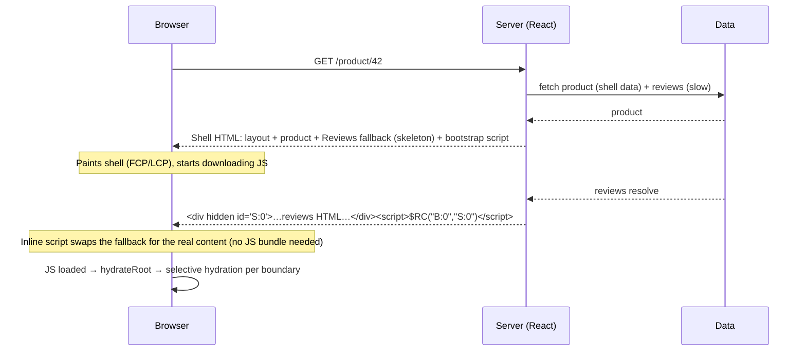
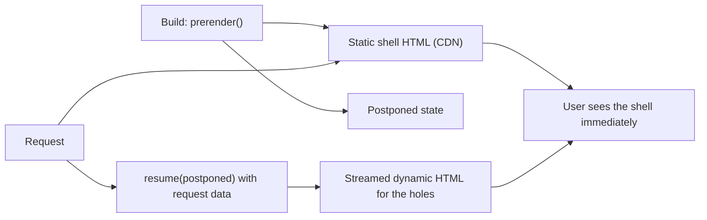

# 17 — SSR, Streaming and Hydration with React DOM

> Server rendering trades server work for user time: HTML arrives with content instead of a blank page. Streaming lets you send what's ready now, hydration makes it interactive, and every mismatch between the two renders is a bug that users pay for.

**Prerequisites:** [10](10-react-internals-fiber-and-reconciliation.md), [15](15-concurrent-react-suspense-and-transitions.md) · **Related:** [18 RSC](18-react-server-components-and-server-functions.md) · [32 Rendering Strategy](32-rendering-strategy-architecture.md) · [48 Next.js Caching](48-nextjs-rendering-and-caching.md)

---

## TL;DR

- **SSR** renders React to HTML on the server. **Hydration** attaches React to that HTML on the client. The client's first render must produce **the same output**, or React discards the mismatched region and client-renders it.
- **Streaming** (`renderToPipeableStream` on Node, `renderToReadableStream` for Web Streams) sends the **shell** first and fills **Suspense boundaries** in later as their data resolves. `renderToString` can't wait for data and doesn't stream.
- **Status codes and headers are committed when the shell flushes.** Decide redirects, 404s and caching before then (frameworks build mechanisms around this).
- **Selective hydration** hydrates boundaries independently, prioritises the one the user is interacting with, and replays the event.
- **Hydration mismatches** come from non-determinism: time, randomness, locale, `typeof window` branches, invalid HTML nesting, browser extensions. Fix the cause. `suppressHydrationWarning` is only for unavoidable text differences.
- **`use(browser())` (19.3)** is a *selective* SSR bailout. The component suspends on the server (its fallback ships in the HTML) and renders after hydration. Use it for rare browser-only UI, not as a blanket replacement for effects.
- **Partial Pre-rendering (19.2)**: `prerender` the static shell ahead of time, then `resume` it per request to stream the dynamic parts.

---

## 1. Why server-render, and what it costs

| Benefit | Cost |
|---|---|
| Content in the first HTML response → better FCP/LCP on slow devices | Server CPU per request (unless cached or prerendered) |
| Crawlers and link previews see content | TTFB includes render time (mitigated by streaming) |
| Works before JS loads (links, forms with progressive enhancement) | **Hydration** cost: the client still downloads, parses and executes component code |
| Shareable, cacheable HTML at the CDN | Complexity: two environments, determinism, data serialization, security of serialized state |

RSC reduces the hydration cost by keeping server-only components out of the client bundle ([18](18-react-server-components-and-server-functions.md)). The per-route choice between CSR, SSR, SSG, ISR and PPR is in [32](32-rendering-strategy-architecture.md).

---

## 2. The server API surface

| API (`react-dom/server`) | Environment | Streams | Waits for Suspense data | Use |
|---|---|---|---|---|
| `renderToPipeableStream` | Node streams | ✅ | ✅ (streams boundaries as they resolve) | **Default for Node servers** |
| `renderToReadableStream` | Web Streams (edge, Deno, Bun; Node since 19.2) | ✅ | ✅ | Edge runtimes |
| `renderToString` | Any | ❌ | ❌ (emits fallbacks for suspended boundaries) | Legacy, or simple non-suspending trees |
| `renderToStaticMarkup` | Any | ❌ | ❌ | Non-interactive HTML (emails); can't be hydrated |
| `resume` / `resumeToPipeableStream` | Web / Node | ✅ | ✅ | Partial Pre-rendering: continue a prerendered shell (19.2) |

| API (`react-dom/static`) | Use |
|---|---|
| `prerender` / `prerenderToNodeStream` | Static generation that **waits for all data** (SSG). Supports postponing for PPR |
| `resumeAndPrerender` / `resumeAndPrerenderToNodeStream` | Resume a postponed prerender into complete static HTML (19.2) |

### Key options

| Option | Purpose |
|---|---|
| `bootstrapScripts` / `bootstrapModules` / `bootstrapScriptContent` | Scripts emitted to start hydration |
| `onShellReady` | The shell (everything outside the innermost pending Suspense boundaries) is ready: **set status and headers, then start piping** |
| `onShellError` | The shell failed. Send a fallback error page |
| `onAllReady` | Everything resolved. Use it for crawlers and static generation |
| `onError` | Log server errors (also called for errors inside boundaries) |
| `nonce` | CSP nonce for inline scripts React emits |
| `identifierPrefix` | Must match `hydrateRoot`'s option for `useId` consistency |
| `signal` (or `abort()`) | Stop rendering after a timeout; pending boundaries fall back to client rendering |
| `onBrowserBailout` (19.3) | Reports components that deferred to the browser via `use(browser())` |
| `progressiveChunkSize` | Tune streaming chunk sizes |

---

## 3. How streaming works



- The shell contains everything up to the first pending Suspense boundaries, which render their **fallbacks**.
- Each resolved boundary streams as hidden HTML plus a tiny inline script that moves it into place. Users see content **before** the main JS bundle loads.
- Since 19.2, reveals are **batched**, to reduce layout churn.
- Hydration can begin before the stream finishes. Boundaries hydrate as their HTML and code become available.

> [!IMPORTANT]
> **Headers are final once the shell streams.** You can't send a 404 or a redirect from inside a boundary that resolves later. Fetch whatever decides status (does the product exist? is the user allowed?) **before** the shell, or inside the shell without a boundary. Frameworks provide mechanisms such as `notFound()` and `redirect()` that work within these constraints.

---

## 4. SSR from scratch (Node + Vite)

```tsx
// src/Document.tsx: the full HTML document is rendered by React
export function Document({ children, title }: { children: React.ReactNode; title: string }) {
  return (
    <html lang="en">
      <head>
        <meta charSet="utf-8" />
        <meta name="viewport" content="width=device-width, initial-scale=1" />
        <title>{title}</title>
        <link rel="stylesheet" href="/assets/app.css" />
      </head>
      <body>{children}</body>
    </html>
  );
}
```

```tsx
// server.tsx
import express from 'express';
import { renderToPipeableStream } from 'react-dom/server';
import { App } from './src/App';

const app = express();
app.use('/assets', express.static('dist/client/assets', { immutable: true, maxAge: '1y' }));

// Escape serialized state: a raw "</script>" in data would end the script tag (XSS)
const serialize = (data: unknown) =>
  JSON.stringify(data).replace(/</g, '\\u003c').replace(/\u2028/g, '\\u2028').replace(/\u2029/g, '\\u2029');

app.get('*', async (req, res) => {
  const shellData = await loadShellData(req.path);       // only what the shell needs; may decide status
  if (!shellData) return res.status(404).send(renderNotFound());

  const isBot = /bot|crawler|spider/i.test(req.get('user-agent') ?? '');
  let didError = false;

  const startStreaming = () => {
    res.status(didError ? 500 : 200);
    res.setHeader('Content-Type', 'text/html; charset=utf-8');
    res.setHeader('Cache-Control', 'private, no-cache');
    pipe(res);
  };

  const { pipe, abort } = renderToPipeableStream(<App url={req.url} shellData={shellData} />, {
    bootstrapModules: ['/assets/client.js'],
    bootstrapScriptContent: `window.__SHELL_DATA__=${serialize(shellData)}`,
    nonce: res.locals.cspNonce,
    onShellReady() { if (!isBot) startStreaming(); },   // users: stream as soon as the shell is ready
    onAllReady() { if (isBot) startStreaming(); },      // crawlers: wait for complete HTML
    onShellError(error) {
      res.status(500);
      res.setHeader('Content-Type', 'text/html');
      res.send('<!doctype html><h1>Something went wrong</h1>');
      logError(error);
    },
    onError(error) {
      didError = true;
      logError(error);
    },
  });

  setTimeout(() => abort(), 10_000);                      // never hang a request forever
});
```

```tsx
// src/client.tsx
import { hydrateRoot } from 'react-dom/client';
import { App } from './App';

hydrateRoot(document, <App url={location.pathname + location.search} shellData={window.__SHELL_DATA__} />, {
  onRecoverableError(error, info) {
    reportHydrationIssue(error, info.componentStack);      // hydration mismatches land here
  },
});
```

> [!CAUTION]
> **Request isolation:** in SSR, module-level variables are shared by **all requests and all users**. Never store per-request data (the user, cookies, the locale) in module scope or singletons. Pass it through props or context, or use request-scoped storage (`AsyncLocalStorage`, React's `cache()` in RSC). Cross-request leaks are a classic data-exposure incident ([43](43-frontend-security-architecture.md)).

---

## 5. Hydration in depth

### 5.1 What hydration does

`hydrateRoot` renders the tree on the client and, instead of creating DOM, **claims** the existing server nodes, attaching fibers and event handling ([10](10-react-internals-fiber-and-reconciliation.md)). Until a boundary hydrates, it isn't interactive. React replays discrete events (such as clicks) that happen during hydration, after it hydrates that boundary at high priority.

### 5.2 The mismatch catalogue

| Cause | Example | Fix |
|---|---|---|
| Time | `new Date().toLocaleTimeString()` | Pass a server timestamp as data; render relative times after hydration |
| Randomness | `Math.random()` IDs | `useId()`; stable data IDs |
| Locale and time zone | `Intl.DateTimeFormat()` with the server's default locale | Pass locale and time zone explicitly from the request |
| Environment branches | `typeof window !== 'undefined' ? A : B` during render | Render the same thing on both; switch after hydration; or `use(browser())` for truly browser-only parts |
| Invalid HTML nesting | `<div>` inside `<p>`, `<a>` inside `<a>`, missing `<tbody>` | Valid markup (the browser "fixes" invalid HTML, so the DOM differs from React's tree) |
| Browser extensions or auto-translation | Injected nodes or rewritten text | React 19 tolerates extensions in `<head>`/`<body>`. Wrap text in elements and avoid bare text next to conditionals |
| Personalisation differences | Server renders logged-out, client renders logged-in | Same auth state on both sides (cookies on the server); or render a personalised hole client-side |
| Feature flags | Server and client evaluate flags differently | Evaluate on the server and serialize the result |
| CDN or proxy rewriting | HTML minifiers, injected scripts | Disable HTML rewriting for SSR pages |

React 19 reports a single error with a **diff**, and 19.3 fixed false positives on `nonce` attributes. Treat every `onRecoverableError` report as a defect: the user downloaded HTML that React threw away.

### 5.3 `suppressHydrationWarning`

```tsx
<time dateTime={iso} suppressHydrationWarning>{formatRelative(iso)}</time>
```

It only silences **text-content** mismatches, **one level deep**. Use it sparingly, for values that legitimately differ (timestamps). It doesn't fix structural mismatches.

### 5.4 `use(browser())`: selective client-only rendering (19.3)

```tsx
import { use } from 'react';
import { browser } from 'react-dom';

function LocalTimeZone({ serverValue }: { serverValue?: string }) {
  if (serverValue) return <span>{serverValue}</span>;  // prefer server-known data when available
  use(browser());                                      // suspends during SSR only → fallback in HTML
  return <span>{Intl.DateTimeFormat().resolvedOptions().timeZone}</span>;
}

<Suspense fallback={<span className="skeleton-text" />}>
  <LocalTimeZone />
</Suspense>
```

| Old pattern | Problem | 19.3 replacement |
|---|---|---|
| `const [mounted, setMounted] = useState(false); useEffect(() => setMounted(true), [])` | Extra render, flash, effect noise, `set-state-in-effect` lint | `use(browser())` inside a Suspense boundary |
| `typeof window` checks in render | Hydration mismatch | Same |

> [!WARNING]
> `use(browser())` removes that content from the server HTML. It's invisible to crawlers, absent from first paint, and can hurt LCP if overused. It's right for content that **cannot** be meaningful on the server (a local time zone, canvas-measured layouts, browser-only SDK widgets). It's wrong as a blanket fix for hydration mismatches you could solve deterministically. Monitor its usage with the server option `onBrowserBailout`.

### 5.5 Hydration performance

- The cost is **all client component code for the page**: download, parse, execute, render. Reduce it with RSC, code splitting, fewer client components and smaller dependencies.
- **Selective hydration** and Suspense boundaries let the important parts (above the fold, interactive) hydrate first.
- Measure hydration with Performance Tracks and Long Animation Frames. Hydration often produces the worst early long tasks and **INP** problems in the first seconds of a page ([39](39-web-performance-and-core-web-vitals.md)).
- Islands architectures (Astro) hydrate only interactive islands. RSC achieves a similar effect inside React ([32](32-rendering-strategy-architecture.md)).

---

## 6. Partial Pre-rendering (19.2)

```ts
import { prerender } from 'react-dom/static';
import { resume } from 'react-dom/server';

// Build / revalidation time: render everything that can be rendered without request data
const controller = new AbortController();
const { prelude, postponed } = await prerender(<App />, { signal: controller.signal });
// Abort when the static work is done: dynamic (request-dependent) holes are postponed
await storeStaticShell(prelude);          // e.g. upload to the CDN
await storePostponedState(postponed);     // serialized state needed to resume

// Request time: serve the shell instantly (CDN), then stream the dynamic holes
const stream = await resume(<App />, await loadPostponedState());
```



This is the primitive behind framework features like Next.js **Cache Components**, where static and cached parts are prerendered and request-time parts stream into the same response ([48](48-nextjs-rendering-and-caching.md)).

---

## 7. Streaming in production

| Concern | Guidance |
|---|---|
| Proxies and buffering | Some proxies and CDNs buffer responses, which defeats streaming. Disable buffering (e.g., `X-Accel-Buffering: no` for NGINX) and verify that TTFB ≪ total time |
| Compression | Gzip/Brotli must flush per chunk, or chunks get delayed |
| Timeouts | Abort rendering after a budget; pending boundaries client-render |
| Bots | `onAllReady` for crawlers that don't execute JS well (or serve them prerendered HTML) |
| Caching | Anonymous pages: cache full HTML at the CDN (or prerender with PPR). Personalised pages: `private` + streaming |
| Node vs Web streams | Node streams are faster on Node (Next.js 16.3 switched its App Router rendering to native Node streams for up to 22% more throughput) |
| Event-loop blocking | SSR render is CPU-bound and blocks the Node event loop, so cap page complexity, cache, and monitor event-loop lag ([03](03-javascript-runtime-and-engine.md)) |
| Security | CSP nonces for inline scripts; escape serialized data; no secrets in serialized state; validate URLs used for server fetches (SSRF) |

---

## Decision framework: how should this route render?

| Signal | Leaning |
|---|---|
| Public, SEO-critical, rarely changing | SSG / prerender (CDN), with ISR or PPR for updates |
| Public, changes often, mostly the same for everyone | SSR + CDN caching (`s-maxage` + SWR), or PPR with dynamic holes |
| Personalised but content-heavy | Streaming SSR + Suspense for slow parts (or PPR shell + personalised holes) |
| Highly interactive app behind login, SEO irrelevant | CSR (SPA) or SSR shell + client data. Consider whether SSR's complexity pays off |
| Content that can't be meaningful on the server | `use(browser())` for that component only |

**Failure modes:** hydration mismatches (wasted HTML + INP), cross-request data leaks, buffering proxies defeating streaming, slow shell data inflating TTFB, crawler-unfriendly content behind client-only boundaries.

---

## Pitfalls and anti-patterns

- `renderToString` with data that suspends (users get fallbacks forever in the HTML).
- Awaiting **all** data before rendering (TTFB = slowest API). Stream the slow parts.
- Deciding 404s and redirects inside late boundaries.
- Non-deterministic rendering (time, random, locale) causing hydration mismatches.
- Raw `JSON.stringify` into `<script>` (XSS through `</script>`).
- Per-request data in module scope.
- Mounted-flag two-pass rendering everywhere (use deterministic SSR, or `use(browser())` sparingly).
- No render timeout.

---

## Architect's checklist

- [ ] Streaming SSR with an abort timeout, CSP nonces and escaped serialized state
- [ ] Status-deciding data is loaded before the shell
- [ ] `onRecoverableError` → observability; hydration mismatches tracked as bugs with an SLO of zero
- [ ] Locale, time zone and feature flags are evaluated on the server and serialized
- [ ] No per-request data in module scope (lint, review, tests with concurrent requests)
- [ ] Proxies and CDN verified not to buffer streamed responses
- [ ] Bot strategy (complete HTML via `onAllReady` or prerendering)
- [ ] `use(browser())` usage reviewed and monitored via `onBrowserBailout`

---

## Interview angles

**Q1. Explain streaming SSR and why it beats `renderToString`.**
`renderToString` renders synchronously to one string. It can't wait for data inside Suspense boundaries and sends nothing until everything is done. Streaming APIs send the shell as soon as it's ready, with fallbacks for pending boundaries, then stream each boundary's HTML with a tiny inline script that swaps it in as its data resolves. Users see content sooner (better TTFB, FCP and LCP), slow data doesn't block the page, and hydration can start early and be selective.

**Q2. What causes hydration mismatches, and how do you fix them?**
Non-deterministic rendering: time, random values, locale and time-zone differences, branches on `typeof window`, invalid HTML nesting that the browser rewrites, extensions mutating the DOM, and auth or flag differences between server and client. Fix them by making rendering deterministic: pass time, locale and flags from the server, use `useId`, keep markup valid, and use the same auth state on both sides. For genuinely browser-only content, use `use(browser())` (19.3) inside a Suspense boundary. Use `suppressHydrationWarning` only for unavoidable text differences.

**Q3. How do you return a 404 for a missing product with streaming SSR?**
Determine existence before streaming the shell: load the product as shell data, or inside the shell without a Suspense boundary, and set the status before `pipe()` in `onShellReady`. Once the shell flushes, headers are committed. Frameworks wrap this with APIs like `notFound()` that throw during the shell render.

**Q4. What is selective hydration?**
With streaming SSR, each Suspense boundary hydrates independently, as its code and HTML become available. If the user interacts with a not-yet-hydrated boundary, React prioritises hydrating that one and replays the discrete event afterwards, so the interaction isn't lost and the visible, interactive parts become usable first.

**Q5. What's Partial Pre-rendering at the React level?**
React 19.2 lets you `prerender` a tree ahead of time and stop (abort) at request-dependent parts. You get a static `prelude` (cacheable on a CDN) plus `postponed` state. At request time, `resume(element, postponed)` renders and streams only the dynamic holes. Frameworks build features like Next.js Cache Components on it.

---

## Further reading

- React docs, *Server APIs* (`renderToPipeableStream`, `renderToReadableStream`, `resume`): <https://react.dev/reference/react-dom/server>
- React docs, *Static APIs* (`prerender`, `resumeAndPrerender`): <https://react.dev/reference/react-dom/static>
- React docs, *`hydrateRoot`*: <https://react.dev/reference/react-dom/client/hydrateRoot>
- React 18 working group, *New Suspense SSR Architecture in React 18*: <https://github.com/reactwg/react-18/discussions/37>
- React 19.2 (Partial Pre-rendering) and 19.3 (`browser()`) release posts: <https://react.dev/blog>
- Vite, *Server-Side Rendering guide*: <https://vite.dev/guide/ssr>

---

[← Previous: 16 — React 19.x Features and the React Compiler](16-react-19-features-and-the-compiler.md) · [Index](README.md) · [Next: 18 — React Server Components and Server Functions →](18-react-server-components-and-server-functions.md)
