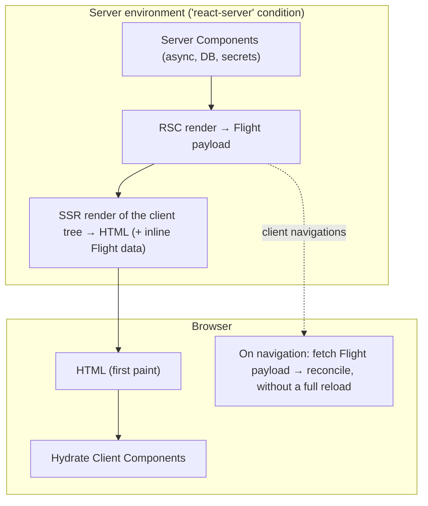
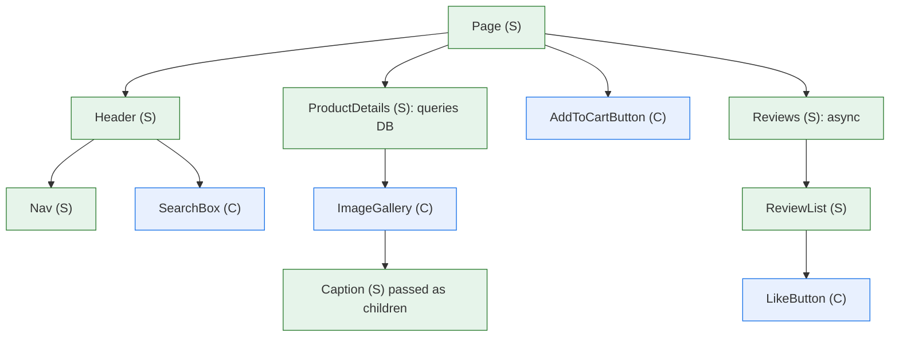
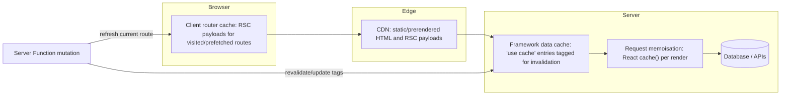

# 18 — React Server Components and Server Functions

> Server Components move the boundary between server and client from "the API" to "inside the component tree". That gives you zero-bundle components and data fetching next to the data. It also gives you a new network protocol, a new trust boundary and a new class of vulnerabilities.

**Prerequisites:** [15](15-concurrent-react-suspense-and-transitions.md), [17](17-ssr-streaming-and-hydration.md) · **Related:** [44 RSC Security](44-rsc-security-threat-model.md) · [32 Rendering Strategy](32-rendering-strategy-architecture.md) · [47 Next.js App Router](47-nextjs-app-router-architecture.md) · [48 Next.js Caching](48-nextjs-rendering-and-caching.md)

---

## TL;DR

- **Server Components (RSC)** run only on the server (at request time or at build time). They can be `async`, read databases and secrets directly, and **send no JavaScript** to the client. Their output is a serialized tree: the **RSC payload**, carried over the **Flight** protocol.
- **Client Components** are ordinary React components, still server-rendered to HTML. A module marked `'use client'` is the **entry point** from the server module graph into the client graph: it and everything it imports ship to the browser.
- **`'use server'`** marks **Server Functions**: server-side functions that client code can call, typically as Actions. They are **public HTTP endpoints**, so authenticate, authorise and validate inside every one of them.
- Props crossing server → client must be **serializable**: JSON-like values, Dates, Maps, Sets, typed arrays, **Promises** (streamed), JSX, and Server Function references. Not ordinary functions or class instances.
- **Composition rule:** a Client Component can't *import* a Server Component, but it can *receive* one as `children` or props (the "donut" pattern).
- **Security is a first-class concern.** Since December 2025 there have been **nine** advisories in the Flight and Server Function deserialization path, from React2Shell (CVSS 10.0 RCE) through CVE-2026-126187 (RCE, fixed in 19.3.1). The minimum safe versions are 19.0.9, 19.1.10, 19.2.9 and 19.3.1 ([44](44-rsc-security-threat-model.md)).
- RSC is a strong fit for **content- and data-heavy** UIs, and a weaker fit for highly interactive, offline-first or server-less deployments.

---

## 1. Why Server Components exist

| Problem in classic SSR + SPA | How RSC addresses it |
|---|---|
| Every component's code ships to the client, even if it only formats static content | Server Components ship **zero** JS |
| Client-side data waterfalls (fetch → render child → fetch) | Data is fetched on the server, next to the data source (low latency), and streamed |
| An API layer purely to feed the UI (a "BFF per screen") | Components query data directly (through a data access layer) |
| Secrets and heavy dependencies (markdown parsers, date libraries, SDKs) in the bundle | They stay on the server |
| Hydration cost proportional to the whole page | Only Client Components hydrate |

---

## 2. The mental model: two graphs, three renders



1. **RSC render** (server): runs Server Components and produces the Flight payload, a tree in which Client Components appear as **references** (module ID + export name) with their serialized props.
2. **SSR render** (server): renders that tree, including Client Components, to HTML for the first load. The payload is also inlined into the HTML so the client doesn't refetch it.
3. **Client**: hydrates Client Components. On later navigations it requests **only the Flight payload** for the new route and reconciles it into the existing tree, preserving client state.

> [!NOTE]
> **RSC ≠ SSR.** SSR produces HTML. RSC produces a serialized component tree. A Client Component is still SSR'd to HTML on first load, so `'use client'` doesn't mean "client-side only rendering".

---

## 3. Directives and module boundaries

| Marker | Meaning | Common misconception |
|---|---|---|
| *(none)* in an RSC environment | Server Component by default | "It will run in the browser too": no |
| `'use client'` (top of module) | This module and its imports form a **client entry**; its exports can be rendered from Server Components | "Only this component is client": everything it imports becomes client code |
| `'use server'` (top of module or top of a function body) | Defines **Server Functions** callable from the client | "It marks Server Components": no, it marks *functions* |
| `import 'server-only'` | Build error if the module is pulled into the client graph | Without it, a server utility can silently leak into the bundle |
| `import 'client-only'` | Build error if imported from the server graph | — |
| `"exports": { "react-server": … }` | Package condition for server-specific builds | — |

### Boundary diagram: where to put `'use client'`



**Push `'use client'` to the leaves.** Interactive islands (buttons, inputs, galleries) are Client Components, and everything around them stays on the server. A `'use client'` at the top of a layout turns the whole subtree into client code.

---

## 4. What can cross the boundary

| Server → client props | Allowed |
|---|---|
| Primitives (string, number, bigint, boolean, `null`, `undefined`) | ✅ |
| Plain objects and arrays of serializable values | ✅ |
| `Date`, `Map`, `Set`, typed arrays, `ArrayBuffer`, `FormData` | ✅ |
| **Promises** of serializable values | ✅ (streamed; read with `use()` on the client) |
| JSX elements (including Server Component output) | ✅ |
| Server Function references | ✅ |
| `Error` objects | Errors are serialized; 19.3 also transports `Error.cause` and `AggregateError.errors` |
| Ordinary functions, closures, event handlers | ❌ |
| Class instances (ORM entities, `Decimal`, custom classes) | ❌ (convert to plain DTOs) |
| Symbols (except well-known/global) | ❌ |

> [!CAUTION]
> **Everything you pass to a Client Component is visible to the user** in the RSC payload, even fields the component doesn't render. Pass minimal DTOs, never raw database rows (`passwordHash`, internal flags, other tenants' IDs). The experimental taint APIs (`experimental_taintObjectReference`, `experimental_taintUniqueValue`) add a guardrail, but a **data access layer that returns safe DTOs** is the real control ([49](49-nextjs-data-mutations-and-auth.md)).

---

## 5. Composition patterns

### 5.1 The donut: client wrapper, server content

```tsx
// Collapsible.tsx
'use client';
export function Collapsible({ title, children }: { title: string; children: React.ReactNode }) {
  const [open, setOpen] = useState(false);
  return (
    <section>
      <button aria-expanded={open} onClick={() => setOpen(!open)}>{title}</button>
      {open && children}
    </section>
  );
}

// page.tsx (Server Component)
export default async function Page() {
  const faq = await db.faq.findMany();
  return (
    <Collapsible title="FAQ">
      <FaqList items={faq} />  {/* still a Server Component: rendered on the server, passed as children */}
    </Collapsible>
  );
}
```

### 5.2 Providers

```tsx
// theme.tsx
'use client';
export const ThemeContext = createContext<Theme>('light');

// layout.tsx (Server Component), React 19.3: render the Context directly
export default async function Layout({ children }: { children: React.ReactNode }) {
  const theme = await getUserTheme();
  return <ThemeContext value={theme}>{children}</ThemeContext>;
}
```

Server Components still can't *create* or *read* context. Before 19.3 you needed a small `'use client'` provider wrapper.

### 5.3 Third-party client-only libraries

If a library uses hooks or browser APIs but doesn't ship `'use client'`, re-export it from your own client module:

```tsx
// carousel.tsx
'use client';
export { Carousel } from 'some-carousel-lib';
```

### 5.4 Streaming data into client components

```tsx
// Server Component: start the request, don't await
export default function Page({ params }: { params: Promise<{ id: string }> }) {
  const statsPromise = params.then(({ id }) => getStats(id));
  return (
    <Suspense fallback={<StatsSkeleton />}>
      <StatsChart statsPromise={statsPromise} />   {/* Client Component reads it with use() */}
    </Suspense>
  );
}
```

---

## 6. Data fetching and server-side waterfalls

Async Server Components that each `await` their own data, nested inside each other, still form a **waterfall**. It runs on the server, close to the data, but the latencies still add up.

```tsx
// ❌ Sequential: Page awaits user, then Profile awaits posts, then Posts awaits comments
async function Page() { const user = await getUser(); return <Profile user={user} />; }

// ✅ Start independent work early and in parallel
async function Page({ id }: { id: string }) {
  const userPromise = getUser(id);
  const postsPromise = getPosts(id);           // doesn't depend on user
  const [user, posts] = await Promise.all([userPromise, postsPromise]);
  return <Profile user={user} posts={posts} />;
}
```

### Request-scoped deduplication with `cache()`

```ts
import { cache } from 'react';
import 'server-only';

export const getUser = cache(async (id: string) => {
  return db.user.findUnique({ where: { id }, select: { id: true, name: true, avatarUrl: true } });
});

// The "preload" pattern: kick off the request without awaiting, then consume it later in the tree
export const preloadUser = (id: string) => void getUser(id);
```

- `cache()` memoises **per request** (per server render). Ten components calling `getUser('42')` hit the database once.
- `cacheSignal()` (19.2) gives you an `AbortSignal` that fires when that request's cache lifetime ends, for cancelling in-flight work when a render is abandoned.
- Cross-request caching (minutes, hours, tag invalidation) is a **framework** concern, e.g., Next.js `'use cache'` with `cacheLife`/`cacheTag` ([48](48-nextjs-rendering-and-caching.md)).

---

## 7. The Flight protocol (one page)

The RSC payload is a **streamed, line-oriented format**. Each row has an ID, and rows can reference each other, so the stream can be sent out of order as promises resolve. Conceptually (simplified and illustrative):

```text
1:I["chunks/add-to-cart.js","AddToCartButton"]              ← client reference: module + export
0:["$","main",null,{"children":[["$","h1",null,{"children":"Trail Shoe"}],["$","$L1",null,{"sku":"TS-42"}],"$L2"]}]
2:["$","section",null,{"children":"4.8 ★ (1,204 reviews)"}]  ← a Suspense hole filled later
```

What matters architecturally:

- **The client reconstructs elements from data.** Client references cause their chunks to be loaded.
- **Promises and Suspense map onto the stream.** Unresolved parts become references that later rows fill in.
- **Payload size matters.** Large props are serialized and sent, and the first load sends them twice: as HTML *and* as inline Flight data. Keep props lean.
- **Server Function calls go the other way.** The client encodes arguments (`encodeReply`), POSTs them with the function's ID, and the server decodes them (`decodeReply`, `decodeReplyFromBusboy`, `decodeAction`). That **decoding path handles attacker-controlled input**, and it's where React2Shell and its successors lived ([44](44-rsc-security-threat-model.md)).

---

## 8. Server Functions

```tsx
// actions.ts
'use server';
import { z } from 'zod';
import { requireUser } from '@/server/auth';
import { updateTag } from 'next/cache';            // framework-specific (Next.js 16+)

const AddToCart = z.object({ sku: z.string().regex(/^[A-Z]{2}-\d+$/), qty: z.coerce.number().int().min(1).max(10) });

export async function addToCart(prev: CartState, formData: FormData): Promise<CartState> {
  const user = await requireUser();                     // 1. authenticate: never trust the caller
  const input = AddToCart.safeParse(Object.fromEntries(formData)); // 2. validate: arguments are attacker-controlled
  if (!input.success) return { ...prev, error: 'Invalid item' };
  await cartService.add(user.id, input.data);           // 3. authorise inside the service layer
  updateTag(`cart:${user.id}`);                         // 4. invalidate with read-your-writes semantics
  return { ...prev, error: undefined, count: prev.count + input.data.qty };
}
```

```tsx
'use client';
export function AddToCartForm({ sku }: { sku: string }) {
  const [state, formAction, isPending] = useActionState(addToCart, { count: 0 });
  return (
    <form action={formAction}>
      <input type="hidden" name="sku" value={sku} />
      <input name="qty" type="number" defaultValue={1} min={1} max={10} />
      <button disabled={isPending}>Add to cart</button>
      {state.error && <p role="alert">{state.error}</p>}
    </form>
  );
}
```

| Property | Detail |
|---|---|
| Transport | POST request carrying the function ID and serialized arguments; the response is a Flight payload |
| Progressive enhancement | `<form action={serverFn}>` works before hydration and without JS |
| Closures | Inline Server Functions can capture variables. Frameworks serialize the bound values, and Next.js encrypts them, but **treat them as client-visible and tamperable** |
| Identity across deploys | Function IDs change between builds. Old clients calling new servers fail unless the platform has **skew protection** ([62](62-cicd-release-engineering-and-feature-flags.md)) |
| Security | **Public endpoints**: authenticate, authorise, validate, rate limit, design for idempotency; CSRF protection relies on Origin checks plus `SameSite` cookies ([43](43-frontend-security-architecture.md)) |

> [!WARNING]
> Server Functions are discoverable even if no page renders them. Anything exported from a `'use server'` module can be called directly by an attacker with crafted arguments. **"The button is only shown to admins" is not authorization** ([45](45-authentication-and-authorization.md)).

---

## 9. Cache topology



Every layer needs an **owner** and an **invalidation story** ([28](28-state-and-data-ownership-architecture.md)):

| Layer | Lifetime | Invalidated by |
|---|---|---|
| `cache()` request memo | One server render | End of request |
| Framework data cache | Seconds to days | Tags and paths (`revalidateTag`, `updateTag`, `cacheLife`) |
| CDN / prerendered output | Until purge or revalidation | Deploys, tag purges, ISR |
| Client router cache | The session | Navigation refresh, Server Function responses, `router.refresh()` |

---

## 10. Deployment trade-offs

| Factor | Implication |
|---|---|
| Needs a server (or build-time rendering) | No pure static hosting for dynamic RSC. Cost per request |
| Navigation = server round trip for uncached routes | Mitigated by prefetching, Partial Prefetching and caching. Offline navigation is limited |
| Runtime choice (Node vs edge) | Edge: lower latency, limited APIs and DB drivers. Node: full ecosystem |
| Version skew | The client bundle and the server must agree on client references and Server Function IDs |
| Security patch cadence | RSC packages and frameworks have had frequent security releases. Budget for fast upgrades |
| Observability | Server render time, payload size, and Server Function error rates are new metrics ([41](41-observability-and-diagnostics.md)) |

### Framework support (November 2026)

| Framework | RSC status |
|---|---|
| **Next.js** App Router | The most mature and widely deployed implementation ([47](47-nextjs-app-router-architecture.md)) |
| **React Router v8** | RSC APIs alongside loaders and actions ([51](51-react-router-v8-framework-mode.md)) |
| **TanStack Start 1.0** | RSC supported but optional ([52](52-tanstack-start-and-router.md)) |
| **Waku** | Minimal RSC-first framework |
| **Parcel** (`@parcel/rsc`), **Vite** (`@vitejs/plugin-rsc`), **RedwoodSDK** | Bundler-level and smaller-framework integrations |
| **Expo Router** | Server components for universal apps ([53](53-react-native-and-expo.md)) |

> [!NOTE]
> The low-level bundler APIs (`react-server-dom-*`) don't follow semver as strictly as React's public APIs. Prefer a framework unless you're building one.

---

## Decision framework: should this app (or route) use RSC?

| Favours RSC | Favours client components / SPA |
|---|---|
| Content- and data-heavy pages (commerce, media, docs, dashboards that mostly display) | Highly interactive canvases (editors, design tools, games) |
| Heavy formatting or rendering dependencies that shouldn't ship (markdown, syntax highlighting, i18n catalogues) | Offline-first or local-first apps |
| SEO and fast first load on slow devices | No server infrastructure; static hosting required |
| Data close to the server (databases, internal services) | Data mostly comes from third-party APIs called from the browser |
| Teams comfortable with server-side security and operations | Teams without capacity for rapid security patching and server observability |

**Migration path:** start with a framework that supports RSC. Keep existing components as Client Components (`'use client'` near the top). Then move data fetching and non-interactive rendering up into Server Components route by route, pushing `'use client'` down to the leaves, and measure JS bytes, LCP and INP as you go ([64](64-migration-playbooks.md)).

---

## Pitfalls and anti-patterns

- `'use client'` at the top of layouts or pages (the whole subtree becomes client code).
- Importing server utilities into client modules without `server-only` (leaked secrets, bloated bundles).
- Passing ORM entities or full records to Client Components (data exposure, serialization errors).
- Sequential `await`s down the tree (server waterfalls).
- Treating Server Functions as private (missing authentication, authorisation and validation).
- Module-level per-request state on the server (cross-user leaks).
- Huge props serialized twice (HTML + Flight) inflating payloads.
- Running unpatched `react-server-dom-*` versions.

---

## Architect's checklist

- [ ] React and RSC packages at or above the security floors; framework security releases tracked with an SLA
- [ ] `'use client'` at the leaves; lint or review rule for `'use client'` in layout files
- [ ] `server-only` on every module touching secrets, databases or internal services
- [ ] Data access layer returns DTOs; Client Component props reviewed for exposure
- [ ] Every Server Function: auth check, schema validation, authorisation, rate limit, idempotency strategy
- [ ] Parallel data fetching conventions (start early, `Promise.all`, `cache()`, preload)
- [ ] Cache topology documented, with an owner and invalidation for each layer
- [ ] Skew protection or a deploy strategy for Server Function IDs
- [ ] Metrics: RSC payload size per route, server render time, Server Function error and latency

---

## Interview angles

**Q1. Explain RSC vs SSR.**
SSR renders components to HTML on the server for the first load, and then the client hydrates everything. RSC is a component type that runs *only* on the server and outputs a serialized tree (the Flight payload) instead of HTML. Their code never ships. In an RSC app, the server first renders Server Components to Flight, then SSR renders the resulting tree (including Client Components) to HTML. Client navigations fetch only Flight payloads. SSR is about the initial HTML; RSC is about where components execute and what code ships.

**Q2. What can and can't you pass from a Server Component to a Client Component?**
Serializable data: primitives, plain objects and arrays, Dates, Maps, Sets, typed arrays, promises (streamed, read with `use()`), JSX elements, and Server Function references. Not ordinary functions, class instances, or most symbols. And everything passed is visible in the payload, so pass DTOs, not database rows.

**Q3. How do Server Functions work, and how do you secure them?**
A `'use server'` function gets an ID. The client calls it via a POST with serialized arguments, the server decodes them, runs the function, and returns a Flight payload that can include updated UI. Because any exported Server Function is a reachable endpoint with attacker-controlled input, every one must authenticate, authorise in the service layer, validate arguments with a schema, rate limit, and be safe to retry. Platform CSRF protections (Origin checks, `SameSite` cookies) complement this but don't replace it. Keep the RSC packages patched, too: the deserialization path itself has had critical bugs.

**Q4. What did React2Shell and the follow-up advisories teach architects?**
The Flight reply-decoding path is an internet-facing parser, and parsers are attack surface. Several fixes were incomplete and needed follow-ups, and one fix shipped 27 days before its CVE was assigned, so CVE-keyed scanners missed it. The lessons: track framework security releases directly (not only CVE feeds), have a fast patch pipeline, minimise exposed surface, treat WAF rules as temporary mitigation, and include RSC endpoints in threat models and penetration tests ([44](44-rsc-security-threat-model.md)).

**Q5. Design a product page with RSC.**
The page and product details are Server Components that fetch through a cached data access layer. Interactive leaves (add to cart, gallery, size picker) are Client Components. Reviews and recommendations sit behind Suspense boundaries with promises started early. Mutations go through Server Functions with validation and tag-based revalidation. The static shell is prerendered and CDN-cached, with personalised parts (cart badge, recommendations) streamed as dynamic holes. Measure JS per route, LCP and INP ([68](68-case-study-ecommerce-storefront.md)).

---

## Further reading

- React docs, *Server Components*, *Server Functions*, *`'use client'`*, *`'use server'`*: <https://react.dev/reference/rsc/server-components>
- React docs, *`cache`*, *`cacheSignal`*, *taint APIs*: <https://react.dev/reference/react>
- React blog, *Critical Security Vulnerability in React Server Components* (Dec 3, 2025) and follow-ups: <https://react.dev/blog>
- Dan Abramov, *The Two Reacts* and *RSC from scratch* discussions: <https://overreacted.io>
- Next.js docs, *Server and Client Components*: <https://nextjs.org/docs/app/getting-started/server-and-client-components>

---

[← Previous: 17 — SSR, Streaming and Hydration with React DOM](17-ssr-streaming-and-hydration.md) · [Index](README.md) · [Next: 19 — Class Components, Lifecycles and Legacy APIs →](19-class-components-lifecycles-and-legacy-apis.md)
