# 19 — Class Components, Lifecycles and Legacy APIs

> You won't write many class components in 2026. You'll still meet them in every long-lived codebase, in every error boundary, and in every interview that asks *why* hooks were invented. Understanding the lifecycle model is how you migrate away from it safely.

**Prerequisites:** [08](08-react-mental-model-and-rules.md), [12](12-hooks-in-depth.md) · **Related:** [40 Resilience](40-resilience-and-reliability.md) · [64 Migration Playbooks](64-migration-playbooks.md) · [71 Case Study: Legacy Modernization](71-case-study-legacy-react-modernization.md) · [A2 Version History](A2-react-version-history-and-governance.md)

---

## TL;DR

- Class components extend `React.Component` (or `PureComponent`), hold `this.state`, update with `this.setState` (which **merges** shallowly and is batched), and expose **lifecycle methods** split into render-phase methods (pure) and commit-phase methods (side effects allowed).
- **Error boundaries are still class-only**: `static getDerivedStateFromError` plus `componentDidCatch`. Most teams wrap them with `react-error-boundary`.
- `UNSAFE_componentWillMount`, `UNSAFE_componentWillReceiveProps` and `UNSAFE_componentWillUpdate` are deprecated because they ran during the **render phase**, where side effects break under concurrent rendering.
- `getDerivedStateFromProps` is almost always a smell ("derived state"). `getSnapshotBeforeUpdate` is the one lifecycle with no direct hook equivalent (a layout effect plus a ref approximates it).
- Legacy element APIs (`Children`, `cloneElement`) still work but make components fragile. Prefer explicit props, compound components and context.
- React 19 **removed** string refs, legacy context, `findDOMNode`, `createFactory`, `propTypes` checks and `defaultProps` on *function* components. Classes keep `defaultProps`.

---

## 1. Anatomy of a class component

```tsx
type Props = { userId: string; pageSize?: number };
type State = { items: Item[]; status: 'idle' | 'loading' | 'error' };

class ActivityFeed extends React.Component<Props, State> {
  static defaultProps = { pageSize: 20 };       // still supported for classes
  state: State = { items: [], status: 'idle' }; // class field instead of constructor boilerplate
  private abort?: AbortController;              // instance field ≈ useRef

  componentDidMount() { this.load(); }

  componentDidUpdate(prevProps: Props) {
    if (prevProps.userId !== this.props.userId) this.load(); // manual "dependency" comparison
  }

  componentWillUnmount() { this.abort?.abort(); }

  load = async () => {                          // arrow class field: `this` stays bound
    this.abort?.abort();
    this.abort = new AbortController();
    this.setState({ status: 'loading' });       // merges into existing state
    try {
      const items = await api.activity(this.props.userId, this.props.pageSize!, this.abort.signal);
      this.setState({ items, status: 'idle' });
    } catch {
      if (!this.abort.signal.aborted) this.setState({ status: 'error' });
    }
  };

  render() {
    const { items, status } = this.state;
    if (status === 'error') return <p role="alert">Couldn't load activity.</p>;
    return <ul aria-busy={status === 'loading'}>{items.map((i) => <li key={i.id}>{i.text}</li>)}</ul>;
  }
}
```

| `setState` detail | Behaviour |
|---|---|
| Object form | Shallow **merge** into `this.state` (unlike `useState`, which replaces) |
| Function form | `this.setState((prev, props) => ({ count: prev.count + 1 }))`, for updates based on previous state |
| Callback | `this.setState(update, () => { /* after commit */ })` |
| Batching | Automatic batching (React 18+) applies to classes too |
| `forceUpdate()` | Re-renders without a state change (escape hatch for external mutable data) |

---

## 2. The lifecycle, precisely

```mermaid
flowchart TB
  subgraph Mount
    C1["constructor(props)"] --> G1["static getDerivedStateFromProps(props, state)"]
    G1 --> R1["render()"]
    R1 --> DM["componentDidMount()"]
  end
  subgraph Update["Update (new props, setState, forceUpdate)"]
    G2["static getDerivedStateFromProps"] --> S["shouldComponentUpdate(nextProps, nextState)"]
    S -->|true| R2["render()"]
    R2 --> SN["getSnapshotBeforeUpdate(prevProps, prevState)"]
    SN --> DU["componentDidUpdate(prevProps, prevState, snapshot)"]
  end
  subgraph Unmount
    WU["componentWillUnmount()"]
  end
  subgraph Errors["Errors in descendants"]
    E1["static getDerivedStateFromError(error)"] --> E2["componentDidCatch(error, info)"]
  end
```



| Phase | Methods | Rules |
|---|---|---|
| **Render phase** (pure, may run more than once, may be discarded) | `constructor`, `getDerivedStateFromProps`, `shouldComponentUpdate`, `render`, `getDerivedStateFromError` | No side effects |
| **Pre-commit** (can read the DOM before mutation) | `getSnapshotBeforeUpdate` | Read-only DOM access |
| **Commit phase** (side effects allowed) | `componentDidMount`, `componentDidUpdate`, `componentWillUnmount`, `componentDidCatch` | Subscriptions, network, DOM manipulation |

### The `UNSAFE_` methods

| Deprecated | Why it's unsafe | Replacement |
|---|---|---|
| `UNSAFE_componentWillMount` | Render phase: side effects can run multiple times or for discarded renders; it also ran on the server | Constructor (state), `componentDidMount` (effects) |
| `UNSAFE_componentWillReceiveProps` | Encouraged derived-state bugs; render phase | Compute in render, `key` resets, `componentDidUpdate` for effects |
| `UNSAFE_componentWillUpdate` | Read DOM in the render phase | `getSnapshotBeforeUpdate` |

StrictMode warns about them. Concurrent features make them actively dangerous.

---

## 3. Lifecycle → hooks mapping

| Class | Hooks | Notes |
|---|---|---|
| `this.state` + `setState` (merge) | `useState` per concern, or `useReducer` | No automatic merge: split state, or spread |
| `constructor` initialisation | `useState(() => init())` lazy initialiser | |
| Instance fields (`this.timer`) | `useRef` | |
| `componentDidMount` | `useEffect(…, [])` | But think *synchronisation*, not *mount* ([13](13-effects-and-synchronization.md)) |
| `componentDidUpdate` comparing `prevProps.x` | `useEffect(…, [x])` | Dependencies replace manual comparisons |
| `componentWillUnmount` | Effect cleanup | Cleanup also runs before each re-sync |
| `componentDidMount` + `Update` + `WillUnmount` for one subscription | **One** effect with setup + cleanup | Hooks group code by concern, not by lifecycle |
| `shouldComponentUpdate` / `PureComponent` | `memo` (or the Compiler) | |
| `getDerivedStateFromProps` | Compute during render; guarded state adjustment during render | |
| `getSnapshotBeforeUpdate` | `useLayoutEffect` + a ref of the previous measurement | The closest approximation |
| `static contextType` | `useContext` / `use(Context)` | |
| `forceUpdate` | `useSyncExternalStore` for external data, or a `useReducer` tick | |
| Error boundary methods | **No hook equivalent** | Keep a class (or use `react-error-boundary`) |

> [!NOTE]
> **Why hooks were invented** (React 16.8, 2019): classes scattered related logic across lifecycles (a subscription split between `didMount`, `didUpdate` and `willUnmount`), made reuse awkward (HOC and render-prop "wrapper hell"), confused people with `this` binding, and resisted optimisation (classes minify poorly, and the Compiler can't reason about instance mutation). Hooks group logic by concern and compose as plain functions ([A2](A2-react-version-history-and-governance.md)).

---

## 4. `getDerivedStateFromProps` and derived state

```tsx
// ❌ Mirroring props into state: state goes stale or fights the parent
static getDerivedStateFromProps(props: Props, state: State) {
  return { email: props.email };   // overwrites user edits on every parent re-render!
}

// ✅ Alternatives
// 1. Fully controlled: no state, the parent owns the value
// 2. Fully uncontrolled with a reset key: <EmailInput key={user.id} defaultEmail={user.email} />
// 3. Memoised computation: derive in render instead of storing
```

Legitimate uses are rare, e.g., a transition component that tracks the previous children to animate them out.

---

## 5. `getSnapshotBeforeUpdate`: the one that still earns its keep

```tsx
class ChatLog extends React.Component<{ messages: Message[] }> {
  listRef = React.createRef<HTMLDivElement>();

  getSnapshotBeforeUpdate(prevProps: { messages: Message[] }) {
    if (prevProps.messages.length < this.props.messages.length) {
      const el = this.listRef.current!;
      return el.scrollHeight - el.scrollTop;          // distance from the bottom, BEFORE the DOM changes
    }
    return null;
  }

  componentDidUpdate(_p: unknown, _s: unknown, snapshot: number | null) {
    if (snapshot !== null) {
      const el = this.listRef.current!;
      el.scrollTop = el.scrollHeight - snapshot;      // keep the same distance from the bottom
    }
  }

  render() {
    return <div ref={this.listRef} className="chat">{this.props.messages.map((m) => <p key={m.id}>{m.text}</p>)}</div>;
  }
}
```

The hooks version tracks the previous `scrollHeight` in a ref and adjusts in `useLayoutEffect` ([14](14-refs-dom-portals-and-imperative-apis.md)). CSS `overflow-anchor` often removes the need entirely.

---

## 6. `shouldComponentUpdate` and `PureComponent`

```tsx
class Row extends React.PureComponent<{ item: Item; onSelect: (id: string) => void }> {
  render() { /* re-renders only when props are shallowly different */ }
}
```

- `PureComponent` shallow-compares props and state. A mutated object (`item.done = true`) passes the comparison, so the component **doesn't update**. That's the classic mutation bug.
- Inline callbacks from the parent (`onSelect={() => …}`) defeat it.
- Function-component equivalents: `memo`, or the Compiler.

---

## 7. Error boundaries

```tsx
type BoundaryProps = { fallback: (error: Error, reset: () => void) => React.ReactNode; children: React.ReactNode; resetKeys?: unknown[] };
type BoundaryState = { error: Error | null };

export class ErrorBoundary extends React.Component<BoundaryProps, BoundaryState> {
  state: BoundaryState = { error: null };

  static getDerivedStateFromError(error: Error): BoundaryState {
    return { error };                                   // render phase: switch to the fallback
  }

  componentDidCatch(error: Error, info: React.ErrorInfo) {
    reportError(error, { componentStack: info.componentStack }); // commit phase: side effects OK
  }

  componentDidUpdate(prev: BoundaryProps) {
    if (this.state.error && !shallowEqualArrays(prev.resetKeys, this.props.resetKeys)) this.reset();
  }

  reset = () => this.setState({ error: null });

  render() {
    return this.state.error ? this.props.fallback(this.state.error, this.reset) : this.props.children;
  }
}
```

| Error boundaries catch | They don't catch |
|---|---|
| Errors thrown during **render** of descendants | Errors in **event handlers** (use try/catch, or set state to rethrow during render) |
| Errors in descendants' **lifecycle methods**, constructors and effects | Errors in **async code** (timers, promises) unless rethrown into render via state |
| Errors from Suspense data (rejected promises read with `use()`) | Errors in the boundary **itself** |
| Errors from transitions and Actions (React 19) | Server-side rendering errors (handled by SSR `onError`/`onShellError`, [17](17-ssr-streaming-and-hydration.md)) |

```tsx
// Rethrow async errors into the nearest boundary
function useThrowToBoundary() {
  const [, setState] = useState();
  return useCallback((error: unknown) => setState(() => { throw error; }), []);
}
```

- **`react-error-boundary`** provides `ErrorBoundary`, `useErrorBoundary()` (with `showBoundary(error)` from handlers) and `resetKeys`. It's the de facto standard wrapper.
- Root-level visibility: `createRoot(…, { onCaughtError, onUncaughtError })` reports boundary-caught and uncaught errors centrally (React 19).
- 19.3: errors thrown inside a hidden `<Activity>` no longer escape it.
- Frameworks add their own: Next.js `error.tsx` and, since 16.3, `catchError` from `next/error`, which provides a `retry()` that can re-fetch Server Components ([40](40-resilience-and-reliability.md)).

---

## 8. Legacy composition patterns

### 8.1 Higher-order components (HOCs)

```tsx
function withFeatureFlag<P extends object>(flag: string, Component: React.ComponentType<P>) {
  function WithFlag(props: P) {
    const enabled = useFeatureFlag(flag);
    return enabled ? <Component {...props} /> : null;
  }
  WithFlag.displayName = `withFeatureFlag(${Component.displayName ?? Component.name})`;
  return WithFlag;
}
```

| HOC problem | Hook-era answer |
|---|---|
| Wrapper hell in DevTools | Hooks add no tree depth |
| Prop name collisions between HOCs | Hooks return values you name yourself |
| Static methods not hoisted | Not needed |
| Refs not forwarded (pre-19) | `ref` is a prop in React 19 |
| Indirection: "where does this prop come from?" | Explicit hook calls |

HOCs remain reasonable for **cross-cutting wrappers applied at module level** (route guards, instrumentation, `connect` in old Redux code), but new reusable logic should be a hook.

### 8.2 Render props

```tsx
<MouseTracker render={({ x, y }) => <Cursor x={x} y={y} />} />
```

Render props are still a legitimate pattern for **UI injection** (a list that lets the caller render each row, virtualisers, headless components). For **logic reuse**, hooks are cleaner ([22](22-component-architecture-and-patterns.md)).

### 8.3 Mixins

The `createClass` era (2013–2016) had mixins. They were removed because of implicit dependencies, name clashes and snowballing complexity, which was the motivation for HOCs and later hooks.

---

## 9. Legacy element APIs

| API | Status | Why to avoid | Prefer |
|---|---|---|---|
| `Children.map/forEach/count/only/toArray` | Legacy (still exported) | Depends on the exact children structure. Breaks with Fragments, wrappers, conditionals and arrays | Explicit props (`items`), compound components with context |
| `cloneElement(el, props)` | Legacy | Implicit prop injection: hard to type, easy to break, invisible at call sites | Context, render props, slots, `asChild` patterns |
| `createElement` | Stable (JSX compiles to `jsx()` now) | — | JSX |
| `createRef` | Legacy | — | `useRef` (classes still use `createRef`) |
| `isValidElement` | Legacy | — | Type checks with TypeScript |
| `forwardRef` | Still exported, no longer needed | Extra wrapper | `ref` as a prop |
| `Component`, `PureComponent` | Supported | — | Function components (except error boundaries) |

```tsx
// ❌ cloneElement-based tabs: fragile
<Tabs>{panels}</Tabs>  // Tabs injects `active` into children via cloneElement

// ✅ compound components + context: explicit and robust to wrappers
<Tabs value={tab} onValueChange={setTab}>
  <Tabs.List><Tabs.Trigger value="a">A</Tabs.Trigger></Tabs.List>
  <Tabs.Panel value="a">…</Tabs.Panel>
</Tabs>
```

---

## 10. APIs removed in React 19, and their migrations

| Removed | Migration |
|---|---|
| String refs: `ref="input"` + `this.refs.input` | `createRef` / callback refs (codemod: `replace-string-ref`) |
| Legacy context: `contextTypes`, `childContextTypes`, `getChildContext` | `createContext` + `static contextType` / `useContext` |
| `findDOMNode(this)` | A ref to the root element; Fragment refs for multi-root components |
| `propTypes` checking | TypeScript; runtime validation at boundaries ([04](04-typescript-at-scale.md)) |
| `defaultProps` on function components | ES default parameters |
| Module pattern factories | Plain function components |
| `React.createFactory` | JSX |
| `ReactDOM.render`, `hydrate`, `unmountComponentAtNode` | `createRoot`, `hydrateRoot`, `root.unmount()` |
| `react-dom/test-utils` (except `act`), shallow renderer | Testing Library; `act` from `react` |

---

## 11. Migrating a class component to hooks

```tsx
// Before: logic split across three lifecycles
class Presence extends React.Component<{ roomId: string }, { online: string[] }> {
  state = { online: [] as string[] };
  sub?: Subscription;
  componentDidMount() { this.sub = presence.subscribe(this.props.roomId, (online) => this.setState({ online })); }
  componentDidUpdate(prev: { roomId: string }) {
    if (prev.roomId !== this.props.roomId) {
      this.sub?.unsubscribe();
      this.sub = presence.subscribe(this.props.roomId, (online) => this.setState({ online }));
    }
  }
  componentWillUnmount() { this.sub?.unsubscribe(); }
  render() { return <AvatarStack users={this.state.online} />; }
}

// After: one concern, one hook
function usePresence(roomId: string) {
  const [online, setOnline] = useState<string[]>([]);
  useEffect(() => {
    const sub = presence.subscribe(roomId, setOnline);
    return () => sub.unsubscribe();
  }, [roomId]);
  return online;
}

function Presence({ roomId }: { roomId: string }) {
  return <AvatarStack users={usePresence(roomId)} />;
}
```

**Process for large migrations:**

1. **Don't migrate for its own sake.** Migrate code you're changing, code blocking the Compiler or React upgrades, and the error-prone lifecycles (`UNSAFE_*`, `getDerivedStateFromProps`).
2. Add **characterisation tests** (Testing Library, which works identically for classes and functions) before refactoring.
3. Translate **by concern**, not method by method: find each subscription or synchronisation, and make it one effect.
4. Watch for semantic traps: `setState` merging (now separate states or a reducer), the `setState` callback (now an effect or `flushSync`), instance variables read during render (now state, if they're displayed).
5. **Keep classes for error boundaries**, or adopt `react-error-boundary`.
6. Track progress as a metric: class count over time, as a ratchet ([63](63-architecture-governance-and-adrs.md)). See the full modernisation case study in [71](71-case-study-legacy-react-modernization.md).

---

## Pitfalls and anti-patterns

- Side effects in `render`, the constructor or `getDerivedStateFromProps`.
- Forgetting to compare `prevProps` in `componentDidUpdate` (infinite update loops).
- Mutating `this.state` directly.
- `PureComponent` combined with mutation or inline callbacks.
- `cloneElement`/`Children` APIs as the backbone of reusable components.
- Unbound methods passed as callbacks (`this` is `undefined`). Use arrow class fields.
- One catch-all error boundary at the root (the whole app goes down for one widget's error).

---

## Architect's checklist

- [ ] Error boundaries at route, layout-region and widget levels, using a standard component (`react-error-boundary` or an in-house wrapper)
- [ ] No `UNSAFE_*` lifecycles; StrictMode clean
- [ ] Class-component count tracked as a ratchet; migration happens opportunistically
- [ ] Legacy context, string refs and `findDOMNode` eliminated before the React 19 upgrade
- [ ] New reusable logic is written as hooks; HOCs only for module-level wrappers

---

## Interview angles

**Q1. Walk through the class component lifecycle in order.**
Mount: `constructor` → `getDerivedStateFromProps` → `render` → (DOM and refs updated) → `componentDidMount`. Update: `getDerivedStateFromProps` → `shouldComponentUpdate` → `render` → `getSnapshotBeforeUpdate` → (DOM updated) → `componentDidUpdate(prevProps, prevState, snapshot)`. Unmount: `componentWillUnmount`. Errors: `getDerivedStateFromError` (render phase) and `componentDidCatch` (commit phase). Render-phase methods must be pure, because React may call them more than once or discard their results.

**Q2. Why were `componentWillMount`/`WillReceiveProps`/`WillUpdate` deprecated?**
They ran during the render phase, but people used them for side effects (fetching, subscriptions, DOM reads). With concurrent rendering, render-phase work can run several times or be thrown away, so those side effects would duplicate or leak. Their legitimate uses moved to the constructor, `componentDidMount`/`componentDidUpdate`, `getDerivedStateFromProps` (rarely) and `getSnapshotBeforeUpdate`.

**Q3. What can't error boundaries catch, and how do you handle those cases?**
Errors in event handlers, in async callbacks, in the boundary itself, and during SSR. Handle event-handler errors with try/catch and user feedback, or forward them to the boundary by setting state that rethrows during render (`useErrorBoundary().showBoundary`). Handle SSR errors with the server rendering callbacks. Report everything through root error callbacks and a global error handler.

**Q4. Why did React move from classes to hooks?**
To group logic by concern instead of by lifecycle, to make stateful logic reusable without wrapper components, to remove `this` confusion, and to enable better optimisation (function components are easier for tools like the Compiler to analyse). Hooks also fit concurrent rendering: effects are explicit setup and cleanup pairs instead of lifecycle side effects.

**Q5. When would you still write a class component today?**
For error boundaries, which have no hook equivalent (though most teams use `react-error-boundary`). Possibly when `getSnapshotBeforeUpdate` semantics are needed exactly. And when touching stable legacy code where a rewrite adds risk with no benefit.

---

## Further reading

- React docs, *`Component`* (all lifecycle methods): <https://react.dev/reference/react/Component>
- React docs, *Legacy React APIs* (`Children`, `cloneElement`, `createRef`, `forwardRef`, `PureComponent`…): <https://react.dev/reference/react/legacy>
- React blog (legacy), *You Probably Don't Need Derived State*: <https://legacy.reactjs.org/blog/2018/06/07/you-probably-dont-need-derived-state.html>
- React blog (legacy), *Update on Async Rendering*: <https://legacy.reactjs.org/blog/2018/03/27/update-on-async-rendering.html>
- `react-error-boundary`: <https://github.com/bvaughn/react-error-boundary>
- React 19 Upgrade Guide (removed APIs): <https://react.dev/blog/2024/04/25/react-19-upgrade-guide>

---

[← Previous: 18 — React Server Components and Server Functions](18-react-server-components-and-server-functions.md) · [Index](README.md) · [Next: 20 — React Tooling, DevTools and Debugging Workflows →](20-react-tooling-devtools-and-debugging.md)
