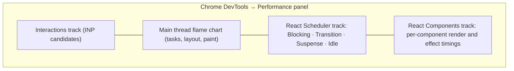
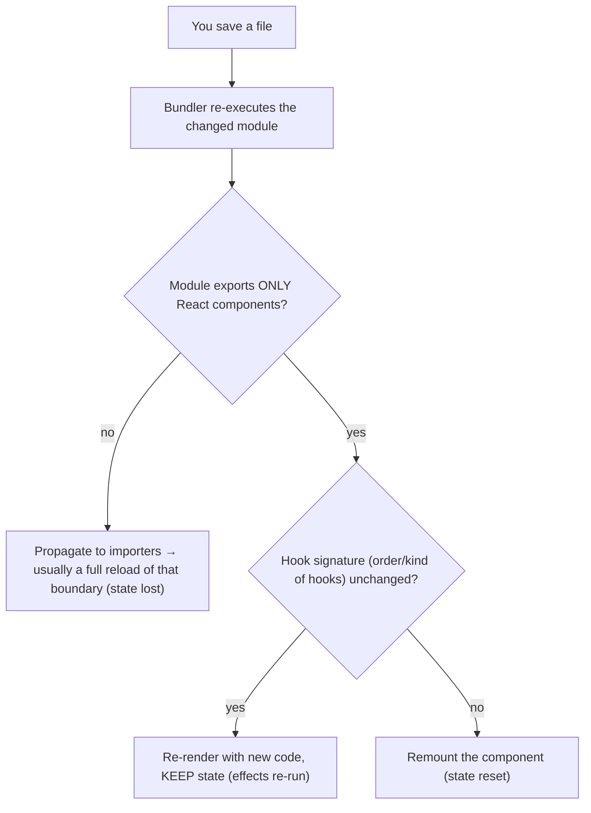

# 20 — React Tooling, DevTools and Debugging Workflows

> A principal engineer's debugging edge isn't knowing more tools. It's having a repeatable workflow for each class of problem: render storms, laggy input, hydration mismatches, leaks, Suspense flicker, and "works locally, breaks in production".

**Prerequisites:** [10](10-react-internals-fiber-and-reconciliation.md), [15](15-concurrent-react-suspense-and-transitions.md) · **Related:** [38 React Performance](38-react-performance-engineering.md) · [39 Core Web Vitals](39-web-performance-and-core-web-vitals.md) · [41 Observability](41-observability-and-diagnostics.md)

---

## TL;DR

- **React DevTools 8.0** (September 2026): the Components tab (inspect and edit props, state and hooks; owner tree), the Profiler (commits, flame graph, "why did this render"), a **Suspense tab on by default** (boundaries and named Activities), and a **React Element pane** inside the browser's Elements panel. The old **Timeline tab was removed**: use the browser's Performance panel, which includes React tracks.
- **React Performance Tracks** (React 19.2+) put the **Scheduler** track (blocking, transition, Suspense and idle work) and the **Components** track (render and effect timings) inside Chrome's Performance panel, aligned with input, layout and paint.
- **Owner Stacks** (19.1) tell you *who rendered* a component, which is far more useful than the parent stack when you're debugging where bad props came from.
- **Fast Refresh** preserves state only for files that export **only components**. Changing the hooks signature, editing class components or exporting non-components forces a remount. `// @refresh reset` forces one deliberately.
- `eslint-plugin-react-hooks` **v7** is a debugging tool as much as a linter: its compiler-derived rules catch the bugs that cause most production incidents.
- This chapter ends with **nine diagnostic playbooks** you can follow step by step.

---

## 1. The toolbox

| Tool | Use it for | Notes |
|---|---|---|
| **React DevTools: Components** | Inspect the tree, props, state, hooks, context; edit values live; find the owner and source of an element | Compiled components show a "Memo ✨" badge |
| **React DevTools: Profiler** | Record commits; flame and ranked charts; "Record why each component rendered" | Use a profiling build to profile production code |
| **React DevTools: Suspense tab** | See Suspense boundaries and named `<Activity>` trees; toggle fallbacks | On by default in 8.0 |
| **React Element pane** (in the Elements panel) | Jump from a DOM node to its React component | New in 8.0 |
| **Chrome Performance panel + React tracks** | INP and long-task analysis with React's scheduler lanes visible | Replaces the old Timeline profiler |
| **`<Profiler>` component** | Programmatic render timing in production (RUM) | Small overhead; sample it |
| **Owner Stacks / `captureOwnerStack()`** | Development-only stack of owners for errors and warnings | Powers the improved error overlays |
| **`eslint-plugin-react-hooks` v7** | Rules of Hooks, dependencies, and compiler-derived correctness rules | Flat config `recommended` |
| **React Compiler logger / playground** | See what compiled and why something bailed out | Feed bail-out reasons into dashboards |
| **Standalone `react-devtools`** | React Native, Safari, embedded webviews | Custom host, port and path in 8.0 |
| **React Scan** (community) | Visualise renders in place during development | Great for demos and quick triage |
| **Framework DevTools** | Next.js DevTools (Instant Insights, Navigation Inspector), dev overlays | [47](47-nextjs-app-router-architecture.md), [48](48-nextjs-rendering-and-caching.md) |
| **MCP servers for agents** | React DevTools MCP (experimental), Next.js DevTools MCP, Chrome DevTools MCP | Let coding agents inspect running apps ([65](65-ai-powered-react-interfaces.md)) |

---

## 2. React DevTools in depth

### 2.1 Components tab

- **Search** by component name (regex supported); filter out host components and HOCs with component filters.
- **Inspect hooks** by name. Custom hooks appear with their `useDebugValue` labels.
- **Edit props, state and context live** to test edge cases without changing code.
- **"Rendered by" (owner list)** shows the chain of components that *created* this element, which is often more useful than the parent chain.
- **Suspend a boundary** or **force an error** from the toolbar to test fallbacks and error UI.
- **Highlight updates when components render** (setting): a quick visual check for render storms.

### 2.2 Profiler

| View | Answers |
|---|---|
| **Commit list** (bar chart at the top) | How many commits happened, and which were expensive? |
| **Flame graph** | For one commit, which components rendered and how long each took (self vs total)? |
| **Ranked** | Which components were slowest in this commit? |
| **"Why did this render?"** (enable in settings) | Props changed (which), state or hooks changed, context changed, or the parent rendered |
| **Interactions and timeline** | Moved to the browser's Performance panel in 8.0 |

**Profiling production code:** production builds strip profiling hooks by default. Build with the profiling variant (`react-dom/profiling`, a bundler alias, or framework flags such as `next build --profile`) on a staging environment.

### 2.3 Suspense tab

It lists every Suspense boundary and every **named** `<Activity>` (hidden Activities are dimmed), shows which boundaries are currently suspended, and lets you toggle fallbacks. Use it to review loading-state architecture with designers ([15](15-concurrent-react-suspense-and-transitions.md)).

---

## 3. React Performance Tracks



How to read a slow interaction:

1. Find the interaction on the **Interactions** track and note its duration and phases (input delay, processing, presentation).
2. On the **Scheduler** track, check *which lane* the work ran in. A big **Blocking** block for a filter or tab switch means it should probably be a **Transition**.
3. On the **Components** track, find which components dominated render time and whether effects ran long.
4. On the **main thread** flame chart, check layout and paint after the commit: forced reflows, style recalculation storms ([02](02-browser-rendering-pipeline.md)).

---

## 4. `<Profiler>` for production telemetry

```tsx
import { Profiler, type ProfilerOnRenderCallback } from 'react';

const onRender: ProfilerOnRenderCallback = (id, phase, actualDuration, baseDuration) => {
  if (actualDuration > 16 && Math.random() < 0.05) {            // sample slow commits only
    rum.track('react-render', { id, phase, actualDuration, baseDuration });
  }
};

<Profiler id="ProductGrid" onRender={onRender}>
  <ProductGrid />
</Profiler>
```

| Field | Meaning |
|---|---|
| `phase` | `"mount"`, `"update"` or `"nested-update"` |
| `actualDuration` | Time spent rendering this subtree in this commit (memoisation reduces it) |
| `baseDuration` | Estimated time to render the whole subtree without memoisation (worst case) |
| `startTime` / `commitTime` | Timestamps for correlating with other telemetry |

---

## 5. Owner Stacks

```tsx
import { captureOwnerStack } from 'react';

function Price({ amount }: { amount: number }) {
  if (process.env.NODE_ENV !== 'production' && !Number.isFinite(amount)) {
    console.error('Invalid amount', amount, captureOwnerStack()); // which components rendered <Price>?
  }
  return <span>{format(amount)}</span>;
}
```

The **parent stack** says where an element sits. The **owner stack** says which component's render *created* it. For "where did this bad prop come from?", that's the stack you want. It's development-only, and `captureOwnerStack()` returns `null` in production.

---

## 6. Fast Refresh internals



Rules that explain "why did my state reset?":

| Situation | Result |
|---|---|
| File exports only components | State preserved |
| File also exports constants, utilities or hooks used elsewhere | Edits propagate and remount or reload |
| You added, removed or reordered hooks | That component remounts |
| Class components | Always remount |
| Anonymous components (`export default () => …`) | Can't be tracked reliably. **Name your components** |
| `// @refresh reset` in a file | Forces a remount on every edit |
| Effects | Re-run on every refresh (another reason effects must be resilient) |
| Runtime errors during refresh | Shown in the overlay; fix and save to recover without a reload |

19.3 fixed several Fast Refresh edge cases with `lazy`, `memo` and edits that change a component's kind.

---

## 7. Lint as a debugging tool

```js
// eslint.config.js (flat config, ESLint 9/10)
import reactHooks from 'eslint-plugin-react-hooks';
import jsxA11y from 'eslint-plugin-jsx-a11y';
import tseslint from 'typescript-eslint';

export default tseslint.config(
  ...tseslint.configs.recommendedTypeChecked,
  reactHooks.configs.recommended,        // rules-of-hooks, exhaustive-deps + compiler-derived rules
  jsxA11y.flatConfigs.recommended,
  {
    rules: {
      'react-hooks/exhaustive-deps': 'error',
      'react-hooks/set-state-in-effect': 'error',
      'react-hooks/refs': 'error',
      'react-hooks/purity': 'error',
    },
  },
);
```

The compiler-derived rules (`purity`, `refs`, `immutability`, `globals`, `set-state-in-render`, `set-state-in-effect`, `static-components`, `incompatible-library`, `preserve-manual-memoization`, `use-memo`, `error-boundaries`, `unsupported-syntax`, `config`, `gating`) turn whole bug classes into lint errors ([12](12-hooks-in-depth.md)). Faster linters (Oxlint, Biome) cover many rules too, including an Oxlint `react/react-compiler` rule. Many teams run them as a fast first pass, with ESLint for type-aware and plugin-specific rules ([60](60-monorepos-build-tooling-and-bundlers.md)).

---

## 8. Diagnostic playbooks

### Playbook 1: "Why does this component keep re-rendering?"

1. Profiler → enable **"Record why each component rendered"** → reproduce → select the component.
2. Read the reason:
   - **Props changed** → which prop? If it's a function or object created inline by the parent, stabilise it (the Compiler usually does), or move state down.
   - **Context changed** → is the provider value a new object every render? Split the context or memoise the value ([29](29-client-state-management.md)).
   - **Parent rendered** → can the expensive child be passed as `children` from higher up? Is the component compiled (Memo ✨ badge)?
   - **Hooks changed** → which state? Is it updating more often than it should (e.g., on every scroll event)?
3. Fix the cause, re-profile, and compare the commit durations.

### Playbook 2: "Typing in this input feels laggy" (INP)

1. Performance panel, **CPU 4–6× throttling**, record while typing.
2. Interactions track: are the events > 200 ms? Which phase dominates?
3. React Scheduler track: is the expensive render in the **Blocking** lane?
   - Yes → keep the input update urgent, and move the expensive update into `startTransition` or `useDeferredValue` ([15](15-concurrent-react-suspense-and-transitions.md)).
4. Components track: does one component take > 50 ms? Virtualise, memoise, or move computation to a worker ([38](38-react-performance-engineering.md)).
5. Main thread after commit: long style or layout? Reduce DOM size, avoid layout thrash.
6. Verify in the field: RUM INP by route and interaction target ([39](39-web-performance-and-core-web-vitals.md)).

### Playbook 3: "We have hydration mismatch errors"

1. Read the React 19 error: it includes a **diff** of the mismatched content.
2. Classify it with the mismatch catalogue in [17](17-ssr-streaming-and-hydration.md) (time, random, locale, `typeof window`, invalid nesting, extensions, auth, flags).
3. Reproduce: load the page with JS disabled (that's the server HTML) and compare it with the client render. Try a clean browser profile to rule out extensions.
4. Fix the cause, deterministically. Use `use(browser())` only for genuinely browser-only UI, and `suppressHydrationWarning` only for unavoidable text.
5. Add `onRecoverableError` reporting, with route and component stack, to catch regressions.

### Playbook 4: "Memory grows the longer the app is open"

1. Memory panel → **3-snapshot technique**, repeating the suspected action N times ([03](03-javascript-runtime-and-engine.md)).
2. Look for growing counts, **Detached** DOM trees, and listeners retained by closures.
3. Common React culprits: missing effect cleanups, global stores or caches that never evict, `<Activity>` trees retained without a cap, subscriptions held by module-level singletons.
4. Fix, then add a soak test (an E2E test repeating the action, checking heap growth in Chromium).

### Playbook 5: "Loading states flash and pop in random order"

1. Suspense tab: list the boundaries on the page. Are there too many? Do they nest in the right places?
2. Throttle the network (Slow 4G) and watch the reveal sequence.
3. Consolidate boundaries around perceived regions. Move critical content into the shell. Make skeletons match final sizes.
4. Use transitions for navigations, so already-visible content isn't replaced by fallbacks.

### Playbook 6: "This effect runs too often"

1. Log inside the effect along with its dependencies, to see which dependency changes each time.
2. Is it an object or function created during render? Move it inside the effect, depend on primitives, or use an Effect Event ([13](13-effects-and-synchronization.md)).
3. Is the effect really derived state (`set-state-in-effect`)? Delete it.

### Playbook 7: "Invalid hook call" or hooks behaving strangely

1. `npm ls react react-dom`: **duplicate React copies** (monorepo hoisting, linked packages, a library bundling React) are the top cause.
2. Check that `react` and `react-dom` versions match exactly.
3. Look for hooks called outside components, in class components, or conditionally.
4. In monorepos, dedupe React via the package manager and bundler `resolve.dedupe`.

### Playbook 8: "The Compiler didn't optimise my component"

1. DevTools: is the **Memo ✨** badge missing?
2. Run the hooks lint rules. Violations (mutation, reading refs during render, impure calls) cause bail-outs.
3. Check the compiler logger output (bail-out reason) or paste the component into the compiler playground.
4. Check for `'use no memo'` directives, annotation mode, or `sources` filters excluding the file.
5. If an incompatible library is involved, isolate it behind a small wrapper component.

### Playbook 9: "It only breaks in production"

1. Reproduce with a **production build locally** (`vite build && vite preview`, `next build && next start`).
2. Use the error tracker with **uploaded source maps** (hidden, not public) and release tagging ([41](41-observability-and-diagnostics.md)).
3. Suspect environment differences: minification (`fn.name`-based logic), dead-code elimination of development-only paths, CSP blocking inline scripts, CDN caching of stale HTML pointing to deleted chunks (version skew), and different feature flags.
4. Owner stacks aren't available in production, so add breadcrumbs (route, recent actions) to errors.

---

## 9. Debugging Server Components and Server Functions

- **Server logs come first.** RSC render errors, Server Function exceptions and data-layer latency appear on the server. Correlate them with request IDs ([41](41-observability-and-diagnostics.md)).
- **Inspect payloads:** RSC navigations show up in the Network panel as framework-specific requests (in Next.js, requests with an RSC header or `_rsc` parameter). Check payload size and which data leaked into props.
- In development, supporting frameworks let React DevTools show **Server Components** from the payload, labelled with their environment, so you can follow owners across the boundary.
- **Server Function calls** are POSTs. Inspect their arguments and responses, then replay them to test authorisation (this is also how attackers will probe them, [44](44-rsc-security-threat-model.md)).

---

## Decision framework: which tool first?

| Symptom | First tool | Second tool |
|---|---|---|
| Slow interaction | Performance panel + React tracks | Profiler flame graph |
| Unexpected re-renders | Profiler "why did this render" | Components tab (owner, props) |
| Wrong data in UI | Components tab (props and state), owner stack | Network panel |
| Loading choreography | Suspense tab | Network throttling |
| Leak | Memory panel snapshots | Components tab (retained trees) |
| Hydration | Console error diff | JS-disabled comparison |
| Production-only | Error tracker + source maps | Local production build |

---

## Pitfalls and anti-patterns

- Profiling development builds and drawing production conclusions (development React is much slower).
- Profiling on a fast laptop without CPU throttling.
- Optimising based on render counts rather than measured durations.
- Shipping public source maps to production (they expose source). Upload them privately to the error tracker instead.
- Ignoring lint warnings that are really bug reports.
- `why-did-you-render`-style monkey-patching in compiled codebases (may conflict with the Compiler). Prefer DevTools.

---

## Architect's checklist

- [ ] Profiling builds available on staging; teams trained on Performance Tracks
- [ ] `<Profiler>` sampling on 3–5 critical surfaces, feeding RUM
- [ ] Hooks and a11y lint rules as errors; compiler bail-outs tracked
- [ ] Playbooks (this chapter) linked from the incident runbook
- [ ] Hidden source maps uploaded per release; releases tagged in the error tracker
- [ ] React deduplication enforced in monorepo bundler configs
- [ ] Fast Refresh conventions: one component file per export pattern; named components

---

## Interview angles

**Q1. A product manager says the search page "feels slow". How do you investigate?**
Reproduce with CPU throttling and record in the Performance panel. Check INP on the Interactions track and the React Scheduler track for blocking renders, then the Components track for the slowest components and the main thread for layout. Classify the problem: blocking render (move it into a transition or defer it), a single heavy component (memoise, virtualise or use a worker), network (debounce and cache), or hydration and long tasks at load. Confirm with RUM INP by route and interaction, set a budget, and add a regression check.

**Q2. How do you find out why a component re-rendered?**
Enable "Record why each component rendered" in the Profiler, reproduce, and inspect the commit. It tells you whether props (and which ones), state, hooks or context changed, or whether the parent rendered. Then look for unstable identities, context values recreated per render, or state that's too high in the tree. With the Compiler, check whether the component compiled at all.

**Q3. How does Fast Refresh decide whether to keep state?**
It tracks component registrations per module and a signature of each component's hooks. If a module exports only components and the hook signature is unchanged, it swaps in the new code and keeps state. If hooks were added or reordered, it remounts that component. If the module exports non-components, the update propagates to importers, often causing a reload. Class components always remount. `// @refresh reset` forces remounts.

**Q4. What changed in React DevTools 8?**
The Suspense tab is on by default (boundaries and named Activities). The Timeline profiler was removed in favour of React's Performance Tracks in the browser's Performance panel. There's a React Element pane in the Elements panel, hidden Activities are shown dimmed, and there's support for displaying experimental `optimisticKey` values. Overall, React profiling moved into the browser's native performance tools.

---

## Further reading

- React DevTools changelog: <https://github.com/react/react/blob/main/packages/react-devtools/CHANGELOG.md>
- React docs, *React Performance Tracks*: <https://react.dev/reference/dev-tools/react-performance-tracks>
- React docs, *`<Profiler>`*, *`captureOwnerStack`*: <https://react.dev/reference/react>
- Chrome for Developers, *Analyze runtime performance*: <https://developer.chrome.com/docs/devtools/performance>
- React docs, *Fast Refresh* (framework docs, e.g. Next.js): <https://nextjs.org/docs/architecture/fast-refresh>
- `eslint-plugin-react-hooks` README: <https://github.com/react/react/tree/main/packages/eslint-plugin-react-hooks>

---

[← Previous: 19 — Class Components, Lifecycles and Legacy APIs](19-class-components-lifecycles-and-legacy-apis.md) · [Index](README.md) · [Next: 21 — Frontend Architecture Styles and Application Boundaries →](21-frontend-architecture-styles-and-boundaries.md)
