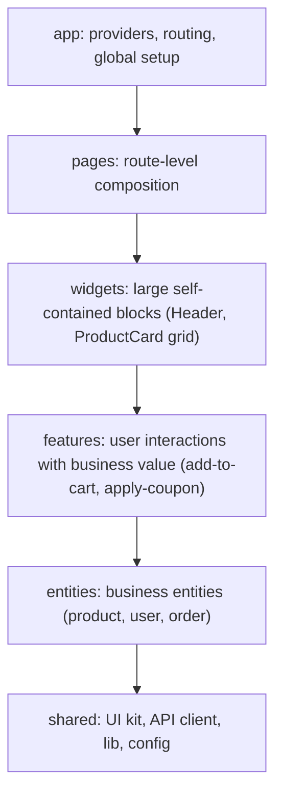
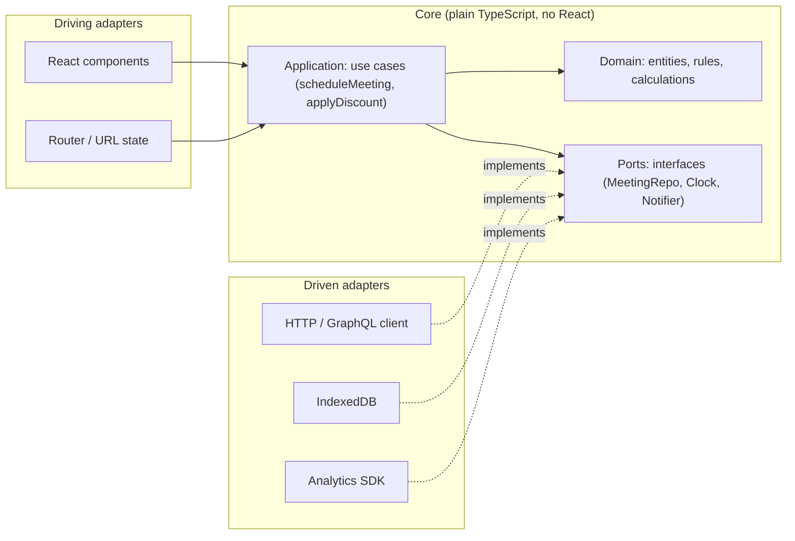

# 21 — Frontend Architecture Styles and Application Boundaries

> Folder structure isn't architecture. Dependency direction is. Decide which code may know about which other code, enforce it with tools, and the folders take care of themselves.

**Prerequisites:** [01](01-thinking-like-a-frontend-architect.md), [04](04-typescript-at-scale.md) · **Related:** [22 Component Patterns](22-component-architecture-and-patterns.md) · [28 State Ownership](28-state-and-data-ownership-architecture.md) · [60 Monorepos](60-monorepos-build-tooling-and-bundlers.md) · [61 Micro-Frontends](61-micro-frontends-and-module-federation.md)

---

## TL;DR

- Organise by **feature (vertical slice)**, not by technical type, once an app has more than a handful of features or more than one team. `components/`, `hooks/` and `utils/` folders don't scale. `features/checkout/` does.
- **Feature-Sliced Design** formalises layering for frontends: `app → pages → widgets → features → entities → shared`, where each layer imports only from layers below it, and each slice exposes a **public API**.
- **Hexagonal (ports and adapters)** keeps domain logic in plain TypeScript, independent of React, HTTP and storage. It's worth it for complex, long-lived domains; for CRUD screens it's overkill.
- The **modular monolith** (one deployable, many strongly bounded modules or packages) is the right default for most organisations. Micro-frontends are the exception, not the goal.
- **Dependency direction** is the core rule: UI depends on application logic, which depends on the domain. The domain depends on nothing. Shared code is small and stable. Cycles are forbidden.
- In React, **Context is your DI container** and the app entry is your **composition root**: wire adapters (API client, analytics, flags, clock) once, and inject them into features.
- Enforce boundaries with tools (`eslint-plugin-boundaries`, Nx module-boundary rules, dependency-cruiser, package `exports`), and treat violations as CI failures.

---

## 1. Why boundaries matter more in frontends than people think

Frontends accumulate **coupling** faster than backends:

- Every screen can import every other screen's components "just this once".
- Shared global state makes any component a potential dependency of any other.
- UI code changes constantly (design iterations, experiments), so tangled code means constant collateral damage.
- Many teams commit to one repository and one deployable.

The symptom is the "**big ball of mud**" frontend: you can't delete a feature, can't give a team ownership, can't upgrade a library in one area, and can't split the bundle meaningfully.

---

## 2. The styles, compared

| Style | Organising principle | Strengths | Weaknesses | Fits |
|---|---|---|---|---|
| **Technical layering** (`components/`, `hooks/`, `services/`) | By kind of code | Simple to start | Features are smeared across folders; no ownership; `utils/` black hole | Prototypes, < ~10 screens |
| **Feature-first / vertical slices** | By business capability | Cohesion; team ownership; deletability | Needs rules for shared code | Most product apps |
| **Feature-Sliced Design** | Layers × slices × segments, with an import rule | Explicit, teachable conventions; scales to many teams | Learning curve; can feel rigid | Large apps, many contributors |
| **Hexagonal / clean** | Domain at the centre, adapters outside | Testable domain; swappable infrastructure; framework-independent | Indirection; overkill for CRUD | Complex domains (pricing, scheduling, editors, finance) |
| **Modular monolith** | Packages with enforced boundaries, one deploy | Team autonomy without distributed-system costs | Needs a monorepo and tooling discipline | Most multi-team organisations |
| **Micro-frontends** | Independently deployed applications | Deployment autonomy; tech heterogeneity | Integration, performance and consistency costs | Many teams with truly independent release needs ([61](61-micro-frontends-and-module-federation.md)) |

---

## 3. Vertical slices (feature-first)

```text
src/
  app/                      # composition root: providers, router, global styles, telemetry
  features/
    checkout/
      index.ts              # PUBLIC API: the only file other features may import
      ui/                   # CheckoutPage, PaymentForm, OrderSummary
      model/                # state, reducers, selectors, domain logic
      api/                  # queries, mutations, DTO mappers
      lib/                  # feature-private helpers
    catalog/
    account/
  entities/                 # shared business entities (Product, User): types, UI atoms, queries
  shared/                   # design-system wrappers, generic utilities, config (no business logic)
```

Rules that make it work:

1. **A feature's internals are private.** Others import only from `features/checkout` (its `index.ts`).
2. **Features don't import other features**, or only through public APIs that architecture review has approved. Cross-feature composition happens one level up (pages or widgets).
3. **`shared/` has no business logic** and changes rarely. If something there knows what an "order" is, it belongs in `entities/`.
4. **Delete test:** deleting `features/reviews/` should require edits only to the pages that compose it.

---

## 4. Feature-Sliced Design (FSD)



| Concept | Meaning |
|---|---|
| **Layer** | One of the six levels above. **Imports flow downward only** |
| **Slice** | A business-domain folder within a layer (`features/add-to-cart`). Slices on the same layer don't import each other |
| **Segment** | Technical purpose within a slice: `ui`, `model`, `api`, `lib`, `config` |
| **Public API** | Each slice exposes an `index.ts`. Deep imports are banned |

FSD's main value is a **shared vocabulary** for where code goes, which settles most "where should this live?" debates in code review.

---

## 5. Hexagonal architecture (ports and adapters) in React apps



```ts
// core/scheduling/ports.ts
export interface MeetingRepository {
  findConflicts(calendarId: string, range: TimeRange): Promise<Meeting[]>;
  save(meeting: Meeting): Promise<Meeting>;
}
export interface Clock { now(): Temporal.Instant }

// core/scheduling/scheduleMeeting.ts: pure application logic, trivially unit-testable
export async function scheduleMeeting(deps: { repo: MeetingRepository; clock: Clock }, draft: MeetingDraft) {
  if (Temporal.Instant.compare(draft.start, deps.clock.now()) < 0) return { ok: false, error: 'IN_PAST' } as const;
  const conflicts = await deps.repo.findConflicts(draft.calendarId, draft.range);
  if (conflicts.length) return { ok: false, error: 'CONFLICT', conflicts } as const;
  return { ok: true, meeting: await deps.repo.save(toMeeting(draft)) } as const;
}
```

**Use it when** the domain logic is complex, valuable and long-lived (pricing engines, scheduling, document editors, financial rules), or shared across UIs (web, mobile, CLI) or with the backend. **Skip it when** screens are mostly forms over an API. You'd be writing interfaces that only ever have one implementation.

> [!TIP]
> A pragmatic middle ground: keep **domain logic in plain TypeScript modules** (no React imports, no `fetch`) even inside a feature-first structure. Most of hexagonal's testability benefit comes from this single rule.

---

## 6. Dependency direction rules

| Principle | Frontend translation |
|---|---|
| **Acyclic dependencies** | No import cycles between features or packages (detect them in CI) |
| **Stable dependencies** | Depend in the direction of stability: features → entities → shared. Shared code must be the most stable |
| **Dependency inversion** | Core logic depends on interfaces (ports), and adapters implement them |
| **Common closure** | Code that changes together lives together (a feature's UI, state and API) |
| **Reuse/release equivalence** | Shared packages are versioned and owned, like products |

### Enforcement examples

```js
// eslint.config.js: eslint-plugin-boundaries (FSD-style layers)
import boundaries from 'eslint-plugin-boundaries';

export default [
  {
    plugins: { boundaries },
    settings: {
      'boundaries/elements': [
        { type: 'app', pattern: 'src/app/*' },
        { type: 'pages', pattern: 'src/pages/*' },
        { type: 'widgets', pattern: 'src/widgets/*' },
        { type: 'features', pattern: 'src/features/*' },
        { type: 'entities', pattern: 'src/entities/*' },
        { type: 'shared', pattern: 'src/shared/*' },
      ],
    },
    rules: {
      'boundaries/element-types': ['error', {
        default: 'disallow',
        rules: [
          { from: 'app', allow: ['pages', 'widgets', 'features', 'entities', 'shared'] },
          { from: 'pages', allow: ['widgets', 'features', 'entities', 'shared'] },
          { from: 'widgets', allow: ['features', 'entities', 'shared'] },
          { from: 'features', allow: ['entities', 'shared'] },
          { from: 'entities', allow: ['shared'] },
          { from: 'shared', allow: ['shared'] },
        ],
      }],
      'boundaries/entry-point': ['error', { default: 'disallow', rules: [{ target: ['*'], allow: 'index.ts' }] }],
    },
  },
];
```

```js
// .dependency-cruiser.cjs: no cycles, domain must not import React or HTTP
module.exports = {
  forbidden: [
    { name: 'no-circular', severity: 'error', from: {}, to: { circular: true } },
    { name: 'domain-is-pure', severity: 'error', from: { path: '^src/core' }, to: { path: 'node_modules/(react|axios|next)' } },
  ],
};
```

In an Nx monorepo, use project **tags** (`type:feature`, `type:ui`, `type:data-access`, `scope:checkout`) with `@nx/enforce-module-boundaries` ([60](60-monorepos-build-tooling-and-bundlers.md)).

---

## 7. Public APIs, barrels and `exports`

| Approach | Pros | Cons |
|---|---|---|
| **`index.ts` per slice** (narrow, curated) | Clear contract; enables deep-import bans | Can grow into a barrel |
| **Giant barrels** (`export * from` everything) | Convenient | Slow dev servers and tests (everything loads), broken tree-shaking with side effects, circular imports |
| **Package `exports` map** (monorepo packages) | Enforced by Node and bundlers; multiple entry points (`@acme/ui/button`) | Requires a package per module |

> [!WARNING]
> Barrel files are a top cause of slow Vite and Jest/Vitest runs and accidental cycles in large codebases. Keep public APIs **narrow** (export what consumers need, not everything), prefer **multiple explicit entry points** for big packages, and mark packages `"sideEffects": false` (with CSS exceptions) so tree-shaking works.

---

## 8. Dependency injection and the composition root

React has no DI container, and it doesn't need one: **Context is dependency injection**, and the app entry is the **composition root**.

```tsx
// shared/services.tsx
export type Services = {
  api: ApiClient;
  analytics: Analytics;
  flags: FeatureFlags;
  clock: Clock;
  logger: Logger;
};

const ServicesContext = createContext<Services | null>(null);

export function ServicesProvider({ services, children }: { services: Services; children: React.ReactNode }) {
  return <ServicesContext value={services}>{children}</ServicesContext>;
}

export function useServices(): Services {
  const services = use(ServicesContext);
  if (!services) throw new Error('useServices must be used within <ServicesProvider>');
  return services;
}
```

```tsx
// app/root.tsx: the COMPOSITION ROOT (the only place concrete adapters are chosen)
const services: Services = {
  api: createApiClient({ baseUrl: env.API_URL, getToken }),
  analytics: createSegmentAnalytics(env.SEGMENT_KEY),
  flags: createOpenFeatureClient(),
  clock: systemClock,
  logger: createLogger({ release: env.RELEASE }),
};

createRoot(el).render(
  <ServicesProvider services={services}>
    <QueryClientProvider client={queryClient}>
      <RouterProvider router={router} />
    </QueryClientProvider>
  </ServicesProvider>,
);
```

```tsx
// In tests: inject fakes, with no module mocking needed
render(
  <ServicesProvider services={{ ...fakeServices, clock: fixedClock('2026-11-21T10:00:00Z') }}>
    <CheckoutPage />
  </ServicesProvider>,
);
```

| Benefit | Why |
|---|---|
| Testability | Swap adapters with fakes; no `vi.mock` of module paths |
| SSR safety | Services are created **per request** on the server, never as module-level singletons carrying user data ([17](17-ssr-streaming-and-hydration.md)) |
| Replaceability | Changing analytics vendors touches one adapter and the composition root |
| Explicitness | Features declare what they need (`useServices().api`) |

> [!NOTE]
> Keep the services context **stable** (create it once, so it never triggers re-renders) and keep fast-changing *state* out of it. DI context holds capabilities, not data ([29](29-client-state-management.md)).

### Anti-corruption layers

Wrap every third-party SDK and every backend contract in an adapter that maps to your own types:

```ts
// features/billing/api/mappers.ts: the backend's shape never leaks past this file
export function toInvoice(dto: InvoiceDTO): Invoice {
  return {
    id: dto.invoice_id as InvoiceId,
    total: Money.fromCents(dto.amount_cents, dto.currency),
    status: dto.state === 'PAID_IN_FULL' ? 'paid' : dto.state === 'VOID' ? 'void' : 'open',
    issuedAt: Temporal.Instant.from(dto.issued_at),
  };
}
```

---

## 9. Boundaries in Next.js and other file-system routers

File-system routers (Next.js `app/`, React Router's route modules, TanStack Router) make **routes** the obvious unit, which tempts teams to put everything inside route folders. A healthier pattern:

```text
app/                                   # routing layer: thin
  (shop)/products/[slug]/page.tsx      # composes features; data loading; metadata
  (shop)/checkout/page.tsx
src/
  features/checkout/                   # real logic lives here, router-agnostic
  features/catalog/
  entities/product/
  shared/
```

- Route files **compose** features and handle routing concerns: params, metadata, loading and error files, caching directives.
- Features stay **router-agnostic** where possible, which makes them easier to test, move or share between apps.
- Colocate *route-only* UI (a page-specific banner) under the route folder. Promote it to a feature when it's reused.

---

## 10. Example: Acme Insights (multi-tenant SaaS) package topology

```text
apps/
  insights-web/            # Next.js app: routing, composition root
  marketing-site/
packages/
  ui/                      # Prism design system components   (type:ui)
  design-tokens/           # DTCG tokens → CSS/TS              (type:util)
  domain-analytics/        # metrics math, no React             (type:domain)
  data-access-insights/    # API client, queries, DTO mappers   (type:data-access)
  feature-dashboards/      # dashboards UI + model              (type:feature, scope:insights)
  feature-alerts/          #                                    (type:feature, scope:insights)
  feature-billing/         #                                    (type:feature, scope:billing)
  shared-auth/             # session, permissions hooks         (type:util, scope:shared)
```

| Rule (tags) | Meaning |
|---|---|
| `type:feature` → may depend on `type:ui`, `type:data-access`, `type:domain`, `type:util` | Features compose lower layers |
| `type:ui` → only `type:util` | The design system knows nothing about business |
| `type:domain` → nothing but `type:util` | Pure logic |
| `scope:billing` ↛ `scope:insights` | Teams' features stay independent |
| Apps → anything | Apps are composition roots |

The full case study is in [67](67-case-study-enterprise-saas-dashboard.md).

---

## Decision framework: choosing a structure

| Context | Recommendation |
|---|---|
| Solo or small team, < 10 screens, short-lived | Simple feature folders; don't over-engineer |
| 1–3 teams, growing product | Feature-first + `shared/` + lint-enforced public APIs |
| 4+ teams in one app | Modular monolith in a monorepo (packages + tags), FSD-style layering |
| Complex domain logic | Hexagonal core modules (pure TS) inside the above |
| Teams needing independent deploys, different release cadences | Consider micro-frontends ([61](61-micro-frontends-and-module-federation.md)), but only after the modular monolith proves insufficient |

**Failure modes to anticipate:** a shared folder that becomes a dumping ground, boundaries documented but not enforced, cycles introduced through barrels, features importing each other's internals "temporarily", and route files containing all the logic.

**Migration path from technical layering:** create `features/` and `shared/` alongside the existing folders. All **new** work goes into features. Move existing code into a feature **when you touch it**. Add lint rules in *warn* mode, track the violation count as a ratchet, and switch to *error* once it hits zero ([63](63-architecture-governance-and-adrs.md)).

---

## Pitfalls and anti-patterns

- `utils/` and `common/` folders with no owner and hundreds of unrelated exports.
- Feature-to-feature imports of internals.
- Domain logic inside components or hooks (untestable without rendering).
- Module-level singletons holding user-specific state (SSR leaks).
- Barrel files re-exporting everything.
- Structure enforced by convention only.
- Hexagonal ceremony for CRUD (interfaces with a single implementation, mappers for identical shapes).

---

## Architect's checklist

- [ ] Architecture style chosen and recorded in an ADR, with the import rules spelled out
- [ ] Import rules enforced in CI (boundaries, cycles, deep imports, domain purity)
- [ ] Every feature or package has an owner (CODEOWNERS) and a public API
- [ ] A composition root wires adapters; services are injected via context; per-request on the server
- [ ] Domain logic in plain TypeScript with unit tests
- [ ] Adapters (anti-corruption layers) for the backend and third-party SDKs
- [ ] `shared/` kept small and reviewed by the platform team
- [ ] Metrics: dependency violations, cycles, shared-package churn, feature coupling

---

## Interview angles

**Q1. How would you structure a React codebase for 8 teams?**
As a modular monolith in a monorepo. Apps are thin composition roots, and features are packages owned by teams, with tags restricting dependencies (features → ui, data-access, domain, util; no cross-scope feature imports). There's a small shared layer owned by a platform team, and domain logic lives in pure TypeScript packages. Boundaries are enforced with Nx rules or ESLint boundaries plus cycle detection, and CI builds and tests only affected packages. I'd consider micro-frontends only if teams need independent deploys badly enough to pay the integration costs.

**Q2. What is a composition root, and how does it work in React?**
It's the single place where concrete implementations are chosen and wired together: API client, analytics, flags, logger, stores, router. In React that's the app entry (or root layout), and dependencies are provided through context, which acts as the DI container. Features depend on capabilities through hooks like `useServices()`, so tests and different environments (SSR per request, storybooks, E2E) can inject different implementations.

**Q3. When is hexagonal architecture worth it in a frontend?**
When the domain logic is complex, valuable, long-lived, or shared across UIs: pricing, scheduling, editors, risk calculations. Keeping that logic in pure TypeScript behind ports makes it testable without React or network, and lets you swap infrastructure. For form-over-API screens it's overhead. The pragmatic rule of "no React and no fetch in domain modules" gets most of the benefit.

**Q4. Why are barrel files controversial?**
A barrel that re-exports everything makes importing one thing load the whole module graph. Dev servers and test runners slow down, tree-shaking fails when modules have side effects, and accidental import cycles appear. Narrow public APIs and multiple explicit entry points (package `exports`) keep encapsulation without the cost.

**Q5. How do you stop a `shared/` folder from rotting?**
Give it an owner, a strict admission rule (no business concepts, so those go to `entities/` or a domain package), lint rules preventing shared from importing features, review for every addition, and periodic pruning using usage analysis. If code is used by only one feature, it moves back into that feature.

---

## Further reading

- Feature-Sliced Design: <https://feature-sliced.design>
- Alistair Cockburn, *Hexagonal Architecture*: <https://alistair.cockburn.us/hexagonal-architecture/>
- Robert C. Martin, *Clean Architecture* (component principles: ADP, SDP, SAP)
- Nx, *Enforce Module Boundaries*: <https://nx.dev/features/enforce-module-boundaries>
- `eslint-plugin-boundaries`: <https://github.com/javierbrea/eslint-plugin-boundaries>
- dependency-cruiser: <https://github.com/sverweij/dependency-cruiser>
- Kent C. Dodds, *Colocation*: <https://kentcdodds.com/blog/colocation>

---

[← Previous: 20 — React Tooling, DevTools and Debugging Workflows](20-react-tooling-devtools-and-debugging.md) · [Index](README.md) · [Next: 22 — Component Architecture, Contracts and Design Patterns →](22-component-architecture-and-patterns.md)
