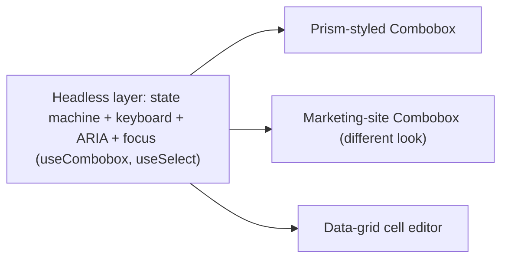

# 22 — Component Architecture, Contracts and Design Patterns

> A component's props are a public API. Treat them like one: small, predictable, composable, accessible by default, and hard to misuse. Every pattern in this chapter is a way to give consumers more control while giving them less to get wrong.

**Prerequisites:** [08](08-react-mental-model-and-rules.md), [21](21-frontend-architecture-styles-and-boundaries.md) · **Related:** [35 Design Systems](35-enterprise-design-system-architecture.md) · [25 Complex UI](25-complex-ui-engineering.md) · [27 Best Practices](27-react-best-practices-and-code-review.md)

---

## TL;DR

- **Composition beats configuration.** Prefer `children`, slots and compound components over growing lists of boolean and config props.
- **Compound components** (`<Tabs><Tabs.List/><Tabs.Panel/></Tabs>`) share implicit state through context: flexible markup, one cohesive API.
- **Headless components and hooks** separate *behaviour and accessibility* from *rendering*. Libraries like React Aria, Radix, Base UI, Ark UI and TanStack Table are built this way.
- **Support both controlled and uncontrolled usage** (`value`/`onValueChange` plus `defaultValue`) with a `useControllableState` hook.
- **Polymorphism:** prefer **`asChild`/Slot** (compose behaviour onto the consumer's element) over a generic `as` prop (expensive types, ambiguous semantics).
- **Inversion of control** (render props, state reducers, prop getters) lets consumers customise without forking. Use it in libraries and design systems, not everywhere.
- **API design rules:** discriminated unions over boolean soup, `variant` enums over flags, `data-state` attributes for styling, native props pass-through, `ref` as a prop, and deprecations with warnings and codemods.

---

## 1. Components as contracts

| Contract property | What it means |
|---|---|
| **Minimal surface** | Every prop is a forever commitment in a shared component |
| **Predictable naming** | `onXChange`/`x`/`defaultX`, `isX`-free booleans (`disabled`, `open`), `variant`, `size` |
| **Composable** | Accepts `children` and slots, and doesn't assume its context |
| **Accessible by default** | Correct roles, labels and keyboard behaviour without consumer effort ([36](36-accessibility-engineering.md)) |
| **Native pass-through** | Extends the underlying element's props (`ComponentProps<'button'>`) and forwards `ref` |
| **Controlled and uncontrolled** | Works both ways where it holds state |
| **Typed precisely** | Invalid combinations don't compile ([04](04-typescript-at-scale.md)) |
| **Stable** | Semver, deprecation warnings, codemods |
| **Observable state for styling** | `data-state="open"`, `data-disabled`, `aria-*`, so consumers style states without internals |

---

## 2. Composition fundamentals

```tsx
// Configuration explosion (❌)
<Modal title="Delete project" showCloseButton footerAlign="right" primaryLabel="Delete" onPrimary={handleDelete} secondaryLabel="Cancel" />

// Composition (✅)
<Dialog>
  <Dialog.Header>
    <Dialog.Title>Delete project?</Dialog.Title>
    <Dialog.Close />
  </Dialog.Header>
  <Dialog.Body>This permanently deletes 12 dashboards.</Dialog.Body>
  <Dialog.Footer>
    <Button variant="secondary" onClick={close}>Cancel</Button>
    <Button variant="danger" onClick={confirm}>Delete</Button>
  </Dialog.Footer>
</Dialog>
```

### Slots: named composition points

```tsx
type PageLayoutProps = { header: React.ReactNode; sidebar?: React.ReactNode; children: React.ReactNode };

export function PageLayout({ header, sidebar, children }: PageLayoutProps) {
  return (
    <div className="layout">
      <header>{header}</header>
      {sidebar && <aside>{sidebar}</aside>}
      <main id="main">{children}</main>
    </div>
  );
}
```

> [!TIP]
> Slots are also a **performance** tool. Elements passed as props are created by the parent, so when `PageLayout` re-renders because of its own state, those elements are the same objects and React skips them ([10](10-react-internals-fiber-and-reconciliation.md)).

---

## 3. Compound components

```tsx
type TabsContextValue = {
  value: string;
  setValue: (v: string) => void;
  baseId: string;
};
const TabsContext = createContext<TabsContextValue | null>(null);
const useTabs = () => {
  const ctx = use(TabsContext);
  if (!ctx) throw new Error('Tabs.* must be used within <Tabs>');
  return ctx;
};

export function Tabs({ value, defaultValue, onValueChange, children }: {
  value?: string; defaultValue?: string; onValueChange?: (v: string) => void; children: React.ReactNode;
}) {
  const [current, setCurrent] = useControllableState({ value, defaultValue: defaultValue ?? '', onChange: onValueChange });
  const baseId = useId();
  return <TabsContext value={{ value: current, setValue: setCurrent, baseId }}>{children}</TabsContext>;
}

function List({ children, label }: { children: React.ReactNode; label: string }) {
  const onKeyDown = (e: React.KeyboardEvent<HTMLDivElement>) => {
    const tabs = [...e.currentTarget.querySelectorAll<HTMLButtonElement>('[role="tab"]:not([disabled])')];
    const i = tabs.indexOf(document.activeElement as HTMLButtonElement);
    const next = e.key === 'ArrowRight' ? tabs[(i + 1) % tabs.length]
      : e.key === 'ArrowLeft' ? tabs[(i - 1 + tabs.length) % tabs.length]
      : e.key === 'Home' ? tabs[0] : e.key === 'End' ? tabs.at(-1) : undefined;
    if (next) { e.preventDefault(); next.focus(); next.click(); } // automatic activation
  };
  return <div role="tablist" aria-label={label} onKeyDown={onKeyDown}>{children}</div>;
}

function Trigger({ value, children }: { value: string; children: React.ReactNode }) {
  const { value: selected, setValue, baseId } = useTabs();
  const isSelected = selected === value;
  return (
    <button
      role="tab"
      id={`${baseId}-tab-${value}`}
      aria-selected={isSelected}
      aria-controls={`${baseId}-panel-${value}`}
      tabIndex={isSelected ? 0 : -1}            // roving tabindex
      data-state={isSelected ? 'active' : 'inactive'}
      onClick={() => setValue(value)}
    >
      {children}
    </button>
  );
}

function Panel({ value, children }: { value: string; children: React.ReactNode }) {
  const { value: selected, baseId } = useTabs();
  return (
    <div role="tabpanel" id={`${baseId}-panel-${value}`} aria-labelledby={`${baseId}-tab-${value}`} hidden={selected !== value} tabIndex={0}>
      {children}
    </div>
  );
}

Tabs.List = List;
Tabs.Trigger = Trigger;
Tabs.Panel = Panel;
```

| Strength | Caveat |
|---|---|
| Consumers control markup and order (add wrappers, icons, badges) | Context re-renders all parts on change (fine for small widgets) |
| One cohesive API with implicit wiring | Parts must be used inside the root (throw a helpful error) |
| Accessibility relationships handled internally | Server Components can't render the parts' internals, so mark the module `'use client'` |

---

## 4. Controlled vs uncontrolled: `useControllableState`

```ts
export function useControllableState<T>({ value, defaultValue, onChange }: {
  value?: T; defaultValue: T; onChange?: (next: T) => void;
}) {
  const [internal, setInternal] = useState(defaultValue);
  const isControlled = value !== undefined;
  const current = isControlled ? (value as T) : internal;

  const setValue = useCallback((next: T) => {
    if (!isControlled) setInternal(next);
    if (!Object.is(next, current)) onChange?.(next);
  }, [isControlled, current, onChange]);

  return [current, setValue] as const;
}
```

> [!NOTE]
> Native inputs warn when a component switches between controlled and uncontrolled. Design systems usually add the same development-only warning, implemented in an effect (not by reading refs during render, which the Compiler's `refs` rule flags), or prevent the switch with discriminated-union prop types.

---

## 5. Headless components and hooks



```tsx
// Consumers render whatever markup they like; the hook supplies behaviour and a11y via prop getters
function CountryPicker({ countries }: { countries: Country[] }) {
  const cb = useCombobox({ items: countries, itemToString: (c) => c?.name ?? '' });
  return (
    <div className="combobox">
      <label {...cb.getLabelProps()}>Country</label>
      <input {...cb.getInputProps({ placeholder: 'Search…' })} />
      <ul {...cb.getMenuProps()}>
        {cb.isOpen && cb.items.map((c, index) => (
          <li key={c.code} {...cb.getItemProps({ item: c, index })} data-highlighted={cb.highlightedIndex === index}>
            {c.flag} {c.name}
          </li>
        ))}
      </ul>
    </div>
  );
}
```

| Approach | Examples | When |
|---|---|---|
| Headless **hooks** | React Aria hooks, Downshift, TanStack Table/Virtual | Maximum control. You write the markup |
| Headless **unstyled components** | Radix Primitives, Base UI, Ark UI, React Aria Components, Headless UI | Behaviour and structure provided, styling yours |
| **Styled kits** | MUI, Mantine, Chakra, Ant Design | Speed, with design constraints accepted |
| **Copy-in components** | shadcn/ui (Radix or Base UI + Tailwind, copied into your repo) | Ownership of code with a good starting point ([35](35-enterprise-design-system-architecture.md)) |

> [!IMPORTANT]
> Don't hand-roll complex interactive widgets (combobox, date picker, menu, dialog, grid) for a design system. Their keyboard, focus and screen-reader behaviour is the hard part. Build on a well-tested headless layer and spend your effort on design and API ([25](25-complex-ui-engineering.md)).

---

## 6. Polymorphism: `asChild` vs `as`

```tsx
// asChild / Slot: merge our props and behaviour onto the consumer's single child element
import { Slot } from '@radix-ui/react-slot';

type ButtonProps = React.ComponentProps<'button'> & { asChild?: boolean; variant?: 'primary' | 'secondary' };

export function Button({ asChild, variant = 'primary', className, ...props }: ButtonProps) {
  const Comp = asChild ? Slot : 'button';
  return <Comp className={cx('btn', `btn--${variant}`, className)} {...props} />;
}

// Renders an <a> with button styling, the consumer's href, and Next.js client navigation
<Button asChild variant="secondary">
  <Link href="/pricing">See pricing</Link>
</Button>
```

| | `asChild` / Slot | `as` prop (`<Button as="a" href>`) |
|---|---|---|
| Types | Simple | Complex generic types, slow to check |
| Semantics | The consumer chooses the actual element and its props | Mixed props of two elements |
| Composition with router `Link`s | Natural | Awkward |
| Event and ref merging | Slot merges handlers, classNames, styles and refs | Manual |

---

## 7. Inversion of control patterns

### 7.1 Render props (UI injection)

```tsx
<VirtualList items={rows} itemHeight={40} renderItem={(row, style) => <Row style={style} row={row} />} />
```

### 7.2 State reducer (customise state transitions)

```ts
function useToggle({ reducer = toggleReducer }: { reducer?: typeof toggleReducer } = {}) {
  const [{ on }, dispatch] = useReducer(reducer, { on: false });
  return { on, toggle: () => dispatch({ type: 'toggle' }), reset: () => dispatch({ type: 'reset' }) };
}

// Consumer: "after 4 clicks, stop toggling", without forking the hook
const { on, toggle } = useToggle({
  reducer: (state, action) => (action.type === 'toggle' && clicks >= 4 ? state : toggleReducer(state, action)),
});
```

### 7.3 Prop getters (merge consumer handlers safely)

```ts
function getToggleProps({ onClick, ...rest }: React.ComponentProps<'button'> = {}) {
  return {
    'aria-pressed': on,
    onClick: callAll(onClick, toggle),   // consumer's handler runs too; it can call preventDefault to opt out
    ...rest,
  };
}
```

---

## 8. API design guidelines

### 8.1 Boolean traps

```tsx
// ❌ Which combinations are valid? <Button primary danger ghost small />
// ✅ Mutually exclusive variants as enums
type ButtonProps = { variant?: 'primary' | 'secondary' | 'ghost' | 'danger'; size?: 'sm' | 'md' | 'lg' };
```

### 8.2 Naming and event conventions

| Concept | Convention | Example |
|---|---|---|
| Controlled value | `value` + `onValueChange` | Avoids clashing with the DOM `onChange` event signature |
| Uncontrolled initial value | `defaultValue`, `defaultOpen` | Mirrors native inputs |
| Open state | `open` + `onOpenChange` | Dialogs, popovers |
| Render customisation | `renderItem`, `renderEmpty` | Render props |
| Styling state | `data-state`, `data-disabled`, `data-orientation` | `.tab[data-state='active']` |
| Escape hatches | `className`, `style`, `ref`, native props | Pass through to the main element |

### 8.3 Styling override policy

- **Allowed:** `className` merges (appended, not replaced), CSS custom properties exposed as documented tokens (`--button-radius`), and `data-*` state selectors.
- **Discouraged:** deep selectors into internals (`.btn > span > svg`). They break on every refactor.
- **Design-system rule:** expose *semantic* customisation (variants, sizes, tokens), not arbitrary style injection everywhere ([35](35-enterprise-design-system-architecture.md)).

### 8.4 Deprecating props

```ts
if (process.env.NODE_ENV !== 'production' && 'isPrimary' in props) {
  warnOnce('Button: `isPrimary` is deprecated; use variant="primary". Codemod: npx @acme/codemods button-variant');
}
```

Deprecate across at least one minor release, with a warning and a codemod, before removing in a major.

---

## 9. Component granularity and categories

| Category | Owns | Example | Lives in |
|---|---|---|---|
| **Primitives** | Look, behaviour, a11y | `Button`, `Dialog`, `Combobox` | Design-system package |
| **Domain components** | How an entity is presented | `ProductCard`, `UserAvatar`, `PriceTag` | `entities/` |
| **Feature components** | A user interaction with business value | `AddToCartForm`, `ApplyCouponDialog` | `features/` |
| **Page / route components** | Composition, data loading, layout | `ProductPage` | Routes |

Guidance:

- **Inline first, extract on the third repetition** (the "rule of three"). Premature abstraction is costlier than duplication.
- Split components to **localise state** (the part that changes on every keystroke lives in its own small component), not to hit an arbitrary line count.
- "Atomic design" (atoms, molecules, organisms) is a useful vocabulary for design systems, but a poor folder structure for product code.

---

## 10. Server and client composition (the modern container/presentational split)

RSC brings back the old container/presentational idea at a new boundary. **Server Components fetch and compose data. Client Components handle interaction** ([18](18-react-server-components-and-server-functions.md)).

```tsx
// Server: data + composition
export default async function OrdersPage() {
  const orders = await getOrders();             // data access layer, DTOs only
  return <OrdersTable orders={orders} />;       // a client component for sorting and selection
}
```

Design components so their **interactive core** can be a small client leaf, while the surrounding layout and data presentation stay on the server.

---

## Decision framework: which pattern?

| Need | Pattern |
|---|---|
| Flexible layout around fixed behaviour | `children` / slots |
| A multi-part widget with shared state (tabs, accordion, menu) | Compound components |
| The same behaviour with radically different visuals | Headless hook / unstyled primitive |
| Render arbitrary items supplied by the consumer | Render prop |
| Consumers must override state logic | State reducer |
| Consumers attach their own handlers safely | Prop getters |
| Apply component styling or behaviour to the consumer's element | `asChild` / Slot |
| Components hold state that parents sometimes control | `useControllableState` |
| Reuse non-visual logic | Custom hook |
| Cross-cutting wrapper at module level | HOC (sparingly) |

---

## Pitfalls and anti-patterns

- Boolean-prop explosion and "god components" with 40 props.
- `cloneElement`/`Children.map` magic that breaks when consumers wrap children ([19](19-class-components-lifecycles-and-legacy-apis.md)).
- Re-implementing complex widgets without a tested a11y layer.
- Components that can only be controlled (or only uncontrolled) when consumers need both.
- Swallowing native props (no `className`, no `ref`, no `aria-*` pass-through).
- `onChange` with a non-DOM signature on input-like components (confusing; use `onValueChange`).
- Over-abstraction: a generic `<Entity>` component configured by schema for every screen.
- Prop drilling across many layers where composition or context would be clearer. (Two or three layers is fine and explicit.)

---

## Architect's checklist

- [ ] Component API guidelines published (naming, variants, controlled/uncontrolled, pass-through, `data-state`)
- [ ] Shared interactive components built on a headless, a11y-tested layer
- [ ] All shared components accept `className`, `ref` and native props, and forward them correctly
- [ ] Deprecation policy with dev warnings and codemods
- [ ] Storybook stories for every public component state; interaction and a11y tests
- [ ] Review rubric flags boolean explosions, `cloneElement` usage and premature abstraction ([27](27-react-best-practices-and-code-review.md))

---

## Interview angles

**Q1. Design a reusable `Select` for a design system. What's its API?**
Compound and headless-backed: `<Select value onValueChange defaultValue>` with `<Select.Trigger>`, `<Select.Value>`, `<Select.Content>` and `<Select.Item value>`. It's controlled and uncontrolled via `useControllableState`, has `name` for form integration and `disabled`, is keyboard and screen-reader complete via a headless primitive, exposes `data-state` and `data-highlighted` for styling, passes through `ref` and native props, supports a `renderValue` slot for custom display, and has a typed `value` generic. Stories, a11y tests and visual tests cover every state, and deprecations ship with codemods.

**Q2. Compound components vs a single configurable component?**
Compound components let consumers control structure (wrapping, ordering, adding content) while the root manages shared state and accessibility through context. A single configurable component is simpler for trivial cases but grows a config-prop explosion as requirements diverge. For anything with multiple visible parts, compound components age better.

**Q3. What does "headless" mean, and why is it the dominant design-system strategy?**
Headless components provide behaviour (state, keyboard interaction, focus management, ARIA) without imposing markup or styles. They let organisations reuse the hardest, most expensive-to-get-right part (accessible behaviour) across brands and products, while owning visuals completely. Styled kits trade that flexibility for speed.

**Q4. `asChild` vs `as`?**
`as` makes one component pretend to be another element. It needs complex generic typings and mixes two elements' prop sets. `asChild` lets the consumer supply the real element as a child, and the component merges its props, handlers, styles and ref onto it. Types stay simple, it composes with router links, and semantics stay explicit.

**Q5. When is prop drilling fine?**
When it's two or three levels and the intermediate components meaningfully pass the data on. It's explicit and easy to trace. It becomes a problem when many layers merely forward props they don't use. Then use composition (pass elements as children or slots, so the data is consumed where it's created) or context for truly cross-cutting values.

---

## Further reading

- React docs, *Passing Props*, *Passing Data Deeply with Context*: <https://react.dev/learn>
- Kent C. Dodds, *Advanced React Patterns* (compound components, state reducer, prop getters): <https://kentcdodds.com/blog>
- Radix Primitives, *Composition* (`asChild`): <https://www.radix-ui.com/primitives/docs/guides/composition>
- React Aria, *Building components with hooks*: <https://react-spectrum.adobe.com/react-aria/>
- Base UI: <https://base-ui.com>
- WAI-ARIA Authoring Practices Guide, *Tabs pattern*: <https://www.w3.org/WAI/ARIA/apg/patterns/tabs/>

---

[← Previous: 21 — Frontend Architecture Styles and Application Boundaries](21-frontend-architecture-styles-and-boundaries.md) · [Index](README.md) · [Next: 23 — Styling Architecture and Theming →](23-styling-architecture-and-theming.md)
