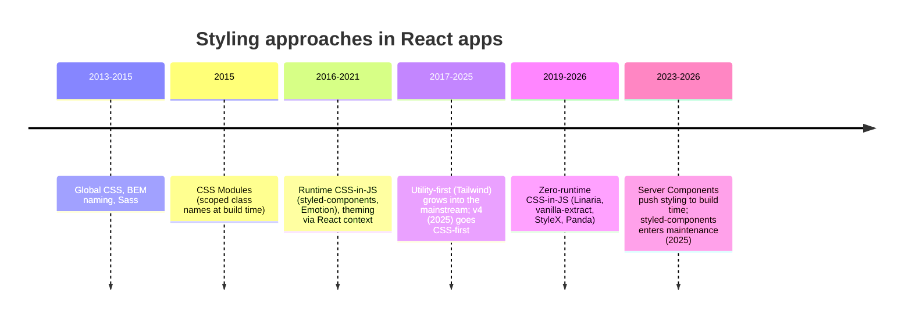
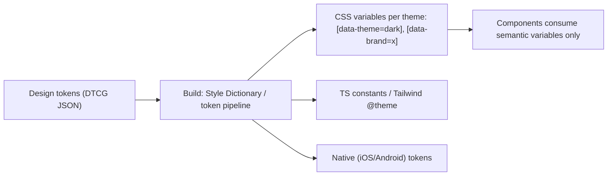

# 23 — Styling Architecture and Theming

> Styling decisions look like taste and behave like infrastructure. They determine your bundle size, your Server Components story, your theming model, and how painful the next redesign will be.

**Prerequisites:** [07](07-modern-css-and-layout-architecture.md) · **Related:** [35 Design Systems](35-enterprise-design-system-architecture.md) · [24 Animation](24-animation-and-motion-systems.md) · [18 RSC](18-react-server-components-and-server-functions.md)

---

## TL;DR

- **Zero-runtime styling won.** Styles are compiled to static CSS at build time (CSS Modules, Tailwind CSS v4, vanilla-extract, StyleX, Panda). That works with Server Components and streaming, costs nothing at render time, and caches well.
- **Runtime CSS-in-JS** (styled-components, Emotion) generates and injects styles while rendering. That has a CPU cost, needs `useInsertionEffect` and SSR extraction, and conflicts with RSC (it needs client-side context). styled-components entered maintenance mode in March 2025 (a v7 alpha appeared in May 2026), so check its status before betting on it.
- **Tailwind v4** is CSS-first: `@import "tailwindcss"` plus an `@theme` block that defines tokens as CSS variables, which in turn generate utilities. It has built-in container queries and a fast engine. Pair it with variant helpers (`cva`/`tailwind-variants`) and `tailwind-merge`.
- **Theming = semantic tokens as CSS custom properties**, switched by attributes (`data-theme`, `data-brand`) and honouring `prefers-color-scheme`. Avoid the flash of the wrong theme by rendering the attribute **on the server** from a cookie.
- Component styling APIs should expose **variants and tokens**, merge `className`, and style states via `data-state`/`aria-*`.

---

## 1. How we got here



### Why runtime CSS-in-JS fell out of favour

| Cost | Detail |
|---|---|
| Render-time CPU | Serialising style objects and hashing class names on every render of styled components |
| Style insertion | `<style>` tags injected during commit (`useInsertionEffect`). Insertions trigger style recalculation |
| Bundle | The runtime library plus style definitions as JS |
| SSR complexity | Collecting styles per request, streaming them in order, hydrating style registries |
| **RSC incompatibility** | Relies on React context and hooks, so styled components must be Client Components. You lose RSC's zero-JS benefit for styled leaves |

---

## 2. The options compared

| Approach | Runtime cost | RSC-friendly | Type safety | Theming | Colocation | Notes |
|---|---|---|---|---|---|---|
| **CSS Modules** | None | ✅ | With typed-CSS plugins | CSS variables | `.module.css` next to component | Simple and durable. Turbopack shortens class names in production (Next.js 16.4) |
| **Tailwind CSS v4** | None | ✅ | Editor tooling; variant libraries add types | `@theme` tokens → CSS variables | In markup | Mainstream; fast; consistent spacing and color scales |
| **vanilla-extract** | None | ✅ | ✅ (`.css.ts`) | `createTheme`, typed contracts | Separate `.css.ts` file | Great for design systems |
| **StyleX** | None (atomic CSS at build) | ✅ | ✅ | `defineVars`, `createTheme` | In component file | Deterministic style merging; proven at Meta scale |
| **Panda CSS** | None | ✅ | ✅ | Tokens, recipes | Style props / `css()` | CSS-in-JS ergonomics, compiled |
| **Emotion / styled-components** | **Yes** | ⚠️ Client-only | ✅ | Context `ThemeProvider` | In component | Legacy-friendly; avoid for new RSC apps |
| **Plain CSS + layers** | None | ✅ | ❌ | CSS variables | Global or per-route | Fine for small apps and marketing sites ([07](07-modern-css-and-layout-architecture.md)) |
| **Inline `style`** | Minimal | ✅ | ✅ | Variables | In markup | Dynamic values only. No media or container queries or pseudo-classes |

---

## 3. Tailwind CSS v4 in practice

```css
/* app.css */
@import "tailwindcss";

@theme {
  --color-surface: oklch(99% 0.005 250);
  --color-text: oklch(22% 0.02 250);
  --color-brand: oklch(62% 0.19 255);
  --font-sans: "Inter Variable", system-ui, sans-serif;
  --radius-md: 0.5rem;
  --breakpoint-3xl: 120rem;
}

/* class-based dark mode that also respects data-theme */
@custom-variant dark (&:where([data-theme=dark], [data-theme=dark] *));

@layer components {
  .prose-acme { /* sparing component classes for long-form content */ }
}
```

```tsx
// Variants with class-variance-authority (cva) + tailwind-merge for safe overrides
import { cva, type VariantProps } from 'class-variance-authority';
import { twMerge } from 'tailwind-merge';

const button = cva(
  'inline-flex items-center gap-2 rounded-md font-medium focus-visible:outline-2 focus-visible:outline-offset-2 disabled:opacity-50',
  {
    variants: {
      variant: {
        primary: 'bg-brand text-white hover:bg-brand/90',
        secondary: 'bg-surface text-text ring-1 ring-text/15 hover:bg-text/5',
        danger: 'bg-red-600 text-white hover:bg-red-700',
      },
      size: { sm: 'h-8 px-3 text-sm', md: 'h-10 px-4', lg: 'h-12 px-6 text-lg' },
    },
    defaultVariants: { variant: 'primary', size: 'md' },
  },
);

type ButtonProps = React.ComponentProps<'button'> & VariantProps<typeof button>;

export function Button({ variant, size, className, ...props }: ButtonProps) {
  return <button className={twMerge(button({ variant, size }), className)} {...props} />;
}
```

| Practice | Why |
|---|---|
| Tokens in `@theme` (they become CSS variables **and** utilities) | One source for design tokens; runtime theming via variables |
| Components over `@apply` | Reuse markup and behaviour, not class lists. `@apply` recreates the problems of global CSS |
| `tailwind-merge` when accepting `className` | Later classes override conflicting earlier ones predictably (`px-4` vs `px-2`) |
| Container queries (`@container`, `@md:`) | Responsive components ([07](07-modern-css-and-layout-architecture.md)) |
| Lint: class sorting, banned arbitrary values in product code | Consistency; arbitrary values (`w-[317px]`) erode the design system |

> [!NOTE]
> The common criticism of utility-first is readability: long class strings. The mitigations are variant helpers, extracting components, and design-system primitives that hide utilities from product code. Many organisations use Tailwind *inside* the design system and expose only semantic components to feature teams.

---

## 4. CSS Modules in practice

```css
/* Card.module.css */
.card { container: card / inline-size; border-radius: var(--radius-md); background: var(--surface); }
.title { font-size: var(--step-1); }
@container card (min-width: 30rem) { .card { display: grid; grid-template-columns: 10rem 1fr; } }
.card[data-state='selected'] { outline: 2px solid var(--brand); }
```

```tsx
import styles from './Card.module.css';
export function Card({ selected, children }: { selected?: boolean; children: React.ReactNode }) {
  return <article className={styles.card} data-state={selected ? 'selected' : undefined}>{children}</article>;
}
```

They're boring and durable: native CSS features (layers, container queries, `:has()`), no runtime, and identical behaviour in Server and Client Components.

---

## 5. Zero-runtime CSS-in-JS for design systems

```ts
// button.css.ts (vanilla-extract)
import { createThemeContract, createTheme, style } from '@vanilla-extract/css';
import { recipe } from '@vanilla-extract/recipes';

export const vars = createThemeContract({ color: { brand: null, surface: null, text: null }, radius: { md: null } });

export const lightTheme = createTheme(vars, {
  color: { brand: 'oklch(62% 0.19 255)', surface: 'white', text: 'oklch(22% 0.02 250)' },
  radius: { md: '0.5rem' },
});

export const button = recipe({
  base: { borderRadius: vars.radius.md, fontWeight: 600 },
  variants: {
    variant: {
      primary: { background: vars.color.brand, color: 'white' },
      secondary: { background: vars.color.surface, color: vars.color.text },
    },
  },
  defaultVariants: { variant: 'primary' },
});
```

Type-checked token contracts guarantee every theme defines every token, which is valuable for multi-brand design systems ([35](35-enterprise-design-system-architecture.md)).

---

## 6. Theming architecture



### 6.1 No flash of the wrong theme (SSR)

```tsx
// Server (e.g., Next.js root layout): read the user's choice from a cookie and render it into HTML
export default async function RootLayout({ children }: { children: React.ReactNode }) {
  const theme = (await cookies()).get('theme')?.value as 'light' | 'dark' | 'system' | undefined;
  return (
    <html lang="en" data-theme={theme === 'system' || !theme ? undefined : theme} suppressHydrationWarning>
      <head>
        {/* Only needed for "system": resolve before first paint without a network round trip */}
        <script
          dangerouslySetInnerHTML={{
            __html: `if(!document.documentElement.dataset.theme){document.documentElement.dataset.theme=matchMedia('(prefers-color-scheme: dark)').matches?'dark':'light'}`,
          }}
        />
      </head>
      <body>{children}</body>
    </html>
  );
}
```

| Technique | Trade-off |
|---|---|
| **Server-rendered attribute from a cookie** | Best: no flash, and the HTML is cacheable per theme only if the cache varies on the cookie (otherwise keep it `private`) |
| Tiny inline blocking script reading `localStorage`/`matchMedia` | Works with static HTML, but it's a blocking script and needs a CSP nonce or hash |
| CSS only (`prefers-color-scheme`, `light-dark()`) | No user override, but zero JS |
| JS theme provider applying classes after hydration | ❌ Flash of the wrong theme. Avoid |

### 6.2 Multi-brand and white-label

- **Semantic tokens** (`--surface`, `--brand`, `--radius-control`) are the only thing components read.
- Brands override a **small** set of tokens via `[data-brand]` (colour, typography, radius), not component CSS.
- Validate contrast for every theme × brand combination in CI ([36](36-accessibility-engineering.md)).
- For per-tenant branding loaded at runtime (SaaS), inject a tenant `<style>` block of variables from the server, sanitised and validated ([46](46-enterprise-saas-architecture.md)).

---

## 7. Styling in a Server Components world

| Approach | Works in Server Components? | Notes |
|---|---|---|
| CSS Modules, Tailwind, vanilla-extract, StyleX, Panda | ✅ | Static CSS. Class names usable anywhere |
| Global CSS imports in layouts | ✅ | Framework-managed ordering |
| `<link rel="stylesheet" precedence>` (React 19) | ✅ | React dedupes and orders, and Suspense waits for it |
| Emotion / styled-components | ❌ in Server Components | Styled elements must be in `'use client'` modules |
| Inline `style` with CSS variables | ✅ | Good for data-driven values (`style={{ '--progress': pct }}`) |

---

## 8. Performance of styling

- **Ship less CSS per route.** Bundlers split CSS Modules per route. Tailwind generates only the classes you use. Budget render-blocking CSS ([39](39-web-performance-and-core-web-vitals.md)).
- **Avoid runtime style generation** in hot paths (lists, animations).
- **Theme switching** recalculates style for the whole document (fine as a rare event). Per-frame variable updates should be scoped ([07](07-modern-css-and-layout-architecture.md)).
- **Dead CSS:** coverage analysis per route. Delete styles with their components (colocation helps).
- **Fonts** are part of styling performance: self-host, subset, `size-adjust` fallbacks.

---

## 9. Migrating off runtime CSS-in-JS

1. **Freeze**: no new runtime-styled components (lint rule banning `styled.`/`css` imports in new files).
2. **Bridge tokens**: make the existing `ThemeProvider` theme emit **CSS variables** on the root, so old and new styling share tokens.
3. **New components** use the target approach (CSS Modules, Tailwind or vanilla-extract).
4. **Convert leaf components first** (no children styling dependencies). Codemods handle simple `styled.div` → CSS Module conversions. Complex dynamic styles become `data-*` attributes plus CSS variables.
5. **Move interactive leaves to Client Components** and server-render the rest as you adopt RSC.
6. **Remove the runtime** and the SSR style registry last. Measure bundle size, render time and INP before and after.

---

## Decision framework

| Context | Recommendation |
|---|---|
| New app on Next.js / RSC | Tailwind v4 **or** CSS Modules, plus CSS-variable tokens |
| Design system serving several apps and brands | vanilla-extract or StyleX (typed token contracts), **or** Tailwind inside primitives exposing semantic components |
| Legacy app on styled-components, no RSC plans | Keep, but bridge tokens to CSS variables, and freeze new usage if the maintenance status worries you |
| Marketing or content site | Plain CSS with layers, or Tailwind; critical CSS |
| Heavy data-driven dynamic styles (charts, heatmaps) | CSS variables via inline `style` + static CSS |

**Failure modes:** arbitrary values everywhere (design-system drift), `@apply`-based global component libraries, theme flashes, runtime styling in hot lists, and unscoped global CSS from many teams.

---

## Pitfalls and anti-patterns

- Mixing three styling systems in one app without a migration plan.
- Hard-coded colours bypassing tokens.
- Client-side theme switching after hydration (flash of the wrong theme).
- Accepting `className` without merge semantics (consumer overrides randomly fail).
- Styling via deep descendant selectors into other components' internals.
- Runtime CSS-in-JS inside Server Component trees, forcing `'use client'` everywhere.

---

## Architect's checklist

- [ ] One primary styling approach (ADR), with a written migration plan for any legacy ones
- [ ] Tokens from a single source (DTCG) emitted as CSS variables (and TS/Tailwind theme)
- [ ] Theme attribute rendered on the server; no flash; `color-scheme` set
- [ ] Variant helpers and `className` merge strategy in the design system
- [ ] Lint bans raw colours and arbitrary values in product code
- [ ] Render-blocking CSS budget per route
- [ ] Contrast validated per theme × brand in CI

---

## Interview angles

**Q1. Why are teams moving away from runtime CSS-in-JS?**
Runtime libraries generate and inject styles during render, which costs CPU and bundle size, complicates SSR and streaming, and depends on React context, so they don't work in Server Components. Zero-runtime approaches compile to static CSS at build time with the same colocation and typing benefits, and no runtime cost.

**Q2. Design dark mode for an SSR app without a flash.**
Store the preference in a cookie. On the server, render `data-theme` on `<html>` from the cookie (for "system", a tiny nonce'd inline script resolves `prefers-color-scheme` before first paint). Components use semantic CSS variables that switch on `[data-theme]`, set `color-scheme` so native controls match, and validate contrast for both themes. Never toggle classes after hydration.

**Q3. Tailwind or CSS Modules for a large organisation?**
Both are zero-runtime and RSC-friendly. Tailwind gives a constrained, consistent vocabulary and very fast iteration, but needs discipline: variants, merge utilities, no arbitrary values, and components to hide long class lists. CSS Modules give plain CSS with full platform features and familiar review. The decisive factors are the design system's token pipeline and team familiarity. Many orgs use Tailwind inside the design system and expose semantic components to feature teams.

**Q4. How do you support per-customer branding in a multi-tenant SaaS?**
Components read only semantic tokens. Each tenant has a validated brand token set (colours, logo, radius, typography), and the server injects it as a scoped CSS-variable block (`[data-tenant=x]` or `:root`) at request time. Check contrast automatically (reject or adjust colours that fail WCAG), cache per tenant, and never accept raw CSS from tenants ([46](46-enterprise-saas-architecture.md)).

---

## Further reading

- Tailwind CSS v4 docs, *Theme variables*, *Functions and directives*: <https://tailwindcss.com/docs>
- vanilla-extract: <https://vanilla-extract.style>
- StyleX: <https://stylexjs.com>
- Panda CSS: <https://panda-css.com>
- CSS Modules: <https://github.com/css-modules/css-modules>
- Sam Magura, *Why We're Breaking Up with CSS-in-JS*: <https://dev.to/srmagura/why-were-breaking-up-wiht-css-in-js-4g9b>
- W3C Design Tokens Community Group, *Format specification*: <https://www.designtokens.org>

---

[← Previous: 22 — Component Architecture, Contracts and Design Patterns](22-component-architecture-and-patterns.md) · [Index](README.md) · [Next: 24 — Animation and Motion Systems →](24-animation-and-motion-systems.md)
