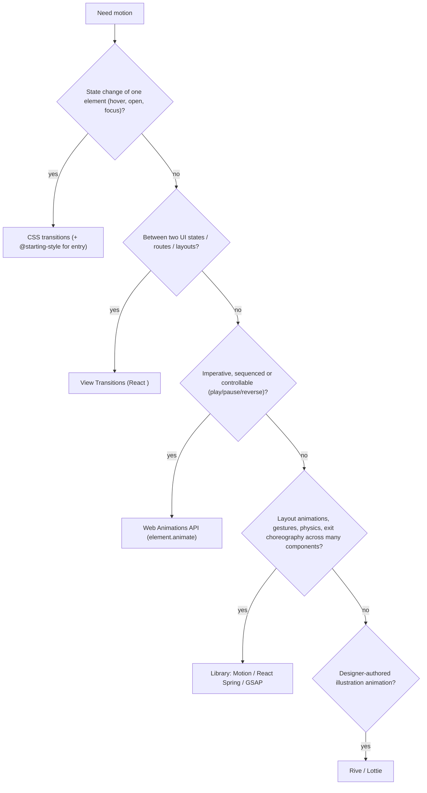

# 24 — Animation and Motion Systems

> Motion is a design system concern with a performance budget and an accessibility contract. Good motion explains change. Bad motion delays users, drops frames and makes some people physically ill.

**Prerequisites:** [02](02-browser-rendering-pipeline.md), [15](15-concurrent-react-suspense-and-transitions.md) · **Related:** [07 Modern CSS](07-modern-css-and-layout-architecture.md) · [35 Design Systems](35-enterprise-design-system-architecture.md) · [36 Accessibility](36-accessibility-engineering.md)

---

## TL;DR

- Motion should serve a **purpose**: orientation (where did this come from?), feedback (it worked), continuity (this is the same thing, moved), or focus (look here). Decoration comes last.
- **Animate `transform` and `opacity`.** They can run on the compositor without layout or paint. Animating `width`, `height`, `top` or `left` costs layout on every frame ([02](02-browser-rendering-pipeline.md)).
- **Respect `prefers-reduced-motion` globally.** Replace movement with fades or nothing, and provide pause controls for anything that moves automatically for more than 5 seconds (WCAG 2.2.2).
- The **tool ladder**: CSS transitions (with `@starting-style`) → Web Animations API → **View Transitions** (React's `<ViewTransition>`, stable in 19.3) → a library (Motion, React Spring, GSAP) for layout, gesture or physics-heavy work.
- **Exit animations** are the hard part in React, because unmounting removes DOM immediately. Use `<ViewTransition>` exits, Motion's `AnimatePresence`, or CSS `allow-discrete` transitions for popovers and dialogs.
- Never drive animations by **calling `setState` every frame**. Use CSS, the Web Animations API, refs or CSS variables.
- Put **motion tokens** (durations, easings, distances) in the design system, with reduced-motion variants.

---

## 1. Motion principles for product UI

| Principle | Guidance |
|---|---|
| Purpose first | Every animation answers "what changed, and where did it go?" |
| Fast | Micro-interactions 100–200 ms; panels and page transitions 200–350 ms; rarely more than 500 ms |
| Interruptible | Users can act mid-animation. Animations must be cancellable and reversible |
| Consistent | Durations, easings and directions come from tokens, not ad-hoc values |
| Spatially coherent | Things that enter from the right exit to the right; hierarchy moves along a consistent axis |
| Accessible | Reduced-motion alternatives; no flashing (WCAG 2.3.1: three flashes per second maximum); pause controls for autoplay |
| Performant | Compositor-only properties; no frame drops on mid-tier devices |

### Motion tokens

```css
@layer tokens {
  :root {
    --motion-duration-instant: 80ms;
    --motion-duration-fast: 150ms;
    --motion-duration-base: 220ms;
    --motion-duration-slow: 320ms;
    --motion-ease-standard: cubic-bezier(0.2, 0, 0, 1);
    --motion-ease-enter: cubic-bezier(0, 0, 0, 1);
    --motion-ease-exit: cubic-bezier(0.3, 0, 1, 1);
    --motion-distance-sm: 4px;
    --motion-distance-md: 16px;
  }
  @media (prefers-reduced-motion: reduce) {
    :root {
      --motion-duration-fast: 0ms;
      --motion-duration-base: 0ms;
      --motion-duration-slow: 0ms;
      --motion-distance-sm: 0px;
      --motion-distance-md: 0px;
    }
  }
}
```

---

## 2. The tool ladder



| Tool | Strengths | Limits |
|---|---|---|
| **CSS transitions and animations** | Zero JS; compositor-friendly; `@starting-style` and `allow-discrete` handle entry and `display`/popover exits | Limited choreography; no physics |
| **Web Animations API** | Imperative control (`play`, `pause`, `reverse`, `finished` promise); runs off the main thread for compositor properties | Verbose for complex sequences |
| **View Transitions** | Animates *between DOM states*, including layout changes and shared elements, almost for free | Snapshot-based (static during the transition); browser support varies; transition-driven updates only in React |
| **Motion** (formerly Framer Motion, `motion/react`) | Layout animations, `AnimatePresence` exits, gestures, springs; added a `ViewTransition` wrapper in 2026 | Adds JS; must be used in Client Components |
| **React Spring** | Physics-based, interruptible animations | API learning curve |
| **GSAP** | Powerful timelines, scroll animations, SVG | Imperative; large feature surface |
| **Rive / Lottie** | Designer-authored vector animation | Asset size; accessibility (provide alternatives) |

---

## 3. CSS-first patterns

```css
/* Entry animation without JS: element animates from @starting-style when it appears */
.toast {
  transition: opacity var(--motion-duration-base) var(--motion-ease-enter),
              transform var(--motion-duration-base) var(--motion-ease-enter);
}
@starting-style {
  .toast { opacity: 0; transform: translateY(var(--motion-distance-md)); }
}

/* Dialog enter and exit, including display/overlay (allow-discrete) */
dialog {
  opacity: 1; transform: scale(1);
  transition: opacity var(--motion-duration-fast), transform var(--motion-duration-fast),
              overlay var(--motion-duration-fast) allow-discrete, display var(--motion-duration-fast) allow-discrete;
}
dialog:not([open]) { opacity: 0; transform: scale(0.97); }
@starting-style { dialog[open] { opacity: 0; transform: scale(0.97); } }
```

Accordion height without measuring, using grid tracks:

```css
.accordion-panel { display: grid; grid-template-rows: 0fr; transition: grid-template-rows var(--motion-duration-base) var(--motion-ease-standard); }
.accordion-panel[data-state='open'] { grid-template-rows: 1fr; }
.accordion-panel > .inner { overflow: hidden; }
```

---

## 4. View Transitions in React

```tsx
// Route-level transitions: frameworks run navigations in transitions,
// so wrapping page content enables enter/exit/shared-element animation
export function PageTransition({ children, routeKey }: { children: React.ReactNode; routeKey: string }) {
  return (
    <ViewTransition key={routeKey} enter="page-enter" exit="page-exit" default="none">
      {children}
    </ViewTransition>
  );
}
```

```css
::view-transition-new(.page-enter) { animation: var(--motion-duration-base) var(--motion-ease-enter) both fade-up; }
::view-transition-old(.page-exit) { animation: var(--motion-duration-fast) var(--motion-ease-exit) both fade-out; }
@keyframes fade-up { from { opacity: 0; transform: translateY(var(--motion-distance-md)); } }
@keyframes fade-out { to { opacity: 0; } }
```

- Only **transitions, Suspense reveals and `useDeferredValue` updates** animate. Urgent updates are instant by design ([15](15-concurrent-react-suspense-and-transitions.md)).
- Shared-element transitions: the same `name` on the list thumbnail and the detail hero.
- Direction-aware animation via `addTransitionType('forward' | 'back')` and the class maps on `enter`/`exit`.
- In browsers without the View Transition API, updates simply apply with no animation, which is a graceful default.

---

## 5. Exit animations

| Approach | How | Use |
|---|---|---|
| `<ViewTransition>` exit | The removed boundary animates out of its snapshot | Transition-driven removals (list filtering, route changes) |
| Motion `AnimatePresence` | Keeps exiting children mounted until their `exit` animation finishes | Toasts, list items, modals with complex choreography |
| CSS `allow-discrete` | Transitions `display`/`overlay` to keep elements visible during exit | Native `<dialog>` and `popover` |
| "Stay mounted, then unmount" | Local state delays removal until `animationend` | Simple cases without a library |

```tsx
import { AnimatePresence, motion } from 'motion/react';

function Toasts({ toasts }: { toasts: Toast[] }) {
  const reduce = usePrefersReducedMotion();
  return (
    <ol aria-live="polite">
      <AnimatePresence initial={false}>
        {toasts.map((t) => (
          <motion.li
            key={t.id}
            layout                                     // FLIP layout animation when siblings change
            initial={{ opacity: 0, y: reduce ? 0 : 16 }}
            animate={{ opacity: 1, y: 0 }}
            exit={{ opacity: 0, y: reduce ? 0 : -8 }}
            transition={{ duration: reduce ? 0 : 0.18 }}
          >
            {t.message}
          </motion.li>
        ))}
      </AnimatePresence>
    </ol>
  );
}
```

---

## 6. FLIP: layout animation from first principles

**F**irst (measure) → **L**ast (apply the change, measure again) → **I**nvert (transform the element back to where it was) → **P**lay (animate the transform to zero).

```tsx
function useFlip<T extends HTMLElement>(deps: unknown[]) {
  const ref = useRef<T>(null);
  const last = useRef<DOMRect | null>(null);

  useLayoutEffect(() => {
    const el = ref.current;
    if (!el) return;
    const next = el.getBoundingClientRect();             // Last
    const prev = last.current;                           // First (from the previous commit)
    last.current = next;
    if (!prev || matchMedia('(prefers-reduced-motion: reduce)').matches) return;
    const dx = prev.left - next.left, dy = prev.top - next.top;
    if (dx || dy) {
      el.animate(                                        // Invert + Play, on the compositor
        [{ transform: `translate(${dx}px, ${dy}px)` }, { transform: 'translate(0, 0)' }],
        { duration: 220, easing: 'cubic-bezier(0.2, 0, 0, 1)' },
      );
    }
  }, deps); // eslint-disable-line react-hooks/exhaustive-deps -- intentionally re-measure on these deps
  return ref;
}
```

Today, View Transitions and Motion's `layout` prop do FLIP for you. Knowing the technique explains why layout animations can be cheap (they only animate transforms).

---

## 7. Gestures and scroll-driven motion

```css
/* Scroll progress bar with no JS */
.progress { transform-origin: 0 50%; animation: grow linear both; animation-timeline: scroll(root); }
@keyframes grow { from { transform: scaleX(0); } to { transform: scaleX(1); } }

/* Reveal on scroll */
.reveal { animation: fade-up linear both; animation-timeline: view(); animation-range: entry 0% cover 30%; }
```

- **Scroll-driven animations** run on the compositor in Chromium and Safari. Use IntersectionObserver fallbacks where needed.
- **Gestures** (drag, swipe, pinch): use Pointer Events with `touch-action` set appropriately, so you don't block scrolling. Libraries (Motion, use-gesture) handle velocity and inertia.
- Gesture-driven React transitions (`unstable_startGestureTransition`) are **experimental** ([A4](A4-experimental-and-canary-apis.md)).

---

## 8. Performance rules

| Rule | Why |
|---|---|
| Animate `transform` and `opacity` | Compositor-only, so they don't block on the main thread |
| Don't `setState` per frame | Each frame re-renders React, so animations become main-thread-bound. Use CSS, the Web Animations API, refs or CSS variables |
| `will-change` only during an animation | GPU memory ([02](02-browser-rendering-pipeline.md)) |
| Avoid animating `box-shadow`, `filter: blur` and large `clip-path`s on big surfaces | Expensive paints. Animate the opacity of a pre-rendered shadow layer instead |
| Keep animated layers few | Layer explosion on low-end devices |
| Profile with CPU throttling | Check for dropped frames in the Performance panel; use the DevTools Animations panel to inspect timings |
| Respect 120 Hz | Half the frame budget (8.3 ms) |

```tsx
// ✅ Pointer-following highlight without re-rendering: a CSS variable updated via a ref
function Spotlight() {
  const ref = useRef<HTMLDivElement>(null);
  return (
    <div
      ref={ref}
      className="spotlight"
      onPointerMove={(e) => {
        const r = e.currentTarget.getBoundingClientRect();
        ref.current!.style.setProperty('--x', `${e.clientX - r.left}px`);
        ref.current!.style.setProperty('--y', `${e.clientY - r.top}px`);
      }}
    />
  );
}
```

---

## 9. Accessibility contract for motion

```ts
// Shared hook for logic that needs the preference (CSS handles most cases)
const query = '(prefers-reduced-motion: reduce)';
export function usePrefersReducedMotion() {
  return useSyncExternalStore(
    (cb) => { const m = matchMedia(query); m.addEventListener('change', cb); return () => m.removeEventListener('change', cb); },
    () => matchMedia(query).matches,
    () => false,
  );
}
```

| Requirement | Source |
|---|---|
| Content that moves, blinks or scrolls automatically for more than 5 s must have pause, stop or hide | WCAG 2.2.2 (A) |
| No more than three flashes per second | WCAG 2.3.1 (A) |
| Motion triggered by interaction can be disabled | WCAG 2.3.3 (AAA): treat it as a product requirement |
| Reduced-motion users get equivalent information | Replace movement with fades or instant changes; don't remove feedback |
| Screen-reader users get state changes, not choreography | `aria-live` for status, focus management for new content ([36](36-accessibility-engineering.md)) |

---

## Decision framework

| Scenario | Choice |
|---|---|
| Hover, focus, press feedback | CSS transitions with tokens |
| Dialog, popover, toast entry and exit | CSS `@starting-style` + `allow-discrete`, or Motion for complex stacks |
| Route and page transitions, shared elements | `<ViewTransition>` with transition types |
| List reorder or filter animations | `<ViewTransition>` (transition-driven) or Motion `layout` |
| Drag, swipe, physics | Motion or React Spring with Pointer Events |
| Scroll-linked effects | CSS scroll-driven animations with fallback |
| Marketing hero sequences | GSAP or Rive, lazy-loaded, with reduced-motion alternatives |

**Failure modes:** janky animations on low-end devices, animations that block input, missing reduced-motion support, inconsistent ad-hoc durations, and libraries pulled into Server Component trees (forcing client boundaries).

---

## Pitfalls and anti-patterns

- `setState` in `requestAnimationFrame` loops for visual motion.
- Animating layout properties or giant blurred shadows.
- Long, non-interruptible transitions that delay interaction.
- Exit animations that keep invisible elements focusable or clickable.
- Skeleton shimmer and parallax ignoring reduced motion.
- `view-transition-name` collisions (names must be unique per snapshot).

---

## Architect's checklist

- [ ] Motion tokens (durations, easings, distances) in the design system, with reduced-motion variants
- [ ] Global reduced-motion handling, plus a manual "reduce motion" user setting where the brand uses heavy motion
- [ ] Approved tool ladder documented (CSS → WAAPI → View Transitions → library)
- [ ] Animation library usage confined to client leaves; bundle impact tracked
- [ ] Frame-rate checks for key animations on throttled CPUs
- [ ] Autoplaying content has pause controls

---

## Interview angles

**Q1. How do you animate a list item's removal in React?**
Removal unmounts DOM immediately, so you need something that keeps it around. Make the removal a transition and wrap items in `<ViewTransition>` so the exit animates from a snapshot, or use Motion's `AnimatePresence` with an `exit` variant, which keeps the element mounted until the animation finishes. Remaining items reflow with a layout (FLIP) animation. Respect reduced motion, and make sure the exiting item is no longer focusable.

**Q2. Why are `transform`/`opacity` animations smoother than `top`/`left`?**
They don't affect layout. The browser can animate an already-rasterised layer on the compositor thread without re-running style, layout and paint on the main thread each frame, so the animation stays smooth even when JavaScript is busy.

**Q3. Explain FLIP.**
First: measure the element's position. Last: apply the DOM change and measure again. Invert: apply a transform that puts the element visually back at its first position. Play: animate that transform to zero. Expensive layout happens once, and the animation itself only changes `transform`. View Transitions and layout-animation libraries automate this.

**Q4. How do you make an animated product accessible?**
Use motion tokens that collapse to zero, or to fades, under `prefers-reduced-motion`, and offer an in-app reduce-motion setting. Provide pause controls for autoplaying content. Avoid flashing. Announce state changes with live regions, manage focus for new content, and make sure exiting elements aren't interactive. Motion should carry no information that isn't also available without it.

---

## Further reading

- MDN, *Using CSS transitions*, *`@starting-style`*, *Web Animations API*, *Scroll-driven animations*: <https://developer.mozilla.org/en-US/docs/Web/CSS>
- React docs, *`<ViewTransition>`*: <https://react.dev/reference/react/ViewTransition>
- Motion for React: <https://motion.dev>
- Paul Lewis, *FLIP Your Animations*: <https://aerotwist.com/blog/flip-your-animations/>
- WCAG 2.2, *Understanding 2.2.2 Pause, Stop, Hide* and *2.3.3 Animation from Interactions*: <https://www.w3.org/WAI/WCAG22/Understanding/>
- web.dev, *How to create high-performance CSS animations*: <https://web.dev/articles/animations-guide>

---

[← Previous: 23 — Styling Architecture and Theming](23-styling-architecture-and-theming.md) · [Index](README.md) · [Next: 25 — Complex UI Engineering →](25-complex-ui-engineering.md)
