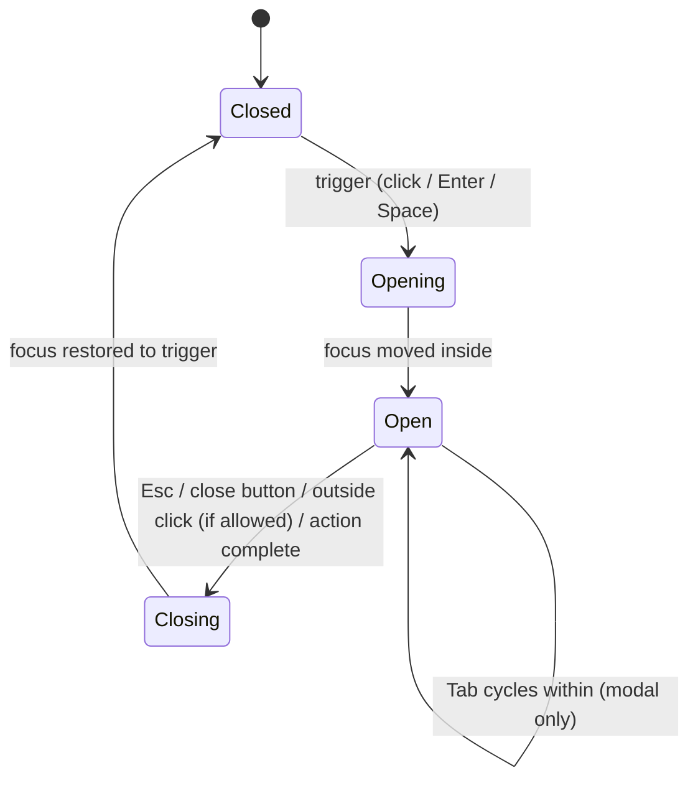
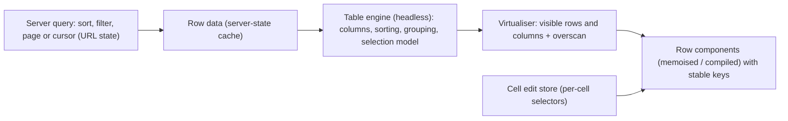
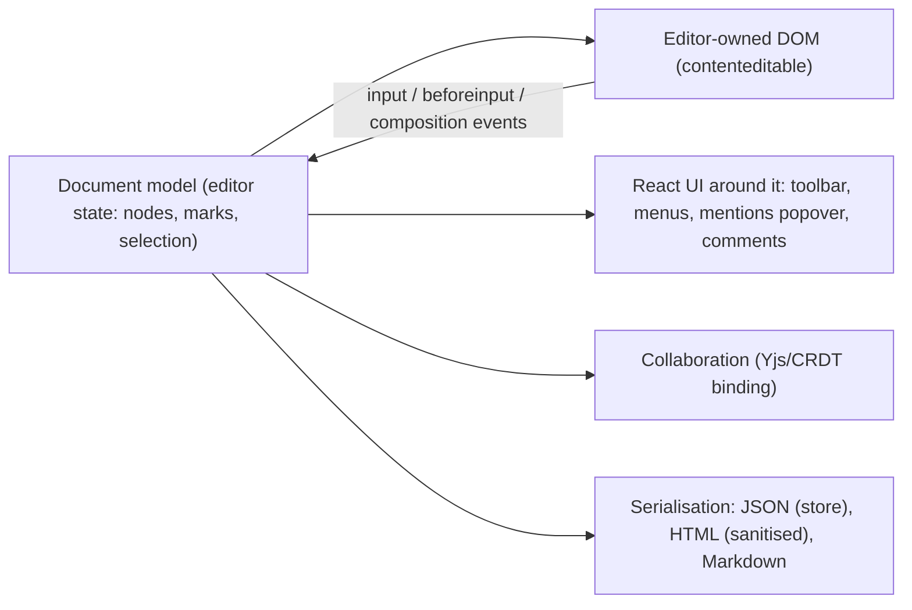

# 25 — Complex UI Engineering: Overlays, Menus, Grids, Trees, Editors, Drag-and-Drop and Canvas

> Simple components are about props. Complex components are about **interaction contracts**: focus, keyboard, pointer, screen readers, scrolling and data scale. These are the widgets where architecture decisions show up as bugs, and where buying (or building on) a proven core beats heroics.

**Prerequisites:** [14](14-refs-dom-portals-and-imperative-apis.md), [22](22-component-architecture-and-patterns.md) · **Related:** [36 Accessibility](36-accessibility-engineering.md) · [38 React Performance](38-react-performance-engineering.md) · [34 Collaboration](34-realtime-offline-and-collaboration.md)

---

## TL;DR

- **Overlays:** use the **top layer** (`<dialog>`, `popover`) and **anchor positioning** first. Define focus rules (initial focus, trap, restore), dismissal rules (`Esc`, outside click, light dismiss) and nesting rules once, in the design system.
- **Composite widgets** (menus, listboxes, comboboxes, tabs, grids, trees) follow the **WAI-ARIA Authoring Practices (APG)** keyboard models. Use roving `tabIndex` or `aria-activedescendant`, never "every item is a tab stop".
- **Data grids:** semantic `<table>` for read-only data. ARIA `grid` only when cells are interactive. A headless table engine (TanStack Table) plus virtualisation (TanStack Virtual), or a commercial grid (AG Grid) for spreadsheet-class needs. Server-side sort, filter and pagination beyond ~10k rows.
- **Virtualisation** trades memory and DOM cost for complexity: variable heights, scroll anchoring, find-in-page and a11y. Try `content-visibility` first for moderate lists.
- **Rich text:** never hand-roll `contenteditable`. Use Lexical, Tiptap/ProseMirror or Slate/Plate. The editor owns its DOM, and React renders around it.
- **Drag-and-drop** must have a **non-drag alternative** (WCAG 2.5.7), keyboard support and live announcements. Use dnd-kit or Pragmatic drag and drop, and persist order with fractional indexing.
- **Canvas/WebGL** when the DOM can't scale (huge charts, maps, design tools), but plan accessibility (DOM mirrors, live regions) and HiDPI from day one.

---

## 1. Overlay architecture

### 1.1 The overlay contract

| Concern | Decision to standardise |
|---|---|
| Layering | Top layer (`showModal()`, `popover`) by default; a z-index token scale only for legacy |
| Positioning | CSS anchor positioning with fallbacks (`position-try-fallbacks`), or Floating UI where unsupported |
| Initial focus | First focusable element, a designated element (`autofocus`), or the dialog itself for long content |
| Focus trap | Modal: trapped (native with `showModal()`). Non-modal popovers: not trapped |
| Focus restore | Back to the invoking element on close |
| Dismissal | `Esc` always; outside click for non-critical overlays; **never** for destructive confirmations with unsaved input |
| Scroll locking | Modal: lock background scroll (`html:has(dialog[open]:modal) { overflow: hidden }`) and avoid layout shift from the scrollbar (`scrollbar-gutter: stable`) |
| Nesting | Menus inside dialogs, popovers inside popovers (`popover` supports nested stacks via the invoker relationship) |
| Mobile | Bottom-sheet variants; handle the virtual keyboard (`VisualViewport`, `interactive-widget=resizes-content` in the viewport meta) |
| Semantics | `role="dialog"`/`alertdialog`, `aria-modal`, `aria-labelledby`; `aria-haspopup`/`aria-expanded` on triggers |



### 1.2 A design-system Dialog on the native element

```tsx
export function Dialog({ open, onOpenChange, title, children }: {
  open: boolean; onOpenChange: (open: boolean) => void; title: string; children: React.ReactNode;
}) {
  const ref = useRef<HTMLDialogElement>(null);
  const titleId = useId();

  useEffect(() => {
    const dialog = ref.current!;
    if (open && !dialog.open) dialog.showModal();   // top layer + focus trap + inert background
    if (!open && dialog.open) dialog.close();       // native focus restoration to the invoker
  }, [open]);

  return (
    <dialog
      ref={ref}
      aria-labelledby={titleId}
      onCancel={(e) => { e.preventDefault(); onOpenChange(false); }}  // Esc → controlled close
      onClose={() => onOpenChange(false)}
    >
      <h2 id={titleId}>{title}</h2>
      {children}
    </dialog>
  );
}
```

---

## 2. Composite widgets and keyboard models

### 2.1 Two focus strategies

| Strategy | How | Use |
|---|---|---|
| **Roving `tabIndex`** | One item `tabIndex=0`, the rest `-1`. Arrow keys move real DOM focus | Toolbars, tabs, radio groups, trees, grids |
| **`aria-activedescendant`** | Focus stays on the container or input. `aria-activedescendant` points at the active item's ID | Comboboxes (focus must stay in the input), large virtualised listboxes |

### 2.2 Keyboard maps you should know cold (APG)

| Widget | Keys |
|---|---|
| **Menu button + menu** | `Enter`/`Space`/`↓` open; `↑`/`↓` move; `Home`/`End`; typeahead letters; `Esc` closes and returns focus; `→`/`←` open and close submenus |
| **Listbox** | `↑`/`↓`; `Home`/`End`; `Space` toggles (multi-select); `Shift+↑/↓` extends selection; typeahead |
| **Combobox** | Type to filter; `↓` opens and moves; `Enter` selects; `Esc` closes (then clears); `Alt+↓` opens without moving |
| **Tabs** | `←`/`→` (or `↑`/`↓` when vertical); `Home`/`End`; automatic or manual activation |
| **Tree** | `↑`/`↓` move; `→` expands or moves to the first child; `←` collapses or moves to the parent; `*` expands siblings; typeahead |
| **Grid** | Arrows move between cells; `Home`/`End` within the row; `Ctrl+Home`/`Ctrl+End` to the first/last cell; `PageUp`/`PageDown`; `Enter`/`F2` to edit a cell |

> [!IMPORTANT]
> These keyboard models are **contracts users rely on** (especially screen-reader and keyboard users), not suggestions. Build them once on a headless library (React Aria, Radix, Base UI, Ark UI) and test them with automated keyboard tests plus real screen readers ([36](36-accessibility-engineering.md)).

### 2.3 Submenus and hover intent

Mouse users move diagonally toward submenus. Naïve hover logic closes the submenu as the pointer crosses a sibling item. Use a **"safe triangle"** (hover intent between the pointer position and the submenu edges) or small delays. Headless libraries implement this for you.

---

## 3. Data grids and tables

### 3.1 Choose the right semantics

| Need | Semantics |
|---|---|
| Read-only data, sorting via header buttons | `<table>` with `<th scope="col">`, `aria-sort` on the sorted header |
| Interactive cells (editing, cell-level navigation, selection) | ARIA `grid` (`role="grid"`, `row`, `gridcell`), with full keyboard support |
| Spreadsheet-class (formulas, fill handles, pivoting) | A commercial grid (e.g., AG Grid) or a canvas-based grid |

### 3.2 Architecture of a large grid



| Scale | Strategy |
|---|---|
| < 1k rows | Render everything; client-side sort and filter |
| 1k–100k rows | Virtualise rows (and columns if wide). Client-side operations **in a worker** above ~20k rows |
| > 100k rows or unbounded | **Server-side** sorting, filtering and pagination (cursor-based); virtualise the viewport; prefetch neighbouring pages |

```tsx
import { useReactTable, getCoreRowModel, flexRender, type ColumnDef } from '@tanstack/react-table';
import { useVirtualizer } from '@tanstack/react-virtual';

function OrdersGrid({ rows, columns }: { rows: Order[]; columns: ColumnDef<Order>[] }) {
  const table = useReactTable({ data: rows, columns, getCoreRowModel: getCoreRowModel() });
  const parentRef = useRef<HTMLDivElement>(null);
  const model = table.getRowModel().rows;
  const virtualizer = useVirtualizer({
    count: model.length,
    getScrollElement: () => parentRef.current,
    estimateSize: () => 40,
    overscan: 10,
  });

  return (
    <div ref={parentRef} style={{ blockSize: 600, overflow: 'auto' }}>
      <table aria-rowcount={model.length + 1}>
        <thead style={{ position: 'sticky', top: 0 }}>{/* headers… */}</thead>
        <tbody style={{ position: 'relative', blockSize: virtualizer.getTotalSize() }}>
          {virtualizer.getVirtualItems().map((v) => {
            const row = model[v.index];
            return (
              <tr key={row.id} aria-rowindex={v.index + 2} style={{ position: 'absolute', transform: `translateY(${v.start}px)` }}>
                {row.getVisibleCells().map((cell) => <td key={cell.id}>{flexRender(cell.column.columnDef.cell, cell.getContext())}</td>)}
              </tr>
            );
          })}
        </tbody>
      </table>
    </div>
  );
}
```

Performance rules for grids:

- **Stable row keys** (domain IDs), and memoised or compiled row components.
- **Edit state per cell** in a store with selectors, so typing in one cell doesn't re-render the grid ([29](29-client-state-management.md)).
- **Column definitions memoised**. Recreating columns every render resets internal state in many engines.
- `aria-rowcount`/`aria-rowindex` keep screen readers oriented in virtualised grids.
- Note: the React Compiler's `incompatible-library` lint flags some table-engine APIs that rely on mutation. Isolate them in small wrapper components ([16](16-react-19-features-and-the-compiler.md)).

---

## 4. Virtualisation in depth

| Concern | Detail |
|---|---|
| Fixed vs variable heights | Fixed is trivial. Variable needs measurement (ResizeObserver) plus estimated sizes, and corrections cause scroll jumps unless anchored |
| Overscan | Render extra items beyond the viewport to avoid blank flashes during fast scrolls |
| Scroll anchoring | When items above the viewport change size, adjust `scrollTop` to keep the visible item steady |
| Sticky items | Group headers need special handling (most libraries support them) |
| Find-in-page | Unrendered items can't be found with Ctrl+F. Provide in-app search |
| Accessibility | Screen readers only see rendered rows: use `aria-setsize`/`aria-posinset` or `aria-rowcount`/`aria-rowindex` |
| Restoring scroll on back navigation | Store the offset and index in router state |
| Alternative | `content-visibility: auto` keeps DOM but skips rendering work. Simpler, accessible, and enough for lists of hundreds to low thousands ([02](02-browser-rendering-pipeline.md)) |

---

## 5. Tree views

```tsx
// Flatten the visible tree for rendering and virtualisation; keep normalised data underneath
type Node = { id: string; parentId: string | null; label: string; hasChildren: boolean };
function flattenVisible(nodes: Map<string, Node[]>, expanded: Set<string>, parentId: string | null = null, level = 1): FlatNode[] {
  return (nodes.get(parentId ?? 'root') ?? []).flatMap((n, i, siblings) => [
    { ...n, level, posInSet: i + 1, setSize: siblings.length },
    ...(expanded.has(n.id) ? flattenVisible(nodes, expanded, n.id, level + 1) : []),
  ]);
}
```

| Concern | Guidance |
|---|---|
| Semantics | `role="tree"` / `treeitem` / `group`, plus `aria-expanded`, `aria-level`, `aria-setsize`, `aria-posinset`, `aria-selected` or `aria-checked` |
| Data model | Normalised (`byId`, `childrenIds`). Flatten the visible nodes for rendering |
| Lazy children | Load on expand. Show a loading treeitem. Cache via server state |
| Selection | Single, multi, or checkbox tri-state (parent `mixed` when partially selected) |
| Large trees | Virtualise the flattened list |
| Drag to reparent | Validate cycles (you can't drop a node into its own descendant), auto-expand on hover, keyboard "move to" alternative |

---

## 6. Rich text editors



| Library | Model | Notes |
|---|---|---|
| **Lexical** (Meta) | Immutable editor state, nodes | React-friendly, extensible, strong performance |
| **Tiptap** (ProseMirror) | Schema-driven document | Huge extension ecosystem; mature collaboration support |
| **Slate / Plate** | React-centric, JSON tree | Flexible; Plate adds batteries |

Rules:

- **Never build on raw `contenteditable`.** Selection, IME composition, undo, paste and browser quirks will consume your roadmap.
- **The editor owns its DOM.** React renders toolbars and popovers *around* it, or renders node views through the library's integration points.
- **Sanitise pasted and imported HTML** against an allowlist schema. Store structured JSON, not HTML ([43](43-frontend-security-architecture.md)).
- **IME and composition** (CJK and other input methods) must be tested explicitly.
- **Collaboration**: bind the editor model to a CRDT (Yjs bindings exist for all three) ([34](34-realtime-offline-and-collaboration.md)).
- **Performance:** large documents need incremental rendering. Avoid re-rendering React trees on every keystroke.

---

## 7. Drag-and-drop

| Approach | Pros | Cons |
|---|---|---|
| Native HTML5 DnD | Cross-window and file drops; no library | Poor touch support, limited styling, weak a11y |
| **dnd-kit** | Pointer, touch and keyboard sensors; accessible announcements; sortable presets | React-specific |
| **Pragmatic drag and drop** (Atlassian) | Built on native DnD with adapters; small; framework-agnostic | Lower-level |

Requirements checklist:

1. **A non-drag alternative** (WCAG 2.5.7 *Dragging Movements*, AA): "Move up/down" buttons, a "Move to…" menu, or keyboard reordering.
2. **Keyboard dragging**: pick up with `Space`, move with arrows, drop with `Space`, cancel with `Esc`.
3. **Announcements** via a live region: "Picked up task 3 of 8. Moved to position 5. Dropped."
4. **Auto-scroll** near container edges; clear drop indicators.
5. **Optimistic reorder** with server persistence using **fractional indexing** (or LexoRank), so a move writes one row instead of re-indexing everything:

```ts
// Insert between two neighbours without renumbering the list
const rank = generateKeyBetween(prev?.rank ?? null, next?.rank ?? null); // e.g., fractional-indexing library
await api.moveTask(taskId, { columnId, rank });
```

---

## 8. Canvas, WebGL and WebGPU

| Use the DOM when… | Use canvas or WebGL when… |
|---|---|
| Hundreds to a few thousand interactive elements | Tens of thousands of points or shapes (charts, maps, CAD, design tools) |
| Text-heavy, selectable, accessible content | Pixel-level effects, custom rendering, 3D |
| Native form controls are needed | Frame-rate-critical interactions (pan, zoom) |

Architecture notes:

- **HiDPI:** size the backing store as `cssSize × devicePixelRatio`, then scale the context.
- **Workers:** `OffscreenCanvas` renders off the main thread ([06](06-modern-web-platform-apis.md)).
- **Hit testing:** spatial indexes (quadtrees, R-trees), or colour-picking buffers.
- **Accessibility:** canvas is a black box to assistive technology. Provide a **DOM mirror** (a hidden table of the chart's data, focusable shapes as overlay buttons), keyboard navigation, and live-region announcements.
- **React integration:** an imperative wrapper component ([14](14-refs-dom-portals-and-imperative-apis.md)) or a custom renderer (react-three-fiber is React for Three.js scenes).

---

## 9. Large forms

- **Field-level subscriptions** (React Hook Form, TanStack Form) so typing in one field doesn't re-render 200 fields ([26](26-forms-and-validation.md)).
- **Sections and steps** with independent validation; save drafts (autosave with debounce plus `visibilitychange` flush).
- **Dependent fields:** derive visibility and options from watched values with selectors, not effects.
- **Error summaries** at the top on submit, linking to fields, plus inline errors (`aria-describedby`, `aria-invalid`).
- **Virtualising** form fields is almost never right (focus order, find-in-page, autofill). Paginate or section instead.

---

## 10. Keyboard shortcuts and command palettes

| Concern | Guidance |
|---|---|
| Registry | One shortcut registry with scopes (global, page, focused region), conflict detection and a help screen |
| Platform | `Mod` = ⌘ on macOS, Ctrl elsewhere. Display the right glyphs |
| Conflicts | Don't override browser or screen-reader keys. Single-character shortcuts must be remappable or disable-able (WCAG 2.1.4 *Character Key Shortcuts*) |
| Inputs | Ignore shortcuts while typing in editable fields (except explicit editor commands) |
| IME | Ignore during composition (`isComposing`) |
| Discoverability | A command palette (`⌘K`) listing actions with their shortcuts; `aria-keyshortcuts` on controls |

---

## Decision framework: build, compose, or buy?

| Widget | Default |
|---|---|
| Dialog, popover, tooltip | Native elements + design-system wrapper |
| Menu, listbox, combobox, select, tabs | Headless library (React Aria / Radix / Base UI / Ark UI) + your styles |
| Date and time pickers | Headless library with i18n (React Aria's date components handle calendars and locales) |
| Data grid (moderate) | TanStack Table + TanStack Virtual |
| Data grid (spreadsheet-class) | Commercial grid |
| Tree | Headless tree (React Aria) or a dedicated library; build only if requirements are unusual |
| Rich text | Lexical / Tiptap / Slate |
| Drag-and-drop | dnd-kit or Pragmatic drag and drop |
| Charts | SVG libraries (Recharts, visx) for typical sizes; canvas or WebGL libraries (ECharts, deck.gl) at scale |

**Failure modes:** home-grown widgets that pass visual QA and fail keyboard and screen-reader users, grids that re-render entirely per keystroke, virtualised lists that break back-navigation scroll, editors corrupting content on paste or IME input, and drag-only interactions.

---

## Pitfalls and anti-patterns

- Every menu item or grid cell as a separate tab stop.
- Click-outside handlers that ignore portals and nested overlays.
- `z-index: 99999` arms races (use the top layer).
- Client-side sorting of 200k rows on the main thread.
- Using index as the key in virtualised or reorderable lists.
- `contenteditable` with `dangerouslySetInnerHTML` round-trips.
- Drag-only reordering; no announcements.
- Canvas charts with no data alternative.

---

## Architect's checklist

- [ ] Overlay contract (focus, dismissal, nesting, scroll lock, mobile) implemented once in the design system
- [ ] Composite widgets built on a headless a11y library; APG keyboard maps tested automatically
- [ ] Grid strategy by data scale (client vs worker vs server operations) documented
- [ ] Virtualisation guidelines (when, which library, scroll restoration, a11y attributes)
- [ ] Editor choice ADR, with a sanitisation and storage format decision
- [ ] Every drag interaction has a keyboard and non-drag alternative, plus live announcements
- [ ] Canvas visualisations ship accessible data alternatives
- [ ] Shortcut registry with scopes, remapping and a help surface

---

## Interview angles

**Q1. Design a data grid that handles one million rows.**
Don't load a million rows into the browser. Use server-side sorting, filtering and cursor pagination with the query in URL state, and a server-state cache with prefetching of neighbouring pages. Virtualise rows (and columns if wide) with overscan, keep stable keys and memoised rows, put cell edits in a store with per-cell selectors, and memoise column definitions. Use ARIA grid semantics with `aria-rowcount`/`aria-rowindex` and the full keyboard model. If spreadsheet features are needed, evaluate a commercial or canvas-based grid instead of building one.

**Q2. Build an accessible combobox. What matters most?**
The keyboard model and focus. Focus stays in the input, `aria-activedescendant` points at the highlighted option, and the input has `role="combobox"` with `aria-expanded`, `aria-controls` and `aria-autocomplete`. Options use `role="option"` with `aria-selected`. Arrow keys, `Enter`, `Esc` and `Alt+↓` behave per the APG. Results announce via a polite live region ("5 results"), IME composition doesn't trigger selection, and the list is virtualised for large datasets. In practice, build it on React Aria or a similar headless primitive and test with screen readers.

**Q3. How do you make drag-and-drop accessible?**
Provide a keyboard interaction (pick up, move, drop, cancel), announce each step through a live region, and offer a non-drag alternative such as "Move to…" menus or up/down buttons, as WCAG 2.5.7 requires. Also give clear focus and drop indicators, and auto-scroll. Libraries like dnd-kit include keyboard sensors and announcement hooks.

**Q4. When would you choose canvas over DOM rendering?**
When the element count or interaction rate exceeds what DOM layout can handle: tens of thousands of chart points, maps, design tools, real-time visualisations. The costs are accessibility (you must provide DOM mirrors or alternative data views), text rendering, hit testing and HiDPI handling, so canvas is a deliberate trade-off, not a default.

---

## Further reading

- WAI-ARIA Authoring Practices Guide (patterns: dialog, menu, listbox, combobox, grid, tree): <https://www.w3.org/WAI/ARIA/apg/patterns/>
- React Aria (hooks and components): <https://react-spectrum.adobe.com/react-aria/>
- TanStack Table and TanStack Virtual: <https://tanstack.com>
- Lexical: <https://lexical.dev> · Tiptap: <https://tiptap.dev> · Slate: <https://docs.slatejs.org>
- dnd-kit: <https://dndkit.com> · Pragmatic drag and drop: <https://atlassian.design/components/pragmatic-drag-and-drop>
- WCAG 2.2, *Understanding 2.5.7 Dragging Movements*: <https://www.w3.org/WAI/WCAG22/Understanding/dragging-movements>

---

[← Previous: 24 — Animation and Motion Systems](24-animation-and-motion-systems.md) · [Index](README.md) · [Next: 26 — Forms and Validation Architecture →](26-forms-and-validation.md)
