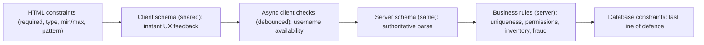
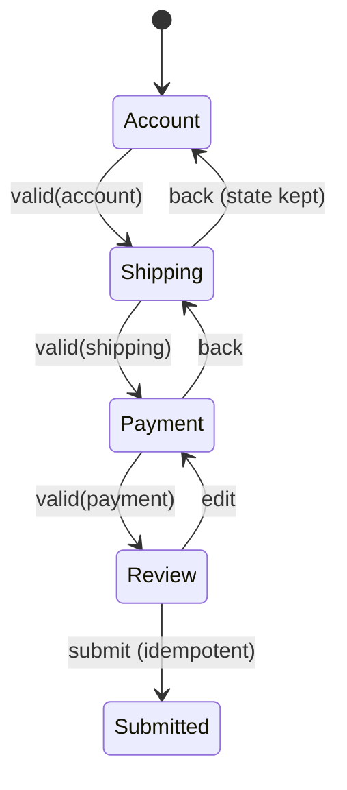

# 26 — Forms and Validation Architecture

> Forms are where users give you their data, their money and their patience. A form architecture answers four questions: who owns the field state, where validation is authoritative, how submission degrades, and how errors reach every user, including those using screen readers.

**Prerequisites:** [09](09-react-fundamentals-complete-reference.md), [16](16-react-19-features-and-the-compiler.md) · **Related:** [18 Server Functions](18-react-server-components-and-server-functions.md) · [36 Accessibility](36-accessibility-engineering.md) · [33 API Contracts](33-api-integration-bff-and-contracts.md)

---

## TL;DR

- **The server is the authority on validation.** Client validation is UX. Share one schema (Zod, Valibot or ArkType, via **Standard Schema**) between client and server, and return field-level errors from the server.
- **React 19 Actions** (`<form action>`, `useActionState`, `useFormStatus`) plus **uncontrolled inputs and `FormData`** cover most forms, including progressive enhancement with Server Functions.
- For large or highly dynamic forms, use a **form library with field-level subscriptions** (React Hook Form, TanStack Form, Conform) so typing doesn't re-render the whole form.
- **Validation timing UX:** validate on blur first, then on change once a field has errored ("reward early, punish late"). On submit, show an **error summary**, focus the first invalid field, and announce the result.
- **Accessible forms:** real `<label>`s, `aria-describedby` for hints and errors, `aria-invalid`, `autocomplete` tokens, `<fieldset>`/`<legend>` for groups, and no paste-blocking or cognitive tests for authentication (WCAG 2.2: 3.3.7, 3.3.8).
- **Double submits, retries and optimistic UI** require **idempotency keys** on the server. Disabling the button isn't enough.

---

## 1. The architecture dimensions

| Dimension | Options |
|---|---|
| Field state ownership | DOM (uncontrolled), React state (controlled), form-library store (subscriptions) |
| Validation | Schema (shared), field-level sync, async (server checks), cross-field; client (UX) vs server (authority) |
| Submission | Form Action / Server Function, API mutation (TanStack Query), native POST |
| Error transport | Field errors map, form-level errors, toast/alert for unexpected failures |
| Degradation | Works without JS? Before hydration? Offline? |
| Persistence | Drafts, autosave, multi-step resume |

---

## 2. Approach 1: native form + Actions + shared schema

```ts
// schemas/signup.ts: shared by client and server
import { z } from 'zod';
export const SignupSchema = z.object({
  email: z.email('Enter a valid email address'),
  password: z.string().min(12, 'Use at least 12 characters'),
  terms: z.literal('on', { error: 'You must accept the terms' }),
});
export type SignupInput = z.infer<typeof SignupSchema>;
export type FieldErrors = Partial<Record<keyof SignupInput | 'form', string[]>>;
```

```ts
// actions/signup.ts
'use server';
import { z } from 'zod';
import { redirect } from 'next/navigation'; // framework-specific (Next.js); other frameworks have equivalents
import { SignupSchema, type FieldErrors } from '@/schemas/signup';

export async function signup(_prev: { errors?: FieldErrors; values?: Record<string, string> }, formData: FormData) {
  const values = Object.fromEntries(formData) as Record<string, string>;
  const parsed = SignupSchema.safeParse(values);
  if (!parsed.success) {
    return { errors: z.flattenError(parsed.error).fieldErrors as FieldErrors, values: { email: values.email ?? '' } };
  }
  const result = await accounts.create(parsed.data);           // authoritative checks (email taken, etc.)
  if (!result.ok) return { errors: { email: ["This email can't be used"] }, values: { email: values.email } };
  redirect('/welcome');
}
```

```tsx
'use client';
export function SignupForm() {
  const [state, formAction] = useActionState(signup, {});
  const errorId = (f: string) => `signup-${f}-error`;
  return (
    <form action={formAction} noValidate aria-describedby={state.errors ? 'form-errors' : undefined}>
      {state.errors && <ErrorSummary id="form-errors" errors={state.errors} />}   {/* focus on appearance */}

      <label htmlFor="email">Email</label>
      <input id="email" name="email" type="email" autoComplete="email" defaultValue={state.values?.email}
        aria-invalid={!!state.errors?.email} aria-describedby={state.errors?.email ? errorId('email') : undefined} />
      {state.errors?.email && <p id={errorId('email')} className="error">{state.errors.email[0]}</p>}

      <label htmlFor="password">Password</label>
      <input id="password" name="password" type="password" autoComplete="new-password" aria-describedby="pw-hint" />
      <p id="pw-hint">At least 12 characters. Passphrases welcome.</p>

      <label><input type="checkbox" name="terms" /> I accept the terms</label>
      <SubmitButton>Create account</SubmitButton>
    </form>
  );
}
```

| Property | Value |
|---|---|
| Works before hydration and without JS | ✅ (Server Function as the form action) |
| Re-renders while typing | None (uncontrolled) |
| Live validation | Add it per field with `onBlur` handlers, or use a library |
| Good for | Sign-up, login, settings, checkout steps, most CRUD |

> [!NOTE]
> After a **successful** Action, React resets uncontrolled fields automatically (19.3 also fires `onReset`). On **failure**, return the submitted values in state and feed them back via `defaultValue`, so users don't lose their input.

---

## 3. Approach 2: a form library with subscriptions

```tsx
import { useForm, useWatch } from 'react-hook-form';
import { standardSchemaResolver } from '@hookform/resolvers/standard-schema';

function ProfileForm({ initial }: { initial: Profile }) {
  const form = useForm<Profile>({
    resolver: standardSchemaResolver(ProfileSchema),   // any Standard Schema (Zod, Valibot, ArkType)
    defaultValues: initial,
    mode: 'onTouched',                                 // validate on blur first, then on change
  });
  const { register, handleSubmit, formState: { errors, isSubmitting }, setError, control } = form;
  const country = useWatch({ control, name: 'country' }); // subscription to one field (prefer it over watch())

  const onSubmit = handleSubmit(async (values) => {
    const res = await saveProfile(values);
    if (!res.ok) Object.entries(res.fieldErrors).forEach(([name, message]) => setError(name as keyof Profile, { message }));
  });

  return (
    <form onSubmit={onSubmit} noValidate>
      <Field label="Display name" error={errors.displayName?.message}>
        {(props) => <input {...props} {...register('displayName')} autoComplete="nickname" />}
      </Field>
      {country === 'US' && (
        <Field label="State" error={errors.state?.message}>
          {(props) => <select {...props} {...register('state')}>{/* … */}</select>}
        </Field>
      )}
      <button disabled={isSubmitting}>Save</button>
    </form>
  );
}
```

| Library | Model | Strengths | Watch out for |
|---|---|---|---|
| **React Hook Form** | Uncontrolled inputs registered via refs; subscription-based state | Mature, fast, huge ecosystem | `watch()` is flagged by the Compiler's `incompatible-library` rule. Prefer `useWatch`/`subscribe` |
| **TanStack Form** | Headless, type-safe store with fine-grained subscriptions; framework-agnostic | Excellent TypeScript inference, Standard Schema validators, async validation built in | Newer, smaller ecosystem |
| **Conform** | Progressive-enhancement-first, built around Server Actions | Server-validated forms without JS | Opinionated around server submission |
| Formik | Controlled, context-based | Common in older codebases | Re-render cost on large forms |

> [!TIP]
> Wrap field rendering in one design-system `Field` component that wires `id`, `<label>`, hint and error `aria-describedby`, and `aria-invalid`. Accessibility then becomes the default instead of a per-form chore ([35](35-enterprise-design-system-architecture.md)).

---

## 4. Validation design

### 4.1 Layers of validation



### 4.2 Timing: "reward early, punish late"

| Moment | Behaviour |
|---|---|
| While first typing in a field | No error |
| On blur | Validate the field; show its error |
| After a field has an error | Re-validate on change, so the error disappears as soon as it's fixed |
| On submit | Validate everything, show a summary, focus the first invalid field (or the summary), announce the count |
| Async checks | Debounce (300–500 ms), abort stale requests, show a pending state ("Checking…") |

### 4.3 Cross-field and conditional rules

```ts
const ShippingSchema = z.object({
  sameAsBilling: z.boolean(),
  shipping: AddressSchema.optional(),
}).superRefine((v, ctx) => {
  if (!v.sameAsBilling && !v.shipping) ctx.addIssue({ code: 'custom', path: ['shipping'], message: 'Enter a shipping address' });
});
```

---

## 5. Accessibility contract for forms

| Requirement | Implementation |
|---|---|
| Every control has an accessible name | `<label htmlFor>` (not placeholder-only) |
| Hints and errors are associated | `aria-describedby` with IDs from `useId` |
| Invalid state is exposed | `aria-invalid="true"` on the control |
| Errors are perceivable on submit | An error summary with links to fields; focus moves to it; or announcements via a live region |
| Groups are labelled | `<fieldset>` + `<legend>` for radio groups and address blocks |
| Input purpose is identifiable | `autocomplete` tokens (`email`, `given-name`, `postal-code`, `one-time-code`, `new-password`) (WCAG 1.3.5) |
| No redundant entry | Prefill or offer "same as billing" for data already provided (WCAG 2.2, 3.3.7) |
| Accessible authentication | Allow paste and password managers; no cognitive puzzles without alternatives (WCAG 2.2, 3.3.8) |
| Required fields are indicated in text | Not colour alone |
| Errors are specific | "Enter a date in the past", not "Invalid input" |
| Status after submit is announced | `role="status"` (polite) or `role="alert"` for errors |

```tsx
function ErrorSummary({ id, errors }: { id: string; errors: Record<string, string[] | undefined> }) {
  const ref = useRef<HTMLDivElement>(null);
  useEffect(() => { ref.current?.focus(); }, [errors]);
  const entries = Object.entries(errors).filter(([, v]) => v?.length);
  return (
    <div id={id} ref={ref} tabIndex={-1} role="alert" className="error-summary">
      <h2>There {entries.length === 1 ? 'is 1 problem' : `are ${entries.length} problems`}</h2>
      <ul>{entries.map(([field, msgs]) => <li key={field}><a href={`#${field}`}>{msgs![0]}</a></li>)}</ul>
    </div>
  );
}
```

---

## 6. Submission semantics: double submits, retries and idempotency

```ts
// Client: one idempotency key per logical submission (kept across retries)
const idempotencyKey = useMemo(() => crypto.randomUUID(), [/* new key per new draft */]);

await fetch('/api/orders', {
  method: 'POST',
  headers: { 'Content-Type': 'application/json', 'Idempotency-Key': idempotencyKey },
  body: JSON.stringify(order),
});
```

| Problem | Client mitigation | Server requirement |
|---|---|---|
| Double click | Disable while pending (`useFormStatus`) | **Idempotency key**: same key returns the same result |
| Network retry after timeout | Retry with the **same** key | Store key → response for a window (e.g., 24 h) |
| Optimistic UI | `useOptimistic` with rollback | Deterministic, idempotent mutation endpoints ([28](28-state-and-data-ownership-architecture.md)) |
| Concurrent edits | Send a version or ETag | `If-Match` / version check → 409/412 conflict response |

---

## 7. Multi-step forms and wizards



- Keep the **current step in the URL** (`?step=shipping`) so back and forward buttons and refresh work ([31](31-routing-architecture.md)).
- Persist **drafts** (server-side for long flows, `sessionStorage` for short ones). Never store payment data client-side.
- Validate **per step** with step schemas, and validate the whole thing again on final submit (server).
- Allow **editing from review** without losing later steps' data.
- Instrument **drop-off per step**.

---

## 8. Dynamic and schema-driven forms

| Scenario | Approach |
|---|---|
| Repeating groups (line items, addresses) | Field arrays (`useFieldArray`) with stable keys (IDs, not indexes) |
| Conditional sections | Subscribe to the controlling field; unregister hidden fields or exclude them in the schema |
| Admin-configurable forms | Schema-driven rendering (JSON Schema or a custom DSL → components), but only when forms are genuinely configured at runtime by non-engineers |
| Product forms built by engineers | Plain JSX. Schema-driven UI frameworks become a slow, inflexible inner platform |

---

## 9. File uploads

| Concern | Guidance |
|---|---|
| Transport | Upload **directly to object storage** with presigned URLs. Don't proxy large files through the app server |
| Large or unreliable networks | Chunked, resumable uploads (e.g., the tus protocol, or multipart uploads) |
| Progress | `fetch` has no upload-progress events. Use XHR `upload.onprogress` or streaming uploads where supported (Angular 22 even split `reportUploadProgress` because Fetch is now its default backend) |
| Validation | Client checks (type, size, dimensions) for UX; **server re-validates** and scans content |
| Previews | `URL.createObjectURL(file)`, and **revoke** it on cleanup |
| Accessibility | A real `<input type="file">` (styled), drag-and-drop as an enhancement, announced progress |

---

## 10. Autosave and drafts

```ts
// features/drafts/use-autosave.ts
import { useEffect, useRef } from 'react';
import { useDebouncedCallback } from 'use-debounce';
import type { Draft } from './types';

// Debounced autosave with conflict detection. Saves run one at a time, each sending the ETag the previous
// one returned: overlapping saves would send the same stale If-Match and conflict with each other.
export function useAutosave(initialEtag: string, onConflict: (server: unknown) => void, onError: (reason: unknown) => void) {
  const etag = useRef(initialEtag);
  const queue = useRef<Promise<void>>(Promise.resolve());
  const save = useDebouncedCallback((draft: Draft) => {
    queue.current = queue.current
      .then(async () => {
        const res = await fetch(`/api/drafts/${draft.id}`, {
          method: 'PUT',
          headers: { 'Content-Type': 'application/json', 'If-Match': etag.current },
          body: JSON.stringify(draft),
        });
        if (res.status === 412) onConflict(await res.json());          // someone else saved: resolve explicitly
        else if (res.ok) etag.current = res.headers.get('ETag') ?? etag.current;
        else onError(res.status);                                        // keep the draft dirty; the next change retries
      })
      .catch(onError);                                                   // network failure: same
  }, 800);

  // Flush pending saves when the page is hidden (tab switch, close)
  useEffect(() => {
    const onHide = () => { if (document.visibilityState === 'hidden') save.flush(); };
    document.addEventListener('visibilitychange', onHide);
    return () => document.removeEventListener('visibilitychange', onHide);
  }, [save]);
  useEffect(() => () => { save.flush(); }, [save]);                     // and when the editor unmounts (in-app navigation)
  return save;
}
```

Two failure modes shaped this hook, and both lose or reject work without an error anyone sees. The first is a conflict with yourself. A debounced save that starts while the previous one is still in flight sends the same `If-Match`, because the new ETag hasn't come back yet, and the server rejects it with 412. Queueing the saves fixes it. The second is the last edit vanishing: the user types and then clicks to another route inside the debounce window. The unmount flush sends that edit. The `visibilitychange` flush covers closing the tab, but the browser may cancel an ordinary fetch as the page unloads. `keepalive: true` lets requests outlive the page, up to 64 KiB in flight in total. For larger drafts, or if losing a few seconds of typing is unacceptable, also keep the draft in IndexedDB and reconcile on the next load.

---

## 11. Security for forms

- **Validate on the server, always.** Client checks can be bypassed with one curl command.
- **CSRF:** Server Actions rely on Origin checks plus `SameSite` cookies. Classic endpoints use tokens or `SameSite`/Origin validation ([43](43-frontend-security-architecture.md)).
- **Account enumeration:** don't reveal whether an email exists ("If an account exists, we've sent a link").
- **Bots:** rate limiting, honeypot fields, and privacy-friendly challenges (e.g., Turnstile) over visual CAPTCHAs, which fail accessibility.
- **Rich input:** sanitise and allowlist ([25](25-complex-ui-engineering.md)).
- **Sensitive fields:** `autocomplete="off"` doesn't stop password managers (and shouldn't). Never log raw form payloads.

---

## Decision framework

| Form type | Recommended approach |
|---|---|
| Login, sign-up, contact, simple settings | Native form + Action/Server Function + shared schema |
| Large forms (50+ fields), dynamic sections, live validation | React Hook Form or TanStack Form + shared schema + server errors mapped back |
| Must work without JS (public or government sites) | Server Function actions (Conform or Actions) with server-rendered errors |
| Spreadsheet-like data entry | Grid editing patterns ([25](25-complex-ui-engineering.md)), not form libraries |
| Runtime-configurable forms | Schema-driven renderer with a constrained component set |

**Failure modes:** client-only validation, lost input on error, inaccessible error messaging, re-render storms on large forms, non-idempotent submissions, and a wizard that loses state on refresh.

---

## Pitfalls and anti-patterns

- Placeholders as labels.
- Showing errors on the first keystroke.
- Two schemas (client and server) that drift apart.
- `onSubmit`-only forms that break before hydration.
- Field arrays keyed by index.
- `watch()`-everything patterns that re-render the whole form (and trip the Compiler).
- Blocking paste in password or confirmation fields.
- Treating a disabled submit button as protection against duplicates.

---

## Architect's checklist

- [ ] One schema per form, shared by client and server (Standard Schema)
- [ ] A design-system `Field` component wiring label, hint, error and ARIA
- [ ] Error summary pattern, plus focus management on submit
- [ ] Idempotency keys for all create and payment mutations
- [ ] Progressive enhancement requirement decided per form (and tested with JS disabled)
- [ ] Form library choice (if any) recorded in an ADR, with Compiler compatibility notes
- [ ] Upload pipeline: presigned direct uploads, server validation and scanning
- [ ] Autosave conflict strategy (ETags or versions)

---

## Interview angles

**Q1. Where should validation live?**
Everywhere, for different reasons. HTML constraints and client schemas give fast feedback. Async client checks catch things like taken usernames early. The server re-parses with the same schema and applies business rules, and it's the authority. The database has constraints as the last line. Sharing one schema between client and server keeps the layers consistent.

**Q2. How do you prevent duplicate orders from a checkout form?**
Generate an idempotency key per logical submission and send it with every attempt, including retries. The server stores key → result and returns the original result for repeats. On the client, disable the submit while pending and show status. Use optimistic UI only with idempotent endpoints. Reconcile on timeouts by checking status with the same key rather than resubmitting blindly.

**Q3. React Hook Form vs React 19 form Actions?**
Actions plus uncontrolled inputs cover most forms with less code and give progressive enhancement through Server Functions. A subscription-based library adds field-level subscriptions for large or highly dynamic forms, rich live validation, field arrays and dirty/touched tracking. They also combine: a library handles client-side state and validation, and submission goes through an Action or Server Function that returns server errors to map back.

**Q4. Make a long form accessible.**
Give every input a real label, associate hints and errors via `aria-describedby`, set `aria-invalid`, group related controls with fieldset and legend, use `autocomplete` tokens, and indicate required fields in text. On submit, show an error summary linking to fields, focus it, and announce it. Validate on blur, then on change. Allow paste and password managers. Save drafts so users can resume. Test with a screen reader and keyboard only.

---

> [!TIP]
> **Runnable code:** [E26](E26-forms-and-validation.md) has `useAutosave`, with tests for queued saves, conflicts, failures and the unmount flush. `node extract-examples.mjs 26` writes it out as a project; then run `npm ci` and `npm test` in it.

## Further reading

- React docs, *`<form>`*, *`useActionState`*, *`useFormStatus`*: <https://react.dev/reference/react-dom/components/form>
- Standard Schema: <https://standardschema.dev> · Zod: <https://zod.dev>
- React Hook Form: <https://react-hook-form.com> · TanStack Form: <https://tanstack.com/form> · Conform: <https://conform.guide>
- GOV.UK Design System, *Error summary* and *Validation* patterns: <https://design-system.service.gov.uk/components/error-summary/>
- WCAG 2.2, *Understanding 3.3.7 Redundant Entry* and *3.3.8 Accessible Authentication (Minimum)*: <https://www.w3.org/WAI/WCAG22/Understanding/>
- Stripe, *Idempotent requests*: <https://docs.stripe.com/api/idempotent_requests>

---

[← Previous: 25 — Complex UI Engineering](25-complex-ui-engineering.md) · [Index](README.md) · [Next: 27 — React Best Practices, Anti-patterns and Code Review Guide →](27-react-best-practices-and-code-review.md)
