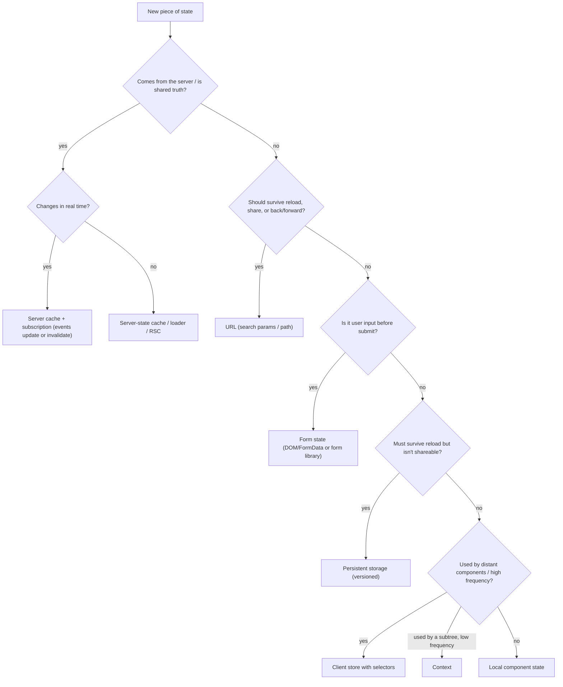
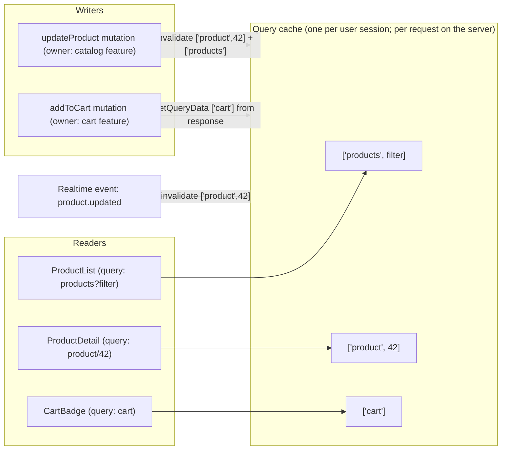
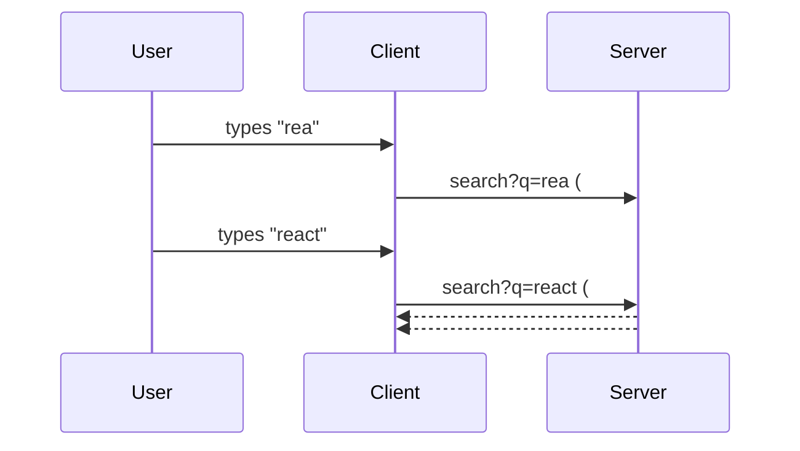
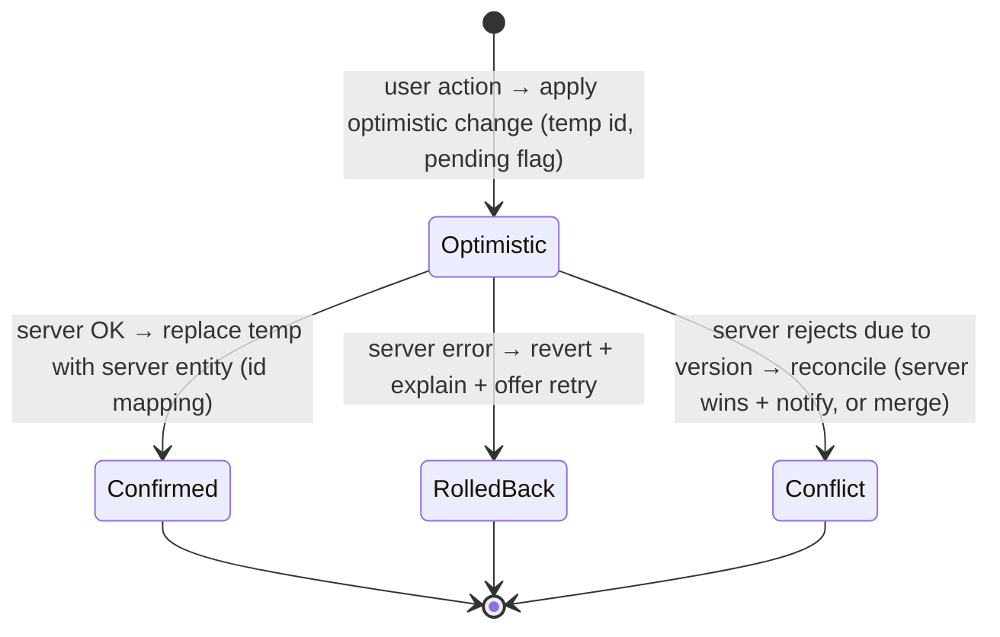

# 28 — State and Data Ownership Architecture

> Most frontend complexity isn't rendering. It's **copies of data**: in the server cache, the store, the URL, the form, local storage and another tab, all slowly disagreeing. State architecture is the discipline of deciding who owns each piece of data, who may copy it, and who is responsible when the copies go stale.

**Prerequisites:** [08](08-react-mental-model-and-rules.md), [12](12-hooks-in-depth.md) · **Related:** [29 Client State](29-client-state-management.md) · [30 Server State](30-server-state-and-data-fetching.md) · [31 Routing](31-routing-architecture.md) · [34 Real-time & Offline](34-realtime-offline-and-collaboration.md)

---

## TL;DR

- Classify every piece of state into one of **eight categories** (component UI, shared client, server, URL, form, optimistic, persistent, real-time). Each category has a natural owner, a natural tool and a different set of failure modes.
- **One source of truth per datum.** Everything else is a **derived view** or an explicitly managed **cache** with an owner and an invalidation rule.
- **Server state is a cache.** It's stale by default, deduplicated, garbage-collected and invalidated by whoever performs the mutation. Don't copy it into a client store by default; when you do so deliberately (an editing draft, an offline-first store), give the copy an owner, a base version and a sync rule.
- **URL state is application state.** Filters, sorting, pagination, tabs and selected entities belong in the URL when they should survive reload, sharing and back/forward.
- Design for **mutation races** (out-of-order responses, concurrent edits, retries) with request sequencing, per-entity mutation queues, version checks (ETag/`If-Match`) and **idempotency keys**.
- **Optimistic updates** need a rollback path, temporary-ID mapping and a conflict policy ("server wins and notify", merge, or CRDT).
- **Persistent client state** needs schema versions, migrations, privacy rules (PII on shared devices) and cleanup on logout.
- **Real-time state** needs ordering (sequence numbers), deduplication, gap detection and resync-on-reconnect.

---

## 1. The state taxonomy

| Category | Examples | Typical owner and tool | Architectural concern |
|---|---|---|---|
| **Component UI state** | Open/closed, hover, active tab (when not shareable), input draft | `useState`, `useReducer` | Keep it local; colocate |
| **Shared client state** | Theme, sidebar collapse, selection across panels, wizard progress, editor tool | Context (low frequency), Zustand/Jotai/Redux (high frequency) | Avoid unnecessary global ownership; selectors |
| **Server state** | Products, orders, user profile, permissions | TanStack Query / SWR / RTK Query, framework loaders, RSC + framework cache | Caching, freshness, deduplication, invalidation |
| **URL state** | Search query, filters, sort, page or cursor, selected ID, step | Router search params and path | Deep linking, history semantics, canonicalisation |
| **Form state** | Field values, touched/dirty, validation errors | DOM + `FormData`, or a form library | Validation, dirty tracking, submission, reset |
| **Optimistic state** | Pending like, temporary cart line, reordered card | `useOptimistic`, the query cache's optimistic updates | Rollback, conflicts, reconciliation |
| **Persistent state** | Preferences, drafts, offline data, recently viewed | `localStorage`, IndexedDB, OPFS | Versioning, migrations, privacy, eviction |
| **Real-time state** | Presence, live prices, chat messages, collaborative document | WebSocket/SSE subscriptions feeding a cache or CRDT | Ordering, reconnection, consistency |



---

## 2. Source-of-truth principles

1. **Every datum has exactly one owner.** Name it in design docs: "the cart is owned by the cart service and cached in the `['cart', userId]` query".
2. **Copies are caches.** Any copy (in a store, in local state, in another tab) must have a refresh or invalidation rule. If it doesn't, it's a bug waiting to happen.
3. **Derive, don't sync.** If B can be computed from A, compute it ([13](13-effects-and-synchronization.md)).
4. **Promote and demote deliberately.** State starts local and gets promoted to URL, store or server only when a requirement demands it. It moves back down when the requirement disappears.
5. **Scope state to its lifetime.** Per component, per route, per session, per user, per tenant, per device. On the server, **per request**.

### What not to duplicate, and when it's deliberate

*Default* rows describe what to do unless you have a specific reason and the safeguards listed; *requirement* rows have no exceptions.

| Don't copy… | …into | Because | Strength | Deliberate exceptions, and their safeguards |
|---|---|---|---|---|
| Server entities | A client store (Redux, Zustand) | Two caches with different freshness; mutations update one and not the other | Default | An **editing draft** (a working copy of a record being edited, stored with the version it started from so conflicts are detected on save) or an **offline-first store** whose local database syncs by explicit rules ([34](34-realtime-offline-and-collaboration.md)). Either way: one owner, a base version, a sync or discard rule |
| URL state | Local `useState` mirrors | Back/forward and shared links diverge from the UI | Default | A text box's in-progress value while typing, committed to the URL on debounce or submit |
| Form drafts | A global store | Leaks between forms; reset bugs; re-render storms | Default | A multi-step flow spanning routes, in a store scoped to that flow and reset when it ends |
| Permissions and entitlements | Long-lived client state without refresh | Revoked access persists ([45](45-authentication-and-authorization.md)) | Requirement for enforcement | Client copies may drive what the UI shows, refreshed on focus and expiry; the server always enforces |
| Auth tokens | JS-readable storage | XSS exfiltration ([43](43-frontend-security-architecture.md)) | Requirement for `localStorage` and `sessionStorage` | Where a BFF isn't possible: short-lived access tokens in memory only |

---

## 3. Server state as a cache: the ownership model



| Question | Answer to standardise |
|---|---|
| Who invalidates? | **The mutation owner** (the feature that performs the write) invalidates the keys it affects. Document the key schema per entity |
| How are keys structured? | Hierarchical: `['product', id]`, `['products', { filter }]`, so you can invalidate by prefix (`['products']`) |
| How fresh is fresh? | `staleTime` per entity type (prices: seconds; catalogue: minutes; user profile: until mutation) |
| How long are entries kept? | GC time (e.g., 5–30 minutes unused); bounded for long sessions |
| What happens on focus, reconnect or mount? | Refetch stale queries (defaults are usually right; tune for expensive queries) |
| How do pushes integrate? | Realtime events **invalidate** (simple, consistent) or **patch** (fast, but you must handle ordering) |
| SSR? | Prefetch on the server, dehydrate, hydrate on the client, so the first client render needs no fetch ([30](30-server-state-and-data-fetching.md)) |

### Query-level caching vs entity normalisation

| | Query-level cache (TanStack Query, SWR, RTK Query) | Normalised entity cache (Apollo Client, Relay, urql's Graphcache) |
|---|---|---|
| Model | Each query key stores its response | Entities stored once by ID; queries reference them |
| Update after mutation | Invalidate or patch the affected queries | Update the entity; every query showing it updates |
| Complexity | Low | Higher (cache policies, key fields, garbage collection) |
| Best for | REST, most apps | GraphQL, heavily cross-referenced data, many views of the same entities |

RTK Query belongs in the first column. It stores each query result independently and deliberately doesn't deduplicate the same entity across requests: three queries that each return to-do 1 cache three copies, kept consistent by tag invalidation, which refetches every endpoint that provides the tag. `createEntityAdapter` in `transformResponse` normalises the data *within one response*; it doesn't share entities between queries. If you need one copy of each entity across many views, that's a normalised cache's job.

---

## 4. Layered caches and coherence

| Layer | Owner | Invalidation | Coherence risk |
|---|---|---|---|
| CDN / edge | Platform | Purge by tag, TTL, SWR | Stale HTML referencing old data |
| Framework cache (`'use cache'`, data cache) | Server team | Tags, `cacheLife` | Server-rendered views stale vs fresh client queries |
| Browser HTTP cache | HTTP headers | `Cache-Control`, ETags | API responses cached unexpectedly |
| Service Worker cache | Frontend platform | SW versioning, strategies | Offline data outliving schema changes |
| Query cache | Feature teams | Keys, `staleTime`, mutations | Duplicated data across keys |
| Client router cache (RSC payloads) | Framework | Navigation refresh, Server Function responses | Old RSC payloads after mutations |
| Persistent storage | Feature teams | Versioning, migrations | Schema drift, PII retention |

> [!IMPORTANT]
> When you add a cache layer, write down **its owner, its TTL and its invalidation trigger**. Most "the UI shows old data" incidents are two layers with different invalidation rules ([18](18-react-server-components-and-server-functions.md), [48](48-nextjs-rendering-and-caching.md)).

---

## 5. Consistency models in the UI

| Model | Meaning | Use for | Implementation |
|---|---|---|---|
| **Read-your-writes** | After I change something, I see my change | Profiles, settings, carts, anything the user just edited | Update the cache from the mutation response; `updateTag` (Next.js); refetch before releasing pending state |
| **Monotonic reads** | I never see data go *backwards* in time | Feeds, counters, order status | Version or timestamp checks; ignore older responses |
| **Eventual consistency** | Everyone converges, eventually | Analytics, likes counts, presence | Background refetch, SWR, realtime invalidation |
| **Strong / transactional** | Server-confirmed before display | Payments, inventory reservation, trades | No optimistic UI; pessimistic flows with clear pending states |

Choose **per feature**, and state the choice in the design. "Likes are eventually consistent; cart is read-your-writes; payments are confirmed-before-display."

---

## 6. Mutation races and how to defeat them

### 6.1 Out-of-order responses



Fixes: **abort** superseded requests (`AbortController`), **key** results by input (query libraries do this: `['search', q]`), or **sequence** responses and drop older ones.

### 6.2 Concurrent mutations on the same entity

| Technique | How | When |
|---|---|---|
| **Per-entity mutation queue** (scope) | Serialise mutations for entity X; the next starts after the previous settles | Rapid toggles, reorders, counters |
| **Version checks** (`ETag` + `If-Match`, version fields) | Server rejects stale writes with 409/412 | Collaborative or long-lived edits |
| **Idempotency keys** | Same key → same result; safe retries | Creates, payments, any non-idempotent POST ([26](26-forms-and-validation.md)) |
| **Commutative operations** | Send *intents* (`increment`), not results (`set 42`) | Counters, add/remove from sets |
| **CRDTs** | Merge concurrent edits automatically | Collaborative documents and boards ([34](34-realtime-offline-and-collaboration.md)) |

```ts
// TanStack Query: serialise mutations on the same todo with a mutation scope
useMutation({
  mutationFn: (patch: TodoPatch) => api.patchTodo(patch),
  scope: { id: `todo:${todoId}` },   // mutations with the same scope id run one after another
});
```

---

## 7. Optimistic UI architecture



| Design decision | Guidance |
|---|---|
| When to be optimistic | High success probability, low cost of being wrong, reversible (likes, reorders, renames, cart quantity). **Not** payments, irreversible deletes or inventory-critical actions |
| Mechanism | `useOptimistic` for Action-scoped UI; query-cache optimistic updates (`onMutate` snapshot → `setQueryData` → rollback in `onError` → invalidate in `onSettled`) for shared data |
| Temporary IDs | Generate client IDs (UUIDs) and let the server accept them, or map temp → real IDs on success |
| Multiple pending mutations | Apply in order; on rollback, re-apply the remaining pending ones over the restored base |
| Failure UX | Revert visibly, explain, and offer retry. Never silently drop the user's intent |
| Conflicts | Server wins + toast, field-level merge, or CRDT. Decide per feature |

```ts
const qc = useQueryClient();
useMutation({
  mutationFn: (rename: { id: string; title: string }) => api.renameBoard(rename),
  onMutate: async ({ id, title }) => {
    await qc.cancelQueries({ queryKey: ['board', id] });              // avoid overwriting by in-flight fetches
    const previous = qc.getQueryData<Board>(['board', id]);
    qc.setQueryData<Board>(['board', id], (b) => (b ? { ...b, title } : b));
    return { previous };
  },
  onError: (_err, { id }, ctx) => qc.setQueryData(['board', id], ctx?.previous), // rollback
  onSettled: (_d, _e, { id }) => qc.invalidateQueries({ queryKey: ['board', id] }), // reconcile with truth
});
```

---

## 8. URL state

| Belongs in the URL | Doesn't |
|---|---|
| Search terms, filters, sort, page or cursor | Hover and focus |
| Selected tab (when meaningful to share) | Unsaved form drafts (by default) |
| Selected entity (`/orders/123`), open detail drawer (sometimes) | Secrets, tokens, PII |
| Wizard step | Huge state blobs |
| Map viewport, chart time range | Ephemeral animations |

Rules:

- **Validate and parse** search params with a schema. They're untrusted input ([31](31-routing-architecture.md)).
- **Canonicalise** (sorted keys, defaults omitted) for cache-key stability and SEO.
- **`push` vs `replace`:** push for navigations users expect to go "back" through (changing page, opening an item). Replace for refinements (typing a search, dragging a slider).
- Use typed search-param APIs (TanStack Router, React Router, nuqs) instead of ad-hoc `URLSearchParams` parsing.

```ts
// nuqs: URL state with types and defaults, used like useState
const [filters, setFilters] = useQueryStates({
  q: parseAsString.withDefault(''),
  status: parseAsStringLiteral(['open', 'closed', 'all'] as const).withDefault('open'),
  page: parseAsInteger.withDefault(1),
}, { history: 'replace' });
```

---

## 9. Form state

Form state is **ephemeral until submit**. It shouldn't flow into global stores or server caches until it's committed.

- Initialise from server state (`defaultValues`), then **detach**. Don't keep the form "live-bound" to a refetching query, or background refetches overwrite user edits.
- On success: reset to the new server state (Actions do this automatically for uncontrolled fields).
- Drafts for long forms: persist them separately (server-side or `sessionStorage`), with an explicit restore prompt ([26](26-forms-and-validation.md)).

---

## 10. Persistent client state

```ts
// Versioned, migratable persistence: never trust the shape of what's on disk
const STORAGE_KEY = 'acme.preferences';
const CURRENT_VERSION = 3;

type PrefsV3 = { version: 3; theme: 'light' | 'dark' | 'system'; density: 'compact' | 'comfortable'; locale?: string };

const migrations: Record<number, (old: any) => any> = {
  1: (v1) => ({ ...v1, version: 2, density: v1.compact ? 'compact' : 'comfortable' }),
  2: (v2) => ({ ...v2, version: 3, theme: v2.darkMode ? 'dark' : 'system' }),
};

export function loadPrefs(): PrefsV3 {
  try {
    let data = JSON.parse(localStorage.getItem(STORAGE_KEY) ?? 'null');
    if (!data) return defaultPrefs;
    if (data.version > CURRENT_VERSION) return defaultPrefs; // a newer build wrote this: use defaults, don't save over it
    while (data.version < CURRENT_VERSION) data = migrations[data.version](data);
    return PrefsSchema.parse(data);            // validate after migrating
  } catch {
    return defaultPrefs;                      // corrupted or blocked storage: degrade gracefully
  }
}
```

| Concern | Rule |
|---|---|
| Versioning | Every persisted blob has a `version`, with migrations as pure functions, validated by a schema. A version *newer* than the code means an older build is running (a rollback, or two tabs on different releases): use defaults for now, but write only when the user changes something, so the newer data isn't overwritten on load |
| Privacy | No PII or sensitive data in persistent storage on shared or unknown devices. Clear it on logout |
| Multi-user devices | Namespace keys by user and tenant (`acme:{tenantId}:{userId}:…`) |
| Eviction | Browsers evict storage (Safari's ITP limits). Treat local data as a cache unless it's synced ([06](06-modern-web-platform-apis.md)) |
| Cross-tab | Sync via `storage` events or `BroadcastChannel` |
| SSR | Persistent state isn't available on the server. Render defaults, then apply (or keep preferences in cookies when the server needs them, such as theme) |

---

## 11. Real-time state

| Problem | Technique |
|---|---|
| Ordering | Server-assigned **sequence numbers** per stream. Apply in order; buffer early arrivals |
| Duplicates | **Event IDs**; idempotent application |
| Gaps (missed events while disconnected) | Detect a sequence gap → **resync**: fetch a snapshot, then apply events after its sequence number |
| Reconnection | Exponential backoff with jitter; resume from the last event ID (SSE `Last-Event-ID`, or a resume token) |
| Applying events | **Invalidate** the affected queries (simple, robust) or **patch** the caches (fast; needs ordering) |
| Presence and ephemeral state | Kept separate from durable data; TTL-based; never persisted |
| Backpressure | Coalesce high-frequency updates (prices) to frame rate; drop intermediate values |

Details in [34](34-realtime-offline-and-collaboration.md).

---

## 12. Session, tenant and logout boundaries

- **Tenant switch:** clear or partition query caches by tenant (keys include `tenantId`, or use a separate `QueryClient` per tenant), reset stores, and reload feature flags and permissions ([46](46-enterprise-saas-architecture.md)).
- **Logout:** clear query caches, stores, persistent storage for that user, and service-worker caches holding personalised responses. Broadcast logout to other tabs (`BroadcastChannel`) ([45](45-authentication-and-authorization.md)).
- **Server rendering:** caches are created **per request**, never shared across users ([17](17-ssr-streaming-and-hydration.md)).

---

## 13. Worked example: the Acme Insights state map

| Datum | Category | Owner / tool | Key or location | Invalidation / lifetime |
|---|---|---|---|---|
| Dashboards list | Server | TanStack Query | `['dashboards', tenantId]` | On create, rename or delete mutations; `staleTime` 60 s |
| Dashboard layout being edited | Form-like / optimistic | Local reducer + `useOptimistic` | Component | Committed on save; conflicts via ETag |
| Date range and filters | URL | Router search params | `?from=&to=&segment=` | Navigation |
| Selected widget | Component UI | `useState` | Component | Unmount |
| Live metric tiles | Real-time | SSE → patch query cache | `['metric', id]` | Events; resync on gap |
| Theme, density | Persistent | Cookie (theme), `localStorage` (density, versioned) | `acme:{user}:prefs` | Manual; cleared on logout |
| Permissions | Server | Query + server checks | `['me', 'permissions']` | On role change events; short `staleTime` |
| Command palette open | Shared client | Zustand UI store | `ui.commandPalette` | Session |

---

## Decision framework

| Problem | Constraints to weigh | Options | Decision criteria |
|---|---|---|---|
| Where should X live? | Shareability, persistence, frequency, origin | Local, context, store, URL, server cache, persistent | Use the taxonomy and the decision tree. Choose the **lowest** scope that satisfies the requirements |
| How fresh must X be? | Business impact of staleness, cost of refetching | `staleTime`, realtime invalidation, polling | Tolerable staleness per entity |
| Optimistic or not? | Success rate, reversibility, conflict likelihood | Optimistic, pessimistic, hybrid (optimistic + confirm) | Cost of being wrong |
| Normalise or not? | Cross-referencing, API style | Query cache, normalised cache | GraphQL or heavy cross-entity views → normalised |

**Failure modes:** duplicated server data in stores, URL and UI disagreeing after back navigation, optimistic updates that never reconcile, stale permissions, cross-tenant cache bleed, unversioned persisted blobs breaking after deploys, and realtime gaps that go unnoticed.

**Migration path (from "everything in Redux"):** (1) introduce a server-state library and move one entity at a time out of the store (reads first, then mutations with invalidation); (2) move filters and pagination to the URL; (3) move form drafts into form state; (4) what remains in the store is genuinely shared client state, often small enough for Zustand or context ([29](29-client-state-management.md)).

---

## Pitfalls and anti-patterns

- `useEffect(() => dispatch(setProducts(data)), [data])`: copying server state into a store.
- Mirroring search params in `useState`.
- Optimistic updates without rollback, or without invalidating afterwards.
- Treating `localStorage` as durable storage for unsynced work.
- Query keys without tenant or user scoping.
- No owner for invalidation ("someone will refetch").
- Ignoring out-of-order responses in search and typeahead.

---

## Architect's checklist

- [ ] A state map exists for each major feature (category, owner, key or location, invalidation)
- [ ] The query key schema is documented per entity, including tenant and user scoping
- [ ] Mutations declare which keys they invalidate or update (reviewed)
- [ ] URL-state conventions (what goes in, push vs replace, schema validation)
- [ ] An optimistic-UI policy per feature (allowed or not; rollback UX; conflict policy)
- [ ] Idempotency keys and version checks on mutation APIs
- [ ] Persisted state is versioned, migrated, validated and cleared on logout
- [ ] Realtime streams have sequence numbers and a resync strategy
- [ ] Logout and tenant switch clear all client caches across tabs

---

## Interview angles

**Q1. How do you decide where a piece of state lives?**
Classify it first. Is it server truth (server cache), shareable navigation state (URL), uncommitted input (form), something that must persist on this device (versioned storage), shared across distant UI at high frequency (a store with selectors), or local (`useState`)? Then pick the lowest scope that satisfies the requirements, name the owner, and define how copies are invalidated.

**Q2. An optimistic update fails. What should happen?**
Roll back to the snapshot taken before the optimistic change, show the user what happened in context, and offer a retry that reuses the same idempotency key. Re-apply any other pending optimistic changes over the restored state, and invalidate the affected queries to reconcile with server truth. For version conflicts, apply the feature's policy: server wins and notify, merge, or CRDT.

**Q3. Two tabs edit the same record. How do you handle it?**
Detect conflicts with version checks (ETag/`If-Match`). The second save gets a 412 or 409, and the UI offers to reload, merge or overwrite. Keep tabs coherent with `BroadcastChannel` or storage events (invalidate queries when another tab mutates) and refetch on focus. For truly collaborative editing, use CRDTs and a sync channel instead of last-write-wins.

**Q4. Who owns cache invalidation in a large app?**
The feature that performs the mutation. It knows what changed, so it invalidates or updates the affected keys according to a documented key schema. Realtime events from the server invalidate keys for changes made elsewhere. Framework caches use tags owned by the same domain. Review checks that every mutation states its invalidation.

**Q5. What belongs in the URL?**
Anything that should survive reload, be shareable, or behave correctly with back/forward: search terms, filters, sort, pagination, selected entities and steps. Not secrets, PII, ephemeral UI state or large blobs. Parse it with a schema, canonicalise it, and choose push vs replace deliberately.

---

## Further reading

- React docs, *Managing State* and *Choosing the State Structure*: <https://react.dev/learn/managing-state>
- TanStack Query docs, *Important Defaults*, *Query Invalidation*, *Optimistic Updates*, *Mutation scopes*: <https://tanstack.com/query>
- TkDodo, *Practical React Query* (series): <https://tkdodo.eu/blog/practical-react-query>
- Martin Kleppmann, *Designing Data-Intensive Applications* (consistency models)
- nuqs, *Type-safe search params state*: <https://nuqs.dev>
- IETF draft, *The Idempotency-Key HTTP Header Field*: <https://datatracker.ietf.org/doc/draft-ietf-httpapi-idempotency-key-header/>

---

[← Previous: 27 — React Best Practices, Anti-patterns and Code Review Guide](27-react-best-practices-and-code-review.md) · [Index](README.md) · [Next: 29 — Client State Management →](29-client-state-management.md)
