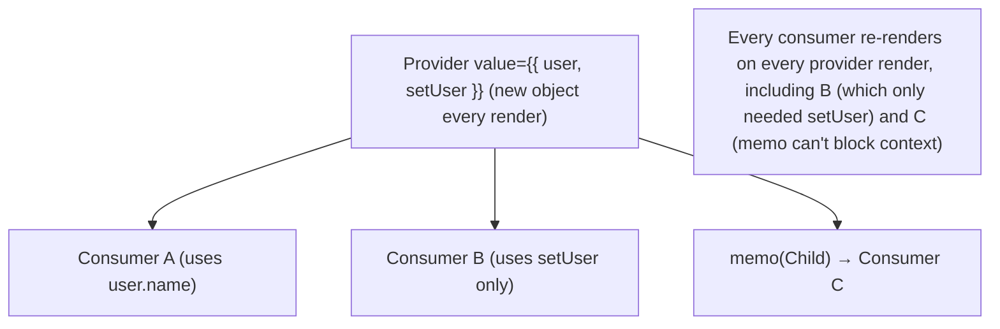

# 29 — Client State Management: Context, Redux Toolkit, Zustand, Jotai, XState and Signals

> Once server state, URL state and form state have moved to their proper homes, the "global state" left in most apps is small. Choose the store for that remainder by its **shape** (a few values, an atom graph, a state machine, an event log), not by popularity.

**Prerequisites:** [28](28-state-and-data-ownership-architecture.md) · **Related:** [12 Hooks](12-hooks-in-depth.md) (`useSyncExternalStore`) · [30 Server State](30-server-state-and-data-fetching.md) · [57 Angular Signals](57-angular-signals-reactivity-and-rxjs.md)

---

## TL;DR

- **First subtract.** Server data goes to a server-state cache, filters to the URL, inputs to forms. Many apps then need little more than `useState` plus a few contexts.
- **Context is dependency injection, not a store.** Every consumer re-renders when the value's identity changes, and `memo` can't stop it. Use it for low-frequency values (theme, locale, session, services). Split contexts by update frequency.
- **Zustand:** a minimal hook store with selectors. It's the default for small-to-medium shared client state.
- **Jotai:** atoms that compose bottom-up into a dependency graph. Good for fine-grained, interdependent state (editors, canvases, dashboards with many widgets).
- **Redux Toolkit:** an explicit event log (actions → reducers) with excellent tooling. It suits large teams that want strict conventions, complex client-side workflows, or existing Redux code.
- **XState:** statecharts and actors for **flows** with many states, guards, timeouts and cancellation (checkout, onboarding, media players, sync engines).
- **Signals:** React's answer to fine-grained reactivity is the **Compiler**, not signals. Signal bridges that patch React internals are risky.
- On the server, **stores are per request**: create them in a provider, never as module singletons holding user data.

---

## 1. Context in depth

### 1.1 The re-render rule



### 1.2 Patterns that keep context cheap

```tsx
// 1. Split state and actions into separate contexts (actions are stable)
const CartStateContext = createContext<CartState | null>(null);
const CartActionsContext = createContext<CartActions | null>(null);

export function CartProvider({ children }: { children: React.ReactNode }) {
  const [state, dispatch] = useReducer(cartReducer, initialCart);
  const actions = useMemo<CartActions>(() => ({      // stable: dispatch never changes
    add: (item) => dispatch({ type: 'add', item }),
    remove: (id) => dispatch({ type: 'remove', id }),
  }), []);
  return (
    <CartActionsContext value={actions}>
      <CartStateContext value={state}>{children}</CartStateContext>
    </CartActionsContext>
  );
}

// 2. Split by update frequency: Session (rare) vs Presence (frequent) vs Cursor (60 Hz → don't use context)
```

| Technique | Effect |
|---|---|
| Memoise the value (or let the Compiler do it) | Consumers re-render only when the content changes |
| Separate state and actions contexts | Components that only dispatch don't re-render on state changes |
| Split contexts by domain and frequency | Smaller blast radius per update |
| Move high-frequency shared state to a store with selectors | Components subscribe to slices, not to everything |
| `use(Context)` after early returns | Conditional reading (React 19) |

> [!NOTE]
> The **React Compiler** stabilises provider values automatically, which removes the "new object every render" problem. It **doesn't** change the core rule: when the value actually changes, every consumer re-renders. Selective subscription needs a store.

---

## 2. How external stores plug into React

Every serious store library uses **`useSyncExternalStore`** under the hood ([12](12-hooks-in-depth.md)): a `subscribe` function, a `getSnapshot` that returns immutable snapshots, and selectors that pick the slice a component needs. This gives tear-free reads under concurrent rendering. The cost is that store updates render **synchronously** (they don't participate in transitions the way `useState` does).

```ts
// A 20-line store: the core of what Zustand does
export function createStore<T>(initial: T) {
  let state = initial;
  const listeners = new Set<() => void>();
  return {
    get: () => state,
    set: (updater: (s: T) => T) => { state = updater(state); listeners.forEach((l) => l()); },
    subscribe: (l: () => void) => { listeners.add(l); return () => listeners.delete(l); },
  };
}

export function useStore<T, S>(store: ReturnType<typeof createStore<T>>, selector: (s: T) => S): S {
  return useSyncExternalStore(store.subscribe, () => selector(store.get()), () => selector(store.get()));
}
```

---

## 3. The libraries

### 3.1 Zustand

```ts
import { create } from 'zustand';
import { persist, devtools } from 'zustand/middleware';
import { useShallow } from 'zustand/react/shallow';

type UIState = {
  sidebarOpen: boolean;
  density: 'compact' | 'comfortable';
  toggleSidebar: () => void;
  setDensity: (d: UIState['density']) => void;
};

export const useUIStore = create<UIState>()(
  devtools(
    persist(
      (set) => ({
        sidebarOpen: true,
        density: 'comfortable',
        toggleSidebar: () => set((s) => ({ sidebarOpen: !s.sidebarOpen })),
        setDensity: (density) => set({ density }),
      }),
      { name: 'acme.ui', version: 2, migrate: migrateUIState }, // versioned persistence
    ),
  ),
);

// Components subscribe to slices
const open = useUIStore((s) => s.sidebarOpen);
const { density, setDensity } = useUIStore(useShallow((s) => ({ density: s.density, setDensity: s.setDensity })));
```

| Strengths | Watch out for |
|---|---|
| Tiny; minimal API; selectors; works outside React (vanilla stores) | Module-level stores are **shared across SSR requests**, so use the per-request provider pattern for user data |
| Middleware: persist, devtools, immer, subscribeWithSelector | Selectors returning new objects need `useShallow` |
| Easy incremental adoption | Without conventions, stores can sprawl. Organise them as slices by domain |

### 3.2 Jotai

```ts
import { atom, useAtom, useAtomValue, useSetAtom } from 'jotai';

const selectedShapeIdsAtom = atom<Set<string>>(new Set());
const shapesAtom = atom<Record<string, Shape>>({});
const selectedShapesAtom = atom((get) => {                      // derived atom
  const shapes = get(shapesAtom);
  return [...get(selectedShapeIdsAtom)].map((id) => shapes[id]).filter(Boolean);
});
const selectionBoundsAtom = atom((get) => boundingBox(get(selectedShapesAtom)));

function SelectionHandles() {
  const bounds = useAtomValue(selectionBoundsAtom);             // re-renders only when bounds change
  return bounds ? <Handles bounds={bounds} /> : null;
}
```

| Strengths | Watch out for |
|---|---|
| Fine-grained dependency graph; only dependents re-render | Many atoms can become hard to trace (use devtools and naming) |
| Async atoms integrate with Suspense | Async atoms are not a replacement for a server cache |
| Scoped stores via `<Provider>` (per editor instance, per test) | Atom families need cleanup to avoid leaks |

### 3.3 Redux Toolkit (RTK 2)

```ts
import { createSlice, configureStore, createEntityAdapter, type PayloadAction } from '@reduxjs/toolkit';

const layersAdapter = createEntityAdapter<Layer>();

const editorSlice = createSlice({
  name: 'editor',
  initialState: layersAdapter.getInitialState({ tool: 'select' as Tool, history: [] as Command[] }),
  reducers: {
    toolSelected: (state, action: PayloadAction<Tool>) => { state.tool = action.payload; }, // Immer
    layerAdded: layersAdapter.addOne,
    layerMoved: (state, action: PayloadAction<{ id: string; dx: number; dy: number }>) => {
      const layer = state.entities[action.payload.id];
      if (layer) { layer.x += action.payload.dx; layer.y += action.payload.dy; }
      state.history.push({ type: 'move', ...action.payload });
    },
  },
});

export const store = configureStore({ reducer: { editor: editorSlice.reducer } });
export type RootState = ReturnType<typeof store.getState>;
```

| Strengths | Watch out for |
|---|---|
| An explicit event log of actions: debuggable, replayable, time-travel devtools | More ceremony than alternatives |
| Strong conventions for large teams; listener middleware for side effects | Teams historically put server data in Redux. Use **RTK Query** or TanStack Query for that |
| `createEntityAdapter` for normalised collections; RTK Query for server state | A single global store couples features unless slices are owned and bounded |

### 3.4 XState (v5)

```ts
import { setup, assign, fromPromise } from 'xstate';
import { useMachine } from '@xstate/react';

const checkoutMachine = setup({
  actors: { placeOrder: fromPromise(({ input }: { input: Order }) => api.placeOrder(input)) },
  guards: { hasPayment: ({ context }) => !!context.payment },
}).createMachine({
  id: 'checkout',
  initial: 'shipping',
  context: { shipping: null as Address | null, payment: null as Payment | null, error: null as string | null },
  states: {
    shipping: { on: { SUBMIT_SHIPPING: { target: 'payment', actions: assign({ shipping: ({ event }) => event.address }) } } },
    payment: {
      on: {
        SUBMIT_PAYMENT: { target: 'review', actions: assign({ payment: ({ event }) => event.payment }) },
        BACK: 'shipping',
      },
    },
    review: { on: { PLACE: { target: 'placing', guard: 'hasPayment' }, BACK: 'payment' } },
    placing: {
      invoke: {
        src: 'placeOrder',
        input: ({ context }) => toOrder(context),
        onDone: 'confirmed',
        onError: { target: 'review', actions: assign({ error: ({ event }) => String(event.error) }) },
      },
    },
    confirmed: { type: 'final' },
  },
});

function Checkout() {
  const [snapshot, send] = useMachine(checkoutMachine);
  // render by snapshot.value: 'shipping' | 'payment' | 'review' | 'placing' | 'confirmed'
}
```

| Strengths | Watch out for |
|---|---|
| Impossible states are impossible; transitions are explicit; visualisable | Learning curve; overkill for simple toggles |
| Async with cancellation (invoked actors are stopped on exit) | Keep machines focused on flows, not all app state |
| `@xstate/store` for simple event-driven stores | |

### 3.5 MobX, Valtio and signals

| Library | Model | Notes |
|---|---|---|
| **MobX** | Observable mutable objects with automatic dependency tracking (`observer` components) | Productive for rich domain models. Mutation-based reactivity sits awkwardly with the React Compiler's assumptions, so verify compatibility (`incompatible-library`) and keep MobX-observed components un-compiled if needed |
| **Valtio** | Proxy state: mutate, and components re-render on the parts they read | Ergonomic; same Compiler caveat for mutation-heavy patterns |
| **Signals** (Preact signals, TC39 proposal) | Fine-grained reactive values that update bindings without re-rendering | React's direction is the **Compiler**, not signals. React-signal bridges that patch internals are fragile across React versions. Compare with Angular's native signals in [57](57-angular-signals-reactivity-and-rxjs.md) |

---

## 4. Comparison matrix

| | Context + reducer | Zustand | Jotai | Redux Toolkit | XState |
|---|---|---|---|---|---|
| Mental model | DI + local reducer | Store + selectors | Atom graph | Event log + reducers | Statecharts + actors |
| Boilerplate | Low | Very low | Low | Medium | Medium–high |
| Selective re-render | ❌ (all consumers) | ✅ selectors | ✅ per atom | ✅ selectors | ✅ (`useSelector` on the actor) |
| DevTools | React DevTools | Redux DevTools via middleware | Jotai DevTools | Excellent (time travel) | Visual inspector |
| Async | Manual | Manual | Async atoms (Suspense) | Thunks, listeners, RTK Query | Invoked actors with cancellation |
| SSR / RSC | Providers in client components | Per-request store pattern | Provider scoping | Per-request store | Per-request actors |
| Best for | Theme, session, services | Shared UI state | Fine-grained interdependent state | Large teams, complex client workflows | Complex flows |

---

## 5. When to introduce each (and when not)

| Signal you see | Introduce | Don't introduce because… |
|---|---|---|
| Distant components share a few UI values (sidebar, density, command palette) | **Zustand** slice | "We might need global state later" |
| Many interdependent derived values with fine-grained updates (editor selection, canvas, spreadsheet) | **Jotai** (or Zustand with careful selectors) | You need it for server data (use a query cache) |
| A multi-step flow with guards, retries, timeouts and cancellation keeps producing impossible-state bugs | **XState** machine for that flow | Every component should be a machine |
| Many teams need strict conventions, an auditable event log and time travel for complex client logic | **Redux Toolkit** | It's the default from 2018 |
| Values change rarely and are needed widely (theme, locale, session, flags, services) | **Context** | It changes at high frequency |

> [!IMPORTANT]
> The most valuable state-management decision is usually **removing** a store: moving server data to TanStack Query, filters to the URL and drafts to forms. Introduce a store last, scoped to the feature that needs it, with an owner.

---

## 6. Stores, SSR and Server Components

```tsx
// Per-request store with Zustand (vanilla store + context): safe for SSR
'use client';
import { createStore } from 'zustand/vanilla';
import { useStore } from 'zustand';

type DashboardStore = ReturnType<typeof createDashboardStore>;
const createDashboardStore = (init: { range: Range }) =>
  createStore<{ range: Range; setRange: (r: Range) => void }>()((set) => ({ ...init, setRange: (range) => set({ range }) }));

const DashboardStoreContext = createContext<DashboardStore | null>(null);

export function DashboardStoreProvider({ initial, children }: { initial: { range: Range }; children: React.ReactNode }) {
  const [store] = useState(() => createDashboardStore(initial));   // one store per mounted provider (per request on the server)
  return <DashboardStoreContext value={store}>{children}</DashboardStoreContext>;
}

export function useDashboard<T>(selector: (s: { range: Range; setRange: (r: Range) => void }) => T) {
  const store = use(DashboardStoreContext);
  if (!store) throw new Error('Missing DashboardStoreProvider');
  return useStore(store, selector);
}
```

- Stores are **client-side state**. Server Components can't use them. Pass initial values from Server Components as props to a client provider.
- **Never** keep user-specific data in module-level stores in SSR builds: they're shared across requests ([17](17-ssr-streaming-and-hydration.md)).
- Hydrate initial store state from server-rendered props (serializable). Don't fetch again on the client for the same data.

---

## 7. Testing client state

- **Reducers and machines** are pure functions: unit-test transitions directly.
- **Stores:** export a factory (`createDashboardStore`) and create a fresh store per test, with no shared singletons between tests.
- **Components:** render with a provider holding test state; assert through the UI ([42](42-testing-architecture.md)).
- **Machines:** test paths (`shipping → payment → review → placing → confirmed`) and guard failures. XState's model-based testing can generate paths.

---

## 8. Migration scenarios

| From | To | Steps |
|---|---|---|
| **Redux for everything** | TanStack Query + small Zustand/RTK slices | Move one entity's reads to queries (keep the Redux copy read-only, then delete it). Move mutations with invalidation. Move filters to the URL. Shrink what's left in the store ([28](28-state-and-data-ownership-architecture.md)) |
| **Context re-render storms** | Split contexts, or a store with selectors | Profile; split state and actions; isolate high-frequency values; move them to Zustand or Jotai |
| **Effect-driven flow spaghetti** | XState machine | Enumerate states and events; encode guards; replace effects with invoked actors; add path tests |
| **MobX app adopting the Compiler** | Keep MobX, scope compilation | Enable the Compiler outside observer-heavy modules; use `'use no memo'` where needed; evaluate incrementally |
| **Legacy Redux (connect HOCs)** | RTK + hooks (`useSelector`) | RTK's `configureStore` first, then slices, then hooks via codemods |

---

## Decision framework

1. **Problem:** what's left after server, URL and form state are subtracted? List the values, their consumers and their update frequency.
2. **Constraints:** team size and conventions, SSR/RSC, Compiler adoption, devtools needs, existing code.
3. **Approaches:** local state → context → Zustand or Jotai → Redux Toolkit; XState for flows.
4. **Criteria:** selective subscription needs, interdependence of values, auditability, flow complexity, SSR safety.
5. **Trade-offs:** ceremony vs explicitness; global vs scoped; library lock-in.
6. **Failure modes:** server data in stores, singleton stores in SSR, context storms, stores with no owner, machines for trivial state.
7. **Migration path:** introduce behind feature-level hooks (`useCartActions`), so the implementation can change without touching consumers.

---

## Pitfalls and anti-patterns

- Putting server responses in client stores.
- One global store for unrelated features, with no slice ownership.
- Selectors returning new objects without shallow comparison (re-render storms).
- Module-level stores holding user data in SSR.
- Context providers wrapping the whole app with frequently changing values.
- Persisted stores without versioning or migrations.
- Choosing a library before writing the state map.

---

## Architect's checklist

- [ ] A state map per feature exists before any store is introduced ([28](28-state-and-data-ownership-architecture.md))
- [ ] Approved store libraries and their use cases are recorded in an ADR
- [ ] Stores are wrapped in feature-level hooks (implementation hidden)
- [ ] SSR-safe store creation (per request via provider)
- [ ] Persisted stores are versioned with migrations and cleared on logout
- [ ] DevTools configured in development, disabled or redacted in production
- [ ] Lint or review rule: no server responses written into client stores

---

## Interview angles

**Q1. Context vs Zustand vs Redux: how do you choose?**
Context for low-frequency, widely needed values and dependency injection, because every consumer re-renders when the value changes. Zustand for small-to-medium shared client state that needs selective subscriptions with minimal ceremony. Redux Toolkit when a large team benefits from an explicit action log, strict conventions and time-travel tooling for complex client workflows. In every case, server data belongs in a server-state cache, not in these stores.

**Q2. Why can't `memo` prevent context-driven re-renders?**
Context propagation schedules work directly on consumer fibers when the provider value changes (`Object.is`). That bypasses the parent-to-child props path that `memo` guards, so a memoised component that reads the context still re-renders. The fixes are splitting contexts, stabilising values, or moving to a store with selectors.

**Q3. When is a state machine worth it?**
When a feature has many states and transitions with rules: multi-step flows, async operations with retries, timeouts and cancellation, media players, connection lifecycles. Machines make impossible states unrepresentable, document behaviour visually, and make testing paths systematic. For simple toggles and lists, they're overhead.

**Q4. How do you use a client store safely with SSR?**
Create the store per request, inside a client provider (`useState(() => createStore(initial))`), pass initial data from the server as serializable props, and never hold user-specific data in module-level singletons, which are shared across all requests on the server.

---

## Further reading

- React docs, *Scaling Up with Reducer and Context*: <https://react.dev/learn/scaling-up-with-reducer-and-context>
- Zustand docs (including *Next.js / SSR* guide): <https://zustand.docs.pmnd.rs>
- Jotai docs: <https://jotai.org>
- Redux Toolkit docs, *Usage Guide* and *RTK Query*: <https://redux-toolkit.js.org>
- XState v5 docs: <https://stately.ai/docs>
- TC39, *JavaScript Signals standard proposal*: <https://github.com/tc39/proposal-signals>

---

[← Previous: 28 — State and Data Ownership Architecture](28-state-and-data-ownership-architecture.md) · [Index](README.md) · [Next: 30 — Server State, Data Fetching and Cache Invalidation →](30-server-state-and-data-fetching.md)
