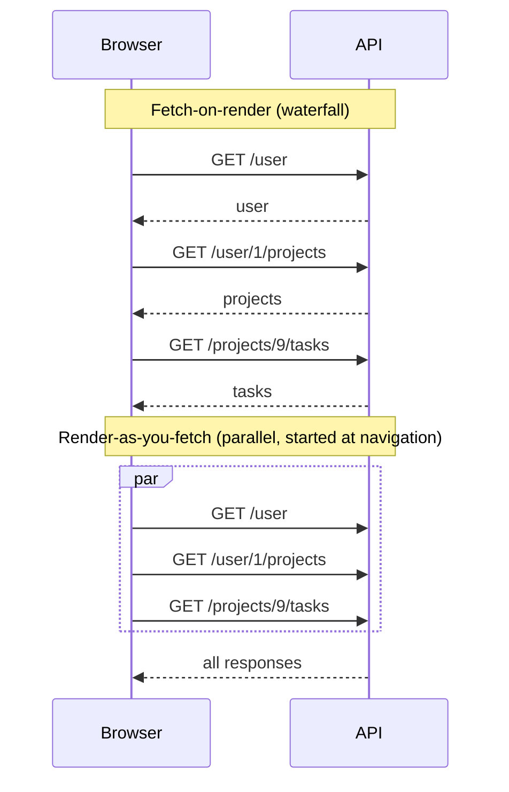
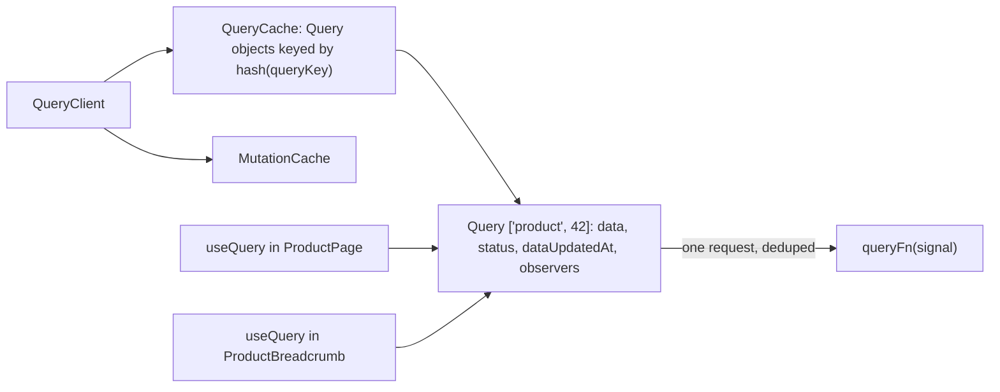

# 30 — Server State, Data Fetching and Cache Invalidation

> Server state is borrowed. You have a possibly stale copy of data someone else owns. Good data-fetching architecture fetches early and in parallel, caches deliberately, deduplicates relentlessly, and knows exactly when its copy stops being true.

**Prerequisites:** [28](28-state-and-data-ownership-architecture.md) · **Related:** [18 RSC](18-react-server-components-and-server-functions.md) · [31 Routing](31-routing-architecture.md) · [33 API Contracts](33-api-integration-bff-and-contracts.md) · [34 Real-time & Offline](34-realtime-offline-and-collaboration.md)

---

## TL;DR

- **Waterfalls are the main data-fetching performance problem.** Fetch on the server (RSC, loaders), start requests in parallel, **prefetch on intent**, and colocate data requirements so one round trip serves a screen.
- Use a **server-state library** (TanStack Query, SWR, RTK Query, Apollo, Relay) or framework data APIs. They handle caching, deduplication, staleness, retries, cancellation, pagination and SSR hydration, all of which hand-written effect fetching gets wrong.
- In TanStack Query, **`staleTime`** decides *when data needs refetching*, and **`gcTime`** decides *how long unused data stays in memory*. Most tuning is choosing `staleTime` per entity.
- Use **query key factories** and `queryOptions()` so keys are consistent and invalidation by prefix works.
- **Mutations** update the cache from the response (`setQueryData`) when they return the new entity, and **invalidate** when the effects are broader. Optimistic updates snapshot, patch, roll back and then re-validate ([28](28-state-and-data-ownership-architecture.md)).
- **Classify errors:** don't retry 4xx responses, do retry network errors and 5xx with backoff, and surface background-refetch failures without wiping visible data.
- With RSC, fetch **read-mostly** data on the server, and keep a client cache for **interactive, frequently changing, client-driven** data.

---

## 1. Fetching strategies

| Strategy | How | Waterfall risk | Example |
|---|---|---|---|
| **Fetch-on-render** | Each component fetches in an effect when it mounts | ❌ High: parent fetch → render child → child fetch | Classic SPA code |
| **Fetch-then-render** | The route loader fetches everything, then renders | Low, but slow data blocks the whole screen | Loaders without streaming |
| **Render-as-you-fetch** | Start fetching *before* rendering (on route match or intent); components read with Suspense | Low; progressive | Router loaders + `useSuspenseQuery`, Relay |
| **Server Components** | Fetch on the server, next to the data; stream with Suspense | Low (server-side waterfalls still possible) | Next.js App Router ([18](18-react-server-components-and-server-functions.md)) |



### Waterfall-elimination toolkit

1. **Hoist** fetching to route loaders or Server Components.
2. **Parallelise** independent requests (`Promise.all`, `useQueries`, `useSuspenseQueries`).
3. **Prefetch on intent:** hover or focus on links, viewport visibility, likely-next routes.
4. **Compose on the server:** a BFF endpoint or GraphQL query returns everything the screen needs ([33](33-api-integration-bff-and-contracts.md)).
5. **Colocate data requirements** (GraphQL fragments, as in Relay) so the screen's query is assembled at build time.
6. **Avoid dependent queries** unless the dependency is real (you need the user's org ID before listing org projects).

---

## 2. TanStack Query (v5) in depth

### 2.1 The model



- A **Query** is shared by every component that uses the same key. Requests are **deduplicated**.
- Components are **observers**. Each subscribes to the properties it reads (tracked properties), so it re-renders only when those change.
- **Structural sharing** keeps unchanged parts of new data referentially equal, so a refetch that changes one item doesn't re-render consumers of the others.

### 2.2 The two clocks: `staleTime` and `gcTime`

| Setting | Default | Meaning | Tune it when… |
|---|---|---|---|
| `staleTime` | `0` | How long data is considered **fresh**. Fresh data isn't refetched on mount, focus or reconnect | Most of the time: set per entity (a catalogue might be 5 minutes, a user profile `Infinity` until it's mutated) |
| `gcTime` | 5 minutes | How long **unused** cache entries stay in memory | Memory constraints, or long sessions with many entities |
| `refetchOnWindowFocus` / `OnReconnect` / `OnMount` | `true` (when stale) | Background refresh triggers | Expensive queries, or data that rarely changes |
| `retry` | 3 (client) with exponential backoff | Retries failed queries | Don't retry 4xx |

### 2.3 Query key factories and `queryOptions`

```ts
// features/products/api/queries.ts
import { queryOptions, infiniteQueryOptions, keepPreviousData } from '@tanstack/react-query';

export const productKeys = {
  all: ['products'] as const,
  lists: () => [...productKeys.all, 'list'] as const,
  list: (filters: ProductFilters) => [...productKeys.lists(), filters] as const,
  details: () => [...productKeys.all, 'detail'] as const,
  detail: (id: string) => [...productKeys.details(), id] as const,
};

export const productQuery = (id: string) =>
  queryOptions({
    queryKey: productKeys.detail(id),
    queryFn: ({ signal }) => api.getProduct(id, { signal }),    // cancellation built in
    staleTime: 5 * 60_000,
  });

export const productListQuery = (filters: ProductFilters) =>
  queryOptions({
    queryKey: productKeys.list(filters),
    queryFn: ({ signal }) => api.listProducts(filters, { signal }),
    placeholderData: keepPreviousData,                          // keep old page while the next loads
    staleTime: 60_000,
  });

export const productFeedQuery = (filters: ProductFilters) =>
  infiniteQueryOptions({
    queryKey: [...productKeys.list(filters), 'infinite'],
    queryFn: ({ pageParam, signal }) => api.listProducts({ ...filters, cursor: pageParam }, { signal }),
    initialPageParam: null as string | null,
    getNextPageParam: (last) => last.nextCursor,
  });

// Usage everywhere, typed and consistent
const { data } = useQuery(productQuery(id));
await queryClient.prefetchQuery(productQuery(id));                    // loaders, hover prefetch
queryClient.invalidateQueries({ queryKey: productKeys.lists() });      // all lists, any filters
```

### 2.4 Mutations: update or invalidate?

| After a mutation… | Do | Example |
|---|---|---|
| The response contains the full updated entity | `setQueryData(detailKey, response)`, then invalidate lists that might order or filter differently | Rename a product |
| The effects are broad or unknown | `invalidateQueries` on affected prefixes | Bulk import; role change |
| The user needs instant feedback | Optimistic update → rollback on error → invalidate on settle ([28](28-state-and-data-ownership-architecture.md)) | Toggle favourite |
| Mutations on the same entity can race | Mutation `scope` to serialise | Rapid quantity changes |

```ts
export function useUpdateProduct() {
  const qc = useQueryClient();
  return useMutation({
    mutationFn: api.updateProduct,
    onSuccess: (updated) => {
      qc.setQueryData(productKeys.detail(updated.id), updated);          // read-your-writes
      qc.invalidateQueries({ queryKey: productKeys.lists() });           // lists may reorder
    },
  });
}
```

### 2.5 Suspense, errors and boundaries

```tsx
function ProductPanel({ id }: { id: string }) {
  const { data } = useSuspenseQuery(productQuery(id));   // data is always defined
  return <ProductDetails product={data} />;
}

<ErrorBoundary FallbackComponent={ProductError}>       {/* react-error-boundary */}
  <Suspense fallback={<ProductSkeleton />}>
    <ProductPanel id={id} />
  </Suspense>
</ErrorBoundary>
```

Global behaviour for background failures:

```ts
import { QueryCache, QueryClient } from '@tanstack/react-query';
import { captureError } from '@/shared/observability';

const queryClient = new QueryClient({
  defaultOptions: {
    queries: {
      retry: (count, error) => !(error instanceof HttpError && error.status < 500) && count < 3,
      staleTime: 30_000,
    },
  },
  queryCache: new QueryCache({
    onError: (error, query) => {
      if (query.state.data !== undefined) toast.warn('Showing saved data; refresh failed'); // background refetch failed
      captureError(error, { queryKey: query.queryKey });
    },
  }),
});
```

### 2.6 SSR and hydration

```tsx
// Server (loader or Server Component): prefetch, then pass dehydrated state to the client
const queryClient = new QueryClient();                       // per request
await queryClient.prefetchQuery(productQuery(id));
return (
  <HydrationBoundary state={dehydrate(queryClient)}>
    <ProductPanel id={id} />                                 {/* client component: no fetch on first render */}
  </HydrationBoundary>
);
```

> [!WARNING]
> Create the `QueryClient` **per request** on the server, and once per app lifetime on the client (`useState(() => new QueryClient())`). A module-level client on the server shares cached user data across requests ([17](17-ssr-streaming-and-hydration.md)).

---

## 3. The library landscape

| Library | Cache model | Strengths | Best fit |
|---|---|---|---|
| **TanStack Query** | Query-key cache | Rich features, devtools, framework-agnostic, great SSR story | Most REST and RPC apps |
| **SWR** | Key-based SWR cache | Minimal API, small | Simpler apps, Next.js-adjacent teams |
| **RTK Query** | Redux-integrated with cache **tags** (`providesTags`/`invalidatesTags`) | Declarative invalidation, codegen from OpenAPI | Teams already on Redux Toolkit |
| **Apollo Client** | **Normalised** GraphQL cache | Type policies, local state, pagination helpers | GraphQL apps with heavily cross-referenced data |
| **Relay** | Normalised store + **compiler** | Fragment colocation, automatic query composition, data masking, robust pagination | Large GraphQL apps that want strict data dependencies per component |
| **urql** | Document cache (normalised via Graphcache) | Lightweight, extensible exchanges | Mid-size GraphQL apps |
| **Framework data APIs** | Loaders, RSC + framework caches | Integrated with routing, SSR and streaming | Next.js, React Router, TanStack Start |

### Relay's idea worth stealing: fragment colocation

```tsx
// Each component declares exactly the data it needs; the compiler composes one query per screen
function Avatar({ user }: { user: Avatar_user$key }) {
  const data = useFragment(graphql`fragment Avatar_user on User { name avatarUrl(size: 64) }`, user);
  return ;
}
```

No component can depend on data it didn't declare (**data masking**), and there are no waterfalls because a single query is built at compile time. You can apply the same principle to REST with BFF endpoints shaped per screen.

---

## 4. Loaders, routers and RSC

| Approach | Where fetching happens | Pair with |
|---|---|---|
| React Router loaders (data and framework modes) | On route match, in parallel for nested routes | Query cache for interactive data (`ensureQueryData` in loaders) ([51](51-react-router-v8-framework-mode.md)) |
| TanStack Router loaders | On route match; type-safe; `ensureQueryData` integration | TanStack Query ([52](52-tanstack-start-and-router.md)) |
| Next.js Server Components | On the server, with `'use cache'` for cross-request caching | Client queries for live and interactive data ([48](48-nextjs-rendering-and-caching.md)) |

### RSC and client caches together

| Data | Fetch with |
|---|---|
| Read-mostly content (product details, articles, settings pages) | Server Components (+ framework cache) |
| Highly interactive, client-driven data (filters changing per keystroke, infinite lists, live dashboards) | Client query cache, optionally prefetched on the server and hydrated |
| Mutations | Server Functions (RSC refresh) **or** API mutations with cache invalidation, but pick one per feature to avoid split-brain caches |

---

## 5. Pagination

| Strategy | Pros | Cons | Use |
|---|---|---|---|
| **Offset** (`?page=3&size=20`) | Jump to page N; simple | Inconsistent under inserts and deletes; slow deep offsets in databases | Admin tables, bounded datasets |
| **Cursor** (`?after=abc`) | Stable under writes; efficient | No "jump to page 50" | Feeds, infinite scroll, large tables |
| **Keyset / seek** (`?after_created_at=…&after_id=…`) | Database-efficient cursors | Requires a sortable unique key | Large, sorted datasets |

UX notes: keep the previous page visible while the next loads (`placeholderData`), restore the scroll position on back navigation, combine infinite lists with virtualisation ([25](25-complex-ui-engineering.md)), and offer a **"Load more" button** as an accessible alternative to auto-loading infinite scroll.

---

## 6. Errors, retries and resilience

| Error class | Retry? | UI |
|---|---|---|
| Network failure, timeout | ✅ with exponential backoff + jitter | Offline banner, auto-retry on reconnect |
| 5xx | ✅ (limited) | Error state with retry; keep stale data visible |
| 429 rate limited | ✅ after `Retry-After` | "Busy, retrying…" |
| 401 | ❌ → refresh the session once, then re-authenticate | Redirect to login or silent refresh ([45](45-authentication-and-authorization.md)) |
| 403 | ❌ | "You don't have access" (and refresh permissions) |
| 404 | ❌ | Not-found state |
| 409/412 conflict | ❌ | Conflict resolution UI ([28](28-state-and-data-ownership-architecture.md)) |
| Validation (400/422) | ❌ | Field errors ([26](26-forms-and-validation.md)) |

More on degraded modes in [40](40-resilience-and-reliability.md).

---

## 7. Performance notes

- **`select`** derives a view of the data (memoised per query), so components re-render only when *their* derived slice changes.
- Tracked properties mean that if you don't read `isFetching`, you won't re-render when it changes.
- Large responses: paginate. Don't keep enormous entries in the cache, and lower `gcTime` for heavy queries.
- **Prefetch** on hover or focus with a small delay (≈ 50–100 ms) to avoid prefetch storms. Respect `navigator.connection.saveData`.
- Parse and validate responses at the boundary ([04](04-typescript-at-scale.md)), but don't validate the same data on every cache read.

---

## 8. Security and privacy

- **Scope keys** by user and tenant, and **clear the cache** on logout or tenant switch ([46](46-enterprise-saas-architecture.md)).
- Don't **persist** caches containing sensitive data to `localStorage`/IndexedDB on shared devices. If you persist, encrypt it or exclude sensitive queries, and version the persisted cache.
- Never put secrets or tokens in query keys (keys show up in devtools and logs).

---

## 9. Testing data fetching

```tsx
// Fresh client per test, no retries, MSW for network
function renderWithQuery(ui: React.ReactElement) {
  const client = new QueryClient({ defaultOptions: { queries: { retry: false, gcTime: Infinity } } });
  return render(<QueryClientProvider client={client}>{ui}</QueryClientProvider>);
}

server.use(http.get('/api/products/42', () => HttpResponse.json(productFixture)));
renderWithQuery(<ProductPanel id="42" />);
expect(await screen.findByRole('heading', { name: 'Trail Shoe' })).toBeVisible();
```

See [42](42-testing-architecture.md).

---

## Decision framework

| Context | Recommendation |
|---|---|
| Next.js / RSC app, read-heavy | Server Components + framework cache; client queries only for interactive islands |
| SPA or React Router / TanStack Router app, REST | TanStack Query + router loaders (`ensureQueryData`) |
| Existing Redux Toolkit app | RTK Query (tags) |
| GraphQL, many teams, strict data dependencies | Relay; Apollo for flexibility |
| Small app, simple reads | SWR or TanStack Query with defaults |

**Failure modes:** waterfalls from effect fetching, split-brain caches (Server Function refresh plus client query cache, uncoordinated), retry storms on 4xx, cache leakage across users, and stale data after mutations because nobody invalidates.

**Migration path (effects → query library):** wrap existing fetch functions as `queryFn`s, replace `useEffect` + `useState` triples with `useQuery`, add key factories, move fetching up into loaders, then tune `staleTime` per entity and add invalidation on mutations.

---

## Pitfalls and anti-patterns

- Fetching in `useEffect` in feature code.
- Ad-hoc query keys (`['product' + id]`) that can't be invalidated by prefix.
- `staleTime: 0` everywhere, so data refetches on every focus and mount.
- Copying query data into `useState` "to edit it" without a reset strategy (forms should *initialise* from data, then detach).
- Server-side module-level `QueryClient`.
- Retrying 4xx errors; no backoff.
- Infinite scroll without virtualisation, scroll restoration or a "load more" fallback.

---

## Architect's checklist

- [ ] One approved server-state approach per app (ADR), plus a key-factory convention
- [ ] `staleTime` defaults per entity type documented
- [ ] Loaders or RSC prefetch the critical data for each route; no fetch-on-render waterfalls on key pages
- [ ] Mutation invalidation rules reviewed; optimistic policies per feature
- [ ] Error classification and retry policy centralised in the `QueryClient`
- [ ] Per-request server `QueryClient`; cache cleared on logout or tenant switch
- [ ] Devtools in development; MSW-based tests
- [ ] Pagination strategy per list type (offset vs cursor) with scroll restoration

---

## Interview angles

**Q1. `staleTime` vs `gcTime`?**
`staleTime` is how long cached data counts as fresh. While fresh, mounting a component, focusing the window or reconnecting won't trigger a refetch. `gcTime` is how long an *unused* query (no observers) stays in memory before it's garbage collected. You mostly tune `staleTime` per entity to match how often the data really changes, and `gcTime` for memory.

**Q2. How do you eliminate request waterfalls in a React app?**
Move fetching out of component effects and into route loaders or Server Components. Start independent requests in parallel. Prefetch on intent (hover, viewport) and on likely-next routes. Compose data on the server (BFF or GraphQL) so a screen needs one round trip. Colocate data requirements (fragments) so they're aggregated rather than discovered render by render.

**Q3. After a mutation, when do you `setQueryData` vs `invalidateQueries`?**
`setQueryData` when the response contains the authoritative new state of a specific entity. It gives instant read-your-writes without a refetch. Invalidate when the mutation affects queries you can't patch accurately: lists with sorting or filtering, aggregates, permissions. Often you do both: set the detail and invalidate the lists.

**Q4. With Server Components, do you still need TanStack Query?**
For read-mostly data rendered on the server, often not: Server Components plus the framework cache cover it. For client-driven, highly interactive or frequently updating data (live dashboards, infinite lists with client filters, optimistic interactions), a client cache is still the right tool. You can prefetch on the server and hydrate it. The rule is to avoid two independent caches for the same data.

---

## Further reading

- TanStack Query docs, *Important Defaults*, *Query Keys*, *Query Options*, *Prefetching*, *SSR & Hydration*, *Optimistic Updates*: <https://tanstack.com/query/latest>
- TkDodo, *Practical React Query* and *Effective React Query Keys*: <https://tkdodo.eu/blog>
- Relay docs, *Thinking in Relay* (fragment colocation, data masking): <https://relay.dev>
- Apollo Client docs, *Caching*: <https://www.apollographql.com/docs/react/caching/overview>
- RTK Query docs, *Automated Re-fetching (tags)*: <https://redux-toolkit.js.org/rtk-query/usage/automated-refetching>
- React docs, *`use`* and Suspense data fetching guidance: <https://react.dev/reference/react/use>

---

[← Previous: 29 — Client State Management](29-client-state-management.md) · [Index](README.md) · [Next: 31 — Routing Architecture →](31-routing-architecture.md)
