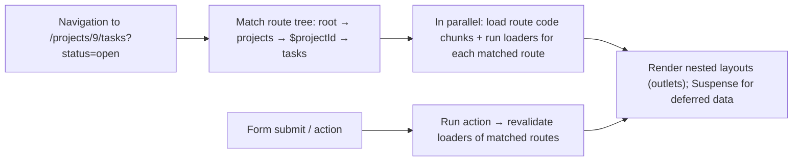

# 31 — Routing Architecture

> The router is your application's skeleton: it decides what code loads, what data is fetched, what the URL promises, and what happens when users press Back. URLs are a public API. Design them with the same care.

**Prerequisites:** [28](28-state-and-data-ownership-architecture.md), [30](30-server-state-and-data-fetching.md) · **Related:** [47 Next.js App Router](47-nextjs-app-router-architecture.md) · [51 React Router v8](51-react-router-v8-framework-mode.md) · [52 TanStack Router](52-tanstack-start-and-router.md) · [36 Accessibility](36-accessibility-engineering.md)

---

## TL;DR

- Modern React routers are **data routers**: route matching triggers **code and data loading in parallel**, nested routes render inside layouts (outlets), and mutations (actions) trigger revalidation.
- Choose among **React Router v8** (declarative, data and framework modes; middleware on by default; ESM-only), **TanStack Router** (end-to-end type safety, validated search params) and **Next.js App Router** (file-system routing with RSC).
- **Split code by route**, and **prefetch on intent** (hover, focus, viewport). Weigh the bandwidth and server cost of aggressive prefetching (Next.js 16.3's Partial Prefetching addresses exactly that).
- **Search params are state.** Validate them with schemas, keep them canonical, and choose `push` vs `replace` deliberately.
- **Navigation UX** needs pending indicators, scroll restoration, focus management and title updates. SPA navigations are silent to screen readers unless you announce them.
- **Route guards are UX, not security.** Enforce authorisation on the server. Validate `returnTo` parameters to prevent open redirects.
- **URLs are forever:** stable IDs plus slugs, canonical redirects, redirect maps for renames, a locale strategy and a trailing-slash policy.

---

## 1. The data-router model



| Concept | Meaning |
|---|---|
| **Nested routes** | The URL hierarchy maps to a UI hierarchy. Parent layouts persist while children change |
| **Outlet** | Where a parent layout renders the matched child |
| **Loader** | Data for a route, fetched on navigation (before or while rendering) |
| **Action** | Handles mutations (form posts), then triggers revalidation |
| **Pending UI** | Router-level navigation state (`useNavigation()`, transitions) |
| **Error boundary per route** | A failure in one route segment doesn't blank the app |
| **Middleware** | Cross-cutting logic around loaders and actions (auth, context, logging): on by default in React Router v8 |

---

## 2. The router landscape (November 2026)

| Router | Model | Strengths | Choose when |
|---|---|---|---|
| **React Router v8** | Declarative mode (classic `<Routes>`), data mode (loaders and actions in a client router), framework mode (Vite plugin, SSR, file routes, RSC APIs) | Mature, flexible, progressive adoption from v6/v7; yearly majors | Most React SPAs and SSR apps outside Next.js ([51](51-react-router-v8-framework-mode.md)) |
| **TanStack Router** | Code- or file-based; fully typed params, search and loader data | Best-in-class type safety; search params as validated state; deep TanStack Query integration | Data-heavy apps with complex URL state; TanStack Start ([52](52-tanstack-start-and-router.md)) |
| **Next.js App Router** | File-system routing with layouts, RSC, parallel and intercepting routes | Integrated SSR, RSC, caching and streaming | Next.js apps ([47](47-nextjs-app-router-architecture.md)) |

> [!NOTE]
> React Router v8 (June 2026) is ESM-only, enables middleware by default, removed `react-router-dom` (import from `react-router` and `react-router/dom`), and requires React 19.2.7+ and Node 22.22+. React Router v6 and Remix v2 are end-of-life. Remix 3 is a separate, non-React framework.

---

## 3. Code splitting by route

```tsx
// React Router (data mode): lazy route modules load in parallel with parent data
const router = createBrowserRouter([
  {
    path: '/',
    Component: RootLayout,
    children: [
      { index: true, lazy: () => import('./routes/home') },               // exports Component, loader, ErrorBoundary
      { path: 'reports/:id', lazy: () => import('./routes/report') },
    ],
  },
]);
```

| Practice | Why |
|---|---|
| One chunk per route (plus shared vendor chunks) | Users download code for what they visit |
| Route modules export `loader` + `Component` + `ErrorBoundary` together | Code and data start together, so there's no "load code, then discover data" waterfall |
| `modulepreload` for critical route chunks (frameworks do this) | Avoids discovery delay ([05](05-networking-caching-and-delivery.md)) |
| Avoid splitting **within** the critical path of a route | Too many tiny chunks recreate waterfalls ([60](60-monorepos-build-tooling-and-bundlers.md)) |

---

## 4. Prefetching

| Strategy | Trigger | Cost | Use for |
|---|---|---|---|
| **Intent** | Hover or focus on a link (with a ~50–100 ms delay) | Low | Default for most links |
| **Viewport** | The link scrolls into view | Medium–high (many links) | Next.js default (static parts); content sites |
| **Render** | Immediately when the link renders | High | Primary call-to-action or next step |
| **Predictive / Speculation Rules** | Heuristics or browser prerendering | Varies | Content sites; MPA-style navigations ([05](05-networking-caching-and-delivery.md)) |
| **None** | — | — | Rarely used routes, destructive actions, large payloads |

```tsx
// React Router
<Link to={`/reports/${id}`} prefetch="intent">Open report</Link>

// TanStack Router
<Link to="/reports/$id" params={{ id }} preload="intent">Open report</Link>
```

> [!WARNING]
> Prefetching has a cost: bandwidth for users (respect `saveData`), load on your servers (every visible link can become a request), and cache pollution. Measure prefetch hit rates. Next.js 16.3 introduced **Partial Prefetching** so links prefetch only the reusable shell or a chosen part of the target page rather than everything ([48](48-nextjs-rendering-and-caching.md)).

---

## 5. Navigation UX

### 5.1 Pending states

```tsx
// Global navigation indicator (React Router)
function GlobalPending() {
  const navigation = useNavigation();
  return <div role="progressbar" aria-hidden={navigation.state === 'idle'} className="top-bar" data-active={navigation.state !== 'idle'} />;
}
```

- Navigations should run in **transitions**, so the current page stays interactive and visible (no blank screen), and fallbacks only appear for new boundaries ([15](15-concurrent-react-suspense-and-transitions.md)).
- Show a **global** indicator within ~100–200 ms, and **local** skeletons for regions still streaming.

### 5.2 Scroll restoration

- Restore the scroll position on Back/Forward, scroll to top on new navigations, and support `#hash` targets.
- React Router: `<ScrollRestoration />`. TanStack Router and Next.js handle it built in.
- Virtualised lists need their index or offset saved in history state ([25](25-complex-ui-engineering.md)).

### 5.3 Accessible route changes

```tsx
// After navigation: update the title, move focus, announce
function RouteAnnouncer() {
  const location = useLocation();
  const [message, setMessage] = useState('');
  useEffect(() => {
    const heading = document.querySelector('h1');
    setMessage(document.title);
    if (heading instanceof HTMLElement) { heading.tabIndex = -1; heading.focus({ preventScroll: true }); }
  }, [location.pathname]);
  return <div aria-live="polite" className="visually-hidden">{message}</div>;
}
```

SPA navigations don't trigger a page load, so screen readers aren't told about them. Update `document.title`, move focus to the main heading (or a skip target), and announce. Frameworks increasingly do this for you, so verify it with a screen reader ([36](36-accessibility-engineering.md)).

---

## 6. Search params as validated state

```tsx
// TanStack Router: typed, validated search params
const searchSchema = z.object({
  q: z.string().catch(''),
  status: z.enum(['open', 'closed', 'all']).catch('open'),
  page: z.number().int().min(1).catch(1),
  sort: z.enum(['created', 'priority']).optional(),
});

export const Route = createFileRoute('/tickets')({
  validateSearch: searchSchema,                       // bad URLs coerce to safe defaults instead of crashing
  loaderDeps: ({ search }) => search,
  loader: ({ context, deps }) => context.queryClient.ensureQueryData(ticketsQuery(deps)),
});

function Tickets() {
  const search = Route.useSearch();                    // fully typed
  const navigate = Route.useNavigate();
  return <Filters value={search} onChange={(next) => navigate({ search: (s) => ({ ...s, ...next, page: 1 }), replace: true })} />;
}
```

| Rule | Why |
|---|---|
| Validate and coerce (`.catch(default)`) | URLs are user-editable and attacker-controlled |
| Canonical form (sorted keys, defaults omitted) | Cache-key stability, SEO, link sharing |
| `replace` for refinements, `push` for navigations | Back should go to the previous *place*, not the previous keystroke |
| Keep it small | URLs have practical length limits, and analytics systems truncate them |

---

## 7. Guards, auth and redirects

```ts
// React Router v8 middleware (framework or data mode): runs around loaders and actions
export const middleware: Route.MiddlewareFunction[] = [
  async ({ request, context }, next) => {
    const session = await getSession(request);
    if (!session) {
      const url = new URL(request.url);
      throw redirect(`/login?returnTo=${encodeURIComponent(url.pathname + url.search)}`);
    }
    context.set(userContext, session.user);
    return next();
  },
];
```

```ts
// Validate returnTo: only same-origin relative paths (prevents open redirects)
export function safeReturnTo(value: string | null, fallback = '/') {
  if (!value || !value.startsWith('/') || value.startsWith('//') || value.startsWith('/\\')) return fallback;
  return value;
}
```

> [!CAUTION]
> Client-side route guards only hide UI. Anyone can call your APIs, loaders or Server Functions directly. **Authorisation must be enforced server-side on every data access** ([45](45-authentication-and-authorization.md)). The Next.js middleware bypass CVE-2025-29927 is the cautionary tale of relying on a single routing layer for auth ([49](49-nextjs-data-mutations-and-auth.md)).

---

## 8. Errors and not-found

- Give each route segment an **error boundary**, so a failing report widget route doesn't take down the navigation shell.
- Distinguish **404** (not found), **403** (forbidden: don't reveal whether a resource exists when that matters) and **5xx** (retryable).
- For SSR, set real status codes ([17](17-ssr-streaming-and-hydration.md)).
- Have a catch-all route with helpful navigation, plus search.

---

## 9. URL design: URLs are a public API

| Principle | Example |
|---|---|
| Stable identifiers plus readable slugs | `/products/8812-trail-runner` → redirect to the canonical slug if it changes |
| Hierarchy reflects ownership | `/orgs/acme/projects/9/settings` |
| Nouns, not verbs | `/invoices/123`, not `/viewInvoice?id=123` |
| Consistent casing and trailing slashes | Lowercase, no trailing slash (redirect the alternatives) |
| Locale strategy | `/de/produkte/…` with `hreflang`, or a domain per locale ([37](37-internationalization-and-localization.md)) |
| Redirect maps for renames | Keep 301s forever for public URLs |
| No secrets or PII | Tokens in URLs leak via logs, history and `Referer` |
| Filters in query params | `?status=open&sort=priority` |

### Route-based modals

A detail opened as a modal over a list, with its own URL (shareable and refresh-safe): Next.js **intercepting routes** ([47](47-nextjs-app-router-architecture.md)), or the "background location" pattern in React Router (render the list for the previous location and the modal for the current one).

---

## 10. The Navigation API

The browser's Navigation API (Baseline since January 2026) centralises navigations into one interceptable `navigate` event with an `AbortSignal`, real history-entry access, and built-in scroll and focus handling ([06](06-modern-web-platform-apis.md)). Routers are adopting it underneath. Architecturally, it simplifies building custom routers and micro-frontend shells that must coordinate navigations.

---

## Decision framework: choosing a router

| Context | Choose |
|---|---|
| Next.js app | App Router |
| Vite SPA with loaders and actions, incremental adoption from v6/v7 | React Router v8 (data mode) |
| SSR without Next.js, Remix heritage, multi-runtime deployment | React Router v8 framework mode |
| Complex URL state, end-to-end type safety, TanStack Query-centric | TanStack Router / TanStack Start |
| Micro-frontend shell | A shell router owning top-level paths; each remote owns its sub-tree ([61](61-micro-frontends-and-module-federation.md)) |

**Failure modes:** route-level data waterfalls, prefetch storms, lost scroll positions, inaccessible navigations, open redirects, URLs that break on rename, and URL state duplicated in component state.

---

## Pitfalls and anti-patterns

- Fetching in route components' effects instead of loaders.
- Filters stored only in component state (not shareable, lost on reload).
- `push` on every keystroke (Back becomes useless).
- Trusting `returnTo` or `redirect` parameters.
- No route-level error boundaries.
- Changing URL structures without redirects.
- Prefetching every link on the page with `render` eagerness.

---

## Architect's checklist

- [ ] Router choice and mode recorded in an ADR
- [ ] Route modules colocate code, data loading and error boundaries
- [ ] Prefetch policy (intent by default), with hit-rate monitoring
- [ ] Search params validated with schemas; URL-state conventions documented ([28](28-state-and-data-ownership-architecture.md))
- [ ] Navigation pending UI, scroll restoration and focus/title announcements verified with a screen reader
- [ ] Auth middleware for UX + server-side authorisation for security; `returnTo` validated
- [ ] URL style guide (slugs, casing, trailing slash, locales) and a redirect map process

---

## Interview angles

**Q1. How do modern routers avoid loading waterfalls?**
They match the whole route tree up front and, for every matched segment, load the code chunk and run the loader in parallel, instead of rendering a parent, discovering a child, then fetching. Combine that with prefetching on intent and streaming for slow data, so the critical path is one round trip.

**Q2. Design routing for a dashboard with shareable filters.**
`/dashboards/:id` with search params for the time range, segment and comparison, validated with a schema and canonicalised. Refinements use `replace`, and switching dashboards uses `push`. A loader prefetches the dashboard definition and visible widgets' data keyed by params. Widgets stream behind Suspense. Each widget route or region has an error boundary. The URL fully reproduces the view, so links work in Slack and emails.

**Q3. How do you handle authentication redirects safely?**
Check the session in route middleware or loaders (better UX, no flash of protected content), redirecting to login with a `returnTo` limited to same-origin relative paths. After login, redirect only to validated paths. Then enforce authorisation again on every API, loader and Server Function, because route guards don't protect data.

**Q4. What's the accessibility problem with SPA navigation?**
There's no page load, so screen readers aren't notified, focus stays on the clicked link (which may no longer exist), and the title may not change. Fix it by updating `document.title`, moving focus to the new page's main heading or a skip target, announcing the change via a polite live region, and restoring or resetting scroll appropriately.

---

## Further reading

- React Router docs (modes, middleware, upgrading to v8): <https://reactrouter.com>
- TanStack Router docs, *Search Params*, *Data Loading*, *Type Safety*: <https://tanstack.com/router>
- Next.js docs, *Linking and Navigating*, *Parallel and Intercepting Routes*: <https://nextjs.org/docs/app>
- MDN, *Navigation API*: <https://developer.mozilla.org/en-US/docs/Web/API/Navigation_API>
- Marcy Sutton (Gatsby research), *What we learned from user testing of accessible client-side routing*: <https://www.gatsbyjs.com/blog/2019-07-11-user-testing-accessible-client-routing/>
- OWASP, *Unvalidated Redirects and Forwards Cheat Sheet*: <https://cheatsheetseries.owasp.org/cheatsheets/Unvalidated_Redirects_and_Forwards_Cheat_Sheet.html>

---

[← Previous: 30 — Server State, Data Fetching and Cache Invalidation](30-server-state-and-data-fetching.md) · [Index](README.md) · [Next: 32 — Rendering Strategy Architecture →](32-rendering-strategy-architecture.md)
