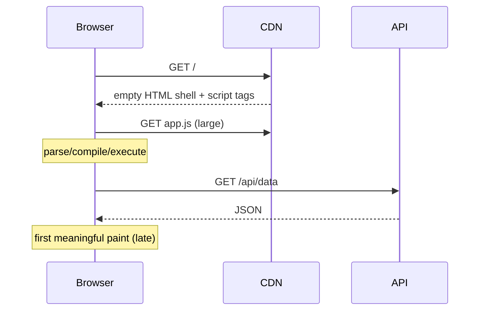
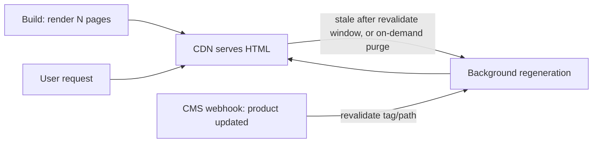
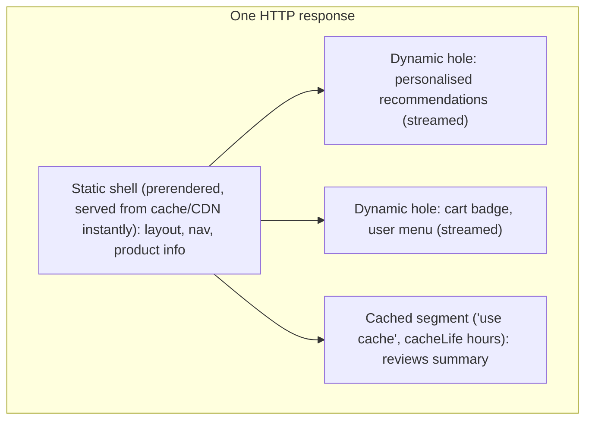
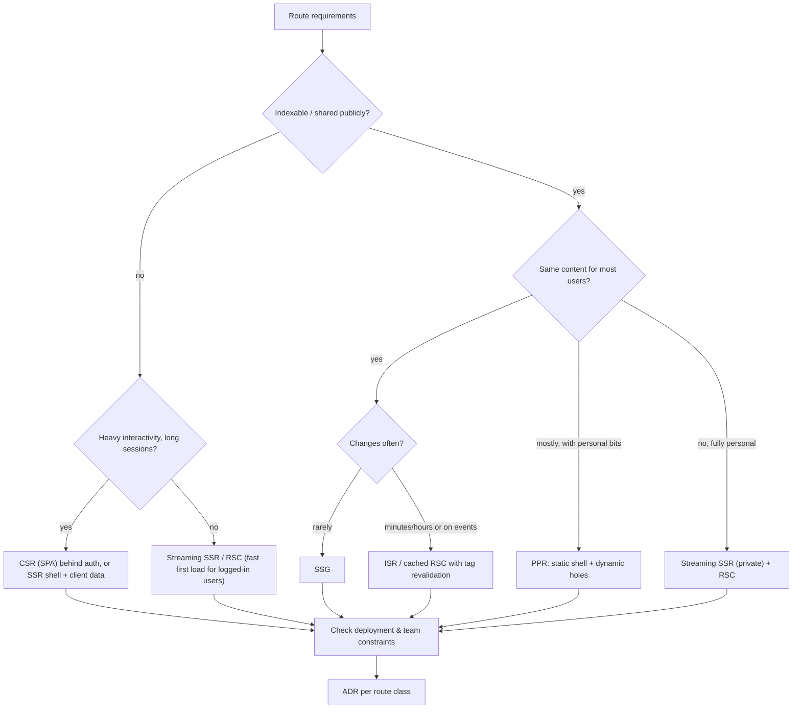

# 32 — Rendering Strategy Architecture

> "Should we use SSR?" is the wrong question. The right one is: *for each route, when should HTML be produced, where, how fresh must it be, and how much JavaScript must wake up before the user can act?*

**Prerequisites:** [05](05-networking-caching-and-delivery.md), [17](17-ssr-streaming-and-hydration.md), [18](18-react-server-components-and-server-functions.md) · **Related:** [48 Next.js Caching](48-nextjs-rendering-and-caching.md) · [39 Core Web Vitals](39-web-performance-and-core-web-vitals.md) · [54 Choosing a Framework](54-choosing-a-react-framework.md)

---

## TL;DR

- Rendering strategies vary along three axes: **when** HTML is produced (build, request, client), **where** (origin, edge, browser), and **how much JS hydrates** (all of it, islands, server-only components, or resumable). Choose **per route**, not per app.
- **CSR** is cheap to host and fine behind login, but slow on first load and weak for SEO. **SSR** gives fast content but costs compute per request and adds hydration. **SSG/ISR** gives CDN-speed HTML with bounded staleness. **Streaming** sends the shell immediately. **RSC** cuts hydration cost. **PPR / Cache Components** combine a static shell with streamed dynamic holes in one response.
- **Islands** (Astro) and **resumability** (Qwik) attack hydration from different angles: hydrate less, or never hydrate.
- **Edge rendering** helps only when the data is also near the edge. Rendering at the edge against a database in one region usually makes things *slower*.
- **Personalisation** is the enemy of caching. Isolate it into small dynamic holes or client islands so the rest stays cacheable.
- Every strategy implies a **cache topology** (CDN, framework cache, client cache) with owners and invalidation rules.

---

## 1. The strategy spectrum

| Strategy | HTML produced | Data freshness | First load (LCP) | Hydration cost | Server cost | SEO | Complexity |
|---|---|---|---|---|---|---|---|
| **CSR / SPA** | In the browser | Live (client fetch) | Slow (JS first, then data) | Full app | Minimal (static hosting) | Weak | Low |
| **SSR** (blocking) | Per request, at origin | Live | Good (slowed by the slowest data) | Full page | High | Strong | Medium |
| **Streaming SSR** | Per request, streamed | Live | Good (shell first) | Selective | High | Strong | Medium–high |
| **SSG** | At build | As of build | Excellent (CDN) | Full page (unless RSC/islands) | Build-time only | Strong | Low |
| **ISR** | At build, then on revalidation | Bounded staleness (time or on demand) | Excellent | As SSG | Low | Strong | Medium |
| **RSC** (with any of the above) | Server (build or request) | As configured | Good | **Only Client Components** | Medium–high | Strong | High |
| **PPR / Cache Components** | Static shell prerendered + dynamic holes at request time | Mixed per component | Excellent shell + streamed holes | Client Components only | Medium | Strong | High |
| **Islands** (Astro) | Build or request | As configured | Excellent | **Only interactive islands** | Low–medium | Strong | Medium |
| **Resumability** (Qwik) | Build or request | As configured | Excellent | **None**: handlers lazy-load on interaction | Medium | Strong | Medium–high |
| **Edge SSR** | Per request, at the edge | Live (if data is near) | Excellent TTFB *if* data is close | As SSR | Edge compute | Strong | High |

---

## 2. How each strategy works

### 2.1 CSR



Good for authenticated apps where SEO is irrelevant and sessions are long (admin consoles, internal tools), when bundle budgets and route splitting are disciplined.

### 2.2 SSR and streaming SSR

HTML is rendered per request. Blocking SSR waits for all data. **Streaming** sends the shell and streams slow regions behind Suspense ([17](17-ssr-streaming-and-hydration.md)). The cost is server CPU per request plus hydration.

### 2.3 SSG and ISR



- **SSG** breaks down with huge page counts (build times) and frequently changing data.
- **ISR** regenerates pages in the background after a time window, or **on demand** (tag or path revalidation from a webhook), serving the stale version meanwhile (stale-while-revalidate semantics).
- Pages not prerendered at build can render on first request and then be cached. Next.js 16.3 improved this so the first visitor gets an instant loading shell instead of a blocking render ([48](48-nextjs-rendering-and-caching.md)).

### 2.4 Server Components

RSC changes *what ships*, not just *when HTML is produced*. Server Components contribute HTML but no JS, so hydration covers only Client Components. They combine with SSG, ISR, SSR and streaming ([18](18-react-server-components-and-server-functions.md)).

### 2.5 PPR and Cache Components



React 19.2's `prerender`/`resume` APIs provide the primitive. Next.js Cache Components (`'use cache'`, `cacheLife`, `cacheTag`) provide the developer model. Static, cached and request-time content compose **inside one page** ([48](48-nextjs-rendering-and-caching.md)).

### 2.6 Islands

```astro
---
// Astro page: static by default; only marked islands ship JS
import Header from '../components/Header.astro';
import AddToCart from '../components/AddToCart.tsx';
---
<Header />
<article>…static content…</article>
<AddToCart client:visible sku="TS-42" />   <!-- hydrates when scrolled into view -->
```

Islands deliver content-site performance with React components where interactivity is needed. The trade-off is that cross-island shared state and app-like navigation take more work.

### 2.7 Resumability

Qwik serialises application state and event-listener locations into the HTML, so the client **resumes** without re-executing components. Event handlers download on first interaction. This gives near-zero startup JS. The trade-off is a different programming model and ecosystem, and the first interaction can pay a code-download cost (mitigated by prefetching).

### 2.8 Edge rendering

| Works well | Works badly |
|---|---|
| Data cached or replicated at the edge (KV, edge caches, read replicas) | Every render calls a database in one region (the edge→origin round trip dominates) |
| Personalisation from cookies and headers (geo, experiments, locale) | Heavy CPU rendering (edge limits) |
| Redirects, rewrites, auth checks (proxy and middleware) | Node-only libraries and drivers |

> [!IMPORTANT]
> **Data locality decides edge value.** Place compute next to the data it needs. A common pattern is edge middleware for routing, experiments and auth, with origin rendering in the data's region, and CDN caching of the output.

---

## 3. Personalisation without killing caching

| Technique | How | Cacheability |
|---|---|---|
| Client-side holes | Static or ISR page; personalised widgets fetch client-side | Page fully cacheable; widgets pop in later |
| **PPR dynamic holes** | Static shell + request-time segments in the same response | Shell cacheable; holes per request |
| Edge variants | Middleware assigns a variant (A/B, region) → cache key includes the **variant**, not the user | Cacheable per variant |
| ESI (edge-side includes) | CDN assembles fragments | Fragment-level caching |
| Full SSR per user | Render everything per request | `private`, not cacheable |

Rule: **vary the cache key by bounded dimensions** (variant, locale, device class), never by user ID ([05](05-networking-caching-and-delivery.md)).

---

## 4. SEO realities

- Google renders JavaScript, but rendering can lag crawling, and many other crawlers, social preview bots and AI crawlers don't execute JS reliably. **Content that matters for discovery should be in the HTML.**
- Metadata (titles, descriptions, canonical URLs, `hreflang`, Open Graph) must be server-rendered.
- Structured data (JSON-LD) belongs in the server HTML.
- Avoid `use(browser())` or client-only rendering for indexable content ([17](17-ssr-streaming-and-hydration.md)).

---

## 5. The cost model

| Cost driver | CSR | SSR | SSG/ISR | PPR |
|---|---|---|---|---|
| Compute per request | ~0 | High | ~0 (cache hits) | Dynamic holes only |
| Build time | Low | Low | High for many pages (use ISR) | Medium |
| CDN egress | JS bundles | HTML + JS | HTML + JS | HTML + JS |
| Operational complexity | Low | Servers, scaling, observability | Revalidation pipelines | All of the above |
| Hydration (users' CPU) | Full app | Full page | Full page | Client Components only |

> [!TIP]
> Express the decision in money **and** user milliseconds: "SSR for product pages costs ~$X per million requests at our cache-hit ratio and improves p75 LCP by Y ms on mobile. CSR saves $X and loses Y ms and SEO". That makes it a product decision, not a framework debate.

---

## 6. Choosing per route



| Route | Typical choice | Why |
|---|---|---|
| Marketing home, landing pages | SSG/ISR (or islands) | CDN speed, SEO, rare changes |
| Blog, docs | SSG + ISR on publish | Content-driven |
| Product detail page (PDP) | PPR / ISR + dynamic holes (price, stock, personalisation) | SEO + freshness + personalisation |
| Category and search results | Streaming SSR with CDN caching of common queries | SEO for categories; long-tail queries dynamic |
| Cart, checkout | SSR/RSC, private, no CDN caching | Personal, correctness-critical |
| Account settings | RSC/SSR private, or CSR | Personal; SEO irrelevant |
| Admin and analytics dashboards | CSR or SSR shell + client data | Interactivity, long sessions |
| Real-time collaboration | CSR (+ SSR shell) | WebSocket-heavy, client state ([34](34-realtime-offline-and-collaboration.md)) |

---

## 7. Cache topology per strategy

| Strategy | CDN | Framework / server cache | Client cache |
|---|---|---|---|
| CSR | Static assets (immutable) | — | Query cache |
| SSR (public) | HTML with `s-maxage` + SWR | Data cache | Router cache |
| SSR (private) | Bypass (`private`) | Data cache per user or tenant | Router + query cache |
| SSG/ISR | HTML + payloads; purge by tag | Regeneration | Router cache |
| PPR | Shell (static) | `'use cache'` segments with tags | Router cache (prefetched shells) |

Document **who invalidates each layer, and how** ([28](28-state-and-data-ownership-architecture.md)).

---

## 8. Migration paths

| From → To | Approach |
|---|---|
| SPA → SSR/RSC framework | Adopt the framework with existing components as Client Components. Move route data loading to the server. Push `'use client'` down over time. Measure LCP, INP and JS per route ([64](64-migration-playbooks.md)) |
| SSR everywhere → hybrid | Identify cacheable routes. Add ISR or tag revalidation. Isolate personalisation into holes |
| SSG with slow builds → ISR | Prerender the top N pages at build; render the rest on demand and cache |
| Legacy SSR (renderToString) → streaming | Introduce Suspense boundaries around slow data; switch to streaming APIs ([17](17-ssr-streaming-and-hydration.md)) |
| Content site with an SPA → islands | Rebuild templates in Astro with React islands for interactive parts |

---

## Pitfalls and anti-patterns

- One strategy for the whole app ("we're an SSR shop").
- Edge rendering against far-away databases.
- Personalised HTML cached publicly (data leaks), or `Vary: Cookie` cache fragmentation.
- SSG with tens of thousands of pages rebuilt on every deploy.
- Client-only rendering of SEO-critical content.
- Ignoring hydration cost: SSR pages that look ready but don't respond (poor INP).
- No owner for revalidation webhooks (stale prices on PDPs).

---

## Architect's checklist

- [ ] Route classes defined with a chosen strategy and an ADR for each
- [ ] Cache topology per route class (CDN, framework, client) with owners and invalidation
- [ ] Personalisation isolated into holes or islands; cache keys bounded
- [ ] Edge usage justified by data locality
- [ ] SEO-critical content and metadata in server HTML
- [ ] Field metrics (LCP, INP, TTFB) segmented by route class and strategy
- [ ] Cost model per strategy reviewed with product and finance for high-traffic routes

---

## Interview angles

**Q1. SSR vs SSG vs ISR vs PPR: when do you use each?**
SSG for content that rarely changes and is the same for everyone. ISR when that content changes on a schedule or on events, so you prerender once and revalidate in the background or on demand. SSR (streaming) for content that's personal or must be fresh on every request. PPR when most of a page is static or cacheable but some parts are personal or real-time: you serve the static shell instantly from cache and stream the dynamic holes in the same response. Choose per route.

**Q2. Does edge rendering always improve performance?**
No. It improves TTFB only when the data needed to render is also near the edge (cached, replicated or derived from the request). If each render makes round trips to a single-region database, the edge adds latency. Use the edge for routing, experiments, auth checks and cached content, and render data-heavy pages near the data.

**Q3. How do RSC, islands and resumability differ in attacking hydration cost?**
RSC keeps Server Components out of the bundle, so only Client Components hydrate, all within one React tree. Islands render static HTML and hydrate isolated interactive widgets independently (Astro), which is excellent for content sites. Resumability (Qwik) avoids hydration entirely by serialising state and lazily loading handlers on interaction. All three reduce startup JS; they differ in programming model and in how app-like navigation and shared state work.

**Q4. A PDP needs SEO, fresh price and stock, and personalised recommendations. Design its rendering.**
Prerender (or cache) the product shell (title, images, description, structured data) with tag-based revalidation from the PIM and CMS. Render price and stock in a dynamic or short-lived cached segment (seconds), keyed by product and region. Stream personalised recommendations as a dynamic hole after the shell. Keep the cart badge as a small client island or dynamic hole. The LCP image is in the shell with high fetch priority. Mutations (add to cart) go through Server Functions that update tags ([68](68-case-study-ecommerce-storefront.md)).

---

## Further reading

- web.dev, *Rendering on the Web*: <https://web.dev/articles/rendering-on-the-web>
- Next.js docs, *Caching*, *Cache Components*, *Incremental Static Regeneration*: <https://nextjs.org/docs/app>
- Astro docs, *Islands architecture*: <https://docs.astro.build/en/concepts/islands/>
- Qwik docs, *Resumable vs. hydration*: <https://qwik.dev/docs/concepts/resumable/>
- Jason Miller, *Islands Architecture*: <https://jasonformat.com/islands-architecture/>
- React docs, *Static APIs* (`prerender`, `resume`): <https://react.dev/reference/react-dom/static>

---

[← Previous: 31 — Routing Architecture](31-routing-architecture.md) · [Index](README.md) · [Next: 33 — API Integration, BFF and Data Contracts →](33-api-integration-bff-and-contracts.md)
