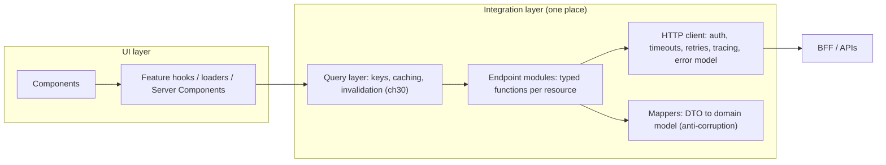
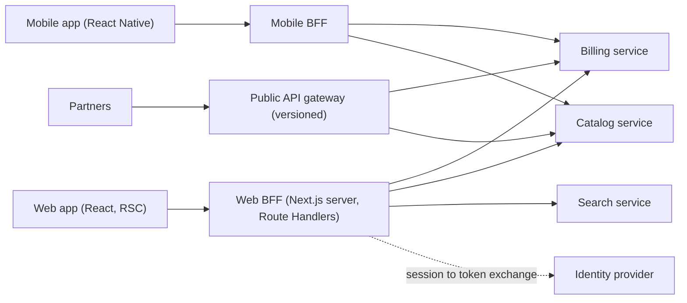
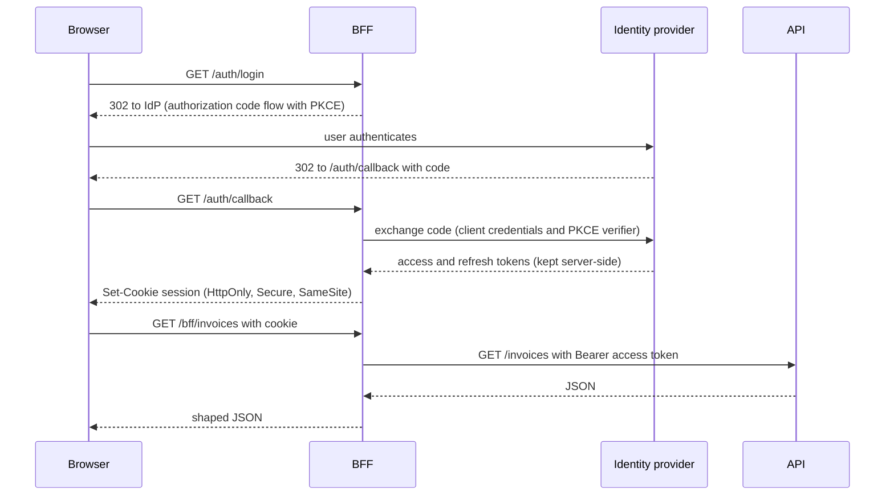
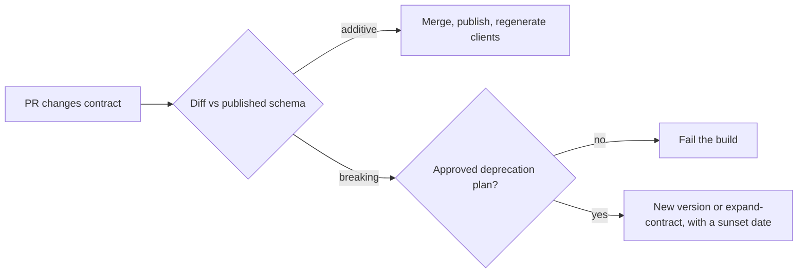

# 33 — API Integration, BFF and Data Contracts

> The API is the most expensive interface your frontend has. Components can be refactored in an afternoon; a contract that a mobile app shipped against two years ago is forever.

**Prerequisites:** [05](05-networking-caching-and-delivery.md), [28](28-state-and-data-ownership-architecture.md), [30](30-server-state-and-data-fetching.md) · **Related:** [18 RSC and Server Functions](18-react-server-components-and-server-functions.md) · [40 Resilience](40-resilience-and-reliability.md) · [45 Authentication and Authorization](45-authentication-and-authorization.md)

---

## TL;DR

- Treat the integration layer as an **architectural boundary**. A single typed API client owns transport, auth, timeouts, retries, error normalisation, tracing and response validation. Components never call `fetch` directly.
- A **Backend for Frontend (BFF)** aggregates, shapes and secures data for one experience. It's owned by the frontend team. In RSC frameworks the server component tree *is* largely your BFF.
- For browser apps that use OAuth, the IETF's **RFC 10017 (BCP 212, August 2026)** describes the BFF pattern: tokens stay on the server and the browser holds only an `HttpOnly` session cookie.
- **Contracts are code.** Generate types from OpenAPI or GraphQL schemas (or share them via tRPC in a TypeScript monorepo). Validate at trust boundaries. Detect breaking changes in CI.
- Standardise errors on **RFC 9457 Problem Details**. Retry only idempotent requests (or requests that carry an idempotency key), with exponential backoff and jitter. Respect `Retry-After`.
- **Evolve rather than version.** Make additive changes, read tolerantly, expand and contract for renames, and announce deprecations with the `Deprecation` (RFC 9745) and `Sunset` (RFC 8594) headers. Remember the long tail: mobile app versions live for years, and open browser tabs run yesterday's deploy.

---

## 1. The integration layer as a boundary



| Responsibility | Lives in | Why there |
|---|---|---|
| Base URL, credentials, headers, tracing | HTTP client | One policy for every call |
| Timeouts, cancellation, retries, backoff | HTTP client | Consistent resilience ([40](40-resilience-and-reliability.md)) |
| Error normalisation (Problem Details → `ApiError`) | HTTP client | The UI handles one error shape |
| Response validation | Endpoint modules | Each schema sits beside its endpoint |
| DTO → domain mapping (dates, money, enums) | Mappers | Backend quirks don't leak into components |
| Cache keys, staleness, invalidation | Query layer | Server-state ownership ([30](30-server-state-and-data-fetching.md)) |

> [!IMPORTANT]
> **Lint rule:** no `fetch`, `axios` or SDK imports outside `shared/api` and `entities/*/api`. That single boundary makes cross-cutting changes (auth migration, tracing, a new error format) a one-file change instead of a 400-file change.

---

## 2. API styles for frontends

| Style | Strengths | Weaknesses | Best fit |
|---|---|---|---|
| **REST + OpenAPI** | Universal, HTTP caching, mature tooling and codegen | Over- and under-fetching, chatty for complex screens | Public and partner APIs, service boundaries |
| **GraphQL** | Client-selected fields, one round trip, fragments colocated with components, strong schema | Caching is harder, query cost control, N+1 on the server, operational complexity | Many clients with different needs, graph-shaped domains |
| **tRPC** | End-to-end types without codegen, very fast iteration | TypeScript-only, couples client and server deploys, not a public API | Internal app with a TS monorepo and a single team or deploy |
| **gRPC-web / Connect** | Protobuf contracts, streaming, polyglot | Browser support needs a proxy or the Connect protocol, binary payloads are harder to debug | Organisations already on protobuf |
| **Server Functions / RSC** | No API layer for your own UI, colocated with components | Private to the app, version skew across deploys, still public HTTP endpoints ([44](44-rsc-security-threat-model.md)) | Mutations and reads in RSC framework apps |

**Rule of thumb:** one public contract style per organisation (usually REST with OpenAPI, sometimes GraphQL), plus whatever private, UI-specific mechanism the framework offers (Server Components, Server Functions, tRPC) behind your BFF.

---

## 3. Backend for Frontend (BFF)

### 3.1 Topology



### 3.2 What a BFF does, and what it doesn't

| Does | Doesn't |
|---|---|
| Aggregate several service calls into one response per screen | Own business rules (they belong in domain services) |
| Shape DTOs for the UI (fields, formats, localisation hints) | Become a shared gateway for every client ("God BFF") |
| Hold OAuth tokens and expose a cookie session to the browser | Replace authorisation in the domain services (defence in depth) |
| Translate protocols (gRPC to JSON, SOAP to JSON) | Proxy arbitrary paths (an open proxy is an SSRF and data-exposure risk) |
| Cache, rate-limit, enforce request-size limits, add flags and experiments | Hide slow services behind ever-longer timeouts |

Sam Newman's original guidance still holds: **one BFF per user experience** (web, mobile, partner), owned by the team that builds that experience.

### 3.3 RSC collapses the BFF into the render layer

In Next.js, React Router framework mode or TanStack Start, the server side of your app already sits between the browser and your services:

- **Server Components** call services directly and send only the shaped result (as Flight data and HTML).
- **Server Functions** handle mutations from your own UI.
- **Route Handlers** (or resource routes) serve webhooks, third-party consumers, mobile apps and anything that needs a stable URL.

```tsx
// app/invoices/[id]/page.tsx: a Server Component acting as the BFF for this screen
import 'server-only';
import { billing, crm } from '@/server/services';
import { requireSession } from '@/server/auth';

export default async function InvoicePage({ params }: { params: Promise<{ id: string }> }) {
  const { id } = await params;
  const session = await requireSession();                       // authenticate
  const invoice = await billing.getInvoice(session.tenantId, id); // service authorises
  const customer = await crm.getCustomer(session.tenantId, invoice.customerId);
  // Shape: pass only what the UI needs. Never forward the raw upstream objects.
  return (
    <InvoiceView
      number={invoice.number}
      total={invoice.total}
      customerName={customer.displayName}
    />
  );
}
```

> [!WARNING]
> When the BFF is "just components", it's easy to forget it's still a **security boundary**. Every Server Function is a public POST endpoint, and every prop passed to a Client Component is serialised to the browser. Validate inputs, authorise every call, and pass DTOs, not database rows ([44](44-rsc-security-threat-model.md)).

### 3.4 Tokens belong in the BFF

RFC 10017 (*OAuth 2.0 for Browser-Based Applications*, BCP 212, August 2026) catalogues three patterns: the **BFF**, the **token-mediating backend** and the **browser-based OAuth client**. It discourages the implicit grant. In the BFF pattern, the backend is a confidential OAuth client: it runs the code flow, keeps access and refresh tokens server-side, and gives the browser an `HttpOnly`, `Secure`, `SameSite` session cookie.



What this buys you, and what it doesn't:

- **XSS can't steal tokens** for use elsewhere, or later. That's the big win.
- **XSS can still ride the session** while the page is open (sending requests through the BFF). Content Security Policy, Trusted Types and output encoding still matter ([43](43-frontend-security-architecture.md)).
- Cookie sessions bring back **CSRF**. Use `SameSite=Lax` or `Strict`, check `Origin` on state-changing requests, and require a custom header or CSRF token for cross-site-capable endpoints ([45](45-authentication-and-authorization.md)).

---

## 4. Contracts as code

### 4.1 Schema-first vs code-first

| Approach | How | Good for |
|---|---|---|
| **Schema-first** | Write OpenAPI or GraphQL SDL; generate server stubs and client types | Multiple teams or languages, public APIs, design reviews before code |
| **Code-first** | Derive the schema from server code (Zod-to-OpenAPI, Pothos/Nexus for GraphQL, tRPC routers) | One team, a TS end to end, fast iteration |

Either way, the schema is an **artifact in CI**: published to a registry, diffed for breaking changes, and used to generate clients and mocks.

### 4.2 OpenAPI: generated types and client

```ts
// Generated in CI: npx openapi-typescript ./contracts/billing.yaml -o src/shared/api/billing.d.ts
import createClient from 'openapi-fetch';
import type { paths } from './billing';

export const billingApi = createClient<paths>({ baseUrl: '/bff' });

// Path, params and response are all typed from the contract
const { data, error } = await billingApi.GET('/v2/invoices/{id}', {
  params: { path: { id: 'inv_123' } },
});
```

Alternatives in the same family: **Orval** and **Hey API** (`@hey-api/openapi-ts`) generate typed clients, TanStack Query hooks and MSW mocks from one spec.

### 4.3 GraphQL: fragments colocated with components

```tsx
// entities/invoice/ui/InvoiceRow.tsx
import { graphql, readFragment, type FragmentOf } from '@/shared/graphql'; // gql.tada, initGraphQLTada<…>()

export const InvoiceRowFragment = graphql(`
  fragment InvoiceRow on Invoice {
    id
    number
    total { amountMinor currency }
  }
`);

export function InvoiceRow({ data }: { data: FragmentOf<typeof InvoiceRowFragment> }) {
  const invoice = readFragment(InvoiceRowFragment, data); // masked: only this component's fields
  return <tr><td>{invoice.number}</td><td><Money value={invoice.total} /></td></tr>;
}

// features/invoice-list/api.ts: the query composes the fragment
export const InvoicesQuery = graphql(`
  query Invoices($first: Int!, $after: String) {
    invoices(first: $first, after: $after) {
      nodes { id ...InvoiceRow }
      pageInfo { hasNextPage endCursor }
    }
  }
`, [InvoiceRowFragment]);
```

GraphQL hygiene for production:

- **Fragment masking.** Components see only their own fields, so removing a field from one component can't break another (the Relay model).
- **Persisted operations (trusted documents).** Ship operation IDs instead of query strings. The server allows only known operations, which shuts down arbitrary expensive queries and shrinks requests. It also makes CDN caching of GET operations possible.
- **Cost limits.** Depth, complexity and pagination caps on the server. Use DataLoader-style batching against N+1.
- **Schema checks.** Run `graphql-inspector` or your registry's checks against real client operations before merging schema changes.

### 4.4 tRPC: shared types in a monorepo

```ts
// server/routers/invoice.ts
export const invoiceRouter = router({
  byId: protectedProcedure
    .input(z.object({ id: z.string() }))
    .query(({ ctx, input }) => ctx.billing.getInvoice(ctx.session.tenantId, input.id)),
});

// client: tRPC v11 with the TanStack React Query integration
const trpc = useTRPC();
const { data: invoice } = useQuery(trpc.invoice.byId.queryOptions({ id }));
```

tRPC v11 (released March 2025) requires TanStack Query v5. It adds SSE subscriptions and supports FormData and binary bodies. The trade-off is coupling: client and server types move together, which is ideal for one team and one deploy, and wrong for public or long-lived clients.

### 4.5 Where to validate at runtime

TypeScript types disappear at runtime. A generated type says what the server *promised*; a runtime schema checks what it *sent*.

| Boundary | Validate? | Why |
|---|---|---|
| Browser → your server (Server Functions, Route Handlers, BFF) | **Always** | Untrusted input. This is a security control |
| Third-party API → your server | **Always** | You don't control their deploys |
| Your services → BFF | Yes, or sampled in production | Catches drift close to the source |
| Your BFF → browser | Selectively: critical flows, dev and staging, or sampled | Large lists cost CPU on low-end phones |
| `localStorage`, URL, `postMessage` → app | **Always** | Any of them can be stale or tampered with |

Libraries that implement **Standard Schema** (Zod 4, Valibot, ArkType) work with routers, form libraries and clients that accept "any Standard Schema validator", so the choice of validator stays local.

---

## 5. A production HTTP client

```ts
// shared/api/http.ts
import { z } from 'zod';

const API_BASE = new URL('/api/', globalThis.location?.href ?? 'http://localhost'); // the same-origin BFF

const ProblemSchema = z.looseObject({
  type: z.string().default('about:blank'),
  title: z.string().optional(),
  status: z.number().int().optional(),
  detail: z.string().optional(),
  instance: z.string().optional(),
  // Extension member used by Acme APIs for field-level validation errors (RFC 9457 §3 example)
  errors: z.array(z.object({ pointer: z.string(), detail: z.string() })).optional(),
});
export type Problem = z.infer<typeof ProblemSchema>;

// Plain fields instead of parameter properties: works under `erasableSyntaxOnly` and Node type stripping
export class ApiError extends Error {
  readonly status: number;
  readonly problem: Problem;
  readonly retryable: boolean;
  readonly retryAfterMs: number | undefined; // when the server said to try again, if it did
  constructor(status: number, problem: Problem, retryable: boolean, retryAfterMs?: number) {
    super(problem.title ?? `HTTP ${status}`);
    this.name = 'ApiError';
    this.status = status;
    this.problem = problem;
    this.retryable = retryable;
    this.retryAfterMs = retryAfterMs;
  }
}

type Method = 'GET' | 'POST' | 'PUT' | 'PATCH' | 'DELETE';
const SAFE_TO_RETRY = new Set<Method>(['GET', 'PUT', 'DELETE']); // idempotent by HTTP semantics
const TRANSIENT = new Set([408, 425, 429, 502, 503, 504]);      // 500 is usually a bug, not a blip

export type RequestOptions<T> = {
  method?: Method;
  body?: unknown;
  schema: z.ZodType<T>;
  signal?: AbortSignal;
  timeoutMs?: number;
  retries?: number;
  maxRetryWaitMs?: number; // the longest Retry-After this caller will wait before giving up
  idempotencyKey?: string; // makes POST/PATCH safe to retry, if the server honours it
};

export async function request<T>(path: string, opts: RequestOptions<T>): Promise<T> {
  const method = opts.method ?? 'GET';
  const key = opts.idempotencyKey;
  if (key !== undefined && key.trim() === '') {
    // An empty key would turn retries on without sending the header that makes them safe
    throw new TypeError('idempotencyKey must be a non-empty string');
  }
  const canRetry = SAFE_TO_RETRY.has(method) || key !== undefined;
  const maxAttempts = canRetry ? 1 + (opts.retries ?? 2) : 1;
  const maxWait = opts.maxRetryWaitMs ?? 30_000;

  for (let attempt = 1; ; attempt++) {
    let res: Response;
    try {
      res = await fetch(new URL(path, API_BASE), {
        method,
        credentials: 'include',
        signal: AbortSignal.any([
          AbortSignal.timeout(opts.timeoutMs ?? 10_000),
          ...(opts.signal ? [opts.signal] : []),
        ]),
        headers: {
          Accept: 'application/json, application/problem+json',
          ...(opts.body !== undefined ? { 'Content-Type': 'application/json' } : {}),
          ...(key !== undefined ? { 'Idempotency-Key': key } : {}),
        },
        body: opts.body === undefined ? undefined : JSON.stringify(opts.body),
      });
    } catch (cause) {
      // Network failure or timeout. Never retry when the caller aborted.
      if (opts.signal?.aborted || attempt >= maxAttempts) throw cause;
      await sleep(backoffMs(attempt), opts.signal);
      continue;
    }

    if (res.ok) {
      const data: unknown = res.status === 204 ? undefined : await res.json();
      return opts.schema.parse(data); // validate at the boundary
    }

    const error = await toApiError(res);
    if (!error.retryable || attempt >= maxAttempts) throw error;
    // Respect Retry-After: wait exactly that long, or stop now if it's longer than this caller can wait,
    // so the UI can say when to try again. Never retry earlier than the server asked.
    if (error.retryAfterMs !== undefined && error.retryAfterMs > maxWait) throw error;
    await sleep(error.retryAfterMs ?? backoffMs(attempt), opts.signal);
  }
}

async function toApiError(res: Response): Promise<ApiError> {
  let problem: Problem = { type: 'about:blank', title: res.statusText, status: res.status };
  if (res.headers.get('Content-Type')?.includes('application/problem+json')) {
    const parsed = ProblemSchema.safeParse(await res.json().catch(() => null));
    if (parsed.success) problem = parsed.data;
  }
  return new ApiError(res.status, problem, TRANSIENT.has(res.status), retryAfterMs(res.headers.get('Retry-After')));
}

/** Retry-After is delay-seconds (a non-negative integer) or an HTTP-date (RFC 9110 §10.2.3). */
function retryAfterMs(value: string | null): number | undefined {
  if (!value) return undefined;
  const v = value.trim();
  if (/^\d+$/.test(v)) return Number(v) * 1000;
  const at = Date.parse(v);
  return Number.isNaN(at) ? undefined : Math.max(0, at - Date.now());
}

function backoffMs(attempt: number): number {
  return Math.random() * Math.min(8_000, 300 * 2 ** attempt); // exponential backoff, "full jitter"
}

function sleep(ms: number, signal?: AbortSignal): Promise<void> {
  return new Promise((resolve, reject) => {
    if (signal?.aborted) return reject(signal.reason);
    const onAbort = () => { clearTimeout(id); reject(signal!.reason); };
    const id = setTimeout(() => { signal?.removeEventListener('abort', onAbort); resolve(); }, ms);
    signal?.addEventListener('abort', onAbort, { once: true });
  });
}
```

*Verified* with a scripted `fetch` (seven `node:test` cases, zod 4.6): an empty idempotency key throws before any request is sent; a keyed `POST` sends the same key on every attempt, and an unkeyed one is never retried; `Retry-After: 120` against the default 30-second budget fails at once with `retryAfterMs: 120000` instead of retrying early; delay-seconds and HTTP-date values are honoured exactly; and waiting between attempts leaves no abort listeners behind. An earlier version of this client capped `Retry-After` at 30 seconds, sent no header when given an empty key, and left one abort listener per wait.

Design notes:

- **Retries multiply load.** Three layers that each retry three times turn one failure into 27 requests. Retry in **one** layer (here, or the query library, not both). Cap attempts and use jitter so clients don't retry in lockstep.
- **Idempotency keys** make `POST` safe to retry. The server stores the result per key and replays it. Generate the key **once per user intent** (when the checkout form mounts, say), not per click or per attempt. An empty key is rejected, because it would turn retries on without sending the header that makes them safe. The `Idempotency-Key` header is still an IETF draft, but Stripe-style implementations are widespread.
- **`Retry-After` is an instruction, not a hint.** The client waits exactly as long as the server asks, or, if that's longer than the caller's budget (`maxRetryWaitMs`), stops at once and reports `retryAfterMs` so the UI can say when to try again. Retrying sooner than asked is exactly what rate limiters penalise.
- **Timeouts are mandatory.** A request with no timeout is a spinner with no end. `AbortSignal.any` combines the caller's cancellation (unmount, navigation, a newer search) with the timeout.
- **Tracing.** Let OpenTelemetry's fetch instrumentation add `traceparent`, so a slow screen can be followed from browser to BFF to services ([41](41-observability-and-diagnostics.md)).

### 5.1 Endpoint modules and mapping

```ts
// entities/invoice/api.ts
import { z } from 'zod';
import { request } from '@/shared/api/http';
import type { Money } from '@/shared/money';

const InvoiceStatus = z.enum(['draft', 'open', 'paid', 'void']);

const InvoiceDto = z.object({
  id: z.string(),
  number: z.string(),
  status: z.string(), // tolerant: the server may add statuses before the UI knows them
  total: z.object({ amountMinor: z.number().int(), currency: z.string().length(3) }),
  issuedAt: z.iso.datetime({ offset: true }),
});
type InvoiceDto = z.infer<typeof InvoiceDto>;

export type InvoiceId = string & { readonly __brand: 'InvoiceId' };
export type Invoice = {
  id: InvoiceId;
  number: string;
  status: z.infer<typeof InvoiceStatus> | 'unknown';
  total: Money;
  issuedAt: Date;
};

// Anti-corruption layer: backend quirks stop here
function toInvoice(dto: InvoiceDto): Invoice {
  return {
    id: dto.id as InvoiceId,
    number: dto.number,
    status: InvoiceStatus.safeParse(dto.status).data ?? 'unknown',
    total: { amountMinor: dto.total.amountMinor, currency: dto.total.currency },
    issuedAt: new Date(dto.issuedAt),
  };
}

export const invoiceApi = {
  get: (id: InvoiceId, signal?: AbortSignal) =>
    request(`/v2/invoices/${encodeURIComponent(id)}`, { schema: InvoiceDto, signal }).then(toInvoice),

  void: (id: InvoiceId, idempotencyKey: string) =>
    request(`/v2/invoices/${encodeURIComponent(id)}/void`, {
      method: 'POST',
      schema: InvoiceDto,
      idempotencyKey,
    }).then(toInvoice),
};
```

### 5.2 Data-shape rules

| Data | Rule |
|---|---|
| **Money** | Integer minor units plus an ISO 4217 currency code. Never floats. Format at the edge with `Intl.NumberFormat` ([37](37-internationalization-and-localization.md)) |
| **Dates and times** | ISO 8601 with offset on the wire. Parse in the mapper. Use Temporal where it ships (Firefox 139+, Chrome 144+; Safari not yet), or a polyfill |
| **IDs** | Strings. 64-bit integers lose precision above 2^53 in JavaScript numbers |
| **Enums** | Tolerate unknown values: map them to `'unknown'` and render a neutral fallback |
| **Nullability** | Distinguish "absent", "null" and "empty" in the contract. `PATCH` bodies especially need this |
| **Large numbers** | Strings or decimal types. `BigInt` isn't JSON-serialisable |

---

## 6. The error model

### 6.1 RFC 9457 Problem Details

```http
HTTP/1.1 422 Unprocessable Content
Content-Type: application/problem+json

{
  "type": "https://api.acme.dev/problems/validation",
  "title": "Your request is not valid",
  "status": 422,
  "detail": "2 fields are invalid",
  "instance": "/v2/invoices",
  "errors": [
    { "pointer": "#/dueDate", "detail": "must be after the issue date" },
    { "pointer": "#/lines/0/quantity", "detail": "must be a positive integer" }
  ]
}
```

`type` is a stable identifier the UI can switch on. `title` is the same human summary for every instance of that type; `detail` is specific to this occurrence. Extension members such as `errors` carry structured data.

### 6.2 Mapping errors to UI behaviour

| Error | UI behaviour |
|---|---|
| `401` | Session expired: refresh the session or redirect to sign-in with `returnTo` ([31](31-routing-architecture.md)) |
| `403` | "You don't have access", with a request-access path. Don't silently hide it |
| `404` | Route-level not-found, or an inline empty state for optional resources |
| `409` | Conflict: show the current server state and offer "reload and retry" or a merge ([34](34-realtime-offline-and-collaboration.md)) |
| `422` with `errors[]` | Field errors: map each JSON pointer to a form field ([26](26-forms-and-validation.md)) |
| `429` / `503` | Back off. Show "busy, retrying" for user-initiated actions |
| Network / timeout | Offline-aware messaging, retry affordance, keep the user's input |
| Schema validation failure | Treat as a bug: report to monitoring with the endpoint, keep the UI usable |

```ts
// shared/api/problem-to-form.ts: "#/lines/0/quantity" → "lines.0.quantity"
export function fieldErrors(problem: Problem): Record<string, string> {
  return Object.fromEntries(
    (problem.errors ?? []).map(e => [e.pointer.replace(/^#\//, '').replaceAll('/', '.'), e.detail]),
  );
}
```

---

## 7. Pagination

| Model | How | Pros | Cons |
|---|---|---|---|
| **Offset** (`?page=3&size=50`) | `OFFSET … LIMIT …` | Jump to any page, simple | Slow at large offsets; rows shift, so items are duplicated or skipped |
| **Cursor** (`?after=opaque`) | Server encodes the position | Stable under inserts, efficient, fits infinite scroll | No random access; cursors expire |
| **Keyset / seek** (`?after=2026-11-02T10:00Z,inv_9`) | `WHERE (created_at, id) < (…)` | Fast, deterministic with a unique tiebreaker | Sort order must match the index |

Guidance:

- Default to **opaque cursors** for feeds and infinite scroll (`useInfiniteQuery` with `getNextPageParam`, [30](30-server-state-and-data-fetching.md)).
- Exact totals are expensive at scale. Prefer `hasNextPage`, or an approximate count labelled as approximate.
- Put the page or cursor **in the URL** for shareable lists ([31](31-routing-architecture.md)). Virtualise long lists ([25](25-complex-ui-engineering.md)).

---

## 8. Evolution, versioning and version skew

### 8.1 Evolve first, version last

| Change | Safe? | How |
|---|---|---|
| Add an optional response field | ✅ | Clients must ignore unknown fields (tolerant reader) |
| Add an enum value | ⚠️ | Safe only if clients map unknown values. Make that a contract rule |
| Add a required request field | ❌ | Add it as optional with a server default, then tighten later |
| Rename or remove a field | ❌ | **Expand and contract:** add the new field, migrate clients, measure usage of the old one, then remove it after the sunset date |
| Change a field's type or meaning | ❌ | Add a new field. Never repurpose an old one |
| Breaking redesign | — | New major version (`/v3`, or a new GraphQL field) with a published sunset for the old one |

### 8.2 Announcing deprecation on the wire

```http
Deprecation: @1796083200
Sunset: Wed, 30 Jun 2027 23:59:59 GMT
Link: <https://developer.acme.dev/deprecations/invoices-v1>; rel="deprecation"; type="text/html"
```

`Deprecation` (RFC 9745) uses a structured-field date (`@` plus Unix seconds; here 1 December 2026). `Sunset` (RFC 8594) uses an HTTP-date, and must not be earlier than the deprecation date. Log calls to deprecated endpoints with client version and tenant, so you know *who* still depends on them before you remove anything. GraphQL has `@deprecated(reason: …)`, and OpenAPI has `deprecated: true`.

### 8.3 Breaking-change gates in CI



Tools: `oasdiff` (OpenAPI), `graphql-inspector` or a schema registry (GraphQL), `buf breaking` (protobuf). Consumer-driven contract tests with **Pact** verify the provider against what each consumer actually uses ([42](42-testing-architecture.md)).

### 8.4 Version skew is a frontend problem too

| Client | Skew window | Mitigation |
|---|---|---|
| Mobile apps | Months to years (users don't update) | Support N−k versions, minimum-version gate with a forced-upgrade screen, server-driven feature flags |
| Long-lived browser tabs | Hours to days | Keep APIs backward-compatible for at least one deploy. Keep old static assets available. Send a client-version header and let the server ask for a reload |
| Server Functions / Server Actions | Until reload | Action IDs are tied to a build. Use the platform's skew protection, or catch the failure and reload ([50](50-nextjs-in-production.md)) |

---

## 9. Performance at the integration layer

| Problem | Fix |
|---|---|
| UI waterfall (list, then N detail calls) | Aggregate in the BFF or a Server Component. Add batch endpoints (`?ids=`). Use DataLoader in GraphQL resolvers |
| Over-fetching | Sparse fieldsets (`?fields=`), GraphQL selections, BFF shaping |
| Re-downloading unchanged data | `ETag` plus `If-None-Match` (304), `Cache-Control` on GETs, client-side deduplication ([30](30-server-state-and-data-fetching.md)) |
| Large payloads | Brotli or zstd, pagination, removing unused fields (measure the JSON parse cost on low-end phones) |
| Many small requests | HTTP/2 and HTTP/3 multiplexing makes them cheaper; batch only when round trips dominate |
| Slow first byte for long responses | Stream: NDJSON, SSE, or RSC streaming with Suspense ([17](17-ssr-streaming-and-hydration.md)) |
| GraphQL query parsing and size | Persisted operations, GET plus CDN for public queries |

---

## 10. Security checklist for the integration layer

- **Every endpoint authenticates and authorises.** That includes Server Functions, Route Handlers and BFF routes. "The UI never calls it like that" is not a control ([45](45-authentication-and-authorization.md)).
- **Validate and bound inputs:** schema, size limits, allowlisted fields (against mass assignment).
- **No open proxies.** A BFF route like `/bff/*` forwarding to `upstream/*` exposes every internal endpoint. Allowlist routes explicitly.
- **SSRF.** Never fetch a URL taken from user input without an allowlist. Block internal address ranges.
- **CORS is not authorisation.** It only relaxes the browser's read restriction. Keep it tight, and never reflect arbitrary origins with credentials.
- **Data exposure.** Map to DTOs. Never spread upstream or database objects into responses or Client Component props.
- **Secrets stay server-side.** Mark server modules with `server-only` and keep environment variables out of client bundles ([43](43-frontend-security-architecture.md)).

---

## 11. Mocking and local development

[MSW](https://mswjs.io/) (Mock Service Worker) intercepts requests at the network level, so the same handlers serve local development, Storybook, unit tests (Node) and end-to-end tests.

```ts
// test/mocks/handlers.ts
import { http, HttpResponse } from 'msw';

export const handlers = [
  http.get('/bff/v2/invoices/:id', ({ params }) =>
    HttpResponse.json({
      id: params.id,
      number: 'INV-0042',
      status: 'open',
      total: { amountMinor: 129_900, currency: 'EUR' },
      issuedAt: '2026-11-02T10:00:00Z',
    }),
  ),

  http.post('/bff/v2/invoices/:id/void', () =>
    new HttpResponse(
      JSON.stringify({
        type: 'https://api.acme.dev/problems/invoice-paid',
        title: 'Paid invoices cannot be voided',
        status: 409,
      }),
      { status: 409, headers: { 'Content-Type': 'application/problem+json' } },
    ),
  ),
];
```

Generate the default handlers from the contract (Orval and similar tools can emit MSW mocks), and hand-write the edge cases: errors, slow responses, empty states. Mocks that drift from the contract give false confidence, which is why the contract-diff and Pact gates matter.

---

## Decision framework

**Problem.** How should this frontend talk to its data, with what contract, through which layer?

**Constraints.** Who are the consumers (one web app, web plus mobile, partners)? How do the teams and deploys work (one TS monorepo, or polyglot services)? What are the security requirements (OAuth, multi-tenant)? What does the latency budget look like on mobile networks?

| If… | Choose |
|---|---|
| RSC framework app, one team, UI-only consumers | Server Components for reads, Server Functions for mutations; Route Handlers for webhooks and external consumers |
| SPA with several services behind it | A web BFF (Node or edge) with a cookie session, OpenAPI-generated clients, a query cache |
| Web and mobile with different screens | One BFF per experience over shared domain services |
| Partners or a public API | Versioned REST + OpenAPI (or GraphQL with persisted operations), published deprecation policy |
| Graph-shaped domain, many varied clients | GraphQL with fragments, persisted operations, cost limits, a schema registry |
| TS monorepo, internal tool, one deploy | tRPC (or Server Functions) |

**Criteria.** Type safety from end to end, evolution cost, security posture (where tokens live, attack surface), performance (round trips, payload size), operability (tracing, error model), and team ownership.

**Failure modes.**
- A God BFF with duplicated business rules.
- Retries at every layer (retry storms).
- Contracts that drift without CI gates.
- Open proxies.
- Tokens in `localStorage`.
- Unhandled version skew after deploys.

**Migration path.** Wrap existing calls behind the typed client first (no behaviour change). Add Problem Details mapping and timeouts. Introduce codegen from the existing spec. Add contract diffs to CI. Then move token handling into a BFF, and collapse chatty screens into BFF or Server Component aggregations, one route at a time.

### The hard decision: which layer retries?

"Retry in one layer" is easy to agree with and hard to implement, because every layer has a good local reason to retry. The browser is on a flaky mobile network. The query library retries failed queries by default (TanStack Query tries three more times). The BFF calls services that occasionally time out, and the service mesh has a retry policy of its own. Each choice is sensible alone. Together they multiply: three layers that each try three times turn one click into as many as 27 requests (3 × 3 × 3) against the service that's failing, at the moment it can least absorb them.

**The rule: one retrying layer per network hop, and it's the layer that knows whether a request is safe to repeat.**

- **Browser to BFF.** The typed HTTP client from §5 retries, because it knows the method and the idempotency key, and it honours `Retry-After`. The query library doesn't (`retry: false` for anything the client already retries), and neither does the component.
- **BFF to services.** The BFF's own client retries, within a budget of about 10% extra requests ([40](40-resilience-and-reliability.md)). It passes the caller's remaining deadline downstream, so no retry starts that can't finish before the browser gives up.
- **The mesh.** Either it's the one retrying layer for that hop and the BFF's client doesn't retry, or its retries are off. Never both, and never for non-idempotent routes.

**What makes a retry safe.** A retry needs three things:

- a *budget*, so retries can't grow past a fixed share of traffic;
- a *deadline* that travels with the request;
- *pushback* from the server: 429 or 503 with `Retry-After`, honoured exactly, or a fast failure with `retryAfterMs` when the wait is over budget, so the UI can say when to try again.

Don't retry non-idempotent requests without a key, 4xx responses other than 408 and 429, requests the user aborted, or calls behind an open circuit breaker.

**Make it testable.** Write the retry policy per hop into the architecture docs. Then test the end-to-end number, not each layer: point a test environment at a dependency that always returns 503, perform one user action, and count the requests that reach the dependency. If the count is more than the one layer's attempts, a second layer is retrying. That test is cheap, and it catches what code review misses: a library upgrade that changed a default.

---

## Pitfalls and anti-patterns

- Calling `fetch` from components, so policies are reimplemented forty times.
- Treating generated TypeScript types as validation.
- Spreading upstream objects into responses or props (`{...user}`), which leaks internal fields.
- Retrying non-idempotent `POST`s without idempotency keys, which double-charges and creates duplicates.
- Generating a new idempotency key on every retry (it defeats the purpose).
- Removing an API field because "the web app doesn't use it", while the mobile app from 2024 still does.
- Adding enum values that crash older clients' `switch` statements.
- Floats for money, numbers for 64-bit IDs, dates without offsets.
- GraphQL without persisted operations or cost limits on a public endpoint.
- A BFF that proxies `/*` to internal services.

---

## Architect's checklist

- [ ] One typed HTTP client with timeouts, cancellation, single-layer retries with jitter, Problem Details mapping and tracing
- [ ] Lint rule: no direct `fetch` or SDK calls outside the integration layer
- [ ] Contracts published, versioned and diffed in CI; clients and mocks generated
- [ ] Runtime validation at every trust boundary (inbound always; outbound selectively)
- [ ] DTO-to-domain mappers for money, dates, IDs and unknown enum values
- [ ] Tokens held by the BFF; browser has an `HttpOnly` session cookie; CSRF defences in place
- [ ] Deprecation policy with `Deprecation` and `Sunset` headers and usage telemetry
- [ ] A version-skew strategy for mobile, long-lived tabs and Server Functions
- [ ] Idempotency keys on payment and creation endpoints, generated once per intent
- [ ] MSW handlers generated from contracts, plus hand-written edge cases

---

## Interview angles

**Q1. What is a BFF, and when is it worth having one?**
A backend owned by the frontend team that serves one experience. It aggregates service calls into screen-shaped responses, translates protocols, holds OAuth tokens behind a cookie session, and applies caching and rate limits. It's worth it when the UI talks to several services, when web and mobile need different shapes, or when you want tokens out of the browser (the BFF pattern in RFC 10017). It goes wrong when it accumulates business rules or becomes a shared gateway for every client. In RSC frameworks, Server Components and Server Functions already play most of this role.

**Q2. How do you evolve an API without breaking clients?**
Make additive changes only, and require tolerant readers (ignore unknown fields, map unknown enum values). Use expand and contract for renames: add the new field, migrate clients, measure use of the old field, and remove it after an announced sunset (`Deprecation` and `Sunset` headers, `@deprecated` in GraphQL). Gate merges on schema diffs and consumer contract tests. Plan for skew: mobile versions persist for years, browser tabs for days, Server Action IDs until reload.

**Q3. REST, GraphQL or tRPC for a new product?**
It depends on consumers and ownership. A public or partner API: REST with OpenAPI, which is universal and cacheable. Many clients with different data needs over a graph-like domain: GraphQL, with persisted operations, fragments and cost limits. One team in a TS monorepo shipping one app: tRPC or the framework's Server Functions for speed and end-to-end types. Many organisations combine them: a public REST contract, with private UI-specific mechanisms behind the BFF.

**Q4. Where should access tokens live in a browser app?**
Ideally not in the browser. With a BFF, the server holds the tokens and the browser gets an `HttpOnly`, `Secure`, `SameSite` session cookie, so XSS can't exfiltrate the tokens. It can still act through the session while the page is open, so CSP and Trusted Types still matter, and cookies bring back CSRF, which needs SameSite, Origin checks or tokens. If tokens must live in the browser, keep them in memory, short-lived, sender-constrained where possible (DPoP), with refresh-token rotation, and never in `localStorage`.

**Q5. Design a safe retry policy.**
Retry only idempotent methods, or `POST`s that carry an idempotency key generated once per user intent. Retry only transient failures (network errors, timeouts, 408, 429, 502–504). Cap attempts, use exponential backoff with full jitter, honour `Retry-After`, and never retry after the caller aborts. Retry in exactly one layer to avoid multiplication, and add a circuit breaker or failure budget so a struggling service isn't hammered ([40](40-resilience-and-reliability.md)).

---

> [!TIP]
> **Runnable code:** [E33](E33-api-integration-bff-and-contracts.md) has the HTTP client and the Problem Details mapper, with tests for retries, `Retry-After` and idempotency keys. `node extract-examples.mjs 33` writes it out as a project; then run `npm ci` and `npm test` in it.

## Further reading

- RFC 10017 (BCP 212), *OAuth 2.0 for Browser-Based Applications*: <https://www.rfc-editor.org/rfc/rfc10017>
- RFC 9457, *Problem Details for HTTP APIs*: <https://www.rfc-editor.org/rfc/rfc9457>
- RFC 9745, *The Deprecation HTTP Response Header Field*: <https://www.rfc-editor.org/rfc/rfc9745> · RFC 8594, *The Sunset HTTP Header Field*: <https://www.rfc-editor.org/rfc/rfc8594>
- IETF draft, *The Idempotency-Key HTTP Header Field*: <https://datatracker.ietf.org/doc/draft-ietf-httpapi-idempotency-key-header/>
- Sam Newman, *Backends For Frontends*: <https://samnewman.io/patterns/architectural/bff/>
- Marc Brooker, *Exponential Backoff and Jitter* (AWS Architecture Blog): <https://aws.amazon.com/blogs/architecture/exponential-backoff-and-jitter/>
- OpenAPI Specification: <https://spec.openapis.org/oas/latest.html> · openapi-typescript: <https://openapi-ts.dev/>
- GraphQL documentation, *Best practices*: <https://graphql.org/learn/best-practices/> · gql.tada: <https://gql-tada.0no.co/>
- tRPC documentation: <https://trpc.io/docs>
- MSW documentation: <https://mswjs.io/docs> · Pact documentation: <https://docs.pact.io/>
- Standard Schema: <https://standardschema.dev/>

---

[← Previous: 32 — Rendering Strategy Architecture](32-rendering-strategy-architecture.md) · [Index](README.md) · [Next: 34 — Real-time, Offline and Collaboration →](34-realtime-offline-and-collaboration.md)
