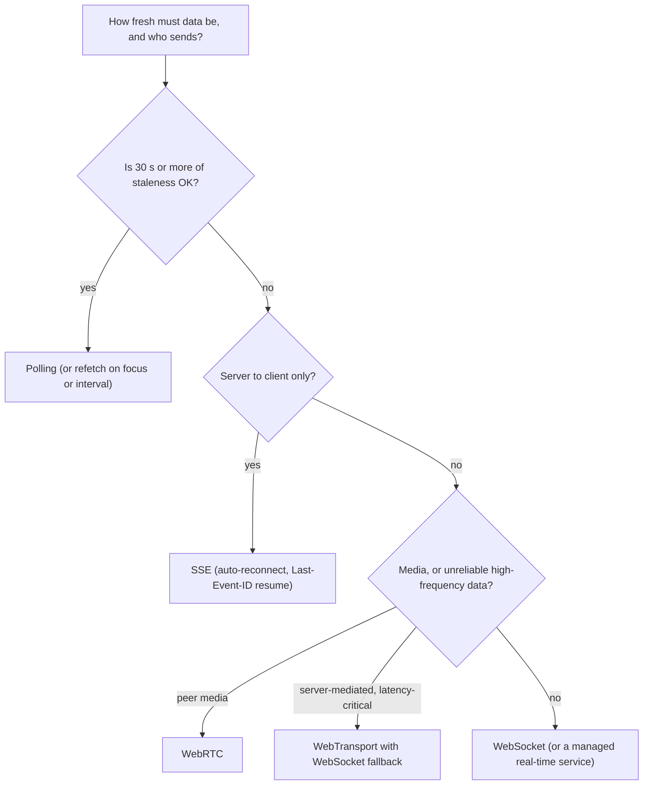
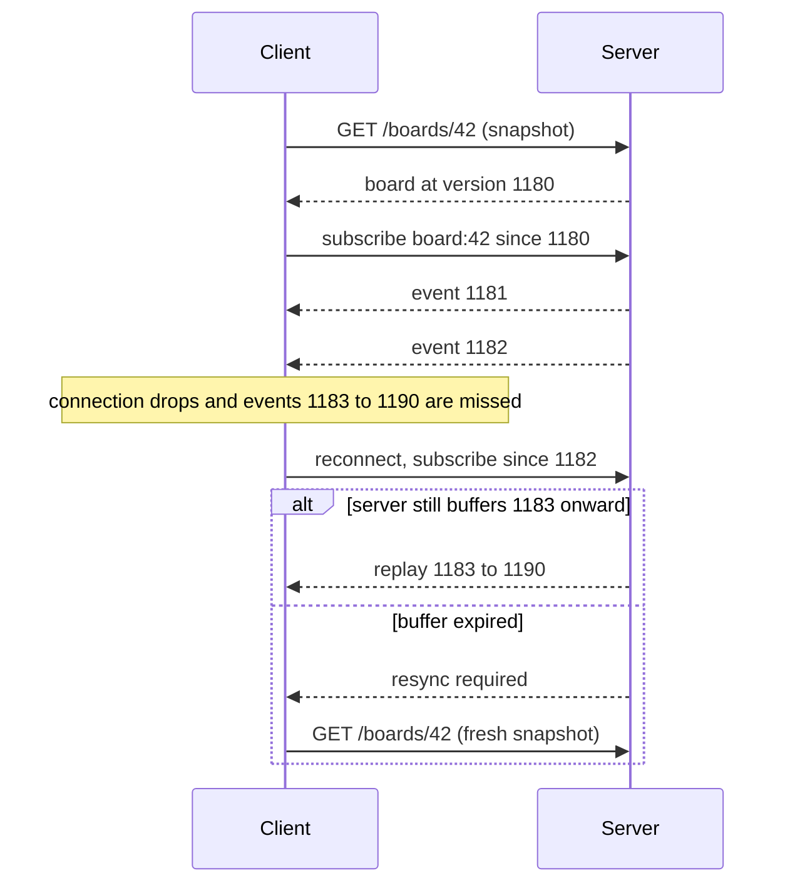
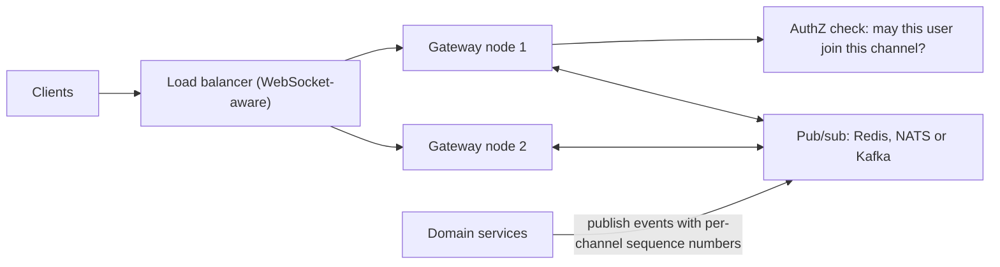
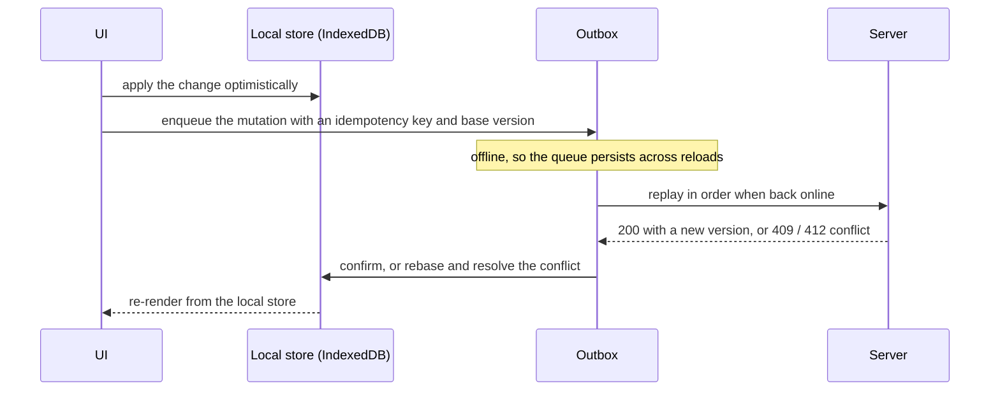

# 34 — Real-time, Offline and Collaboration

> Real-time is easy until the connection drops. Offline is easy until two people edit the same thing. Collaboration is the art of making both of those boring.

**Prerequisites:** [28](28-state-and-data-ownership-architecture.md), [30](30-server-state-and-data-fetching.md), [33](33-api-integration-bff-and-contracts.md) · **Related:** [06 Web Platform APIs](06-modern-web-platform-apis.md) · [40 Resilience](40-resilience-and-reliability.md) · [69 Case Study: Acme Boards](69-case-study-collaborative-project-management.md)

---

## TL;DR

- Choose the transport by **direction and frequency**:
  - **Polling** for "fresh within a minute".
  - **SSE** for server-to-client feeds (notifications, progress, LLM tokens).
  - **WebSockets** for bidirectional, high-frequency traffic.
  - **WebTransport** (Baseline since Safari 26.4 shipped it in March 2026) for low-latency streams and datagrams where you control the server.
  - **WebRTC** for peer-to-peer media.
- In React, **push events into the server-state cache** (update or invalidate query data). Don't push them into component state. Keep one connection manager outside React and expose it with `useSyncExternalStore` and `useEffectEvent`.
- Assume **at-least-once, possibly out-of-order delivery**. Number events per channel, dedupe them, detect gaps, and resync from a snapshot. Treat events as hints and the server as the truth.
- Offline is a spectrum: offline-tolerant (cached reads), offline-capable (queued writes, the **outbox** pattern), and local-first (the local database is primary, sync runs in the background).
- Pick conflict resolution **per data type**:
  - Optimistic concurrency (`If-Match`, 412) for records.
  - Field-level last-writer-wins for simple properties.
  - **CRDTs** (Yjs, Automerge, Loro) or OT for rich text and shared documents.
  - **Fractional indexing** for ordered lists.
- Collaboration has three planes with different guarantees: **document state** (durable, merged), **presence** (ephemeral, lossy, throttled) and **activity** (comments and notifications through the normal API).
- Real-time endpoints are a security boundary: authenticate the connection, **check `Origin`** (cross-site WebSocket hijacking), authorise **every channel**, and validate every message.

---

## 1. The transport spectrum

| Transport | Direction | Latency | Reconnect / resume | Infrastructure | Best for |
|---|---|---|---|---|---|
| **Short polling** | Client pull | Interval | Trivial | Plain HTTP, CDN-friendly | Dashboards that tolerate 30–60 s staleness |
| **Long polling** | Pull (held open) | Low | Manual | Plain HTTP; holds server resources | Legacy fallback |
| **SSE** (`EventSource`) | Server → client | Low | **Built in** (`Last-Event-ID`) | HTTP; use HTTP/2+ to avoid the HTTP/1.1 per-origin connection limit | Notifications, job progress, streamed AI output |
| **WebSocket** | Bidirectional | Very low | Manual (backoff, resubscribe) | Stateful connections, sticky routing, pub/sub fan-out | Chat, collaboration, live trading UIs, games |
| **WebTransport** | Bidirectional streams and datagrams over HTTP/3 | Lowest (no head-of-line blocking; unreliable datagrams) | Manual | HTTP/3 servers; ecosystem still maturing | Media, gaming, telemetry, high-frequency state |
| **WebRTC data channel** | Peer-to-peer | Lowest | Manual (ICE restarts) | Signalling server, STUN/TURN | Peer collaboration, media, P2P transfer |

> [!NOTE]
> WebTransport became **Baseline (newly available) in March 2026** when Safari 26.4 shipped it. Chrome has had it since 97 and Firefox since 114. The support floor on Apple devices is the **OS version** (iOS and macOS 26.4), and interop details are still settling, so keep a WebSocket fallback for now.

### 1.1 Choosing



---

## 2. Delivery semantics: design for the bad day

Networks drop, servers restart and phones sleep. Design for:

| Reality | Consequence | Design response |
|---|---|---|
| **At-least-once** delivery after reconnects or retries | Duplicate events | Idempotent handlers: dedupe by event ID or a per-channel sequence number |
| **Gaps** while disconnected | Missed events | Resume from the last sequence number. If the server's buffer has expired, **resync** from a snapshot |
| **Reordering** across channels or nodes | Stale overwrites | Per-entity version numbers. Ignore events older than the cached version |
| **Your own echoes** | Optimistic UI flickers or doubles | Tag mutations with a client mutation ID and reconcile on echo |
| **Clock skew** | Wrong last-writer-wins outcomes | Server-assigned versions or hybrid logical clocks. Never trust client wall-clock time |

### 2.1 Snapshot plus deltas



Subscribing *since a version* closes the race between taking the snapshot and opening the subscription.

---

## 3. Real-time in React

### 3.1 A connection manager outside React

One connection per app, with channels multiplexed over it. It lives in a module or in context, **not** in a component. Strict Mode's double-invoked effects, route changes and re-renders must never open new sockets.

```ts
// shared/realtime/client.ts
type ServerMsg =
  | { type: 'event'; channel: string; seq: number; payload: unknown }
  | { type: 'resync'; channel: string } // server: too much was missed, refetch
  | { type: 'pong' };

type Listener = (payload: unknown) => void;
export type ConnectionStatus = 'connecting' | 'open' | 'reconnecting' | 'offline' | 'closed';

export class RealtimeClient {
  private ws: WebSocket | null = null;
  private attempt = 0;
  private status: ConnectionStatus = 'connecting';
  private heartbeat: ReturnType<typeof setInterval> | undefined;
  private readonly listeners = new Map<string, Set<Listener>>();
  private readonly lastSeq = new Map<string, number>();
  private readonly statusListeners = new Set<() => void>();
  private readonly url: string;
  private readonly onResync: (channel: string) => void;

  constructor(url: string, onResync: (channel: string) => void) {
    this.url = url;
    this.onResync = onResync;
    window.addEventListener('online', () => { if (this.status === 'offline') this.connect(); });
  }

  connect(): void {
    // Cookie-authenticated. The server MUST check the Origin header.
    const ws = new WebSocket(this.url);
    this.ws = ws;
    ws.onopen = () => {
      this.attempt = 0;
      this.setStatus('open');
      for (const channel of this.listeners.keys()) this.sendSubscribe(channel); // resubscribe and resume
      this.heartbeat = setInterval(() => this.send({ type: 'ping' }), 25_000);
    };
    ws.onmessage = (e) => this.handle(JSON.parse(String(e.data)) as ServerMsg); // validate in production
    ws.onclose = () => {
      clearInterval(this.heartbeat);
      if (this.status === 'closed') return;
      if (!navigator.onLine) return this.setStatus('offline'); // the 'online' listener reconnects
      this.setStatus('reconnecting');
      const delay = Math.random() * Math.min(30_000, 500 * 2 ** this.attempt++); // backoff with full jitter
      setTimeout(() => this.connect(), delay);
    };
  }

  close(): void {
    this.setStatus('closed');
    this.ws?.close();
  }

  subscribe(channel: string, listener: Listener): () => void {
    const existing = this.listeners.get(channel);
    const set = existing ?? new Set<Listener>();
    if (!existing) {
      this.listeners.set(channel, set);
      this.sendSubscribe(channel);
    }
    set.add(listener);
    return () => {
      set.delete(listener);
      if (set.size === 0) {
        this.listeners.delete(channel);
        this.send({ type: 'unsubscribe', channel });
      }
    };
  }

  // For useSyncExternalStore
  getStatus = (): ConnectionStatus => this.status;
  onStatusChange = (cb: () => void): (() => void) => {
    this.statusListeners.add(cb);
    return () => { this.statusListeners.delete(cb); };
  };

  private handle(msg: ServerMsg): void {
    if (msg.type === 'pong') return;
    if (msg.type === 'resync') return this.onResync(msg.channel);
    const last = this.lastSeq.get(msg.channel);
    if (last !== undefined && msg.seq <= last) return; // duplicate: at-least-once delivery
    this.lastSeq.set(msg.channel, msg.seq);
    if (last !== undefined && msg.seq > last + 1) return this.onResync(msg.channel); // gap: refetch the truth
    this.listeners.get(msg.channel)?.forEach((l) => l(msg.payload));
  }

  private sendSubscribe(channel: string): void {
    this.send({ type: 'subscribe', channel, sinceSeq: this.lastSeq.get(channel) ?? null });
  }

  private send(msg: object): void {
    if (this.ws?.readyState === WebSocket.OPEN) this.ws.send(JSON.stringify(msg));
    // Otherwise drop it: subscriptions are re-sent on open, and writes go through the outbox (§5)
  }

  private setStatus(next: ConnectionStatus): void {
    this.status = next;
    this.statusListeners.forEach((l) => l());
  }
}
```

> [!TIP]
> `navigator.onLine === true` only means "there is a network interface". It doesn't mean "the internet works". Treat failed requests and missed heartbeats as the real signal, and `online`/`offline` events as hints.

### 3.2 React bindings

```ts
// shared/realtime/react.ts
import { createContext, use, useEffect, useEffectEvent, useSyncExternalStore } from 'react';
import type { ConnectionStatus, RealtimeClient } from './client';

export const RealtimeContext = createContext<RealtimeClient | null>(null);

function useRealtime(): RealtimeClient {
  const client = use(RealtimeContext);
  if (!client) throw new Error('<RealtimeContext> is missing');
  return client;
}

export function useConnectionStatus(): ConnectionStatus {
  const client = useRealtime();
  return useSyncExternalStore(client.onStatusChange, client.getStatus, () => 'connecting');
}

export function useChannel(channel: string, onEvent: (payload: unknown) => void): void {
  const client = useRealtime();
  const handle = useEffectEvent(onEvent); // always the latest handler, without resubscribing
  useEffect(() => client.subscribe(channel, (payload) => handle(payload)), [client, channel]);
}
```

### 3.3 Push into the cache, not into component state

```ts
// features/board/use-board-live.ts
import { useQueryClient } from '@tanstack/react-query';
import { z } from 'zod';
import { useChannel } from '@/shared/realtime/react';
import { boardKeys, CardSchema, type Board } from '@/entities/board';

const BoardEvent = z.discriminatedUnion('kind', [
  z.object({ kind: z.literal('card.updated'), card: CardSchema }),
  z.object({ kind: z.literal('card.moved'), cardId: z.string() }),
  z.object({ kind: z.literal('card.deleted'), cardId: z.string() }),
]);

export function useBoardLive(boardId: string): void {
  const queryClient = useQueryClient();

  useChannel(`board:${boardId}`, (raw) => {
    const parsed = BoardEvent.safeParse(raw); // the socket is a trust boundary too
    if (!parsed.success) return;              // report to monitoring in real code
    const event = parsed.data;

    switch (event.kind) {
      case 'card.updated':
        // Small, self-contained change: apply the delta, but never overwrite newer data
        queryClient.setQueryData<Board>(boardKeys.detail(boardId), (board) =>
          board && {
            ...board,
            cards: board.cards.map((c) =>
              c.id === event.card.id && c.version < event.card.version ? event.card : c),
          });
        break;
      case 'card.moved':
      case 'card.deleted':
        // Ordering-sensitive change: treat the event as a hint and refetch the truth
        void queryClient.invalidateQueries({ queryKey: boardKeys.detail(boardId) });
        break;
    }
  });
}
```

Two strategies, often mixed:

| Strategy | How | Use when |
|---|---|---|
| **Invalidate on event** | The event says "X changed", so refetch X | Payloads are large, ordering matters, or permissions may differ per viewer |
| **Apply the delta** | The event carries new data, so `setQueryData` | Small, self-contained changes with versions (counters, statuses, single records) |

Wire the client's `onResync` to `queryClient.invalidateQueries(...)` for the channel's keys, so gaps heal automatically.

### 3.4 SSE when it's one-way

```ts
// The browser reconnects automatically and sends Last-Event-ID so the server can resume
const source = new EventSource('/bff/notifications/stream', { withCredentials: true });

source.addEventListener('notification', (e) => {
  const n = NotificationSchema.parse(JSON.parse(e.data));
  queryClient.setQueryData<Notification[]>(notificationKeys.all, (list = []) => [n, ...list]);
});
```

SSE is plain HTTP. It works through proxies and CDNs that support streaming, authenticates with cookies, and needs no sticky protocol upgrade. For streaming AI responses, SSE or streamed `fetch` bodies are the norm ([65](65-ai-powered-react-interfaces.md)).

---

## 4. Scaling real-time



| Concern | Guidance |
|---|---|
| **Fan-out** | Gateways hold connections. A pub/sub backbone distributes events. Services publish and don't know about sockets |
| **Statefulness** | Connections pin to a node. Deploys drain connections, so expect reconnect storms and jitter the backoff |
| **Replay** | Keep a bounded per-channel buffer (or a log, such as Kafka or Redis Streams) to resume from `sinceSeq` |
| **Serverless** | Most function platforms can't hold long-lived sockets. Use a managed service (Ably, Pusher, Liveblocks, Supabase Realtime) or stateful edge primitives such as Cloudflare Durable Objects, which PartyKit (now part of Cloudflare) builds on |
| **Backpressure** | Coalesce high-frequency updates (send the latest state at 10–20 Hz, not every change). Drop presence before durable events |
| **Limits** | Per-connection message rate limits, payload caps, and a cap on channels per connection |

---

## 5. Offline: a spectrum, not a checkbox

| Level | What works offline | Mechanisms | Example |
|---|---|---|---|
| **Online-only** | Nothing; a clear offline message | Error boundaries, retry | Admin console |
| **Offline-tolerant** | Reads from cache; writes blocked | Service worker caching, persisted query cache | News, docs, dashboards |
| **Offline-capable** | Reads and **queued writes** | Outbox, idempotency keys, conflict handling | Field-service apps, notes, retail POS |
| **Local-first** | Everything; sync is background | Local database (IndexedDB or SQLite-WASM on OPFS) plus a sync engine or CRDTs | Linear-style apps, editors |

### 5.1 Storage building blocks

| API | Use | Notes |
|---|---|---|
| **Cache API** (via a service worker) | HTTP responses: app shell, assets, API GETs | Pair with strategies: cache-first (hashed assets), stale-while-revalidate (reads), network-first (HTML) |
| **IndexedDB** | Structured data, outboxes, persisted query caches | Asynchronous, transactional. Use a wrapper (`idb`, Dexie) |
| **OPFS** (Origin Private File System) | Files, and SQLite-WASM databases | Fast synchronous access in workers. The foundation of browser SQLite |
| `localStorage` | Tiny preferences only | Synchronous (blocks the main thread), about 5 MB, strings only. Never tokens ([43](43-frontend-security-architecture.md)) |

> [!WARNING]
> Browser storage is **evictable**. Call `navigator.storage.persist()` for important offline data, monitor `navigator.storage.estimate()`, and design for "the local copy is gone". Safari also deletes script-writable storage for sites that haven't had user interaction in seven days of browser use (installed home-screen apps are exempt). Background Sync is Chromium-only. Replay the outbox on app start and on `online` everywhere else.

### 5.2 Offline mutations with TanStack Query

```tsx
// app/providers.tsx
import { QueryClient } from '@tanstack/react-query';
import { PersistQueryClientProvider } from '@tanstack/react-query-persist-client';
import { createAsyncStoragePersister } from '@tanstack/query-async-storage-persister';
import { get, set, del } from 'idb-keyval';
import type { ReactNode } from 'react';
import { cardApi, type UpdateCardVars } from '@/entities/card/api';

const queryClient = new QueryClient({
  defaultOptions: { queries: { gcTime: 24 * 60 * 60 * 1000 } }, // keep data long enough to persist
});

// Paused mutations are persisted without their functions, so register them by key
// so they can resume after a reload
queryClient.setMutationDefaults(['card', 'update'], {
  mutationFn: (vars: UpdateCardVars) => cardApi.update(vars), // vars carry an idempotency key
});

const persister = createAsyncStoragePersister({
  storage: { getItem: get, setItem: set, removeItem: del }, // IndexedDB, not localStorage
});

export function Providers({ children }: { children: ReactNode }) {
  return (
    <PersistQueryClientProvider
      client={queryClient}
      persistOptions={{ persister, maxAge: 24 * 60 * 60 * 1000, buster: import.meta.env.VITE_BUILD_ID }}
      onSuccess={() => queryClient.resumePausedMutations().then(() => queryClient.invalidateQueries())}
    >
      {children}
    </PersistQueryClientProvider>
  );
}
```

With the default `networkMode: 'online'`, mutations **pause** while offline, are persisted, and resume when the app restores. Use the same `mutationKey` in components (`useMutation({ mutationKey: ['card', 'update'] })`).

### 5.3 The outbox pattern

For anything beyond simple cases, make the write queue explicit:



Outbox rules:

- **Idempotency keys** on every entry, so replays after a crash don't double-apply ([33](33-api-integration-bff-and-contracts.md)).
- **Order per entity.** Don't let "rename" overtake "create".
- **Base versions** on updates, so the server can detect conflicts.
- **Visible state.** Show "3 changes waiting to sync", with per-item failure and retry. Never silently drop a user's work.
- **Poison messages.** After N permanent failures (for example a 422), move the entry aside and tell the user.

---

## 6. Conflict resolution

| Strategy | How | Pros | Cons | Fits |
|---|---|---|---|---|
| **Optimistic concurrency** | `If-Match: <etag>`; the server answers `412 Precondition Failed` on mismatch | Simple, server-authoritative, no silent loss | The user resolves conflicts; poor for high-concurrency editing | Forms, records, settings |
| **Last-writer-wins (record)** | The highest version or timestamp wins | Trivial | Silently loses concurrent edits | Low-contention, low-value data |
| **Field-level LWW** | Merge per field | Fewer lost edits | Cross-field invariants can break | Cards, profiles, task fields |
| **Domain merge** | Custom rules (sum counters, union tags) | Matches business meaning | Must be written and tested per type | Inventory, carts, tags |
| **OT** (operational transformation) | Transform concurrent operations against each other via a central server | Proven for text (Google Docs) | Complex; needs a central sequencer | Server-centric text editors |
| **CRDTs** | Data types whose concurrent updates converge automatically | Offline and peer-to-peer friendly; no central sequencer needed | Metadata overhead; validating updates on the server is hard | Rich text, shared documents, whiteboards |

### 6.1 Optimistic concurrency in practice

```ts
const res = await fetch(`/bff/cards/${card.id}`, {
  method: 'PATCH',
  headers: { 'Content-Type': 'application/merge-patch+json', 'If-Match': card.etag },
  body: JSON.stringify(patch),
});

if (res.status === 412) {
  // Someone else changed the card. Fetch the latest, then re-apply the user's patch to the
  // fields they touched, or show a merge dialog. Never silently overwrite.
}
```

### 6.2 Ordered lists: fractional indexing

Moving an item in a list as "delete at *i*, insert at *j*" duplicates it when two users move it concurrently. Store a **sortable position key** instead, generated *between* the neighbours. A concurrent move then becomes an ordinary last-writer-wins on one field.

```ts
import { generateKeyBetween } from 'fractional-indexing';

// Between "a0" and "a1" gives "a0V"; at the start of the list (null, "a0") gives "Zz"
const position = generateKeyBetween(prev?.position ?? null, next?.position ?? null);
// Sort by (position, id): two clients inserting different items in the same gap can produce equal keys
```

---

## 7. Collaboration architecture

### 7.1 Three planes

| Plane | Examples | Guarantees | Transport |
|---|---|---|---|
| **Document state** | Card fields, text, canvas shapes | Durable, convergent, persisted | CRDT or OT sync over WebSocket; persisted server-side |
| **Presence and awareness** | Cursors, selections, "Ana is typing", who's viewing | Ephemeral, lossy, latest value wins | Same socket; throttled; never persisted |
| **Activity** | Comments, mentions, notifications, history | Durable, auditable, permission-checked | Normal API plus events ([33](33-api-integration-bff-and-contracts.md)) |

### 7.2 Yjs in a React app

```ts
// features/board/collab/doc.ts
import * as Y from 'yjs';
import { WebsocketProvider } from 'y-websocket';
import { IndexeddbPersistence } from 'y-indexeddb';
import { generateKeyBetween } from 'fractional-indexing';

export const LOCAL = Symbol('local-origin'); // lets the UndoManager track only this user's changes

export function openBoard(boardId: string) {
  const doc = new Y.Doc();
  const local = new IndexeddbPersistence(`board:${boardId}`, doc);                 // offline, instant load
  const remote = new WebsocketProvider('wss://collab.acme.dev', `board:${boardId}`, doc); // sync
  const cards = doc.getMap<Y.Map<string>>('cards');                                // a nested Y.Map per card
  const undo = new Y.UndoManager(cards, { trackedOrigins: new Set([LOCAL]) });     // per-user undo

  return {
    doc, cards, undo, awareness: remote.awareness,
    destroy() { undo.destroy(); remote.destroy(); void local.destroy(); doc.destroy(); },
  };
}

// Field-level merge: concurrent edits to different fields of the same card both survive
export function moveCard(
  doc: Y.Doc, cards: Y.Map<Y.Map<string>>, cardId: string,
  column: string, before: string | null, after: string | null,
): void {
  const card = cards.get(cardId);
  if (!card) return;
  doc.transact(() => {
    card.set('column', column);
    card.set('position', generateKeyBetween(before, after));
  }, LOCAL);
}
```

```ts
// shared/collab/use-y.ts: subscribe React to a Yjs type with a stable snapshot
import { useSyncExternalStore } from 'react';
import type * as Y from 'yjs';

type Store<T> = { subscribe: (onChange: () => void) => () => void; getSnapshot: () => T };
const stores = new WeakMap<object, Store<unknown>>();

function storeFor<T>(type: Y.AbstractType<any>, read: () => T): Store<T> {
  const cached = stores.get(type) as Store<T> | undefined;
  if (cached) return cached;
  let snapshot = read();
  const listeners = new Set<() => void>();
  // Observe for the lifetime of the type, so the snapshot is never stale between subscriptions
  type.observeDeep(() => { snapshot = read(); listeners.forEach((l) => l()); });
  const store: Store<T> = {
    subscribe: (onChange) => { listeners.add(onChange); return () => { listeners.delete(onChange); }; },
    getSnapshot: () => snapshot, // same reference until the next change, as useSyncExternalStore requires
  };
  stores.set(type, store);
  return store;
}

export function useYMapJSON<T>(map: Y.Map<unknown>): Record<string, T> {
  const store = storeFor(map, () => map.toJSON() as Record<string, T>);
  return useSyncExternalStore(store.subscribe, store.getSnapshot);
}
```

Presence via awareness, throttled and in **board coordinates** (not viewport pixels, which differ per user):

```ts
awareness.setLocalStateField('user', { id: me.id, name: me.name, color: me.color });

const publishCursor = throttle((p: { x: number; y: number }) => {
  awareness.setLocalStateField('cursor', p); // lossy by design: only the latest value matters
}, 50);
```

### 7.3 Collaboration UX checklist

- **Presence:** avatars of who's here, live cursors and selections, "following" mode for presentations.
- **Per-user undo:** undo reverts *my* changes, not my colleague's (`trackedOrigins`).
- **Sync status:** "Saved", "Saving…", "Offline: changes saved on this device", "Conflict".
- **Attribution:** history and "last edited by" come from the activity plane, not the CRDT.
- **Accessibility:** announce remote changes politely and sparingly (`aria-live="polite"`, batched), and never move the user's focus because of someone else's edit ([36](36-accessibility-engineering.md)).

### 7.4 Permissions in collaborative documents

> [!CAUTION]
> CRDT updates are opaque binary deltas produced by **untrusted clients**. A relay that blindly applies and rebroadcasts them lets any member with write access write *anything* into the document, including fields the UI never exposes. Enforce access at the **room level** (read-only connections can't send updates). Use server-authoritative commands or schema validation on the server for fine-grained rules. Keep sensitive data (prices, permissions, audit fields) **out of the shared document** entirely.

### 7.5 Build, buy or sync engine

| Option | Examples | Trade-off |
|---|---|---|
| **CRDT library plus your own server** | Yjs with y-websocket or Hocuspocus, Automerge, Loro | Full control; you operate persistence, auth and scaling |
| **Managed collaboration** | Liveblocks, Ably, Cloudflare Durable Objects / PartyKit | Fast to ship; vendor coupling; pricing grows with concurrent users |
| **Sync engine** (database to client) | Zero (Rocicorp; 1.0 in 2026), Electric, PowerSync, InstantDB, Convex | Local-first queries over your database with server permissions. Adopting one is an architectural commitment, so evaluate maturity, permission models and escape hatches |

---

## 8. Security for real-time endpoints

- **Authenticate the connection.** Prefer the session cookie on the upgrade request. If you need a token, send it in the first message or use a short-lived ticket, never a long-lived token in the URL (URLs end up in logs).
- **Check `Origin` on the WebSocket upgrade.** Browsers attach cookies to cross-site WebSocket requests, and the same-origin policy doesn't protect them. Without an `Origin` allowlist you're open to **cross-site WebSocket hijacking (CSWSH)**.
- **Authorise every subscription.** `subscribe board:42` must check that the user can read board 42 in *this tenant*. Channel names are user input.
- **Validate every message** server-side (schema, size, rate). Clients can send anything.
- **Re-check authorisation on long-lived connections.** Permissions change and sessions get revoked. Disconnect, or re-authorise periodically and on revocation events.
- **Rate-limit** messages per connection and per user. Cap payload sizes and channel counts.

---

## 9. Testing and observability

| Test | How |
|---|---|
| Offline and reconnect | Playwright `context.setOffline(true)`, then false; assert the outbox drains and the UI recovers |
| WebSocket behaviour | Playwright `page.routeWebSocket()` or MSW's `ws` handlers to script server messages, gaps and duplicates |
| Conflicts | Two browser contexts editing the same entity; assert convergence and a visible resolution |
| Flaky networks | Throttling profiles; a proxy that drops and delays frames in end-to-end environments |
| CRDT convergence | Property-based tests: random concurrent operations on N replicas must converge |

Metrics worth a dashboard ([41](41-observability-and-diagnostics.md)):

- Connection success rate and time to connect.
- Reconnects per session.
- **Event lag** (server send time to client apply time, p95).
- Resync rate.
- **Outbox depth and age.**
- Conflict rate.
- Presence fan-out per room.

---

## Decision framework

**Problem.** How fresh, how collaborative and how offline must this feature be, and what happens to the user's work when the network fails?

**Constraints.** Latency targets, device and network quality, the hosting model (serverless or stateful), data sensitivity, team experience with distributed systems, and budget for managed services.

| Requirement | Approach |
|---|---|
| Dashboard fresh within a minute | Polling, or refetch on focus or interval with TanStack Query |
| Notifications and job progress | SSE into the query cache |
| Chat or a live activity feed | WebSocket with per-channel sequence numbers and resync |
| Collaborative structured data (boards, tables) | Server-authoritative records, field-level merges, events for invalidation; fractional indexing for order |
| Collaborative rich text or canvas | CRDT (Yjs, Automerge, Loro) with room-level authorisation and server persistence |
| Field work with poor connectivity | Offline-capable: persisted cache, outbox, idempotency keys, conflict UI |
| Product-defining instant UX across devices | Local-first with a sync engine, after a maturity and permissions evaluation |

**Criteria.** Data loss risk, user-visible latency, operational complexity, security (authorisation granularity), cost per concurrent user, and vendor lock-in.

**Failure modes.**
- Sockets opened per component.
- No resync after gaps.
- Events applied over newer data.
- Silent last-writer-wins on valuable data.
- Unbounded outboxes.
- Presence persisted as document state.
- Missing `Origin` checks.
- Serverless platforms that kill long connections.

**Migration path.** Polling, then SSE for one-way feeds, then WebSockets when bidirectional needs appear. Add a persisted cache and offline messaging before queued writes. Add queued writes before local-first. Introduce CRDTs only for the data types that need them, not the whole app.

---

## Pitfalls and anti-patterns

- Opening a WebSocket inside a component's effect (Strict Mode double-connects and route changes reconnect).
- Storing real-time data in component state alongside a query cache (two sources of truth).
- Applying events without versions, so stale events overwrite fresh data.
- Reconnecting without jitter, so every client stampedes the server after a deploy.
- Treating `navigator.onLine` as truth.
- Deleting and re-inserting to reorder CRDT lists (duplicates on concurrent moves).
- Sending cursor positions on every `pointermove` without throttling.
- Long-lived tokens in WebSocket URLs.
- Offline writes without idempotency keys, which create duplicate orders on replay.
- Silently discarding queued writes that fail validation.

---

## Architect's checklist

- [ ] Transport chosen per feature (polling, SSE, WebSocket, WebTransport) with a fallback plan
- [ ] One connection manager outside React; channels multiplexed; React bindings via `useSyncExternalStore` and `useEffectEvent`
- [ ] Per-channel sequence numbers, dedupe, gap detection and snapshot resync
- [ ] Events update or invalidate the server-state cache; versions guard against stale overwrites
- [ ] Backoff with jitter; heartbeats; reconnect on `online`; drained connections on deploy
- [ ] Offline level decided per feature; persisted cache in IndexedDB; outbox with idempotency keys and visible sync state
- [ ] Conflict strategy per data type; fractional indexing for ordered collections
- [ ] Presence separated from document state and throttled
- [ ] Origin check, per-channel authorisation, message validation and rate limits
- [ ] Metrics: event lag, reconnect rate, resync rate, outbox depth, conflict rate

---

## Interview angles

**Q1. WebSockets, SSE or polling for a notifications feed?**
Notifications flow server to client, so SSE is the natural fit. It's plain HTTP with cookie auth, reconnects automatically, and resumes with `Last-Event-ID`. Use HTTP/2 or later to avoid the HTTP/1.1 connection limit. Polling is fine if a minute of staleness is acceptable and simplicity matters most. WebSockets earn their operational cost when the client also sends frequent messages (chat, collaboration). Whichever you choose, push events into the query cache, not into component state.

**Q2. How do you integrate real-time events with TanStack Query (or any server-state cache)?**
Keep one connection manager outside React and subscribe through a small hook (`useEffectEvent` keeps the handler fresh without resubscribing). For each event, either apply the delta with `setQueryData`, guarded by entity versions, or invalidate the affected keys and refetch. Number events per channel to dedupe and detect gaps, and resync by invalidating when a gap appears or the server requests it. Tag your own mutations so their echoes reconcile instead of double-applying.

**Q3. Design offline support for a field-service app that creates and edits work orders.**
Persist the query cache in IndexedDB and cache the app shell with a service worker. Writes go to an outbox with an idempotency key and base version per entry, and are replayed in order per entity when online (on app start and `online`; Background Sync where available). Show sync status and per-item failures. Resolve conflicts with optimistic concurrency (412 responses, then a merge UI), plus field-level merges for low-risk fields. Request persistent storage, and handle eviction and Safari's seven-day storage rule.

**Q4. CRDT, OT or last-writer-wins: how do you choose?**
By data type and stakes. Records and forms: optimistic concurrency, where the server detects conflicts and the user decides, so nothing is lost silently. Independent fields: field-level last-writer-wins. Counters, sets and rich text that people edit concurrently, especially offline or peer to peer: CRDTs, which converge without a central sequencer. OT suits server-centric text editing. Ordered lists: fractional indexing. Most products mix these; very few need CRDTs everywhere.

**Q5. How do you secure a WebSocket endpoint?**
Authenticate on the upgrade (a session cookie or short-lived ticket, never a long-lived token in the URL) and enforce an `Origin` allowlist, because cookies are sent on cross-site WebSocket requests (CSWSH). Authorise every channel subscription against tenant and resource. Validate, size-cap and rate-limit every message. Re-authorise long-lived connections when permissions change or sessions are revoked. For CRDT rooms, enforce read and write at the room level and keep sensitive fields out of the shared document.

---

## Further reading

- MDN, *Server-sent events*: <https://developer.mozilla.org/en-US/docs/Web/API/Server-sent_events> · *WebSockets API*: <https://developer.mozilla.org/en-US/docs/Web/API/WebSockets_API> · *WebTransport API*: <https://developer.mozilla.org/en-US/docs/Web/API/WebTransport_API>
- WebKit, *WebKit Features for Safari 26.4*: <https://webkit.org/blog/17862/webkit-features-for-safari-26-4/>
- web.dev, *Storage for the web*: <https://web.dev/articles/storage-for-the-web>
- TanStack Query docs, *Mutations: persisting offline mutations* and *persistQueryClient*: <https://tanstack.com/query/latest/docs/framework/react/guides/mutations>
- Martin Kleppmann et al., *Local-first software*: <https://www.inkandswitch.com/essay/local-first/>
- Yjs documentation: <https://docs.yjs.dev/> · Automerge: <https://automerge.org/> · Loro: <https://loro.dev/>
- Evan Wallace, *Realtime Editing of Ordered Sequences* (Figma blog): <https://www.figma.com/blog/realtime-editing-of-ordered-sequences/>
- Rocicorp, *Zero* documentation: <https://zero.rocicorp.dev/docs/introduction>
- OWASP, *WebSocket Security Cheat Sheet*: <https://cheatsheetseries.owasp.org/cheatsheets/WebSocket_Security_Cheat_Sheet.html>

---

[← Previous: 33 — API Integration, BFF and Data Contracts](33-api-integration-bff-and-contracts.md) · [Index](README.md) · [Next: 35 — Enterprise Design System Architecture →](35-enterprise-design-system-architecture.md)
