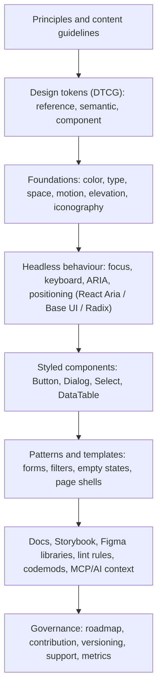
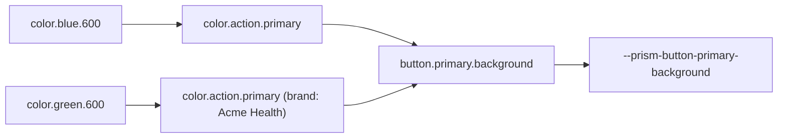
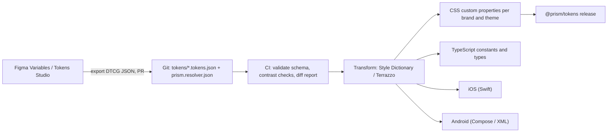
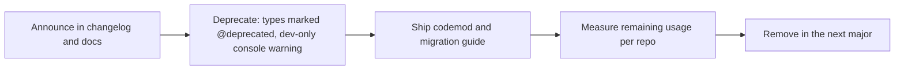
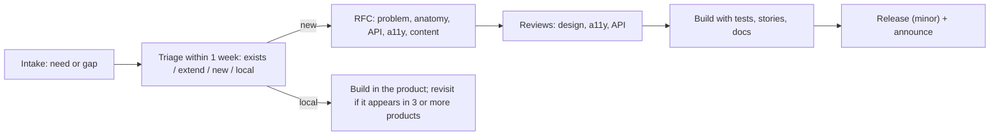

# 35 — Enterprise Design System Architecture

> A design system is not a component library. It's a product whose customers are your product teams, and whose currency is the decisions they no longer have to make.

**Prerequisites:** [07](07-modern-css-and-layout-architecture.md), [22](22-component-architecture-and-patterns.md), [23](23-styling-architecture-and-theming.md) · **Related:** [36 Accessibility](36-accessibility-engineering.md) · [60 Monorepos](60-monorepos-build-tooling-and-bundlers.md) · [70 Case Study: Prism](70-case-study-enterprise-design-system.md)

---

## TL;DR

- Architect the system in **layers**: principles → **tokens** → foundations → **headless behaviour** → styled components → patterns and templates → documentation and tooling → **governance**. Each layer has its own owners, release cadence and consumers.
- **Tokens are the contract between design and code.** Use three tiers (reference → semantic → component) in the **DTCG format**, whose first stable version (2025.10) shipped in October 2025 with Format, Color and Resolver modules. Generate CSS custom properties, TypeScript and native outputs from one source.
- **Don't hand-roll accessible behaviour for complex widgets.** Build on a headless layer (React Aria, Base UI 1.x, Radix, Ark UI), wrap it, and never let consumers import it directly, so the foundation stays swappable.
- **Theming** (brands, dark mode, density, contrast) is a remap of semantic tokens, applied with CSS custom properties, `light-dark()`, data attributes and cascade layers. Never fork components per brand.
- **Distribution:**
  - ESM packages with per-component entry points and correct `'use client'` boundaries for RSC.
  - Zero-runtime CSS.
  - Optionally an "open code" registry (the shadcn/ui model) for recipes teams are expected to own.
- **Change management is the hard part:** a semver policy that defines "breaking" (visual and DOM changes count), deprecation windows, **codemods**, visual and a11y regression gates, and adoption telemetry.
- **Governance** decides success more than code does. Choose a team model (centralised, federated or hybrid), run a contribution path, and measure adoption, version lag and time-to-ship.

---

## 1. The layers of a design system



| Layer | Owner | Changes | Consumers |
|---|---|---|---|
| Tokens | DS designers and engineers | Frequently (values), rarely (names) | Every platform: web, iOS, Android, email, PDFs |
| Headless behaviour | DS engineers (often a vendor library) | Rarely | Styled components only |
| Styled components | DS engineers, with contributions | Monthly | Product teams |
| Patterns | DS plus product teams (federated) | Continuously | Product teams |
| Docs and tooling | DS team | Continuously | Designers, engineers, AI agents |

---

## 2. Tokens architecture

### 2.1 Three tiers

| Tier | Examples | Rule |
|---|---|---|
| **Reference** (primitive) | `color.blue.600`, `space.4`, `radius.2`, `font.size.300` | Raw palette. **Never** used directly by components |
| **Semantic** (system) | `color.text.default`, `color.surface.raised`, `color.action.primary`, `color.border.danger`, `space.inset.md` | Intent-based. **Themes remap these** |
| **Component** | `button.primary.background`, `input.border.focus` | Optional. For component-specific overrides and white-labelling |



### 2.2 The DTCG format (2025.10)

```json
{
  "color": {
    "$type": "color",
    "blue": {
      "600": {
        "$value": { "colorSpace": "oklch", "components": [0.55, 0.2, 260], "hex": "#2563eb" }
      }
    }
  },
  "space": {
    "$type": "dimension",
    "4": { "$value": { "value": 1, "unit": "rem" } }
  },
  "semantic": {
    "color": {
      "action": {
        "primary": {
          "$type": "color",
          "$value": "{color.blue.600}",
          "$description": "Primary call-to-action background"
        }
      }
    }
  }
}
```

Key points of the stable spec:

- `$type` and `$value` (types can be inherited from groups). Aliases use `{path.to.token}`.
- **Colour values are objects**, with a `colorSpace` (including `srgb`, `oklch` and `display-p3`), `components`, and optional `alpha` and `hex` fallback. That matches how wide-gamut design tools work.
- **Dimensions are objects** (`{ "value": 1, "unit": "rem" }`), not strings.
- The **Resolver module** describes how token sets and modifiers (theme, brand, density) combine, so you don't store every combination.

```json
{
  "$schema": "https://www.designtokens.org/schemas/2025.10/resolver.json",
  "version": "2025.10",
  "name": "Prism",
  "sets": {
    "foundation": { "sources": [{ "$ref": "tokens/foundation.tokens.json" }] }
  },
  "modifiers": {
    "brand": {
      "contexts": {
        "acme": [{ "$ref": "tokens/brand/acme.tokens.json" }],
        "acme-health": [{ "$ref": "tokens/brand/acme-health.tokens.json" }]
      },
      "default": "acme"
    },
    "theme": {
      "contexts": {
        "light": [{ "$ref": "tokens/theme/light.tokens.json" }],
        "dark": [{ "$ref": "tokens/theme/dark.tokens.json" }]
      },
      "default": "light"
    }
  },
  "resolutionOrder": [
    { "$ref": "#/sets/foundation" },
    { "$ref": "#/modifiers/brand" },
    { "$ref": "#/modifiers/theme" }
  ]
}
```

### 2.3 The token pipeline



Governance rules for tokens:

- **Git is the source of truth.** Design tools sync through pull requests, not by overwriting.
- **Contrast is checked in CI.** Every semantic text/surface pair must meet WCAG contrast in every theme ([36](36-accessibility-engineering.md)).
- **Renames are breaking.** Ship aliases for one major version. Value changes are visual changes, so they go through visual regression review.
- **Lint against raw values** in product code (Stylelint's `declaration-strict-value` plugin, or a custom rule). A hex code in a feature stylesheet is design debt with a timestamp.

---

## 3. Theming: brands, modes, density and contrast

```css
/* @prism/tokens/dist/prism.css (generated) */
@layer reset, prism.tokens, prism.base, prism.components, app;

@layer prism.tokens {
  :root {
    color-scheme: light dark; /* follow the OS until the user chooses */
    --prism-color-surface-default: light-dark(oklch(99% 0 0), oklch(20% 0.01 260));
    --prism-color-text-default: light-dark(oklch(22% 0.02 260), oklch(95% 0.01 260));
    --prism-color-action-primary: light-dark(oklch(55% 0.2 260), oklch(70% 0.15 260));
    --prism-space-control-block: 0.5rem;
  }
  :root[data-theme='light'] { color-scheme: light; }
  :root[data-theme='dark'] { color-scheme: dark; }

  /* Brand: remap semantic tokens only */
  :root[data-brand='acme-health'] {
    --prism-color-action-primary: light-dark(oklch(52% 0.14 160), oklch(72% 0.12 160));
  }

  /* Density */
  :root[data-density='compact'] { --prism-space-control-block: 0.25rem; }

  @media (prefers-contrast: more) {
    :root { --prism-color-border-default: var(--prism-color-text-default); }
  }
}
```

| Concern | Technique |
|---|---|
| **Dark mode** | `color-scheme` plus `light-dark()`, with `data-theme` for an explicit user choice |
| **No flash of the wrong theme** | Read the preference cookie on the server and render `<html data-theme>` in the root layout. For SPAs, a tiny blocking inline script before CSS |
| **Multi-brand** | One brand file per brand remaps semantic tokens. Same components, same DOM |
| **Density** | Spacing and control-size tokens per density mode |
| **High contrast** | `prefers-contrast` and `forced-colors: active`. Use system colours (`ButtonText`, `Canvas`) for borders and focus in forced-colours mode |
| **Reduced motion** | Motion tokens collapse to zero or a crossfade under `prefers-reduced-motion` ([24](24-animation-and-motion-systems.md)) |
| **Consumer overrides** | The `app` layer outranks `prism.components` without specificity wars ([07](07-modern-css-and-layout-architecture.md)) |

> [!IMPORTANT]
> **Never fork components per brand.** If a brand needs a different *shape* (a different layout or extra parts), it's a different component or a slot, not a theme. Themes change values; components own structure.

---

## 4. Component architecture

### 4.1 Build on a headless layer, then wrap it

| Option | What you get | Trade-offs |
|---|---|---|
| **React Aria / React Aria Components** (Adobe) | The most exhaustive behaviour and i18n (date pickers, drag and drop, virtualised collections) | Verbose APIs; a larger surface to learn |
| **Base UI** (MUI; 1.0 in December 2025, package `@base-ui/react`) | Modern unstyled parts with a `render` prop and data attributes for state | Younger ecosystem |
| **Radix Primitives** | Widely used; the foundation of the original shadcn/ui | `asChild` composition; check maintenance cadence for your needs |
| **Ark UI** (Zag.js state machines) | Framework-agnostic behaviour (React, Vue, Solid, Svelte) | Machine-based mental model |
| **Build your own** | Total control | Years of a11y edge cases (focus traps, typeahead, virtual cursors, IME). Rarely worth it beyond simple primitives |

The **wrapper rule**: product code imports `@prism/react/dialog`, never `@base-ui/react/dialog`. The design system owns the API, so it can switch foundations (Radix to Base UI, say) without touching 300 call sites.

```js
// eslint.config.js in product apps
export default [
  {
    rules: {
      'no-restricted-imports': ['error', {
        paths: [{ name: '@base-ui/react', message: 'Use @prism/react: the design system wraps the headless layer.' }],
        patterns: [{ group: ['@base-ui/react/*'], message: 'Use the matching @prism/react/* entry point.' }],
      }],
    },
  },
];
```

### 4.2 An opinionated wrapper: accessibility encoded in types

```tsx
// packages/react/src/dialog/Dialog.tsx
'use client';
import { Dialog as Base } from '@base-ui/react/dialog';
import type { ReactElement, ReactNode } from 'react';
import styles from './Dialog.module.css';

export type DialogProps = {
  /** Required: every dialog needs an accessible name. */
  title: ReactNode;
  description?: ReactNode;
  /** The element that opens the dialog, e.g. <Button>Edit</Button>. */
  trigger?: ReactElement;
  open?: boolean;
  defaultOpen?: boolean;
  onOpenChange?: (open: boolean) => void;
  footer?: ReactNode;
  children: ReactNode;
};

export function Dialog({ title, description, trigger, open, defaultOpen, onOpenChange, footer, children }: DialogProps) {
  return (
    <Base.Root open={open} defaultOpen={defaultOpen} onOpenChange={(next) => onOpenChange?.(next)}>
      {trigger && <Base.Trigger render={trigger} />}
      <Base.Portal>
        <Base.Backdrop className={styles.backdrop} />
        <Base.Popup className={styles.popup}>
          <Base.Title className={styles.title}>{title}</Base.Title>
          {description && <Base.Description className={styles.description}>{description}</Base.Description>}
          <div className={styles.body}>{children}</div>
          {footer && <div className={styles.footer}>{footer}</div>}
        </Base.Popup>
      </Base.Portal>
    </Base.Root>
  );
}
```

Design choices worth copying:

- **Make the accessible path the only path.** `title` is required, so a dialog without a name doesn't compile.
- **Expose intent, not implementation.** `onOpenChange(open)` hides vendor-specific event details. Add escape hatches deliberately, not by passing everything through.
- **Style state with data attributes** that the headless layer sets (`data-open`, `data-disabled`, transition-status attributes) rather than JavaScript-computed class names.

### 4.3 A styled primitive

```tsx
// packages/react/src/button/Button.tsx
'use client'; // interactive: guards activation while loading
import type { ComponentPropsWithRef, MouseEvent } from 'react';
import styles from './Button.module.css';

export type ButtonProps = Omit<ComponentPropsWithRef<'button'>, 'disabled'> & {
  variant?: 'primary' | 'secondary' | 'danger' | 'ghost';
  size?: 'sm' | 'md' | 'lg';
  /** Keeps focus on the button and blocks activation while true. */
  loading?: boolean;
  disabled?: boolean;
};

export function Button({
  variant = 'primary', size = 'md', loading = false, disabled = false,
  type = 'button', className, onClick, children, ...rest
}: ButtonProps) {
  const inert = loading || disabled;
  function handleClick(event: MouseEvent<HTMLButtonElement>) {
    if (inert) { event.preventDefault(); return; } // aria-disabled doesn't block activation by itself
    onClick?.(event);
  }
  return (
    <button
      {...rest}
      type={type}
      className={[styles.button, className].filter(Boolean).join(' ')}
      data-variant={variant}
      data-size={size}
      data-loading={loading || undefined}
      aria-disabled={inert || undefined}
      onClick={handleClick}
    >
      {loading && <span className={styles.spinner} aria-hidden="true" />}
      <span className={styles.label}>{children}</span>
    </button>
  );
}
```

```css
/* Button.module.css: semantic tokens only, inside the design-system layer */
@layer prism.components {
  .button {
    display: inline-flex;
    align-items: center;
    gap: var(--prism-space-2);
    min-block-size: 2.5rem; /* comfortably above the WCAG 2.2 24×24 px minimum target */
    padding-inline: var(--prism-space-4);
    border: 1px solid transparent;
    border-radius: var(--prism-radius-control);
    font: var(--prism-font-label-md);
    color: var(--prism-color-text-on-action);
    background: var(--prism-color-action-primary);
    cursor: pointer;
  }
  .button:hover { background: var(--prism-color-action-primary-hover); }
  .button:focus-visible { outline: 2px solid var(--prism-color-focus-ring); outline-offset: 2px; }
  .button[data-variant='secondary'] {
    color: var(--prism-color-text-default);
    background: var(--prism-color-surface-default);
    border-color: var(--prism-color-border-default);
  }
  .button[data-size='sm'] { min-block-size: 2rem; padding-inline: var(--prism-space-3); }
  .button[aria-disabled='true'] { opacity: 0.6; cursor: not-allowed; }
  @media (forced-colors: active) {
    .button { border-color: ButtonText; }
    .button:focus-visible { outline-color: Highlight; }
  }
}
```

Why `aria-disabled` rather than `disabled`? A natively disabled button loses focus and can't be discovered by keyboard users, so the loading state moves focus to `<body>`. `aria-disabled` keeps the button focusable and announced. The click guard blocks activation.

### 4.4 RSC compatibility

| Component kind | Directive | Examples |
|---|---|---|
| **Layout and typography** (no hooks, no handlers) | None, so they're server-safe | `Stack`, `Grid`, `Text`, `Heading`, `Card`, `Badge`, `VisuallyHidden` |
| **Interactive** (state, effects, handlers, headless hooks) | `'use client'` at the entry point | `Button`, `Dialog`, `Select`, `Tabs`, `Tooltip`, `DataTable` |

- Put `'use client'` **in the component's own module**, not in a barrel file. A barrel marked `'use client'` drags every export into the client bundle.
- **Check your library build keeps the directives.** Some bundlers strip or hoist module-level directives unless configured to preserve them.
- **No runtime CSS-in-JS.** It needs client context and serialises styles during render. Use CSS Modules, vanilla-extract, StyleX, Panda or Tailwind ([23](23-styling-architecture-and-theming.md)).

---

## 5. Distribution and packaging

```json
{
  "name": "@prism/react",
  "version": "5.3.0",
  "type": "module",
  "sideEffects": ["**/*.css"],
  "exports": {
    "./button": { "types": "./dist/button/index.d.ts", "default": "./dist/button/index.js" },
    "./dialog": { "types": "./dist/dialog/index.d.ts", "default": "./dist/dialog/index.js" },
    "./styles.css": "./dist/styles.css",
    "./package.json": "./package.json"
  },
  "peerDependencies": { "react": "^19.2.0", "react-dom": "^19.2.0" },
  "dependencies": { "@base-ui/react": "^1.9.0", "@prism/tokens": "^5.0.0" }
}
```

| Decision | Recommendation |
|---|---|
| Module format | ESM only, with per-component subpath exports (tree-shakeable, clear RSC boundaries) |
| React | `peerDependencies`, never `dependencies` (duplicate React breaks hooks) |
| CSS | Precompiled CSS per component, plus one tokens stylesheet. Declare it in `sideEffects` so bundlers keep it |
| Icons | Separate package, one module per icon, SVG components or a sprite. Never an icon font |
| Types | Ship `.d.ts`, and treat public types as API under semver |
| Budgets | `size-limit` per entry point in CI. Fail the PR when Dialog grows 3 kB |

### 5.1 Packaged library or "open code" registry?

| Model | How | Strengths | Weaknesses |
|---|---|---|---|
| **Packaged library** | `npm install @prism/react` | Central fixes, consistent upgrades, enforceable a11y | Customisation through props and slots only; upgrade friction |
| **Open code registry** (shadcn/ui model) | A CLI copies component source into the app from a registry | Full ownership and customisation; no dependency lock-in | Every copy drifts; fixes don't propagate; a11y regressions are local |
| **Hybrid** (common in enterprises) | Package the tokens and core primitives; distribute *recipes* and patterns through a registry | Core correctness stays central; teams own composition | Two channels to govern |

---

## 6. Versioning, deprecation and change management

### 6.1 What counts as breaking

| Change | Semver |
|---|---|
| Removing or renaming a prop, component, token or CSS variable | **Major** |
| Changing DOM structure that consumers style or test against (class names, element types) | **Major** (or explicitly declared private) |
| Changing default behaviour (focus target, close-on-outside-click) | **Major** |
| Visual changes beyond bug fixes (size, spacing, colour shifts) | Minor with a changelog and visual diff (some organisations treat these as major) |
| New props, components or tokens | Minor |
| Bug and a11y fixes | Patch (call out behaviour changes) |

Publish the policy. Mark which surfaces are private (internal class names, `data-*` attributes not in the docs) so consumers know what they can rely on.

### 6.2 The deprecation lifecycle



```ts
// codemods/v6/button-kind-to-variant.ts (jscodeshift)
import type { API, FileInfo } from 'jscodeshift';

export default function transform(file: FileInfo, api: API): string {
  const j = api.jscodeshift;
  const root = j(file.source);
  const importsPrismButton = root
    .find(j.ImportDeclaration, { source: { value: '@prism/react/button' } })
    .size() > 0;
  if (!importsPrismButton) return file.source; // only touch our Button

  root.findJSXElements('Button').forEach((element) => {
    for (const attr of element.node.openingElement.attributes ?? []) {
      if (attr.type === 'JSXAttribute' && attr.name.name === 'kind') {
        attr.name = j.jsxIdentifier('variant');
      }
    }
  });
  return root.toSource();
}
```

### 6.3 Quality gates per component

| Gate | Tooling |
|---|---|
| Visual regression across themes, brands and densities | Chromatic or Playwright screenshots of Storybook stories |
| Accessibility | axe in component tests and Storybook, keyboard interaction tests, manual screen-reader passes for complex widgets ([36](36-accessibility-engineering.md)) |
| Interaction behaviour | Storybook play functions or Vitest browser mode ([42](42-testing-architecture.md)) |
| API stability | API Extractor or type snapshots of public exports |
| Bundle size | `size-limit` per entry point |
| Token contrast | Contrast checks over every semantic text/surface pair per theme |

### 6.4 Adoption telemetry

- **Static analysis across repos** (react-scanner, custom AST scripts, Omlet-style tools): which components, which props, which versions, and how many hand-rolled lookalikes.
- **Version lag:** the share of apps on the current major and on N−1. This is your upgrade-friction metric.
- **Figma analytics:** component insertions and detachments, a leading indicator of missing variants.
- **Runtime sampling** (optional): `data-prism-component` attributes, counted in RUM to see what users actually encounter.

---

## 7. Multi-framework design systems

| Strategy | How | Pros | Cons |
|---|---|---|---|
| **Shared tokens and CSS, native components per framework** | One token pipeline; React, Angular (CDK / `@angular/aria`) and native apps each implement components | Idiomatic APIs; best DX | N implementations to keep consistent |
| **Web Components core** (Lit, Stencil) plus thin wrappers | Custom elements with Shadow DOM | One implementation; works everywhere | SSR needs Declarative Shadow DOM; styling across shadow boundaries (`::part`, custom properties); form participation via `ElementInternals`; ARIA references can't cross shadow roots yet |
| **Compile from one source** (Mitosis and similar) | Author once, generate per framework | One source | Lowest-common-denominator features; generated-code debugging |
| **CSS-only layer plus behaviour per framework** | Class-based CSS (the Bootstrap model) with framework-specific behaviour | Very portable | Behaviour and a11y duplicated per framework |

> [!NOTE]
> React 19 fully supports custom elements: it sets properties rather than stringifying attributes and attaches event listeners for `on*` props, which removes most of the old wrapper boilerplate. The hard problems that remain are SSR, cross-shadow-root ARIA and theming. Prototype your most complex widget (a combobox or date picker) before committing to Web Components.

---

## 8. Documentation and tooling

- **Storybook 10** (October 2025; ESM-only, typesafe CSF Factories, module automocking) is the workshop and test harness. Stories double as visual, a11y and interaction tests. Storybook 10.3 added a preview **MCP server** so AI agents can query component docs and stories.
- **Docs site** per component: when to use and when not to, anatomy, props, a11y notes (keyboard map, announcements), content guidelines, do/don't examples, and live code.
- **Design–code links:** Figma Code Connect or equivalent, so designers' components map to real imports.
- **Lint and codemods** ship with the system: `@prism/eslint-plugin` (deprecated APIs, restricted imports, no raw colours) and `@prism/codemods`.
- **Machine-readable context** for coding agents: an `llms.txt`, component metadata in JSON, and MCP access to the docs. Agents generate whatever the context shows them, so make sure it shows the design system ([65](65-ai-powered-react-interfaces.md)).

---

## 9. Governance and team topology

| Model | How it works | Works when | Risk |
|---|---|---|---|
| **Centralised** | A dedicated DS team builds everything | Early stage, strong consistency needs | Bottleneck; disconnected from product needs |
| **Federated** | Product teams contribute; a small core curates | Mature organisation, many teams | Inconsistency; no one owns quality |
| **Hybrid** (most common) | The core team owns tokens, primitives and quality bars; product teams contribute patterns through a defined path | Most enterprises | Needs clear contribution criteria and SLAs |

### 9.1 The contribution path



The "rule of three": a pattern that appears in three products is a candidate for the system. Before then it's a local component, and that's fine.

### 9.2 Measuring success

| Metric | Why |
|---|---|
| Adoption (share of UI from DS components; lookalike count) | Is the system actually used? |
| Version lag (apps on current and N−1 majors) | Are upgrades affordable? |
| Time to build a standard screen | The real productivity promise |
| Accessibility defects in DS-built vs custom UI | Is quality centralised? |
| Contribution lead time | Is the system a bottleneck? |
| Consumer satisfaction (quarterly survey) | Is it a product people choose? |

---

## Decision framework

**Problem.** How should one organisation ship consistent, accessible, brandable UI across many teams, apps and frameworks without slowing them down?

**Constraints.** Number of teams and apps, frameworks in use (React only, or React plus Angular plus native), brand count, regulatory a11y obligations (the EAA, Section 508), existing libraries to migrate, and DS team size and funding.

| Decision | Options | Default for an enterprise |
|---|---|---|
| Token format | DTCG, proprietary JSON, CSS only | **DTCG 2025.10** with a resolver for brand, theme and density |
| Behaviour foundation | React Aria, Base UI, Radix, Ark, custom | A mature headless library, **wrapped** |
| Styling | CSS Modules, zero-runtime CSS-in-JS, Tailwind preset | Zero-runtime CSS plus custom properties in cascade layers |
| Distribution | Package, registry, hybrid | **Hybrid**: package core primitives, registry for recipes |
| Multi-framework | Per-framework, Web Components, compiled | Shared tokens and CSS, per-framework components (Web Components only after a complex-widget prototype) |
| Governance | Centralised, federated, hybrid | **Hybrid**, with the rule of three and published SLAs |

**Criteria.** Accessibility correctness, consistency, team velocity, upgrade cost, bundle cost, multi-brand flexibility, and the cost of ownership for the DS team.

**Failure modes.**
- A component library with no tokens, so theming means forking.
- Consumers importing the headless vendor directly.
- Breaking changes without codemods, so version lag grows to three majors.
- Brand-specific component forks.
- Runtime CSS-in-JS blocking RSC adoption.
- A DS team that builds what's interesting rather than what's needed.

**Migration path.** Tokens first (wrap legacy values as reference tokens, introduce semantics). Then primitives behind wrappers. Then high-traffic components, one at a time, with codemods. Then patterns. Track adoption and lookalike counts throughout ([70](70-case-study-enterprise-design-system.md)).

---

## Pitfalls and anti-patterns

- Components consuming reference tokens (`blue-600`) directly, so dark mode needs a rewrite.
- Tokens named after values (`color.blue`, `space.16px`) instead of intent.
- A "God component" with 60 props instead of composition and slots ([22](22-component-architecture-and-patterns.md)).
- Re-implementing combobox, menu or date picker behaviour by hand.
- `'use client'` on a barrel file, which puts the whole library in the client bundle.
- Shipping CSS that relies on specificity hacks instead of cascade layers.
- Visual changes released as patches with no visual diff.
- Measuring success by component count rather than adoption and time saved.
- Mandating adoption without funding migration help.

---

## Architect's checklist

- [ ] Layered architecture with an owner, cadence and consumers for each layer
- [ ] DTCG tokens in three tiers; resolver for brand, theme and density; contrast checked in CI
- [ ] Generated outputs for CSS, TS and native platforms from one source
- [ ] Headless foundation wrapped; vendor imports restricted by lint
- [ ] Theming through semantic remaps, `light-dark()`, data attributes and cascade layers; no FOUC strategy
- [ ] RSC-correct `'use client'` placement; zero-runtime CSS; per-component ESM entry points
- [ ] Semver policy that defines breaking; deprecation lifecycle with codemods
- [ ] Visual, a11y, interaction, API and bundle-size gates per component
- [ ] Adoption and version-lag telemetry across repos
- [ ] Contribution path with triage SLAs and a published governance model
- [ ] Docs, Storybook and machine-readable context (MCP/llms.txt) kept in sync with releases

---

## Interview angles

**Q1. Architect a design system for 40 product teams using React and Angular.**
Start from tokens: DTCG format in three tiers, with a resolver for brands and themes and a pipeline that generates CSS variables, TS and native outputs. Ship framework-agnostic CSS in cascade layers. Implement components per framework on mature headless foundations (React Aria or Base UI for React, the Angular CDK or `@angular/aria` for Angular), sharing tokens, anatomy, docs and test specifications so behaviour matches. Govern with a hybrid model: a core team owns tokens, primitives and quality bars, and product teams contribute patterns through an RFC path. Measure adoption, version lag and time-to-ship.

**Q2. How do you structure tokens for multi-brand and dark mode?**
Reference tokens hold the raw palette. Semantic tokens express intent (`color.action.primary`). Components consume only semantic or component tokens. Brands and modes are modifiers that remap semantic tokens to different references, combined by a resolver. In CSS that becomes custom properties scoped by `data-brand` and `data-theme`, with `light-dark()` for system mode and contrast validated per combination. Components never know which brand they're in.

**Q3. Build your own primitives or use a headless library?**
Use a headless library for anything with complex interaction semantics (combobox, menu, dialog, date picker, grid). The a11y edge cases (focus management, typeahead, screen-reader quirks, IME, RTL) represent years of work. Wrap it behind your own API so you control the contract and can swap the foundation. Build your own only for simple primitives, or when no library meets a hard requirement.

**Q4. How do you ship a breaking change in a design system used by 200 apps?**
Define it in the semver policy. Announce it. Ship the replacement alongside the old API with `@deprecated` types and dev-only warnings. Provide a codemod and a migration guide. Measure remaining usage per repo with static analysis, and help the stragglers. Remove it only in the next major, after the support window. Visual and a11y gates confirm the replacement is equivalent.

**Q5. shadcn-style open code or a packaged library?**
Open code maximises ownership and customisation but gives up central fixes: every copy drifts, and a11y fixes don't propagate. A package centralises correctness but limits customisation. Enterprises usually go hybrid: package tokens and core primitives (where correctness matters most), and distribute higher-level recipes through a registry that teams are expected to own and adapt.

---

## Further reading

- Design Tokens Community Group, *Design Tokens Technical Reports 2025.10* (Format, Color, Resolver): <https://www.designtokens.org/tr/2025.10/>
- Base UI documentation: <https://base-ui.com/> · React Aria: <https://react-spectrum.adobe.com/react-aria/> · Radix Primitives: <https://www.radix-ui.com/primitives> · Ark UI: <https://ark-ui.com/>
- Storybook 10 release notes: <https://storybook.js.org/blog/storybook-10/>
- Style Dictionary: <https://styledictionary.com/> · Terrazzo: <https://terrazzo.app/>
- Brad Frost, *Atomic Design*: <https://atomicdesign.bradfrost.com/>
- EightShapes (Nathan Curtis), articles on design system team models and governance: <https://medium.com/eightshapes-llc>
- Open UI (standardising UI component behaviour): <https://open-ui.org/>
- Custom Elements Everywhere: <https://custom-elements-everywhere.com/>
- W3C, *Understanding SC 2.5.8 Target Size (Minimum)*: <https://www.w3.org/WAI/WCAG22/Understanding/target-size-minimum.html>

---

[← Previous: 34 — Real-time, Offline and Collaboration](34-realtime-offline-and-collaboration.md) · [Index](README.md) · [Next: 36 — Accessibility as a System Contract →](36-accessibility-engineering.md)
