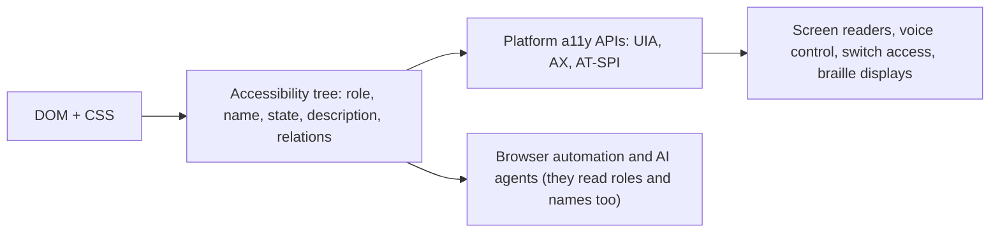
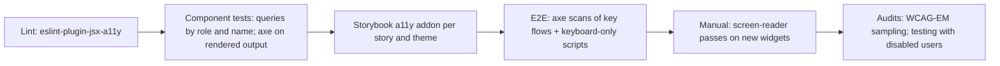

# 36 — Accessibility as a System Contract

> Accessibility isn't a feature you add or an audit you pass. It's a contract your system makes with every user, and like any contract, it needs owners, tests and consequences.

**Prerequisites:** [02](02-browser-rendering-pipeline.md), [22](22-component-architecture-and-patterns.md), [26](26-forms-and-validation.md) · **Related:** [25 Complex UI](25-complex-ui-engineering.md) · [31 Routing](31-routing-architecture.md) · [35 Design Systems](35-enterprise-design-system-architecture.md) · [42 Testing](42-testing-architecture.md)

> [!NOTE]
> This chapter describes legal frameworks so engineers understand the obligations behind the requirements. It isn't legal advice. Involve counsel for compliance decisions.

---

## TL;DR

- Treat accessibility like security: a **non-functional requirement** with a standard (WCAG 2.2 AA), owners, design-time annotations, automated gates, manual and assistive-technology testing, and a defect SLA.
- **The legal floor is rising.** The European Accessibility Act has applied since **28 June 2025**. **EN 301 549 V4.1.1** (published September 2026) moves the European baseline to **WCAG 2.2 AA**. The US ADA Title II rule requires WCAG 2.1 AA, with deadlines extended in April 2026 to **2027 and 2028**. WCAG 2.2 is also **ISO/IEC 40500:2025**.
- **Native HTML first.** ARIA can only *describe* behaviour; you still have to implement it. `<button>`, `<a href>`, `<dialog>`, `popover`, `<details>`, labels and fieldsets get you most of the way with correct semantics, keyboard support and focus behaviour for free.
- **Focus is architecture:**
  - Roving tabindex or `aria-activedescendant` for composite widgets.
  - Restore focus when overlays close.
  - Manage focus on route changes.
  - `inert` behind modals.
  - `scroll-padding` so sticky headers don't obscure focus (WCAG 2.2, SC 2.4.11).
- **Announce what changes.** Keep live regions mounted from the start, and use one app-level announcer for status messages, async results and errors.
- **The design system is your leverage.** Fix a combobox once and 300 screens improve. Encode accessibility in component APIs (required names, safe defaults).
- **Automation finds only part of the problem.** Layer lint → role-based component tests → axe in CI → keyboard end-to-end tests → screen-reader passes → audits with disabled users. Overlay widgets don't make a site compliant: the FTC fined one vendor $1 million in 2025 for claiming they did.

---

## 1. The contract and its legal backdrop

| Framework | Scope | Technical standard | Status (late 2026) |
|---|---|---|---|
| **European Accessibility Act** (Directive 2019/882) | E-commerce, banking, transport, e-books, telecoms and more, for businesses serving EU consumers (microenterprises exempt for services) | EN 301 549 (harmonised standard) | Applies since **28 June 2025**, enforced by member states |
| **EN 301 549 V4.1.1** | ICT products and services (web, software, documents) | **WCAG 2.2 AA** plus extra requirements | Published **2 September 2026**. V3.2.1 (WCAG 2.1 AA) remains the presumption-of-conformity baseline until V4.1.1 is cited in the EU Official Journal. Laws that cite EN 301 549 without a version may pick up V4.1.1 directly |
| **Web Accessibility Directive** (EU public sector) | Public-sector sites and apps | EN 301 549 | In force |
| **ADA Title II rule** (US state and local government) | Government web content and mobile apps | WCAG 2.1 AA | Compliance dates extended by an April 2026 interim final rule: **April 2027** (populations of 50,000 or more) and **April 2028** (smaller entities and special districts) |
| **ADA Title III** (US public accommodations) | Businesses open to the public | No regulation; courts commonly reference WCAG 2.x AA | Active litigation |
| **Section 508** (US federal) | Federal ICT and procurement | WCAG 2.0 AA (revised 508 standards) | In force; vendors supply ACRs/VPATs |

**Engineering target:** WCAG **2.2 AA** everywhere. It's backward-compatible with 2.1, it's where EN 301 549 has moved, and it's what users actually need. WCAG 3 remains a working draft. Track it, but don't build to it yet.

---

## 2. WCAG 2.2 for engineers

### 2.1 What changed in 2.2

| SC | Level | What it means in a React codebase |
|---|---|---|
| **2.4.11 Focus Not Obscured (Minimum)** | AA | Sticky headers, cookie banners and chat widgets must not fully hide the focused element. Use `scroll-padding` and give overlays dismissal paths |
| 2.4.12 Focus Not Obscured (Enhanced) | AAA | No part of the focused element hidden |
| 2.4.13 Focus Appearance | AAA | Strong focus indicators (area and contrast); a good DS default anyway |
| **2.5.7 Dragging Movements** | AA | Every drag operation (reordering, sliders, maps, kanban) needs a single-pointer alternative: buttons, menus, "move to…" |
| **2.5.8 Target Size (Minimum)** | AA | Pointer targets at least **24×24 CSS px**, or enough spacing. Icon buttons, table row actions, close "×" |
| **3.2.6 Consistent Help** | A | Help mechanisms (chat, contact, FAQ link) stay in the same relative place across pages |
| **3.3.7 Redundant Entry** | A | Don't make users re-type information already given in the same process (prefill shipping as billing, for example) |
| **3.3.8 Accessible Authentication (Minimum)** | AA | No cognitive function tests without an alternative. **Allow paste** and password managers. Passkeys and magic links qualify ([45](45-authentication-and-authorization.md)) |
| 3.3.9 Accessible Authentication (Enhanced) | AAA | Not even object or personal-content recognition |
| ~~4.1.1 Parsing~~ | — | Removed (obsolete) |

### 2.2 The failures that never go away

Year after year, large-scale scans of home pages (such as WebAIM's annual *Million* report) find the same top failures: **low-contrast text, missing alternative text, missing form labels, empty links, empty buttons and a missing document language**. Nearly every one is preventable with design-system defaults and lint rules.

---

## 3. Semantics and the accessibility tree



### 3.1 Native first

| Need | Use | Not |
|---|---|---|
| Action | `<button type="button">` | `<div onClick>` (no role, focus or keyboard activation) |
| Navigation | `<a href>` | `<button onClick={navigate}>` (breaks open-in-new-tab, history, semantics) |
| Modal | `<dialog>` with `showModal()` (focus containment, Esc, top layer, inert background), or a DS Dialog built on it or a headless library | A `div` with `role="dialog"` and hand-rolled trapping |
| Disclosure | `<details>`/`<summary>`, or a button with `aria-expanded` | Clickable headings |
| Popover or menu surface | `popover` plus `popovertarget` or invoker commands ([06](06-modern-web-platform-apis.md)) | Portals with manual outside-click handling |
| Form grouping | `<fieldset>` + `<legend>` | Visual grouping only |
| Data table | `<table>` with `<th scope>` and `<caption>` | CSS grids of `div`s for tabular data |

> [!IMPORTANT]
> **The first rule of ARIA:** don't use ARIA if a native element provides the semantics and behaviour. `role="button"` doesn't make a `div` focusable or keyboard-activatable. It only *promises* that it is. Bad ARIA is worse than no ARIA.

### 3.2 Accessible names

Computed (roughly) in this order: `aria-labelledby` → `aria-label` → native labelling (`<label for>`, `alt`, `<caption>`, `<legend>`) → text content (for roles that allow it) → `title`.

| Rule | Example |
|---|---|
| Every interactive element has a name | `<button aria-label="Close dialog"><XIcon aria-hidden="true" /></button>` |
| **Label in name** (SC 2.5.3): the accessible name contains the visible label | Visible "Send", name "Send message", **not** "Submit form". Voice-control users say what they see |
| Hide decorative content | `aria-hidden="true"` on icons next to text; `alt=""` on decorative images |
| Don't duplicate | An `aria-label` that repeats the visible text adds noise |
| IDs for relationships come from `useId()` | `aria-describedby={hintId}` stays stable across SSR and hydration |

---

## 4. Keyboard and focus architecture

### 4.1 The rules

- **Tab order follows DOM order.** Never use a positive `tabindex`. If the visual order differs from the DOM order (CSS grid `order`, absolute positioning), fix the DOM.
- **Composite widgets have one Tab stop.** Toolbars, radio groups, tabs, menus, listboxes, grids and trees use arrow keys inside. Implement it with **roving tabindex** (focus moves between items) or **`aria-activedescendant`** (focus stays on a container or input, and the active option is referenced). Comboboxes use the latter.
- **Overlays:** move focus in on open (to the first meaningful control, or the dialog itself). Contain it while modal. **Restore it to the invoker on close.**
- **Route changes:** move focus to the new page's `<h1>` (or a skip target) and announce the title ([31](31-routing-architecture.md)).
- **Skip link:** the first focusable element jumps to `<main>`.
- **Visible focus everywhere:** `:focus-visible` styles from the DS. Never `outline: none` without a replacement.
- **Not obscured:**

```css
/* Focused elements scroll clear of the sticky header (SC 2.4.11) */
html { scroll-padding-block-start: calc(var(--app-header-height) + 0.5rem); }
```

### 4.2 Roving tabindex: an APG toolbar

```tsx
// shared/ui/Toolbar.tsx
'use client';
import { useEffect, useRef, type FocusEvent, type KeyboardEvent, type ReactNode } from 'react';

// aria-disabled items stay in the roving set: discoverable by keyboard, but inert when activated
const ITEM = '[data-toolbar-item]';
const getItems = (root: HTMLElement | null) => Array.from(root?.querySelectorAll<HTMLElement>(ITEM) ?? []);

/** One Tab stop. Arrow keys, Home and End move focus between items (WAI-ARIA APG toolbar pattern). */
export function Toolbar({ label, children }: { label: string; children: ReactNode }) {
  const rootRef = useRef<HTMLDivElement>(null);
  const currentRef = useRef<HTMLElement | null>(null);

  // After every render, ensure exactly one item is tabbable (items can be added or removed)
  useEffect(() => {
    const items = getItems(rootRef.current);
    if (!currentRef.current || !items.includes(currentRef.current)) currentRef.current = items[0] ?? null;
    for (const el of items) el.tabIndex = el === currentRef.current ? 0 : -1;
  });

  function moveTo(next: HTMLElement) {
    if (currentRef.current) currentRef.current.tabIndex = -1;
    next.tabIndex = 0;
    currentRef.current = next;
    next.focus();
  }

  function onKeyDown(event: KeyboardEvent<HTMLDivElement>) {
    const items = getItems(rootRef.current);
    const index = items.indexOf(document.activeElement as HTMLElement);
    if (index === -1) return;
    const rtl = getComputedStyle(event.currentTarget).direction === 'rtl';
    const forward = rtl ? 'ArrowLeft' : 'ArrowRight';
    const backward = rtl ? 'ArrowRight' : 'ArrowLeft';
    const target =
      event.key === forward ? items[(index + 1) % items.length]
      : event.key === backward ? items[(index - 1 + items.length) % items.length]
      : event.key === 'Home' ? items[0]
      : event.key === 'End' ? items[items.length - 1]
      : undefined;
    if (!target) return;
    event.preventDefault();
    moveTo(target);
  }

  function onFocus(event: FocusEvent<HTMLDivElement>) {
    // A click or programmatic focus on an item makes it the current Tab stop
    const item = (event.target as HTMLElement).closest<HTMLElement>(ITEM);
    if (item && item !== currentRef.current) moveTo(item);
  }

  return (
    <div ref={rootRef} role="toolbar" aria-label={label} onKeyDown={onKeyDown} onFocus={onFocus}>
      {children}
    </div>
  );
}
```

Usage: `<Toolbar label="Text formatting"><button data-toolbar-item aria-pressed={bold}>Bold</button>…</Toolbar>`. In production, prefer the design system's toolbar, built on a headless library ([35](35-enterprise-design-system-architecture.md)). The point here is the pattern: **one Tab stop, arrow-key movement, RTL-aware, resilient to dynamic items**.

### 4.3 Roving tabindex vs `aria-activedescendant`

| | Roving tabindex | `aria-activedescendant` |
|---|---|---|
| DOM focus | Moves to each item | Stays on the container or input |
| Scrolling into view | Automatic (`focus()`) | Manual (`scrollIntoView`) |
| Virtualised lists | Hard (the item may not be in the DOM) | Easier (the referenced ID must exist, so render the active one) |
| Typical use | Toolbars, tabs, radio groups, menus, grids | Comboboxes (focus must stay in the input), large listboxes |
| Screen-reader support | Excellent | Good, with more quirks; test it |

---

## 5. Announcing change

Single-page apps change content without page loads. Screen-reader users don't see spinners, toasts or inline results unless you tell them.

```tsx
// shared/a11y/Announcer.tsx
'use client';
import { createContext, use, useCallback, useRef, useState, type ReactNode } from 'react';

type Politeness = 'polite' | 'assertive';
type Announce = (message: string, politeness?: Politeness) => void;

const AnnounceContext = createContext<Announce>(() => {});

export function AnnouncerProvider({ children }: { children: ReactNode }) {
  const [messages, setMessages] = useState<Record<Politeness, string>>({ polite: '', assertive: '' });
  const timers = useRef<Partial<Record<Politeness, ReturnType<typeof setTimeout>>>>({});

  const announce = useCallback<Announce>((message, politeness = 'polite') => {
    // Clear, then set after a tick, so an identical repeated message is announced again
    setMessages((m) => ({ ...m, [politeness]: '' }));
    clearTimeout(timers.current[politeness]);
    timers.current[politeness] = setTimeout(
      () => setMessages((m) => ({ ...m, [politeness]: message })),
      100,
    );
  }, []);

  return (
    <AnnounceContext value={announce}>
      {children}
      {/* Mounted from the first render: live regions only announce changes to content */}
      <div className="visually-hidden" aria-live="polite" aria-atomic="true">{messages.polite}</div>
      <div className="visually-hidden" aria-live="assertive" aria-atomic="true">{messages.assertive}</div>
    </AnnounceContext>
  );
}

export function useAnnounce(): Announce {
  return use(AnnounceContext);
}
```

```tsx
// Usage: announce outcomes, not every intermediate state
const announce = useAnnounce();
const voidInvoice = useMutation({
  mutationFn: invoiceApi.void,
  onSuccess: (invoice) => announce(`Invoice ${invoice.number} voided`),
  onError: () => announce('Could not void the invoice. Try again.', 'assertive'),
});
```

> [!NOTE]
> `ariaNotify()`, a newer API for programmatic screen-reader announcements without live regions, is arriving in browsers (Safari added it in the Safari 27 beta). Until it's Baseline, keep live regions as the default, and feature-detect if you adopt it.

| Situation | Pattern |
|---|---|
| Search or filter results updated | Polite, debounced: "24 results" |
| Save succeeded | Polite: "Changes saved" (and visible text) |
| Error that blocks progress | Assertive, plus focus the error summary or the first invalid field ([26](26-forms-and-validation.md)) |
| Loading a region | `aria-busy="true"` on the region. Announce completion only if the user is waiting for it |
| Toasts | Polite, never the only way to get critical information. Pause auto-dismiss on hover or focus, and keep them long enough to read |
| Remote collaborator edits | Batched, polite and rare. Never steal focus ([34](34-realtime-offline-and-collaboration.md)) |

```css
.visually-hidden {
  position: absolute !important;
  inline-size: 1px; block-size: 1px;
  margin: -1px; padding: 0; border: 0;
  overflow: hidden; clip-path: inset(50%); white-space: nowrap;
}
```

---

## 6. Visual accessibility

| Requirement | Engineering approach |
|---|---|
| **Contrast:** 4.5:1 for text, 3:1 for large text, UI component boundaries and focus indicators | Validate token pairs per theme in CI ([35](35-enterprise-design-system-architecture.md)). Dark mode needs its own checks |
| **Not colour alone** (1.4.1) | Pair colour with icons, text or patterns (error states, chart series, status badges) |
| **Reflow** at 320 CSS px (1.4.10) | Responsive layouts with container queries. No horizontal scrolling for text content (data tables and maps are allowed) |
| **Resize text** to 200% (1.4.4) and **text spacing** (1.4.12) | `rem` units, no fixed-height text containers, no clipped text |
| **Motion** | Honour `prefers-reduced-motion`. No flashing more than three times per second (2.3.1) ([24](24-animation-and-motion-systems.md)) |
| **Forced colours** (Windows high contrast) | Test in `forced-colors: active`. Use system colours for borders and focus. Don't paint meaning with `background-image` only |
| **Zoom and magnification** | Keep related content close (labels next to fields, actions near their targets) |

> [!TIP]
> APCA (the contrast algorithm proposed for WCAG 3) models perceived contrast better, especially in dark mode, but it isn't normative. Meet WCAG 2.x ratios for conformance, and use APCA as an extra design-quality signal if your team wants it.

---

## 7. Complex widgets

Follow the **WAI-ARIA Authoring Practices Guide (APG)** patterns, and usually get them from the design system's headless foundation.

| Widget | Watch out for |
|---|---|
| **Combobox / autocomplete** | `aria-activedescendant`, `aria-expanded`, announcing result counts, IME composition, not stealing typed characters |
| **Menu vs navigation** | Most app "menus" (site navigation, account dropdowns of links) are **disclosure** patterns with lists of links, not `role="menu"`. ARIA menus imply application-style arrow-key behaviour |
| **Tabs** | Manual vs automatic activation. Panels are labelled by their tabs |
| **Data grid** | `role="grid"` only for spreadsheet-like interaction. Static tables stay `<table>`. Virtualised rows need `aria-rowcount` and `aria-rowindex` ([25](25-complex-ui-engineering.md)) |
| **Tree** | `aria-level`, `aria-setsize`, `aria-posinset`, `aria-expanded`, typeahead |
| **Drag and drop** | A keyboard alternative (dnd-kit keyboard sensors, or "move up/down/to…" actions), live announcements of position, and a single-pointer alternative (SC 2.5.7) |
| **Charts and canvas** | A text summary plus a data table alternative. Keyboard-explorable data points for exploratory charts. A fallback DOM for canvas |
| **Rich text editors** | Use an editor framework with an a11y track record (Lexical, Tiptap/ProseMirror). Test with screen readers early |
| **Infinite scroll** | Provide a "load more" button or pagination, keep focus position, and don't hide the footer forever |

---

## 8. Assistive technology test matrix

| AT | Platform / browser | Why it's in the matrix |
|---|---|---|
| **NVDA** | Windows + Firefox / Chrome | Free and very widely used on desktop |
| **JAWS** | Windows + Chrome / Edge | Dominant in enterprise and government |
| **VoiceOver** | macOS + Safari, iOS + Safari | The default on Apple devices; dominant on mobile |
| **TalkBack** | Android + Chrome | Mobile Android users |
| **Narrator** | Windows + Edge | Built in; increasingly capable |
| **Voice control** (Dragon, Voice Control) | Desktop / iOS | Requires visible labels to match accessible names (2.5.3) |
| **Magnification and zoom** | OS zoom, browser zoom at 200–400% | Reflow and proximity |
| **Keyboard only** | All | The baseline for everything above |

You don't need every combination on every PR. Do **keyboard-only on every feature**, NVDA and VoiceOver passes on new complex widgets, and the full matrix in periodic audits.

---

## 9. Testing architecture for accessibility



```ts
// e2e/a11y/checkout.spec.ts
import { test, expect } from '@playwright/test';
import AxeBuilder from '@axe-core/playwright';

test('checkout has no detectable WCAG 2.2 AA violations', async ({ page }) => {
  await page.goto('/checkout');
  const results = await new AxeBuilder({ page })
    .withTags(['wcag2a', 'wcag2aa', 'wcag21a', 'wcag21aa', 'wcag22aa'])
    .exclude('[data-third-party-widget]') // tracked separately with the vendor
    .analyze();
  expect(results.violations).toEqual([]);
});

test('void dialog moves focus in, closes on Escape and restores focus', async ({ page }) => {
  await page.goto('/invoices/inv_42');
  const trigger = page.getByRole('button', { name: 'Void invoice' });
  await trigger.click();

  const dialog = page.getByRole('dialog', { name: 'Void invoice INV-0042?' });
  await expect(dialog).toBeVisible();
  await expect(dialog.getByRole('button', { name: 'Cancel' })).toBeFocused();

  await page.keyboard.press('Escape');
  await expect(dialog).toBeHidden();
  await expect(trigger).toBeFocused();
});
```

| Layer | Catches | Misses |
|---|---|---|
| Lint | Missing `alt`, invalid ARIA attributes, click handlers on non-interactive elements | Anything runtime or contextual |
| Role-based component tests (`getByRole('button', { name })`) | Missing names and roles; the test fails if the UI isn't accessible | Visual and AT behaviour |
| axe (component and E2E) | Contrast, labels, ARIA validity, landmarks, target size | Whether names make sense, focus order logic, announcements, usability |
| Keyboard E2E | Traps, lost focus, unreachable controls, restoration | Screen-reader output |
| Manual and AT testing | Real experience: verbosity, reading order, announcements | Scale (hence sampling) |
| Users with disabilities | Whether it's actually usable | — |

> [!WARNING]
> **Automated tools detect a minority to roughly half of real issues**, depending on how you count. Zero axe violations is the start of testing, not the end. And **overlay widgets don't fix inaccessible code**: in April 2025 the FTC finalised a $1 million order against an overlay vendor and barred it from claiming its automated product could make any website WCAG-compliant.

### 9.1 CI policy for legacy codebases

- **Ratchet:** record the current violations as a baseline and fail on any *new* violation. Burn the baseline down by priority.
- **Prioritise by journey:** sign-in, checkout, core tasks and help first, then high-traffic pages, then the long tail.
- **Severity SLAs:** blockers (a user can't complete a task) are fixed like P1 bugs.

---

## 10. Running an accessibility program

| Element | Practice |
|---|---|
| **Standard** | WCAG 2.2 AA, published internally with team-specific guidance |
| **Design** | Annotations for headings, landmarks, focus order, names and announcements. Contrast-checked tokens. A11y review in design critique |
| **Definition of done** | Keyboard path verified, names and roles checked, axe clean, announcements specified, reduced motion respected |
| **Design system** | Accessible-by-default components with required names, documented keyboard maps and AT-tested widgets. This is the biggest lever |
| **People** | A central a11y team or centre of excellence, plus champions in each product team. Training for designers, engineers, QA and content authors |
| **Procurement** | Require ACRs/VPATs from vendors and test third-party widgets yourself (chat, payments, consent banners) |
| **Transparency** | An accessibility statement, a feedback channel and a response SLA (EU regimes expect information about how services meet requirements) |
| **Research** | Include disabled participants in usability studies |
| **Measurement** | Violations by severity per journey, time to fix, share of UI built from DS components, audit results over time |

### 10.1 AI and accessibility

- **AI-generated alt text and captions** are a drafting aid, not a guarantee. Review them for meaning in context.
- **AI coding agents** reproduce the patterns they see. Point them at the design system and its a11y docs (MCP, `llms.txt`) and keep lint gates on ([65](65-ai-powered-react-interfaces.md)).
- **Agents use the accessibility tree.** Browser automation and AI agents find controls by role and name, so semantic UIs work better for them too. Accessibility is becoming machine-usability.

---

## Decision framework

**Problem.** How do we make every team ship accessible UI by default, prove it, and keep it from regressing?

**Constraints.** Legal exposure (EAA markets, public-sector customers, US litigation), legacy debt, team skills, design-system maturity, and third-party components.

| Decision | Recommended default |
|---|---|
| Target standard | WCAG 2.2 AA for all new work; legacy remediated by journey priority |
| Where a11y lives | Design system first (required names, keyboard behaviour, tested widgets); feature teams compose |
| Complex widgets | Native elements where they exist; otherwise APG patterns via a headless library, never hand-rolled |
| Testing | Lint + role-based tests + axe gates + keyboard E2E on every PR; AT passes for new widgets; periodic audits |
| Legacy | Ratcheting CI baseline, journey-prioritised fixes, a blocker SLA |
| Third parties | Contractual a11y requirements; isolate and track their issues |

**Criteria.** User impact (task completion), legal risk, cost of remediation versus prevention, and scalability across teams.

**Failure modes.**
- An a11y "sprint" before an audit, then regression.
- Overlays.
- `div` buttons.
- ARIA sprinkled on to silence linters.
- Toasts as the only error channel.
- Focus lost after every route change or dialog close.
- Drag-only interactions.
- Contrast checked once in light mode only.

**Migration path.** Add lint and axe gates in ratchet mode, then fix the blockers in critical journeys. Next, move teams onto accessible DS components (with codemods). Then add keyboard E2E tests for core flows, and finally schedule an AT audit with disabled users and publish an accessibility statement.

---

## Pitfalls and anti-patterns

- `onClick` on `div`s and `span`s; `<a>` without `href` used as a button.
- `aria-label` that contradicts the visible label (breaks voice control).
- `role="menu"` for navigation lists.
- Removing focus outlines globally.
- `tabindex="1"` and up.
- Live regions inserted at the moment of the message (nothing is announced).
- Modals that don't make the background `inert`, or don't restore focus.
- Disabled submit buttons with no explanation; errors shown only in colour.
- Blocking paste in password or one-time-code fields (SC 3.3.8).
- Placeholder text used as the label.
- Treating "zero axe violations" as compliance.

---

## Architect's checklist

- [ ] WCAG 2.2 AA adopted as the standard; legal context (EAA, EN 301 549 V4.1.1, ADA) understood with counsel
- [ ] DS components accessible by default; APIs require names; keyboard maps documented; widgets AT-tested
- [ ] Focus management patterns: overlays, route changes, skip link, `scroll-padding` for sticky headers
- [ ] App-level announcer with mounted live regions; announcement guidelines for async outcomes
- [ ] Contrast checks per theme in the token pipeline; reduced motion and forced colours supported
- [ ] Drag interactions have single-pointer and keyboard alternatives; targets at least 24×24 px
- [ ] Lint, role-based tests, axe gates (ratchet for legacy) and keyboard E2E in CI
- [ ] AT test matrix defined; periodic audits including users with disabilities
- [ ] Accessibility statement, feedback channel and defect SLAs published
- [ ] Third-party widgets assessed; vendors provide ACRs/VPATs

---

## Interview angles

**Q1. How do you make accessibility scale across 30 product teams?**
Make the accessible path the default path. Put accessible behaviour in the design system: headless foundations, required accessible names in component APIs, documented keyboard maps, AT-tested widgets. Set WCAG 2.2 AA as the standard, and add lint, role-based tests and axe gates in CI (ratcheting for legacy). Add a11y annotations to the design process, champions in each team and a central team for audits and training. Measure violations per journey and time to fix, and treat blockers as P1 bugs.

**Q2. Native `<dialog>` or a library dialog?**
Native `<dialog>` with `showModal()` gives you the top layer, Esc handling, an inert background and focus containment with good browser support, so it's a strong default and a good foundation for a DS component. A headless library adds conveniences: animation states, nested-dialog stacking, consistent initial and final focus control, scroll locking nuances, and parity with other overlay components. Either way, verify focus moves in on open, returns to the invoker on close, and that the dialog has an accessible name.

**Q3. Roving tabindex or `aria-activedescendant`?**
Roving tabindex moves real DOM focus between items, so scrolling and screen-reader behaviour are robust. It's best for toolbars, tabs, radio groups and menus. `aria-activedescendant` keeps focus on a container or input and points at the active item. It's required for comboboxes (typing must stay in the input) and helpful for large or virtualised lists, but it needs manual scrolling and more AT testing.

**Q4. How do you announce asynchronous results in a single-page app?**
Mount polite and assertive live regions once, at app start, and expose an `announce()` function through context. Announce outcomes ("24 results", "Saved", errors), debounced and concise. Errors that block progress also move focus to an error summary or the first invalid field. Mark loading regions with `aria-busy`. Don't rely on toasts alone, and never steal focus for background events.

**Q5. What do automated accessibility tests miss?**
Whether names and descriptions are meaningful, logical focus order, correct announcements and their timing, reading order, keyboard usability of custom widgets, cognitive load, and whether a task can actually be completed with a screen reader or voice control. That's why keyboard E2E scripts, AT passes and testing with disabled users complete the strategy.

---

## Further reading

- W3C, *WCAG 2.2*: <https://www.w3.org/TR/WCAG22/> · *What's New in WCAG 2.2*: <https://www.w3.org/WAI/standards-guidelines/wcag/new-in-22/>
- W3C, *WAI-ARIA Authoring Practices Guide (APG)*: <https://www.w3.org/WAI/ARIA/apg/>
- W3C, *Accessible Name and Description Computation*: <https://www.w3.org/TR/accname-1.2/>
- ETSI, *EN 301 549* standards page: <https://www.etsi.org/human-factors-accessibility/en-301-549-v3-the-harmonized-european-standard-for-ict-accessibility>
- European Commission, *European Accessibility Act*: <https://commission.europa.eu/strategy-and-policy/policies/justice-and-fundamental-rights/disability/european-accessibility-act-eaa_en>
- ADA.gov, *Title II web rule* (with the 2026 compliance-date extension): <https://www.ada.gov/title-ii-web-rule/>
- FTC, *FTC Approves Final Order Requiring accessiBe to Pay $1 Million* (April 2025): <https://www.ftc.gov/news-events/news/press-releases/2025/04/ftc-approves-final-order-requiring-accessibe-pay-1-million>
- Deque, *axe-core*: <https://github.com/dequelabs/axe-core> · Playwright, *Accessibility testing*: <https://playwright.dev/docs/accessibility-testing>
- WebAIM, *The WebAIM Million*: <https://webaim.org/projects/million/>
- Sara Soueidan, *Practical Accessibility* (course): <https://practical-accessibility.today/>

---

[← Previous: 35 — Enterprise Design System Architecture](35-enterprise-design-system-architecture.md) · [Index](README.md) · [Next: 37 — Internationalization and Localization →](37-internationalization-and-localization.md)
