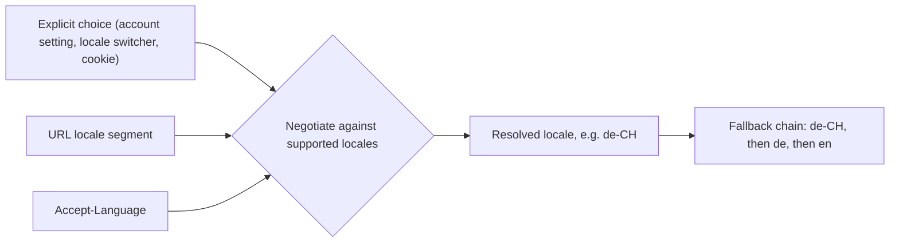
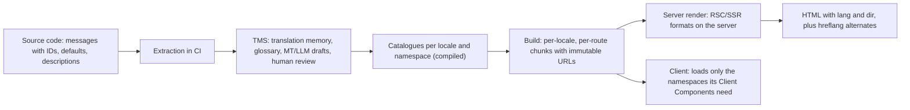
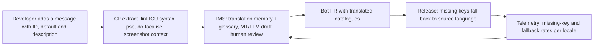

# 37 — Internationalization and Localization

> Internationalisation is an engineering property: the product *can* speak any language, count in any numbering system and lay itself out in any direction. Localisation is the work of making it actually do so, again and again, as both the product and the world change.

**Prerequisites:** [07](07-modern-css-and-layout-architecture.md), [17](17-ssr-streaming-and-hydration.md), [31](31-routing-architecture.md) · **Related:** [33 API Contracts](33-api-integration-bff-and-contracts.md) · [35 Design Systems](35-enterprise-design-system-architecture.md) · [47 Next.js App Router](47-nextjs-app-router-architecture.md)

---

## TL;DR

- **A locale is not a language.** Language, region, script, currency, time zone, calendar and numbering system are separate dimensions. Use BCP 47 tags (`pt-BR`, `zh-Hant-TW`, `ar-EG-u-nu-latn`), store user preferences separately, and define fallback chains.
- **Never concatenate strings.** Use whole-sentence messages with named placeholders in **ICU MessageFormat** (plural, select, ordinal, rich-text tags). **MessageFormat 2** became stable in Unicode CLDR 47 (March 2025). `Intl.MessageFormat` is still a Stage 1 TC39 proposal, so ICU MF1 libraries remain the production default.
- **Format with `Intl`** (numbers, currencies, units, dates, relative times, lists, display names, collation, segmentation). Cache formatter instances.
- **Dates:**
  - Store instants in UTC.
  - Model calendar dates as calendar dates.
  - Render with the user's time zone on both server and client to avoid hydration mismatches.
  - **Temporal** reached Stage 4 (ES2026) and ships in Firefox and Chromium, but not yet in Safari, so use a polyfill.
- **RTL is a layout mode, not a stylesheet.** Use logical properties, `dir` on `<html>`, `dir="auto"` and `<bdi>` for user content, and selective icon mirroring.
- **Design for expansion** (short English strings can double), script-specific line breaking and fonts, and grapheme-aware truncation.
- **Ship only what's needed:** per-locale, per-route message bundles. With Server Components, server-rendered text never sends its catalogue to the client.
- **Locale routing for SEO:** locale in the URL path, `hreflang` alternates and `x-default`. Don't force redirects based on IP.
- **Localisation is a pipeline:** extraction, then context for translators, then a TMS (MT or LLM drafts plus human review), then **pseudo-localisation in CI**, then continuous delivery with source-language fallback and missing-key telemetry.

---

## 1. Locales, languages and preferences

| Dimension | Example | Where it comes from |
|---|---|---|
| Language (+ script) | `pt`, `sr-Latn`, `zh-Hant` | User choice, then `Accept-Language`, then default |
| Region | `BR`, `CH`, `IN` | Affects formats (dates, number grouping), legal content, currency defaults |
| Currency | `BRL`, `CHF` | The **transaction**, not the UI locale (a German user can buy in USD) |
| Time zone | `America/Sao_Paulo` | User profile or browser (`Intl.DateTimeFormat().resolvedOptions().timeZone`) |
| Calendar, numbering system | `-u-ca-japanese`, `-u-nu-arab` | Locale defaults plus user overrides via Unicode extensions |
| Units | metric or imperial | Region default plus user preference |



> [!IMPORTANT]
> **Separate "UI language" from "formatting region" and "currency".** A Swiss user may read German UI with Swiss number formatting (an apostrophe as the thousands separator: `1'234.50`) and pay in EUR. Collapsing these into one `locale` string causes real bugs in checkout and invoicing.

---

## 2. Architecture overview



---

## 3. Messages

### 3.1 Why concatenation breaks

```tsx
// ✗ English word order, plural rule and gender are baked in
const label = t('you_have') + ' ' + count + ' ' + (count === 1 ? t('message') : t('messages'));

// ✓ One message per sentence. The translator owns word order and plural forms
// en: "{count, plural, one {You have # message} other {You have # messages}}"
const label = intl.formatMessage({ id: 'inbox.count' }, { count });
```

Languages have between one and six plural categories:

| Locale | Categories (`Intl.PluralRules`) | Example |
|---|---|---|
| `ja`, `zh` | other | No grammatical plural |
| `en`, `de` | one, other | 1 item / 2 items |
| `pl` | one, few, many (+ other for fractions) | 1 plik, 2 pliki, 5 plików, 22 pliki, 25 plików |
| `ar` | zero, one, two, few, many, other | 0, 1, 2, 3, 11 and 100 each select a different form |

### 3.2 ICU MessageFormat (MF1) in practice

```json
{
  "invoices.overdue": "{count, plural, =0 {No invoices are overdue} one {# invoice is overdue} other {# invoices are overdue}}",
  "activity.assigned": "{actorGender, select, female {{actor} assigned you a task} male {{actor} assigned you a task} other {{actor} assigned you a task}}",
  "ranking.place": "You finished {place, selectordinal, one {#st} two {#nd} few {#rd} other {#th}}",
  "legal.consent": "By continuing you agree to our <terms>Terms</terms> and <privacy>Privacy Policy</privacy>."
}
```

The `select` on gender looks redundant in English. It exists because the French, Polish or Arabic translations of that sentence change with the actor's gender, and **the translator needs the variable to express that**.

```tsx
// features/legal/Consent.tsx (react-intl / FormatJS)
import { FormattedMessage } from 'react-intl';

export function Consent() {
  return (
    <p>
      <FormattedMessage
        id="legal.consent"
        defaultMessage="By continuing you agree to our <terms>Terms</terms> and <privacy>Privacy Policy</privacy>."
        description="Shown under the sign-up button. <terms> and <privacy> wrap links."
        values={{
          terms: (chunks) => <a href="/legal/terms">{chunks}</a>,
          privacy: (chunks) => <a href="/legal/privacy">{chunks}</a>,
        }}
      />
    </p>
  );
}
```

Rich-text tags keep the whole sentence translatable as a unit. The translator can move "Privacy Policy" before "Terms" if the grammar requires it.

### 3.3 MessageFormat 2

MF2 (stable since CLDR 47) is a redesign: explicit declarations, composable functions and a data model that any existing syntax can map onto.

```
.input {$count :number}
.match $count
0   {{No invoices are overdue}}
one {{{$count} invoice is overdue}}
*   {{{$count} invoices are overdue}}
```

The JavaScript `messageformat` package (v4) implements stable MF2, and plugins exist for some i18n frameworks. Native `Intl.MessageFormat` remains a **Stage 1** TC39 proposal. **Recommendation:** standardise on ICU MF1 today with a library that has an MF2 path, and keep messages free of library-specific syntax so a later migration can be automated.

### 3.4 Message hygiene

| Rule | Why |
|---|---|
| **Stable semantic IDs** (`invoices.overdue`) plus a `defaultMessage` | Source-text keys break when copy changes; IDs alone give translators no meaning |
| **A description for every message** | Translators see a string, not your UI. "Close" the verb or "close" the adjective? |
| **Named placeholders** (`{actor}`, not `{0}`) | Context, and safe reordering |
| **No markup or styling in messages** beyond semantic tags | Translators shouldn't edit HTML or class names |
| **No reused fragments** ("Save" for both a button and a heading) | Different contexts need different translations in many languages |
| **Typed keys** | i18next TS augmentation, next-intl typed messages, or compiled message functions (Paraglide) catch missing keys at build time |
| **API errors as codes** | Map RFC 9457 `type` values to message IDs. Never display English server sentences ([33](33-api-integration-bff-and-contracts.md)) |

---

## 4. Formatting with `Intl`

```ts
// shared/i18n/format.ts: cache formatters (construction is the expensive part)
import type { Money } from '@/shared/money';

const numberFormats = new Map<string, Intl.NumberFormat>();
const dateFormats = new Map<string, Intl.DateTimeFormat>();

export function numberFormat(locale: string, options: Intl.NumberFormatOptions = {}): Intl.NumberFormat {
  const key = `${locale}|${JSON.stringify(options)}`;
  let f = numberFormats.get(key);
  if (!f) { f = new Intl.NumberFormat(locale, options); numberFormats.set(key, f); }
  return f;
}

export function dateTimeFormat(locale: string, options: Intl.DateTimeFormatOptions): Intl.DateTimeFormat {
  const key = `${locale}|${JSON.stringify(options)}`;
  let f = dateFormats.get(key);
  if (!f) { f = new Intl.DateTimeFormat(locale, options); dateFormats.set(key, f); }
  return f;
}

// ISO 4217 minor units: how amounts are stored. Intl's display digits differ for some currencies
// (HUF, IDR and COP display no decimals but are stored with two; IQD with three), so don't use them to convert.
const MINOR_UNITS: Record<string, number> = {
  BHD: 3, IQD: 3, JOD: 3, KWD: 3, LYD: 3, OMR: 3, TND: 3, CLF: 4, UYW: 4,
  BIF: 0, CLP: 0, DJF: 0, GNF: 0, ISK: 0, JPY: 0, KMF: 0, KRW: 0, PYG: 0, RWF: 0, UGX: 0, UYI: 0, VND: 0, VUV: 0, XAF: 0, XOF: 0, XPF: 0,
};
export const minorUnits = (currency: string) => MINOR_UNITS[currency] ?? 2;

export function formatMoney(locale: string, { amountMinor, currency }: Money): string {
  return numberFormat(locale, { style: 'currency', currency }).format(amountMinor / 10 ** minorUnits(currency));
}
```

What the platform gives you (real outputs):

| API | Call | Output |
|---|---|---|
| Currency | `de-DE`, EUR, 1299.5 | `1.299,50 €` |
| Currency | `ja-JP`, JPY, 1299.5 | `￥1,300` |
| Grouping | `en-IN`, INR, 1234567 | `₹12,34,567.00` (lakh grouping) |
| Numbering system | `ar-EG`, 1234567.89 | `١٬٢٣٤٬٥٦٧٫٨٩` |
| Compact | `en` / `de`, 1234567 | `1.2M` / `1,2 Mio.` |
| Units | `en`, 88 km/h | `88 km/h` |
| Percent | `fr-FR`, 0.256 | `25,6 %` (a no-break space before `%`; French groups thousands with a *narrow* no-break space, as in `1 299,50 €`) |
| Relative time | `en` −1 day / `de` +2 days | `yesterday` / `übermorgen` |
| Lists | `en` / `es` | `Ana, Ben, and Chen` / `Ana, Ben y Chen` |
| Display names | `de` region `US`; `en` language `pt-BR` | `Vereinigte Staaten`; `Brazilian Portuguese` |
| Collation | `de` vs `sv` sorting `Äpfel` | German sorts Ä with A; Swedish sorts it after Z |
| Segmentation | `'👩‍👩‍👧'.length` vs graphemes | `8` code units, but `1` grapheme |

Also available: `Intl.PluralRules` (cardinal and ordinal), `Intl.DurationFormat`, and `Intl.Locale` week and text info (`firstDay`, `weekend`, text direction) where supported.

> [!TIP]
> Never truncate with `str.slice(0, n)`. You can split emoji, combining marks or surrogate pairs. Count graphemes with `Intl.Segmenter`, or truncate visually with CSS (`text-overflow: ellipsis`, `line-clamp`). For word breaks in Thai, Japanese or Chinese (no spaces), use `Intl.Segmenter` with `granularity: 'word'`.

---

## 5. Dates, times and time zones

### 5.1 Model time correctly

| Concept | Type | Example |
|---|---|---|
| An **instant** | UTC timestamp / `Temporal.Instant` | "Payment captured at 2026-11-21T15:30:00Z" |
| A **calendar date** (no zone) | `Temporal.PlainDate` | Birthdays, due dates, holidays: "due 1 December" everywhere |
| A **wall-clock time in a zone** | `Temporal.ZonedDateTime` | Meetings, store opening hours, flight departures |
| A **duration** | `Temporal.Duration` | "Session lasts 1 h 30 min" |

```ts
import { Temporal } from 'temporal-polyfill'; // native in Firefox 139+ and Chromium 144+, not yet in Safari

// A due date is a calendar date: no "midnight UTC is yesterday in New York" bugs
const due = Temporal.PlainDate.from('2026-12-01');
const today = Temporal.Now.plainDateISO('America/New_York');
const overdue = Temporal.PlainDate.compare(today, due) > 0;

// A recurring meeting is a wall-clock time in a zone
const standup = Temporal.ZonedDateTime.from('2026-03-23T09:00[Europe/Berlin]');
const nextWeek = standup.add({ weeks: 1 });
// → 2026-03-30T09:00:00+02:00[Europe/Berlin]: still 09:00 after the DST change.
// Adding 7 × 24 hours to a Date would give 10:00.

const forAna = nextWeek.withTimeZone('America/Sao_Paulo');
forAna.toLocaleString('pt-BR', { dateStyle: 'full', timeStyle: 'short' });
// → "segunda-feira, 30 de março de 2026 às 04:00" (it was 05:00 for her the week before)
```

Temporal reached **Stage 4 in March 2026** (ES2026). It ships in Firefox (139+), Chrome and Edge (144+) and Node.js 26, but **not in Safari** as of late 2026, which means no native Temporal on any iOS browser. Use a polyfill (`temporal-polyfill`, `@js-temporal/polyfill`), loaded conditionally if bundle size matters.

### 5.2 Server rendering and hydration

Formatting a date depends on locale **and time zone**. If the server formats in UTC and the browser in `Asia/Tokyo`, the text differs and React reports a hydration mismatch. 15:30 UTC on 21 November is *22 November* in Tokyo.

| Strategy | How |
|---|---|
| **Known user time zone** (recommended) | Store it in the profile, or set a cookie from `Intl.DateTimeFormat().resolvedOptions().timeZone` on first visit. Format with the same `timeZone` on server and client |
| **Client-only formatting** | Render `<time dateTime={iso}>` with a neutral fallback, then format in an effect or a client island. Costs a text shift |
| **Relative times** ("5 minutes ago") | Render on the client or refresh periodically. Server and client clocks always differ slightly |

```tsx
export function LocalDateTime({ iso, locale, timeZone }: { iso: string; locale: string; timeZone: string }) {
  const text = dateTimeFormat(locale, { dateStyle: 'medium', timeStyle: 'short', timeZone }).format(new Date(iso));
  return <time dateTime={iso}>{text}</time>; // identical on server and client: same locale and zone
}
```

---

## 6. Bidirectional text and RTL

```html
<html lang="ar" dir="rtl">
```

| Technique | Detail |
|---|---|
| **Logical properties** | `margin-inline-start`, `padding-inline`, `inset-inline-end`, `border-start-start-radius`, `text-align: start`. Flexbox and grid follow `dir` automatically ([07](07-modern-css-and-layout-architecture.md)) |
| **Directional selectors** | `:dir(rtl)` for the rare direction-specific rule (it respects inherited direction, unlike `[dir="rtl"]`) |
| **Icon mirroring** | Mirror directional icons (back and forward arrows, "reply", list indentation, progress bars). Don't mirror media playback, clocks, checkmarks, logos or charts' time axes |
| **User-generated content** | `dir="auto"` on inputs and rendered user text. `<bdi>` (bidirectional isolation) around names and values inside sentences |
| **Mixed content** | Numbers, emails, URLs and code stay LTR inside RTL text. Isolate them so punctuation doesn't jump |
| **Keyboard** | Arrow-key semantics flip in RTL for horizontal widgets ([36](36-accessibility-engineering.md)) |
| **Testing** | An RTL pseudo-locale and visual regression snapshots for key screens |

```tsx
// Without isolation, an Arabic or Hebrew username can reorder the surrounding punctuation
<p>{t.rich('comment.byline', { author: () => <bdi>{author.name}</bdi> })}</p> {/* next-intl; <Trans> in react-i18next */}
```

---

## 7. Typography, expansion and layout

| Concern | Guidance |
|---|---|
| **Text expansion** | German, Finnish and French often run 30–40% longer than English. Very short strings ("Save", "OK") can double or triple. Avoid fixed widths; allow wrapping; test with pseudo-locales |
| **Contraction** | CJK strings are often shorter, so don't rely on text length to size layouts either |
| **Line breaking** | Set `lang` so the browser applies language-specific rules. `word-break: keep-all` for Korean, `line-break: strict` for Japanese punctuation, `text-wrap: balance` for headings, `hyphens: auto` (needs `lang`) |
| **Fonts** | Fallback stacks per script, subsetting with `unicode-range`, `font-display: swap`. CJK fonts are large: subset or use system fonts. Avoid `font-synthesis` surprises |
| **Line height** | Scripts with tall ascenders and descenders (Thai, Devanagari, Arabic) need more line height. Use unitless line heights and test |
| **Input** | Support IME composition (don't act on `keydown` during `isComposing`). `inputmode` and `autocomplete` vary by locale (postal codes, phone numbers) |
| **Names and addresses** | Not everyone has a "first" and "last" name. Address formats vary by country: use per-country schemas and libraries (libaddressinput data, `libphonenumber-js`) ([26](26-forms-and-validation.md)) |

---

## 8. Loading strategy and performance

| Practice | Why |
|---|---|
| **Per-locale catalogues, split by namespace or route** | A user in `ja` shouldn't download `de`, and the settings page shouldn't download checkout strings |
| **Translate in Server Components** | Server-rendered text needs no client-side catalogue. Only the strings used by Client Components are sent ([18](18-react-server-components-and-server-functions.md)) |
| **Compile messages** | Precompiled ICU ASTs (FormatJS) or message functions (Lingui, Paraglide) skip runtime parsing and enable tree-shaking of unused messages |
| **Immutable, hashed URLs** for catalogues | Long-term CDN caching. A new deploy produces a new URL |
| **Load in route loaders, not effects** | Avoids a flash of untranslated text and waterfalls ([31](31-routing-architecture.md)) |
| **Polyfill conditionally** | Only for missing `Intl` features or Temporal, behind feature detection |

---

## 9. Locale routing and SEO

| URL strategy | Example | Notes |
|---|---|---|
| **Path prefix** (recommended default) | `/de-DE/pricing` | One domain, simple CDN rules, clear `hreflang` |
| Subdomain | `de.acme.com` | Separate deployments or teams per market |
| Country-code domain | `acme.de` | Strongest local signal; highest cost (domains, legal entities) |
| Query parameter or cookie only | `?lang=de` | Avoid for indexable content: crawlers may never see the alternates |

```ts
// proxy.ts (Next.js 16; formerly middleware.ts)
import { NextResponse, type NextRequest } from 'next/server';
import { match } from '@formatjs/intl-localematcher';
import Negotiator from 'negotiator';

const locales = ['en-US', 'en-GB', 'de-DE', 'fr-FR', 'ar-SA', 'ja-JP'];
const defaultLocale = 'en-US';

function preferredLocale(request: NextRequest): string {
  const chosen = request.cookies.get('locale')?.value; // an explicit choice always wins
  if (chosen && locales.includes(chosen)) return chosen;
  const languages = new Negotiator({
    headers: { 'accept-language': request.headers.get('accept-language') ?? '' },
  }).languages();
  return match(languages, locales, defaultLocale);
}

export function proxy(request: NextRequest) {
  const { pathname } = request.nextUrl;
  if (locales.some((l) => pathname === `/${l}` || pathname.startsWith(`/${l}/`))) return;

  const url = request.nextUrl.clone();
  url.pathname = `/${preferredLocale(request)}${pathname}`;
  const response = NextResponse.redirect(url);
  response.headers.set('Vary', 'Accept-Language, Cookie'); // the redirect depends on these: don't cache it blindly
  return response;
}

export const config = { matcher: ['/((?!api|_next|.*\\..*).*)'] };
```

```tsx
// app/[locale]/pricing/page.tsx: localised metadata with hreflang alternates
import type { Metadata } from 'next';
import { getTranslations } from 'next-intl/server';

export async function generateMetadata({ params }: { params: Promise<{ locale: string }> }): Promise<Metadata> {
  const { locale } = await params;
  const t = await getTranslations({ locale, namespace: 'Pricing' });
  return {
    title: t('meta.title'),
    alternates: {
      canonical: `/${locale}/pricing`,
      languages: {
        'en-US': '/en-US/pricing',
        'de-DE': '/de-DE/pricing',
        'ja-JP': '/ja-JP/pricing',
        'x-default': '/en-US/pricing',
      },
    },
  };
}
```

SEO and UX rules:

- **Every locale variant lists every other variant** (including itself) in `hreflang`, with `x-default` for the language picker or fallback.
- **Don't force-redirect by IP.** Travellers, VPN users and crawlers (which mostly crawl from one region) end up in the wrong locale. Suggest a switch with a banner instead.
- **Remember the user's choice** in a cookie or profile. It outranks `Accept-Language`.
- **Translate slugs** only if you can keep them stable and mapped. Otherwise keep shared slugs.
- In Next.js, read the locale anywhere on the server from the `[locale]` segment (or `next/root-params` for root parameters, added in 16.3). React Router v8 can resolve it in middleware and put it in the request context ([51](51-react-router-v8-framework-mode.md)).

---

## 10. The localisation pipeline



| Stage | Practice |
|---|---|
| **Authoring** | IDs, defaults and descriptions in code. Storybook links or screenshots attached as translator context |
| **Validation** | Lint ICU syntax and placeholders. Check that every translation keeps the source placeholders and tags |
| **Pseudo-localisation** | A CI locale like `[!! Ŝàvé çĥàñĝéš ~~~~ !!]` (accents, +40% length, brackets) catches hard-coded strings, truncation and concatenation before translators see anything. Add an RTL pseudo-locale too |
| **Translation** | A TMS (Crowdin, Lokalise, Phrase, Smartling) with translation memory and a glossary. Machine or LLM translation produces **drafts**, followed by human review for customer-facing and legal text |
| **Delivery** | Continuous localisation: strings flow on merge, and releases don't wait for every locale. Missing keys fall back to the source language and are counted |
| **Exceptions** | String freezes for regulated content (finance, health, legal) with sign-off per market |

> [!WARNING]
> LLM translations are fluent even when they're wrong, and the errors are hard to spot without a native speaker. Enforce glossaries (product names, legal terms), keep placeholders and tags machine-validated, and require human review for anything legal, financial or safety-related.

---

## 11. Beyond UI strings

- **SEO metadata, Open Graph, structured data:** localised per route, rendered on the server.
- **Emails, PDFs, push notifications:** rendered on the server with the same message catalogues and the **recipient's** locale and time zone (not the sender's).
- **Images and SVGs containing text:** avoid them, or produce a variant per locale.
- **Legal and regulatory content:** varies by market (consent, cookie banners, pricing display rules such as tax-inclusive prices).
- **User-generated content:** store the language tag with the content, render it with `lang` and `dir="auto"`, and offer on-demand translation with a "translated" label.
- **Sorting and search:** collation per locale (`Intl.Collator`), and accent- and case-insensitive matching (`sensitivity: 'base'`).

---

## Decision framework

**Problem.** How do we make the product speak N locales correctly, keep it fast, and keep translations flowing without blocking releases?

**Constraints.** Number of locales and scripts (RTL? CJK?), framework (Next.js App Router, React Router, SPA), SEO requirements, the translation budget and vendor, regulated content, and the team's tolerance for build-time tooling.

| Library | Model | Strengths | Consider when |
|---|---|---|---|
| **FormatJS / react-intl** | ICU MF1, runtime or precompiled | Standards-aligned, rich `Intl` integration, mature | ICU-first teams; complex plural, select and rich text |
| **i18next / react-i18next** | Its own format (ICU via plugin), namespaces, backends | Huge ecosystem: loaders, detectors, plugins, MF2 plugin | Many apps and platforms sharing one setup |
| **Lingui** | Macros, compile-time extraction, ICU | Small runtime, compiled catalogues, good DX | Performance-sensitive SPAs and RSC apps |
| **next-intl** | ICU, built for the App Router | RSC-native APIs, routing helpers, typed messages | Next.js App Router apps |
| **Paraglide JS** | Messages compiled to functions | Tree-shakeable, type-safe, tiny | Bundle-critical apps that want compile-time guarantees |

| Decision | Recommended default |
|---|---|
| Message syntax | ICU MF1 now, with a library that has an MF2 path |
| Routing | Locale path prefix, `hreflang`, cookie for explicit choice, no IP redirects |
| Rendering | Translate in Server Components; ship per-route namespaces to Client Components |
| Dates | UTC instants, `PlainDate` for calendar dates, user time zone shared by server and client, Temporal with a polyfill |
| Pipeline | Extraction + pseudo-locale in CI, TMS with memory and glossary, continuous delivery with fallback telemetry |

**Criteria.** Linguistic correctness, bundle and runtime cost, SEO, developer ergonomics (typed keys), translator experience (context), and the cost of adding the next locale.

**Failure modes.**
- Concatenated strings.
- One `locale` used for currency and time zone.
- Hydration mismatches from time zones.
- `margin-left` everywhere (RTL needs a rewrite).
- All catalogues shipped to every user.
- Releases blocked on translations.
- Untranslated server error messages.
- IP-based forced redirects.

**Migration path.** Externalise strings behind IDs (codemods help), add a pseudo-locale to CI, replace concatenation with ICU messages, move to logical properties (Stylelint can enforce them), introduce per-route catalogues, then add locales one at a time, starting with an RTL and a CJK locale to flush out layout assumptions.

---

## Pitfalls and anti-patterns

- `toLocaleString()` without an explicit locale and time zone (the server's defaults leak into the HTML).
- `new Date('2026-12-01')` for a due date: parsed as UTC midnight, it shows as 30 November in the Americas.
- Plural logic written as `count === 1 ? … : …`.
- Language picker flags (flags are countries, not languages; Spanish isn't Spain's alone).
- Translating with source text as keys, then rewording the source and invalidating every translation.
- Hard-coded format strings (`MM/DD/YYYY`) instead of `Intl` styles.
- Sorting with `Array.prototype.sort()` without a collator.
- Truncating strings by code units.
- Forgetting `lang` on `<html>` (screen readers use the wrong voice, and hyphenation and line breaking fail) ([36](36-accessibility-engineering.md)).
- Formatting money from floats, or assuming two decimal places ([33](33-api-integration-bff-and-contracts.md)).

---

## Architect's checklist

- [ ] Locale model separates UI language, formatting region, currency, time zone and units; fallback chains defined
- [ ] ICU messages with IDs, defaults, descriptions and named placeholders; no concatenation (lint)
- [ ] Cached `Intl` formatters for numbers, money (convert with ISO 4217 minor units, not Intl's display digits), dates, lists, relative times and collation
- [ ] Time modelled as instants, calendar dates and zoned times; user time zone shared by server and client; Temporal polyfilled where needed
- [ ] `lang` and `dir` on `<html>`; logical properties enforced; `dir="auto"` and `<bdi>` for user content; mirroring rules documented
- [ ] Layouts tested with pseudo-locales (expansion, accents, RTL) in CI and visual regression
- [ ] Per-locale, per-route catalogues; server-side translation in RSC; compiled messages
- [ ] Locale path routing with `hreflang` and `x-default`; explicit choice remembered; no IP-forced redirects
- [ ] Localisation pipeline: extraction, context, TMS, review policy for MT/LLM, continuous delivery, missing-key telemetry
- [ ] Emails, PDFs, notifications and API errors localised using the recipient's locale

---

## Interview angles

**Q1. Architect i18n for a Next.js App Router app with 20 locales.**
Use a `[locale]` path segment, with a `proxy.ts` that negotiates the locale (cookie first, then `Accept-Language`) and redirects only paths without a locale (with `Vary` set). Use an App Router-native library (next-intl, or FormatJS with server helpers) so Server Components translate on the server and only Client Component namespaces ship to the browser. Generate `hreflang` alternates with `x-default` in `generateMetadata`. Cache per-locale catalogues with immutable URLs. Run extraction and pseudo-localisation in CI, connect to a TMS, and release continuously with source-language fallback and missing-key telemetry.

**Q2. Why is string concatenation harmful in i18n?**
It hard-codes English grammar: word order, plural rules (some languages have six categories), gender and case agreement, and where punctuation and spaces go. Translators can't fix what they can't see. Whole-sentence ICU messages with named placeholders, plural and select, and rich-text tags let each language express the full sentence.

**Q3. How do you avoid date hydration mismatches?**
Formatting depends on locale and time zone, so make both deterministic and shared. Store the user's time zone (from their profile or a cookie captured from the browser), and pass the same locale and `timeZone` to `Intl.DateTimeFormat` on server and client. Model calendar dates as `PlainDate` so they never shift across zones. For relative times, render on the client or accept periodic refreshes. Don't paper over the mismatch with `suppressHydrationWarning` except for genuinely live timestamps.

**Q4. How do you add RTL support to an existing LTR codebase?**
Set `dir` on `<html>` from the locale. Migrate physical CSS properties to logical ones with a codemod and a Stylelint rule, and rely on flexbox and grid flipping automatically. Audit icons for mirroring. Add `dir="auto"` and `<bdi>` for user content. Flip horizontal keyboard navigation. Add an RTL pseudo-locale to CI and visual regression snapshots of key screens, then validate with native readers.

**Q5. How do you keep translations from blocking releases?**
Continuous localisation. Strings are extracted on merge and sent to the TMS automatically, translations return as bot PRs, and releases ship with source-language fallback for missing keys, with fallback rates monitored per locale. Pseudo-localisation in CI catches i18n bugs before translation. Reserve string freezes and sign-off for regulated or legal content.

---

> [!TIP]
> **Runnable code:** [E37](E37-internationalization-and-localization.md) has the formatters and `formatMoney`, and a test that checks the platform-outputs table against your Node's ICU data. `node extract-examples.mjs 37` writes it out as a project; then run `npm ci` and `npm test` in it.

## Further reading

- MDN, *Intl*: <https://developer.mozilla.org/en-US/docs/Web/JavaScript/Reference/Global_Objects/Intl>
- Unicode, *MessageFormat 2*: <https://messageformat.unicode.org/> · CLDR 47 release (MF2 stable): <https://blog.unicode.org/2025/03/unicode-cldr-47-release-messageformat-2.html>
- TC39, *Intl.MessageFormat* proposal: <https://github.com/tc39/proposal-intl-messageformat>
- TC39, *Temporal* documentation: <https://tc39.es/proposal-temporal/docs/>
- W3C Internationalization, *Language tags in HTML and XML*: <https://www.w3.org/International/articles/language-tags/> · *Inline markup and bidirectional text in HTML*: <https://www.w3.org/International/articles/inline-bidi-markup/>
- Google Search Central, *Localized versions of your pages* (hreflang): <https://developers.google.com/search/docs/specialty/international/localized-versions>
- FormatJS: <https://formatjs.github.io/> · i18next: <https://www.i18next.com/> · Lingui: <https://lingui.dev/> · next-intl: <https://next-intl.dev/> · Paraglide JS: <https://inlang.com/m/gerre34r/library-inlang-paraglideJs>
- Next.js docs, *Internationalization*: <https://nextjs.org/docs/app/guides/internationalization>

---

[← Previous: 36 — Accessibility as a System Contract](36-accessibility-engineering.md) · [Index](README.md) · [Next: 38 — React Performance Engineering →](38-react-performance-engineering.md)
