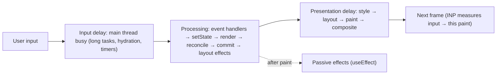
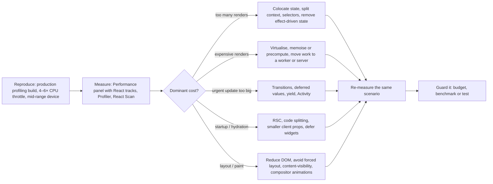

# 38 — React Performance Engineering

> Performance work is a loop, not a list of tricks: measure on the device your users have, find the one cost that dominates, remove it, prove it, and then make sure it can't come back.

**Prerequisites:** [10](10-react-internals-fiber-and-reconciliation.md), [15](15-concurrent-react-suspense-and-transitions.md), [16](16-react-19-features-and-the-compiler.md), [20](20-react-tooling-devtools-and-debugging.md) · **Related:** [39 Core Web Vitals](39-web-performance-and-core-web-vitals.md) · [25 Complex UI](25-complex-ui-engineering.md) · [29 Client State](29-client-state-management.md)

---

## TL;DR

- React's cost has five parts: **render** (calling components), **reconcile** (diffing), **commit** (DOM mutations and layout effects), the **browser's work** (style, layout, paint) and **effects**. Startup adds **download, parse and compile** plus **hydration**. INP sums them for every interaction.
- **Measure first**, on a throttled mid-range Android profile with a production profiling build:
  - React **Performance Tracks** in the Chrome DevTools Performance panel (React 19.2+).
  - The React DevTools Profiler.
  - React Scan for visual re-render maps.
  - `<Profiler>` and Long Animation Frames data from the field.
- Problems come in two families:
  - **Too many renders:** state too high, contexts too broad, store subscriptions without selectors, effects that set state.
  - **Renders that are too expensive:** huge lists, heavy computations, deep trees, heavy third-party widgets.
  Fix the family you actually have.
- **The Compiler removes most identity-driven re-renders.** It doesn't shrink expensive renders, virtualise lists, fix waterfalls or cut bundle size. Manual memoisation is still justified for identity contracts, code the Compiler skips, and libraries used by non-compiled apps.
- **Schedule, don't just optimise:**
  - Transitions and `useDeferredValue` keep urgent updates small.
  - `<Activity>` pre-renders and preserves hidden UI.
  - `scheduler.yield()` (Chromium, Firefox; not Safari) splits long handlers.
  - Workers take heavy computation off the main thread.
- **Startup:** ship less JavaScript (Server Components, route splitting, lazy islands). Let Suspense drive selective hydration. Keep Client Component props small.
- **Prevent regressions:** per-route bundle budgets, interaction benchmarks, component render tests (such as Reassure), and RUM INP attributed by route and component.

---

## 1. The cost model



| Cost centre | Grows with | Typical symptom | First tool |
|---|---|---|---|
| **Render** | Components re-rendered × cost per render | Typing lag, sluggish toggles | React Performance Tracks, Profiler flamegraph |
| **Reconcile** | Elements compared (list length, tree size) | Slow updates to big lists | Profiler "ranked" view |
| **Commit (DOM)** | DOM nodes created, removed or mutated | Jank when lists change | Performance panel: "Commit" spans |
| **Layout and paint** | DOM size, CSS complexity, forced synchronous layout | Long "Layout" or "Recalculate Style" entries | Performance panel, Layout Shift and Rendering tabs |
| **Effects** | Effects re-run per commit; setState in effects | Double renders, waterfalls | Components track and Profiler ("why did this render") |
| **Startup** | JS bytes, parse and compile, hydration work | Slow first interaction, high TBT and INP after load | Coverage tab, bundle analyser, Performance panel |
| **Memory** | Retained objects over long sessions | Slower over time, tab crashes | Memory panel, heap snapshots |

> [!IMPORTANT]
> **INP is the user's verdict on all of these at once.** A 30 ms render plus a 120 ms layout plus a 90 ms analytics handler is a 240 ms interaction, and you'd only see it if you profile the whole frame, not just React ([39](39-web-performance-and-core-web-vitals.md)).

---

## 2. A measurement-first workflow



| Tool | Use it for |
|---|---|
| **React Performance Tracks** (Chrome DevTools, React 19.2+) | See the Scheduler track (blocking, transition, Suspense and idle work) and the Components track (what rendered, and for how long) *in the same timeline* as layout, paint and network ([20](20-react-tooling-devtools-and-debugging.md)) |
| **React DevTools Profiler** | Flamegraph and ranked views per commit, "why did this render?", Compiler "Memo ✨" badges |
| **React Scan** | Visual highlight of re-renders while you click around. Finds render storms in minutes |
| **Performance panel** | Long tasks, forced reflows, style recalculation, paint, script attribution |
| **Production profiling build** (`react-dom/profiling`, or your framework's flag) | Production-like timings; development builds are several times slower and misleading |
| **`<Profiler onRender>` in production** (sampled) | Real-user render durations per subtree |
| **Long Animation Frames** (LoAF, Chromium) | Field attribution of slow frames to scripts and handlers ([39](39-web-performance-and-core-web-vitals.md)) |

> [!WARNING]
> Never profile a development build and never profile on a developer laptop without throttling. Development mode double-invokes renders and effects, runs extra checks and skips minification. You'll optimise the wrong thing.

---

## 3. Family one: too many renders

### 3.1 Causes and fixes

| Cause | Fix |
|---|---|
| State lives higher than its consumers | **Colocate** it in the smallest subtree that needs it |
| A parent with fast-changing state re-renders an expensive subtree | **Lift content up:** pass the subtree as `children` so it keeps its element identity |
| One context holds everything | **Split contexts** by change frequency. Move high-frequency values to an external store with selectors |
| Store subscriptions without selectors | Subscribe to slices (`useStore(selector)`, `useShallow`), atoms (Jotai) or signals |
| New object, array or function props every render | The Compiler stabilises these. Without it, use `useMemo`/`useCallback` where profiling shows the cascade |
| Derived values stored in state and synced by effects | **Compute during render.** Effects that set state cause extra render passes (lint: `set-state-in-effect`) ([13](13-effects-and-synchronization.md)) |
| Server data copied into client state | Read from the query cache with select functions ([30](30-server-state-and-data-fetching.md)) |

### 3.2 Lift content up

```tsx
// ✗ Every scroll event re-renders the whole dashboard
function Shell() {
  const [scrollY, setScrollY] = useState(0);
  return (
    <div className="shell" onScroll={(e) => setScrollY(e.currentTarget.scrollTop)}>
      <Header compact={scrollY > 80} />
      <Dashboard />
    </div>
  );
}

// ✓ The state is a boolean that changes only at the threshold, and the expensive
//   subtree arrives as children, created by the parent, so it isn't re-rendered
function ScrollShell({ children }: { children: ReactNode }) {
  const [compact, setCompact] = useState(false);
  return (
    <div className="shell" onScroll={(e) => setCompact(e.currentTarget.scrollTop > 80)}>
      <Header compact={compact} />
      {children}
    </div>
  );
}
// <ScrollShell><Dashboard /></ScrollShell>
```

Two lessons in one: **store the coarsest state that drives the UI** (React bails out when you set the same value), and **keep expensive elements out of fast-changing components**.

### 3.3 Context by change frequency

```tsx
// ✗ Every consumer re-renders whenever any field changes (including the 1 Hz clock)
const AppContext = createContext<{ user: User; theme: Theme; now: Date; unread: number } | null>(null);

// ✓ Static-ish values in their own contexts; high-frequency values in a store with selectors
const UserContext = createContext<User | null>(null);
const ThemeContext = createContext<Theme>('light');
```

```ts
// High-frequency, widely shared state: subscribe to exactly the slice you render
import { create } from 'zustand';
import { useShallow } from 'zustand/react/shallow';

type NotificationsState = { unread: number; items: Notification[]; markRead: (id: string) => void };

export const useNotifications = create<NotificationsState>()((set) => ({
  unread: 0,
  items: [],
  markRead: (id) => set((s) => ({
    items: s.items.map((n) => (n.id === id ? { ...n, read: true } : n)),
    unread: Math.max(0, s.unread - 1),
  })),
}));

// The badge re-renders only when `unread` changes
export const useUnreadCount = () => useNotifications((s) => s.unread);
// Several fields with shallow comparison
export const useNotificationActions = () =>
  useNotifications(useShallow((s) => ({ markRead: s.markRead, unread: s.unread })));
```

> [!NOTE]
> `use(Context)` and `useContext` re-render **every** consumer when the value changes. There are no context selectors in React 19.3. If you need selector-style subscriptions to shared state, use an external store with `useSyncExternalStore` (directly or through Zustand, Jotai, Redux or XState) ([29](29-client-state-management.md)).

---

## 4. Family two: renders that are too expensive

### 4.1 Virtualise long lists

```tsx
// features/invoices/InvoiceList.tsx
'use client';
import { useRef } from 'react';
import { useVirtualizer } from '@tanstack/react-virtual';

export function InvoiceList({ invoices }: { invoices: Invoice[] }) {
  const scrollRef = useRef<HTMLDivElement>(null);
  const virtualizer = useVirtualizer({
    count: invoices.length,
    getScrollElement: () => scrollRef.current,
    estimateSize: () => 56,
    overscan: 8,
  });

  return (
    <div ref={scrollRef} className="invoice-scroller" role="list" aria-label="Invoices">
      <div style={{ blockSize: virtualizer.getTotalSize(), position: 'relative' }}>
        {virtualizer.getVirtualItems().map((row) => {
          const invoice = invoices[row.index];
          return (
            <div
              key={invoice.id}
              role="listitem"
              aria-setsize={invoices.length}  // screen readers know the real list size
              aria-posinset={row.index + 1}
              style={{ position: 'absolute', insetInlineStart: 0, inlineSize: '100%', blockSize: row.size, transform: `translateY(${row.start}px)` }}
            >
              <InvoiceRow invoice={invoice} />
            </div>
          );
        })}
      </div>
    </div>
  );
}
```

| Technique | When |
|---|---|
| **Virtualisation** (TanStack Virtual, react-window, Virtuoso) | More than a few hundred rows or cards, or any unbounded list. Handle keyboard navigation, find-in-page and a11y explicitly ([25](25-complex-ui-engineering.md)) |
| **Pagination or "load more"** | When users need stable positions, find-in-page or printing |
| **`content-visibility: auto`** | Long *documents* or dashboards with many independent sections. The browser skips rendering offscreen sections; no JavaScript needed |

```css
.dashboard-section {
  content-visibility: auto;           /* skip style, layout and paint for offscreen sections */
  contain-intrinsic-size: auto 480px; /* reserve space so the scrollbar stays stable */
}
```

### 4.2 Expensive computations

| Situation | Approach |
|---|---|
| Pure derivation repeated on unrelated renders | Let the Compiler cache it, or `useMemo` without the Compiler |
| Derivation expensive even once (sorting or aggregating 100k rows) | Do it on the **server** (in an RSC or API), or in a **Web Worker** (Comlink, a worker per feature) ([06](06-modern-web-platform-apis.md)) |
| Recomputed per keystroke | Defer it (§5) and debounce network calls |
| Large charts and grids | Canvas or WebGL renderers, data decimation, incremental updates instead of full re-renders |

### 4.3 Deep and wide trees

- **Wrapper depth.** Every design-system wrapper, provider and HOC is a fiber. Profile DS components inside lists ([35](35-enterprise-design-system-architecture.md)).
- **DOM size.** Thousands of nodes slow style recalculation and layout for every update. Lighthouse flags very large DOMs. Virtualise, paginate, or render rarely used parts on demand.
- **Third-party widgets.** Isolate heavy widgets (maps, editors, grids) in their own subtree, behind Suspense and lazy loading, with a stable props surface.

---

## 5. Scheduling: keep urgent updates small

### 5.1 Transitions and deferred values

```tsx
export function ProductSearch({ products }: { products: Product[] }) {
  const [query, setQuery] = useState('');
  const deferredQuery = useDeferredValue(query); // the input updates urgently; the list follows
  const isStale = query !== deferredQuery;

  return (
    <>
      <input aria-label="Search products" value={query} onChange={(e) => setQuery(e.target.value)} />
      <div style={{ opacity: isStale ? 0.6 : 1 }}>
        {/* Must be memoised (the Compiler does this) so the urgent render can skip it */}
        <ResultList products={products} query={deferredQuery} />
      </div>
    </>
  );
}
```

| Tool | Use when | Gotcha |
|---|---|---|
| `useDeferredValue(value)` | A **derived** expensive render follows a fast-changing value you don't own the setter for (props, search text) | The expensive child must be memoised, or the urgent render pays the full cost anyway |
| `startTransition` / `useTransition` | **You own the update** and it can lag: tab switches, filter application, navigation | Transitions are interruptible. Don't put controlled input values inside them |
| `<Activity mode="hidden">` | Pre-render a likely next screen, or keep a tab's state alive without its effects running | Costs memory. Effects are cleaned up while hidden |
| `<Suspense>` boundaries | Let slow parts load without blocking fast parts | Too many boundaries cause pop-in. Group them by what users perceive as one unit ([15](15-concurrent-react-suspense-and-transitions.md)) |

```tsx
// Keep the reports tab mounted (state, scroll position, fetched data) while it's hidden
<Activity mode={tab === 'reports' ? 'visible' : 'hidden'}>
  <ReportsTab />
</Activity>
```

### 5.2 Yielding inside event handlers

React's scheduler yields between units of *render* work, but your own handler code runs to completion. Put the visual update first and the rest after a yield:

```ts
async function yieldToMain(): Promise<void> {
  if ('scheduler' in globalThis && typeof scheduler.yield === 'function') return scheduler.yield();
  return new Promise((resolve) => setTimeout(resolve, 0)); // Safari fallback
}

async function handleAddToCart(item: CartItem) {
  setCartCount((c) => c + 1); // 1. urgent feedback: React commits it before the continuation
  await yieldToMain();         // 2. give the browser a chance to paint
  analytics.track('add_to_cart', { sku: item.sku }); // 3. non-urgent work afterwards
  prefetchRecommendations(item.sku);
}
```

`scheduler.yield()` ships in Chrome and Edge (129+) and Firefox (142+), not Safari, so always feature-detect it. The continuation is prioritised ahead of other queued tasks, unlike `setTimeout(0)`.

### 5.3 Avoid forced synchronous layout

Reading layout (`offsetHeight`, `getBoundingClientRect`) after writing styles forces the browser to lay out immediately, and doing it in a loop ("layout thrashing") is a classic source of long frames. Batch reads before writes. Prefer `ResizeObserver` and `IntersectionObserver` to polling. Keep `useLayoutEffect` for measurements that must happen before paint, and keep them cheap ([14](14-refs-dom-portals-and-imperative-apis.md)).

---

## 6. Startup and hydration

| Lever | How |
|---|---|
| **Ship less JavaScript** | Server Components for non-interactive UI. Push `'use client'` to the leaves. Keep libraries that are only needed on the server out of client bundles ([18](18-react-server-components-and-server-functions.md)) |
| **Split by route and interaction** | Route-level code splitting via the router. `lazy()` for heavy, rarely used widgets (editors, charts, admin panels) behind Suspense |
| **Small client props** | Every prop passed from a Server Component to a Client Component is serialised into the Flight payload and hydrated. Pass IDs and the fields used, not whole records |
| **Selective hydration** | Suspense boundaries let React hydrate the region the user interacts with first ([17](17-ssr-streaming-and-hydration.md)) |
| **No hydration mismatches** | A mismatch makes React re-render the boundary on the client, which costs time and loses the benefit of SSR. Fix the cause (time zones, random IDs, `window` checks) ([37](37-internationalization-and-localization.md)) |
| **Defer non-critical work** | Chat widgets, analytics and A/B SDKs load after the first interaction or at idle ([39](39-web-performance-and-core-web-vitals.md)) |
| **Preload critical modules** | `modulepreload` for the route's chunks; framework prefetching for likely navigations ([31](31-routing-architecture.md)) |

---

## 7. Memory and long sessions

Dashboards and collaboration apps stay open for days. Memory regressions show up as gradual slowness, not as errors.

| Leak source | Prevention |
|---|---|
| Subscriptions, intervals and listeners without cleanup | Every effect that subscribes returns a cleanup (Strict Mode surfaces missing ones) |
| Detached DOM nodes held by refs, closures or third-party libraries | The heap snapshot "Detached" filter. Release references on unmount |
| Unbounded caches | Set `gcTime` and limits in query caches. Use LRU caches for memoised selectors |
| Hidden `<Activity>` trees and keep-alive tabs | Cap how many stay mounted. Unmount the least recently used |
| Large data kept in state "just in case" | Keep pages, not the universe. Virtualise and paginate |

Debug it by taking a heap snapshot, repeating the scenario N times, taking another snapshot and comparing. Look for growth that scales with N.

---

## 8. The Compiler in the performance toolbox

| Problem | Does the Compiler fix it? |
|---|---|
| Re-renders caused by new object, array or function props | ✅ Yes. This is its main job |
| Expensive recomputation on unrelated renders | ✅ Caches pure derivations |
| Context consumers re-rendering on any change | ❌ No. Split contexts or use selector stores |
| Expensive first render, huge lists | ❌ No. Virtualise and reduce work |
| Effects re-running or setting state | ❌ No. Restructure them ([13](13-effects-and-synchronization.md)) |
| Bundle size, waterfalls, hydration | ❌ No |
| Components using interior-mutability libraries (react-hook-form's `watch()`, TanStack Table's `useReactTable`) | ⚠️ Skipped by design. Lint's `incompatible-library` flags them. Use alternatives such as `useWatch`, or accept non-compiled code there |

**Keep manual memoisation when:**

1. A reference is part of a **correctness contract** (effect dependencies, external libraries comparing identities).
2. The code is in a library consumed by **non-compiled apps**.
3. The Compiler **bails out** of a hot component and you can't fix the violation yet.

Verify with the "Memo ✨" badges in DevTools, and measure rollouts with the Compiler's `gating` option ([16](16-react-19-features-and-the-compiler.md)).

---

## 9. Performance in RSC applications

- **Server waterfalls replace client waterfalls.** Sequential `await`s in nested Server Components serialise latency. Start fetches in parallel (`Promise.all`, or kick off promises early and `use()` them lower down), and dedupe with `cache()` ([18](18-react-server-components-and-server-functions.md)).
- **Streaming boundaries are UX decisions.** Put Suspense where a skeleton is acceptable. Keep the shell (layout, navigation, LCP element) outside slow boundaries.
- **Flight payload size matters.** Large props to Client Components, repeated data in lists and big JSON blobs inflate HTML *and* hydration. Measure the payload per route.
- **Server render time is TTFB.** Cache what you can (`'use cache'` or framework caching), and watch p95 render times per route ([48](48-nextjs-rendering-and-caching.md)).

---

## 10. Preventing regressions

| Guard | How |
|---|---|
| **Bundle budgets per route** | `size-limit` or bundler budgets in CI. Fail the PR on growth above threshold ([60](60-monorepos-build-tooling-and-bundlers.md)) |
| **Component render tests** | Reassure (Callstack) measures render count and duration for scenarios and compares them with the base branch |
| **Interaction benchmarks** | Playwright with CPU throttling and traces for critical interactions (type in search, open dialog, switch tab). Track the durations over time |
| **Lab metrics** | Lighthouse CI for TBT and LCP on key routes, as a proxy for field INP |
| **Field metrics** | RUM INP, LCP and LoAF attribution by route, component and release, with alerts on regressions ([41](41-observability-and-diagnostics.md)) |
| **Lint** | `eslint-plugin-react-hooks` v7 rules (`set-state-in-effect`, `static-components`, `purity`, `refs`) prevent whole classes of performance bugs |

```tsx
// perf/invoices.perf-test.tsx (Reassure)
import { measureRenders } from 'reassure';
import { screen, fireEvent } from '@testing-library/react';
import { InvoicesPage } from '@/features/invoices/InvoicesPage';
import { invoices } from '@/test/fixtures';

test('filtering invoices', async () => {
  const scenario = async () => {
    fireEvent.change(screen.getByLabelText('Filter invoices'), { target: { value: 'acme' } });
    await screen.findByText('3 results');
  };
  await measureRenders(<InvoicesPage invoices={invoices} />, { scenario });
});
```

---

## Decision framework

**Problem.** An interaction, route or session is slow. Where should the effort go?

**Constraints.** Target devices (low-end Android is the norm in many markets), framework (RSC or SPA), Compiler adoption, the team's familiarity with concurrent features, and third-party code you don't control.

| Symptom | Likely cause | First fix |
|---|---|---|
| Typing lag in an input | Large synchronous re-render per keystroke | Colocate state; `useDeferredValue` + memoised results; virtualise the list |
| Clicking a toggle takes 300 ms | Handler does too much, or the render cascades widely | Profile; split the handler with a yield; narrow the state's scope or context |
| Slow first interaction after load | Hydration and startup JS | RSC, code splitting, defer third parties, Suspense for selective hydration |
| Scrolling jank | Layout and paint, or JS on scroll | Passive listeners, compositor-only animations, `content-visibility`, virtualisation |
| App slows over hours | Memory leak | Heap snapshot diffing; cleanup discipline; cache limits |
| Everything re-renders on every store change | Subscriptions without selectors | Selectors, `useShallow`, atoms |

**Criteria.** User-perceived latency (INP p75 on target devices), engineering cost, complexity added, and regression risk.

**Failure modes.**
- Memoising everything without measuring.
- Optimising development builds.
- `useMemo` around cheap work while a 2 MB bundle ships.
- Transitions wrapped around controlled inputs.
- Virtualisation that breaks keyboard and screen-reader access.
- One-off fixes with no guard, so they regress next quarter.

**Migration path.** Adopt the Compiler with lint first. Add RUM INP with attribution. Fix the top three interactions by INP contribution. Add budgets and benchmarks for them. Then move to RSC and code splitting for startup, route by route.

---

## Pitfalls and anti-patterns

- Profiling in development mode, or without CPU throttling.
- `React.memo` on everything while props are new objects every render (without the Compiler, that's a no-op with overhead).
- Context providers whose `value` is a new object every render.
- `useEffect(() => setX(derive(y)), [y])` instead of computing during render.
- Keying list items by index in reorderable lists (wasted DOM work and state bugs).
- Long lists rendered in full "because it's only 2,000 rows".
- Expensive work in `useLayoutEffect`, which blocks paint.
- Unthrottled `scroll`, `resize` and `pointermove` handlers that set state.
- Large serialised props from Server Components to Client Components.
- Analytics and logging inside the critical interaction path.

---

## Architect's checklist

- [ ] Standard profiling setup: production profiling build, throttled CPU, mid-range Android reference device
- [ ] React Performance Tracks and Profiler workflows documented; React Scan available in development
- [ ] Compiler rolled out with lint; incompatible libraries tracked; manual-memo policy written down
- [ ] State colocation and context-splitting guidelines; selector stores for high-frequency shared state
- [ ] Virtualisation standard (with a11y and keyboard support) for long lists; `content-visibility` for long pages
- [ ] Deferred values and transitions used for expensive, non-urgent updates; yield points in heavy handlers
- [ ] RSC and code-splitting strategy; Client Component prop budgets; Flight payload size monitored
- [ ] Memory leak checks for long-session apps
- [ ] Regression guards: route bundle budgets, Reassure or interaction benchmarks, RUM INP alerts by route

---

## Interview angles

**Q1. A 5,000-row table lags when you type in its filter. Diagnose and fix it.**
Reproduce it in a production profiling build with CPU throttling. In the Performance panel with React tracks, check whether the time goes to render (every row re-rendering), commit (DOM churn) or layout. Typical fixes, in order: virtualise the rows (render about 30 instead of 5,000). Keep the input urgent and the list deferred (`useDeferredValue`, with a memoised list, which the Compiler handles). Make sure row components don't re-render because of unstable props. If the filtering computation itself is heavy, move it to a worker or the server. Then add a benchmark or Reassure test so it stays fixed.

**Q2. Does the React Compiler make `useMemo` and `useCallback` obsolete?**
Mostly, for performance purposes: it memoises at finer granularity than manual code and removes identity-driven re-render cascades. But it doesn't make expensive work cheaper, fix context-wide re-renders, virtualise lists or reduce bundle size. Manual memoisation is still justified when identity is part of a correctness contract, in code the Compiler bails out of (interior-mutability libraries, rule violations), and in libraries consumed by apps that aren't compiled.

**Q3. Context or an external store for frequently changing global state?**
Context re-renders every consumer when its value changes, and React 19.3 has no context selectors. So context suits values that change rarely (theme, user, locale, dependency injection). For frequently changing shared state (notifications, presence, editor state), use an external store with selector subscriptions (Zustand, Jotai, Redux, or `useSyncExternalStore` directly), so each component re-renders only when its slice changes.

**Q4. `useTransition` or `useDeferredValue`?**
Use `useTransition` (or `startTransition`) when you own the state update and can mark it non-urgent: switching tabs, applying filters, navigating. Use `useDeferredValue` when you receive a fast-changing value (a prop or input text) and want an expensive derived render to lag behind it. In both cases the expensive subtree must be able to skip the urgent render (memoised), and controlled input values must stay urgent.

**Q5. How do you prevent performance regressions in a large React codebase?**
Make performance visible and enforced. Field RUM (INP, LCP, LoAF attribution) by route, component and release, with alerts. Lab guards in CI: per-route bundle budgets, Lighthouse CI for key routes, interaction benchmarks under throttling, and Reassure-style component render tests for critical components. Lint rules from `eslint-plugin-react-hooks` v7. And an owner for performance in architecture reviews, with budgets agreed with product.

---

## Further reading

- React docs, *React Performance tracks*: <https://react.dev/reference/dev-tools/react-performance-tracks>
- React docs, *`useDeferredValue`*, *`useTransition`*, *`<Activity>`*: <https://react.dev/reference/react>
- React docs, *incompatible-library* lint: <https://react.dev/reference/eslint-plugin-react-hooks/lints/incompatible-library>
- Chrome for Developers, *Use scheduler.yield() to break up long tasks*: <https://developer.chrome.com/blog/use-scheduler-yield>
- web.dev, *Optimize Interaction to Next Paint*: <https://web.dev/articles/optimize-inp> · *Optimize long tasks*: <https://web.dev/articles/optimize-long-tasks>
- web.dev, *content-visibility*: <https://web.dev/articles/content-visibility>
- TanStack Virtual: <https://tanstack.com/virtual/latest> · React Scan: <https://react-scan.com/> · Reassure: <https://callstack.github.io/reassure/>
- Nadia Makarevich, *Advanced React* (re-render patterns): <https://www.advanced-react.com/>

---

[← Previous: 37 — Internationalization and Localization](37-internationalization-and-localization.md) · [Index](README.md) · [Next: 39 — Production Web Performance: Core Web Vitals, Budgets and RUM →](39-web-performance-and-core-web-vitals.md)
