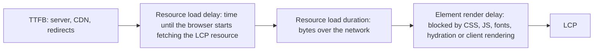
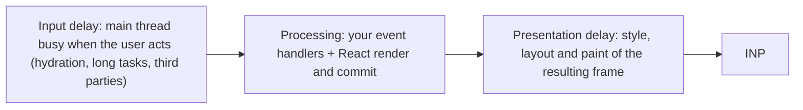
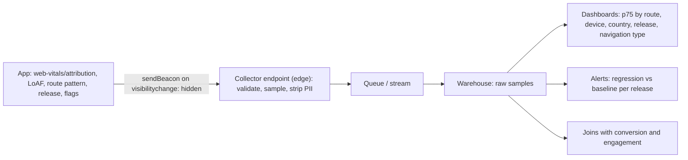

# 39 — Production Web Performance: Core Web Vitals, Budgets and RUM

> The lab tells you what *could* be slow. The field tells you what *is* slow, for whom, and how much it costs. Architects own the system that connects the two.

**Prerequisites:** [02](02-browser-rendering-pipeline.md), [05](05-networking-caching-and-delivery.md), [38](38-react-performance-engineering.md) · **Related:** [32 Rendering Strategy](32-rendering-strategy-architecture.md) · [41 Observability](41-observability-and-diagnostics.md) · [62 CI/CD](62-cicd-release-engineering-and-feature-flags.md)

---

## TL;DR

- **The Core Web Vitals,** each measured at the **75th percentile** of real visits, per device class:

  | Metric | Measures | Good |
  |---|---|---|
  | **LCP** | Loading | ≤ 2.5 s |
  | **INP** | Responsiveness | ≤ 200 ms |
  | **CLS** | Visual stability | ≤ 0.1 |

  LCP and INP became Baseline in December 2025, when Safari 26.2 shipped them. CLS is still Chromium-only.
- **SPAs are finally measurable.** Chrome 151 shipped the **Soft Navigations API**, and CrUX began publishing *experimental* soft-navigation Core Web Vitals in October 2026. The stable metrics are unchanged for now. `web-vitals` v6 supports `reportSoftNavs`.
- **Diagnose by sub-part:**
  - **LCP** = TTFB + resource load delay + resource load duration + element render delay.
  - **INP** = input delay + processing + presentation delay.
  - **CLS** is the largest burst of unexpected shifts in a session window.
  Each sub-part has different owners and fixes.
- **Field data decides; lab data diagnoses and gates.** Run RUM with attribution (`web-vitals/attribution`, Long Animation Frames), segmented by route pattern, release, device and connection. Gate in CI with Lighthouse CI, bundle budgets and interaction benchmarks.
- **Budgets make performance a product decision:**
  - JS kB per route.
  - LCP image weight.
  - Third-party main-thread time.
  - p75 targets.
  Each budget has an owner and an exception process.
- **Third parties are usually the biggest INP and privacy risk.** Keep an inventory, load them late, use facades, tag on the server, and give them their own budget.

---

## 1. The metrics

| Metric | Good | Needs improvement | Poor | What it captures |
|---|---|---|---|---|
| **LCP** | ≤ 2.5 s | ≤ 4.0 s | > 4.0 s | When the largest image or text block in the viewport rendered |
| **INP** | ≤ 200 ms | ≤ 500 ms | > 500 ms | The slowest interaction latency in the visit (near the 98th percentile on interaction-heavy pages: one outlier is ignored per 50 interactions) |
| **CLS** | ≤ 0.1 | ≤ 0.25 | > 0.25 | The largest burst of unexpected layout shift (session windows of up to 5 s, with gaps under 1 s) |
| TTFB | ≈ ≤ 0.8 s | ≤ 1.8 s | > 1.8 s | Server and network responsiveness (diagnostic) |
| FCP | ≤ 1.8 s | ≤ 3.0 s | > 3.0 s | First content painted (diagnostic) |
| TBT (lab only) | < 200 ms | | | Long-task time between FCP and TTI. A lab **proxy** for INP |

| Browser support | LCP | INP | CLS |
|---|---|---|---|
| Chromium | ✅ | ✅ | ✅ |
| Firefox | ✅ | ✅ | ❌ |
| Safari (26.2+) | ✅ | ✅ | ❌ |

> [!NOTE]
> Your RUM sees CLS only from Chromium users, and CrUX contains only opted-in Chrome users. Segment by browser before concluding "Safari users are fine".

### 1.1 Soft navigations

Traditionally every metric was tied to the hard (document) navigation, so an SPA's route changes were invisible: all later interactions counted toward the landing page's INP, and route transitions had no LCP.

- **Chrome 151** ships the Soft Navigations API, with `soft-navigation` and `interaction-contentful-paint` entries. A soft navigation is a user interaction, then a URL change, then a paint.
- **CrUX** publishes experimental Core Web Vitals that include soft navigations (from October 2026). Google's stable scores are unchanged while these are evaluated. For most SPAs the experimental numbers are the same or better.
- **RUM:** `web-vitals` v6 reports per soft navigation with `{ reportSoftNavs: true }`. Each metric carries `navigationType: 'soft-navigation'` and a `navigationURL`.

---

## 2. Lab vs field

| | Field: CrUX | Field: your RUM | Lab: Lighthouse, WebPageTest, DevTools |
|---|---|---|---|
| Who | Opted-in Chrome users | All your users (sampled) | One synthetic run |
| Granularity | Origin, URL (when traffic allows), 28-day rolling window | Any dimension you collect: route, release, flag, country | One page, one device profile |
| Attribution | Little | Rich (element, script, sub-parts, LoAF) | Full traces |
| Best for | SEO signal, benchmarking against competitors | **Truth, prioritisation, regression detection** | **Diagnosis, CI gates** |
| Blind spots | Non-Chrome users, low-traffic URLs | Needs engineering and privacy work | Real devices, networks, caches, user behaviour, third parties |

> [!IMPORTANT]
> **A Lighthouse score of 98 with a poor field INP is common, not contradictory.** Lab runs don't interact (TBT is only a proxy), use a cold cache and a fixed device, and often load without consent banners, logged-in state, experiments or real third-party tags. Trust the field and reproduce in the lab.

---

## 3. LCP: diagnose by sub-part



A healthy breakdown (web.dev's guidance) is roughly 40% TTFB, under 10% load delay, about 40% load duration and under 10% render delay.

| Sub-part | Common causes | Fixes |
|---|---|---|
| **TTFB** | Uncached SSR, slow data, redirect chains, far-away origin | CDN caching of HTML (ISR, PPR shells), streaming, edge caching, data near compute, no redirect hops, 103 Early Hints ([05](05-networking-caching-and-delivery.md), [32](32-rendering-strategy-architecture.md)) |
| **Load delay** | LCP image discovered late: CSS backgrounds, client-rendered markup, `loading="lazy"` on the hero, injected by JS | Put the LCP element **in the server HTML**. `fetchpriority="high"`. Never lazy-load the LCP image. `preload` only if it's discovered late |
| **Load duration** | Oversized images, no modern formats, no responsive sources | AVIF/WebP via an image CDN, `srcset` and `sizes`, compression. Keep LCP images small and early |
| **Render delay** | Render-blocking CSS and JS, web fonts, A/B "anti-flicker" snippets hiding the page, client-side rendering that waits for JS and data | Inline critical CSS (frameworks do this). Defer non-critical JS. `font-display` strategy. Run experiments on the server or at the edge. SSR or RSC instead of client-rendered heroes |

```html
<!-- LCP hero: in the server HTML, prioritised, responsive, with explicit dimensions -->

```

> [!WARNING]
> **Client-rendered SPAs pay for LCP several times over:** HTML, then JS download, parse and execute, then the data fetch, then render. No image optimisation fixes that chain. The architectural fix is rendering the LCP element on the server (SSR, SSG or RSC) ([32](32-rendering-strategy-architecture.md)).

---

## 4. INP: diagnose by sub-part



| Sub-part | Common causes | Fixes |
|---|---|---|
| **Input delay** | Hydration, long tasks during load, timers, third-party scripts (analytics, session replay, consent, chat) | Less JS at startup (RSC, splitting), selective hydration, load third parties late, break up long tasks ([38](38-react-performance-engineering.md)) |
| **Processing** | Large synchronous renders, heavy handlers, synchronous analytics | Colocate state, transitions and deferred values, virtualisation, `scheduler.yield()` after the visual update, workers |
| **Presentation delay** | Huge DOM, expensive CSS (large blur or shadow areas, complex selectors), forced layouts, big paints | Reduce DOM size, `content-visibility`, compositor-friendly animations, avoid layout thrash |

**Long Animation Frames (LoAF, Chromium)** attribute slow frames to the scripts that ran in them: source URL, function, invoker (event listener, timer, promise) and duration. The `web-vitals` attribution build attaches the LoAF entries overlapping your INP interaction and summarises the longest script, so you can tell "our React render" from "the chat widget's listener".

---

## 5. CLS: diagnose the shift

| Cause | Fix |
|---|---|
| Images, video, iframes without dimensions | `width` and `height` attributes, or CSS `aspect-ratio` |
| Ads, embeds and promos injected late | Reserve space (`min-block-size`). Never insert above existing content |
| Cookie or consent banners pushing content | Overlay them (fixed position) or reserve space from the first paint |
| Web fonts swapping with different metrics | Matched fallbacks (`size-adjust`, `ascent-override`), `font-display: optional` for body text, preload 1–2 critical fonts |
| Client-side content inserted above the fold | Render it on the server, or reserve exact space. Skeletons must match the final layout |
| Animations of `top`, `left`, `height` | Animate `transform` and `opacity` ([24](24-animation-and-motion-systems.md)) |
| Late-loading CSS or CSS-in-JS injecting styles | Extract and ship CSS with the HTML ([23](23-styling-architecture-and-theming.md)) |

Shifts within 500 ms of a discrete user input (click, tap, key press) don't count. Shifts triggered by scrolling, hovering or late network responses do.

```css
/* Fallback font tuned to the web font's metrics, so the swap doesn't move text.
   The override values are illustrative: generate real ones per font (e.g. with a font-metrics tool). */
@font-face {
  font-family: 'Inter Fallback';
  src: local('Arial');
  size-adjust: 107%;
  ascent-override: 90%;
  descent-override: 22%;
  line-gap-override: 0%;
}
body { font-family: 'Inter', 'Inter Fallback', system-ui, sans-serif; }
```

---

## 6. Performance budgets

Budgets turn "fast" into numbers that teams own.

| Budget type | Example (Acme Store, mobile) | Enforced by |
|---|---|---|
| **Field timing** | LCP p75 ≤ 2.2 s on product pages; INP p75 ≤ 150 ms on checkout | RUM dashboards and alerts |
| **Lab timing** | Lighthouse (mobile): LCP ≤ 2.5 s, TBT ≤ 200 ms, CLS ≤ 0.1 on 5 key routes | Lighthouse CI on PRs |
| **Quantity** | JS ≤ 170 kB compressed per route (first load); LCP image ≤ 120 kB; fonts ≤ 2 files | `size-limit`, bundler budgets, Lighthouse resource summaries |
| **Third parties** | ≤ 3 third-party origins on product pages; ≤ 50 ms main-thread time combined | LoAF attribution in RUM; tag review |
| **Server** | SSR p95 ≤ 300 ms for product pages | APM ([41](41-observability-and-diagnostics.md)) |

```json
{
  "ci": {
    "collect": {
      "url": ["http://localhost:3000/", "http://localhost:3000/products/ts-42", "http://localhost:3000/checkout"],
      "numberOfRuns": 3
    },
    "assert": {
      "assertions": {
        "largest-contentful-paint": ["error", { "maxNumericValue": 2500 }],
        "total-blocking-time": ["error", { "maxNumericValue": 200 }],
        "cumulative-layout-shift": ["error", { "maxNumericValue": 0.1 }],
        "resource-summary:script:size": ["error", { "maxNumericValue": 175000 }],
        "resource-summary:third-party:count": ["warn", { "maxNumericValue": 5 }]
      }
    }
  }
}
```

Budget governance:

- **Every budget has an owner** (a team, not "everyone") and a dashboard.
- **Exceptions are explicit:** a PR that breaks a budget needs sign-off and a remediation ticket. Budgets that are always overridden aren't budgets.
- **Budgets ratchet.** When you beat one consistently, tighten it.
- **Connect to business metrics.** Correlate your own RUM with conversion, bounce and task completion. That's how performance gets roadmap time.

---

## 7. RUM architecture



```ts
// shared/rum/vitals.ts
import { onCLS, onINP, onLCP, onTTFB, type MetricWithAttribution } from 'web-vitals/attribution';
import { routePatternFor } from '@/shared/routing';  // "/products/:slug": never raw URLs (PII, cardinality)
import { deviceClass } from '@/shared/rum/device';

type Beacon = {
  name: string; value: number; rating: string; id: string;
  navigationType: string; route: string; release: string; device: string;
  attribution: Record<string, unknown>;
};

const queue: Beacon[] = [];

function summarise(metric: MetricWithAttribution): Record<string, unknown> {
  switch (metric.name) {
    case 'LCP': {
      const a = metric.attribution;
      return { target: a.target, url: a.url, ttfb: a.timeToFirstByte, loadDelay: a.resourceLoadDelay,
        loadDuration: a.resourceLoadDuration, renderDelay: a.elementRenderDelay };
    }
    case 'INP': {
      const a = metric.attribution;
      return { target: a.interactionTarget, type: a.interactionType, inputDelay: a.inputDelay,
        processing: a.processingDuration, presentation: a.presentationDelay,
        longestScript: a.longestScript?.entry.sourceURL, scriptSubpart: a.longestScript?.subpart,
        loadState: a.loadState };
    }
    case 'CLS': {
      const a = metric.attribution;
      return { target: a.largestShiftTarget, value: a.largestShiftValue, loadState: a.loadState };
    }
    default:
      return {};
  }
}

function report(metric: MetricWithAttribution): void {
  queue.push({
    name: metric.name,
    value: metric.value,
    rating: metric.rating,
    id: metric.id,
    navigationType: metric.navigationType, // includes 'soft-navigation' and 'back-forward-cache'
    route: routePatternFor(metric.navigationURL ?? location.href),
    release: import.meta.env.VITE_RELEASE,
    device: deviceClass(),
    attribution: summarise(metric),
  });
}

function flush(): void {
  if (queue.length === 0) return;
  const body = JSON.stringify(queue.splice(0));
  // sendBeacon survives page hide; fall back to a keepalive fetch
  if (!navigator.sendBeacon('/rum', body)) {
    void fetch('/rum', { method: 'POST', body, keepalive: true, headers: { 'Content-Type': 'application/json' } });
  }
}

export function startRum(sampleRate = 0.2): void {
  if (Math.random() > sampleRate) return; // sample per page view
  onLCP(report, { reportSoftNavs: true });
  onINP(report, { reportSoftNavs: true });
  onCLS(report, { reportSoftNavs: true });
  onTTFB(report);
  addEventListener('visibilitychange', () => { if (document.visibilityState === 'hidden') flush(); });
}
```

RUM rules that prevent bad conclusions:

- **Percentiles come from raw samples.** Never average p75s across days or routes.
- **Segment before you aggregate:** device class, connection, country, browser, navigation type (bfcache restores and prerenders are near-instant and flatter your numbers), logged-in vs anonymous.
- **Tag every sample** with release, feature flags and experiment arms, so regressions map to changes ([62](62-cicd-release-engineering-and-feature-flags.md)).
- **Respect privacy:** no PII in URLs or targets (CSS selectors can leak names, so truncate them). Use route patterns, honour consent requirements in your jurisdictions, and filter bots.
- **Sample deliberately:** a fixed per-page-view sample rate, recorded with each beacon so it can be re-weighted.

---

## 8. Third-party governance

| Practice | Detail |
|---|---|
| **Inventory** | Every script, with owner, purpose, data collected, pages and cost (kB, main-thread ms). Review quarterly |
| **Load late** | `async` or `defer`, after first interaction or at idle, or only on the pages that need them |
| **Facades** | Static placeholders for video embeds, maps and chat that load the real thing on click |
| **Server-side tagging** | Move analytics fan-out to a server container: one first-party request instead of ten vendor scripts |
| **Isolation** | Web workers (Partytown-style) for some tags. Test for compatibility, since DOM-heavy tags break |
| **Experiments** | Server-side or edge A/B tests instead of client-side flicker snippets (LCP and CLS killers) |
| **Enforcement** | CSP `script-src` allowlists (unknown scripts can't load), plus budgets on third-party main-thread time ([43](43-frontend-security-architecture.md)) |
| **Contracts** | Performance and privacy terms in vendor agreements. The right to remove a tag that breaks budgets |

---

## 9. Navigation speed

- **bfcache:** instant back and forward. Avoid `unload` handlers. Be careful with `Cache-Control: no-store` on HTML (it blocks bfcache in some browsers) and with open connections. Test eligibility in DevTools ([05](05-networking-caching-and-delivery.md)).
- **Prefetch and prerender:** framework prefetching on intent or viewport, and Speculation Rules (Chromium) for likely next pages. Guard analytics during prerender ([31](31-routing-architecture.md)).
- **Perceived performance:** instant skeletons for navigations (route `loading` states, PPR shells), View Transitions for continuity, optimistic UI for mutations.

---

## Decision framework

**Problem.** Field Core Web Vitals miss targets on important routes. What do we change, in what order, and how do we keep it fixed?

**Constraints.** Rendering architecture (SPA or SSR/RSC), third-party contracts, team ownership per route, release cadence, privacy and consent rules.

| Field symptom | Look at | Likely architectural fix |
|---|---|---|
| LCP poor, TTFB dominant | Server timing, cache hit ratio | CDN and HTML caching, PPR or ISR, streaming, data locality |
| LCP poor, load delay dominant | Is the LCP element in the HTML? Priority? | SSR or RSC hero, `fetchpriority`, no lazy-loading |
| LCP poor, render delay dominant | Render-blocking resources, experiments | Critical CSS, defer JS, server-side experiments |
| INP poor, input delay dominant | Hydration and third parties during load | Less client JS, selective hydration, late third parties |
| INP poor, processing dominant | React render and handler profiles | State colocation, transitions, virtualisation, yields |
| CLS poor | Largest shift target | Reserve space, font metrics, overlay banners |

**Criteria.** User impact (traffic-weighted), business impact (conversion correlation), engineering cost and regression risk.

**Failure modes.**
- Optimising Lighthouse scores instead of field p75.
- Averaging percentiles.
- One global dashboard nobody owns.
- Budgets without owners.
- Ignoring Safari and Firefox users because CLS isn't measured there.
- Third parties added through a tag manager with no review.

**Migration path.** Add RUM with attribution first (you can't prioritise without it). Fix the dominant sub-part on the highest-traffic route. Add Lighthouse CI and bundle budgets for that route. Then expand route by route, adopt soft-navigation reporting for SPAs, and introduce third-party governance.

---

## Pitfalls and anti-patterns

- `loading="lazy"` on the LCP image; the hero as a CSS background image.
- Preloading everything (it steals bandwidth from the LCP resource).
- A/B testing snippets that hide the page until scripts load.
- Measuring only desktop, or only on fast office Wi-Fi.
- Treating TBT as INP.
- Reporting metrics on `unload` (unreliable, and it breaks bfcache).
- Raw URLs with IDs or emails in RUM data.
- Skeletons whose size differs from the final content (CLS).
- Cookie banners inserted at the top of the document.
- One-time performance sprints without regression gates.

---

## Architect's checklist

- [ ] RUM with `web-vitals/attribution` (LCP, INP, CLS, TTFB) sampled, privacy-safe and tagged with route pattern, release and flags
- [ ] Soft-navigation reporting enabled for SPA routes (`reportSoftNavs`), with metrics segmented by navigation type
- [ ] Dashboards per route and team, by device class and browser; p75 computed from raw samples
- [ ] LCP element server-rendered and prioritised on key routes; images responsive and modern-format
- [ ] INP attribution with LoAF; top offending scripts and components tracked
- [ ] CLS sources fixed: dimensions, reserved slots, font metric overrides, overlay banners
- [ ] Budgets (field, lab, quantity, third-party) with owners, CI enforcement and an exception process
- [ ] Third-party inventory, loading policy, facades, server-side tagging, CSP allowlist
- [ ] bfcache eligibility and prefetch or prerender strategy verified
- [ ] Performance correlated with business metrics and reviewed in planning

---

## Interview angles

**Q1. Mobile LCP p75 is 4.1 seconds. How do you approach it?**
Start with field attribution: break LCP into TTFB, resource load delay, load duration and render delay for the worst routes, and find the LCP element. If TTFB dominates, fix caching, rendering strategy and data locality. If load delay dominates, the element probably isn't in the server HTML or isn't prioritised. Render it on the server, add `fetchpriority="high"`, and remove lazy-loading. If load duration dominates, use responsive AVIF from an image CDN. If render delay dominates, look at render-blocking CSS and JS, fonts and client-side experiments. Then lock in the gain with Lighthouse CI and image budgets on that route.

**Q2. Lighthouse says 98, but field INP is poor. Why?**
Lighthouse doesn't interact. TBT is only a proxy, measured during load on a clean profile. Field INP covers every interaction across the visit, on real devices, with consent banners, logged-in state, experiments and third-party scripts, often long after load. Use RUM attribution (interaction target, sub-parts, LoAF scripts) to find the slow interactions, then reproduce them in DevTools with throttling.

**Q3. Design a RUM pipeline for a large site.**
Use the `web-vitals` attribution build in the app, with soft navigations enabled for SPA routes. Tag each beacon with route pattern, release, flags, device class and navigation type. Batch and send on `visibilitychange` with `sendBeacon` (falling back to `fetch` with `keepalive`). An edge collector validates, samples and strips PII, then streams to a warehouse of raw samples. Dashboards show p75s computed from raw data, segmented by device, country and browser. Alert on regressions per release. Join with business metrics to prioritise. Document the sampling rate and the privacy and consent posture.

**Q4. How do you govern third-party scripts?**
Treat them as dependencies with owners and costs. Keep an inventory (purpose, data, pages, kB, main-thread time) and review it regularly. Default to loading late or on interaction, with facades for heavy embeds and server-side tagging to collapse analytics. Move experiments to the server. Enforce a CSP allowlist so nothing unreviewed loads, give third parties their own performance budget, measure them in the field with LoAF, and put performance and privacy terms in vendor contracts.

**Q5. How do soft navigations change SPA measurement?**
Before, every interaction in an SPA session counted toward the landing page, and route changes had no LCP. Chrome 151's Soft Navigations API defines a soft navigation as an interaction, then a URL change, then a paint, and emits entries that reset INP and CLS and allow an LCP-like measurement per route change. CrUX now publishes experimental soft-navigation Core Web Vitals alongside the unchanged stable ones. In RUM, `web-vitals` v6 supports `reportSoftNavs` and tags each metric with its navigation type and URL, so you can finally see per-route performance in SPAs. Remember it's Chromium-only for now.

---

## Further reading

- web.dev, *Web Vitals*: <https://web.dev/articles/vitals> · *Optimize LCP*: <https://web.dev/articles/optimize-lcp> · *Optimize INP*: <https://web.dev/articles/optimize-inp> · *Optimize CLS*: <https://web.dev/articles/optimize-cls>
- web.dev, *Experimental soft navigation metrics now available in CrUX* (October 2026): <https://web.dev/blog/crux-experimental-soft-navs>
- web.dev, *How SPA architectures affect Core Web Vitals*: <https://web.dev/vitals-spa-faq/>
- GoogleChrome, *web-vitals* library: <https://github.com/GoogleChrome/web-vitals>
- Chrome for Developers, *Long Animation Frames API*: <https://developer.chrome.com/docs/web-platform/long-animation-frames>
- Chrome UX Report documentation: <https://developer.chrome.com/docs/crux>
- Lighthouse CI: <https://github.com/GoogleChrome/lighthouse-ci>
- WebPageTest documentation: <https://docs.webpagetest.org/>

---

[← Previous: 38 — React Performance Engineering](38-react-performance-engineering.md) · [Index](README.md) · [Next: 40 — Resilience and Reliability Engineering →](40-resilience-and-reliability.md)
