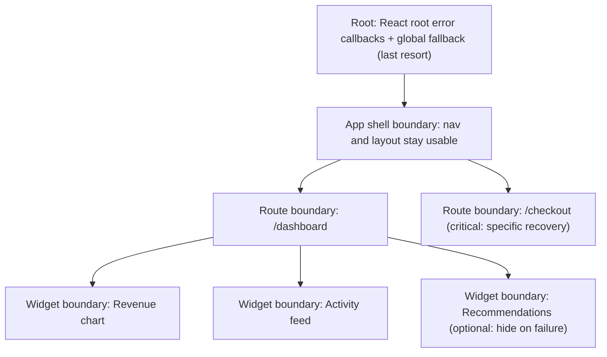
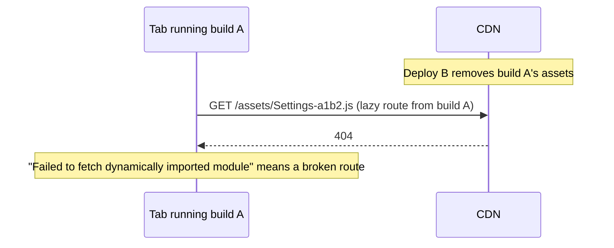

# 40 — Resilience and Reliability Engineering

> Every dependency your UI has will fail eventually: the network, the API, the CDN, the payment provider, last week's JavaScript chunk. Reliability is deciding, in advance, what the user sees when it does.

**Prerequisites:** [15](15-concurrent-react-suspense-and-transitions.md), [30](30-server-state-and-data-fetching.md), [33](33-api-integration-bff-and-contracts.md) · **Related:** [34 Real-time and Offline](34-realtime-offline-and-collaboration.md) · [41 Observability](41-observability-and-diagnostics.md) · [62 CI/CD and Feature Flags](62-cicd-release-engineering-and-feature-flags.md)

---

## TL;DR

- **Design for failure by blast radius.** Layer error boundaries: app shell, then route, then feature or widget. A failing recommendations carousel must never take down checkout.
- **Bounded waits, careful retries.** Every request has a timeout. Retry only transient failures and only idempotent operations (or ones with idempotency keys), with jittered backoff in **one** layer. A small client-side **circuit breaker** stops hammering a dependency that's already down ([33](33-api-integration-bff-and-contracts.md)).
- **Degrade, don't die.** Classify features as critical or non-critical. Fallbacks include stale cached data (`stale-if-error`, persisted query caches), hiding optional widgets, read-only modes, queued writes and kill switches.
- **Static stability:** the shell, navigation and cached data keep working when APIs fail. Serve the app shell from the CDN and design pages that render something useful without every dependency.
- **Deploys break running clients.** Keep old hashed assets available, recover from chunk-load failures (reload once), keep APIs backward-compatible across deploys, and use skew protection where your platform offers it.
- **Never lose user input:** autosaved drafts, persisted form state, outboxes with idempotency keys, and a `beforeunload` guard only while there are unsaved changes.
- **Isolate third parties** (analytics, flags, A/B, chat, payments). They load asynchronously with timeouts and defaults, and never block render.
- **Test failure on purpose:** fault injection with MSW and Playwright routes, offline and slow-network tests, game days, and synthetic monitoring of critical journeys. Measure crash-free sessions and journey success rates against SLOs ([41](41-observability-and-diagnostics.md)).

---

## 1. A failure taxonomy for frontends

| Category | Examples | Typical user impact |
|---|---|---|
| **Network** | Offline, captive portals, high latency, packet loss, timeouts | Spinners forever, lost submissions |
| **Backend** | 5xx, 429 rate limits, one slow dependency, partial outages | Broken widgets, failed actions |
| **Contract** | Schema drift, unknown enum values, version skew between client and API | Crashes on render, wrong data shown |
| **Deploy** | Chunk 404s after a release, Server Action IDs from an old build, service-worker cache mismatches | "Failed to fetch dynamically imported module", blank pages |
| **Client runtime** | Uncaught exceptions, memory exhaustion, old browsers, extensions mutating the DOM, blocked storage | White screen, frozen tab |
| **Third party** | CDN, fonts, analytics, A/B SDK, auth or payment provider outages | Blocked render, failed login or checkout |
| **Data** | Unexpected nulls, huge payloads, pathological strings | Crashes, jank |

---

## 2. Principles

| Principle | In practice |
|---|---|
| **Contain the blast radius** | Error boundaries per independent unit. Separate critical and optional data dependencies |
| **Bounded waiting** | Timeouts on every request. Skeletons with a deadline, after which you show a fallback or retry affordance |
| **Retry safely** | Only transient errors, only idempotent operations, with jitter, in one layer, with a budget |
| **Degrade gracefully** | Stale data beats no data. A hidden optional widget beats an error page |
| **Static stability** | What worked a minute ago keeps working when a dependency fails: cached shell, cached data, queued writes |
| **Never lose user work** | Drafts, outboxes and idempotency keys. Make failure states keep the user's input |
| **Fail visibly but kindly** | Tell users what happened and what they can do. No raw stack traces, no silent failures |
| **Observe everything** | Every caught error is reported with context. Degraded modes are counted, not just errors ([41](41-observability-and-diagnostics.md)) |

---

## 3. Error boundary architecture



### 3.1 Layers

| Layer | Fallback | Recovery |
|---|---|---|
| **Root** (`createRoot` options, `global-error.tsx` in Next.js) | Branded "something went wrong" with a reload button | Full reload. Always report |
| **App shell** | Keep navigation, show a content-area error | Navigate elsewhere, retry |
| **Route** (Next.js `error.tsx` per segment, React Router route `ErrorBoundary`) | Route-level message with retry and a way back | `reset()` or retry, or re-navigate ([31](31-routing-architecture.md)) |
| **Widget** | Small inline message, or hide if optional | Retry button. `resetKeys` when inputs change |
| **List item** (rarely) | Placeholder row | Only when items render untrusted or complex content |

### 3.2 Root callbacks: report everything

```tsx
// app/main.tsx
import { createRoot } from 'react-dom/client';
import { captureError } from '@/shared/observability';
import { App } from './App';

createRoot(document.getElementById('root')!, {
  onUncaughtError(error, info) {   // not caught by any boundary: the app is in a bad state
    captureError(error, { handled: false, componentStack: info.componentStack });
  },
  onCaughtError(error, info) {     // caught by an error boundary: UI degraded, still usable
    captureError(error, { handled: true, componentStack: info.componentStack });
  },
  onRecoverableError(error, info) { // React recovered (e.g. a hydration mismatch fell back to client rendering)
    captureError(error, { recoverable: true, componentStack: info.componentStack });
  },
}).render(<App />);
```

### 3.3 Widget boundaries with server state

```tsx
// shared/ui/WidgetBoundary.tsx
'use client';
import { Suspense, type ReactNode } from 'react';
import { ErrorBoundary, type FallbackProps } from 'react-error-boundary';
import { QueryErrorResetBoundary } from '@tanstack/react-query';
import { captureError } from '@/shared/observability';

function WidgetError({ resetErrorBoundary }: FallbackProps) {
  return (
    <div role="status" className="widget-error">
      <p>This panel couldn't load.</p>
      <button type="button" onClick={resetErrorBoundary}>Try again</button>
    </div>
  );
}

type Props = { name: string; skeleton: ReactNode; optional?: boolean; children: ReactNode };

export function WidgetBoundary({ name, skeleton, optional = false, children }: Props) {
  return (
    <QueryErrorResetBoundary>
      {({ reset }) => (
        <ErrorBoundary
          onReset={reset} // clear the failed queries so "Try again" refetches them
          fallbackRender={optional ? () => null : (props) => <WidgetError {...props} />} // optional widgets disappear
          onError={(error, info) => captureError(error, { boundary: name, componentStack: info.componentStack })}
        >
          <Suspense fallback={skeleton}>{children}</Suspense>
        </ErrorBoundary>
      )}
    </QueryErrorResetBoundary>
  );
}
```

> [!IMPORTANT]
> **Error boundaries catch errors during rendering, not in event handlers, timers or promises you don't render.** For async failures in handlers, keep error state and render it (Actions and `useActionState` do this for forms), or escalate to the nearest boundary explicitly with `useErrorBoundary().showBoundary(error)` from react-error-boundary. With TanStack Query, `useSuspenseQuery` (or `throwOnError`) routes query errors to boundaries ([30](30-server-state-and-data-fetching.md)).

Framework specifics: Next.js has segment-level `error.tsx` and `global-error.tsx` (16.3 also added `catchError` in `next/error`, with a `retry()` helper, for finer-grained handling). React Router has route `ErrorBoundary` exports with `isRouteErrorResponse` for thrown responses.

---

## 4. Timeouts, retries and circuit breakers

The production HTTP client in [33](33-api-integration-bff-and-contracts.md) covers timeouts (`AbortSignal.timeout`), cancellation, Problem Details and safe retries. Two additions for resilience:

### 4.1 Retry budgets

Retries multiply load exactly when a backend is struggling. Cap them per session or per endpoint (for example, at most 10% extra requests from retries), use jitter, and honour `Retry-After`. Never retry in both the HTTP client and the query library.

### 4.2 A client-side circuit breaker

When a non-critical dependency is down, stop calling it for a while: fail fast to a fallback, then let a single probe test recovery.

```ts
// shared/resilience/circuit-breaker.ts
type BreakerState = 'closed' | 'open' | 'half-open';
/** Does this error say the dependency is unhealthy? Aborts and client errors don't. */
export const isTransientFailure = (error: unknown): boolean => {
  if (error instanceof DOMException) return error.name === 'TimeoutError';           // AbortError: the caller gave up
  if (error instanceof TypeError) return true;                                       // fetch's network failure
  const status = (error as { status?: unknown } | null)?.status;
  return typeof status === 'number' && status >= 500;
};

export class CircuitBreaker {
  private state: BreakerState = 'closed';
  private failures = 0;
  private openedAt = 0;
  private readonly threshold: number;
  private readonly cooldownMs: number;
  private readonly isFailure: (error: unknown) => boolean;

  constructor(threshold = 5, cooldownMs = 30_000, isFailure = isTransientFailure) {
    this.threshold = threshold;
    this.cooldownMs = cooldownMs;
    this.isFailure = isFailure;
  }

  async run<T>(call: () => Promise<T>, fallback: () => T): Promise<T> {
    if (this.state === 'open') {
      if (Date.now() - this.openedAt < this.cooldownMs) return fallback(); // fail fast
      this.state = 'half-open';                                             // this call is the probe
    } else if (this.state === 'half-open') {
      return fallback();                                                    // a probe is already in flight
    }
    try {
      const result = await call();
      this.state = 'closed';
      this.failures = 0;
      return result;
    } catch (error) {
      if (this.isFailure(error)) {
        this.failures += 1;
        if (this.state === 'half-open' || this.failures >= this.threshold) {
          this.state = 'open';
          this.openedAt = Date.now();
        }
      } else if (this.state === 'half-open') {
        this.state = 'open';                                                // an aborted probe proves nothing: probe again next call
      }
      return fallback();
    }
  }
}
```

Only errors that say the dependency is unhealthy count towards opening: timeouts, network failures and 5xx responses. An `AbortError` means the caller gave up, which TanStack Query does whenever the user navigates away mid-request, and a 404 is a correct answer. An earlier version of this breaker counted every error, so three quick navigations opened it and hid recommendations for a minute. Pass your own `isFailure` if your client throws something else, and test the classifier, because it decides more than the threshold does.

```ts
// features/recommendations/api.ts
const breaker = new CircuitBreaker(3, 60_000);

export function useRecommendations(sku: string) {
  return useQuery({
    queryKey: ['recommendations', sku],
    // An empty list hides the carousel. The product page doesn't depend on this service
    queryFn: ({ signal }) => breaker.run(() => recommendationsApi.forSku(sku, signal), () => []),
    staleTime: 5 * 60_000,
    retry: false, // the breaker and the HTTP client already decide
  });
}
```

> [!NOTE]
> Client breakers are per tab, so they protect *this user's* experience and reduce load from retry storms. They don't replace server-side breakers, load shedding and rate limits, which protect the system as a whole.

---

## 5. Degraded modes and fallbacks

### 5.1 Classify features

| Tier | Examples (Acme Store) | On dependency failure |
|---|---|---|
| **Critical path** | Product details, add to cart, checkout, sign-in | Specific recovery: retry, alternative provider, clear messaging. Never hidden |
| **Important** | Search, reviews, order history | Stale cache, reduced functionality, inline error with retry |
| **Optional** | Recommendations, recently viewed, promos, chat | Hide silently (but count it) |

### 5.2 Fallback strategies

| Strategy | How |
|---|---|
| **Stale data** | Serve cached data with a "last updated" note. `Cache-Control: stale-if-error` at the CDN; persisted query cache in the client ([34](34-realtime-offline-and-collaboration.md)) |
| **Defaults** | Feature flags fall back to safe defaults bootstrapped from the server. Missing config means a conservative experience |
| **Hide** | Optional widgets render nothing on failure (§3.3) |
| **Read-only mode** | During partial outages, keep browsing and viewing while disabling writes, with a banner |
| **Queue writes** | Accept actions offline or during a brief outage and replay them later, with visible status ([34](34-realtime-offline-and-collaboration.md)) |
| **Kill switch** | Disable a misbehaving feature remotely with a flag, without a deploy ([62](62-cicd-release-engineering-and-feature-flags.md)) |
| **Static fallback** | The CDN serves a cached page or a maintenance page when the origin is down |

```http
Cache-Control: public, max-age=60, stale-while-revalidate=300, stale-if-error=86400
```

With `stale-if-error`, a CDN that supports it keeps serving the last good copy for up to a day if the origin starts failing. That's static stability for public pages.

---

## 6. Deploys, chunk errors and version skew

After a deploy, open tabs still run the previous build. When they lazy-load a route, they ask for chunks that may no longer exist:



| Mitigation | How |
|---|---|
| **Keep old assets** | Immutable, hashed assets stay on the CDN for days or weeks after a deploy. Deploys add files; a separate job garbage-collects old ones |
| **Recover once** | On a chunk-load failure, reload the page once to get the new HTML (guarded against loops) |
| **Skew protection** | Platforms can route a client to the deployment it was loaded from for a period after a release (Vercel's skew protection, for example). Server Action IDs and RSC payloads stay consistent ([50](50-nextjs-in-production.md)) |
| **Backward-compatible APIs** | Support at least the previous client version (expand and contract) ([33](33-api-integration-bff-and-contracts.md)) |
| **Version signalling** | The client sends its build ID. The server can return "please reload" when it's too old. Show a non-blocking "new version available" prompt |
| **Service workers** | Version caches per build. Prompt to reload on update instead of silently mixing builds |

```ts
// app/chunk-recovery.ts (Vite emits 'vite:preloadError' when a dynamic import's preload fails)
const KEY = 'acme:chunk-reload-at';

window.addEventListener('vite:preloadError', (event) => {
  let last = 0;
  try { last = Number(sessionStorage.getItem(KEY) ?? 0); } catch { /* storage unavailable */ }
  if (Date.now() - last < 60_000) return; // already reloaded recently: let the error boundary handle it
  event.preventDefault();                 // suppress the error; we recover by reloading
  try { sessionStorage.setItem(KEY, String(Date.now())); } catch { /* ignore */ }
  window.location.reload();               // new HTML references the new chunks
});
```

Frameworks with client-side routers typically fall back to a full-page navigation when a route's code can't load. Verify yours does, and test it ([42](42-testing-architecture.md)).

---

## 7. Never lose user input

| Technique | Detail |
|---|---|
| **Autosave drafts** | Debounced saves of long forms and editors to IndexedDB (or the server as a draft resource), restored on return with a "restored your draft" notice |
| **Persist form state across reloads** | `sessionStorage` for short-lived wizards. Clear it on successful submit |
| **Keep input on failure** | Failed submissions keep every field and show the error next to the relevant fields ([26](26-forms-and-validation.md)) |
| **Idempotent submit** | An idempotency key generated when the form opens, so retries after timeouts don't double-submit ([33](33-api-integration-bff-and-contracts.md)) |
| **Unsaved-changes guard** | Register `beforeunload` **only while dirty**, and remove it after saving (a permanent listener can hurt bfcache eligibility in some browsers). Router-level blockers handle in-app navigation |

```ts
// shared/forms/use-unsaved-changes.ts
import { useEffect } from 'react';

export function useUnsavedChangesWarning(isDirty: boolean): void {
  useEffect(() => {
    if (!isDirty) return;
    const onBeforeUnload = (event: BeforeUnloadEvent) => { event.preventDefault(); };
    window.addEventListener('beforeunload', onBeforeUnload);
    return () => window.removeEventListener('beforeunload', onBeforeUnload);
  }, [isDirty]);
}
```

---

## 8. Third-party isolation

| Dependency | Failure mode | Isolation |
|---|---|---|
| **Analytics and tag managers** | Slow script blocks the main thread; requests blocked by extensions | Async load after first interaction; queue events locally; never `await` analytics in handlers ([39](39-web-performance-and-core-web-vitals.md)) |
| **Feature flag SDK** | SDK unreachable means no flags | Bootstrap flags from the server into HTML, cache the last known values, and fall back to safe defaults. Never block render waiting for the SDK |
| **A/B testing** | Anti-flicker snippet hides the page until the SDK loads | Server-side or edge assignment |
| **Auth provider** | IdP outage blocks sign-in | Clear status messaging, a longer session grace period, alternative sign-in methods where possible ([45](45-authentication-and-authorization.md)) |
| **Payments** | Provider SDK fails to load or errors | Timeout with retry, alternative payment method, preserve the cart and the user's input |
| **Fonts and CDNs** | Slow or failed font CDN | `font-display` fallbacks; self-host critical fonts |
| **Chat and support widgets** | Heavy, error-prone scripts | Facade; load on click |

> [!WARNING]
> A third-party script that throws at the top level can break your page if it runs synchronously in your bundle's execution path. Load vendor scripts separately (`async`), wrap SDK initialisation in `try`/`catch` with timeouts, and keep Subresource Integrity on pinned third-party files so a tampered script fails closed ([43](43-frontend-security-architecture.md)).

---

## 9. Testing failure on purpose

```ts
// e2e/resilience/product-page.spec.ts
import { test, expect } from '@playwright/test';

test('product page still works when recommendations fail', async ({ page }) => {
  await page.route('**/bff/recommendations/**', (route) => route.fulfill({ status: 503, body: '' }));
  await page.goto('/products/ts-42');

  await expect(page.getByRole('heading', { level: 1, name: 'TS-42 Trail Shoe' })).toBeVisible();
  await expect(page.getByRole('button', { name: 'Add to cart' })).toBeEnabled();
  await expect(page.getByRole('region', { name: 'Recommended for you' })).toHaveCount(0); // hidden, not broken
});

test('checkout keeps the user’s input when payment times out', async ({ page }) => {
  await page.route('**/bff/payments/intent', (route) => route.abort('timedout'));
  await page.goto('/checkout');
  await page.getByLabel('Card holder name').fill('Ana Lima');
  await page.getByRole('button', { name: 'Pay now' }).click();

  await expect(page.getByRole('alert')).toContainText('Payment is taking longer than expected');
  await expect(page.getByLabel('Card holder name')).toHaveValue('Ana Lima');
});
```

| Practice | Detail |
|---|---|
| **Fault injection in development and staging** | MSW scenarios: latency, 500s, malformed JSON, timeouts, empty responses, very large payloads. Toggle them from a dev toolbar |
| **Network conditions** | Offline, slow 3G, flaky (Playwright `context.setOffline`, CDP throttling) |
| **Deploy skew** | An E2E test that loads build A, deploys build B to a preview environment, then navigates to a lazy route |
| **Game days** | Scheduled exercises: "the search API is down; what do users see?" Fix what you find |
| **Synthetic monitoring** | Critical journeys (sign-in, search, add to cart, checkout) run from several regions every few minutes against production, alerting on failure ([41](41-observability-and-diagnostics.md)) |

---

## 10. Reliability as a measured property

| Indicator | Definition |
|---|---|
| **Crash-free sessions** | The share of sessions without an uncaught error or root fallback |
| **Journey success rate** | The share of started critical journeys that complete (sign-in, checkout), measured from frontend events |
| **Degraded-mode rate** | How often fallbacks engage (stale data served, widgets hidden, breakers open), per dependency |
| **Error rate per route and release** | Caught and uncaught errors per 1,000 page views |
| **Chunk-load failure rate** | After each deploy. It should spike briefly, then drop to zero |

Define SLOs on these (for example, 99.5% checkout journey success over 28 days), with error budgets that gate risky releases ([41](41-observability-and-diagnostics.md), [62](62-cicd-release-engineering-and-feature-flags.md)).

---

## Decision framework

**Problem.** How should the UI behave when each dependency fails, and how do we prove it does?

**Constraints.** The criticality of each feature, the business cost of downtime, dependency SLAs, deploy frequency, hosting capabilities (skew protection, `stale-if-error`), and offline expectations.

| Decision | Recommended default |
|---|---|
| Boundaries | Root callbacks + shell + route + widget boundaries; optional widgets hide on failure |
| Requests | Timeouts everywhere; retries in one layer with budgets; breakers for flaky optional dependencies |
| Data fallback | Stale-while-error at the CDN and in the client cache; "last updated" messaging |
| Deploys | Keep old assets; one guarded reload on chunk failure; skew protection; N−1 API compatibility |
| User input | Drafts, idempotency keys, outboxes for important writes, a dirty-only unload guard |
| Third parties | Async, with timeouts, defaults and facades; never on the render path |
| Verification | Fault-injection tests for critical journeys; synthetic monitoring; game days |

**Criteria.** User impact during failures, data-loss risk, operational load (pages and alerts), complexity cost, and recovery time.

**Failure modes.**
- One root error boundary for the whole app.
- Infinite spinners without timeouts.
- Retry storms.
- Optional widgets that throw into critical pages.
- Deleting old assets on deploy.
- Reload loops on chunk errors.
- Feature-flag SDKs blocking render.
- Errors swallowed without reporting.

**Migration path.** Start with root callbacks and route boundaries plus error reporting. Add timeouts to the HTTP client. Classify features and add widget boundaries to optional ones. Fix chunk-load recovery and asset retention. Add fault-injection tests for the top journeys. Then add breakers, `stale-if-error` and synthetic monitoring.

---

## Pitfalls and anti-patterns

- `catch (e) {}`: swallowed errors with no report and no UI.
- Showing raw error messages or stack traces to users.
- Error boundaries that reset on every render, or never reset (no `resetKeys`, no retry).
- Throwing from optional data hooks into critical routes.
- `await analytics.track()` before navigating.
- Retrying `POST` without idempotency keys.
- Hard-deleting the previous build's assets on deploy.
- Service workers that serve a stale shell referencing deleted chunks.
- `beforeunload` registered permanently.
- Feature flags without defaults.
- "It works on staging" without failure tests.

---

## Architect's checklist

- [ ] Root error callbacks report caught, uncaught and recoverable errors with component stacks
- [ ] Boundaries at shell, route and widget level; optional widgets hide on failure; retries reset queries
- [ ] Every request has a timeout; retries are single-layer and budgeted; breakers protect optional dependencies
- [ ] Features classified (critical, important, optional), with documented fallbacks per dependency
- [ ] CDN `stale-if-error` for public pages; persisted client cache for key data
- [ ] Old assets retained across deploys; guarded chunk-reload recovery; skew protection or version signalling
- [ ] Drafts, idempotent submits and outboxes protect user input; the unload guard is dirty-only
- [ ] Third parties async, with timeouts and defaults; flags bootstrapped from the server
- [ ] Fault-injection E2E tests for critical journeys; synthetic monitoring in production; regular game days
- [ ] SLOs on crash-free sessions and journey success, with error budgets tied to release policy

---

## Interview angles

**Q1. Design error handling for a dashboard with 12 independent widgets.**
Use root error callbacks for reporting, a shell boundary so navigation survives, a route boundary for the dashboard, and a boundary per widget with its own Suspense skeleton. Use `QueryErrorResetBoundary` so "Try again" refetches the failed queries. Optional widgets render nothing on failure, while important ones show an inline error with retry. Data requests have timeouts, and flaky optional services sit behind a breaker. Every caught error is reported with the boundary's name, so you can see which widget fails most.

**Q2. Users see "Failed to fetch dynamically imported module" after deploys. Why, and how do you fix it?**
Open tabs run the previous build and lazy-load chunks that the deploy removed. Fix it at three levels. Keep old hashed assets on the CDN for a retention window instead of deleting them on deploy. Recover in the client by reloading once on chunk-load failure (Vite's `vite:preloadError`, guarded against loops). And use skew protection or version signalling so old clients either keep talking to their deployment or are asked to reload. Add an E2E test that simulates the skew.

**Q3. The recommendations API is flaky. How should the product page behave?**
Recommendations are optional, so the page must not depend on them. Fetch them separately from the critical product data, behind a widget boundary that renders nothing on failure. Give the request a short timeout, and put it behind a client circuit breaker so the browser stops calling a failing service for a cooldown period. Cache successful results. Count the degraded-mode rate so the owning team sees the impact, and test the failure with a Playwright route that returns 503.

**Q4. How do you make sure a user never loses a long form?**
Autosave drafts (debounced, to IndexedDB or a server-side draft) and restore them with a notice. Keep every field on submission failure, with errors shown next to the fields. Generate an idempotency key when the form opens, so retries after timeouts can't double-submit. Queue the submission in an outbox if offline. Warn on unload only while the form is dirty, and use router blockers for in-app navigation.

**Q5. What is static stability, and how does it apply to frontends?**
It's the property that a system keeps doing what it was doing when a dependency fails, rather than needing that dependency to recover. For frontends: the app shell is served from the CDN and doesn't need the API to render. Data fetched recently stays usable (stale-if-error at the CDN, persisted query caches on the client). Writes can be queued. Feature flags have cached and default values. A failing service degrades one region of the screen, not the whole app.

---

> [!TIP]
> **Runnable code:** [E40](E40-resilience-and-reliability.md) has the circuit breaker, with black-box tests of its states and failure classifier. `node extract-examples.mjs 40` writes it out as a project; then run `npm ci` and `npm test` in it.

## Further reading

- React docs, *Error boundaries* and root options (`onCaughtError`, `onUncaughtError`, `onRecoverableError`): <https://react.dev/reference/react-dom/client/createRoot>
- react-error-boundary: <https://github.com/bvaughn/react-error-boundary>
- TanStack Query docs, *Suspense* and *QueryErrorResetBoundary*: <https://tanstack.com/query/latest/docs/framework/react/guides/suspense>
- Vite docs, *Load error handling* (`vite:preloadError`): <https://vite.dev/guide/build#load-error-handling>
- RFC 5861, *HTTP Cache-Control Extensions for Stale Content* (`stale-while-revalidate`, `stale-if-error`): <https://www.rfc-editor.org/rfc/rfc5861>
- AWS Builders' Library, *Static stability using Availability Zones*: <https://aws.amazon.com/builders-library/static-stability-using-availability-zones/>
- Google SRE Book, *Handling Overload* and *Addressing Cascading Failures*: <https://sre.google/sre-book/table-of-contents/>
- Michael T. Nygard, *Release It!* (2nd edition), Pragmatic Bookshelf

---

[← Previous: 39 — Production Web Performance: Core Web Vitals, Budgets and RUM](39-web-performance-and-core-web-vitals.md) · [Index](README.md) · [Next: 41 — Observability and Diagnostics →](41-observability-and-diagnostics.md)
