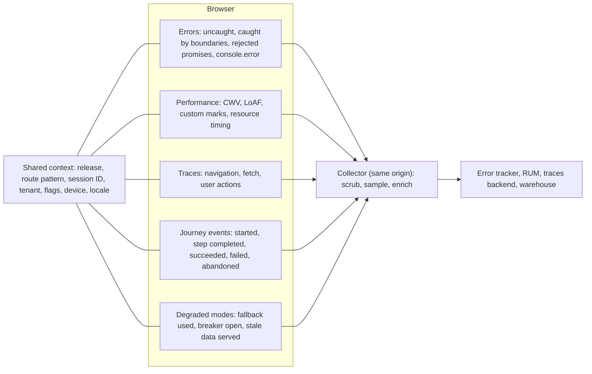
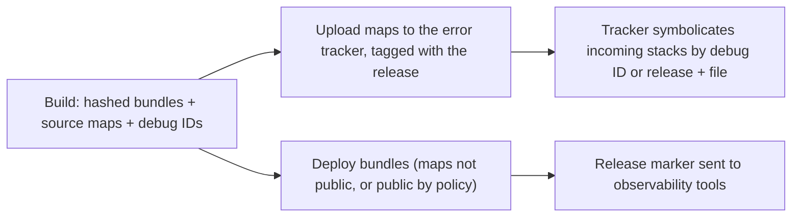
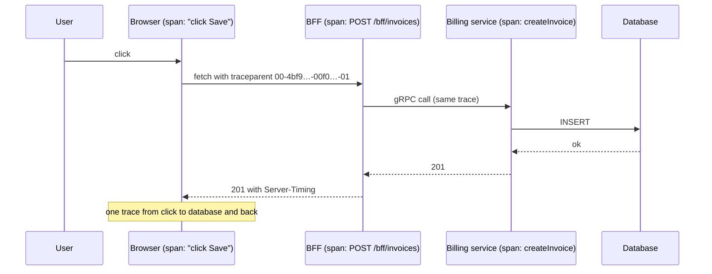
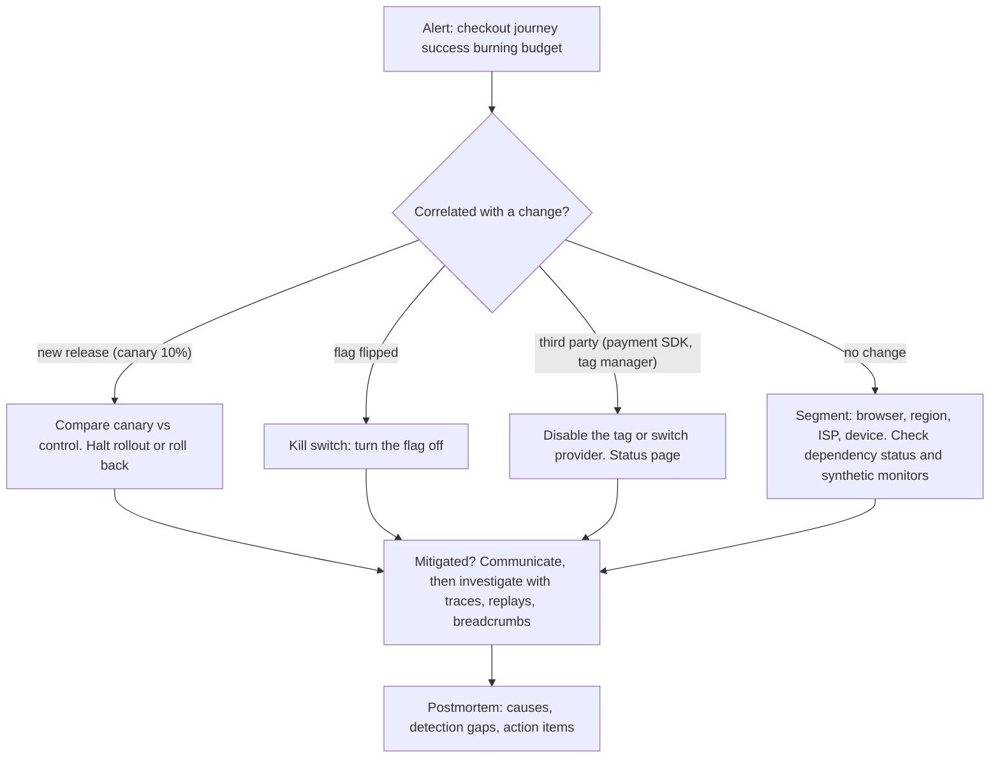

# 41 — Observability and Diagnostics

> The browser is the biggest, most diverse and least observable production environment you run. If you can't see what happened on the user's device, you're debugging folklore.

**Prerequisites:** [39](39-web-performance-and-core-web-vitals.md), [40](40-resilience-and-reliability.md) · **Related:** [20 React Tooling](20-react-tooling-devtools-and-debugging.md) · [33 API Integration](33-api-integration-bff-and-contracts.md) · [62 CI/CD](62-cicd-release-engineering-and-feature-flags.md) · [63 Governance](63-architecture-governance-and-adrs.md)

---

## TL;DR

- Frontend observability has four signals:
  - **Errors** with stack traces, symbolicated through source maps.
  - **Performance** (Core Web Vitals, LoAF, custom timings).
  - **Traces** that link browser actions to backend spans through W3C `traceparent`.
  - **Product and journey events.**
  Every signal carries the same context: release, route pattern, session, tenant, flags, device.
- **OpenTelemetry for browsers is real but young.** The `sdk-trace-web` path is deprecated in OpenTelemetry JS 3.x. The new `@opentelemetry/browser-sdk` and `@opentelemetry/browser-instrumentation` (fetch, errors, navigation, web vitals, LoAF and more) are **experimental**. Many teams pair OTel-compatible tracing with a dedicated error and RUM vendor.
- **Source maps are build artifacts.** Upload them to your error tracker per release (debug IDs make the match robust), and decide deliberately whether to serve them publicly.
- **Privacy by design:** route patterns not raw URLs, scrubbing before sending, masked session replay, consent-aware collection, and retention limits.
- **Control cost and noise:** sample traces and replays (keep 100% of errors, but dedupe and rate-limit), bound attribute cardinality, and count degraded modes as first-class events.
- **Define frontend SLOs on user experience:** journey success rate, crash-free sessions, the share of "good" page views (LCP and INP). Alert on burn rates, not on single errors.
- **Correlate with change.** Release markers, feature-flag evaluations and experiment arms on every event make "what changed?" answerable in minutes. Keep runbooks with kill switches, rollbacks and CDN purges ready ([62](62-cicd-release-engineering-and-feature-flags.md)).

---

## 1. What to observe



| Signal | Questions it answers | Typical tooling |
|---|---|---|
| **Errors** | What broke, for whom, since which release, how often? | Sentry, Datadog, New Relic, Grafana Faro, Bugsnag |
| **Performance** | Is it fast for real users? Which route, interaction or script is slow? | `web-vitals`, LoAF, RUM vendors, CrUX ([39](39-web-performance-and-core-web-vitals.md)) |
| **Traces** | Where did the 4 seconds go: browser, BFF or which service? | OpenTelemetry → Jaeger, Tempo, Honeycomb, Datadog |
| **Journey events** | Can users complete what they came to do? | Analytics or event pipelines, SLO tooling |
| **Degraded modes** | How often do fallbacks hide problems? | Custom events ([40](40-resilience-and-reliability.md)) |
| **Browser reports** | CSP violations, deprecations, interventions, crashes | Reporting API endpoints |

---

## 2. Errors: capture, enrich, symbolicate

### 2.1 Capture everything once

| Source | Hook |
|---|---|
| React render errors | Root `onUncaughtError` / `onCaughtError` / `onRecoverableError`, plus boundary `onError` ([40](40-resilience-and-reliability.md)) |
| Uncaught exceptions outside React | `window.addEventListener('error', …)` |
| Unhandled promise rejections | `window.addEventListener('unhandledrejection', …)` |
| Handled-but-important failures | Explicit `captureError(error, context)` in catch blocks |
| Failed network calls | The HTTP client reports Problem Details with endpoint and status ([33](33-api-integration-bff-and-contracts.md)) |
| Chunk-load failures | The `vite:preloadError` handler or your framework's equivalent |

> [!TIP]
> Errors from cross-origin scripts arrive as an opaque `"Script error."` with no stack. Load your own scripts from a CDN with `crossorigin="anonymous"` and `Access-Control-Allow-Origin` so errors keep their details.

### 2.2 A vendor-neutral reporting core

```ts
// shared/observability/index.ts
import { routePatternFor } from '@/shared/routing';

type Breadcrumb = { t: number; kind: 'nav' | 'click' | 'fetch' | 'log'; message: string };

const MAX_BREADCRUMBS = 50;
const breadcrumbs: Breadcrumb[] = [];
let context: Record<string, string> = {};
const seen = new Map<string, number>();

export function setContext(next: Record<string, string>): void {
  context = { ...context, ...next }; // release, tenant, flags, locale: never emails or names
}

export function breadcrumb(kind: Breadcrumb['kind'], message: string): void {
  breadcrumbs.push({ t: Date.now(), kind, message: scrub(message) });
  if (breadcrumbs.length > MAX_BREADCRUMBS) breadcrumbs.shift();
}

const EMAIL = /[^\s@]+@[^\s@]+\.[^\s@]+/g;
const LONG_NUMBER = /\b\d{9,19}\b/g; // card, account and phone-like numbers
function scrub(text: string): string {
  return text.replace(EMAIL, '[email]').replace(LONG_NUMBER, '[number]');
}

// Not named reportError: that's a DOM global taking one argument, which a missing import would silently call
export function captureError(error: unknown, extra: Record<string, unknown> = {}): void {
  const err = error instanceof Error ? error : new Error(String(error));
  const fingerprint = `${err.name}|${err.message}|${err.stack?.split('\n')[1]?.trim() ?? ''}`;
  const count = (seen.get(fingerprint) ?? 0) + 1;
  seen.set(fingerprint, count);
  if (count > 5) return; // client-side storm control: the backend counts occurrences

  const payload = {
    kind: 'error',
    name: err.name,
    message: scrub(err.message),
    stack: err.stack, // symbolicated server-side with the release's source maps
    release: import.meta.env.VITE_RELEASE,
    route: routePatternFor(location.href),
    context,
    breadcrumbs: breadcrumbs.slice(-20),
    extra,
  };
  navigator.sendBeacon('/telemetry/errors', JSON.stringify(payload));
}

export function installGlobalHandlers(): void {
  window.addEventListener('error', (event) => captureError(event.error ?? event.message, { source: 'window.error' }));
  window.addEventListener('unhandledrejection', (event) => captureError(event.reason, { source: 'unhandledrejection' }));
}
```

Commercial SDKs do the same with more polish: breadcrumbs from navigation, clicks, network and console; `beforeSend` hooks for scrubbing; release and environment tagging; fingerprinting; and grouping. Whichever you use, own the **context and scrubbing policy** centrally.

### 2.3 Source maps and releases



| Decision | Options |
|---|---|
| **Public source maps?** | Private (upload only, strip `sourceMappingURL`) protects code from casual copying. Public helps open debugging and costs nothing in security, since minified code is readable anyway. **Never put secrets in client code either way** |
| **Matching** | Release plus file path is fragile (CDN paths, hashed names). **Debug IDs**, a unique ID injected into both bundle and map, match reliably. Source maps were standardised as **ECMA-426** in 2024, and debug IDs are being standardised alongside them |
| **Retention** | Keep maps as long as the release can still be running in browsers (skew windows, [40](40-resilience-and-reliability.md)) |

---

## 3. Tracing from the browser

### 3.1 Distributed traces across the boundary



The W3C `traceparent` header (`version-traceid-spanid-flags`) links the browser span to backend spans. For cross-origin APIs, the API must allow the header in CORS (`Access-Control-Allow-Headers: traceparent, tracestate`). Send `Server-Timing` headers back so browser tooling and RUM can show server phases.

### 3.2 OpenTelemetry in the browser (late 2026)

```ts
// app/telemetry.ts: load first, before frameworks or libraries patch browser APIs
import { startBrowserSdk } from '@opentelemetry/browser-sdk';
import { FetchInstrumentation } from '@opentelemetry/browser-instrumentation/experimental/fetch';
import { ErrorsInstrumentation } from '@opentelemetry/browser-instrumentation/experimental/errors';
import { NavigationInstrumentation } from '@opentelemetry/browser-instrumentation/experimental/navigation';
import { WebVitalsInstrumentation } from '@opentelemetry/browser-instrumentation/experimental/web-vitals';
import { LongAnimationFrameInstrumentation } from '@opentelemetry/browser-instrumentation/experimental/long-animation-frame';

export const telemetry = startBrowserSdk({
  serviceName: 'acme-insights-web',
  serviceVersion: import.meta.env.VITE_RELEASE,
  resourceAttributes: { 'deployment.environment.name': import.meta.env.MODE },
  // Same-origin collector proxy (no CORS preflights, fewer blocked requests). Per-signal URLs are used
  // as given; a root exportConfig.url would have its path replaced with /v1/traces and /v1/logs.
  traces: { exportConfig: { url: `${location.origin}/otel/v1/traces` } },
  logs: { exportConfig: { url: `${location.origin}/otel/v1/logs` } },
  instrumentations: [
    // Adds W3C traceparent to calls to our API, so browser spans join the backend trace
    new FetchInstrumentation({ propagateTraceHeaderCorsUrls: [/^https:\/\/api\.acme\.dev\//] }),
    new ErrorsInstrumentation(),
    new NavigationInstrumentation(),
    new WebVitalsInstrumentation(),
    new LongAnimationFrameInstrumentation(),
  ],
});
```

> [!WARNING]
> **Maturity check.** In OpenTelemetry JS 3.x, the old `@opentelemetry/sdk-trace-web` package is deprecated in favour of `@opentelemetry/sdk-trace`. The browser SDK and instrumentation packages above are **experimental** (pre-1.0, breaking changes possible), need `@opentelemetry/api` 1.10.x and a bundler that supports subpath imports (Vite, webpack 5.54+). Pin versions, wrap the setup in one module, and keep your own context and scrubbing layer in front of it.

### 3.3 Custom spans for business-meaningful work

Instrument what product and on-call people ask about: "open invoice", "apply filters", "export report". Give spans low-cardinality names (`invoice.open`, not `invoice.open.inv_123`) and IDs as attributes. Mark user-visible milestones with `performance.mark` and `performance.measure` too, so they appear in DevTools traces.

---

## 4. Browser reporting and platform signals

```http
Reporting-Endpoints: default="https://reports.acme.dev/r", csp="https://reports.acme.dev/csp"
Content-Security-Policy: default-src 'self'; script-src 'self' 'nonce-…'; report-to csp
```

```ts
// Deprecations and interventions observed in the page (Chromium)
if ('ReportingObserver' in window) {
  new ReportingObserver(
    (reports) => {
      for (const report of reports) breadcrumb('log', `${report.type}: ${JSON.stringify(report.body)}`);
    },
    { types: ['deprecation', 'intervention'], buffered: true },
  ).observe();
}
```

| Report | Value |
|---|---|
| **CSP violations** | Detect injected scripts and policy breakage before enforcing ([43](43-frontend-security-architecture.md)) |
| **Deprecation reports** | APIs your code (or a vendor's) uses that browsers will remove |
| **Intervention reports** | Where the browser blocked or modified your behaviour |
| **Crash reports** (Chromium) | Tab crashes such as out-of-memory, which never reach your error handler |
| **Network Error Logging** (Chromium) | DNS, TLS and connection failures before your JavaScript even loads |

---

## 5. Privacy, cost and noise

### 5.1 Privacy by design

| Rule | Practice |
|---|---|
| **No PII by default** | Route patterns instead of URLs. Hashed or opaque user IDs. Scrub messages and breadcrumbs. Filter request bodies and query strings |
| **Session replay** | Mask all text and inputs by default, and block media. Allowlist specific non-sensitive regions. Record only on error, or a small sample |
| **Consent** | Collect according to the consent model in each jurisdiction. Separate strictly necessary diagnostics from analytics where the law requires it |
| **Retention and access** | Short retention for raw events, role-based access, deletion on request |
| **Third-party SDKs** | Review what they collect, and route through your collector where possible |

### 5.2 Cost and noise

| Lever | Practice |
|---|---|
| **Sampling** | Errors: 100%, with client-side dedupe and rate limits. Traces: 1–10%, with head sampling plus "always keep errors and slow traces". Replays: on error only |
| **Cardinality** | Bounded attribute values: route patterns, release, device class. Never user IDs as metric labels |
| **Grouping** | Fingerprint errors by type, message template and top in-app frame. Drop known noise (extension errors, aborted fetches, ResizeObserver loop warnings) with documented filters |
| **Ownership** | Route errors to owning teams by code ownership (CODEOWNERS paths in symbolicated stacks), not to a shared inbox |

---

## 6. Frontend SLOs

| SLI | Good event | Typical SLO |
|---|---|---|
| **Journey success** | A started checkout ends in "order placed" (client-side events, deduplicated server-side) | 99.5% over 28 days |
| **Crash-free sessions** | A session without an uncaught error or root fallback | 99.8% |
| **Good LCP page views** | LCP ≤ 2.5 s (field) on key routes, mobile | 90% of page views |
| **Good interactions** | INP ≤ 200 ms | 90% of page views |
| **API calls from the browser** | Non-5xx, non-timeout responses on critical endpoints | 99.9% |

```sql
-- SLI: share of mobile product-page views with good LCP, last 28 days (ClickHouse-style SQL)
SELECT countIf(value <= 2500) / count() AS good_ratio
FROM rum_vitals
WHERE name = 'LCP'
  AND route = '/products/:slug'
  AND device = 'mobile'
  AND ts >= now() - INTERVAL 28 DAY;
```

Alert on **error-budget burn rates** (for example, a fast burn of 2% of the monthly budget in one hour, or a slow burn of 5% in six hours), not on individual errors. Tie error-budget exhaustion to release policy: when the budget is spent, reliability work comes before features ([62](62-cicd-release-engineering-and-feature-flags.md), [63](63-architecture-governance-and-adrs.md)).

---

## 7. Correlating with change

Most incidents are caused by a change. Make every change visible next to the signals:

- **Release markers** (deploy start, canary percentage, full rollout) on dashboards.
- **Feature flags and experiment arms** attached to every event (`flags.checkout_v2=on`), so you can split error rates by flag ([62](62-cicd-release-engineering-and-feature-flags.md)).
- **Third-party and config changes** (tag manager publishes, CDN rules, CSP updates) logged as change events too.
- **Commit and ownership links** from symbolicated frames to code and the owning team.



---

## 8. Diagnostics in production

| Technique | Use |
|---|---|
| **Breadcrumbs** | The last N navigations, clicks, fetches and logs before an error. Your best "steps to reproduce" |
| **Debug mode** | A flag or signed query parameter that raises the log level and disables sampling for one user or session, with consent, for support cases |
| **Remote log levels** | Turn up verbosity for one route or tenant through configuration, without a deploy |
| **Session replay (masked)** | Watch what led to an error. Use it sparingly and privacy-first |
| **Synthetic monitoring** | Scripted journeys from several regions catch outages when real traffic is low (nights, new markets) ([40](40-resilience-and-reliability.md)) |
| **DevTools local overrides** | Reproduce production issues locally by overriding responses and scripts on the live site |

---

## 9. Incident response for frontends

| Runbook item | Content |
|---|---|
| **Detection** | Which alerts page whom; dashboards to open first |
| **Triage questions** | Since when? Which releases, routes, browsers, regions, tenants, flags? Is the backend healthy? |
| **Mitigations** | Kill switches (flag names), rollback commands, CDN purge, disabling a third-party tag, maintenance banner, static fallback page |
| **Communication** | Status page, support macros, internal channels |
| **Evidence** | Release diff, error groups, traces, replays, CrUX and RUM deltas |
| **Follow-up** | Blameless postmortem, a detection-gap analysis ("why didn't an alert fire sooner?"), test and guardrail action items |

---

## Decision framework

**Problem.** How do we see, quickly and privately, what users experience, and connect it to code, releases and backends?

**Constraints.** Privacy and consent regimes, budget (event volumes), existing backend observability stack, team ownership, and vendor policies.

| Decision | Options | Recommended default |
|---|---|---|
| Errors | Vendor SDK, OTel errors instrumentation, custom | A vendor SDK (mature grouping, symbolication, replay) wrapped by your own context and scrubbing layer |
| RUM | Vendor, `web-vitals` with your own pipeline, OTel web vitals | `web-vitals` attribution plus a pipeline you own, or a vendor exporting raw data ([39](39-web-performance-and-core-web-vitals.md)) |
| Tracing | OTel browser SDK, vendor tracing | W3C `traceparent` everywhere. OTel browser packages behind a wrapper (they're experimental), or vendor tracing that propagates W3C context |
| Transport | Direct to vendors, same-origin collector | Same-origin collector (privacy control, fewer blocked requests, one place to scrub) |
| Source maps | Public, private | Private upload with debug IDs, unless there's an explicit open-source policy |
| Alerting | Error counts, SLO burn rates | Burn-rate alerts on journey and crash-free SLOs, plus new-error-group alerts per release |

**Criteria.** Time to detect and diagnose, privacy risk, cost per million sessions, signal-to-noise ratio, and vendor lock-in.

**Failure modes.**
- Raw URLs and emails in error payloads.
- 100% trace sampling bills.
- Unsymbolicated stacks.
- Errors without release tags.
- One shared error inbox.
- Alerts on every exception, so people mute the channel.
- Replays recording payment fields.
- Observability SDKs that slow the page they measure.

**Migration path.** Start with error capture plus release tagging plus source-map upload. Add context and scrubbing. Then add RUM with attribution and journey events, then `traceparent` propagation to the BFF. Next define two or three SLOs with burn-rate alerts, and finally correlate flags and releases on every event and write the runbooks.

---

## Pitfalls and anti-patterns

- `console.log` as the observability strategy.
- Reporting errors from `unload` (lost), or blocking navigation to send telemetry.
- Grouping errors by full message (IDs in messages explode the groups).
- Using user IDs or URLs as metric labels (cardinality explosions).
- Sending telemetry straight to many third-party domains (blocked, slow, privacy-hostile).
- Source maps deleted before old clients stop running.
- Ignoring "handled" errors, which silently degrade UX.
- Session replay without masking.
- Dashboards nobody owns; alerts without runbooks.

---

## Architect's checklist

- [ ] Errors captured from React roots, boundaries, window handlers and the HTTP client, with dedupe and rate limits
- [ ] Shared context (release, route pattern, session, tenant, flags, device, locale) on every signal; central scrubbing
- [ ] Source maps uploaded per release with debug IDs; retention matches skew windows
- [ ] `traceparent` propagated to BFF and APIs (CORS allowed); `Server-Timing` returned
- [ ] OTel browser packages pinned and wrapped (experimental), or vendor tracing with W3C context
- [ ] Reporting API endpoints for CSP, deprecations and crashes
- [ ] Privacy policy for telemetry: PII rules, replay masking, consent, retention, access
- [ ] Sampling and cardinality rules with cost dashboards
- [ ] Frontend SLOs (journey success, crash-free sessions, good LCP and INP views) with burn-rate alerts
- [ ] Release, flag and experiment correlation; runbooks with kill switches, rollback and CDN purge

---

## Interview angles

**Q1. How would you design frontend observability for a large SaaS app?**
Capture four signals (errors, performance, traces and journey events) with one shared context: release, route pattern, session, tenant, flags and device. Errors come from React root callbacks, boundaries, window handlers and the HTTP client, symbolicated with per-release source maps. RUM uses `web-vitals` attribution with soft navigations. Traces propagate W3C `traceparent` to the BFF. Everything goes through a same-origin collector that scrubs PII and samples. Define SLOs on journey success and crash-free sessions with burn-rate alerts, route errors to owning teams via code ownership, and correlate everything with releases and flags.

**Q2. How do you connect a slow click in the browser to the backend cause?**
Create a span for the user action and propagate `traceparent` on the resulting fetches (with CORS allowing the header), so backend spans join the same trace. Return `Server-Timing` for server phases. In the trace view you see browser input delay and render time, network time, BFF time and each downstream service span. Then compare with RUM INP attribution to tell main-thread problems from backend latency.

**Q3. What are good frontend SLOs, and how do you alert on them?**
Measure user outcomes: critical journey success (checkout completes), crash-free sessions, the share of page views with good LCP and INP on key routes, and browser-observed API success for critical endpoints. Set targets over a 28-day window, and alert on error-budget burn rates (fast and slow windows) rather than individual errors. Tie budget exhaustion to release policy.

**Q4. How do you keep telemetry privacy-safe?**
Collect the minimum. Use route patterns instead of URLs and opaque user IDs. Scrub messages, breadcrumbs and request data centrally before sending. Mask session replays by default and record them only on error. Respect consent and data-residency rules. Route through a first-party collector where scrubbing and access control live, set short retention, and review what third-party SDKs collect.

**Q5. Users report a bug you can't reproduce. What's your toolkit?**
Find their session through support IDs or the error group. Read breadcrumbs (navigation, clicks, failed fetches) and the symbolicated stack. Check the release, flags and browser context. Watch the masked replay if one exists. Follow the trace to the backend. If that isn't enough, enable debug mode for that user with consent, or raise log levels for that route or tenant remotely, then reproduce locally with DevTools overrides or by replaying the recorded API responses.

---

## Further reading

- OpenTelemetry, *Browser SDK* (`opentelemetry-browser` repository): <https://github.com/open-telemetry/opentelemetry-browser>
- OpenTelemetry JS: <https://github.com/open-telemetry/opentelemetry-js>
- W3C, *Trace Context*: <https://www.w3.org/TR/trace-context/> · *Server Timing*: <https://www.w3.org/TR/server-timing/>
- W3C, *Reporting API*: <https://www.w3.org/TR/reporting-1/> · MDN, *Reporting API*: <https://developer.mozilla.org/en-US/docs/Web/API/Reporting_API>
- Ecma International, *ECMA-426: Source map format*: <https://ecma-international.org/publications-and-standards/standards/ecma-426/>
- Google SRE Workbook, *Alerting on SLOs*: <https://sre.google/workbook/alerting-on-slos/>
- Charity Majors, Liz Fong-Jones and George Miranda, *Observability Engineering* (O'Reilly)
- Grafana Faro (open-source frontend observability): <https://grafana.com/oss/faro/>

---

[← Previous: 40 — Resilience and Reliability Engineering](40-resilience-and-reliability.md) · [Index](README.md) · [Next: 42 — Testing Architecture →](42-testing-architecture.md)
