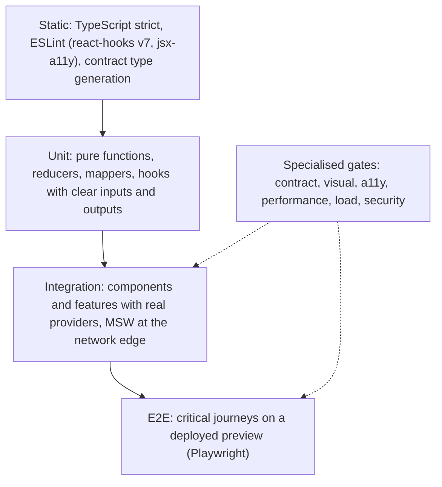
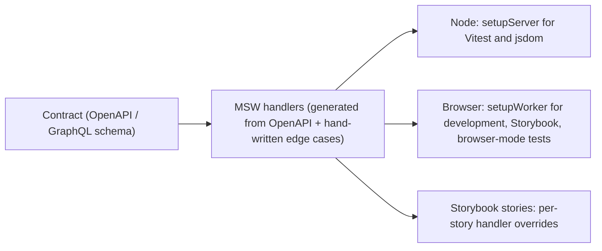
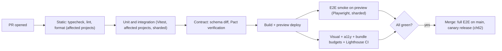

# 42 — Testing Architecture

> A test suite is a product with two customers: the developer who needs fast, trustworthy feedback, and the business that needs confidence to ship on a Tuesday afternoon. Most suites serve neither, because nobody designed them.

**Prerequisites:** [26](26-forms-and-validation.md), [30](30-server-state-and-data-fetching.md), [33](33-api-integration-bff-and-contracts.md) · **Related:** [36 Accessibility](36-accessibility-engineering.md) · [38 React Performance](38-react-performance-engineering.md) · [40 Resilience](40-resilience-and-reliability.md) · [62 CI/CD](62-cicd-release-engineering-and-feature-flags.md)

---

## TL;DR

- **Design the portfolio, not individual tests.** For React apps the *testing trophy* fits better than the classic pyramid:
  - A wide base of static analysis (TypeScript, ESLint including the React hooks v7 rules).
  - Focused unit tests for pure logic.
  - **Most confidence from integration tests:** components with real providers and network mocked at the boundary.
  - A thin layer of E2E tests for critical journeys.
- **Test behaviour through the accessibility tree.** Testing Library queries by role and name (`getByRole('button', { name: 'Save' })`), so tests resemble how users and assistive tech find things, and survive refactors.
- **Mock the network, not your modules.** MSW intercepts requests at the boundary, so the same handlers serve unit tests, the browser, Storybook and development. Unmocked requests should fail the test.
- **Vitest 5** runs fast DOM-emulated tests and **browser mode** (real Chromium, Firefox or WebKit through the Playwright provider) side by side. Use browser mode for components that depend on layout, focus, pointer events or real CSS.
- **Playwright** owns E2E:
  - Auth via storage state.
  - Role-based locators, ARIA snapshots, network routing for failure tests.
  - Traces on retry, sharding.
  - E2E against preview deployments.
- **Contract tests** (Pact, schema diffs) replace most cross-team E2E. **Visual** (Chromatic, Playwright screenshots), **a11y** (axe plus keyboard scripts), **performance** (Reassure, Lighthouse CI) and **load** tests (k6 against the BFF and SSR) each guard one risk.
- **Async Server Components** are best covered by testing their server logic directly plus E2E. Server Functions are tested as functions (auth, validation, authorisation) *and* as public endpoints ([44](44-rsc-security-threat-model.md)).
- **Treat flakiness as a defect** with an owner and an SLA: quarantine, fix the root cause (clocks, network, isolation), and report retried passes instead of hiding them.

---

## 1. The portfolio



| Layer | Speed | Confidence per test | Typical share | Owns |
|---|---|---|---|---|
| **Static** | Instant | Narrow but total | All code | Type errors, hook-rule violations, a11y lint, dead code |
| **Unit** | ms | Logic correctness | 20–30% | Formatting, validation schemas, reducers, state machines, mappers ([33](33-api-integration-bff-and-contracts.md)) |
| **Integration** | 10s–100s of ms | **High**: real rendering, real hooks, network mocked | 50–60% | Feature behaviour: forms, lists, error states, permissions in the UI |
| **E2E** | Seconds | Highest, but costly and flakier | 10–15% (tens of tests, not thousands) | Critical journeys across real services: sign-in, checkout, core workflows |

> [!IMPORTANT]
> **The ratio follows the architecture.** A thin-client SPA over a well-tested API gets most value from integration tests. A Next.js app whose logic lives in Server Components and Server Functions needs more server-side unit tests plus E2E, because Server Components don't render in component-test environments the way Client Components do.

---

## 2. Testing Library: behaviour over implementation

### 2.1 Query priority

| Priority | Query | Why |
|---|---|---|
| 1 | `getByRole(role, { name })` | Mirrors the accessibility tree. Fails if the UI isn't accessible ([36](36-accessibility-engineering.md)) |
| 2 | `getByLabelText` | Form fields, the way users find them |
| 3 | `getByPlaceholderText`, `getByText`, `getByDisplayValue` | Non-interactive content |
| 4 | `getByAltText`, `getByTitle` | Images and fallbacks |
| Last | `getByTestId` | Only when there's no user-facing handle (canvas, charts) |

| Variant | Use |
|---|---|
| `getBy…` | Element must exist now |
| `queryBy…` | Assert absence (`expect(queryByRole('alert')).toBeNull()`) |
| `findBy…` | Wait for async appearance (data loaded, toast shown) |
| `within(region)` | Scope queries to a row, dialog or section |

### 2.2 An integration test with real providers and MSW

```tsx
// features/invoices/InvoicePage.test.tsx (Vitest + jsdom + Testing Library + MSW)
import { expect, test } from 'vitest';
import { screen } from '@testing-library/react';
import userEvent from '@testing-library/user-event';
import { http, HttpResponse } from 'msw';
import { server } from '@/test/msw-server';
import { renderWithProviders } from '@/test/render';
import { InvoicePage } from './InvoicePage';

test('voids an open invoice and confirms it', async () => {
  const user = userEvent.setup();
  renderWithProviders(<InvoicePage id="inv_42" />);

  await user.click(await screen.findByRole('button', { name: 'Void invoice' }));
  await user.click(screen.getByRole('button', { name: 'Confirm void' }));

  expect(await screen.findByText('Invoice INV-0042 voided')).toBeInTheDocument();
});

test('explains why a paid invoice cannot be voided', async () => {
  server.use(
    http.post('/bff/v2/invoices/:id/void', () =>
      new HttpResponse(
        JSON.stringify({ type: 'https://api.acme.dev/problems/invoice-paid', title: 'Paid invoices cannot be voided', status: 409 }),
        { status: 409, headers: { 'Content-Type': 'application/problem+json' } },
      ),
    ),
  );
  const user = userEvent.setup();
  renderWithProviders(<InvoicePage id="inv_42" />);

  await user.click(await screen.findByRole('button', { name: 'Void invoice' }));
  await user.click(screen.getByRole('button', { name: 'Confirm void' }));

  expect(await screen.findByRole('alert')).toHaveTextContent('Paid invoices cannot be voided');
});
```

```ts
// test/setup.ts (Vitest setupFiles)
import { afterAll, afterEach, beforeAll } from 'vitest';
import { cleanup } from '@testing-library/react';
import '@testing-library/jest-dom/vitest';
import { server } from './msw-server';

beforeAll(() => server.listen({ onUnhandledRequest: 'error' })); // an unmocked request fails the test
afterEach(() => {
  server.resetHandlers(); // per-test overrides never leak
  cleanup();
});
afterAll(() => server.close());
```

```tsx
// test/render.tsx: the same providers as production, configured for determinism
import { render } from '@testing-library/react';
import { QueryClient, QueryClientProvider } from '@tanstack/react-query';
import type { ReactElement } from 'react';
import { AnnouncerProvider } from '@/shared/a11y/Announcer';

export function renderWithProviders(ui: ReactElement) {
  const queryClient = new QueryClient({
    defaultOptions: { queries: { retry: false, gcTime: Infinity }, mutations: { retry: false } },
  });
  return render(
    <QueryClientProvider client={queryClient}>
      <AnnouncerProvider>{ui}</AnnouncerProvider>
    </QueryClientProvider>,
  );
}
```

Principles visible here:

- **A fresh client per test** (no cache leakage), with retries off (no slow failures).
- **`userEvent.setup()`** rather than `fireEvent`. It simulates real event sequences (pointer, focus, keyboard).
- **Assertions on what users perceive** (text, roles, alerts), not on state, props or mocks of your own modules.
- **Error paths tested as first-class behaviour**, with per-test MSW overrides.

---

## 3. Vitest 5: emulated DOM and real browsers

| Environment | Use for | Trade-off |
|---|---|---|
| `node` | Pure logic, schemas, server utilities, Server Function logic | Fastest |
| `jsdom` / `happy-dom` | Most component integration tests | Fast. No layout, no real CSS, imperfect focus and pointer semantics |
| **Browser mode** (Playwright provider) | Components depending on layout, focus management, pointer and drag, CSS (container queries, `:has()`), real `IntersectionObserver` and `ResizeObserver`, visual assertions | Slower, needs browser binaries, but runs real engines (Chromium, Firefox, WebKit) |

```ts
// vitest.config.ts: two projects, fast unit tests and real-browser component tests
import { defineConfig } from 'vitest/config';
import react from '@vitejs/plugin-react';
import { playwright } from '@vitest/browser-playwright';

export default defineConfig({
  plugins: [react()],
  test: {
    projects: [
      {
        extends: true,
        test: { name: 'unit', environment: 'node', include: ['src/**/*.test.ts'] },
      },
      {
        extends: true,
        test: {
          name: 'browser',
          include: ['src/**/*.browser.test.tsx'],
          browser: {
            enabled: true,
            provider: playwright(),
            headless: true,
            instances: [{ browser: 'chromium' }, { browser: 'webkit' }],
          },
        },
      },
    ],
  },
});
```

```tsx
// features/invoices/InvoiceFilters.browser.test.tsx: runs in real Chromium and WebKit
import { expect, test, vi } from 'vitest';
import { page } from 'vitest/browser';
import { render } from 'vitest-browser-react';
import { InvoiceFilters } from './InvoiceFilters';

test('applies the selected status filter', async () => {
  const onApply = vi.fn();
  await render(<InvoiceFilters onApply={onApply} />);

  await page.getByRole('combobox', { name: 'Status' }).selectOptions('overdue');
  await page.getByRole('button', { name: 'Apply filters' }).click();

  expect(onApply).toHaveBeenCalledWith({ status: 'overdue' });
  await expect.element(page.getByRole('status')).toHaveTextContent('Filters applied');
});
```

> [!NOTE]
> Vitest 5 (September 2026) requires Node 22.12+ and Vite 6.4+, clears mocks between tests by default, and **fails tests with unawaited assertions**, a common source of false passes. Browser providers are separate packages (`@vitest/browser-playwright`, `@vitest/browser-webdriverio`), and `page`, `userEvent` and friends import from `vitest/browser`.

---

## 4. MSW as the shared mocking layer



| Practice | Why |
|---|---|
| **Generate default handlers from the contract** | Mocks can't drift silently from the API ([33](33-api-integration-bff-and-contracts.md)) |
| **`onUnhandledRequest: 'error'`** | Tests can't accidentally hit real services |
| **Scenario helpers** (`useScenario('invoice-paid')`) | Readable tests, reusable edge cases |
| **Latency and failure scenarios** | Loading states, timeouts and degraded modes get tested ([40](40-resilience-and-reliability.md)) |
| **WebSocket handlers** (MSW's `ws` API) | Real-time features without a server ([34](34-realtime-offline-and-collaboration.md)) |

---

## 5. Testing hooks, state and server code

| Target | Approach |
|---|---|
| **Custom hooks** | Prefer testing through a component that uses them. For reusable library hooks, `renderHook` with providers |
| **Reducers, state machines, selectors** | Plain unit tests (inputs to outputs). XState machines are testable with model-based paths |
| **Zod and Valibot schemas, mappers** | Table-driven unit tests, including tolerant-reader cases (unknown enums, missing optional fields) |
| **Async Server Components** | Test the data and authorisation functions they call directly in `node`. Cover the composed page with E2E. Component-test runners don't fully render async Server Components |
| **Server Functions** | Call them as functions with a mocked session: assert validation, **authorisation** and side effects. Also hit them in E2E. They're public endpoints ([44](44-rsc-security-threat-model.md)) |
| **Route loaders and middleware** | Unit-test them as request-to-response functions (redirects, `returnTo` validation) ([31](31-routing-architecture.md)) |

```ts
// app/invoices/actions.test.ts: a Server Function is a public endpoint; test it like one
import { beforeEach, expect, test, vi } from 'vitest';
import { voidInvoice } from './actions';
import * as auth from '@/server/auth';
import { billing } from '@/server/services';

vi.mock('@/server/auth');
vi.mock('@/server/services');

beforeEach(() => {
  vi.mocked(billing.voidInvoice).mockResolvedValue({ id: 'inv_42', status: 'void' });
});

test('rejects users without billing:write', async () => {
  vi.mocked(auth.requireSession).mockResolvedValue({ userId: 'u1', tenantId: 't1', permissions: ['billing:read'] });
  await expect(voidInvoice({ invoiceId: 'inv_42' })).resolves.toEqual({ ok: false, error: 'forbidden' });
  expect(billing.voidInvoice).not.toHaveBeenCalled();
});

test('scopes the call to the session tenant, never to client input', async () => {
  vi.mocked(auth.requireSession).mockResolvedValue({ userId: 'u1', tenantId: 't1', permissions: ['billing:write'] });
  await voidInvoice({ invoiceId: 'inv_42' });
  expect(billing.voidInvoice).toHaveBeenCalledWith('t1', 'inv_42');
});
```

---

## 6. E2E with Playwright

```ts
// playwright.config.ts
import { defineConfig, devices } from '@playwright/test';

export default defineConfig({
  testDir: './e2e',
  fullyParallel: true,
  forbidOnly: !!process.env.CI,
  retries: process.env.CI ? 2 : 0, // retried passes are reported as flaky, not hidden
  reporter: process.env.CI ? [['blob'], ['github']] : 'html',
  use: {
    baseURL: process.env.BASE_URL ?? 'http://localhost:3000', // CI points this at the PR's preview deployment
    trace: 'on-first-retry',
    screenshot: 'only-on-failure',
  },
  projects: [
    { name: 'setup', testMatch: /.*\.setup\.ts/ },
    { name: 'chromium', use: { ...devices['Desktop Chrome'], storageState: 'e2e/.auth/user.json' }, dependencies: ['setup'] },
    { name: 'mobile-safari', use: { ...devices['iPhone 15'], storageState: 'e2e/.auth/user.json' }, dependencies: ['setup'] },
  ],
  webServer: process.env.BASE_URL
    ? undefined
    : { command: 'pnpm start', url: 'http://localhost:3000', reuseExistingServer: !process.env.CI },
});
```

```ts
// e2e/auth.setup.ts: sign in once, reuse the session in every test
import { test as setup, expect } from '@playwright/test';

setup('authenticate', async ({ page }) => {
  await page.goto('/login');
  await page.getByLabel('Email').fill(process.env.E2E_USER_EMAIL ?? '');
  await page.getByLabel('Password').fill(process.env.E2E_USER_PASSWORD ?? '');
  await page.getByRole('button', { name: 'Sign in' }).click();
  await expect(page.getByRole('navigation', { name: 'Main' })).toBeVisible();
  await page.context().storageState({ path: 'e2e/.auth/user.json' });
});
```

```ts
// e2e/invoices.spec.ts
import { test, expect } from '@playwright/test';

test('invoice header exposes the right structure', async ({ page }) => {
  await page.goto('/invoices/inv_42');
  // An ARIA snapshot asserts the accessibility tree: roles, names and order, not CSS classes
  await expect(page.getByRole('banner')).toMatchAriaSnapshot(`
    - heading "Invoice INV-0042" [level=1]
    - text: Open
    - button "Void invoice"
  `);
});
```

| Practice | Why |
|---|---|
| **Critical journeys only** | Each E2E test costs minutes and maintenance. Tens of tests, not thousands |
| **Dedicated test tenants and data**, seeded through APIs | Isolation from other runs. No dependence on shared fixtures |
| **Role-based locators, ARIA snapshots** | Resilient to markup refactors, and they double as a11y checks |
| **Network routing only for third parties and failure cases** | E2E should exercise your real stack. Route what you can't control (payment sandbox failures, outages) ([40](40-resilience-and-reliability.md)) |
| **Deterministic time** | `page.clock` for timers, expiry and relative dates |
| **Run on preview deployments** | Tests the real build, CDN configuration and environment variables |
| **Sharding and the trace viewer** | Fast feedback; debuggable failures |

---

## 7. Specialised gates

| Risk | Gate | Tools |
|---|---|---|
| **Breaking API changes** | Schema diff + consumer-driven contracts | `oasdiff`, `graphql-inspector`, Pact (consumers publish expectations, providers verify them in CI) ([33](33-api-integration-bff-and-contracts.md)) |
| **Visual regressions** | Screenshot comparison of stories and pages across themes, brands and viewports | Chromatic, Playwright `toHaveScreenshot`, Vitest browser-mode screenshots ([35](35-enterprise-design-system-architecture.md)) |
| **Accessibility** | axe scans plus keyboard scripts | `@axe-core/playwright`, `vitest-axe`, Storybook a11y addon ([36](36-accessibility-engineering.md)) |
| **Performance** | Render-count and duration regressions; lab budgets | Reassure, Lighthouse CI, bundle budgets ([38](38-react-performance-engineering.md), [39](39-web-performance-and-core-web-vitals.md)) |
| **Load and capacity** | SSR and BFF throughput, cache hit ratios, degradation under load | k6 (HTTP and browser modules), Artillery: test the BFF and SSR routes, not just APIs |
| **Security** | Dependency audit, secret scanning, DAST on preview environments | npm audit or OSV-Scanner, gitleaks, OWASP ZAP ([43](43-frontend-security-architecture.md)) |
| **Test quality** | Do tests catch bugs? | Mutation testing (Stryker) on critical logic, run periodically |

> [!TIP]
> Replace cross-team E2E suites ("the web team's tests break when billing deploys") with **contract tests plus a handful of E2E smoke tests**. Contracts fail fast and point at the team that broke the agreement.

---

## 8. Flakiness as a defect

| Cause | Fix |
|---|---|
| Real time and timers | Fake timers (`vi.useFakeTimers`), `page.clock`, injected clocks |
| Unmocked or shared network | MSW with `onUnhandledRequest: 'error'`; seeded, isolated test data |
| Test-order dependence | Fresh providers per test, no module-level state, `resetHandlers` |
| Animations and transitions | Reduced motion in tests (`prefers-reduced-motion: reduce` emulation), web-first assertions that wait |
| Arbitrary waits (`waitForTimeout(2000)`) | Web-first assertions (`expect(locator).toBeVisible()`), `findBy…` |
| Environment drift | Pinned browsers (Playwright version), containerised CI, the same Node version as production |

Policy: retried passes are reported. A test that flakes twice in a week is **quarantined** (it still runs but doesn't block), gets an owner, and has a fix-by date. Quarantine without an owner is deletion with extra steps.

---

## 9. CI pipeline and ownership



- **Affected-only runs** in monorepos (Nx or Turborepo task graphs) keep PR feedback fast. Run the full suite on `main` and nightly ([60](60-monorepos-build-tooling-and-bundlers.md)).
- **Targets:** PR feedback within about 10 minutes; flaky rate under 1%; E2E smoke under 5 minutes with sharding.
- **Ownership:** tests live next to the code they test, and CODEOWNERS route failures to teams. A shared E2E suite has explicit journey owners.

---

## Decision framework

**Problem.** Which tests, at which layers, give the most confidence per minute of CI and per hour of maintenance?

**Constraints.** Architecture (SPA, RSC, micro-frontends), team topology, release frequency, regulatory needs (audit trails of testing), and CI budget.

| Question | Recommended default |
|---|---|
| Component tests in jsdom or a real browser? | jsdom for most behaviour; browser mode for layout, focus, pointer and CSS-dependent components and design-system primitives |
| How to mock data? | MSW at the network boundary, with handlers generated from contracts; never mock your own fetch layer modules |
| How much E2E? | Critical journeys plus smoke per deploy, on previews. Everything else through integration and contract tests |
| How to test RSC apps? | Server logic and Server Functions as functions (with authorisation cases), Client Components with integration tests, pages with E2E |
| Cross-team integration? | Contract tests (Pact or schema diffs) instead of shared E2E |
| Visual and a11y? | Per design-system component in Storybook; key pages in E2E |

**Criteria.** Defect detection on real bugs, speed, flakiness, maintenance cost, and refactor resilience.

**Failure modes.**
- Snapshot tests of entire component trees (brittle, rubber-stamped).
- Mocking your own modules until tests only test the mocks.
- 2,000 E2E tests that take an hour and fail randomly.
- `data-testid` everywhere.
- No error-path tests.
- Retries hiding flakiness.
- Coverage targets driving low-value tests.

**Migration path.** Turn on strict TypeScript and the hooks v7 lint rules. Introduce MSW and a `renderWithProviders` helper. Convert implementation-detail tests to role-based integration tests when you touch those files. Cut the E2E suite to critical journeys and move to preview deployments. Add contract tests at team boundaries. Then add visual and a11y gates to the design system and key pages.

---

## Pitfalls and anti-patterns

- Testing implementation details: state values, internal methods, hook call counts.
- `container.querySelector('.btn-primary')` in place of role queries.
- `act()` warnings silenced instead of awaited properly (`findBy…`, `userEvent`).
- Shared `QueryClient` across tests (cache leakage).
- Asserting on mocks of the HTTP client instead of what the UI shows.
- E2E tests that log in through the UI every time (slow; use storage state).
- `waitForTimeout` sleeps.
- Tests that depend on today's date or the machine's time zone ([37](37-internationalization-and-localization.md)).
- Generated "golden" snapshots updated without review.
- Coverage as a goal rather than a signal.

---

## Architect's checklist

- [ ] Portfolio defined (static, unit, integration, E2E, specialised gates) with target ratios and owners
- [ ] Testing Library with role-based queries; `userEvent`; `renderWithProviders` with deterministic providers
- [ ] MSW shared across tests, Storybook and development; handlers generated from contracts; unhandled requests fail
- [ ] Vitest projects for node, DOM-emulated and browser-mode tests; Vitest 5 requirements met
- [ ] Server Functions tested for validation and authorisation; server logic unit-tested; RSC pages covered by E2E
- [ ] Playwright E2E for critical journeys on preview deployments, with storage-state auth, ARIA snapshots and traces
- [ ] Contract tests at team boundaries; visual, a11y, performance and load gates where the risk lives
- [ ] Flakiness policy: reported retries, quarantine with owner and deadline, root-cause fixes
- [ ] CI under about 10 minutes for PRs (affected-only, sharding); full runs on main and nightly

---

## Interview angles

**Q1. How would you structure testing for a large React and Next.js codebase?**
Use the trophy: strict TypeScript and lint at the base; unit tests for pure logic (schemas, mappers, reducers); most confidence from integration tests of features with real providers and MSW at the network boundary; and a thin E2E layer for critical journeys on preview deployments. In an RSC app, test server logic and Server Functions directly, including authorisation, because async Server Components don't fully render in component-test runners, and cover composed pages with E2E. Add contract tests at team boundaries and visual and a11y gates in the design system.

**Q2. Why query by role instead of test IDs?**
Role queries find elements the way users and assistive technologies do, so tests verify accessibility for free and survive markup refactors. A test that can't find `getByRole('button', { name: 'Save' })` has found a real bug: the button has no accessible name or isn't a button. Test IDs couple tests to implementation and say nothing about whether users can use the UI.

**Q3. When do you use Vitest browser mode instead of jsdom?**
When behaviour depends on real browser features jsdom doesn't implement faithfully: layout and measurement, focus management and `:focus-visible`, pointer and drag interactions, CSS such as container queries or `:has()`, `IntersectionObserver` and `ResizeObserver`, and visual output. Design-system primitives and complex widgets benefit most. Everything else stays in jsdom for speed.

**Q4. How do you keep an E2E suite fast and reliable?**
Keep it small: critical journeys and smoke tests. Authenticate once via storage state. Seed isolated data through APIs. Use role-based locators and web-first assertions, never sleeps. Control time with `page.clock`. Route only third parties and failure scenarios. Shard runs, run against preview deployments, record traces on retry, and treat retried passes as flaky defects with owners.

**Q5. What replaces "test everything end-to-end across teams"?**
Contract testing. Consumers publish their expectations (Pact) or the provider's schema is diffed against consumers' operations (OpenAPI or GraphQL checks), and providers verify those expectations in their CI. Breaks are caught before deploy and attributed to the team that changed the contract. Keep a few cross-system smoke tests for wiring, not behaviour.

---

## Further reading

- Testing Library, *Guiding principles* and *Queries priority*: <https://testing-library.com/docs/queries/about/#priority>
- Kent C. Dodds, *The Testing Trophy and Testing Classifications*: <https://kentcdodds.com/blog/the-testing-trophy-and-testing-classifications>
- Vitest, *Browser Mode*: <https://vitest.dev/guide/browser/> · Vitest 5 migration guide: <https://vitest.dev/guide/migration>
- MSW documentation: <https://mswjs.io/docs>
- Playwright, *Best practices*: <https://playwright.dev/docs/best-practices> · *ARIA snapshots*: <https://playwright.dev/docs/aria-snapshots>
- Next.js docs, *Testing* (Vitest and async Server Components): <https://nextjs.org/docs/app/guides/testing>
- Pact documentation: <https://docs.pact.io/>
- k6 documentation: <https://grafana.com/docs/k6/latest/>
- Stryker Mutator: <https://stryker-mutator.io/>

---

[← Previous: 41 — Observability and Diagnostics](41-observability-and-diagnostics.md) · [Index](README.md) · [Next: 43 — Frontend Security Architecture →](43-frontend-security-architecture.md)
