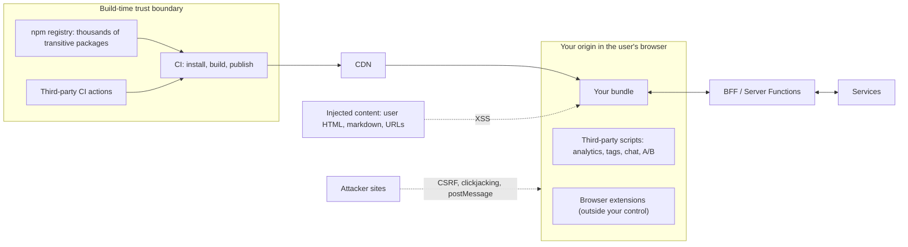
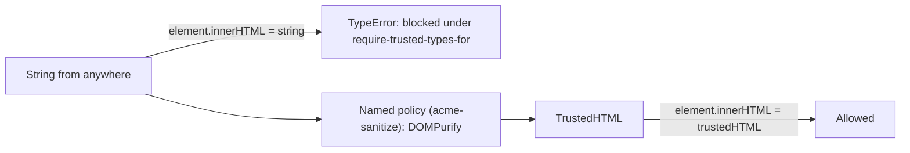

# 43 — Frontend Security Architecture

> Your frontend runs on hardware you don't control, alongside code you didn't write, built from packages you've never read. Security architecture is deciding which of those you trust, and proving the rest can't hurt you.

**Prerequisites:** [05](05-networking-caching-and-delivery.md), [33](33-api-integration-bff-and-contracts.md) · **Related:** [44 RSC Security](44-rsc-security-threat-model.md) · [45 AuthN and AuthZ](45-authentication-and-authorization.md) · [46 Enterprise SaaS](46-enterprise-saas-architecture.md) · [60 Build Tooling](60-monorepos-build-tooling-and-bundlers.md)

---

## TL;DR

- **Use the standards as requirements.** OWASP **ASVS 5.0** (May 2025; about 350 requirements in 17 chapters, including V3 *Web Frontend Security*) is the verification catalogue. The **OWASP Top 10:2025** (final January 2026) is the awareness list, and now includes **A03 Software Supply Chain Failures**.
- **React escapes text by default, but not everything.** The escape hatches are where XSS lives: `dangerouslySetInnerHTML`, URL attributes (React 19 blocks `javascript:` URLs, but not every dangerous scheme or sink), `innerHTML` through refs, HTML from markdown or rich-text libraries, and JSON serialised into inline scripts.
- **Defence in depth against XSS:**
  - Sanitise (DOMPurify, and the HTML Sanitizer API as it arrives).
  - **Strict CSP** with nonces and `strict-dynamic`.
  - **Trusted Types**, which became **Baseline in February 2026** when Firefox 148 shipped it. React 19.3 passes Trusted Types values through without coercing them to strings.
- **Cookies and CSRF:** `HttpOnly`, `Secure`, `SameSite`, the `__Host-` prefix, plus Origin and **Fetch Metadata** checks on state-changing requests. Never put tokens in `localStorage` ([45](45-authentication-and-authorization.md)).
- **Everything in the client bundle is public:** `NEXT_PUBLIC_*` and `VITE_*` variables, source maps, feature names. Guard server modules with `server-only`.
- **The supply chain is now the biggest frontend attack vector.** Self-propagating npm worms (the Shai-Hulud waves since September 2025) and malicious releases with *valid* provenance mean you need:
  - Lockfiles.
  - Install scripts off by default (npm 12, pnpm 10).
  - A release-age cooldown.
  - Scanning.
  - Pinned CI actions.
  - Least-privilege publishing.
- **Hiding a button is not authorisation.** The UI reflects permissions; the server enforces them ([45](45-authentication-and-authorization.md)).

---

## 1. Threat model



| Asset | Threats | Primary controls |
|---|---|---|
| Sessions and tokens | XSS exfiltration, CSRF, session fixation | `HttpOnly` cookies, BFF token handling, CSRF defences, rotation ([45](45-authentication-and-authorization.md)) |
| User data (PII) | XSS, over-exposure in payloads, leaky caches, telemetry | Output encoding, DTO minimisation, `Cache-Control: no-store`, telemetry scrubbing ([41](41-observability-and-diagnostics.md)) |
| Privileged actions | Missing server authorisation, CSRF, clickjacking | Server-side authorisation, Origin checks, `frame-ancestors` |
| Build and delivery | Malicious packages, compromised CI, CDN tampering | Supply-chain controls, pinned actions, SRI, CSP |
| Payment and auth flows | Third-party script injection (skimming) | CSP allowlists, isolated payment iframes, minimal third parties |

### 1.1 Standards as requirements

| Standard | Use it for |
|---|---|
| **OWASP ASVS 5.0** (May 2025) | **Verification requirements** by level (L1 baseline, L2 for most apps handling sensitive data, L3 for high assurance). Reference requirement IDs in your definition of done, threat models and vendor questionnaires |
| **OWASP Top 10:2025** | Awareness and prioritisation. A01 Broken Access Control (now including SSRF), A02 Security Misconfiguration, **A03 Software Supply Chain Failures (new)**, A04 Cryptographic Failures, A05 Injection, A06 Insecure Design, A07 Authentication Failures, A08 Software or Data Integrity Failures, A09 Security Logging and Alerting Failures, **A10 Mishandling of Exceptional Conditions (new)** |
| **OWASP Cheat Sheet Series** | Implementation guidance (CSP, XSS prevention, CSRF, session management) |

---

## 2. XSS in React applications

### 2.1 What React protects, and what it doesn't

| Sink | React's behaviour | Your responsibility |
|---|---|---|
| Text children `{value}` | Escaped | — |
| Attribute values `title={value}` | Escaped | — |
| `href`, `src`, `action`, `formAction` with `javascript:` | **Blocked in React 19** (replaced with a URL that throws) | Still validate URL schemes (`data:`, `vbscript:`, and anything you pass to `window.open` or `location`) |
| `dangerouslySetInnerHTML` | **Inserted as-is** | Sanitise, and use Trusted Types |
| `ref.current.innerHTML = …`, `insertAdjacentHTML` | Outside React | Avoid, or sanitise and use Trusted Types |
| Markdown, rich text, syntax highlighters, SVG uploads | Library-dependent | Configure safely, sanitise output, serve user SVGs from a separate origin |
| `eval`, `new Function`, `setTimeout('string')` | — | Ban them (lint plus CSP without `unsafe-eval`) |
| Inline `<script>` with serialised state | — | Escape `<`, U+2028 and U+2029 when embedding JSON |

### 2.2 Safe HTML and safe URLs

```tsx
// shared/security/SafeHtml.tsx
'use client';
import DOMPurify from 'dompurify';

// One named policy, allowed by the CSP `trusted-types` directive.
// (Typings for window.trustedTypes come from @types/trusted-types until TypeScript's DOM lib includes them.)
const policy =
  typeof window !== 'undefined' && window.trustedTypes
    ? window.trustedTypes.createPolicy('acme-sanitize', {
        createHTML: (dirty) => DOMPurify.sanitize(dirty, { USE_PROFILES: { html: true } }),
      })
    : null;

export function SafeHtml({ html, className }: { html: string; className?: string }) {
  // React 19.3 passes TrustedHTML through unchanged, so enforcement of
  // require-trusted-types-for 'script' doesn't break this sink
  const __html = policy ? policy.createHTML(html) : DOMPurify.sanitize(html, { USE_PROFILES: { html: true } });
  return <div className={className} dangerouslySetInnerHTML={{ __html }} />; // React accepts string | TrustedHTML
}
```

```ts
// shared/security/safe-url.ts: for any URL that came from users, CMS content or query strings
const ALLOWED_PROTOCOLS = new Set(['https:', 'http:', 'mailto:', 'tel:']);

export function safeUrl(input: string, base = window.location.origin): string | undefined {
  try {
    const url = new URL(input, base);
    return ALLOWED_PROTOCOLS.has(url.protocol) ? url.href : undefined;
  } catch {
    return undefined;
  }
}
```

```ts
// Serialising state into an inline <script> during SSR: prevent "</script>" breakouts
export function serializeForScript(data: unknown): string {
  return JSON.stringify(data)
    .replace(/</g, '\\u003c')
    .replace(/\u2028/g, '\\u2028')
    .replace(/\u2029/g, '\\u2029');
}
```

> [!TIP]
> The HTML Sanitizer API (`element.setHTML()`) is rolling out across browsers. Until it's Baseline, keep DOMPurify behind one wrapper (like `SafeHtml`) so you can switch implementations in one place.

---

## 3. Content Security Policy

### 3.1 A strict, nonce-based policy

```http
Content-Security-Policy:
  default-src 'self';
  script-src 'nonce-{RANDOM}' 'strict-dynamic' https: 'unsafe-inline';
  style-src 'self' 'nonce-{RANDOM}';
  img-src 'self' data: https://images.acme.dev;
  connect-src 'self' https://api.acme.dev;
  font-src 'self';
  object-src 'none';
  base-uri 'none';
  form-action 'self';
  frame-ancestors 'none';
  require-trusted-types-for 'script';
  trusted-types acme-sanitize;
  upgrade-insecure-requests;
  report-to csp
```

| Directive | Purpose |
|---|---|
| `script-src 'nonce-…' 'strict-dynamic'` | Only scripts carrying this response's nonce run, plus scripts they load. `https:` and `'unsafe-inline'` are ignored by modern browsers when a nonce and `strict-dynamic` are present; they're fallbacks for very old ones |
| `object-src 'none'`, `base-uri 'none'` | Close the plugin and `<base>` hijack vectors |
| `frame-ancestors 'none'` (or an allowlist) | Clickjacking protection |
| `require-trusted-types-for 'script'` + `trusted-types` | DOM sinks accept only Trusted Types created by named policies |
| `report-to` | Violation reports ([41](41-observability-and-diagnostics.md)) |

Roll out with `Content-Security-Policy-Report-Only` first, fix the violations, then enforce. The policy names in `trusted-types` must match your app's and your framework's policies; check your framework's documentation and the violation reports.

### 3.2 Nonces in Next.js 16

```ts
// proxy.ts: a fresh nonce per request. Next.js reads the nonce from the request's CSP header
import { NextResponse, type NextRequest } from 'next/server';

export function proxy(request: NextRequest) {
  const nonce = btoa(crypto.randomUUID());
  const csp = [
    `default-src 'self'`,
    `script-src 'nonce-${nonce}' 'strict-dynamic'`,
    `style-src 'self' 'nonce-${nonce}'`,
    `object-src 'none'`,
    `base-uri 'none'`,
    `frame-ancestors 'none'`,
  ].join('; ');

  const requestHeaders = new Headers(request.headers);
  requestHeaders.set('x-nonce', nonce);
  requestHeaders.set('Content-Security-Policy', csp);

  const response = NextResponse.next({ request: { headers: requestHeaders } });
  response.headers.set('Content-Security-Policy', csp);
  return response;
}

export const config = {
  matcher: [{ source: '/((?!api|_next/static|_next/image|favicon.ico).*)' }],
};
```

> [!WARNING]
> **Nonces require per-request HTML.** A page whose HTML is cached (SSG, ISR, a PPR shell from a CDN) can't carry a fresh nonce. For cacheable pages use **hash-based CSP** (with your framework's subresource-integrity or hash support), or accept a static policy with `strict-dynamic` and hashes. This is an architecture decision, not a header tweak ([32](32-rendering-strategy-architecture.md), [48](48-nextjs-rendering-and-caching.md)).

---

## 4. Trusted Types



- **Baseline since February 2026:** Chrome and Edge 83+, Safari 26+, Firefox 148+.
- Trusted Types turn DOM XSS from "audit every sink" into "audit every policy". Keep **very few policies**, review them like crypto code, and name them in the CSP.
- React 19.3 passes `TrustedHTML` (and other trusted values) through without string coercion, so `dangerouslySetInnerHTML` works under enforcement.
- Start in report-only mode. Violation reports pinpoint every sink that still receives raw strings, including inside third-party libraries.

---

## 5. Cookies, CSRF and cross-origin requests

### 5.1 Cookie settings

```http
Set-Cookie: __Host-session=…; Path=/; Secure; HttpOnly; SameSite=Lax
```

| Attribute | Why |
|---|---|
| `__Host-` prefix | The browser enforces `Secure`, `Path=/` and no `Domain` attribute, so subdomains can't set or overwrite it |
| `HttpOnly` | Scripts can't read it: XSS can't steal the session |
| `Secure` | HTTPS only |
| `SameSite=Lax` (or `Strict`) | Not sent on most cross-site subrequests. Lax still allows top-level GET navigations |
| `Partitioned` (CHIPS) | For legitimate third-party embedded contexts that need per-top-site cookies |

### 5.2 CSRF defences for cookie-authenticated endpoints

1. **SameSite cookies** (baseline, but not a complete defence: subdomains are "same-site", and some flows require `None`).
2. **Origin and Fetch Metadata checks** on every state-changing request.
3. **CSRF tokens or a custom header** for endpoints that must accept cross-site-capable requests.
4. **Never change state on GET.**

```ts
// bff/middleware/fetch-metadata.ts: a resource-isolation policy (web.dev pattern)
export function isAllowedRequest(req: Request, trustedOrigins: Set<string>): boolean {
  const site = req.headers.get('Sec-Fetch-Site');
  if (!site) return true;                                    // older browsers: fall back to other defences
  if (site === 'same-origin' || site === 'none') return true; // own pages, or user-typed navigations
  const isSafeNavigation =
    req.method === 'GET' && req.headers.get('Sec-Fetch-Mode') === 'navigate' &&
    req.headers.get('Sec-Fetch-Dest') === 'document';
  if (isSafeNavigation) return true;                         // links from other sites to our pages
  const origin = req.headers.get('Origin');
  return origin !== null && trustedOrigins.has(origin);      // explicitly trusted partners only
}
```

Server Functions in Next.js compare `Origin` with `Host` and reject mismatches, which is CSRF protection out of the box. Configure allowed origins explicitly when you sit behind proxies ([44](44-rsc-security-threat-model.md)).

### 5.3 CORS isn't authorisation

CORS only relaxes the browser's read restriction for cross-origin responses. It doesn't stop requests from being *sent*, and it doesn't protect anything from non-browser clients. Rules:

- No wildcard origin with credentials.
- Never reflect the request's `Origin` without an allowlist.
- Keep preflight caching (`Access-Control-Max-Age`) moderate.
- Authorise every request on the server regardless.

---

## 6. Framing, windows and isolation

| Risk | Control |
|---|---|
| Clickjacking | `frame-ancestors 'none'` or an allowlist of embedding origins |
| `postMessage` spoofing | Always check `event.origin` against an allowlist, validate the message schema, and pass an explicit `targetOrigin` (never `'*'` for sensitive data) |
| Reverse tabnabbing | Modern browsers imply `noopener` for `target="_blank"`. Add `rel="noopener noreferrer"` for older clients and explicit `window.open` calls |
| Cross-origin leaks (Spectre-class) | `Cross-Origin-Opener-Policy: same-origin` (or `same-origin-allow-popups` for OAuth popups), `Cross-Origin-Resource-Policy`, and COEP where you need cross-origin isolation |

```ts
window.addEventListener('message', (event) => {
  if (event.origin !== 'https://pay.acme-payments.example') return; // ignore everyone else
  const parsed = PaymentMessage.safeParse(event.data);               // schema-validate the payload
  if (!parsed.success) return;
  handlePaymentResult(parsed.data);
});
```

---

## 7. Secrets, configuration and exposure

- **Anything in the client bundle is public.** That includes `NEXT_PUBLIC_*`, `VITE_*` and `import.meta.env` values, feature flag names, internal API hostnames and comments in source maps.
- **Validate the environment at build time** with a schema that separates server and client variables. Fail the build if a secret-looking variable gets a public prefix.
- **`import 'server-only'`** in modules that touch secrets or databases, so bundling them into client code fails the build ([18](18-react-server-components-and-server-functions.md)).
- **Browser API keys** (maps, analytics) must be restricted by HTTP referrer and quota, and treated as public.
- **Clear sensitive state on sign-out:** `Clear-Site-Data: "cache", "cookies", "storage"` on the sign-out response, plus in-memory caches (query cache, stores).
- **Don't cache sensitive pages:** `Cache-Control: no-store` on account and billing HTML and API responses. Check the shared-cache keys for personalised content ([05](05-networking-caching-and-delivery.md)).

---

## 8. Supply-chain security (OWASP A03:2025)

### 8.1 The threat

- **Self-propagating npm worms** (the Shai-Hulud waves since September 2025) steal tokens from developer machines and CI, then publish infected versions of the victims' own packages.
- **CI compromise.** In May 2026 a "Mini Shai-Hulud" wave reached packages through a popular project's GitHub Actions setup.
- **Valid provenance isn't proof of safety.** Malicious versions have shipped with legitimate provenance attestations, because the attacker published *from inside* an authorised workflow.
- **Typosquats, dependency confusion and maintainer takeovers** continue.

### 8.2 Controls

```mermaid
flowchart LR
  A["Dependency added (PR)"] --> B["Review: need? alternatives? maintainers? install scripts?"]
  B --> C["Lockfile committed; CI installs with npm ci / frozen lockfile"]
  C --> D["Install scripts blocked by default; explicit allowlist"]
  D --> E["Cooldown: versions must be N days old"]
  E --> F["Scanning: OSV/Snyk/Socket, provenance check, SBOM"]
  F --> G["Build in hardened CI: pinned actions, least-privilege tokens"]
  G --> H["Publish your packages with trusted publishing + 2FA"]
```



| Control | Implementation |
|---|---|
| **Lockfiles and deterministic installs** | Commit lockfiles. `npm ci` or `pnpm install --frozen-lockfile` in CI |
| **No install scripts by default** | **npm 12** (July 2026) disables dependency install scripts and git or remote-URL dependencies by default, with explicit approval commands. **pnpm 10** blocks dependency lifecycle scripts unless allowlisted (`onlyBuiltDependencies`) |
| **Release-age cooldown** | Don't install versions younger than a few days. Most malicious releases are caught within hours. pnpm's `minimumReleaseAge`, Renovate's minimum release age |
| **Scanning** | OSV-Scanner, Snyk or Socket in CI; `npm audit signatures` for registry signatures and provenance; an SBOM (CycloneDX) per release |
| **Private registry proxy** | An allowlisted or proxied registry with quarantine and malware scanning |
| **CI hardening** | Pin GitHub Actions to commit SHAs. Least-privilege `GITHUB_TOKEN`. No secrets in workflows triggered by forks. Short-lived OIDC credentials. Separate build and publish jobs |
| **Token hygiene** | npm revoked classic tokens in December 2025, and granular tokens are short-lived. Prefer trusted publishing (OIDC) over stored tokens. Rotate everything after an incident |
| **Runtime third parties** | Subresource Integrity on pinned third-party files, CSP allowlists, payment fields in isolated provider iframes ([39](39-web-performance-and-core-web-vitals.md)) |

```yaml
# pnpm-workspace.yaml (pnpm 10)
minimumReleaseAge: 4320   # minutes: only install versions published at least 3 days ago
onlyBuiltDependencies:    # the only packages allowed to run install scripts
  - esbuild
  - '@parcel/watcher'
```

> [!CAUTION]
> **Incident playbook for a compromised dependency:**
> 1. Freeze deploys.
> 2. Identify affected versions in lockfiles across repos (SBOMs make this minutes, not days).
> 3. Rebuild from a known-good lockfile.
> 4. Rotate every credential reachable from developer machines and CI that installed the package: npm, GitHub and cloud tokens, and environment secrets.
> 5. Check for unauthorised publishes of your own packages.
> 6. Notify customers if shipped bundles were affected.

---

## 9. Security headers baseline

| Header | Recommended value |
|---|---|
| `Content-Security-Policy` | Strict (nonce or hash) policy with Trusted Types (§3) |
| `Strict-Transport-Security` | `max-age=63072000; includeSubDomains; preload` (after verifying every subdomain is HTTPS) |
| `X-Content-Type-Options` | `nosniff` |
| `Referrer-Policy` | `strict-origin-when-cross-origin` (or `no-referrer` for sensitive apps) |
| `Permissions-Policy` | Disable unused features: `camera=(), microphone=(), geolocation=(), payment=(self)` |
| `Cross-Origin-Opener-Policy` | `same-origin` (`same-origin-allow-popups` if you use OAuth popups) |
| `Cross-Origin-Resource-Policy` | `same-origin` for private resources |
| `Cache-Control` | `no-store` for authenticated, personalised HTML and APIs |

---

## 10. "Hiding a button is not authorisation"

```tsx
// ✓ The UI hides what the user can't do, which is UX
{can(session, 'invoice:void', invoice) && <Button onClick={() => voidInvoice(invoice.id)}>Void</Button>}

// ✓✓ The server enforces it anyway, which is security
export async function voidInvoice(invoiceId: string) {
  'use server';
  const session = await requireSession();
  const invoice = await billing.getInvoice(session.tenantId, invoiceId);
  if (!can(session, 'invoice:void', invoice)) return { ok: false, error: 'forbidden' } as const;
  // …
}
```

Any request the UI can send, an attacker can send without the UI: curl, a replayed request, a modified bundle. Client-side checks are hints for a better experience. Authorisation lives where the data lives ([45](45-authentication-and-authorization.md)).

---

## 11. Security in the delivery process

| Practice | Detail |
|---|---|
| **Threat modelling per feature** | A lightweight STRIDE pass in design review for anything touching auth, payments, user-generated content, file uploads or third parties |
| **SAST** | ESLint security rules (no `dangerouslySetInnerHTML` without the `SafeHtml` wrapper, no `eval`), Semgrep rules for the framework's escape hatches |
| **Secret scanning** | Pre-commit and CI (gitleaks, GitHub secret scanning). Block pushes with secrets |
| **DAST** | OWASP ZAP or a commercial scanner against preview deployments for critical flows |
| **Dependency policy** | Review gates for new dependencies, the cooldown, and automated updates with grouped PRs |
| **Pen tests and bug bounty** | Before major launches, and continuously for internet-facing products |
| **Security champions** | One per team, trained, connected to the security team |
| **ASVS mapping** | Track which ASVS requirements each control satisfies, at your target level |

---

## Decision framework

**Problem.** How do we keep users' data and sessions safe in a browser we don't control, with code we didn't write?

**Constraints.** Rendering strategy (cacheable HTML vs per-request), third-party requirements (marketing tags, payments), compliance (PCI DSS for payments, SOC 2, sector rules), team maturity, and legacy code with `innerHTML` patterns.

| Decision | Recommended default |
|---|---|
| Verification standard | ASVS 5.0 at L2 for SaaS and commerce; L3 for high-risk domains |
| XSS defence | React defaults + `SafeHtml` and `safeUrl` wrappers + strict CSP + Trusted Types (report-only, then enforce) |
| CSP strategy | Nonces for per-request pages; hashes or SRI for cached pages; report-only first |
| Sessions | `__Host-` `HttpOnly` `Secure` `SameSite=Lax` cookies through a BFF; no tokens in storage |
| CSRF | SameSite + Fetch Metadata/Origin checks + tokens where needed |
| Supply chain | Lockfiles, scripts off by default, cooldown, scanning, SBOM, pinned actions, trusted publishing |
| Third parties | Inventory, CSP allowlist, SRI, isolated iframes for payments |

**Criteria.** Exploitability reduction, blast radius, operational cost (CSP maintenance), performance impact (dynamic rendering for nonces), and developer friction.

**Failure modes.**
- CSP with `'unsafe-inline'` and no nonces (decorative).
- A Trusted Types policy that passes strings through unsanitised.
- `localStorage` tokens.
- `NEXT_PUBLIC_` secrets.
- CORS reflecting origins with credentials.
- No cooldown, so you install a worm within minutes of publication.
- Unpinned CI actions.
- Relying on UI checks for authorisation.

**Migration path.** Add security headers and CSP in report-only mode. Fix violations, introduce the `SafeHtml` and `safeUrl` wrappers, and lint against raw sinks. Enforce CSP, then add Trusted Types in report-only mode and enforce. In parallel, harden the supply chain (lockfiles, scripts off, cooldown, scanning, pinned actions) and move tokens into a BFF ([33](33-api-integration-bff-and-contracts.md)).

---

## Pitfalls and anti-patterns

- `dangerouslySetInnerHTML={{ __html: markdownToHtml(userInput) }}` without sanitising.
- `<a href={user.website}>` without scheme validation.
- `JSON.stringify(state)` inside `<script>` without escaping `<`.
- `window.addEventListener('message', handler)` without an origin check.
- `Access-Control-Allow-Origin: *` with cookies, or reflected origins.
- Secrets in environment variables with public prefixes.
- Sensitive pages cached by a CDN or bfcache-restored after sign-out without revalidation.
- `npm install` in CI (not `npm ci`), plus floating versions.
- Personal access tokens with publish rights stored in CI.
- Pasting third-party snippets into the HTML head without review.

---

## Architect's checklist

- [ ] ASVS 5.0 target level chosen; requirements mapped to controls and definition of done
- [ ] XSS sinks wrapped (`SafeHtml`, `safeUrl`, safe JSON serialisation); lint bans raw sinks and `eval`
- [ ] Strict CSP (nonce or hash) enforced after a report-only phase; violation reports monitored
- [ ] Trusted Types enforced with minimal named policies
- [ ] Session cookies `__Host-`, `HttpOnly`, `Secure`, `SameSite`; CSRF via Fetch Metadata/Origin and tokens where needed
- [ ] CORS allowlists; `frame-ancestors`; COOP and CORP; `postMessage` origin and schema checks
- [ ] Environment schema separating server and client variables; `server-only` guards; sign-out clears site data
- [ ] Supply chain: lockfiles, scripts off by default, cooldown, scanning, SBOM, pinned actions, trusted publishing, incident playbook
- [ ] Security headers baseline deployed and tested
- [ ] Threat modelling, SAST, DAST, secret scanning and pen testing in the delivery process

---

## Interview angles

**Q1. React escapes output. How can a React app still have XSS?**
Through escape hatches and adjacent sinks. `dangerouslySetInnerHTML` with unsanitised content (markdown and rich text are the common culprits), `innerHTML` set through refs, URL attributes with dangerous schemes React doesn't block, `window.open` or `location` with untrusted URLs, JSON serialised into inline scripts without escaping, third-party libraries that write HTML, and SVG uploads served from your origin. Defences: sanitise through one wrapper, validate URL schemes, escape serialised JSON, and add a strict CSP plus Trusted Types so a missed sink can't run script.

**Q2. Design a CSP for a Next.js app with both static and dynamic pages.**
For per-request pages, generate a nonce in `proxy.ts`, set a strict policy (`script-src 'nonce-…' 'strict-dynamic'`, `object-src 'none'`, `base-uri 'none'`, `frame-ancestors`, Trusted Types directives), and let Next.js apply the nonce to its scripts. Cached pages can't carry per-request nonces, so use hash-based policies or subresource integrity for those. That trade-off belongs in the rendering-strategy ADR. Roll out report-only first, and monitor violations through the Reporting API.

**Q3. What are Trusted Types, and why do they matter now?**
A browser API plus CSP directives that make DOM XSS sinks (`innerHTML`, script URLs) reject plain strings, accepting only typed values created by named policies. Instead of auditing thousands of call sites, you audit a few policies. They became Baseline in February 2026 (Chrome, Safari 26, Firefox 148), and React 19.3 passes trusted values through, so they work with `dangerouslySetInnerHTML`.

**Q4. How do you defend against npm supply-chain attacks?**
Layered controls. Commit lockfiles and install deterministically. Disable install scripts by default (npm 12 and pnpm 10 do this) with an explicit allowlist. Enforce a release-age cooldown so you don't install brand-new versions. Scan with OSV, Snyk or Socket and verify signatures. Produce SBOMs. Harden CI with SHA-pinned actions and least-privilege, short-lived credentials. Publish your own packages via trusted publishing with 2FA. Have an incident playbook ready: freeze, identify, rebuild, rotate credentials. Remember that provenance proves where a package was built, not that it's benign.

**Q5. Why is "hide the button" not authorisation?**
Because the server can't know whether a request came from your UI. Anyone can replay, script or modify requests. UI checks improve the experience by not showing actions users can't take. The server must authorise every action against the session, tenant and resource, at the data-access layer. Server Functions and Route Handlers are public endpoints ([44](44-rsc-security-threat-model.md), [45](45-authentication-and-authorization.md)).

---

## Further reading

- OWASP, *Application Security Verification Standard 5.0*: <https://owasp.org/www-project-application-security-verification-standard/>
- OWASP, *Top 10:2025*: <https://owasp.org/Top10/2025/>
- OWASP Cheat Sheets: *Cross-Site Scripting Prevention*, *Content Security Policy*, *CSRF Prevention*: <https://cheatsheetseries.owasp.org/>
- web.dev, *Mitigate cross-site scripting with a strict CSP*: <https://web.dev/articles/strict-csp> · *Trusted Types*: <https://web.dev/articles/trusted-types> · *Fetch Metadata resource isolation*: <https://web.dev/articles/fetch-metadata>
- Next.js docs, *Content Security Policy*: <https://nextjs.org/docs/app/guides/content-security-policy>
- MDN, *Trusted Types API*: <https://developer.mozilla.org/en-US/docs/Web/API/Trusted_Types_API>
- DOMPurify: <https://github.com/cure53/DOMPurify>
- OpenSSF, *npm Best Practices Guide*: <https://github.com/ossf/package-manager-best-practices/blob/main/published/npm.md>
- pnpm docs, *Settings: minimumReleaseAge, onlyBuiltDependencies*: <https://pnpm.io/settings>

---

[← Previous: 42 — Testing Architecture](42-testing-architecture.md) · [Index](README.md) · [Next: 44 — RSC Security: Threat Model, CVE History and Patch Operations →](44-rsc-security-threat-model.md)
