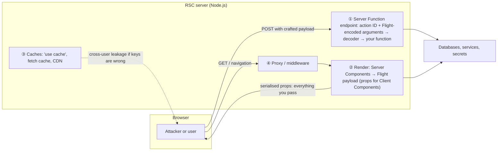
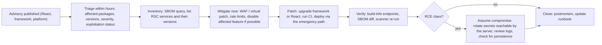

# 44 — RSC Security: Threat Model, CVE History and Patch Operations

> React Server Components moved part of your frontend onto a server that parses attacker-controlled bytes. That's not a reason to avoid them. It is a reason to run them like the backend they are.

**Prerequisites:** [17](17-ssr-streaming-and-hydration.md), [18](18-react-server-components-and-server-functions.md), [43](43-frontend-security-architecture.md) · **Related:** [45 AuthN and AuthZ](45-authentication-and-authorization.md) · [49 Next.js Mutations and Auth](49-nextjs-data-mutations-and-auth.md) · [50 Next.js in Production](50-nextjs-in-production.md) · [A3 Advisories Timeline](A3-security-advisories-timeline.md)

---

## TL;DR

- **RSC adds server attack surface owned by "frontend" teams:**
  - **Server Function endpoints** that decode attacker-supplied Flight payloads.
  - **Server-rendered props** serialised to the browser, which risks data exposure.
  - **Shared caches**, which risk cross-user leakage.
  - **Proxy and middleware layers**, which are tempting but unreliable as auth boundaries.
- **Nine advisories in under a year.** Between December 2025 and November 2026, React published nine security advisories for the RSC transport packages (`react-server-dom-webpack`, `-turbopack`, `-parcel`):
  - **Two unauthenticated RCEs:** React2Shell, CVSS 10.0, December 2025; and GHSA-xqc2-xf4c-x3h3 / CVE-2026-126187, CVSS 4.0 9.5, October 2026.
  - **Six denial-of-service** advisories.
  - **One source-code exposure.**
- **Security floors today:** React **19.0.9 / 19.1.10 / 19.2.9 / 19.3.1**. Next.js **16.4.5+ or 15.5.29+**. Next.js 13.x and 14.x are end-of-life and get no fixes. Client-only React apps aren't affected.
- **Scanners can miss these.** The October 2026 RCE had a GitHub advisory but no CVE for 27 days, so CVE-keyed scanners didn't flag it. Next.js vendors its own compiled copy of the React server packages, so you patch Next.js itself, not a lockfile entry.
- **Design for the next advisory:**
  - Validate and authorise inside **every** Server Function.
  - Export only intended actions from `'use server'` modules.
  - Map data to DTOs before it crosses to Client Components.
  - Key caches by everything that varies.
  - Never treat the proxy as the only auth layer (CVE-2025-29927).
  - Run RSC servers with least privilege, so an RCE has little to steal.
- **Operate it:** an advisory feed, an SBOM-based inventory of RSC apps, patch SLAs (critical RCE within 24–48 hours), WAF virtual patching, verification, and **secret rotation after any RCE exposure**.

---

## 1. Why RSC changes the threat model



| Entry point | What's new compared with classic SSR | Typical failure |
|---|---|---|
| ① **Server Functions** | Every exported function in a `'use server'` module is a **public HTTP endpoint**. The framework decodes complex serialised arguments before your code runs | Decoder bugs (RCE, DoS); missing validation or authorisation in the function itself |
| ② **Render output** | Props passed to Client Components are serialised into the Flight payload, and anyone can read it | Whole database rows, internal flags and tokens leaked through props |
| ③ **Caches** | Function-level caching (`'use cache'`, data caches) sits between users | A cached result computed for user A served to user B |
| ④ **Proxy / middleware** | Easy to centralise auth checks there | Bypasses (CVE-2025-29927); matchers that miss routes; Server Functions not covered |
| ⑤ **Bundles and source** | Server and client code live side by side | Secrets imported into client bundles; source exposure through decoder bugs |

### 1.1 STRIDE for an RSC route

| Threat | Example | Control |
|---|---|---|
| **Spoofing** | Calling a Server Function without a session | Authenticate inside every action ([45](45-authentication-and-authorization.md)) |
| **Tampering** | Modified arguments (another tenant's ID, a price) | Schema validation; load resources scoped to the session's tenant; never trust client-computed values |
| **Repudiation** | Privileged actions without a trail | Audit log in the data layer ([46](46-enterprise-saas-architecture.md)) |
| **Information disclosure** | Over-broad props; cache leaks; source exposure | DTOs, `server-only`, correct cache keys, patching |
| **Denial of service** | Crafted Flight payloads exhausting CPU or memory; expensive actions | Patching, body-size limits, rate limits, WAF rules, timeouts |
| **Elevation of privilege** | RCE via deserialisation; missing per-resource authorisation | Patching; least-privilege runtime; authorisation at the data access layer |

---

## 2. The advisory history

All nine affect the RSC transport packages `react-server-dom-webpack`, `react-server-dom-turbopack` and `react-server-dom-parcel`, and therefore every framework built on them (Next.js, React Router's RSC APIs, Waku, `@parcel/rsc`, `@vitejs/plugin-rsc`, the Redwood SDK and Expo's RSC support).

| # | Disclosed | ID | Type | Severity | Fixed in (19.0 / 19.1 / 19.2 / 19.3) |
|---|---|---|---|---|---|
| 1 | 3 Dec 2025 | **CVE-2025-55182** "React2Shell" (Next.js's CVE-2025-66478 was merged into it) | **Unauthenticated RCE** via Server Function payload deserialisation. Exploited in the wild; on CISA's KEV list | CVSS 10.0 | 19.0.1 / 19.1.2 / 19.2.1 |
| 2 | 11 Dec 2025 | **CVE-2025-55184** | DoS via unsafe deserialisation (fix incomplete) | 7.5 | 19.0.2 / 19.1.3 / 19.2.2 |
| 3 | 11 Dec 2025 | **CVE-2025-55183** | **Source code exposure** through a crafted request | 5.3 | 19.0.2 / 19.1.3 / 19.2.2 |
| 4 | 11 Dec 2025 | **CVE-2025-67779** | DoS: a case missed by #2's fix | 7.5 | 19.0.3 / 19.1.4 / 19.2.3 |
| 5 | 26 Jan 2026 | **CVE-2026-23864** | Multiple DoS vectors | 7.5 | 19.0.4 / 19.1.5 / 19.2.4 |
| 6 | 8 Apr 2026 | **CVE-2026-23869** "React2DoS" | DoS via cyclic Map/Set structures sent to Server Function endpoints | 7.5 | 19.0.5 / 19.1.6 / 19.2.5 |
| 7 | 6 May 2026 | **CVE-2026-23870** | DoS via crafted HTTP requests (CWE-400) | 7.5 | 19.0.6 / 19.1.7 / 19.2.6 |
| 8 | 21 Jul 2026 | **CVE-2026-44907** (GHSA-wx67-qw84-cm4g) | DoS in Server Functions: out-of-memory or excessive CPU (CWE-770) | 7.5 | 19.0.8 / 19.1.9 / 19.2.8 |
| 9 | 14 Oct 2026 | **GHSA-xqc2-xf4c-x3h3** (CVE-2026-126187 assigned 10 Nov 2026) | **Unauthenticated RCE** in the Flight transport | CVSS 4.0: 9.5 | 19.0.9 / 19.1.10 / 19.2.9 / 19.3.1 |

Alongside #9, Next.js published **GHSA-673q-mjm6-r5xr** (unauthenticated RCE in `'use cache'` functions returning typed arrays; Next.js 16.0.0–16.4.0, patched in 16.4.1). See [A3](A3-security-advisories-timeline.md) for the full timeline, including framework-specific advisories.

### 2.1 Patterns worth learning from

| Pattern | Lesson |
|---|---|
| **Deserialisation is the hot spot.** Every advisory sits in the code that decodes requests to Server Functions or Flight data | Treat Server Function endpoints as the highest-risk surface. Limit body sizes, rate-limit, and monitor them |
| **Fixes beget fixes** (#2 was incomplete, so #4 followed) | After a critical advisory, expect follow-ups within weeks. Keep the emergency patch path warm |
| **DoS dominates by count** (six of nine) | Availability is a security property. Autoscaling alone just converts DoS into a bill |
| **Disclosure gaps.** #9 had a GitHub advisory but no CVE for 27 days; GitHub's advisory database didn't flag the React packages for weeks either | Subscribe to vendor advisories directly. Don't rely only on CVE-keyed scanners |
| **Vendored copies.** Next.js ships its own compiled React server packages | `npm ls react-server-dom-webpack` won't show Next.js's copy. Patch by upgrading **Next.js** to a fixed release |
| **No fixes for end-of-life lines** (Next.js 13.x and 14.x) | Upgrading majors is a security activity. Budget for it ([64](64-migration-playbooks.md)) |

---

## 3. Security floors and verification

| Stack | Minimum safe version (late November 2026) |
|---|---|
| `react-server-dom-*` (directly or via frameworks other than Next.js) | **19.0.9, 19.1.10, 19.2.9, 19.3.1** (or later in the same line) |
| Next.js | **16.4.5+** (16.x) or **15.5.29+** (15.x). 13.x and 14.x: unsupported, so upgrade |
| React Router (RSC APIs), Waku, Parcel RSC, `@vitejs/plugin-rsc`, Redwood SDK, Expo | Their latest releases, which pull fixed `react-server-dom-*` versions. Verify the lockfile |
| Client-only React (no RSC, no Server Functions) | Not affected by these advisories |

```bash
# Direct RSC transport packages (React Router RSC, Waku, Parcel, Vite RSC…)
npm ls react-server-dom-webpack react-server-dom-turbopack react-server-dom-parcel --all
# Next.js vendors its own copy: check the Next.js version instead
npm ls next
```

> [!IMPORTANT]
> **Verify in production, not just in the repo.** Expose the deployed framework and React versions through an internal-only build-info endpoint (or your deployment metadata) and check every RSC service after patching. Inventories built from SBOMs answer "where are we exposed?" in minutes ([43](43-frontend-security-architecture.md)).

---

## 4. Patch operations



| Practice | Detail |
|---|---|
| **Advisory feeds** | Watch GitHub security advisories for `react/react` and your frameworks (`vercel/next.js`, `remix-run/react-router`, and so on), the react.dev blog, and your platform's status page. Next.js has published **scheduled security releases** since July 2026, plus out-of-band releases for critical issues |
| **Patch SLAs** | Critical RCE: mitigate immediately, patch within 24–48 hours. High DoS: within 7 days. Medium: within the normal cycle |
| **Emergency path** | A documented, rehearsed "patch a framework in every RSC app today" procedure: dependency bump PRs from automation, fast CI lane, deploy approvals |
| **Virtual patching** | CDN and WAF providers have shipped emergency rules for major RSC advisories. Managed platforms often deploy them before you patch. Use them as a bridge, never a substitute |
| **Post-RCE hygiene** | RCE means the attacker could read environment variables and call anything the process can reach. Rotate database credentials, API keys and signing secrets, review egress logs, and redeploy from clean builds |
| **Upgrade cadence** | Stay on supported majors. Security fixes may be backported only to recent minor lines |

---

## 5. Designing for the next advisory

Patching fixes known bugs. Design limits what the *next* bug can do.

### 5.1 A secure Server Function

```ts
// app/invoices/actions.ts
'use server';
import 'server-only';
import { z } from 'zod';
import { updateTag } from 'next/cache';
import { requireSession } from '@/server/auth';
import { can } from '@/server/authz';
import { billing } from '@/server/services';

const VoidInput = z.object({ invoiceId: z.string().regex(/^inv_[a-z0-9]{8,}$/) });

export async function voidInvoice(raw: unknown) {
  const input = VoidInput.safeParse(raw);               // 1. validate: arguments are attacker-controlled
  if (!input.success) return { ok: false, error: 'invalid' } as const;

  const session = await requireSession();               // 2. authenticate inside the action itself
  const invoice = await billing.getInvoice(session.tenantId, input.data.invoiceId); // 3. tenant-scoped load
  if (!invoice || !can(session, 'invoice:void', invoice)) {                       // 4. authorise this resource
    return { ok: false, error: 'forbidden' } as const;
  }

  await billing.voidInvoice(session.tenantId, invoice.id); // 5. act (the domain service also enforces rules)
  updateTag(`invoice:${invoice.id}`);                      // 6. read-your-writes cache update
  return { ok: true } as const;                            // 7. return the minimum
}
```

Rules this encodes:

| Rule | Why |
|---|---|
| **Every exported function in a `'use server'` file is an endpoint** | Keep helpers in separate `server-only` modules. Export only actions you intend to expose |
| **Validate `unknown` input** | TypeScript types don't exist at runtime, and attackers don't use your forms |
| **Authenticate and authorise in the action** | Layouts, pages and proxy checks don't run for direct Server Function calls |
| **Scope every lookup by the session's tenant** | Prevents cross-tenant IDOR by construction ([46](46-enterprise-saas-architecture.md)) |
| **Return minimal results** | Return values are serialised to the caller |
| **Don't rely on closure encryption for secrets** | Frameworks such as Next.js encrypt values captured by inline Server Functions, but pass IDs and re-fetch on the server rather than shipping sensitive state round-trip |

### 5.2 Prevent data exposure through props

```tsx
// ✗ Leaks every column (password hash, internal flags, other tenants' references) into the Flight payload
const user = await db.user.findUnique({ where: { id } });
return <ProfileCard user={user} />;

// ✓ The data access layer returns DTOs shaped for the UI
const profile = await users.getPublicProfile(session, id); // { id, displayName, avatarUrl }
return <ProfileCard profile={profile} />;
```

- **Data access layer (DAL):** all data reads go through server-only modules that check authorisation and return DTOs. Components never query the database directly ([49](49-nextjs-data-mutations-and-auth.md)).
- **`import 'server-only'`** in the DAL and in secret-holding modules.
- **Taint APIs** (`experimental_taintObjectReference`, `experimental_taintUniqueValue`) can make React throw if a tainted object or value (a raw user record, an API token) is passed to a Client Component. They're **experimental**: a useful tripwire in development and CI, not a guarantee.

### 5.3 Caches

- A `'use cache'` function's cache key includes its arguments and closed-over values. **Per-user data must vary by user**: pass the user or tenant ID explicitly, or don't cache that function.
- **Never cache authorisation decisions across users.** Cache data and authorise per request.
- CDN-cached HTML must not contain personalised content. Personalised regions stream as dynamic holes ([32](32-rendering-strategy-architecture.md), [48](48-nextjs-rendering-and-caching.md)).

### 5.4 Proxy and middleware are not the auth boundary

**CVE-2025-29927** (March 2025) let attackers skip Next.js middleware entirely by sending an internal `x-middleware-subrequest` header. Apps that only checked auth in middleware were exposed. The lesson generalises:

- Use the proxy for **coarse, optimistic** checks: redirect anonymous users to sign-in, add security headers, set the locale.
- Enforce authentication and authorisation **again at the data access layer and in every Server Function**, where it can't be bypassed by routing tricks.

### 5.5 Limit the blast radius

| Control | Effect on the next RCE or DoS |
|---|---|
| **Least-privilege runtime credentials** (scoped database users, short-lived cloud credentials) | Less to steal, less to modify |
| **Egress restrictions** from the RSC tier | Harder to exfiltrate or pivot |
| **Secrets fetched at runtime from a vault**, not baked into broad environment variables | Rotation is easy and fast |
| **Body-size limits** (Next.js `experimental.serverActions.bodySizeLimit`, 1 MB by default), **rate limits** per IP and session, **timeouts** | Cheaper DoS defence |
| **Allowed origins** for Server Functions behind proxies (`experimental.serverActions.allowedOrigins`) | Keeps the built-in Origin-vs-Host CSRF check meaningful ([43](43-frontend-security-architecture.md)) |
| **Monitoring** of Server Function error rates, latency and payload sizes | Early warning for exploitation attempts ([41](41-observability-and-diagnostics.md)) |

---

## 6. Threat-model template for an RSC feature

| Question | Example answer (Acme Insights, "export report") |
|---|---|
| Entry points | `exportReport` Server Function; `/reports/[id]` page render |
| Assets | Report data (tenant-confidential), export quota, storage bucket credentials |
| Trust boundaries | Browser → Server Function; RSC server → reports service; RSC server → object storage |
| Validation | Zod schema for `reportId` and format; format allowlist |
| Authentication / authorisation | `requireSession` plus `can(session, 'report:export', report)` in the action; tenant-scoped lookup |
| Data exposure | The page passes a `ReportSummary` DTO only; the export URL is short-lived and signed |
| Caching | Report data cached per tenant and report ID; the export itself isn't cached |
| Abuse | Rate limit of 10 exports per user per hour; body-size limit; audit log entry |
| Patch exposure | Next.js 16.4.x on the scheduled security release cadence; app listed in the SBOM inventory |

---

## Decision framework

**Problem.** Can we run RSC safely, and what must be true operationally before we do?

**Constraints.** Team ownership of the server tier, hosting model (managed platform with WAF and fast patch rollout, or self-hosted), compliance obligations, and the number of RSC apps to patch.

| Question | Guidance |
|---|---|
| Who owns the RSC server? | The team shipping it, with on-call responsibility. Frontend teams running RSC are running backends |
| Managed or self-hosted? | Managed platforms typically roll out WAF mitigations and framework patches faster. Self-hosting needs your own WAF, patch automation and runtime hardening ([50](50-nextjs-in-production.md)) |
| Prerequisites before adopting RSC | SBOM inventory, advisory subscriptions, emergency patch path, patch SLAs, and least-privilege runtime credentials |
| When is a client-only SPA the safer choice? | Internal tools with no SEO needs, run by teams without server operations capacity. Client-only React isn't affected by RSC transport advisories ([32](32-rendering-strategy-architecture.md)) |

**Criteria.** Exposure (internet-facing or internal), time to patch, blast radius of an RCE, and operational maturity.

**Failure modes.**
- Trusting middleware-only auth.
- `'use server'` files exporting helpers.
- Raw database objects as props.
- Per-user data in shared caches.
- Scanners as the only advisory source.
- Patching the lockfile but not Next.js's vendored copy.
- Unsupported framework majors.
- No secret rotation after RCE exposure.

**Migration path.** Inventory RSC apps and versions. Bring everything to the security floors. Add advisory feeds and the emergency patch runbook. Introduce the DAL, DTO and validation patterns with lint rules (no database imports in components, `server-only` in data modules). Then harden the runtime (credentials, egress, limits) and rehearse the patch drill quarterly.

---

## Pitfalls and anti-patterns

- Assuming Server Functions are private because "only our UI calls them".
- Auth checks in `layout.tsx` only. Layout checks don't gate direct Server Function calls, and layouts don't re-render on every navigation.
- `export async function` helpers in `'use server'` modules.
- Passing `session` objects or tokens as props.
- Caching functions that read cookies or headers without varying by them.
- Disabling body-size limits "because uploads".
- Waiting for the CVE before patching a published GitHub advisory.
- Treating a WAF rule as the fix.
- Running the RSC tier with admin database credentials.

---

## Architect's checklist

- [ ] Every RSC app at or above the security floors (React 19.0.9/19.1.10/19.2.9/19.3.1; Next.js 16.4.5+/15.5.29+); no EOL majors
- [ ] Advisory feeds for React, frameworks and platform; SBOM-based inventory of RSC services
- [ ] Emergency patch runbook with SLAs, a rehearsed drill, and post-RCE secret rotation
- [ ] Server Functions: schema validation, in-action authentication and authorisation, tenant scoping, minimal returns
- [ ] `'use server'` modules export only intended actions; helpers live in `server-only` modules
- [ ] Data access layer returns DTOs; components don't query databases; taint APIs as a tripwire where available
- [ ] Cache keys include user or tenant where data varies; no cached authorisation decisions
- [ ] Proxy used for coarse checks only; enforcement at the DAL and in actions
- [ ] Runtime hardening: least-privilege credentials, egress limits, body-size and rate limits, allowed origins
- [ ] Monitoring on Server Function errors, latency and payload sizes; WAF virtual-patching capability

---

## Interview angles

**Q1. What makes RSC a different attack surface from classic SSR?**
Classic SSR renders HTML from your own data; the server mostly parses simple requests. With RSC, the server also decodes complex serialised payloads for Server Function calls (Flight replies), and every exported Server Function is a public endpoint. That decoder has been the site of every advisory since December 2025, including two unauthenticated RCEs. RSC also serialises Server Component props to the browser, which makes over-exposure easy, and adds function-level caches where keys determine who sees what.

**Q2. A critical RSC advisory drops on a Tuesday morning. Walk through your response.**
Triage the affected packages and versions, and whether it's being exploited. Query the SBOM inventory to list every RSC service with its framework version; for Next.js that's the Next.js version, because it vendors React. Mitigate immediately with WAF or virtual-patch rules and rate limits. Upgrade through the emergency path, then verify the versions actually deployed. If it's an RCE, assume compromise: rotate secrets reachable by the server, review logs and redeploy clean builds. Then hold a postmortem and update the runbook.

**Q3. Why isn't checking auth in the proxy or middleware enough?**
Because routing layers can be bypassed or misconfigured. CVE-2025-29927 let attackers skip Next.js middleware with a single header. Matchers can also miss routes, and Server Function calls may not pass through the checks you expect. Use the proxy for coarse redirects, and enforce authentication and authorisation at the data access layer and inside every Server Function.

**Q4. How do you stop Server Components from leaking data?**
Route all reads through a server-only data access layer that authorises and returns DTOs shaped for the UI, so components never pass raw rows or session objects to Client Components. Mark the data and secret modules `server-only`. Review the Flight payload for sensitive fields in tests. Use the experimental taint APIs as a tripwire. And key caches by user or tenant whenever the data varies.

**Q5. Why might your vulnerability scanner not flag a vulnerable Next.js app?**
Two reasons. Next.js vendors its own compiled React server packages, so lockfile scanners looking for `react-server-dom-*` don't see them; the signal is the Next.js version. And some advisories have been published as GitHub advisories before a CVE was assigned (27 days, for the October 2026 RCE), so CVE-keyed tools stayed silent. Subscribe to vendor advisories directly and track framework versions as first-class inventory.

---

## Further reading

- React blog, *Critical Security Vulnerability in React Server Components* (3 December 2025): <https://react.dev/blog/2025/12/03/critical-security-vulnerability-in-react-server-components>
- React blog, *Denial of Service and Source Code Exposure in React Server Components* (11 December 2025, updated through 2026): <https://react.dev/blog/2025/12/11/denial-of-service-and-source-code-exposure-in-react-server-components>
- React security advisories: <https://github.com/react/react/security/advisories> · GHSA-xqc2-xf4c-x3h3: <https://github.com/react/react/security/advisories/GHSA-xqc2-xf4c-x3h3>
- Next.js security advisories: <https://github.com/vercel/next.js/security/advisories> · GHSA-673q-mjm6-r5xr: <https://github.com/vercel/next.js/security/advisories/GHSA-673q-mjm6-r5xr>
- NVD, *CVE-2026-44907*: <https://nvd.nist.gov/vuln/detail/CVE-2026-44907>
- Next.js docs, *Data Security* and *How to think about security in Next.js*: <https://nextjs.org/docs/app/guides/data-security>
- CISA, *Known Exploited Vulnerabilities Catalog*: <https://www.cisa.gov/known-exploited-vulnerabilities-catalog>
- OWASP Cheat Sheet, *Deserialization*: <https://cheatsheetseries.owasp.org/cheatsheets/Deserialization_Cheat_Sheet.html>

---

[← Previous: 43 — Frontend Security Architecture](43-frontend-security-architecture.md) · [Index](README.md) · [Next: 45 — Authentication and Authorization →](45-authentication-and-authorization.md)
