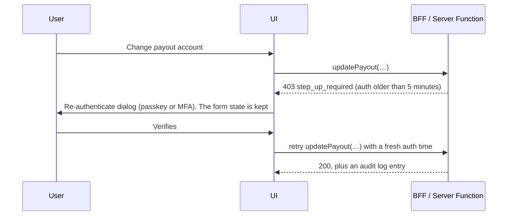
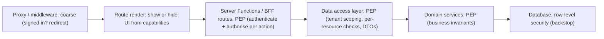

# 45 — Authentication and Authorization

> Authentication answers "who are you?". Authorisation answers "may you do *this*, to *that*, right now?". The first is a solved problem you should buy or borrow. The second is your product's business logic, and nobody else can write it for you.

**Prerequisites:** [33](33-api-integration-bff-and-contracts.md), [43](43-frontend-security-architecture.md), [44](44-rsc-security-threat-model.md) · **Related:** [31 Routing](31-routing-architecture.md) · [46 Enterprise SaaS](46-enterprise-saas-architecture.md) · [49 Next.js Mutations and Auth](49-nextjs-data-mutations-and-auth.md)

---

## TL;DR

- **Architecture first.** For browser apps, the IETF's **RFC 10017** (*OAuth 2.0 for Browser-Based Applications*, BCP 212, August 2026) describes three patterns:
  - **Backend for Frontend** (tokens stay server-side; the browser gets an `HttpOnly` session cookie).
  - A token-mediating backend.
  - A pure browser OAuth client.
  Prefer the BFF. Same-site apps without third-party APIs can skip OAuth entirely and use plain cookie sessions.
- **Sessions are a security system:**
  - Opaque, rotated session IDs.
  - Idle and absolute timeouts.
  - Server-side revocation ("sign out everywhere").
  - Rotation on privilege change.
  - Refresh-token rotation with reuse detection.
  - Sender-constrained tokens (DPoP) where tokens must exist.
- **Authentication methods:**
  - **Passkeys** (WebAuthn) are phishing-resistant and now mainstream: autofill sign-in with conditional mediation, automatic upgrades. The hard part is account recovery.
  - MFA for everything privileged.
  - Step-up re-authentication for sensitive actions.
  - Enterprise SSO (OIDC, SAML) and SCIM for B2B ([46](46-enterprise-saas-architecture.md)).
- **Authorisation is server-side, layered and data-aware.** RBAC for coarse roles, ABAC for attribute rules, ReBAC (Zanzibar-style) for sharing and hierarchies. Enforce at every **policy enforcement point**: Server Functions, BFF routes, the data access layer, domain services, and database row-level security as a backstop.
- **The UI receives capabilities, not rules.** The server computes "can void this invoice" and sends a boolean (or allowed actions per resource). The UI hides or disables accordingly. **Hiding a button is not authorisation.**
- **Frontend responsibilities are real:**
  - Graceful 401 and 403 handling.
  - Session-expiry UX that preserves work.
  - Cross-tab sign-out.
  - Safe `returnTo` redirects.
  - Accessible sign-in (allow paste and password managers; WCAG 3.3.8).
  - Role-matrix tests.

---

## 1. Concepts and vocabulary

| Term | Meaning |
|---|---|
| **Authentication (AuthN)** | Verifying identity: passwords, passkeys, SSO, MFA |
| **Session** | The server's memory that this browser is authenticated, usually an opaque cookie that references server state |
| **Authorisation (AuthZ)** | Deciding whether an authenticated subject may perform an action on a resource in a context |
| **IdP / OP** | Identity provider (OpenID Provider): Entra ID, Okta, Google, your own auth service |
| **RP / client** | Relying party: your app (in practice, its BFF) |
| **PDP / PEP** | Policy *decision* point (evaluates rules) and policy *enforcement* points (where requests are allowed or blocked) |
| **Entitlement** | What a tenant's *plan* includes: features, limits ([46](46-enterprise-saas-architecture.md)) |

---

## 2. Architecture patterns for browser apps

| Pattern (RFC 10017) | How it works | Security | Use when |
|---|---|---|---|
| **BFF** (recommended) | The BFF is a confidential OAuth client. It runs the code flow with PKCE, stores tokens server-side, and gives the browser an `HttpOnly` `SameSite` session cookie. It proxies or aggregates API calls ([33](33-api-integration-bff-and-contracts.md)) | Tokens never reach JavaScript. XSS can still act through the session while the page is open, but can't steal tokens | Most SaaS and consumer apps, and every RSC framework app (the server is already there) |
| **Token-mediating backend** | The backend gets tokens and hands *access* tokens to the browser, keeping refresh tokens server-side | Access tokens are exposed to XSS (keep them short-lived) | When the browser must call third-party APIs directly with tokens |
| **Browser-based OAuth client** | A SPA runs the code flow with PKCE itself and holds tokens in memory | Most exposed to malicious JavaScript | Constrained cases only, with short-lived tokens, rotation and sender-constraining |
| **Same-site cookie session (no OAuth)** | Your own auth service sets a session cookie for your own API on the same site | Simple and strong | First-party apps without delegated access to third-party APIs |

> [!IMPORTANT]
> **Never store tokens in `localStorage` or `sessionStorage`.** Any XSS, including a compromised third-party script, can read them and use them anywhere, for as long as they're valid. With a BFF there's nothing to steal ([43](43-frontend-security-architecture.md)).

---

## 3. Session management

| Control | Recommendation |
|---|---|
| **Session ID** | Opaque, high-entropy, server-side state (Redis or a database). Stateless signed cookies are fine for small claims, but make revocation hard |
| **Cookie** | `__Host-session`, `HttpOnly`, `Secure`, `SameSite=Lax` (or `Strict` for admin apps) |
| **Rotation** | New session ID on sign-in and on privilege change (role grant, step-up, impersonation start). Prevents session fixation |
| **Timeouts** | Idle timeout (for example 30 minutes for admin, longer for consumer) **and** an absolute lifetime (for example 12 hours to 30 days, by risk) |
| **Revocation** | Server-side session list per user: "sign out everywhere", revocation on password or MFA change, admin kill switch |
| **Refresh tokens** (in the BFF) | Rotation on every use. **Reuse detection** revokes the whole token family |
| **Sender-constrained tokens** | DPoP (RFC 9449) or mTLS-bound tokens when tokens exist outside the BFF, so stolen tokens can't be replayed elsewhere |
| **Sign-out** | Destroy the server session, revoke tokens at the IdP when appropriate, send `Clear-Site-Data`, clear client caches and stores, and notify other tabs |

```ts
// shared/auth/cross-tab.ts: sign out (or switch account) in every open tab
const channel = typeof BroadcastChannel !== 'undefined' ? new BroadcastChannel('acme-auth') : null;

export function announceSignOut(): void {
  channel?.postMessage({ type: 'signed-out' });
}

export function onAuthChange(handler: () => void): () => void {
  if (!channel) return () => {};
  const listener = (event: MessageEvent<{ type: string }>) => {
    if (event.data?.type === 'signed-out') handler(); // e.g. clear caches, then navigate to /login
  };
  channel.addEventListener('message', listener);
  return () => channel.removeEventListener('message', listener);
}
```

---

## 4. Authentication methods

| Method | Strengths | Weaknesses | Guidance |
|---|---|---|---|
| **Passkeys (WebAuthn)** | Phishing-resistant, no shared secrets, synced across a user's devices, fast | Account recovery, shared or managed devices, user education | Offer as the primary method. Autofill sign-in with conditional mediation. Prompt for an automatic upgrade after password sign-in |
| **Passwords** | Universal | Phishing, reuse, credential stuffing | Length over composition rules, breached-password checks, no forced periodic rotation, **allow paste and password managers** (WCAG 3.3.8), rate limiting |
| **TOTP / push MFA** | Big improvement over passwords alone | Phishable (real-time relay attacks), push fatigue | Number matching for push. Prefer WebAuthn as the second factor where possible |
| **Magic links / email OTP** | No password to forget | Depends on email security. Links can be forwarded or scanned by mail filters | Short expiry, single use, bound to the browser that requested it where possible |
| **Social login** | Low friction | Account linking complexity, provider dependency | Link accounts by verified email carefully. Handle provider outages ([40](40-resilience-and-reliability.md)) |
| **Enterprise SSO** (OIDC / SAML) | Customer-controlled identity, MFA and offboarding | Configuration per tenant, IdP-initiated flows | Per-tenant connections, domain verification, SCIM provisioning ([46](46-enterprise-saas-architecture.md)) |

### 4.1 Passkey autofill sign-in

```html
<!-- The `webauthn` token lets the browser offer passkeys in the username field's autofill -->
<input name="username" autocomplete="username webauthn" />
```

```ts
// features/auth/passkey-autofill.ts: start on page load; the user picks a passkey from autofill
export async function startPasskeyAutofill(signal: AbortSignal): Promise<void> {
  if (!window.PublicKeyCredential) return;
  if (!(await PublicKeyCredential.isConditionalMediationAvailable())) return;

  const optionsJSON = await fetch('/bff/auth/passkey/options', { method: 'POST' }).then((r) => r.json());
  const credential = await navigator.credentials.get({
    mediation: 'conditional',
    signal, // abort if the user signs in another way
    publicKey: PublicKeyCredential.parseRequestOptionsFromJSON(optionsJSON),
  });
  if (!(credential instanceof PublicKeyCredential)) return;

  const res = await fetch('/bff/auth/passkey/verify', {
    method: 'POST',
    headers: { 'Content-Type': 'application/json' },
    body: JSON.stringify(credential.toJSON()), // the server verifies the challenge, origin and signature
  });
  if (res.ok) window.location.assign('/'); // the session cookie was set by the BFF
}
```

### 4.2 Step-up authentication

Sensitive actions (changing payout details, exporting all customer data, deleting a workspace) require **recent** strong authentication, even inside a valid session:



With OIDC, request recent authentication with `max_age` (and stronger methods with `acr_values`), and check the `auth_time` and `acr` claims on the server.

---

## 5. Authorisation models

| Model | Expresses | Example | Tools |
|---|---|---|---|
| **RBAC** | Roles grant permissions | "Billing admins can void invoices" | Your own tables; most IdPs and auth vendors |
| **ABAC** | Rules over attributes of subject, resource and context | "Void only if the invoice is unpaid, the amount is under the user's approval limit, and it's within business hours" | Cedar, OPA/Rego, Cerbos, code-level policies |
| **ReBAC** | Relationships in a graph (Zanzibar-style) | "Viewers of a folder can view its documents; members of a team inherit the team's access" | OpenFGA, SpiceDB, Permify |
| **Entitlements** | What the tenant's plan allows | "Exports are only on the Business plan; 10 seats" | Billing and entitlement services ([46](46-enterprise-saas-architecture.md)) |

Most products combine them: **entitlement** (is the feature in the plan?), then **RBAC** (does the role allow the action?), then **ABAC or ReBAC** (does this specific resource, in this state, allow it?).

### 5.1 A typed policy module (server-only)

```ts
// server/authz/policy.ts
import 'server-only';

export type Role = 'owner' | 'admin' | 'billing' | 'viewer';
export type Action = 'invoice:read' | 'invoice:void' | 'invoice:export' | 'member:invite';
export type Subject = { userId: string; tenantId: string; roles: readonly Role[]; approvalLimitMinor: number };
export type InvoiceResource = { kind: 'invoice'; tenantId: string; status: 'draft' | 'open' | 'paid' | 'void'; totalMinor: number };

const ROLE_PERMISSIONS: Record<Role, readonly Action[]> = {
  owner: ['invoice:read', 'invoice:void', 'invoice:export', 'member:invite'],
  admin: ['invoice:read', 'invoice:void', 'invoice:export', 'member:invite'],
  billing: ['invoice:read', 'invoice:void', 'invoice:export'],
  viewer: ['invoice:read'],
};

export function can(subject: Subject, action: Action, resource?: InvoiceResource): boolean {
  if (resource && resource.tenantId !== subject.tenantId) return false;             // 1. tenant isolation first
  if (!subject.roles.some((role) => ROLE_PERMISSIONS[role].includes(action))) return false; // 2. RBAC
  if (action === 'invoice:void' && resource) {                                      // 3. ABAC rules
    if (resource.status === 'paid' || resource.status === 'void') return false;
    if (resource.totalMinor > subject.approvalLimitMinor) return false;
  }
  return true;
}
```

### 5.2 Capabilities for the UI

```tsx
// app/invoices/[id]/page.tsx (Server Component): compute capabilities on the server, send booleans
export default async function InvoicePage({ params }: { params: Promise<{ id: string }> }) {
  const { id } = await params;
  const session = await requireSession();
  const invoice = await invoices.get(session, id); // the DAL enforces read access and tenant scoping

  const capabilities = {
    canVoid: can(session.subject, 'invoice:void', invoice),
    canExport: can(session.subject, 'invoice:export', invoice) && session.entitlements.has('exports'),
  };
  return <InvoiceView invoice={toInvoiceDto(invoice)} capabilities={capabilities} />;
}
```

For APIs consumed by SPAs or mobile apps, return **allowed actions per resource** (`"actions": ["void", "export"]`) instead of making clients re-implement policy. The client stays dumb, and the server stays authoritative.

---

## 6. Enforcement in depth



| Layer | Its job | Not its job |
|---|---|---|
| Proxy | Redirect anonymous users, set security headers | Being the only check (bypassable, as CVE-2025-29927 showed) ([44](44-rsc-security-threat-model.md)) |
| UI | UX: hide, disable, explain | Security |
| Server Functions and BFF | Authenticate and authorise each action | Business invariants owned by services |
| Data access layer | Tenant scoping, resource-level checks, DTO shaping | Rendering decisions |
| Domain services | Invariants ("paid invoices can't be voided") regardless of caller | UI concerns |
| Database RLS | Last line against IDOR and cross-tenant bugs | Fine-grained business policy |

---

## 7. Frontend responsibilities

| Concern | Pattern |
|---|---|
| **401 (unauthenticated)** | Session expired: re-authenticate in a dialog that **preserves form state**, then retry. For navigations, redirect to sign-in with a validated `returnTo` ([31](31-routing-architecture.md)) |
| **403 (forbidden)** | Explain, offer "request access", and don't loop. Distinguish "no access" from "not found" according to your privacy policy (sometimes 404 hides existence) |
| **Session-expiry UX** | Warn before the idle timeout ("you'll be signed out in 2 minutes"), extend on activity, and keep drafts ([40](40-resilience-and-reliability.md)) |
| **Cross-tab consistency** | `BroadcastChannel` sign-out and account-switch messages; refetch the session on focus |
| **Route guards** | Redirect early for UX, with server enforcement anyway |
| **Accessible sign-in** | Proper labels and `autocomplete` (`username`, `current-password`, `one-time-code`), paste allowed, no cognitive tests without alternatives (WCAG 3.3.8), accessible error messages ([36](36-accessibility-engineering.md)) |
| **Bot and abuse protection** | Server-side rate limits and risk scoring. If you use challenges, choose accessible, low-friction ones |

---

## 8. Impersonation and support access

Support teams need to see what customers see, and it's one of the riskiest features you can build.

- **Explicit, time-boxed sessions** started from an admin tool, with a reason code and (for enterprise tenants) customer consent policies.
- **A distinct session** with an `actor` (support agent) and a `subject` (customer), both in every audit event.
- **A visible banner** in the UI throughout impersonation, with a one-click exit.
- **Restricted capabilities:** no password or MFA changes, no payment-method changes, no data exports, unless explicitly approved.
- **Audit:** every action logged with both identities, and reviewable by the customer where contracts require it ([46](46-enterprise-saas-architecture.md)).

---

## 9. Testing authorisation

```ts
// server/authz/policy.test.ts: a role × action × state matrix catches regressions in one place
import { describe, expect, test } from 'vitest';
import { can, type Role, type Subject, type InvoiceResource } from './policy';

const subject = (roles: Role[]): Subject => ({ userId: 'u1', tenantId: 't1', roles, approvalLimitMinor: 100_000 });
const invoice = (over: Partial<InvoiceResource> = {}): InvoiceResource => ({
  kind: 'invoice', tenantId: 't1', status: 'open', totalMinor: 50_000, ...over,
});

describe('invoice:void', () => {
  test.each([
    ['owner', true], ['admin', true], ['billing', true], ['viewer', false],
  ] as const)('%s → %s', (role, expected) => {
    expect(can(subject([role]), 'invoice:void', invoice())).toBe(expected);
  });

  test('never across tenants', () => {
    expect(can(subject(['owner']), 'invoice:void', invoice({ tenantId: 't2' }))).toBe(false);
  });

  test('not when paid or above the approval limit', () => {
    expect(can(subject(['billing']), 'invoice:void', invoice({ status: 'paid' }))).toBe(false);
    expect(can(subject(['billing']), 'invoice:void', invoice({ totalMinor: 200_000 }))).toBe(false);
  });
});
```

- **Negative tests for IDOR:** call every Server Function and BFF route with another tenant's IDs and expect 403 or 404 ([42](42-testing-architecture.md)).
- **E2E per role:** Playwright projects with one storage state per role (viewer, billing, admin) for critical journeys.
- **Policy as data:** if you use Cedar, OPA or OpenFGA, version policies with tests and review them like code.

---

## 10. Build, buy or borrow

| Need | Options (verify current status) |
|---|---|
| Auth library in your app | **Better Auth** (which has maintained Auth.js/NextAuth.js since September 2025, and now recommends Better Auth for new projects), framework-native solutions |
| Hosted identity (B2C / B2B) | Clerk, WorkOS (enterprise SSO and SCIM), Auth0/Okta, Microsoft Entra External ID, AWS Cognito, Supabase Auth |
| Self-hosted IdP | Keycloak, Ory, Zitadel, Authentik |
| Authorisation engines | OpenFGA, SpiceDB (ReBAC); Cedar, OPA, Cerbos (policy); Oso, Permit.io (managed) |

**Buy authentication, own authorisation.** Credential storage, MFA, passkeys, SSO federation and bot defence are commodities with sharp edges. Your permission model is your product: model it explicitly, test it, and keep it close to your data.

---

## Decision framework

**Problem.** How do users prove who they are, how do sessions stay safe, and how is every action authorised correctly across UI, server and data?

**Constraints.** B2C or B2B (enterprise SSO, SCIM), regulatory needs (MFA mandates, audit), rendering architecture (RSC or SPA), third-party API access, and team capacity to run identity infrastructure.

| Decision | Recommended default |
|---|---|
| Browser pattern | BFF with cookie sessions (RFC 10017). Plain cookie sessions for same-site first-party apps |
| Methods | Passkeys first, passwords with breached checks as fallback, MFA for privileged roles, step-up for sensitive actions, SSO for B2B |
| Sessions | Opaque server-side sessions, rotation, idle and absolute timeouts, revocation, refresh-token rotation with reuse detection |
| Authorisation | A central policy module (or engine) combining entitlements, RBAC and ABAC/ReBAC; enforcement at Server Functions, DAL and services; RLS as a backstop |
| UI | Capabilities computed on the server; allowed-actions lists in APIs |
| Vendors | Buy AuthN (hosted or library); own AuthZ |

**Criteria.** Phishing resistance, blast radius of XSS, revocation speed, auditability, user friction, accessibility, and operational cost.

**Failure modes.**
- Tokens in `localStorage`.
- Authorisation only in the UI or proxy.
- Role checks without resource checks (IDOR).
- Sessions that never expire.
- No reuse detection.
- Support impersonation without audit.
- Blocked paste in password fields.
- SSO without domain verification (tenant takeover).

**Migration path.** Move tokens behind a BFF. Introduce server sessions with rotation and timeouts. Centralise policy into one module with a role-matrix test suite. Add DAL enforcement and DTOs. Then roll out passkeys (autofill plus upgrade prompts), step-up for sensitive actions, and enterprise SSO and SCIM for B2B tenants.

---

## Pitfalls and anti-patterns

- Decoding a JWT in the browser to "check roles", then trusting the result.
- `if (user.role === 'admin')` scattered across components and endpoints.
- One giant `isAdmin` flag instead of permissions.
- Checking role but not tenant, so one tenant reads another's invoice by ID.
- Long-lived access tokens with no revocation.
- Silent token refresh loops that hide revoked sessions.
- Open redirects in `returnTo`.
- Magic links that log in whichever browser opens them, including mail scanners.
- Forgetting to re-authorise long-lived WebSocket connections ([34](34-realtime-offline-and-collaboration.md)).
- Building your own password hashing or MFA.

---

## Architect's checklist

- [ ] RFC 10017 pattern chosen (BFF by default); no tokens in web storage
- [ ] Session design: opaque IDs, `__Host-` cookies, rotation, idle and absolute timeouts, revocation, cross-tab sign-out
- [ ] Refresh-token rotation with reuse detection; DPoP where tokens leave the server
- [ ] Passkeys offered (autofill and upgrade); MFA for privileged roles; step-up for sensitive actions
- [ ] Central policy combining entitlements, RBAC and ABAC/ReBAC; typed actions; role-matrix tests
- [ ] Enforcement at Server Functions or BFF, the DAL and services; RLS backstop; proxy only for coarse checks
- [ ] Capabilities computed on the server for the UI; allowed actions returned by APIs
- [ ] 401, 403 and session-expiry UX preserves user work; safe `returnTo`
- [ ] Impersonation with dual identity, banner, restrictions and audit
- [ ] Accessible sign-in (labels, autocomplete, paste allowed, WCAG 3.3.8)

---

## Interview angles

**Q1. Design authentication for a B2B SaaS whose customers want SSO.**
Use a BFF with server-side sessions in `__Host-` `HttpOnly` cookies. Offer email and passkey sign-in for small customers, plus per-tenant OIDC or SAML connections for enterprises, with verified domains so users from `@customer.com` route to their IdP. Add SCIM for provisioning and deprovisioning, MFA enforced by the customer's IdP or by you for local accounts, step-up for sensitive actions, session policies configurable per tenant (timeouts), and audit logs exportable to the customer's SIEM. Usually buy the federation layer (WorkOS, Auth0, Entra or similar) and own the authorisation model.

**Q2. Where do authorisation checks belong in an RSC application?**
At every policy enforcement point that can be reached directly. Each Server Function authenticates and authorises the specific action. The data access layer scopes queries to the session's tenant and checks resource-level permissions before returning DTOs. Domain services enforce business invariants. Database row-level security is a backstop. The proxy only redirects anonymous users, and the UI only consumes server-computed capabilities. Layout or proxy checks alone are bypassable.

**Q3. RBAC, ABAC or ReBAC?**
RBAC is simple and auditable but coarse. ABAC adds conditions on attributes (state, amounts, time, location), which suits approval limits and lifecycle rules. ReBAC models relationships and inheritance, which suits sharing, folders, teams and organisations. Most products layer them: plan entitlements, then roles, then attribute or relationship checks on the specific resource. Pick an engine (Cedar, OPA, OpenFGA) when policies outgrow code or need to be managed as data.

**Q4. How do passkeys change sign-in architecture, and what's hard about them?**
The server stores public keys instead of password hashes, and sign-in is a challenge-response bound to your origin, so phishing sites can't replay it. The UX is autofill-based (conditional mediation) with automatic upgrades from passwords. The hard parts are account recovery (lost devices, account takeover through weak recovery channels), shared or managed devices, cross-platform edge cases, and keeping fallback methods from becoming the weak link.

**Q5. How do you handle session expiry without losing a user's work?**
Track idle time and warn before expiry, extending on activity. When an API returns 401, don't navigate away: open a re-authentication dialog over the current page, keep form state and drafts, then retry the failed request with the new session. For long forms, autosave drafts server-side. Broadcast sign-outs across tabs, and make the "sign in again" path return the user exactly where they were.

---

## Further reading

- RFC 10017 (BCP 212), *OAuth 2.0 for Browser-Based Applications*: <https://www.rfc-editor.org/rfc/rfc10017>
- RFC 9700, *Best Current Practice for OAuth 2.0 Security*: <https://www.rfc-editor.org/rfc/rfc9700> · RFC 9449, *DPoP*: <https://www.rfc-editor.org/rfc/rfc9449> · RFC 7636, *PKCE*: <https://www.rfc-editor.org/rfc/rfc7636>
- OWASP Cheat Sheets, *Session Management*, *Authentication*, *Authorization*: <https://cheatsheetseries.owasp.org/>
- NIST SP 800-63B, *Digital Identity Guidelines: Authentication*: <https://pages.nist.gov/800-63-4/>
- passkeys.dev (FIDO Alliance and W3C community resources): <https://passkeys.dev/> · W3C, *Web Authentication*: <https://www.w3.org/TR/webauthn-3/>
- Google, *Zanzibar: Google's Consistent, Global Authorization System* (USENIX ATC 2019): <https://research.google/pubs/zanzibar-googles-consistent-global-authorization-system/>
- OpenFGA: <https://openfga.dev/> · Cedar: <https://www.cedarpolicy.com/>
- Better Auth, *Auth.js is now part of Better Auth*: <https://better-auth.com/blog/authjs-joins-better-auth>

---

[← Previous: 44 — RSC Security: Threat Model, CVE History and Patch Operations](44-rsc-security-threat-model.md) · [Index](README.md) · [Next: 46 — Enterprise SaaS Architecture →](46-enterprise-saas-architecture.md)
