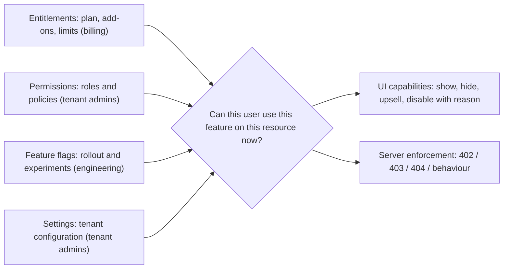
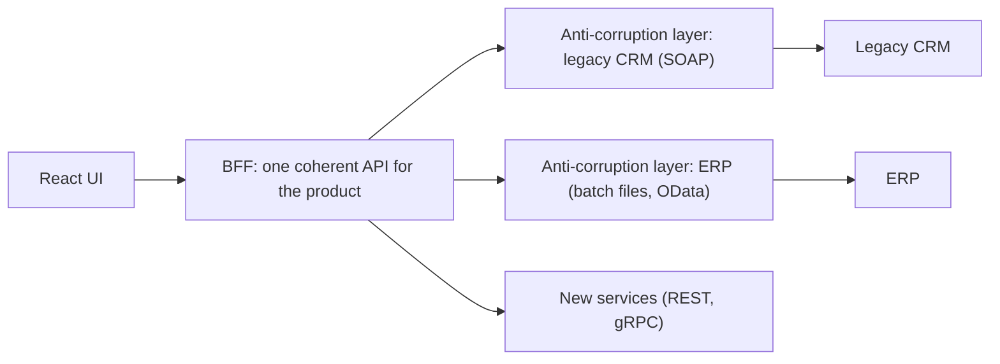

# 46 — Enterprise SaaS Architecture

> Enterprise customers don't buy features. They buy assurances: their data stays theirs, their people get exactly the access they should, their brand looks right, every change is traceable, and nothing breaks when your other customers have a bad day.

**Prerequisites:** [28](28-state-and-data-ownership-architecture.md), [35](35-enterprise-design-system-architecture.md), [45](45-authentication-and-authorization.md) · **Related:** [33 BFF and Contracts](33-api-integration-bff-and-contracts.md) · [41 Observability](41-observability-and-diagnostics.md) · [62 Feature Flags](62-cicd-release-engineering-and-feature-flags.md) · [67 Case Study: Acme Insights](67-case-study-enterprise-saas-dashboard.md)

---

## TL;DR

- **Tenancy is a cross-cutting dimension**, like locale or release. Resolve the tenant once per request (subdomain, custom domain, path or session), carry it in context everywhere, and include it in **every cache key, query, log, metric and permission check**. Cross-tenant leaks are the enterprise SaaS failure that ends contracts.
- **Separate four concepts that teams constantly blur:**

  | Concept | Question it answers | Owned by |
  |---|---|---|
  | **Entitlements** | What did the tenant buy? | Billing |
  | **Permissions** | What may this user do? | Tenant admins, via roles |
  | **Feature flags** | What's rolled out? | Engineering |
  | **Settings** | How has the tenant configured it? | Tenant admins |

- **Customer branding** is a token remap (logo, colours, typography within accessible bounds), plus custom domains and email templates, all through the design system's theming layer ([35](35-enterprise-design-system-architecture.md)).
- **Enterprise identity:**
  - Per-tenant SSO (OIDC or SAML) with verified domains.
  - **SCIM** provisioning and deprovisioning.
  - Tenant-configurable session and MFA policies.
  - Audited impersonation ([45](45-authentication-and-authorization.md)).
- **Audit trails** are a product feature: immutable, queryable and exportable records of who did what, when, from where, to which resource, including support staff acting on a customer's behalf.
- **Privacy and residency:**
  - Data minimisation in the UI and telemetry.
  - Regional routing for data residency.
  - Data subject requests (export and delete).
  - Configurable retention.
  - Consent.
- **Integrating legacy systems** happens behind the BFF with anti-corruption layers, so the UI never learns that "accounts" are three different SOAP services ([33](33-api-integration-bff-and-contracts.md)).
- **Enterprise readiness** is a checklist product teams can see: SSO and SCIM, audit export, RBAC, data residency, uptime SLAs, an accessibility conformance report, a security questionnaire, a status page.

---

## 1. Tenancy architecture

### 1.1 Resolving the tenant

| Strategy | Example | Pros | Cons |
|---|---|---|---|
| **Subdomain** | `acme.insights.app` | Clear isolation in the URL. Easy cookie scoping per tenant | Wildcard TLS and DNS. Cookie rules across subdomains need care |
| **Custom domain** | `analytics.acme-corp.com` | Enterprise branding, a white-label feel | Certificate automation, domain verification, CDN configuration per tenant |
| **Path** | `insights.app/t/acme/…` | One origin, simple infrastructure | Tenant visible in every route. Easier to make cross-tenant mistakes in links |
| **Session only** | `insights.app/…` (tenant from the user's membership) | Simplest URLs | Multi-tenant users need a switcher. Links aren't tenant-explicit |

```ts
// proxy.ts: resolve the tenant once; everything downstream reads it from the request headers
import { NextResponse, type NextRequest } from 'next/server';
import { lookupTenantByHost } from '@/server/tenants/edge-directory'; // a small, edge-cached host → tenant map

export async function proxy(request: NextRequest) {
  const host = request.headers.get('host') ?? '';
  const tenant = await lookupTenantByHost(host); // "acme.insights.app" or "analytics.acme-corp.com"
  if (!tenant) return NextResponse.rewrite(new URL('/tenant-not-found', request.url));

  const headers = new Headers(request.headers);
  headers.delete('x-tenant-id'); // never trust a client-supplied tenant header
  headers.set('x-tenant-id', tenant.id);
  headers.set('x-tenant-region', tenant.region); // data residency routing (§6)
  return NextResponse.next({ request: { headers } });
}
```

> [!IMPORTANT]
> **Tenant from the host is a routing hint, not an authorisation.** The session must belong to a user who is a member of that tenant. The data access layer checks membership and scopes every query by the session's tenant ID, never by an ID from the URL or a header alone ([44](44-rsc-security-threat-model.md), [45](45-authentication-and-authorization.md)).

### 1.2 Tenant context everywhere

| Layer | What "tenant-aware" means |
|---|---|
| **Data access** | Every query takes `tenantId` from the session. Row-level security as a backstop |
| **Caches** | Keys include tenant (and user, if the data varies per user): `['tenant', tenantId, 'invoices', filters]`. CDN never caches tenant HTML publicly ([30](30-server-state-and-data-fetching.md), [48](48-nextjs-rendering-and-caching.md)) |
| **Client query cache** | Cleared on tenant switch. Query keys include `tenantId`, so a stale tab can't show another tenant's data |
| **Real-time channels** | Channel names include the tenant; the server authorises subscriptions ([34](34-realtime-offline-and-collaboration.md)) |
| **Search indexes and exports** | Filtered by tenant at the index or query level. Exports are signed and scoped |
| **Telemetry** | Tenant ID (opaque) on every event, so you can see "is it one customer or everyone?" ([41](41-observability-and-diagnostics.md)) |
| **Rate limits and quotas** | Per tenant (fairness, and protection from noisy neighbours) and per user |

```ts
// entities/invoice/keys.ts: tenant is part of every key, so switching tenants can never reuse data
export const invoiceKeys = {
  all: (tenantId: string) => ['tenant', tenantId, 'invoices'] as const,
  list: (tenantId: string, filters: InvoiceFilters) => [...invoiceKeys.all(tenantId), 'list', filters] as const,
  detail: (tenantId: string, id: string) => [...invoiceKeys.all(tenantId), 'detail', id] as const,
};

// On tenant switch: drop everything belonging to the previous tenant
export function onTenantSwitch(queryClient: QueryClient, previousTenantId: string): void {
  queryClient.removeQueries({ queryKey: ['tenant', previousTenantId] });
}
```

### 1.3 Isolation models

| Model | Data | Use when |
|---|---|---|
| **Pooled** | Shared tables with `tenant_id` + RLS | Most tenants. Cost-efficient |
| **Bridged** | Schema or database per tenant on shared infrastructure | Mid-size tenants with stronger isolation needs |
| **Siloed** | Dedicated stack per tenant (or per region) | Regulated or very large enterprise customers, contractual isolation |

The frontend should be **identical across models**: the BFF and data layer hide where a tenant's data lives.

---

## 2. Entitlements, permissions, flags and settings



| Concept | Example | Typical response when it's missing |
|---|---|---|
| **Entitlement** | "Exports are included in Business and Enterprise; 25 seats" | Show an **upsell** ("Upgrade to export"); the server returns 402 or 403 with a reason |
| **Permission** | "Only billing admins can void invoices" | Hide or disable with an explanation; the server returns 403 |
| **Feature flag** | "New report builder for 10% of tenants" | Feature absent. Never use flags as permanent access control |
| **Setting** | "Require SSO for all members", "Fiscal year starts in April" | Behaviour changes. Validate on the server |

```ts
// shared/capabilities.ts: one decision function, used by Server Components to build UI capabilities
export type FeatureDecision =
  | { allowed: true }
  | { allowed: false; reason: 'not-entitled'; upgradeTo: 'business' | 'enterprise' }
  | { allowed: false; reason: 'no-permission' }
  | { allowed: false; reason: 'not-rolled-out' };

export function decideExport(ctx: TenantContext, subject: Subject): FeatureDecision {
  if (!ctx.flags.isOn('report-export')) return { allowed: false, reason: 'not-rolled-out' };
  if (!ctx.entitlements.has('exports')) return { allowed: false, reason: 'not-entitled', upgradeTo: 'business' };
  if (!can(subject, 'invoice:export')) return { allowed: false, reason: 'no-permission' };
  return { allowed: true };
}
```

The UI renders a **different experience for each reason**: an upsell for `not-entitled`, an explanation and "ask your admin" for `no-permission`, nothing for `not-rolled-out`. The server runs the same function before acting.

---

## 3. Customer branding and white-labelling

| Element | Implementation |
|---|---|
| **Logo, favicon, colours** | Tenant brand tokens remap semantic tokens (`color.action.primary`, `color.surface.brand`) through the DS theming layer ([35](35-enterprise-design-system-architecture.md)) |
| **Accessibility guardrails** | Validate tenant colours on upload. Contrast is computed against the surfaces they'll sit on, and failing combinations are rejected or auto-adjusted ([36](36-accessibility-engineering.md)) |
| **Typography** | Choice from an approved font list (licensing, performance), not arbitrary uploads |
| **Custom domain** | Automated certificates, verified ownership, per-domain cookies and CSP origins |
| **Emails, PDFs, exports** | The same brand tokens rendered server-side |
| **Copy and terminology** | Per-tenant term overrides ("Projects" vs "Engagements") through the i18n layer as a tenant-specific message namespace ([37](37-internationalization-and-localization.md)) |

```tsx
// app/layout.tsx: server-render the tenant's brand tokens, so there's no flash of the default theme
export default async function RootLayout({ children }: { children: React.ReactNode }) {
  const tenant = await getTenantContext(); // resolved from the proxy header, cached per tenant
  return (
    <html lang={tenant.locale} data-brand={tenant.brandId}>
      <head>
        <link rel="stylesheet" href={`/brands/${tenant.brandId}.css`} /> {/* generated from DTCG brand tokens */}
      </head>
      <body>{children}</body>
    </html>
  );
}
```

---

## 4. Enterprise identity

| Capability | What enterprises expect |
|---|---|
| **SSO** | OIDC and SAML per tenant, IdP-initiated and SP-initiated flows, multiple IdPs for subsidiaries |
| **Domain verification** | DNS-based proof that the tenant owns `@acme-corp.com` before routing those users to its IdP. Prevents tenant takeover |
| **SCIM 2.0** | Automatic provisioning and **deprovisioning** of users and groups from the customer's directory (RFC 7643 and 7644) |
| **Group-to-role mapping** | Directory groups map to app roles, configured by tenant admins |
| **Session and MFA policies** | Tenant-configurable idle timeouts, re-authentication frequency, MFA requirements, IP allowlists |
| **Just-in-time provisioning** | Create users on first SSO sign-in with default roles, when SCIM isn't used |
| **Impersonation policy** | The customer decides whether and how vendor support may access their tenant ([45](45-authentication-and-authorization.md)) |

> [!WARNING]
> **Deprovisioning is the security requirement; provisioning is the convenience.** When an employee leaves, the customer's directory disables them and expects access to end within minutes, including active sessions. Wire SCIM deactivation to **session revocation**, not just to "can't log in next time".

---

## 5. Audit trails

```ts
// shared/audit/types.ts: an append-only, tenant-scoped audit event
export type AuditEvent = {
  id: string;                    // ULID: sortable
  tenantId: string;
  occurredAt: string;            // ISO 8601 UTC
  actor: { type: 'user' | 'support' | 'system' | 'api-key'; id: string; impersonating?: string };
  action: string;                // "invoice.voided", "member.role_changed", "export.created"
  target: { type: string; id: string };
  context: { ip?: string; userAgent?: string; requestId: string; sessionId?: string };
  changes?: Array<{ field: string; from: unknown; to: unknown }>; // redact sensitive fields
  outcome: 'success' | 'denied' | 'failed';
};
```

| Requirement | Practice |
|---|---|
| **Written by the server** | Audit events are emitted where actions are authorised and executed (Server Functions, services), never by the client |
| **Immutable** | Append-only storage. Tamper-evident (hash chaining, WORM storage) where required |
| **Include denials** | Failed and denied attempts are often what investigators need |
| **Queryable in the product** | An "Audit log" screen for tenant admins: filters, search, and export (CSV or JSON, plus streaming to a SIEM) |
| **Retention per contract** | Configurable retention, legal holds |
| **Privacy-aware** | Redact secrets and sensitive values in `changes`. Access to audit logs is itself audited |

---

## 6. Privacy, residency and retention

| Obligation | Frontend and BFF implications |
|---|---|
| **Data minimisation** | Fetch and show only what's needed. DTOs, not raw records. No PII in URLs, logs or analytics ([41](41-observability-and-diagnostics.md)) |
| **Data residency** | Route requests and store data in the tenant's region (EU, US, …). The BFF picks the regional API from tenant context. CDN and telemetry pipelines respect it too |
| **Data subject requests** | Self-service export and deletion flows. Clear status and confirmations. Deletion propagates to caches, search indexes and exports |
| **Retention** | Tenant-configurable retention for data and audit logs. UI warnings before automatic deletion |
| **Consent** | Consent management for non-essential cookies and analytics, honouring the regional rules for each user ([39](39-web-performance-and-core-web-vitals.md)) |
| **Sub-processors** | Every third-party script and SDK is a data processor. Keep the inventory in sync with your published sub-processor list ([43](43-frontend-security-architecture.md)) |

---

## 7. Integrating legacy and enterprise systems



- **Normalise in the BFF.** Customer IDs, money, dates, statuses and errors are mapped to the product's contract ([33](33-api-integration-bff-and-contracts.md)).
- **Make latency and eventual consistency explicit.** "Synced from ERP 5 minutes ago", pending states for asynchronous writes, and reconciliation views.
- **Embed carefully.** Legacy UIs embedded with iframes need sandboxing, `postMessage` contracts with origin checks, SSO handoff, and a migration plan (strangler fig) ([61](61-micro-frontends-and-module-federation.md), [64](64-migration-playbooks.md)).
- **Customer integrations** (webhooks, APIs, iPaaS connectors) are a product surface with versioning, signed webhooks, retries and per-tenant observability.

---

## 8. Operating many tenants

| Concern | Practice |
|---|---|
| **Noisy neighbours** | Per-tenant rate limits, query cost limits, background job fairness |
| **Per-tenant observability** | Error rates, latency and journey success by tenant, so you can see "is Acme down, or everyone?" ([41](41-observability-and-diagnostics.md)) |
| **Rollouts** | Flags can target tenants (internal first, then beta tenants, then everyone). Enterprise tenants may require change windows or a release channel ([62](62-cicd-release-engineering-and-feature-flags.md)) |
| **Tenant lifecycle** | Trial → paid → suspended (read-only) → cancelled (export window) → deleted, each with UI states |
| **Support tooling** | An admin console with tenant search, health, configuration and audited impersonation. Built with the same DS, separately deployed and access-restricted |
| **Status communication** | A status page with per-region and per-component status. In-app banners driven by incident state |

---

## 9. Enterprise readiness checklist

| Area | Typical buyer requirement |
|---|---|
| Identity | SSO (SAML/OIDC), SCIM, MFA enforcement, session policies |
| Access control | Custom roles or granular permissions, admin delegation |
| Audit | In-app audit log, export, SIEM streaming |
| Data | Residency options, retention controls, export and deletion |
| Security | SOC 2 Type II and/or ISO 27001 reports, pen-test summaries, security questionnaire answers mapped to ASVS ([43](43-frontend-security-architecture.md)) |
| Accessibility | An Accessibility Conformance Report (VPAT) against WCAG 2.2 AA and EN 301 549 ([36](36-accessibility-engineering.md)) |
| Reliability | Uptime SLA, status page, incident communication, RPO and RTO |
| Branding | Custom domain, logo and colours, email templates |
| Legal | DPA, sub-processor list, regional terms |

---

## Decision framework

**Problem.** How do we serve many organisations from one product, with isolation, configurability and the assurances enterprise buyers require, without forking the codebase?

**Constraints.** Tenant count and size distribution, regulatory and residency requirements, sales motion (self-serve or enterprise), identity requirements, and existing legacy systems.

| Decision | Recommended default |
|---|---|
| Tenant resolution | Subdomain for self-serve, plus custom domains for enterprise, resolved once in the proxy and verified against the session |
| Isolation | Pooled with RLS by default; bridged or siloed for contractual needs, invisible to the frontend |
| Access model | Entitlements × permissions × flags × settings, combined in shared decision functions and enforced on the server |
| Branding | Tenant brand tokens through the design system, with accessibility validation |
| Identity | Per-tenant SSO with verified domains, SCIM with session revocation, tenant session policies |
| Audit | Server-emitted, append-only, in-product viewer and export |
| Legacy | BFF with anti-corruption layers; strangler-fig migration |

**Criteria.** Isolation guarantees, configurability without forks, time to onboard an enterprise tenant, operational cost per tenant, and compliance evidence.

**Failure modes.**
- Tenant missing from a cache key (cross-tenant data leak).
- Trusting a tenant header or URL segment.
- Feature flags used as entitlements (customers lose paid features when a flag is cleaned up).
- Per-tenant code forks.
- Branding that breaks contrast.
- SCIM deprovisioning that doesn't revoke sessions.
- Audit logs written from the client.
- Region-unaware telemetry.

**Migration path.** Introduce tenant context and tenant-keyed caches first (they're the highest-risk gap). Add RLS. Split entitlements from flags. Build the audit pipeline and viewer. Add SSO, domain verification and SCIM. Then tackle residency and the brand token pipeline.

---

## Pitfalls and anti-patterns

- `if (tenant.id === 'acme') { … }`: per-tenant code paths instead of configuration.
- A global query client cache that survives tenant switching.
- Admin consoles that bypass the normal authorisation and audit paths.
- Custom CSS uploads for branding (XSS, broken accessibility, impossible upgrades).
- One shared "admin" role with every permission.
- Hard-coded plan names in components (`plan === 'pro'`) instead of entitlement checks.
- Exports generated without tenant scoping, or with long-lived public URLs.
- Impersonation without banner, restrictions or audit.
- Ignoring the time zone and fiscal calendar settings of the tenant in reports ([37](37-internationalization-and-localization.md)).

---

## Architect's checklist

- [ ] Tenant resolved once per request, verified against session membership, and carried in context
- [ ] Tenant in every cache key (server, CDN, client), channel, index, log, metric and rate limit
- [ ] Data access scoped by session tenant; RLS backstop; isolation model documented
- [ ] Entitlements, permissions, flags and settings modelled separately; shared decision functions; UI reasons (upsell, explain, hide)
- [ ] Brand tokens per tenant through the design system; contrast validation; custom domains automated
- [ ] SSO per tenant, domain verification, SCIM with session revocation, tenant session and MFA policies
- [ ] Server-emitted, append-only audit trail with in-product viewer and export
- [ ] Residency routing, retention controls, data subject request flows, consent
- [ ] Legacy systems behind anti-corruption layers in the BFF
- [ ] Enterprise readiness checklist maintained and visible to product and sales

---

## Interview angles

**Q1. How do you prevent cross-tenant data leaks in a multi-tenant React app?**
Treat tenant as a mandatory dimension. Resolve it once per request (host or session), verify membership, and carry it in server context. Scope every data query by the session's tenant, never by a URL or header value, with RLS as a backstop. Put tenant in every cache key on the server, CDN and client, and clear the client cache on tenant switch. Scope real-time channels, search and exports by tenant. Test with negative IDOR tests that use other tenants' IDs, and monitor per-tenant anomalies.

**Q2. How are entitlements different from feature flags and permissions?**
Entitlements are commercial: what the tenant bought, owned by billing. Permissions are about people: what a user's roles allow, owned by tenant admins. Feature flags are engineering rollout controls, temporary by design. Settings are tenant configuration. Mixing them causes real incidents: removing a "flag" that was really an entitlement takes away paid features. Combine them in one server-side decision function that returns a reason, so the UI can show an upsell, an explanation or nothing.

**Q3. Design white-label branding for enterprise tenants.**
Store brand configuration (logo, a few brand colours, an approved font) as tenant brand tokens that remap the design system's semantic tokens, generated into a per-brand stylesheet and server-rendered with the tenant's `data-brand`, so nothing flashes. Validate colours for contrast against the surfaces they'll appear on. Support custom domains with automated certificates and per-domain CSP and cookies. Apply the same tokens to emails and PDFs. Never accept arbitrary CSS.

**Q4. What do enterprise customers expect from identity integration?**
Per-tenant SSO via SAML or OIDC with verified domains, SCIM for provisioning and, critically, deprovisioning that revokes active sessions promptly, group-to-role mapping, tenant-configurable session timeouts and MFA requirements, audited and policy-controlled vendor impersonation, and audit logs they can export to their SIEM.

**Q5. How should the frontend handle a legacy ERP that's slow and eventually consistent?**
Hide it behind the BFF with an anti-corruption layer that maps its data and errors to the product's contract. Make latency and consistency explicit in the UX: sync timestamps, pending states for asynchronous writes, retry and reconciliation views. Cache reads by tenant with clear staleness indicators. Migrate capabilities out of the legacy system incrementally behind the same BFF contract, so the UI doesn't change as the backend does.

---

## Further reading

- AWS, *SaaS Lens: Well-Architected Framework* (tenant isolation and silo, bridge and pool models): <https://docs.aws.amazon.com/wellarchitected/latest/saas-lens/saas-lens.html>
- Microsoft, *Architect multitenant solutions on Azure*: <https://learn.microsoft.com/en-us/azure/architecture/guide/multitenant/overview>
- RFC 7643 and RFC 7644, *SCIM 2.0*: <https://www.rfc-editor.org/rfc/rfc7644>
- EnterpriseReady (enterprise feature guides): <https://www.enterpriseready.io/>
- OWASP, *Authorization Cheat Sheet*: <https://cheatsheetseries.owasp.org/cheatsheets/Authorization_Cheat_Sheet.html>
- PostgreSQL docs, *Row Security Policies*: <https://www.postgresql.org/docs/current/ddl-rowsecurity.html>
- European Data Protection Board, guidelines and recommendations: <https://www.edpb.europa.eu/our-work-tools/general-guidance/guidelines-recommendations-best-practices_en>

---

[← Previous: 45 — Authentication and Authorization](45-authentication-and-authorization.md) · [Index](README.md) · [Next: 47 — Next.js App Router Architecture →](47-nextjs-app-router-architecture.md)
