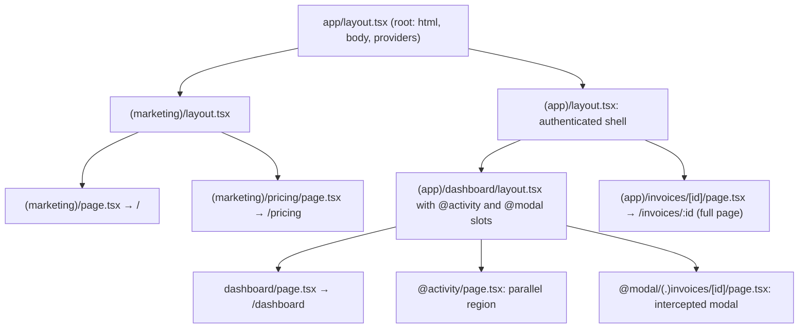

# 47 — Next.js App Router Architecture

> The `app/` directory is a routing table that happens to contain components. Treat it as the composition root of your product, and keep the product itself somewhere else.

**Prerequisites:** [18](18-react-server-components-and-server-functions.md), [21](21-frontend-architecture-styles-and-boundaries.md), [31](31-routing-architecture.md) · **Related:** [48 Rendering and Caching](48-nextjs-rendering-and-caching.md) · [49 Mutations and Auth](49-nextjs-data-mutations-and-auth.md) · [50 Next.js in Production](50-nextjs-in-production.md) · [54 Choosing a Framework](54-choosing-a-react-framework.md)

> [!NOTE]
> **Version baseline:** Next.js 16.4 (October 2026) with React 19.3. Since 16.0: Turbopack is the default bundler, `middleware.ts` is renamed `proxy.ts` (Node.js runtime by default), and Cache Components are opt-in. Cache Components are **recommended for all apps and on by default in new `create-next-app` projects since 16.4**, and are planned to become the default for every app in Next.js 17. Check the [security floors](44-rsc-security-threat-model.md#3-security-floors-and-verification) before you ship: 16.4.5+ or 15.5.29+.

---

## TL;DR

- **Route segments are the units of architecture.** Each folder can own a layout (persistent), a template (re-mounted), a page, a loading UI (Suspense), an error boundary, `not-found`/`forbidden`/`unauthorized` UIs, and route-segment config. Layouts persist across navigations, which is both the performance win and the source of stale-state bugs.
- **Keep `app/` thin:**
  - Pages compose features.
  - Features live in `src/features/*`.
  - Data access lives in `server-only` modules.
  - Shared UI comes from the design system.
  This keeps routing decisions from leaking into domain code, and makes migrations survivable.
- **Server-first composition:**
  - Server Components by default.
  - `'use client'` at interactive leaves.
  - Server Components passed as `children` or props into Client Components.
  - Props crossing the boundary are serialisable DTOs.
- **Advanced routing:**
  - **Route groups** `(marketing)` for layout boundaries without URL segments.
  - **Parallel routes** `@slot` for independent regions (with `default.tsx`).
  - **Intercepting routes** `(.)` for modal-over-list patterns.
  - **Typed routes** (`typedRoutes: true`) with the global `PageProps<'/path/[id]'>` and `LayoutProps` helpers.
- **Choose the right server entry point:**

  | Entry point | Use it for |
  |---|---|
  | Server Components | Reads |
  | Server Functions | Mutations from your own UI |
  | Route Handlers | Webhooks, public APIs, files and feeds |
  | `proxy.ts` | Coarse request routing: rewrites, redirects, locale, tenant, headers. Not your auth boundary |

- **Errors:**
  - `error.tsx` per segment, with `retry()` (stable in 16.3), and `global-error.tsx`.
  - `catchError()` from `next/error` for component-level boundaries.
  - `notFound()`, `redirect()`, and `forbidden()` / `unauthorized()` (experimental `authInterrupts`).
  - `instrumentation.ts` with `onRequestError` for server-side reporting.

---

## 1. The segment model



| File | Role | Lifecycle |
|---|---|---|
| `layout.tsx` | Shared UI and providers for a segment and its children | **Persists** across navigations within it. State and effects survive. Doesn't re-render on navigation between child pages |
| `template.tsx` | Like a layout, but **re-mounted** on every navigation | Use for per-page enter animations or effects that must reset |
| `page.tsx` | The unique UI of a route. Receives `params` and `searchParams` (both **Promises**) | Re-rendered per navigation |
| `loading.tsx` | An instant Suspense fallback for the segment | Shown during navigation while the page streams |
| `error.tsx` | A client error boundary for the segment, with `retry()` and `reset()` | Catches errors below its layout, but not in that layout itself |
| `global-error.tsx` | The last-resort boundary that replaces the root layout | Must render its own `<html>` and `<body>` |
| `not-found.tsx`, `forbidden.tsx`, `unauthorized.tsx` | UI for `notFound()`, `forbidden()` and `unauthorized()` | `forbidden` and `unauthorized` require `experimental.authInterrupts` |
| `default.tsx` | A fallback for a parallel slot when the URL doesn't match it | **Required** for slots on hard navigations |
| `route.ts` | An HTTP handler (`GET`, `POST`, …). Can't coexist with a `page.tsx` in the same segment | Per request |

> [!IMPORTANT]
> **Layouts persist, and that's an architectural decision.** Anything a layout fetches or holds in state doesn't refresh when users move between its child pages. Put per-page data in pages. Put per-navigation resets in templates or keyed components. Never rely on a layout for authorisation (it doesn't run for Server Function calls, and doesn't re-run on every navigation) ([44](44-rsc-security-threat-model.md)).

---

## 2. Project structure: keep `app/` thin

```text
apps/insights/                      # Acme Insights (Next.js app inside a monorepo, ch60)
├─ src/
│  ├─ app/                          # routing table + composition root ONLY
│  │  ├─ layout.tsx                 # html, body, providers, fonts, brand tokens
│  │  ├─ global-error.tsx
│  │  ├─ (marketing)/…
│  │  ├─ (app)/
│  │  │  ├─ layout.tsx              # authenticated shell (nav, tenant switcher)
│  │  │  ├─ dashboard/
│  │  │  │  ├─ layout.tsx           # declares @activity and @modal slots
│  │  │  │  ├─ page.tsx             # composes features: <RevenueOverview/>, <InvoiceTable/>
│  │  │  │  ├─ loading.tsx
│  │  │  │  ├─ error.tsx
│  │  │  │  ├─ @activity/{page,default}.tsx
│  │  │  │  └─ @modal/{default.tsx,(.)invoices/[id]/page.tsx}
│  │  │  └─ invoices/[id]/page.tsx
│  │  └─ api/webhooks/billing/route.ts   # Route Handler: external callers only
│  ├─ features/                     # product features (vertical slices)
│  │  ├─ invoices/
│  │  │  ├─ components/             # Server and Client Components of this feature
│  │  │  ├─ actions.ts              # 'use server': exported Server Functions ONLY
│  │  │  ├─ queries.ts              # server-only reads (calls the DAL)
│  │  │  └─ index.ts                # public API of the feature
│  │  └─ revenue/…
│  ├─ server/                       # server-only: DAL, auth, authz, service clients
│  │  ├─ dal/invoices.ts            # import 'server-only'; tenant-scoped, returns DTOs
│  │  ├─ auth.ts
│  │  └─ authz.ts
│  ├─ shared/                       # framework-agnostic utilities, hooks, types
│  ├─ proxy.ts                      # tenant, locale, CSP nonce, coarse redirects
│  └─ instrumentation.ts            # OTel / error reporting registration
└─ next.config.ts
```

Rules that keep this healthy ([21](21-frontend-architecture-styles-and-boundaries.md)):

- **`app/` imports features; features never import from `app/`.** Lint it with boundary rules.
- **Features expose a public API** (`index.ts`). Cross-feature imports go through it.
- **`server/` modules start with `import 'server-only'`.** Client code importing them fails the build.
- **Server Function files export only actions.** Every export from a `'use server'` file is a public endpoint ([44](44-rsc-security-threat-model.md)).
- **Private folders** (`_components`) and colocation inside `app/` are fine for route-specific pieces, but domain logic in `app/` couples your product to the router.

---

## 3. Server-first composition

### 3.1 Placing the boundary

```tsx
// src/app/(app)/dashboard/page.tsx: a Server Component that composes features
import { Suspense } from 'react';
import { RevenueOverview } from '@/features/revenue';
import { InvoiceTable, InvoiceTableSkeleton } from '@/features/invoices';
import { DashboardFilters } from '@/features/dashboard/DashboardFilters'; // 'use client' leaf

export default async function DashboardPage({ searchParams }: { searchParams: Promise<{ status?: string }> }) {
  return (
    <>
      <DashboardFilters />                                   {/* interactive: client */}
      <RevenueOverview />                                    {/* server: data + charts as static SVG */}
      <Suspense fallback={<InvoiceTableSkeleton />}>
        <InvoiceTable statusPromise={searchParams.then((p) => p.status ?? 'all')} />
      </Suspense>
    </>
  );
}
```

### 3.2 Server Components inside Client Components

```tsx
// features/dashboard/CollapsiblePanel.tsx
'use client';
import { useState, type ReactNode } from 'react';

export function CollapsiblePanel({ title, children }: { title: string; children: ReactNode }) {
  const [open, setOpen] = useState(true);
  return (
    <section aria-labelledby={`${title}-heading`}>
      <h2 id={`${title}-heading`}>
        <button type="button" aria-expanded={open} onClick={() => setOpen((o) => !o)}>{title}</button>
      </h2>
      {open && children} {/* children can be Server Components rendered by the parent */}
    </section>
  );
}

// page.tsx (server): the panel is interactive; its content stays server-rendered with zero client JS
// <CollapsiblePanel title="Top customers"><TopCustomers /></CollapsiblePanel>
```

| Rule | Why |
|---|---|
| **`'use client'` at the leaves** | Every import below a client boundary becomes client code ([18](18-react-server-components-and-server-functions.md)) |
| **Pass Server Components as `children` or slot props** | Interactive shells don't force their content into the client bundle |
| **Props are serialisable DTOs** | Functions can't cross (except Server Functions). Large objects inflate the Flight payload ([38](38-react-performance-engineering.md)) |
| **Context providers in a small client module** | `providers.tsx` with `'use client'`, wrapped around `children` in the root layout |
| **Third-party client-only libraries** | Wrap them in your own `'use client'` component, so pages stay server components |

---

## 4. Advanced routing

### 4.1 Route groups

`(marketing)` and `(app)` give different layouts (public site and authenticated shell) to different URLs without adding URL segments. They can also define **multiple root layouts**. Navigating between root layouts triggers a full page load, which is acceptable between "site" and "app", and expensive if it happens often.

### 4.2 Parallel routes and intercepted modals

```tsx
// src/app/(app)/dashboard/layout.tsx: two independent regions, each with its own loading and error UI
export default function DashboardLayout({
  children,
  activity,
  modal,
}: {
  children: React.ReactNode;
  activity: React.ReactNode;
  modal: React.ReactNode;
}) {
  return (
    <div className="dashboard-grid">
      <main>{children}</main>
      <aside aria-label="Recent activity">{activity}</aside>
      {modal}
    </div>
  );
}
```

```tsx
// src/app/(app)/dashboard/@modal/(.)invoices/[id]/page.tsx: soft navigation from the dashboard shows a modal
import { InvoiceQuickView } from '@/features/invoices';
import { RouteModal } from '@/shared/ui/RouteModal'; // 'use client': dialog that calls router.back() on close

export default async function InvoiceModal({ params }: { params: Promise<{ id: string }> }) {
  const { id } = await params;
  return (
    <RouteModal title="Invoice">
      <InvoiceQuickView id={id} />
    </RouteModal>
  );
}

// src/app/(app)/dashboard/@modal/default.tsx: render nothing when the URL doesn't target the slot
export default function Default() {
  return null;
}
```

| Navigation | Result |
|---|---|
| Click an invoice in the dashboard (soft navigation) | The URL becomes `/invoices/inv_42`; the **intercepted** route renders the modal over the dashboard |
| Reload, or open the link in a new tab (hard navigation) | `/invoices/[id]/page.tsx` renders the **full page** |
| Back button | Closes the modal (the router pops the history entry) |

Accessibility of route modals (focus moves in and returns on close, Esc closes, a title gives the name) is the modal component's job ([36](36-accessibility-engineering.md)).

### 4.3 Typed routes and route props

```ts
// next.config.ts
import type { NextConfig } from 'next';

const nextConfig: NextConfig = {
  typedRoutes: true,      // <Link href> and router methods are checked against real routes
  cacheComponents: true,  // ch48
  reactCompiler: true,    // ch16
};

export default nextConfig;
```

```tsx
// After type generation (next dev, next build or next typegen), PageProps and LayoutProps are global
export default async function Page(props: PageProps<'/invoices/[id]'>) {
  const { id } = await props.params; // typed as string
  // …
}
```

---

## 5. Choosing the server entry point

| Need | Use | Notes |
|---|---|---|
| Read data for UI | **Server Components** calling the DAL | Cached or streamed per [48](48-nextjs-rendering-and-caching.md) |
| Mutate from your own UI | **Server Functions** (`'use server'`) | Forms with progressive enhancement, `useActionState`, `updateTag` or `refresh` ([49](49-nextjs-data-mutations-and-auth.md)) |
| Webhooks, third-party callers, mobile apps, file downloads, RSS, OG images | **Route Handlers** (`route.ts`) | A stable URL contract with standard HTTP semantics ([33](33-api-integration-bff-and-contracts.md)) |
| Request routing: rewrites, redirects, tenant and locale resolution, CSP nonce, coarse auth redirects | **`proxy.ts`** | Node.js runtime by default. Keep it fast and stateless. Not a security boundary on its own |
| Work after the response (logging, analytics, cache warming) | **`after()`** from `next/server` | Runs after the response is sent. The host needs graceful shutdown ([50](50-nextjs-in-production.md)) |
| Shared server bootstrapping (tracing, error reporting) | **`instrumentation.ts`** | `register()` at startup; `onRequestError()` for server errors |

```ts
// src/instrumentation.ts: server-side error reporting with request context
import type { Instrumentation } from 'next';

export async function register(): Promise<void> {
  if (process.env.NEXT_RUNTIME === 'nodejs') {
    await import('./server/telemetry/register-node'); // OpenTelemetry SDK, exporters (ch41)
  }
}

export const onRequestError: Instrumentation.onRequestError = async (error, request, context) => {
  const { reportServerError } = await import('./server/telemetry/report');
  reportServerError(error, {
    method: request.method,              // not request.path: raw paths can carry IDs and PII
    routePath: context.routePath,        // e.g. "/invoices/[id]": low cardinality
    routeType: context.routeType,        // 'render' | 'route' | 'action' | 'proxy'
    renderSource: context.renderSource,
  });
};
```

---

## 6. Error and status architecture

```tsx
// src/app/(app)/dashboard/error.tsx: segment boundary with framework-aware retry
'use client';

export default function DashboardError({ error, retry }: { error: Error & { digest?: string }; retry: () => void }) {
  return (
    <div role="alert">
      <h2>We couldn't load the dashboard</h2>
      <p>Reference: {error.digest}</p> {/* the digest correlates with server logs; never show stack traces */}
      <button type="button" onClick={() => retry()}>Try again</button>
    </div>
  );
}
```

```tsx
// src/shared/ui/WidgetErrorBoundary.tsx: component-level boundary (Next.js 16.3+)
'use client';
import { catchError, type ErrorInfo } from 'next/error';

function WidgetFallback(props: { title: string }, { retry }: ErrorInfo) {
  return (
    <div role="status">
      <p>{props.title} couldn't load.</p>
      <button type="button" onClick={() => retry()}>Try again</button>
    </div>
  );
}

export const WidgetErrorBoundary = catchError(WidgetFallback);
// <WidgetErrorBoundary title="Revenue"><RevenueChart /></WidgetErrorBoundary>
```

| Situation | Mechanism |
|---|---|
| Expected business errors from mutations | Return values from Server Functions (`{ ok: false, error }`) rendered with `useActionState`. Don't throw ([49](49-nextjs-data-mutations-and-auth.md)) |
| Missing resource | `notFound()` → nearest `not-found.tsx` |
| Not signed in / not allowed | `unauthorized()` / `forbidden()` (experimental `authInterrupts`), or `redirect('/login?returnTo=…')` |
| Unexpected render error in a segment | `error.tsx` with `retry()` (re-fetches and re-renders in a transition) |
| Unexpected error in one widget | `catchError()` boundary, or react-error-boundary ([40](40-resilience-and-reliability.md)) |
| The root layout itself fails | `global-error.tsx` |

> [!TIP]
> `retry()` (stable since 16.3) re-fetches and re-renders the boundary's children inside a transition, so Client Component state outside the boundary survives. `reset()` only clears the error state without re-fetching. Prefer `retry()` for data-driven failures.

---

## 7. Metadata, SEO and special files

| Need | Convention |
|---|---|
| Static metadata | `export const metadata: Metadata = { … }` in layouts and pages |
| Data-dependent metadata | `export async function generateMetadata({ params })`, deduplicated with the page's data fetch through `cache()` or `'use cache'` |
| Social images | `opengraph-image.tsx` or `twitter-image.tsx` (generated with `ImageResponse`) |
| Crawling | `sitemap.ts`, `robots.ts` (`generateSitemaps` for large sites) |
| Structured data | JSON-LD `<script type="application/ld+json">`, serialised safely ([43](43-frontend-security-architecture.md)) |
| Localised alternates | `alternates.languages` with `x-default` ([37](37-internationalization-and-localization.md)) |

---

## 8. Multi-team scale

| Approach | When |
|---|---|
| **One app, many features** (vertical slices, ownership per feature folder, CODEOWNERS) | Default. One deploy, shared layouts, the simplest navigation |
| **Monorepo with internal packages** (design system, DAL clients, domain packages) | Several apps sharing code ([60](60-monorepos-build-tooling-and-bundlers.md)) |
| **Multi-zones** (several Next.js apps behind one domain, routed by path) | Independent deploys per area, at the cost of hard navigations between zones ([61](61-micro-frontends-and-module-federation.md)) |
| **Micro-frontends at runtime** | Rarely worth it with RSC. Consider multi-zones or build-time composition first |

---

## Decision framework

**Problem.** How do we structure a Next.js App Router codebase so routing, rendering and domain logic stay independently changeable as teams and features grow?

**Constraints.** Team count and ownership, SEO needs, the share of interactive vs content UI, hosting (Vercel, another adapter, self-hosted), and migration from the Pages Router or an SPA.

| Decision | Recommended default |
|---|---|
| Structure | Thin `app/` composition root; `features/*` vertical slices; `server/*` server-only DAL and auth; shared design system |
| Boundaries | Server Components by default; `'use client'` at leaves; DTO props |
| Layout strategy | Route groups for shells; templates only where reset semantics are needed |
| Modals and side panels | Parallel and intercepting routes with `default.tsx`, so URLs are shareable |
| Entry points | Server Components (reads), Server Functions (UI mutations), Route Handlers (external callers), proxy (routing) |
| Errors | Segment `error.tsx` + `catchError` widgets + `global-error.tsx` + `onRequestError` reporting |
| Types | `typedRoutes`, `PageProps`/`LayoutProps` helpers, strict TS |

**Criteria.** Change isolation, bundle size, navigation performance, testability (features without the router), and the cost of a future framework change.

**Failure modes.**
- Domain logic inside `app/` pages.
- Layouts that fetch per-page data or enforce auth.
- `'use client'` at the top of pages.
- Barrel files marked `'use client'`.
- Parallel routes without `default.tsx` (404s on reload).
- Route Handlers used as an internal API for your own Server Components (an extra network hop).
- A proxy that does heavy work on every request.

**Migration path.** From the Pages Router: move routes incrementally (both routers coexist), starting with leaf pages. Move data fetching from `getServerSideProps` into Server Components that call a DAL. Convert `_app` providers into a client `providers.tsx`. Then adopt Cache Components ([48](48-nextjs-rendering-and-caching.md), [64](64-migration-playbooks.md)).

---

## Pitfalls and anti-patterns

- Reading `params` or `searchParams` synchronously (they're Promises since v15).
- Fetching from your own Route Handlers inside Server Components instead of calling the DAL directly.
- Putting `<Providers>` (client) around the whole tree and then wondering why everything is a client component. It isn't (children stay server components), but providers with huge contexts re-render widely.
- Using `template.tsx` everywhere "to be safe" (it throws away layout persistence).
- Large client components imported by layouts (they ship on every route under that layout).
- Forgetting that `loading.tsx` wraps the page, not the layout.
- Using `redirect()` inside `try/catch` without rethrowing (it works by throwing). Use `unstable_rethrow` or restructure.
- Mixing locale, tenant and auth logic in one giant `proxy.ts`.

---

## Architect's checklist

- [ ] `app/` is a thin routing and composition layer; features and DAL live outside it with lint-enforced boundaries
- [ ] Server-first composition; `'use client'` only on interactive leaves; DTO props
- [ ] Route groups for shells; parallel slots have `default.tsx`; intercepted modals have full-page equivalents
- [ ] `typedRoutes` enabled; `PageProps`/`LayoutProps` used; params handled as Promises
- [ ] Entry-point policy documented (Server Components, Server Functions, Route Handlers, proxy, `after`)
- [ ] Error architecture: `error.tsx` with `retry`, `catchError` widgets, `global-error.tsx`, `onRequestError` reporting
- [ ] Metadata strategy (generated metadata, OG images, sitemaps, JSON-LD, localised alternates)
- [ ] Ownership mapped to feature folders (CODEOWNERS); scaling path (monorepo, multi-zones) decided

---

## Interview angles

**Q1. How do you structure a large Next.js App Router codebase?**
Keep `app/` as a thin routing and composition root: layouts, pages, loading and error files that compose features. Put product code in feature slices (`features/invoices`) with a public API, and server-only data access and auth in `server/`, behind `import 'server-only'`. Enforce boundaries with lint (app may import features; features never import app). Keep Server Function files to exported actions only. That isolates routing changes, keeps features testable without the router, and limits the blast radius of framework migrations.

**Q2. What's the difference between a layout and a template?**
A layout persists across navigations between its child routes: it isn't re-mounted, so its state and effects survive and it doesn't re-render for sibling page changes. A template wraps the same children but is re-mounted on every navigation, which resets state and re-runs effects. Use layouts for shells and providers, and templates only when you need per-navigation resets (enter animations, page-view effects).

**Q3. How do parallel and intercepting routes work together for modals?**
A parallel slot (`@modal`) renders alongside `children` in a layout. An intercepting route inside the slot (`(.)invoices/[id]`) matches the URL during soft navigation, so clicking an invoice renders a modal over the current page while the URL changes to `/invoices/inv_42`. A hard navigation to that URL renders the real `invoices/[id]/page.tsx` instead. `default.tsx` in the slot renders nothing when the slot doesn't match, which prevents 404s on reload. Back closes the modal.

**Q4. When do you use a Route Handler instead of a Server Function?**
Server Functions are for mutations triggered by your own UI. They're invoked through framework-generated IDs, integrate with forms and transitions, and return values to React. Route Handlers are for anything that needs a stable HTTP contract: webhooks, third-party or mobile clients, file downloads, feeds, OAuth callbacks. Don't call your own Route Handlers from Server Components; call the DAL directly and avoid the extra hop.

**Q5. Where should authentication be enforced in an App Router app?**
Not in layouts or the proxy alone. The proxy can redirect anonymous users as a convenience, but it's bypassable and doesn't cover every path. Layouts don't run for Server Function calls and don't re-render on every navigation. Enforce in the data access layer (every read verifies the session and scopes by tenant) and inside every Server Function and Route Handler ([45](45-authentication-and-authorization.md), [49](49-nextjs-data-mutations-and-auth.md)).

---

## Further reading

- Next.js docs, *Project structure*: <https://nextjs.org/docs/app/getting-started/project-structure> · *Layouts and pages*: <https://nextjs.org/docs/app/getting-started/layouts-and-pages>
- Next.js docs, *Parallel routes*: <https://nextjs.org/docs/app/api-reference/file-conventions/parallel-routes> · *Intercepting routes*: <https://nextjs.org/docs/app/api-reference/file-conventions/intercepting-routes>
- Next.js docs, *Server and Client Components*: <https://nextjs.org/docs/app/getting-started/server-and-client-components>
- Next.js docs, *Error handling* and *catchError*: <https://nextjs.org/docs/app/getting-started/error-handling>
- Next.js docs, *instrumentation.js*: <https://nextjs.org/docs/app/api-reference/file-conventions/instrumentation>
- Next.js blog, *Next.js 16*, *16.3* and *16.4* release posts: <https://nextjs.org/blog>
- Next.js docs, *Upgrading to version 16*: <https://nextjs.org/docs/app/guides/upgrading/version-16>

---

[← Previous: 46 — Enterprise SaaS Architecture](46-enterprise-saas-architecture.md) · [Index](README.md) · [Next: 48 — Next.js Rendering and Caching →](48-nextjs-rendering-and-caching.md)
