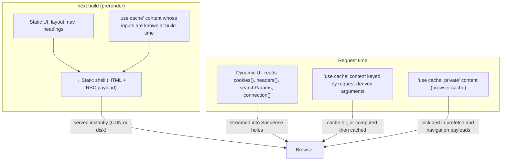
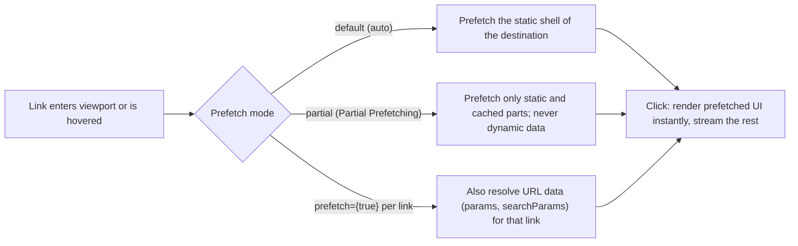

# 48 — Next.js Rendering and Caching

> Next.js moved the static/dynamic decision from the route to the component. That makes pages faster and caching more precise, and it makes "what's cached, where, for how long, and who invalidates it?" the most important question in your architecture reviews.

**Prerequisites:** [32](32-rendering-strategy-architecture.md), [47](47-nextjs-app-router-architecture.md) · **Related:** [30 Server State](30-server-state-and-data-fetching.md) · [39 Core Web Vitals](39-web-performance-and-core-web-vitals.md) · [44 RSC Security](44-rsc-security-threat-model.md) · [50 Next.js in Production](50-nextjs-in-production.md)

> [!IMPORTANT]
> **Status (Next.js 16.4, October 2026).** Cache Components are **recommended for all apps** and **enabled by default in new `create-next-app` projects**. Existing apps opt in with `cacheComponents: true`, and Next.js 17 is planned to make them the default for everyone. This chapter teaches the Cache Components model. Apps that haven't migrated still run on the previous model (`fetch` cache options, `revalidate` segment config, `unstable_cache`), covered briefly in §10.

---

## TL;DR

- **Three kinds of content, one response:**

  | Kind | What it is | When it renders |
  |---|---|---|
  | **Static** | Anything that doesn't need request data | Prerendered into the **static shell** |
  | **Cached** | `'use cache'` functions and components, with lifetimes (`cacheLife`) and tags (`cacheTag`) | In the shell, or at runtime and reused |
  | **Dynamic** | Anything that reads request-time APIs (`cookies()`, `headers()`, `searchParams`, `connection()`) | Streamed into `<Suspense>` holes at request time |

  Nothing is cached unless you say so.
- **Three cache directives:**
  - `'use cache'`: shared, server-side, in memory per instance by default.
  - `'use cache: private'`: may read cookies and headers; cached **in the browser only**.
  - `'use cache: remote'`: durable and shared across instances through a cache handler. Worth its network round trip only at high hit rates.
- **Lifetimes:** `cacheLife` profiles (`seconds`, `minutes`, `hours`, `days`, `weeks`, `max`, `default`) set `stale` (browser), `revalidate` (background refresh) and `expire` (hard limit). Define custom profiles in `next.config`.
- **Invalidation:**
  - `revalidateTag(tag, 'max')`: stale-while-revalidate, for webhooks and Route Handlers. The single-argument form is deprecated.
  - `updateTag(tag)`: **Server Actions only**; read-your-writes, the next request waits for fresh data.
  - `refresh()`: re-render the client router from a Server Action.
  - `revalidatePath()`: invalidate a route's caches by path.
- **Instant navigations (16.3+):**
  - **Partial Prefetching** (`partialPrefetching: true`) prefetches only cached and static parts.
  - `instant` segment validation, the Navigation Inspector, and `@next/playwright`'s `instant()` keep routes from regressing into blocking navigations.
  - 16.4 adds `ensureStatic` per segment, plus `navigation()` and `prefetch()` to defer work out of prefetches and shells.
- **Caches are per deployment.** The build ID is part of every cache key, so a deploy starts cold. Plan warm-up for critical paths, and use a shared cache handler with tag coordination when you run multiple instances ([50](50-nextjs-in-production.md)).
- **Security:** a cached function's key is its arguments and closed-over values. **Never cache per-user data under a shared key**, and never cache authorisation decisions ([44](44-rsc-security-threat-model.md)).

---

## 1. The model: static, cached, dynamic



```ts
// next.config.ts
import type { NextConfig } from 'next';

const nextConfig: NextConfig = {
  cacheComponents: true,     // the Cache Components model (prerendered shell + use cache + streaming)
  partialPrefetching: true,  // <Link> prefetches only static and cached parts (requires cacheComponents)
  cacheLife: {
    catalogue: { stale: 300, revalidate: 900, expire: 86_400 }, // custom profile, in seconds
  },
};

export default nextConfig;
```

---

## 2. A product page, end to end

```tsx
// app/products/[slug]/page.tsx (Acme Store)
import { Suspense } from 'react';
import { cacheLife, cacheTag } from 'next/cache';
import { cookies } from 'next/headers';
import { catalog, pricing, recommendations } from '@/server/dal';
import { ProductGallery, BuyBox, PriceAndStock, Recommendations, CartBadge } from '@/features/product';

export async function generateStaticParams() {
  return catalog.topSellerSlugs(200).then((slugs) => slugs.map((slug) => ({ slug }))); // at least one
}

export default function ProductPage({ params }: { params: Promise<{ slug: string }> }) {
  return (
    <>
      <Suspense fallback={<ProductSkeleton />}>
        <ProductDetails params={params} />
      </Suspense>
      <Suspense fallback={<RecommendationsSkeleton />}>
        <PersonalRecommendations params={params} />
      </Suspense>
      <Suspense fallback={<CartBadge count={null} />}>
        <CartBadgeLive />
      </Suspense>
    </>
  );
}

async function ProductDetails({ params }: { params: Promise<{ slug: string }> }) {
  const { slug } = await params;
  const product = await getProduct(slug); // cached, shared, tagged
  return (
    <>
      <ProductGallery images={product.images} />                 {/* LCP image server-rendered (ch39) */}
      <h1>{product.name}</h1>
      <Suspense fallback={<PriceAndStock.Skeleton />}>
        <PriceAndStock sku={product.sku} />                      {/* short-lived cache, see below */}
      </Suspense>
      <BuyBox sku={product.sku} />                               {/* 'use client' leaf; mutations via Server Functions */}
    </>
  );
}

async function getProduct(slug: string) {
  'use cache';
  cacheLife('catalogue');            // custom profile from next.config
  cacheTag(`product:${slug}`);       // PIM webhook invalidates this tag
  return catalog.getBySlug(slug);
}

async function PersonalRecommendations({ params }: { params: Promise<{ slug: string }> }) {
  const { slug } = await params;
  const userId = (await cookies()).get('uid')?.value; // request-time API: this component is dynamic
  const items = await recommendationsFor(slug, userId ?? 'anonymous');
  return <Recommendations items={items} />;
}

async function recommendationsFor(slug: string, userId: string) {
  'use cache';
  cacheLife('minutes');
  return recommendations.forProduct(slug, userId); // userId is an argument, so it's part of the cache key
}

async function CartBadgeLive() {
  const count = await cartCount(); // reads the cart cookie directly
  return <CartBadge count={count} />;
}

async function cartCount() {
  'use cache: private'; // may read cookies; cached only in this user's browser
  cacheLife('seconds');
  const cartId = (await cookies()).get('cart')?.value;
  return cartId ? pricing.cartCount(cartId) : 0;
}
```

`PriceAndStock` would use its own `'use cache'` with `cacheLife('seconds')` and a `stock:${sku}` tag, so stock changes propagate within seconds without making the whole page dynamic.

What the user gets:

- On a **direct visit**: the static shell (layout, gallery, title for prerendered slugs) arrives from the CDN or disk immediately, and the price, recommendations and cart badge stream in.
- On a **client navigation** from a category page: the prefetched static and cached parts render instantly, and dynamic parts stream ([31](31-routing-architecture.md)).

---

## 3. The cache directives

| Directive | Can read `cookies()` / `headers()`? | Stored | Shared across users? | Use for |
|---|---|---|---|---|
| `'use cache'` | **No.** Pass request-derived values as arguments | Server: per-instance memory by default; prerendered into the shell when possible | Yes, per cache key | Catalogues, CMS content, expensive queries keyed by their inputs |
| `'use cache: private'` | Yes | **Browser only** (navigation and prefetch payloads) | No | Per-user fragments you want in prefetches (cart counts, user-specific previews) |
| `'use cache: remote'` | No | A durable, shared cache handler (Redis, KV, platform cache) | Yes | Serverless or multi-instance deployments where in-memory entries don't survive; high-hit-rate data |

### 3.1 Cache keys

- The key is **the function's identity + its serialised arguments + closed-over values + the build ID**.
- Arguments must be **serialisable**. Pass IDs and primitive filters, not class instances.
- **Per-user data must be keyed by the user** (as an argument), or not cached on the server at all.
- Inside `'use cache'`, non-deterministic values (`Date.now()`, `Math.random()`, `crypto.randomUUID()`) are computed once and shared until revalidation. Outside a cache scope they must come after `connection()` (or `io()`), inside `<Suspense>`.

> [!CAUTION]
> **The classic cache leak:** a `'use cache'` function that internally calls a helper that reads the session (through another module) and returns user-specific data under a key that doesn't include the user. Next.js prevents direct `cookies()` and `headers()` reads inside `'use cache'`, but you can still leak by caching data fetched with a user-scoped credential. Keep cached functions **pure in their inputs**: everything that changes the result must be an argument ([44](44-rsc-security-threat-model.md), [46](46-enterprise-saas-architecture.md)).

---

## 4. Lifetimes with `cacheLife`

| Profile | Use case | `stale` (browser) | `revalidate` (background) | `expire` (hard) |
|---|---|---|---|---|
| `default` | Standard content | 5 minutes | 15 minutes | never |
| `seconds` | Real-time data | 30 seconds | 1 second | 1 minute |
| `minutes` | Frequently updated | 5 minutes | 1 minute | 1 hour |
| `hours` | Updated several times a day | 5 minutes | 1 hour | 1 day |
| `days` | Updated daily | 5 minutes | 1 day | 1 week |
| `weeks` | Updated weekly | 5 minutes | 1 week | 30 days |
| `max` | Rarely changes | 5 minutes | 30 days | 1 year |

- **`stale`**: how long the browser may reuse the payload without asking the server.
- **`revalidate`**: after this, the next request is served the cached value while a background refresh runs.
- **`expire`**: after this, with no traffic, the next request waits for a fresh value.
- **Nested caches:** an outer `'use cache'` with an **explicit** `cacheLife` keeps its own lifetime regardless of the caches inside it, and on a hit it returns the inner data it captured, so short-lived inner data can stay stale for as long as the outer entry lives. Without an explicit lifetime, inner lifetimes propagate outwards, and Next.js throws during prerendering when a short-lived inner cache would silently shorten an outer one. Set `cacheLife` in every cached scope, and keep short-lived data (prices, stock) in its own boundary rather than inside long-lived components.

---

## 5. Invalidation

| API | Where | Semantics | Use for |
|---|---|---|---|
| `cacheTag('product:ts-42')` | Inside `'use cache'` | Labels entries for later invalidation | Entity-level tagging |
| `revalidateTag(tag, 'max')` | Server Actions, Route Handlers, webhooks | Marks entries stale; the next request gets stale content while revalidating (stale-while-revalidate) | CMS and PIM webhooks, background updates where a short delay is fine |
| `revalidateTag(tag, { expire: 0 })` | Same | No stale serving; the next request blocks for fresh data | When data must be gone now and `updateTag` isn't available (webhooks) |
| `updateTag(tag)` | **Server Actions only** | Expires immediately; the user's next render waits for fresh data (**read-your-writes**) | The user just changed something and must see it |
| `refresh()` | **Server Actions only** | Re-renders the client router with fresh server data (no cache change) | Uncached dynamic data that changed |
| `revalidatePath('/products/[slug]', 'page')` | Server Actions, Route Handlers | Invalidates everything a route rendered | Coarse fallback when tagging is incomplete |

> [!WARNING]
> `revalidateTag(tag)` **without a second argument is deprecated**. It behaves like `{ expire: 0 }` today. Use `updateTag` in Server Actions, or pass `'max'` (or another profile) elsewhere.

```ts
// app/api/webhooks/pim/route.ts: the product information system calls this after edits
import { revalidateTag } from 'next/cache';
import { verifyPimSignature } from '@/server/webhooks';

export async function POST(request: Request) {
  const body = await request.text();
  if (!verifyPimSignature(request.headers.get('x-pim-signature'), body)) {
    return new Response('invalid signature', { status: 401 });
  }
  const event = JSON.parse(body) as { type: 'product.updated'; slug: string };
  revalidateTag(`product:${event.slug}`, 'max'); // stale-while-revalidate: shoppers never wait
  return Response.json({ ok: true });
}
```

```ts
// features/cart/actions.ts: the user added an item; they must see it immediately
'use server';
import { updateTag } from 'next/cache';
import { requireCart } from '@/server/cart';

export async function addToCart(formData: FormData) {
  const cart = await requireCart();                         // validates session and cart ownership
  const sku = String(formData.get('sku') ?? '');
  await cart.add(sku, 1);
  updateTag(`cart:${cart.id}`);                             // read-your-writes for this user's cart
}
```

### 5.1 Tag design

| Rule | Example |
|---|---|
| Tag by **entity** and **collection** | `product:ts-42`, `category:trail-shoes`, `products` |
| Include **tenant** in multi-tenant apps | `t:acme:invoice:inv_42` ([46](46-enterprise-saas-architecture.md)) |
| One owner per tag namespace | The PIM webhook owns `product:*`; the checkout service owns `stock:*` |
| Document tags with the data | Next to the DAL function that applies them, so invalidators know what exists |

---

## 6. Request-time boundaries

| API | Effect |
|---|---|
| `cookies()`, `headers()`, `draftMode()` | The calling component is dynamic: wrap it in `<Suspense>` |
| `params`, `searchParams` (Promises) | Awaiting them makes the subtree depend on the URL. Await them **inside** Suspense to keep the shell |
| `connection()` (`next/server`) | "Everything after this needs a real request": per-request IDs, current time, randomness |
| `io()` (`next/cache`, 16.4) | Marks non-deterministic or I/O work. A dynamic boundary during prerender, but usable inside cache scopes and Client Components (unlike `connection()`) |
| `navigation()` / `prefetch()` (`next/cache`, 16.4, with Partial Prefetching) | Defer the code below out of runtime prefetches or out of the shell, until navigation or prefetch. The content **stays cacheable** |

The dev overlay reports **blocking-route** insights (a runtime API outside Suspense, uncached data blocking the shell, unguarded randomness) with fix cards. Treat them as you treat type errors.

---

## 7. Prefetching and instant navigations



| Tool | Purpose |
|---|---|
| `partialPrefetching: true` (config) or `export const prefetch = 'partial'` (segment) | Prefetch cached and static parts only, which is cheap and safe at scale |
| `<Link prefetch={true}>` | Per-link prefetching, including URL-specific data, for high-intent links |
| `export const instant = …` (segment) | Instant-navigation validation for a segment (warning level by default in Cache Components apps) |
| Navigation Inspector (Next.js DevTools) | Pause navigations and see exactly what's in the instant UI |
| `instant()` from `@next/playwright` | E2E assertions scoped to what's visible *instantly*, for both page loads and client navigations |
| `export const ensureStatic = 'shell' \| 'prefetch' \| 'navigation'` (16.4) | Enforce that a segment keeps producing static output at the given phase, failing the build otherwise |

```ts
// e2e/product-navigation.spec.ts: lock in instant navigation in CI
import { test, expect } from '@playwright/test';
import { instant } from '@next/playwright';

test('product page is instant on client navigation', async ({ page }) => {
  await page.goto('/category/trail-shoes');
  await instant(page, async () => {
    await page.getByRole('link', { name: 'TS-42 Trail Shoe' }).click();
    await page.waitForURL((url) => url.pathname === '/products/ts-42');
    await expect(page.getByRole('heading', { level: 1 })).toHaveText('TS-42 Trail Shoe'); // from the cache
    await expect(page.getByText('In stock')).toHaveCount(0);                              // streams later
  });
  await expect(page.getByText('In stock')).toBeVisible();
});
```

> [!NOTE]
> **Page loads and client navigations produce different initial UI.** A Suspense boundary in the root layout covers everything on a page load, but on a client navigation only the segments below the shared layout re-render, so a boundary above that point doesn't apply. Validation checks both paths. That's why a route can pass on reload and still block on navigation.

---

## 8. ISR with Cache Components

- `generateStaticParams` prerenders the listed params (it must return **at least one**).
- Any other param value gets the **App Shell** instantly, renders in the background with the real params, and is cached for the next visitor.
- `dynamicParams` isn't supported with Cache Components (the build fails). Unlisted params are always rendered on request.
- Await `params` inside `<Suspense>` (with Partial Prefetching) to serve a fallback while an unlisted path renders, or outside Suspense to keep classic ISR behaviour for unlisted paths.
- Time-based refresh comes from `cacheLife`. Event-based refresh comes from tags and webhooks (§5).

---

## 9. Where cached content lives

| Store | What's there | Lifetime | Notes |
|---|---|---|---|
| **Prerendered HTML and RSC payloads** | The static shell; ISR-upgraded pages | Until `revalidate`/`expire`, or a new deploy | On disk when self-hosting; durable storage behind the CDN on platforms |
| **Server cache** (`'use cache'`) | Runtime cache entries | Per `cacheLife` | **Per-instance memory by default, so it's ephemeral on serverless.** Use `'use cache: remote'` with `cacheHandlers` for durability |
| **Browser** | Payloads from navigations and prefetches; `'use cache: private'` results | The `stale` window | Client router cache. `staleTimes` (config) and `unstable_dynamicStaleTime` (segment) tune dynamic data reuse |
| **CDN** | Fully static pages (`Cache-Control: public`); shells where the platform supports PPR resumption | Per headers | Pages that access dynamic APIs are sent with `Cache-Control: private` |

**Everything is scoped to a deployment.** The build ID is part of the cache key, so even remote entries don't carry over between deploys. Budget for cold caches after each release: warm critical paths, and watch TTFB right after deploys ([50](50-nextjs-in-production.md)).

---

## 10. Migrating from the previous model

| Previous | With Cache Components |
|---|---|
| `export const dynamic = 'force-dynamic'` | **Remove it.** Uncached data and request-time APIs already run per request; static parts still prerender |
| `export const dynamic = 'force-static'` | Put `'use cache'` around the route's data or UI. Optionally add `ensureStatic` (16.4) |
| `export const revalidate = 3600` | `'use cache'` plus `cacheLife('hours')` (or a custom profile) around the data |
| `export const revalidate = 0` | Remove it. Keep that data outside cache scopes |
| `export const fetchCache = …` | Remove it. Cache at the data source with `'use cache'` |
| `fetch(url, { next: { revalidate, tags } })` | Wrap the fetch in a `'use cache'` function with `cacheLife` and `cacheTag` |
| `unstable_cache(fn, keys, { tags })` | `'use cache'` function with `cacheTag` |
| `unstable_noStore()` | Not needed. Use `connection()` where you need per-request work |
| `export const dynamicParams = false` | Not supported. Unlisted params render on request |
| `experimental.ppr`, `experimental.dynamicIO`, `experimental.useCache` | Replaced by `cacheComponents: true` |

The Next.js team publishes agent skills for the migration (`next-cache-components-adoption`, `next-partial-prefetching-adoption`), and `next upgrade --agent` (16.4) can drive codemods plus follow-up fixes. Review the diffs as you'd review any large refactor ([64](64-migration-playbooks.md)).

---

## 11. SEO and bots

With a static shell, metadata can stream after the shell, which some crawlers can't handle. Next.js detects them by user agent (configurable with `htmlLimitedBots`) and renders those requests fully at request time. **Data sources used at build time must also be available at request time**, or those bots get 500s. Test crawler user agents in staging ([32](32-rendering-strategy-architecture.md)).

---

## Decision framework

**Problem.** For each piece of UI, where should it render, how long can it be reused, and who invalidates it?

**Constraints.** Freshness requirements per data type, personalisation, traffic patterns (hit rates), hosting (single server, multi-instance, serverless, CDN capabilities), and SEO.

| Data | Recommended treatment |
|---|---|
| Layout, navigation, marketing copy | Static (no directive needed) |
| Catalogue, CMS content, docs | `'use cache'` + entity tags + webhooks with `revalidateTag(…, 'max')` |
| Prices and stock | `'use cache'` with `cacheLife('seconds')` and tags, in its own Suspense boundary |
| Per-user widgets in prefetches | `'use cache: private'` |
| Personalised, must be fresh (cart, notifications) | Dynamic in Suspense, or private cache with a short lifetime |
| Expensive shared queries on serverless | `'use cache: remote'`, if the hit rate justifies the round trip |
| After a user's own mutation | `updateTag` (read-your-writes) or `refresh()` |

**Criteria.** Correctness (no cross-user leaks), freshness, TTFB and navigation latency, origin load, and operational complexity (cache handlers, tag coordination).

**Failure modes.**
- Per-user data under shared keys.
- One giant cached component whose shortest inner lifetime kills its reuse.
- Missing Suspense, so the whole route blocks.
- Tags nobody invalidates.
- Deprecated single-argument `revalidateTag`.
- Assuming in-memory cache entries survive on serverless.
- No tag coordination across instances.
- Bots getting 500s because build-only data sources aren't reachable at runtime.

**Migration path.** Turn on `cacheComponents` in a branch and follow the validation insights. Remove legacy segment config per the table. Add tags and webhooks for content sources. Enable `partialPrefetching`. Add `instant()` E2E tests for top journeys. Then tune lifetimes from RUM and hit-rate data.

---

## Pitfalls and anti-patterns

- Wrapping an entire page in `'use cache'` that reads `params` and calls user-specific helpers.
- Using `revalidatePath('/')` as a hammer after every mutation.
- Calling `updateTag` from a Route Handler (it throws; use `revalidateTag` there).
- Rendering `new Date()` in a Server Component without `connection()` or a cache scope (a blocking-prerender error).
- Expecting `useSearchParams()` in a Client Component to be in the static shell (it suspends on page loads).
- Prefetching every link with `prefetch={true}` (costly per-user runtime prefetches).
- Treating the CDN as the cache of record for personalised HTML.
- Forgetting that every deploy resets the caches.

---

## Architect's checklist

- [ ] `cacheComponents` (and `partialPrefetching`) enabled; legacy segment config removed
- [ ] Every cached function is pure in its arguments; per-user data keyed by user or kept private or dynamic
- [ ] `cacheLife` profiles chosen per data type; custom profiles documented in `next.config`
- [ ] Tag taxonomy (entity, collection, tenant) with an owner and invalidation source for each namespace
- [ ] `revalidateTag(tag, profile)` in webhooks; `updateTag` or `refresh` after user mutations
- [ ] Suspense boundaries placed for both page loads and client navigations; `instant` validation clean
- [ ] `instant()` E2E tests for top journeys; `ensureStatic` where static output is a requirement
- [ ] Cache storage plan: in-memory vs `use cache: remote`, cache handlers, tag coordination across instances
- [ ] Post-deploy cold-cache plan (warming, monitoring TTFB)
- [ ] Crawler behaviour tested (`htmlLimitedBots`, runtime availability of data sources)

---

## Interview angles

**Q1. Explain the Cache Components model in two minutes.**
The static/dynamic boundary is per component, not per route. At build time, Next.js prerenders everything that doesn't need request data, including `'use cache'` functions whose inputs are known, into a static shell. Components that read request-time APIs are dynamic and must sit inside Suspense, so they stream in. Cached functions have lifetimes (`cacheLife`) and tags (`cacheTag`) for invalidation. One response contains static, cached and dynamic parts, and prefetches carry the static and cached parts, so navigations are instant.

**Q2. `revalidateTag` vs `updateTag` vs `refresh`?**
`revalidateTag(tag, 'max')` marks tagged entries stale with stale-while-revalidate semantics: nobody waits, data converges shortly after. It's ideal for webhooks and background updates, and works in Route Handlers. `updateTag(tag)` works only in Server Actions and expires entries immediately, so the acting user's next render waits for fresh data (read-your-writes). `refresh()` re-renders the client router with fresh server data without touching caches, which suits uncached dynamic data.

**Q3. How do you prevent caching from leaking data between users?**
Keep cached functions pure in their arguments. Anything that changes the result, including user and tenant, must be an argument and therefore part of the key. Never cache data fetched with a user-scoped credential under a shared key. Use `'use cache: private'` for per-user fragments (browser-only), keep authorisation outside caches, and include tenant in tags and keys in multi-tenant apps.

**Q4. Why might a route be instant on reload but slow on client navigation?**
Because the two paths render different scopes. On a page load the whole tree renders and the root layout's Suspense boundary catches everything. On a client navigation only the segments below the shared layout re-render, so a boundary higher up doesn't apply, and if the destination page awaits uncached data outside its own Suspense boundary, the navigation blocks. Instant-navigation validation checks both paths, and `instant()` E2E tests lock the behaviour in.

**Q5. What changes when you deploy Cache Components on serverless or many instances?**
Default runtime cache entries live in per-instance memory, so on serverless they rarely survive between requests. Use `'use cache: remote'` with a cache handler for shared, durable entries where hit rates justify it. Tag invalidations must be coordinated across instances (the cache handler's `refreshTags`). Every deploy starts with cold caches because the build ID is part of the key. And streaming must work end to end through proxies and load balancers ([50](50-nextjs-in-production.md)).

---

## Further reading

- Next.js docs, *Caching* (Cache Components): <https://nextjs.org/docs/app/getting-started/caching> · *Revalidating*: <https://nextjs.org/docs/app/getting-started/revalidating>
- Next.js docs, *Migrating to Cache Components*: <https://nextjs.org/docs/app/guides/migrating-to-cache-components>
- Next.js docs, *`use cache`*, *`use cache: private`*, *`use cache: remote`*: <https://nextjs.org/docs/app/api-reference/directives/use-cache>
- Next.js docs, *cacheLife*, *cacheTag*, *revalidateTag*, *updateTag*, *refresh*: <https://nextjs.org/docs/app/api-reference/functions>
- Next.js docs, *Ensuring instant navigations*: <https://nextjs.org/docs/app/guides/instant-navigation> · *Adopting Partial Prefetching*: <https://nextjs.org/docs/app/guides/adopting-partial-prefetching>
- Next.js docs, *How revalidation works*: <https://nextjs.org/docs/app/guides/how-revalidation-works> · *Rendering philosophy*: <https://nextjs.org/docs/app/guides/rendering-philosophy>
- Next.js blog, *Next.js 16.4*: <https://nextjs.org/blog>

---

[← Previous: 47 — Next.js App Router Architecture](47-nextjs-app-router-architecture.md) · [Index](README.md) · [Next: 49 — Next.js Data, Mutations and Auth →](49-nextjs-data-mutations-and-auth.md)
