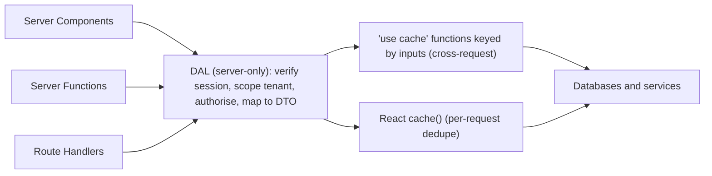

# 49 — Next.js Data, Mutations and Auth

> In the App Router, a form submission is a remote procedure call, a cache invalidation and a re-render in one round trip. That's a superpower, provided you remember that the procedure is public and the caller could be anyone.

**Prerequisites:** [18](18-react-server-components-and-server-functions.md), [26](26-forms-and-validation.md), [47](47-nextjs-app-router-architecture.md), [48](48-nextjs-rendering-and-caching.md) · **Related:** [44 RSC Security](44-rsc-security-threat-model.md) · [45 AuthN and AuthZ](45-authentication-and-authorization.md) · [30 Server State](30-server-state-and-data-fetching.md)

---

## TL;DR

- **Reads go through a Data Access Layer (DAL).** These are `server-only` modules that verify the session, scope by tenant, authorise, and return **DTOs**. Server Components call the DAL directly, never your own Route Handlers.
  - Deduplicate within a request with React `cache()`.
  - Reuse across requests with `'use cache'`.
  - Start fetches in parallel.
  - Pass promises down to `use()` where streaming helps.
- **Server Functions (Actions) are POST endpoints** with encrypted action IDs. Unused actions are removed from client bundles, and captured closure variables are encrypted. The framework checks `Origin` against `Host` and applies a 1 MB body limit by default. **Inside every action:** validate input, authenticate, authorise against the specific resource, and return minimal data.
- **One round trip does it all.** When an action calls `updateTag`, `revalidatePath`, `refresh`, sets cookies or redirects, the response carries both the return value and a freshly rendered RSC payload. `revalidateTag(tag, 'max')` is the exception: background refresh, no immediate re-render.
- **The client dispatches actions sequentially.** Don't `Promise.all` them from the client. Parallelise inside one action, or use Route Handlers for non-mutating requests.
- **Forms:**
  - `<form action={serverAction}>` (works before hydration).
  - `useActionState` for results and field errors.
  - `useFormStatus` for pending state.
  - `useOptimistic` for instant feedback.
  - `redirect()` after success, placed *after* cache updates.
- **Auth with Cache Components:**
  - Read the session in a DAL function marked `'use cache: private'`, so it's prefetchable and browser-only.
  - Keep session reads **inside Suspense**, never at the top of a layout.
  - Share the user through a context promise unwrapped with `use()`.
  - Cache session-derived data on the server keyed by user ID, with tags.
  - Use the proxy only for optimistic redirects.

---

## 1. Reads: the Data Access Layer



```ts
// server/dal/invoices.ts
import 'server-only';
import { cache } from 'react';
import { cacheLife, cacheTag } from 'next/cache';
import { getCurrentUser } from '@/server/auth';
import { can } from '@/server/authz';
import { db } from '@/server/db';

export type InvoiceSummaryDTO = { id: string; number: string; status: string; totalMinor: number; currency: string };

// Per-request dedupe: layout, page and generateMetadata can all call this without extra queries
export const getInvoice = cache(async (invoiceId: string) => {
  const user = await getCurrentUser();                        // authenticates (browser-cached, private)
  const invoice = await invoiceById(user.tenantId, invoiceId); // tenant-scoped, cross-request cache
  if (!invoice || !can(user, 'invoice:read', invoice)) return null;
  return toSummary(invoice);                                   // DTO: never the raw row
});

async function invoiceById(tenantId: string, invoiceId: string) {
  'use cache';
  cacheLife('minutes');
  cacheTag(`t:${tenantId}:invoice:${invoiceId}`);              // tenant is part of the key and the tag
  return db.invoice.findFirst({ where: { tenantId, id: invoiceId } });
}

function toSummary(row: { id: string; number: string; status: string; totalMinor: number; currency: string }): InvoiceSummaryDTO {
  return { id: row.id, number: row.number, status: row.status, totalMinor: row.totalMinor, currency: row.currency };
}
```

| Tool | Scope | Use for |
|---|---|---|
| React `cache()` | **One request** (one render pass) | Deduplicate the same lookup across layout, page, metadata and components |
| `'use cache'` | **Across requests**, by key, with lifetime and tags | Expensive or shared reads ([48](48-nextjs-rendering-and-caching.md)) |
| `'use cache: private'` | One user's browser | Session reads and per-user fragments in prefetches |
| Uncached | Every request | Data that must always be fresh, in Suspense |

### 1.1 Parallel and streamed reads

```tsx
// Start independent work early, await late: no server waterfalls
export default async function InvoicePage({ params }: { params: Promise<{ id: string }> }) {
  const { id } = await params;
  const invoicePromise = getInvoice(id);
  const activityPromise = getInvoiceActivity(id); // starts now, in parallel
  const invoice = await invoicePromise;
  if (!invoice) notFound();
  return (
    <>
      <InvoiceHeader invoice={invoice} />
      <Suspense fallback={<ActivitySkeleton />}>
        <ActivityFeed activityPromise={activityPromise} /> {/* a Client Component can use() the promise */}
      </Suspense>
    </>
  );
}
```

### 1.2 When the client should fetch

Server Components cover most reads. Client-side fetching (TanStack Query, [30](30-server-state-and-data-fetching.md)) still fits:

- Highly interactive views (filters on large datasets, polling dashboards).
- Infinite scrolling.
- Data refreshed on window focus.
- Real-time merges ([34](34-realtime-offline-and-collaboration.md)).

A common hybrid is to prefetch on the server, dehydrate into a `HydrationBoundary`, and let the query cache own updates afterwards. Choose one owner per piece of data ([28](28-state-and-data-ownership-architecture.md)).

---

## 2. How Server Functions work

| Property | Implication |
|---|---|
| A **POST to the page** that invokes it, addressed by an **encrypted action ID** | Anyone who can send that POST can call it. Treat every action as an untrusted entry point |
| **Dead-code elimination** | Actions not referenced by client code have no public endpoint |
| **Closure encryption** | Values captured by inline actions are encrypted before going to the client. Multi-instance deployments need a shared `NEXT_SERVER_ACTIONS_ENCRYPTION_KEY` ([50](50-nextjs-in-production.md)) |
| **CSRF check** | `Origin` must match `Host` / `X-Forwarded-Host`; configure `experimental.serverActions.allowedOrigins` behind proxies. Requests **without** an `Origin` header are allowed with a warning, so don't treat this as your only defence for state-changing endpoints reachable by non-browser clients |
| **Body limit** | 1 MB by default (`experimental.serverActions.bodySizeLimit`) |
| **Sequential client dispatch** | The client sends one action at a time. A second click waits for the first. Don't `Promise.all` actions from the client |
| **One round trip** | Return value + re-rendered RSC payload, when the action updates caches, refreshes, sets cookies or redirects |

---

## 3. Forms: progressive, validated, optimistic

```ts
// features/invoices/actions.ts
'use server';
import { z } from 'zod';
import { redirect } from 'next/navigation';
import { updateTag } from 'next/cache';
import { getCurrentUser } from '@/server/auth';
import { can } from '@/server/authz';
import { invoices } from '@/server/services';

const CreateInvoice = z.object({
  customerId: z.string().min(1, 'Choose a customer'),
  dueDate: z.iso.date({ error: 'Enter a valid due date' }),
  amount: z.coerce.number().positive('Amount must be greater than 0'),
});

export type CreateInvoiceState =
  | { status: 'idle' }
  | { status: 'error'; message?: string; fieldErrors: Partial<Record<keyof z.infer<typeof CreateInvoice>, string>>; values: Record<string, string> };

export async function createInvoice(_prev: CreateInvoiceState, formData: FormData): Promise<CreateInvoiceState> {
  const values = Object.fromEntries([...formData.entries()].map(([k, v]) => [k, String(v)]));
  const parsed = CreateInvoice.safeParse(values);
  if (!parsed.success) {
    const fieldErrors: Record<string, string> = {};
    for (const issue of parsed.error.issues) fieldErrors[String(issue.path[0])] ??= issue.message;
    return { status: 'error', fieldErrors, values };                // keep the user's input
  }

  const user = await getCurrentUser();                               // authenticate inside the action
  if (!can(user, 'invoice:create')) return { status: 'error', message: 'You can’t create invoices.', fieldErrors: {}, values };

  const invoice = await invoices.create(user.tenantId, {             // tenant from the session, never the form
    customerId: parsed.data.customerId,
    dueDate: parsed.data.dueDate,
    amountMinor: Math.round(parsed.data.amount * 100),
  });

  updateTag(`t:${user.tenantId}:invoices`);                          // read-your-writes for the list
  redirect(`/invoices/${invoice.id}`);                               // throws: keep it last
}
```

```tsx
// features/invoices/components/CreateInvoiceForm.tsx
'use client';
import { useActionState } from 'react';
import { useFormStatus } from 'react-dom';
import { createInvoice, type CreateInvoiceState } from '../actions';

const initial: CreateInvoiceState = { status: 'idle' };

export function CreateInvoiceForm() {
  const [state, formAction] = useActionState(createInvoice, initial);
  const errors = state.status === 'error' ? state.fieldErrors : {};
  const values = state.status === 'error' ? state.values : {};

  return (
    <form action={formAction} noValidate>
      {state.status === 'error' && state.message && <p role="alert">{state.message}</p>}

      <label htmlFor="customerId">Customer</label>
      <input id="customerId" name="customerId" defaultValue={values.customerId}
        aria-invalid={!!errors.customerId} aria-describedby={errors.customerId ? 'customerId-error' : undefined} />
      {errors.customerId && <p id="customerId-error">{errors.customerId}</p>}

      <label htmlFor="dueDate">Due date</label>
      <input id="dueDate" name="dueDate" type="date" defaultValue={values.dueDate}
        aria-invalid={!!errors.dueDate} aria-describedby={errors.dueDate ? 'dueDate-error' : undefined} />
      {errors.dueDate && <p id="dueDate-error">{errors.dueDate}</p>}

      <label htmlFor="amount">Amount (EUR)</label>
      <input id="amount" name="amount" inputMode="decimal" defaultValue={values.amount}
        aria-invalid={!!errors.amount} aria-describedby={errors.amount ? 'amount-error' : undefined} />
      {errors.amount && <p id="amount-error">{errors.amount}</p>}

      <SubmitButton />
    </form>
  );
}

function SubmitButton() {
  const { pending } = useFormStatus(); // the nearest parent <form>'s pending state
  return <button type="submit" aria-disabled={pending}>{pending ? 'Creating…' : 'Create invoice'}</button>;
}
```

What this gets right:

- **Works before JavaScript loads.** The form posts natively, and the action runs on the server.
- **Server-side validation is authoritative.** Client-side validation can be added for speed, but never replaces it ([26](26-forms-and-validation.md)).
- **Input survives failure.** Values come back in the state and refill the fields.
- **Accessible errors**, with `aria-invalid` and `aria-describedby` ([36](36-accessibility-engineering.md)).
- **Tenant and ownership come from the session**, never from form fields.
- **Cache update, then redirect**, all in a single round trip.

### 3.1 Actions from event handlers, with optimistic UI

```tsx
'use client';
import { useOptimistic, useTransition } from 'react';
import { toggleStar } from '../actions';

export function StarButton({ invoiceId, starred }: { invoiceId: string; starred: boolean }) {
  const [optimisticStarred, setOptimisticStarred] = useOptimistic(starred);
  const [isPending, startTransition] = useTransition();

  return (
    <button
      type="button"
      aria-pressed={optimisticStarred}
      onClick={() =>
        startTransition(async () => {
          setOptimisticStarred(!optimisticStarred); // instant feedback
          await toggleStar(invoiceId);             // server truth arrives with the response re-render
        })
      }
    >
      {optimisticStarred ? 'Starred' : 'Star'} {isPending && <span className="visually-hidden">(saving)</span>}
    </button>
  );
}
```

If the action throws, React reverts the optimistic value when the transition ends. Surface the failure (a toast, an inline message, an announcement) rather than silently snapping back ([36](36-accessibility-engineering.md)).

---

## 4. Choosing the cache update after a mutation

| Call | Immediate re-render in the action's response? | Use when |
|---|---|---|
| `updateTag(tag)` | **Yes**: the next read waits for fresh data | The user must see their own change (read-your-writes) |
| `revalidateTag(tag, 'max')` | **No**: background refresh | Others' views can converge shortly; the actor doesn't need the new value right now |
| `revalidatePath(path)` | Yes | One route changed and tagging is overkill |
| `refresh()` | Yes, without touching caches | The view depends on uncached state the action changed |
| Set or delete a cookie | Yes | Preferences, locale, theme, session changes |
| `redirect(url)` | Navigates and streams the destination | After create flows. Put cache updates **before** it, since `redirect` throws |

---

## 5. Security checklist for every action

- [ ] **Validate** `FormData` and arguments with a schema. Shape validation doesn't prove ownership.
- [ ] **Authenticate** in the action: `await getCurrentUser()` (or your session verifier).
- [ ] **Authorise** against the specific resource, loaded **by the session's tenant** ([45](45-authentication-and-authorization.md)).
- [ ] **Send references, not contents.** The client says *which* item and *what change*. The server re-reads ownership and current state.
- [ ] **Return minimal data.** Return values are serialised to the caller.
- [ ] **Rate-limit** expensive or abusable actions (per user and IP).
- [ ] **Step up** for destructive or sensitive actions (re-authentication, confirmation, audit) ([45](45-authentication-and-authorization.md)).
- [ ] **Audit** privileged actions in the service layer ([46](46-enterprise-saas-architecture.md)).
- [ ] **Export only actions** from `'use server'` files; helpers live in `server-only` modules ([44](44-rsc-security-threat-model.md)).

With `experimental.authInterrupts`, you can throw `unauthorized()` or `forbidden()` from actions and Server Components, and Next.js renders the matching `unauthorized.tsx` or `forbidden.tsx`.

---

## 6. Authentication with Cache Components

### 6.1 Read the user once, privately

```ts
// server/auth.ts
import 'server-only';
import { redirect } from 'next/navigation';
import { getSession } from './session'; // reads and verifies the session cookie (iron-session, Better Auth, …)
import { users } from './services';

export type CurrentUser = { id: string; name: string; tenantId: string; roles: string[] };

export async function getCurrentUser(): Promise<CurrentUser> {
  'use cache: private';        // may read cookies; cached only in this user's browser, so it's prefetchable
  const session = await getSession();
  if (!session.userId) redirect('/login');           // redirects throw, so they're never cached
  const user = await users.byId(session.userId);
  if (!user || user.disabled) redirect('/login');
  return { id: user.id, name: user.name, tenantId: user.tenantId, roles: user.roles }; // narrow DTO
}
```

### 6.2 Keep session reads inside Suspense

```tsx
// app/(app)/layout.tsx: the shell prerenders; only the user-dependent parts wait for the request
import { Suspense } from 'react';
import { AppNav } from '@/features/shell/AppNav';           // static or cached
import { UserMenu, UserMenuSkeleton } from '@/features/shell/UserMenu';

export default function AppLayout({ children }: { children: React.ReactNode }) {
  return (
    <div className="app-shell">
      <AppNav />
      <Suspense fallback={<UserMenuSkeleton />}>
        <UserMenu />                                          {/* calls getCurrentUser() inside the boundary */}
      </Suspense>
      <main id="main">{children}</main>
    </div>
  );
}
```

> [!WARNING]
> **Never `await getCurrentUser()` at the top level of a layout.** It holds the whole segment, including `{children}`, behind the request, and destroys the static shell. And a layout check doesn't protect child pages or actions anyway. Every DAL call authenticates on its own ([47](47-nextjs-app-router-architecture.md)).

### 6.3 Share the user with Client Components

```tsx
// features/shell/user-context.tsx
'use client';
import { createContext, use, type ReactNode } from 'react';
import type { CurrentUser } from '@/server/auth-types'; // type-only: no server code in the client bundle

const UserContext = createContext<Promise<CurrentUser> | null>(null);

export function UserProvider({ userPromise, children }: { userPromise: Promise<CurrentUser>; children: ReactNode }) {
  return <UserContext value={userPromise}>{children}</UserContext>;
}

export function useCurrentUser(): CurrentUser {
  const promise = use(UserContext);
  if (!promise) throw new Error('useCurrentUser must be used inside <UserProvider>');
  return use(promise); // suspends until resolved: keep consumers inside Suspense
}
```

Create the promise inside the Suspense boundary (`<UserProvider userPromise={getCurrentUser()}>`) without awaiting it. Each consumer resolves it behind its own boundary.

### 6.4 Session-derived data

```ts
// server/dal/my-invoices.ts: cache per user on the server, invalidate by tag
import 'server-only';
import { cacheLife, cacheTag } from 'next/cache';
import { getCurrentUser } from '@/server/auth';
import { db } from '@/server/db';

export async function getMyDraftInvoices() {
  const user = await getCurrentUser();             // private: reads cookies
  return draftsFor(user.tenantId, user.id);        // pass IDs into a shared cache scope
}

async function draftsFor(tenantId: string, userId: string) {
  'use cache';
  cacheLife('minutes');
  cacheTag(`t:${tenantId}:drafts:${userId}`);
  return db.invoice.findMany({ where: { tenantId, createdBy: userId, status: 'draft' } });
}
```

### 6.5 Where the proxy fits

```ts
// proxy.ts: optimistic redirect only, based on cookie presence (no database lookups here)
import { NextResponse, type NextRequest } from 'next/server';

const PUBLIC = ['/login', '/signup', '/forgot-password'];

export function proxy(request: NextRequest) {
  const { pathname, search } = request.nextUrl;
  const hasSession = request.cookies.has('__Host-session');
  if (!hasSession && !PUBLIC.some((p) => pathname.startsWith(p))) {
    const url = new URL('/login', request.url);
    url.searchParams.set('returnTo', pathname + search); // validated again on use (ch31)
    return NextResponse.redirect(url);
  }
}

export const config = { matcher: ['/((?!_next/static|_next/image|favicon.ico|api/webhooks).*)'] };
```

The real checks happen in `getCurrentUser()` and the DAL. The proxy just avoids rendering an app shell for visitors who obviously aren't signed in ([44](44-rsc-security-threat-model.md)).

### 6.6 Libraries and identity providers

| Approach | Notes |
|---|---|
| **Better Auth** (has maintained Auth.js/NextAuth.js since September 2025) | In-app auth with sessions, passkeys, organisations and SSO plugins |
| **Hosted identity** (Clerk, WorkOS, Auth0/Okta, Entra ID, Cognito) | Next.js SDKs with session helpers. Still wrap them in **your** `getCurrentUser()` DAL function so the rest of the app doesn't depend on the vendor |
| **OAuth to upstream APIs** | Next.js's server is your BFF. Store tokens server-side (an encrypted session store), refresh them in the DAL, and call APIs server-side. Never expose tokens to Client Components (RFC 10017, [33](33-api-integration-bff-and-contracts.md)) |

---

## 7. Route Handlers for external callers

```ts
// app/api/webhooks/billing/route.ts: signed, idempotent, cache-aware
import { revalidateTag } from 'next/cache';
import { verifyBillingSignature, alreadyProcessed, markProcessed } from '@/server/webhooks';

export async function POST(request: Request) {
  const raw = await request.text();
  const event = verifyBillingSignature(request.headers.get('billing-signature'), raw); // throws on mismatch
  if (await alreadyProcessed(event.id)) return Response.json({ ok: true }); // providers retry: be idempotent

  await markProcessed(event.id);
  if (event.type === 'invoice.paid') revalidateTag(`t:${event.tenantId}:invoice:${event.invoiceId}`, 'max');
  return Response.json({ ok: true });
}
```

Webhooks can't use `updateTag` (it's Server Actions only). Use `revalidateTag(tag, profile)`, or `{ expire: 0 }` when stale data must never be served ([48](48-nextjs-rendering-and-caching.md)).

---

## Decision framework

**Problem.** How should data flow into and out of a Next.js app, so it's fast, consistent after mutations, and secure by construction?

**Constraints.** Interactivity level, freshness expectations after user actions, auth model (in-app sessions or hosted identity, OAuth to upstream APIs), multi-tenancy, and deployment topology.

| Decision | Recommended default |
|---|---|
| Reads | DAL in `server-only` modules: authenticate, scope tenant, authorise, DTOs; `cache()` per request, `'use cache'` across requests |
| Mutations from your UI | Server Functions with schema validation, in-action authorisation, minimal returns |
| Forms | `<form action>` + `useActionState` + `useFormStatus`; optimistic UI where latency is noticeable |
| After a mutation | `updateTag` for read-your-writes; `revalidateTag(…, 'max')` for others; `refresh` for uncached state |
| Session | `getCurrentUser()` with `'use cache: private'`, read inside Suspense; context promise for Client Components |
| Proxy | Optimistic redirects only |
| External callers | Route Handlers: signed, idempotent, `revalidateTag` |
| Heavy client interactivity | TanStack Query with server prefetching; one owner per datum |

**Criteria.** Security (no bypassable checks), consistency after writes, latency (round trips, streaming), and simplicity (fewer layers).

**Failure modes.**
- Auth only in layouts or the proxy.
- Actions that trust form fields for tenant or owner IDs.
- Raw rows returned from actions.
- `Promise.all` over actions.
- `redirect()` before `updateTag`.
- Session reads at the top of layouts (no static shell).
- Duplicate data owners (server cache plus client store diverging).
- Webhooks without signature checks or idempotency.

**Migration path.** From API routes plus client fetching: build the DAL first, and move page reads into Server Components. Replace mutation endpoints that only your UI uses with Server Functions (keeping Route Handlers for external callers). Introduce `useActionState` forms. Adopt Cache Components and private session caching. Then remove client stores that duplicated server state ([64](64-migration-playbooks.md)).

---

## Pitfalls and anti-patterns

- `fetch('/api/invoices')` inside a Server Component (an extra hop, lost auth context, double serialisation).
- One giant `actions.ts` exporting helpers alongside actions.
- Throwing for expected validation errors (use return values; throw for unexpected failures).
- Using `useFormStatus` in the same component that renders the `<form>` (it reads the *parent* form's status).
- `disabled` submit buttons while pending (focus loss); prefer `aria-disabled` plus guard ([35](35-enterprise-design-system-architecture.md)).
- Optimistic updates without a visible failure path.
- Calling `revalidatePath('/', 'layout')` after every mutation.
- Wrapping a whole layout in `'use cache'` with user-specific children.
- Vendor auth SDK calls scattered across components instead of one DAL entry point.

---

## Architect's checklist

- [ ] DAL in `server-only` modules returns DTOs; every read authenticates, scopes by tenant and authorises
- [ ] `cache()` for per-request dedupe; `'use cache'` with tenant-aware keys and tags for cross-request caching
- [ ] Server Functions validate, authenticate, authorise per resource, return minimal data, and are rate-limited where needed
- [ ] `'use server'` files export only actions; `allowedOrigins`, body limits and encryption key configured for the topology
- [ ] Forms use `useActionState`, `useFormStatus` and accessible errors, and work before hydration
- [ ] Cache update policy per mutation (`updateTag`, `revalidateTag`, `refresh`, `revalidatePath`), with `redirect` last
- [ ] `getCurrentUser()` with `'use cache: private'`, read inside Suspense; user shared via a context promise
- [ ] Proxy limited to optimistic redirects; webhooks signed and idempotent

---

## Interview angles

**Q1. How do Server Actions work, and what are the security implications?**
At build time, `'use server'` functions are replaced in client bundles by references (an encrypted action ID plus a dispatcher) that POST back to the page. Next.js removes unused actions, encrypts captured closure variables, compares `Origin` with `Host` for CSRF, and caps body size. But anyone who can send that POST can call the action, so each one must validate input, authenticate, authorise against the specific resource (loaded by the session's tenant), and return minimal data. Render-time gating isn't a security boundary.

**Q2. How do you structure authentication in an App Router app with Cache Components?**
Put a single `getCurrentUser()` in a server-only DAL. It reads and verifies the session, is marked `'use cache: private'` (browser-only and prefetchable), redirects when there's no valid session, and returns a narrow DTO. Call it inside Suspense boundaries, never at the top of layouts, so the static shell survives. Share the user with Client Components through a context promise and `use()`. Cache session-derived data on the server by passing user and tenant IDs into `'use cache'` functions with tags. Use the proxy only for optimistic redirects, and authorise in every action and DAL read.

**Q3. Design a create-invoice form with progressive enhancement, validation and good UX.**
A Server Function receives `FormData`, validates with Zod, and returns field errors along with the submitted values, so nothing is lost. It authenticates and authorises, takes tenant and owner from the session, creates the invoice, calls `updateTag` for the list, then `redirect`s to the new invoice. The client uses `<form action={formAction}>` from `useActionState`, so it works before hydration, with accessible error wiring and a `useFormStatus` submit button. Add an idempotency key if double submits are costly ([33](33-api-integration-bff-and-contracts.md)).

**Q4. Why shouldn't you `Promise.all` Server Actions from the client?**
Next.js's client dispatcher sends actions one at a time per client, so the re-rendered server tree stays consistent with the action that produced it. A `Promise.all` just queues them. If you need parallel work, do it inside one action (where you can run `Promise.all` on the server), fetch in parallel in Server Components, or use Route Handlers for non-mutating requests.

**Q5. After a mutation, `updateTag` or `revalidateTag`?**
`updateTag` when the acting user must immediately see the result: the tag expires now, and the action's response includes a re-render that waits for fresh data. `revalidateTag(tag, 'max')` when eventual consistency is fine: stale-while-revalidate, with no immediate re-render in the response. That's typical for webhooks and for other users' views. `updateTag` only works in Server Actions.

---

## Further reading

- Next.js docs, *Mutating data*: <https://nextjs.org/docs/app/getting-started/mutating-data> · *Server Actions guide*: <https://nextjs.org/docs/app/guides/server-actions>
- Next.js docs, *Data security*: <https://nextjs.org/docs/app/guides/data-security> · *Authentication*: <https://nextjs.org/docs/app/guides/authentication>
- Next.js docs, *Authentication with Cache Components*: <https://nextjs.org/docs/app/guides/authentication-with-cache-components>
- Next.js docs, *Forms*: <https://nextjs.org/docs/app/guides/forms> · *Backend for Frontend*: <https://nextjs.org/docs/app/guides/backend-for-frontend>
- React docs, *`useActionState`*, *`useFormStatus`*, *`useOptimistic`*: <https://react.dev/reference/react>
- React docs, *`cache`*: <https://react.dev/reference/react/cache>

---

[← Previous: 48 — Next.js Rendering and Caching](48-nextjs-rendering-and-caching.md) · [Index](README.md) · [Next: 50 — Next.js in Production →](50-nextjs-in-production.md)
