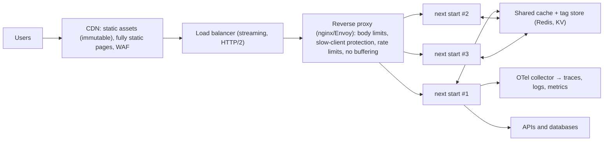
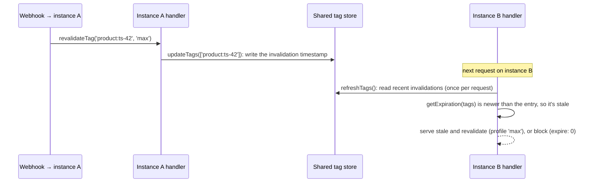

# 50 — Next.js in Production

> Next.js's rendering model puts static and dynamic content in the same response. That's why the app is fast, and it's also why the platform under it has to stream, share caches, coordinate invalidations and survive deploys without confusing the browsers that are still running last week's code.

**Prerequisites:** [47](47-nextjs-app-router-architecture.md), [48](48-nextjs-rendering-and-caching.md), [49](49-nextjs-data-mutations-and-auth.md) · **Related:** [40 Resilience](40-resilience-and-reliability.md) · [41 Observability](41-observability-and-diagnostics.md) · [44 RSC Security](44-rsc-security-threat-model.md) · [62 CI/CD](62-cicd-release-engineering-and-feature-flags.md)

---

## TL;DR

- **Know your fidelity.** A platform has *functional fidelity* when every feature works (the open adapter test suite is the contract), and *performance fidelity* when features hit their best performance (a PPR shell at CDN latency, ISR propagation in under a second). Any Node.js server running `next start` is functionally complete. Performance fidelity depends on platform integration.
- **Deployment options:**
  - **Vercel**.
  - **Platform adapters** built on the public Deployment Adapter API (*verified* adapters are open source and run the compatibility suite).
  - **Self-hosting** with `next start` or a Docker `standalone` build.
  - **Static export** for apps that need no server features.
- **Multi-instance essentials:**
  1. One `NEXT_SERVER_ACTIONS_ENCRYPTION_KEY` shared by every instance.
  2. A `deploymentId`, for skew protection and cache busting.
  3. A shared cache (`cacheHandlers`, for `'use cache'` and `'use cache: remote'`).
  4. **Tag coordination** (`updateTags`, `refreshTags`, `getExpiration`), so `revalidateTag` reaches every instance.
  5. **Streaming end to end** (no buffering proxies).
  6. **Graceful shutdown** (10–30 s drain for in-flight requests and `after()` callbacks).
- **Version skew:** with a `deploymentId`, a client and server mismatch triggers a hard navigation. Immutable static assets (16.3+) let unchanged chunks survive across deploys. Keep old assets reachable regardless ([40](40-resilience-and-reliability.md)).
- **Caches are per deployment** (the build ID or deployment ID is in every key), so plan for cold starts after each release.
- **Security operations:**
  - Stay at or above the floors (16.4.5+ / 15.5.29+) and track the scheduled security releases (since July 2026).
  - Put a reverse proxy in front of self-hosted servers.
  - Rehearse emergency upgrades. `next upgrade --agent` (16.4) automates the mechanics but not the review.
- **Operate it like a backend:** `instrumentation.ts` with `onRequestError` and OpenTelemetry, RUM with `useReportWebVitals` or `web-vitals`, per-route SLOs, canaries, and rollback.

---

## 1. Deployment options

| Option | What you get | What you run | Good for |
|---|---|---|---|
| **Vercel** | Full functional and performance fidelity, managed CDN and PPR shells, skew protection, WAF, preview deployments | Nothing below the app | Teams who want to ship product, not platform |
| **Platform adapters** (Netlify, Cloudflare, AWS and others) | Feature support that depends on the adapter. *Verified* adapters are open source and run the Next.js compatibility suite | Your platform account and configuration | Organisations standardised on another cloud or CDN |
| **Self-hosted Node** (`next start`, Docker `standalone`) | Every feature works in one process. Performance fidelity is what you build: CDN, shared cache, tag coordination | Containers, load balancers, CDN, cache store, observability | Regulated environments, on-premises, cost control at scale |
| **Static export** (`output: 'export'`) | HTML, CSS and JS files only | Any static host | Content sites and SPAs without Server Components that need a server, Server Functions, proxy, ISR or on-demand image optimisation |

### 1.1 What each feature needs from the platform

| Feature | Streaming | Shared cache | Edge stitching | Notes |
|---|---|---|---|---|
| Server Components | Required | — | — | Basic streaming support |
| ISR (time-based) | — | Recommended | — | Works per instance without a shared cache |
| ISR (on-demand) | — | Recommended | — | Tag propagation needs a shared cache across instances |
| Partial prerendering / static shells | Required | Recommended | Optional | Serving the shell at CDN latency needs platform integration |
| Cache Components (`'use cache'`) | Required | Recommended | — | A shared cache gives cross-instance consistency |
| Proxy | — | — | — | Runs at the edge or origin |
| Server Functions | Required | — | — | POST requests with a streaming response |
| `after()` | — | — | — | Requires graceful shutdown |

---

## 2. Self-hosting reference architecture



### 2.1 Build and image

```dockerfile
# Dockerfile: standalone output, small image, non-root, graceful shutdown
FROM node:24-slim AS deps
WORKDIR /app
COPY package.json pnpm-lock.yaml ./
RUN corepack enable && pnpm install --frozen-lockfile

FROM node:24-slim AS build
WORKDIR /app
COPY --from=deps /app/node_modules ./node_modules
COPY . .
ARG NEXT_DEPLOYMENT_ID
ARG NEXT_SERVER_ACTIONS_ENCRYPTION_KEY
ENV NEXT_DEPLOYMENT_ID=$NEXT_DEPLOYMENT_ID \
    NEXT_SERVER_ACTIONS_ENCRYPTION_KEY=$NEXT_SERVER_ACTIONS_ENCRYPTION_KEY \
    NEXT_TELEMETRY_DISABLED=1
RUN corepack enable && pnpm build   # next.config: output: 'standalone'

FROM node:24-slim AS run
WORKDIR /app
ENV NODE_ENV=production PORT=3000 HOSTNAME=0.0.0.0
RUN groupadd --system app && useradd --system --gid app app
COPY --from=build --chown=app:app /app/.next/standalone ./
COPY --from=build --chown=app:app /app/.next/static ./.next/static
COPY --from=build --chown=app:app /app/public ./public
USER app
EXPOSE 3000
STOPSIGNAL SIGTERM
CMD ["node", "server.js"]
```

> [!WARNING]
> **Build-time secrets.** `NEXT_SERVER_ACTIONS_ENCRYPTION_KEY` is embedded in the build output, so every instance built from the same artefact shares it. Pass it as a build secret (not a plain build argument that ends up in image history) in real pipelines, rotate it deliberately, and never use a different key per instance of the same deployment.

### 2.2 Production configuration

```ts
// next.config.ts
import type { NextConfig } from 'next';

const nextConfig: NextConfig = {
  output: 'standalone',
  deploymentId: process.env.NEXT_DEPLOYMENT_ID,   // skew protection + cache busting
  cacheComponents: true,
  partialPrefetching: true,
  poweredByHeader: false,
  cacheHandlers: {
    default: require.resolve('./cache-handlers/shared.js'),   // 'use cache'
    remote: require.resolve('./cache-handlers/shared.js'),    // 'use cache: remote'
  },
  images: {
    remotePatterns: [{ protocol: 'https', hostname: 'images.acme.dev' }], // never a wildcard host
  },
  experimental: {
    serverActions: {
      allowedOrigins: ['store.acme.com'], // the public host, if the proxy doesn't forward x-forwarded-host
      bodySizeLimit: '1mb',
    },
  },
  async headers() {
    return [{
      source: '/:path*',
      headers: [
        { key: 'Strict-Transport-Security', value: 'max-age=63072000; includeSubDomains; preload' },
        { key: 'X-Content-Type-Options', value: 'nosniff' },
        { key: 'Referrer-Policy', value: 'strict-origin-when-cross-origin' },
      ],
    }]; // CSP with nonces is set per request in proxy.ts (ch43)
  },
};

export default nextConfig;
```

### 2.3 Streaming through proxies

```nginx
# nginx in front of next start: don't buffer streamed responses
location / {
  proxy_pass http://next_upstream;
  proxy_http_version 1.1;
  proxy_set_header Host $host;
  proxy_set_header X-Forwarded-Host $host;
  proxy_set_header X-Forwarded-Proto $scheme;
  proxy_buffering off;            # or have the app send X-Accel-Buffering: no
  client_max_body_size 2m;        # keep request bodies bounded
}
```

Check every hop: some load balancers and serverless integrations buffer responses by default. Without streaming, the static shell and the dynamic content arrive together after the whole render, so you lose the time-to-first-byte advantage.

---

## 3. Shared cache and tag coordination

By default `'use cache'` entries live in an in-memory LRU per instance, and `revalidateTag()` on one instance only invalidates that instance. With several instances you need a cache handler that coordinates:



| Method | Called when | Your handler should |
|---|---|---|
| `get(cacheKey, softTags)` | A cached function runs | Return the entry, or `undefined` if missing or expired by its tags |
| `set(cacheKey, pendingEntry)` | A new result is produced | Await the entry, buffer its stream, and store value, tags and timing |
| `updateTags(tags, durations)` | `revalidateTag` / `updateTag` runs | Write invalidation timestamps to shared storage |
| `refreshTags()` | Once per request, before the first read | Sync recent invalidations from shared storage into local state |
| `getExpiration(tags)` | During reads | Return the latest invalidation timestamp for the tags |

Start from the documented examples (or a maintained community handler), load-test it, and alert on handler errors. A broken cache handler shows up as stale data or origin overload, not as exceptions. `'use cache: private'` never uses handlers (it lives in the browser).

> [!NOTE]
> **Every deploy starts cold.** Cache keys include the build or deployment ID, so even remote entries don't carry over. Warm critical routes after deploy (a crawl of top URLs), and watch TTFB and origin load during rollout ([48](48-nextjs-rendering-and-caching.md)).

---

## 4. Version skew and rollouts

| Mechanism | Behaviour |
|---|---|
| **`deploymentId`** (`next.config` or `NEXT_DEPLOYMENT_ID`) | Static asset URLs get `?dpl=<id>`. Navigation requests send `x-deployment-id`, responses send `x-nextjs-deployment-id`, and `<html data-dpl-id>` is set. On a mismatch the client does a **hard navigation** instead of a client navigation |
| **Immutable static assets** (16.3+) | Content-addressed chunks are served without `?dpl`, so browsers keep them across deploys and unchanged files needn't be re-uploaded. It's an adapter capability (`supportsImmutableAssets`) |
| **Keep old assets** | Even with skew protection, keep previous deployments' assets reachable for a retention window. Long-lived tabs lazy-load old chunks ([40](40-resilience-and-reliability.md)) |
| **Server Functions across deploys** | Action IDs are build-specific. Skew protection reloads the page on mismatch, so unsaved form state is lost unless it was persisted (drafts, URL state) |

Rollout practice ([62](62-cicd-release-engineering-and-feature-flags.md)):

- **Canary by percentage** (or by internal users), comparing error rates, INP, LCP and journey success between canary and control.
- **Automatic rollback** on SLO burn ([41](41-observability-and-diagnostics.md)).
- **Feature flags** decouple deploy from release, which matters more when every deploy also resets caches.

### 4.1 Graceful shutdown

```yaml
# Kubernetes: let in-flight requests and after() callbacks finish
spec:
  terminationGracePeriodSeconds: 30
  containers:
    - name: web
      lifecycle:
        preStop:
          exec:
            command: ["sleep", "5"]   # give the load balancer time to stop routing here
```

On `SIGTERM`, the Next.js server finishes in-flight requests and runs pending `after()` callbacks before exiting. Allow a 10–30 second drain period.

---

## 5. CDN behaviour

| Response | `Cache-Control` from Next.js | CDN treatment |
|---|---|---|
| Fully static page | `public` with cache lifetimes | Cache it at the edge |
| Page that accessed dynamic APIs | `private` | Don't cache. Personalised content must never be stored in shared caches |
| `/_next/static/*` assets | Long-lived, immutable | Cache forever. Keep old files available |
| Optimised images (`/_next/image`) | Per the image config (`minimumCacheTTL`) | Cache. Restrict `remotePatterns` to avoid becoming an open image proxy |

Serving the **static shell from the CDN while resuming the dynamic render at the origin** requires platform-specific work (edge compute plus storage). Most CDNs have the primitives (Cloudflare Workers, Akamai EdgeWorkers, CloudFront with Lambda@Edge, Fastly Compute and others), but end-to-end shell resumption is still emerging outside managed platforms. Without it, shells come from the origin. That's still fast with streaming, but not CDN-fast ([32](32-rendering-strategy-architecture.md)).

---

## 6. Builds and CI

| Practice | Detail |
|---|---|
| **Turbopack builds** (the default since 16.0) | Enable the filesystem cache for builds (16.3+), and persist `.next/cache` between CI runs |
| **Type checking** | `next build` type-checks. 16.3+ can use TypeScript 7 for much faster checks. Run `next typegen` in CI for `PageProps` and `typedRoutes` |
| **Bundle budgets** | The bundle analyser per route, plus size budgets in CI ([39](39-web-performance-and-core-web-vitals.md), [60](60-monorepos-build-tooling-and-bundlers.md)) |
| **Preview deployments** | Every PR gets a deployment. E2E and `instant()` navigation tests run against it ([42](42-testing-architecture.md)) |
| **Reproducible builds** | Pinned Node and package manager versions, frozen lockfiles, install scripts off by default ([43](43-frontend-security-architecture.md)) |
| **Agent context** | Next.js writes version-matched docs instructions into `AGENTS.md` for coding agents (`agentRules`, on by default). Keep it under review like any generated file |

---

## 7. Observability in production

| Signal | How |
|---|---|
| **Server errors** | `instrumentation.ts`: `onRequestError(error, request, context)` with `routePath`, `routeType` (`render`, `route`, `action`, `proxy`) and `renderSource` ([47](47-nextjs-app-router-architecture.md)) |
| **Traces** | OpenTelemetry registered in `register()`. Next.js emits spans for rendering, fetch and route handlers. Propagate `traceparent` from the browser ([41](41-observability-and-diagnostics.md)) |
| **RUM** | `useReportWebVitals` or `web-vitals` with attribution and soft navigations ([39](39-web-performance-and-core-web-vitals.md)) |
| **Cache health** | Hit ratio, handler latency and errors, origin load after deploys |
| **Server Function health** | Error rate, latency and payload sizes per action (useful for spotting DoS attempts, [44](44-rsc-security-threat-model.md)) |
| **Release correlation** | Deployment ID on every log, trace and RUM beacon |

---

## 8. Security operations

| Practice | Detail |
|---|---|
| **Floors** | Next.js **16.4.5+** or **15.5.29+**. 13.x and 14.x are end-of-life. Next.js vendors its own React server packages, so you patch by upgrading Next.js ([44](44-rsc-security-threat-model.md)) |
| **Release cadence** | Next.js publishes **scheduled security releases** (since July 2026), plus out-of-band releases for critical issues. Put them on the calendar, and pre-approve the upgrade path |
| **Upgrade automation** | `next upgrade --agent` (16.4) hands the upgrade (codemods plus follow-up fixes) to a coding agent. `experimental.agentUpgrade` selects the default policy (`security` by default) and controls upgrade reminders in `next dev` and `next build`. Review the result like any other PR |
| **Reverse proxy** | For self-hosted servers: request size limits, slow-client protection, rate limiting and malformed-request handling in front of Node |
| **Image optimisation** | Exact `remotePatterns`; on glibc Linux, configure sharp's memory allocator to prevent memory growth; keep the image cache bounded |
| **Secrets** | Server-only environment variables; build-time public variables reviewed. The encryption key is handled as a secret |
| **WAF** | Managed rules for known framework CVEs as a bridge while patching |

---

## 9. Production readiness checklist

| Area | Check |
|---|---|
| Rendering | Suspense placed for page loads and navigations; no blocking-route insights; `instant` validation clean for key routes |
| Caching | Lifetimes and tags documented; shared handler and tag coordination for multi-instance; warm-up plan |
| Data | DAL with DTOs; Server Functions validate and authorise ([49](49-nextjs-data-mutations-and-auth.md)) |
| Skew | `deploymentId` set; old assets retained; drafts protect long forms |
| Infrastructure | Streaming verified end to end; graceful shutdown; health checks; autoscaling on CPU and concurrency |
| Security | Floors met; CSP and headers; `allowedOrigins`; body limits; image `remotePatterns`; WAF |
| Observability | `onRequestError`, traces, RUM, cache metrics, deployment ID tagging, SLOs and alerts |
| SEO | Metadata, sitemaps, `robots`; crawlers tested against `htmlLimitedBots` behaviour |
| Performance | Bundle budgets; Lighthouse CI; RUM baselines per route |
| Accessibility | axe and keyboard E2E on key journeys ([36](36-accessibility-engineering.md)) |

---

## Decision framework

**Problem.** Where and how should we run Next.js so every feature works, performance is predictable, and releases and security patches are routine?

**Constraints.** Compliance (data residency, on-premises), the team's platform capacity, traffic shape (spiky, global), budget, and existing cloud or CDN commitments.

| Situation | Recommended default |
|---|---|
| Product team, no platform team | A managed platform with full fidelity (Vercel, or a verified adapter on your cloud) |
| Standardised on a cloud or CDN | A verified adapter for that platform; confirm its fidelity for the features you use |
| Regulated or on-premises | Self-hosted `standalone` containers + reverse proxy + shared cache with tag coordination + CDN for static assets |
| Content only, no server features | Static export on any CDN |
| Multiple instances (any option) | Shared encryption key, `deploymentId`, shared cache handler, streaming everywhere, graceful shutdown |

**Criteria.** Feature fidelity (functional and performance), operational load, cost per request, patch speed, and observability depth.

**Failure modes.**
- Per-instance encryption keys ("Failed to find Server Action").
- No tag coordination (some users see stale data indefinitely).
- Buffering proxies (no streaming).
- Deleting old assets on deploy.
- Exposing `next start` directly to the internet.
- Open image optimisation proxies.
- No warm-up after deploys.
- Patching React in the lockfile instead of upgrading Next.js.

**Migration path.** From a single server: add a CDN for assets. Externalise the cache with tag coordination before scaling out. Set `deploymentId` and the shared encryption key. Verify streaming through every hop. Add canary releases and SLO-based rollback. Then evaluate CDN shell resumption, if your platform supports it.

---

## Pitfalls and anti-patterns

- Running several instances with the default in-memory cache and expecting `revalidateTag` to propagate.
- Building a separate Docker image per environment (different keys and IDs per environment can break assumptions; promote one artefact).
- Health checks that hit expensive dynamic pages.
- `output: 'export'` chosen for "simplicity", then rewritten when server features are needed.
- Setting `supportsImmutableAssets` when the adapter doesn't support it (broken deployments).
- Treating `next upgrade --agent` as a substitute for reviewing changes.
- Ignoring memory growth in image optimisation on glibc systems.
- One shared cache store with no tenant scoping in keys or tags ([46](46-enterprise-saas-architecture.md)).

---

## Architect's checklist

- [ ] Deployment option chosen with explicit functional and performance fidelity per feature
- [ ] Encryption key shared across instances and handled as a secret; `deploymentId` set per release
- [ ] Shared cache handlers with tag coordination (`updateTags`, `refreshTags`, `getExpiration`), tested under load
- [ ] Streaming verified through CDN, load balancer and reverse proxy
- [ ] Graceful shutdown with a drain period; health checks are cheap
- [ ] Old static assets retained; skew behaviour tested (hard navigation, drafts preserved)
- [ ] CDN rules respect `public` and `private`; images restricted to exact `remotePatterns`
- [ ] Observability: `onRequestError`, OTel traces, RUM, cache and Server Function metrics, deployment tagging
- [ ] Security floors met; scheduled security releases on the calendar; emergency upgrade drill done
- [ ] Production readiness checklist reviewed before launch and after major upgrades

---

## Interview angles

**Q1. What do you need to run Next.js on multiple instances correctly?**
One Server Actions encryption key shared by all instances (otherwise actions encrypted by one instance fail on another). A `deploymentId` for skew protection. A shared cache handler for `'use cache'` entries, with tag coordination: `updateTags` writes invalidations to shared storage, `refreshTags` syncs them per request, and `getExpiration` decides staleness. Streaming through every proxy. And graceful shutdown so in-flight requests and `after()` callbacks finish.

**Q2. How does Next.js handle version skew during rolling deployments?**
With a `deploymentId`, asset URLs carry `?dpl=…`, navigation requests send `x-deployment-id`, and responses send `x-nextjs-deployment-id`. When the client sees a mismatch it does a hard navigation instead of a client navigation, so it never mixes old and new assets or Server Function IDs. Immutable content-addressed assets (16.3+) let unchanged chunks survive deploys. You should still keep old assets available and persist important form state, because a hard reload loses in-memory state.

**Q3. Functional fidelity vs performance fidelity?**
Functional fidelity means every Next.js feature works correctly on a platform. It's binary, and measured by the public adapter test suite: a plain Node.js server passes. Performance fidelity is how well features achieve their intended performance: a PPR shell served from the CDN, ISR revalidation propagating globally in under a second, durable shared caches. It's a spectrum, and it's where platforms differ.

**Q4. A self-hosted Next.js app shows stale product data on some requests after a webhook revalidation. Diagnose it.**
Multiple instances with per-instance caches: `revalidateTag` ran on the instance that received the webhook, and the others never heard about it. Implement or adopt a cache handler with shared storage and tag coordination (`updateTags`, `refreshTags`, `getExpiration`). Confirm the webhook uses `revalidateTag(tag, profile)` with the intended staleness. Check that CDN-cached pages aren't serving older HTML. Then add monitoring of cache handler errors and revalidation latency.

**Q5. How do you keep a fleet of Next.js apps patched?**
Inventory every app with its Next.js version (an SBOM or build-info endpoint), not just its lockfile's React packages, because Next.js vendors its own. Track the scheduled security releases, pre-approve the upgrade path, and automate the mechanics (Renovate, `next upgrade --agent`) with CI gates and canaries. Bridge critical issues with WAF rules, and rehearse the emergency path quarterly ([44](44-rsc-security-threat-model.md)).

---

## Further reading

- Next.js docs, *Deploying*: <https://nextjs.org/docs/app/getting-started/deploying> · *Deploying to platforms*: <https://nextjs.org/docs/app/guides/deploying-to-platforms>
- Next.js docs, *Self-hosting*: <https://nextjs.org/docs/app/guides/self-hosting> · *Production checklist*: <https://nextjs.org/docs/app/guides/production-checklist>
- Next.js docs, *Rendering philosophy* (functional vs performance fidelity): <https://nextjs.org/docs/app/guides/rendering-philosophy>
- Next.js docs, *cacheHandlers*: <https://nextjs.org/docs/app/api-reference/config/next-config-js/cacheHandlers> · *How revalidation works*: <https://nextjs.org/docs/app/guides/how-revalidation-works>
- Next.js docs, *deploymentId*: <https://nextjs.org/docs/app/api-reference/config/next-config-js/deploymentId> · *Adapters*: <https://nextjs.org/docs/app/api-reference/adapters>
- Next.js docs, *Upgrading with an agent*: <https://nextjs.org/docs/app/guides/upgrading/agent-upgrade>
- Next.js security advisories: <https://github.com/vercel/next.js/security/advisories>

---

[← Previous: 49 — Next.js Data, Mutations and Auth](49-nextjs-data-mutations-and-auth.md) · [Index](README.md) · [Next: 51 — React Router v8 in Framework Mode →](51-react-router-v8-framework-mode.md)
