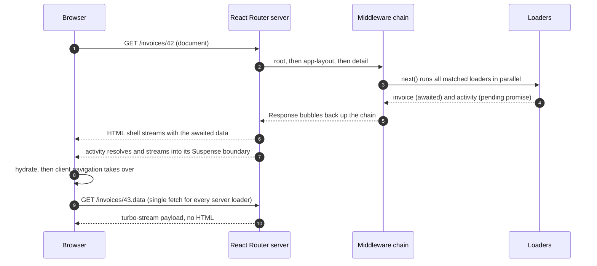
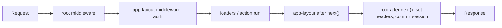
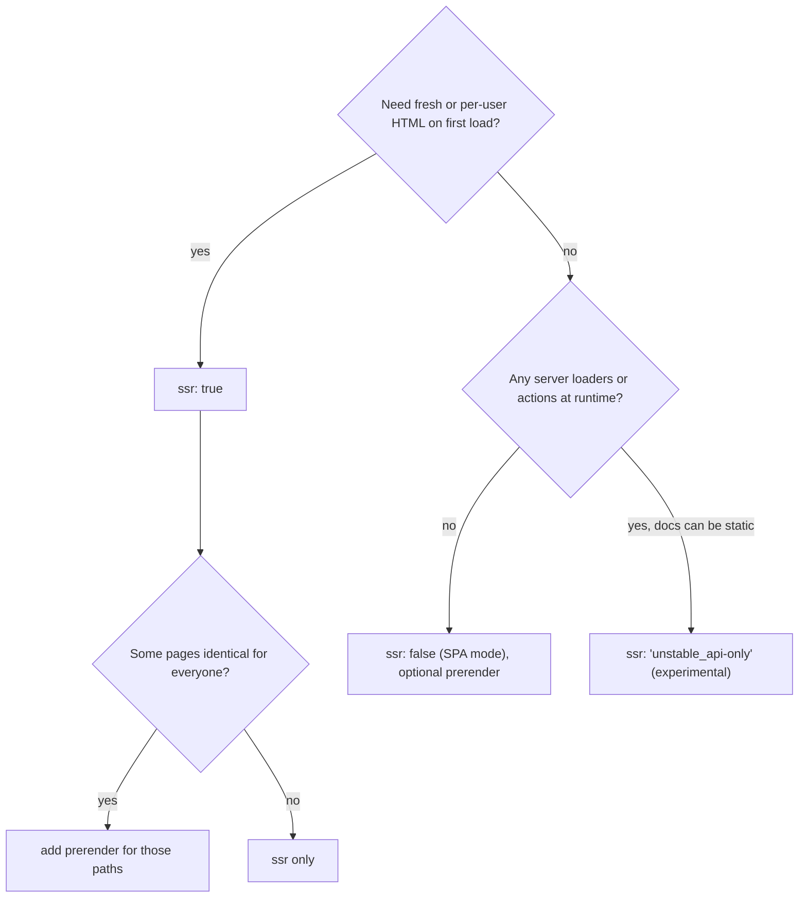
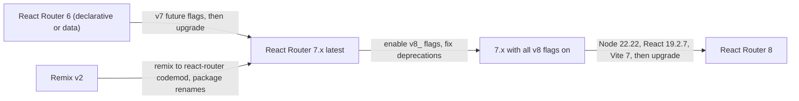

# 51 — React Router v8 in Framework Mode

> React Router started as a component that matched URLs. It is now a framework that decides what runs on the server before a request reaches your code, when data loads, how forms submit and what reloads afterwards. The URL is still at the center of all of it, and that is why the design holds up.

**Prerequisites:** [31 Routing](31-routing-architecture.md), [17 SSR and Streaming](17-ssr-streaming-and-hydration.md), [26 Forms](26-forms-and-validation.md) · **Related:** [32 Rendering Strategy](32-rendering-strategy-architecture.md) · [43 Security](43-frontend-security-architecture.md) · [45 Auth](45-authentication-and-authorization.md) · [52 TanStack Start](52-tanstack-start-and-router.md) · [54 Choosing a Framework](54-choosing-a-react-framework.md) · [64 Migrations](64-migration-playbooks.md)

---

## TL;DR

- **React Router is where Remix went.** Remix v2 merged into React Router v7 (Nov 2024) as *framework mode*. v8 shipped on 17 June 2026, and React Router 6 and Remix v2 are end-of-life. **Remix 3 is a different, non-React framework**, so a "Remix app" in a React codebase means React Router.
- **Three modes, one package.**
  - *Declarative*: `<BrowserRouter>`, routing only.
  - *Data*: `createBrowserRouter`, with loaders and actions in the browser.
  - *Framework*: a Vite plugin, `routes.ts`, route modules, generated types, and SSR, SPA or prerendering.
- **What v8 changed:**
  - ESM-only.
  - Middleware is always on, and `context` is a `RouterContextProvider`.
  - `react-router-dom` is gone.
  - `meta` receives `loaderData`.
  - Loaders get the raw request, plus `url` for the normalised URL.
  - Route-module splitting is on by default.
  - Minimums: Node 22.22+, React 19.2.7+, Vite 7+.
- **The architecture in one line:** URL → match → middleware → loaders in parallel → render (streaming what's still pending). Every mutation goes through an `action` and is followed by automatic revalidation. Forms work before JavaScript loads.
- **Enforce auth in middleware, not in parent loaders.** Loaders run in parallel, so a parent loader can't protect a child.
- **Security defaults:**
  - Built in: an `Origin` check on UI-route actions (`allowedActionOrigins`).
  - Not covered: requests *without* an `Origin` header, and resource routes.
  - Yours to configure: CSP nonces through `<ServerRouter nonce>` and SRI through `subResourceIntegrity`.
- **RSC support is experimental** (`unstable_reactRouterRSC` with `@vitejs/plugin-rsc`). In 2026, React Router's production story is loaders and actions. If server components are your requirement, see [47](47-nextjs-app-router-architecture.md).

---

## 1. React Router in 2026

### 1.1 Lineage

| Release | Date | What it meant |
|---|---|---|
| v6.4 | Sep 2022 | Data APIs (loaders, actions, `createBrowserRouter`) come to React Router from Remix |
| v7 | Nov 2024 | Remix v2 merges in as *framework mode*; `react-router-dom` reduced to a re-export |
| v8 | 17 Jun 2026 | ESM-only, middleware always on, `react-router-dom` removed, new minimums; RR6 and Remix v2 EOL |
| 8.5 | Oct 2026 | React Router view-transition APIs deprecated in favour of React's `<ViewTransition>` (React 19.3+) |

Majors are now yearly and governance is open. Read the changelog before each minor, though: the `unstable_` surface moves quickly (see section 12).

### 1.2 The three modes

| Mode | Entry point | You get | Choose it when |
|---|---|---|---|
| **Declarative** | `<BrowserRouter>` + `<Routes>` | Matching, links, params, navigation | Routing in an existing app that owns its own data layer |
| **Data** | `createBrowserRouter` + `<RouterProvider>` | Loaders, actions, fetchers, pending UI, error boundaries, all in the browser | A client-rendered SPA that wants the data model without a server or build plugin |
| **Framework** | Vite plugin + `routes.ts` + route modules | Everything in Data mode, plus SSR/SPA/prerender, server loaders and actions, middleware, typegen, code splitting, resource routes | New full-stack React apps, and Remix v2 apps |

The modes form a ladder, not three products. A team can go from Declarative to Data to Framework by moving route definitions and data code without rewriting components ([64](64-migration-playbooks.md)).

---

## 2. Anatomy of a framework-mode app

```text
app/
  root.tsx                     # document Layout, root ErrorBoundary, client middleware
  routes.ts                    # the route tree, as data
  context.ts                   # typed request context (createContext)
  entry.server.tsx             # optional: CSP nonce, handleError, instrumentations
  routes/
    home.tsx  pricing.tsx  login.tsx
    app-layout.tsx             # pathless layout: auth middleware + shell
    invoices/index.tsx         # list: search params, fetchers
    invoices/detail.tsx        # loader + action + streaming
    preferences.tsx            # clientLoader + HydrateFallback
    api.webhooks.billing.ts    # resource route: no component
  server/*.server.ts           # server-only modules (.server = never bundled for the client)
react-router.config.ts
vite.config.ts
```

The config and route tree are both plain TypeScript:

```ts
// react-router.config.ts
import type { Config } from '@react-router/dev/config';

export default {
  ssr: true,                       // server rendering at runtime (set false for SPA mode)
  prerender: ['/', '/pricing'],    // plus static HTML for marketing pages at build time
} satisfies Config;
```

```ts
// app/routes.ts: the route tree is configuration, not a folder convention
import { type RouteConfig, index, layout, prefix, route } from '@react-router/dev/routes';

export default [
  index('routes/home.tsx'),
  route('pricing', 'routes/pricing.tsx'),
  route('login', 'routes/login.tsx'),
  layout('routes/app-layout.tsx', [                 // pathless layout: auth middleware + shell
    ...prefix('invoices', [
      index('routes/invoices/index.tsx'),
      route(':invoiceId', 'routes/invoices/detail.tsx'),
    ]),
    route('preferences', 'routes/preferences.tsx'),
  ]),
  route('api/webhooks/billing', 'routes/api.webhooks.billing.ts'), // resource route: no component
] satisfies RouteConfig;
```

> [!TIP]
> Configuration-based routes decouple URLs from files: you can rename a folder without changing a URL, and mount one module at two paths. If your team prefers file conventions, `@react-router/fs-routes` generates the same config (`export default flatRoutes() satisfies RouteConfig`). Pick one per app; mixing them makes the tree hard to read.

`.server.ts` modules and `.server/` directories are never bundled for the client, and the build fails if client code imports them. That gives you a cheap, enforced boundary for secrets and database code, the same job `server-only` does in Next.js ([49](49-nextjs-data-mutations-and-auth.md)).

---

## 3. The request lifecycle



Four behaviours explain most of what you'll see in production:

1. **Loaders run in parallel.** All matched routes' loaders start together. There is no parent-to-child waterfall unless you write one.
2. **Single fetch.** A client navigation makes *one* `.data` request that runs every server loader that needs to run. Data travels as turbo-stream, not JSON, so Dates, Maps, Sets, BigInts and promises survive the trip.
3. **Automatic revalidation.** After any action, the router reloads active loaders so the page reflects the write. You opt *out* per route with `shouldRevalidate`, not in.
4. **Browser-like concurrency.** A new navigation cancels the in-flight one. Stale revalidations are discarded, so last click wins. Cancellation is client-side only, though: an action the server already received still runs, so make actions idempotent ([40](40-resilience-and-reliability.md)).

---

## 4. Route modules: the export contract

A route module is a file whose **named exports** the framework recognises. Each export has a fixed place where it runs.

| Export | Runs | Purpose |
|---|---|---|
| `default` | Server (SSR) + client | The route component; receives `loaderData`, `actionData`, `params`, `matches` |
| `loader` | Server | Read data for GET requests |
| `action` | Server | Handle POST/PUT/PATCH/DELETE; triggers revalidation |
| `clientLoader` / `clientAction` | Client | Browser-side data: caches, `localStorage`, direct API calls; can call `serverLoader()` / `serverAction()` |
| `middleware` | Server | Request pipeline around loaders and actions: auth, sessions, headers, timing |
| `clientMiddleware` | Client | The same, around client navigations and fetcher calls |
| `ErrorBoundary` | Server + client | Rendered when anything in this route throws |
| `HydrateFallback` | Server (SSR) + client | Shown while a hydrating `clientLoader` runs |
| `headers` | Server | HTTP headers for the document or data response |
| `meta` / `links` | Server + client | `<title>`, `<meta>` and `<link>` tags |
| `handle` | Both | Arbitrary route metadata (breadcrumbs, analytics names), read with `useMatches` |
| `shouldRevalidate` | Client | Decide whether this route's loader reruns after a navigation or action |

Here is the invoice detail route, which exercises most of them. Its code (like everything in this chapter) was typechecked against React Router 8.5.2 and run with `react-router-serve`:

```tsx
// app/routes/invoices/detail.tsx: loader with streaming, action with validation, typed everything
import { Suspense } from 'react';
import { Await, data, Form, useNavigation } from 'react-router';
import type { Route } from './+types/detail';
import { userContext } from '../../context';
import { invoices } from '../../server/invoices.server';

export async function loader({ params, context }: Route.LoaderArgs) {
  const user = context.get(userContext);
  const invoice = await invoices.get(user.tenantId, params.invoiceId); // params.invoiceId is typed
  if (!invoice) throw data('Invoice not found', { status: 404 });
  return {
    invoice,
    canVoid: user.permissions.includes('invoice:void') && invoice.status === 'open',
    activity: invoices.activity(user.tenantId, invoice.id), // not awaited: streams to the client
  };
}

export async function action({ request, params, context }: Route.ActionArgs) {
  const user = context.get(userContext);
  if (!user.permissions.includes('invoice:void')) throw data('Forbidden', { status: 403 });
  const form = await request.formData();
  const reason = String(form.get('reason') ?? '').trim();
  if (reason.length < 5) return data({ errors: { reason: 'Give a reason of at least 5 characters' } }, { status: 400 });
  await invoices.void(user.tenantId, params.invoiceId, reason);
  return { ok: true as const };
}

export function meta({ loaderData }: Route.MetaArgs) {
  return [{ title: loaderData ? `Invoice ${loaderData.invoice.number} · Acme Insights` : 'Invoice · Acme Insights' }];
}

export function headers() {
  return { 'Cache-Control': 'private, no-store' }; // tenant data: never in shared caches
}

export default function InvoiceDetail({ loaderData, actionData }: Route.ComponentProps) {
  const { invoice, canVoid, activity } = loaderData;
  const navigation = useNavigation();
  const submitting = navigation.state === 'submitting';
  const errors = actionData && 'errors' in actionData ? actionData.errors : undefined;

  return (
    <article>
      <h1>Invoice {invoice.number}</h1>
      <p>Status: {invoice.status}</p>
      {canVoid && (
        <Form method="post">
          <label htmlFor="reason">Reason for voiding</label>
          <input id="reason" name="reason" aria-invalid={!!errors?.reason} aria-describedby={errors?.reason ? 'reason-error' : undefined} />
          {errors?.reason && <p id="reason-error">{errors.reason}</p>}
          <button type="submit" aria-disabled={submitting}>{submitting ? 'Voiding…' : 'Void invoice'}</button>
        </Form>
      )}
      <Suspense fallback={<p>Loading activity…</p>}>
        <Await resolve={activity}>
          {(items) => <ul>{items.map((a) => <li key={a.id}>{a.text}</li>)}</ul>}
        </Await>
      </Suspense>
    </article>
  );
}
```

A few details matter:

- **`throw data(…, { status })`** goes to the nearest `ErrorBoundary`, where `isRouteErrorResponse(error)` is true. **`return data(…, { status: 400 })`** keeps the page rendered and hands the errors to `actionData`. Throw for "this page can't render". Return for "the user can fix this".
- **The action checks permission itself.** The UI hiding the form is a convenience, not a control ([45](45-authentication-and-authorization.md)).
- **Whatever a loader returns is public.** It is serialised into the HTML and the `.data` payload. Return DTOs, never raw records ([28](28-state-and-data-ownership-architecture.md)).

---

## 5. Type safety: generated route types

`react-router typegen` reads `routes.ts` and writes `.react-router/types/**/+types/<route>.ts`. A `rootDirs` entry in `tsconfig.json` makes `import type { Route } from './+types/detail'` resolve. The Vite plugin regenerates the types in development, so in CI you run them explicitly:

```jsonc
// tsconfig.json (excerpt)
{
  "include": ["**/*", "**/.server/**/*", "**/.client/**/*", ".react-router/types/**/*"],
  "compilerOptions": {
    "rootDirs": [".", "./.react-router/types"],
    "types": ["node", "vite/client"],
    "moduleResolution": "bundler",
    "strict": true,
    "verbatimModuleSyntax": true
  }
}
```

```bash
react-router typegen && tsc   # the CI typecheck step
```

What becomes typed:

- **`params`**, from the path pattern.
- **`loaderData` and `actionData`**, inferred from what the functions return, including the deferred promise inside `<Await>`.
- **`matches`**.
- **`href()`**, which only accepts patterns that exist.

Both checks below failed the build as they should:

```text
error TS2551: Property 'invoiceIdx' does not exist on type '{ invoiceId: string; }'.
error TS2345: Argument of type '"/invoice/:invoiceId"' is not assignable to parameter of type 'keyof Pages'.
```

> [!IMPORTANT]
> Generated types prove that the *client and server agree*. They don't prove the *data is valid*. A loader that returns `JSON.parse(row.settings)` is typed as whatever you assert. Validate at the boundary where untrusted data enters, as you would anywhere else ([04](04-typescript-at-scale.md)).

---

## 6. Middleware and context

### 6.1 The model

Middleware runs as a nested chain: parent to child on the way down, child to parent on the way up. Server middleware wraps the request handlers; `await next()` returns the `Response`.



```ts
// app/context.ts
import { createContext } from 'react-router';
export type SessionUser = { id: string; name: string; tenantId: string; permissions: string[] };
// No default value: context.get() throws if a loader runs without the auth middleware having set it
export const userContext = createContext<SessionUser>();
```

```tsx
// app/routes/app-layout.tsx: authenticated shell; middleware runs before every loader and action below it
import { Outlet, redirect } from 'react-router';
import type { Route } from './+types/app-layout';
import { userContext } from '../context';
import { getUserFromSession } from '../server/auth.server';

const authMiddleware: Route.MiddlewareFunction = async ({ request, context }) => {
  const user = await getUserFromSession(request);
  if (!user) {
    const url = new URL(request.url);
    throw redirect(`/login?returnTo=${encodeURIComponent(url.pathname + url.search)}`);
  }
  context.set(userContext, user);
};

export const middleware: Route.MiddlewareFunction[] = [authMiddleware];

export async function loader({ context }: Route.LoaderArgs) {
  const user = context.get(userContext);
  return { user: { name: user.name } }; // DTO for the shell; never the whole session
}

export default function AppLayout({ loaderData }: Route.ComponentProps) {
  return (
    <div className="app-shell">
      <header>Signed in as {loaderData.user.name}</header>
      <main id="main"><Outlet /></main>
    </div>
  );
}
```

### 6.2 The rules that bite

- **Parent loaders do not protect child loaders.** They run in parallel, and a client can request any route's data directly via `.data`. Authorisation lives in middleware (which runs before *any* handler below it) or in every loader and action. A guard component doesn't count.
- **When server middleware runs.** It always runs on document requests. On client navigations it runs *only if a `.data` request is made*, which happens when some matched route has a server loader or action to run. That's why `app-layout` has a loader: it forces the auth middleware onto every navigation into the section, so an expired session is caught on arrival, not when the form is submitted.
- **`next()` never throws.** Errors below are turned into a `Response` for the right `ErrorBoundary`, so ancestor middleware still runs on the way out (committing a session, setting headers). You can call `next()` at most once per middleware. If you don't call it, it's called for you.
- **Don't rewrite bodies in middleware.** Read status, set headers. The body belongs to loaders and the component.
- **Custom servers:** `getLoadContext` must return a `RouterContextProvider` in v8. Plain objects are gone.

Client middleware wraps client navigations and fetcher calls, and is the right place for navigation timing:

```tsx
// app/root.tsx (excerpt)
const timingMiddleware: Route.ClientMiddlewareFunction = async ({ request }, next) => {
  const start = performance.now();
  await next();
  performance.measure(`nav ${new URL(request.url).pathname}`, { start });
};
export const clientMiddleware: Route.ClientMiddlewareFunction[] = [timingMiddleware];
```

---

## 7. Loading data well

### 7.1 Stream what's slow, await what's critical

Await what the shell needs (the invoice) and return a promise for the rest (activity). The page streams, and the `<Await>` boundary fills in later. Two production details:

- **`streamTimeout`.** Promises still pending after this are rejected and their boundaries show the error UI. The framework default is about 5 seconds. Export `streamTimeout` from `entry.server.tsx` to tune it per app, and keep it below your load balancer's idle timeout.
- **Early rejections can crash Node.** React Router attaches handlers to streamed promises only once *all* loaders have settled. If a streamed promise rejects while a slow parent loader is still running, the rejection is unhandled, and Node exits. Register a `process.on('unhandledRejection', …)` handler in the server entry. Better still, make deferred promises **never reject**: resolve them to `{ ok: false, reason }` and render that state.

### 7.2 Client loaders: when the browser owns part of the data

```tsx
// app/routes/preferences.tsx: server data merged with browser-only state on the client
import type { Route } from './+types/preferences';
import { userContext } from '../context';

export async function loader({ context }: Route.LoaderArgs) {
  const user = context.get(userContext);
  return { saved: { density: 'comfortable' as 'comfortable' | 'compact' }, userId: user.id };
}

export async function clientLoader({ serverLoader }: Route.ClientLoaderArgs) {
  const [server, draft] = await Promise.all([serverLoader(), Promise.resolve(readDraft())]);
  return { ...server, draft }; // draft lives in localStorage only
}
clientLoader.hydrate = true as const; // run on hydration too, so the draft shows on first load

export function HydrateFallback() {
  return <p>Loading preferences…</p>; // SSR renders this; the client loader fills in the rest
}

export default function Preferences({ loaderData }: Route.ComponentProps) {
  return <p>Density: {loaderData.draft?.density ?? loaderData.saved.density}</p>;
}

function readDraft(): { density: 'comfortable' | 'compact' } | null {
  try { return JSON.parse(localStorage.getItem('prefs-draft') ?? 'null'); } catch { return null; }
}
```

Use `clientLoader` for a client cache in front of the server, browser-only state, or calling a public API directly from the browser to skip a server hop. With `hydrate = true` and a `HydrateFallback` export, the server renders the fallback instead of the component. That trades first paint for correctness, so reserve it for data that genuinely can't exist on the server.

> [!NOTE]
> **TanStack Query or loaders?** They compose. Loaders decide *what a URL needs*. A client cache decides *how long it stays fresh* and handles polling, infinite lists and optimistic merges. A common pattern: `clientLoader` calls `queryClient.ensureQueryData(...)`, and components read with `useQuery` ([30](30-server-state-and-data-fetching.md)). Don't run both for the same data with different keys.

### 7.3 Opting out of revalidation

```tsx
// app/routes/invoices/index.tsx (excerpt)
// A star toggle does not change which invoices match the search: skip the list reload it would trigger
export function shouldRevalidate({ formData, defaultShouldRevalidate }: ShouldRevalidateFunctionArgs) {
  if (formData?.get('intent') === 'star') return false;
  return defaultShouldRevalidate;
}
```

Revalidation-by-default is the right default: correctness first, performance by exception. Every `shouldRevalidate` that returns `false` is a promise that some data can't have changed, so review them like cache invalidation code.

### 7.4 HTTP caching

The `headers` export sets headers for the document and its `.data` responses. Public, untenanted pages can carry `s-maxage` and `stale-while-revalidate` for a CDN ([05](05-networking-caching-and-delivery.md)). Anything that reads the session gets `private, no-store`. There is no framework data cache like Next.js's `'use cache'`: caching is HTTP plus whatever your data layer does. That makes it simpler and more explicit, and it's also more work when you need fine-grained invalidation.

---

## 8. Mutations: forms, actions and fetchers

| Use | When | Effect |
|---|---|---|
| `<Form method="post">` | The mutation is "a page submission": create, edit, delete-then-leave | Navigates; `useNavigation()` shows pending state; history entry |
| `useFetcher()` → `<fetcher.Form>` / `fetcher.submit` | Many independent mutations on one page: stars, toggles, inline edits, combobox data | No navigation; each fetcher has its own `state`, `data`, `formData` |
| `useSubmit()` | Programmatic submission (debounced autosave) | Navigation semantics without a form element |
| Resource route `action` | Non-UI clients: webhooks, file downloads, JSON for third parties | Raw `Response`; no component, no revalidation |

Optimistic UI falls out of `fetcher.formData`: while a submission is in flight, render the value *being submitted*.

```tsx
// app/routes/invoices/index.tsx (excerpt)
function StarButton({ id, starred }: { id: string; starred: boolean }) {
  const fetcher = useFetcher<typeof action>();
  // Optimistic: while the submission is in flight, render the value being submitted
  const optimistic = fetcher.formData ? fetcher.formData.get('starred') === 'true' : starred;
  return (
    <fetcher.Form method="post">
      <input type="hidden" name="intent" value="star" />
      <input type="hidden" name="id" value={id} />
      <input type="hidden" name="starred" value={String(!optimistic)} />
      <button type="submit" aria-pressed={optimistic}>{optimistic ? 'Unstar' : 'Star'}</button>
    </fetcher.Form>
  );
}
```

Links are typed and prefetched:

```tsx
<Link to={href('/invoices/:invoiceId', { invoiceId: inv.id })} prefetch="intent">{inv.number}</Link>
```

**Progressive enhancement.** `<Form>` renders a real `<form>`. Before hydration, or if JavaScript fails, the browser posts it, the action runs, and the server renders the result. That's a resilience property worth keeping: don't make critical forms depend on `onClick` handlers ([40](40-resilience-and-reliability.md)).

**One route, many intents.** Use a hidden `intent` field and switch on it in the action, as with `star` above. Unknown intents return 400. Every branch validates its own fields with a schema ([26](26-forms-and-validation.md)).

Resource routes are route modules without a default export:

```ts
// app/routes/api.webhooks.billing.ts: a resource route (no default export), signature-checked
import type { Route } from './+types/api.webhooks.billing';
import { verifyBillingSignature } from '../server/invoices.server';

export async function action({ request }: Route.ActionArgs) {
  if (request.method !== 'POST') return new Response(null, { status: 405 });
  const raw = await request.text();
  const event = await verifyBillingSignature(request.headers.get('billing-signature'), raw); // throws if invalid
  // … update projections, enqueue jobs; respond fast
  return Response.json({ received: event.type });
}
```

---

## 9. Rendering modes

| Config | Output | Loaders allowed | Use for |
|---|---|---|---|
| `ssr: true` | Node (or edge) server renders every document | All routes | Apps with personalised or fresh data, SEO |
| `ssr: true` + `prerender: [...]` | Server, plus static HTML (and `.data`) for listed paths at build | All routes | Mixed: marketing pages static, app dynamic |
| `ssr: false` | **SPA mode:** one `index.html` that hydrates any path | Root route only | Static hosting, internal tools, embedded apps |
| `ssr: false` + `prerender: [...]` | Static HTML for listed paths plus a SPA fallback for the rest | Prerendered routes only | Static sites with some client-only sections |
| `ssr: 'unstable_api-only'` + `prerender` | Static documents plus a runtime server for loaders, actions and discovery | All routes | Experimental: static documents with live data (CDN-hosted HTML) |



`prerender` also accepts `true` (every static path) or an async function that receives `getStaticPaths()`, so you can add CMS slugs. The build used for this chapter printed exactly what it produced:

```text
Prerender (html): / -> build/client/index.html
Prerender (html): /pricing -> build/client/pricing/index.html
```

**Route discovery.** By default (`routeDiscovery.mode: 'lazy'`) the client doesn't download the whole route manifest. It fetches the routes it's about to need from `/__manifest`. That keeps the initial payload flat as the app grows to hundreds of routes. `mode: 'initial'` ships everything up front, which suits small apps or strict CSPs that dislike the extra endpoint. **Route-module splitting** is on by default in v8 (`splitRouteModules`): `clientLoader`, `clientAction`, `clientMiddleware` and `HydrateFallback` load in their own chunks, ahead of the component. Code you share between them and the component defeats the split. `splitRouteModules: 'enforce'` turns that into a build error.

---

## 10. Security

### 10.1 CSRF and the built-in origin check

For actions on **UI routes**, React Router compares the request's `Origin` header with the request URL and aborts when they differ. To allow other hosts (a staging domain, a separate admin host), list them in `allowedActionOrigins`. Glob patterns are supported: `*.example.com`, `**.example.com`. I probed a build:

| Request | Result |
|---|---|
| `POST /invoices/abc.data`, `Origin: https://evil.example` | **500** (aborted) |
| Same, no `Origin` header | 200 (allowed) |
| `POST /api/webhooks/billing`, `Origin: https://evil.example` | 200 (resource routes aren't checked) |

Three consequences:

1. **The check is defence-in-depth, not the defence.** Requests with no `Origin` header pass. Keep session cookies `SameSite=Lax` or `Strict` ([43](43-frontend-security-architecture.md)).
2. **Resource routes are yours to secure.** Use signatures for webhooks, and tokens or origin checks for anything cookie-authenticated.
3. **A blocked attack looks like a server error.** Alert on the abort message rather than letting it hide among real 500s.

### 10.2 Sessions

```ts
// app/server/session.server.ts: the session is an opaque id in a hardened cookie; the data lives server-side
import { createCookieSessionStorage } from 'react-router';

type SessionData = { sessionId: string };
type SessionFlash = { toast: string };

export const sessionStorage = createCookieSessionStorage<SessionData, SessionFlash>({
  cookie: {
    name: '__Host-session',      // __Host-: Secure, Path=/, no Domain, so subdomains can't plant it
    httpOnly: true,
    secure: true,
    sameSite: 'lax',
    path: '/',
    maxAge: 60 * 60 * 8,
    secrets: [process.env.SESSION_SECRET_CURRENT!, process.env.SESSION_SECRET_PREVIOUS!].filter(Boolean), // first signs, all verify
  },
});
```

Cookie session storage signs the cookie; it doesn't encrypt it. Store an opaque session id and keep tokens server-side (the BFF pattern, [45](45-authentication-and-authorization.md)). Rotating secrets is a matter of prepending the new one. Validate every `returnTo` before redirecting: only same-origin paths, never `//evil.example`.

### 10.3 CSP nonces and SRI

Generate a nonce per request in `entry.server.tsx`. Pass it to **both** `<ServerRouter nonce>` (which forwards it to `<Scripts>`, `<ScrollRestoration>` and friends) and the render function's `nonce` option, and send it in the CSP header:

```tsx
// app/entry.server.tsx (excerpt)
const nonce = randomBytes(16).toString('base64');
responseHeaders.set(
  'Content-Security-Policy',
  `script-src 'nonce-${nonce}' 'strict-dynamic'; object-src 'none'; base-uri 'none'; frame-ancestors 'none'`,
);
// …
const { pipe, abort } = renderToPipeableStream(
  <ServerRouter context={routerContext} url={request.url} nonce={nonce} />,
  { nonce, [readyOption]() { /* … */ } },
);
```

Against the build, every inline and module script carried the request's nonce (12 tags on the invoice page). Prerendered HTML can't use per-request nonces, so use hashes or a separate policy for those paths. `subResourceIntegrity: true` in the config adds integrity hashes to asset script tags.

---

## 11. Errors and observability

- **`ErrorBoundary`** at the root, plus one in every section that can fail independently. An error in `invoices/detail` should leave the app shell and navigation usable. Use `isRouteErrorResponse` to tell thrown `data()` responses (404, 403) from crashes.
- **`handleError`** in `entry.server.tsx` sees every server error React Router catches. Skip aborted requests (`request.signal.aborted`), which are navigations the user abandoned.
- **`instrumentations`** (stable since 7.15) wrap request handlers, routes, loaders, actions and middleware with *read-only* hooks. They are the clean way to emit OpenTelemetry spans per loader ([41](41-observability-and-diagnostics.md)):

```tsx
// app/entry.server.tsx (excerpt)
export const handleError: HandleErrorFunction = (error, { request }) => {
  if (request.signal.aborted) return; // client navigated away: not an error worth paging on
  reportError(error, { path: new URL(request.url).pathname, method: request.method });
};

export const instrumentations: ServerInstrumentation[] = [
  {
    route(route) {
      route.instrument({
        async loader(callLoader) {
          const start = performance.now();
          const result = await callLoader(); // read-only: you observe, you cannot change the result
          recordTiming(`loader:${route.id}`, performance.now() - start, result.status);
        },
      });
    },
  },
];
```

A broken instrumentation doesn't take the request down. When my stub threw a `ReferenceError`, React Router logged "An instrumentation function threw an error" and served the page. That isolation is exactly what you want from telemetry, but it means a broken exporter fails silently, so alert on that log line. Since 8.1, results include route metadata (matched pattern, params, status code). That gives you low-cardinality span names for free: `/invoices/:invoiceId`, not `/invoices/42`.

---

## 12. Experimental surface: RSC and `unstable_` APIs

| API | Status (8.5.2) | What it does |
|---|---|---|
| RSC Framework Mode (`unstable_reactRouterRSC` + `@vitejs/plugin-rsc`) | Experimental | Loaders can return server components; `'use server'` functions; templates `unstable_rsc-framework-mode` and `unstable_rsc-data-mode-vite` |
| `ssr: 'unstable_api-only'` | Unstable | Static documents with a runtime data server |
| `unstable_useRouterState()` | Unstable | One hook for active and pending router state |
| `unstable_useRouteDiscovery` | Unstable | App-controlled route discovery and manifest-mismatch handling |
| `<Await unstable_promise>` | Opt-in | An `<Await>` built on React's `use()` |
| `viewTransition` props, `useViewTransitionState`, NavLink `isTransitioning` | **Deprecated in 8.5** | Replaced by React's `<ViewTransition>` (React 19.3+, [15](15-concurrent-react-suspense-and-transitions.md)) |

React Router's RSC support is an interesting design. Server components arrive as *data* from loaders, instead of the route tree itself being a server component. But it's experimental and carries the same Flight-protocol patch obligations as any RSC deployment ([44](44-rsc-security-threat-model.md)). For production in 2026, my position is: **adopt `unstable_` APIs only where you own the upgrade cost**. Wrap them in one module and pin minors, so a breaking change is a one-file edit.

---

## 13. Deployment

- **Node:** `@react-router/node` with `react-router-serve` for the simple case, or `@react-router/express` inside your own server (security headers, health checks, graceful shutdown: [40](40-resilience-and-reliability.md)).
- **Serverless and edge:** `@react-router/architect` for AWS Lambda. For Cloudflare, use `@cloudflare/vite-plugin` (v8 removed React Router's own dev proxy). Other hosts plug in through the `presets` config option.
- **`serverBundles`** splits the server build by route, for example to deploy the admin section as a separate function with its own memory and secrets.
- **Version skew** is handled for you on the client. When lazy route discovery finds the manifest has changed, a navigation reloads the destination document and a fetcher reloads the current one. Keep the previous deploy's assets available for a while so old tabs can finish loading chunks ([62](62-cicd-release-engineering-and-feature-flags.md)).
- **Streaming end to end:** no proxy buffering, and an idle timeout longer than `streamTimeout` (the nginx notes in [50](50-nextjs-in-production.md) apply unchanged).

---

## 14. Migrating to v8



**From v7** (the common case):

1. Update to the latest 7.x. Then enable, one per PR: `v8_middleware`, `v8_splitRouteModules`, `v8_viteEnvironmentApi`, `v8_passThroughRequests`, `v8_trailingSlashAwareDataRequests`.
2. Make the code changes:
   - In `meta`, read `loaderData` instead of `data`.
   - Swap `react-router-dom` imports: `RouterProvider` and `HydratedRouter` come from `react-router/dom`, everything else from `react-router`.
   - Make `getLoadContext` return a `RouterContextProvider`.
   - Move Cloudflare to `@cloudflare/vite-plugin`.
   - Fix any code that read `.data` suffixes or `_routes` from `request.url`; use the `url` argument.
3. Raise the minimums (Node 22.22+, React 19.2.7+, Vite 7+) and audit for ESM-only breakage: CommonJS config files, `require()` in tests, Jest setups. Then install v8.

**From Remix v2:** go to React Router 7 first with the official codemod. It renames `@remix-run/*` packages to `react-router` and `@react-router/*`, and moves routes into `routes.ts` (or `flatRoutes()` to keep file conventions). Then follow the v7 path. **From React Router 6:** enable the v6 `v7_` future flags, move to v7, and decide whether to stay in Data mode or adopt Framework mode. You can adopt it gradually, starting in SPA mode (`ssr: false`) so nothing about hosting changes on day one ([64](64-migration-playbooks.md)).

---

## Decision framework

**Problem.** Should a React app use React Router's framework mode, and in which rendering configuration?

**Constraints.** Hosting (static only, Node, serverless, edge); SEO and first-load requirements; how much data is per-user; the team's appetite for experimental APIs; existing investment in Remix v2 or React Router 6; whether server components are a requirement or just interesting.

| Situation | Recommendation | Why |
|---|---|---|
| Remix v2 or React Router 7 app | Upgrade to v8 framework mode | It's the same architecture; the migration is mechanical and both older lines are EOL |
| New full-stack app, loaders and forms model fits, RSC not required | Framework mode, `ssr: true`, prerender public pages | Explicit data flow, web-standard requests, simple HTTP caching, portable hosting |
| Internal tool on static hosting | Framework mode, `ssr: false` | You keep typegen, code splitting and the data model without running a server |
| Existing SPA with its own data layer (TanStack Query everywhere) | Data or Declarative mode now; framework mode later if SSR is needed | Don't migrate data and routing in one move |
| RSC-first architecture, fine-grained data cache, PPR | Next.js ([47](47-nextjs-app-router-architecture.md)) | React Router's RSC support is experimental; Next's is the production implementation |
| Type-safe search-param state is the core of the UX | Compare with TanStack Router/Start ([52](52-tanstack-start-and-router.md)) | TanStack's search-param validation and inference go further |

**Criteria.** Pick framework mode when you value explicit, URL-driven data and mutation flow, progressive enhancement, and freedom of hosting over a built-in data cache. Pick a rendering configuration by asking what the *first document* has to contain, not what the app does after hydration.

**Failure modes.**

- Authorisation in parent loaders.
- `hydrate = true` client loaders on every route, so SSR renders only fallbacks.
- `shouldRevalidate` returning `false` too broadly, which leaves stale screens after writes.
- Treating the built-in origin check as complete CSRF protection.
- Streamed promises that reject early and crash Node.
- `unstable_` APIs scattered across the codebase.

**Migration path.** Declarative → Data (move data fetching into loaders, route by route) → Framework in SPA mode (`routes.ts`, typegen, no hosting change) → `ssr: true` for the sections that benefit → prerender for public pages.

---

## Pitfalls and anti-patterns

- **Guard components as security.** `<RequireAuth>` hides UI, but the `.data` endpoint still answers. Enforce in middleware or every handler.
- **A layout with auth middleware but no loader.** Its server middleware won't run on client navigations that don't need the server, so an expired session surfaces only when the user submits.
- **Returning whole records from loaders.** Everything returned is serialised to the client: hashed passwords, internal notes, other tenants' ids.
- **`useEffect` data fetching in a framework-mode app.** It brings back waterfalls, loading spinners and race conditions the router already solved. Use loaders or a `clientLoader`.
- **Throwing for validation errors.** The error boundary replaces the form and the user loses their input. Return `data({ errors }, { status: 400 })`.
- **Non-idempotent actions.** Client-side cancellation doesn't stop the server. A double-submitted "charge card" action charges twice unless it's keyed ([33](33-api-integration-bff-and-contracts.md)).
- **Reading `request.url` for app logic.** In v8 it's the raw request, which may carry `.data` and internal params. Use the `url` argument.
- **Prerendering personalised pages.** The build has no user, so it bakes in the anonymous variant.
- **Per-request nonces on prerendered HTML.** They can't exist. Use hashes, or skip prerendering for those routes.
- **Mixing `fs-routes` conventions and hand-written config** in one app.

---

## Architect's checklist

- [ ] On React Router 8.x with Node 22.22+, React 19.2.7+ and Vite 7+; no `react-router-dom` imports remain
- [ ] `react-router typegen && tsc` runs in CI; `href()` is used for internal links
- [ ] Auth and tenant resolution happen in server middleware; protected layouts have a loader so the middleware runs on navigations
- [ ] Every action checks permissions itself and validates input with a schema; unknown intents return 400
- [ ] Loaders return DTOs; no raw records, secrets or other tenants' data reach the client
- [ ] Deferred promises never reject (or a process-level `unhandledRejection` handler exists); `streamTimeout` is below proxy idle timeouts
- [ ] Session cookies are `HttpOnly`, `Secure`, `SameSite=Lax` or stricter, with rotating secrets; `returnTo` is validated
- [ ] `allowedActionOrigins` lists every legitimate cross-origin host; resource routes verify signatures or tokens
- [ ] CSP uses a per-request nonce passed to `<ServerRouter nonce>` and the render call; `subResourceIntegrity` is considered
- [ ] Root and section `ErrorBoundary`s exist; `handleError` reports non-aborted errors; instrumentation emits per-route spans
- [ ] `headers` exports set `private, no-store` on anything personalised; public pages have explicit CDN caching
- [ ] `unstable_` APIs are wrapped in one module with pinned minors and an owner
- [ ] Previous deploy's assets stay available for skewed clients; streaming works through every proxy

---

## Interview angles

**Q1. Why can't a parent route's loader protect its children in React Router?**
Because matched loaders run in parallel, not in sequence, and any route's data can be requested on its own through a `.data` request. Neither loader waits for the other, so a check in the parent doesn't gate the child. Put authorisation in server middleware, which runs down the chain before any handler, or in every loader and action. And make sure a protected layout has a loader, so its middleware runs on client navigations too.

**Q2. Explain single fetch and what it changes.**
On a client navigation the router makes one `.data` request that runs every server loader that needs to run for the new location, instead of one request per route. Responses use turbo-stream, so rich types and promises survive and pending data can stream. The consequences: fewer round trips, middleware runs once per navigation, and `headers` and caching apply to that one response. Routes without server loaders don't trigger a request at all.

**Q3. A colleague says React Router has CSRF protection built in, so the team can drop `SameSite` cookies. Respond.**
The built-in check aborts UI-route actions whose `Origin` header doesn't match the request, which helps. But requests without an `Origin` header pass, resource routes aren't covered, and the failure surfaces as a 500 rather than a clear 403. Keep `SameSite=Lax` or stricter session cookies as the primary control. Add explicit checks or signatures on resource routes, and configure `allowedActionOrigins` for legitimate cross-origin hosts.

**Q4. When would you choose `ssr: false` for a framework-mode app?**
When the HTML doesn't need per-request content (internal tools, authenticated dashboards behind SSO) and you want static hosting, or there's no Node runtime available. You keep generated types, route-based code splitting, `clientLoader`s and the form model. Only the root route can have a server-style `loader`, evaluated at build. Add `prerender` for the public pages that should exist as real HTML, and move to `ssr: true` later without changing route modules.

**Q5. How would you migrate a Remix v2 app to React Router 8 with minimal risk?**
Do it in two hops, each releasable. First, move to React Router 7 with the official codemod: package renames, `routes.ts` or `flatRoutes()`. Ship it. Then turn on the v8 future flags one PR at a time (middleware, split route modules, Vite Environment API, request pass-through, trailing-slash data URLs) and fix the deprecations: `meta` `loaderData`, `react-router-dom` imports, `getLoadContext`. Raise Node, React and Vite to the v8 minimums, check ESM-only compatibility, and install v8. Canary every hop with RUM and error budgets ([62](62-cicd-release-engineering-and-feature-flags.md)).

---

## Further reading

- React Router docs, *Picking a mode*: <https://reactrouter.com/start/modes> · *Framework mode installation*: <https://reactrouter.com/start/framework/installation>
- React Router docs, *Middleware*: <https://reactrouter.com/how-to/middleware> · *Security*: <https://reactrouter.com/how-to/security>
- React Router docs, *Pre-rendering*: <https://reactrouter.com/how-to/pre-rendering> · *SPA mode*: <https://reactrouter.com/how-to/spa>
- React Router docs, *Instrumentation*: <https://reactrouter.com/how-to/instrumentation> · *Error reporting*: <https://reactrouter.com/how-to/error-reporting>
- React Router docs, *Race conditions*: <https://reactrouter.com/explanation/race-conditions> · *Lazy route discovery*: <https://reactrouter.com/explanation/lazy-route-discovery>
- React Router docs, *Upgrading from v7*: <https://reactrouter.com/upgrading/v7> · *React Server Components (experimental)*: <https://reactrouter.com/how-to/react-server-components>
- React Router changelog: <https://github.com/remix-run/react-router/blob/main/CHANGELOG.md>

---

[← Previous: 50 — Next.js in Production](50-nextjs-in-production.md) · [Index](README.md) · [Next: 52 — TanStack Start and TanStack Router →](52-tanstack-start-and-router.md)
